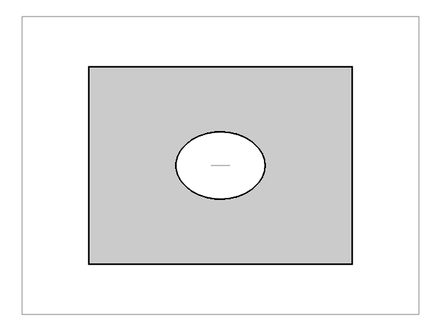
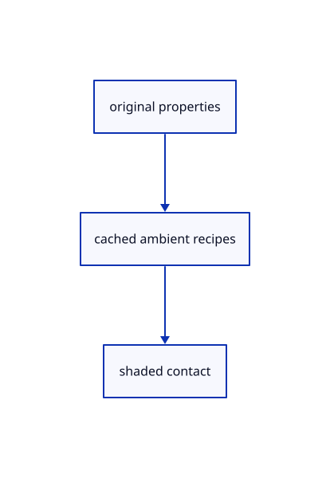

# 18.2.3 · Adapt the earlier forward camera

**Chapter 18 · Lighting, render quality and comparison · Section 18.2 · Contact and ambient light** · [Contents](contents.md)

**Typing: 7–14 minutes.** [Estimate](typing-load.md).

Adapt the earlier forward camera.

## Type

Continue from [Write current viewing rays](90a-copy-current-viewing-rays.md). [Save or recover your work](recovery.md).

### 1. `src/ambient_camera.rs`

Adapt the earlier camera to the maintained ambient convention.

<details>
<summary>Locate the existing block</summary>

```rust
pub fn pixel_rays(inverse: &[f32; 16], size: (u32, u32)) -> [f32; 24] {
    // world point at a pixel and depth, as the shader's `world`
    let world = |x: f64, y: f64, z: f64| -> [f64; 3] {
        let ndc = [
            x / f64::from(size.0) * 2.0 - 1.0,
            1.0 - y / f64::from(size.1) * 2.0,
            z,
            1.0,
        ];
        let p: [f64; 4] = std::array::from_fn(|row| {
            (0..4)
                .map(|col| f64::from(inverse[col * 4 + row]) * ndc[col])
                .sum()
        });
        [p[0] / p[3], p[1] / p[3], p[2] / p[3]]
    };
    let near = [
        world(0.0, 0.0, 1.0),
        world(1.0, 0.0, 1.0),
        world(0.0, 1.0, 1.0),
    ];
    let half = [
        world(0.0, 0.0, 0.5),
        world(1.0, 0.0, 0.5),
        world(0.0, 1.0, 0.5),
    ];
    let ray: [[f64; 3]; 3] =
        std::array::from_fn(|i| std::array::from_fn(|k| half[i][k] - near[i][k]));
    let mut out = [0.0; 24];
    for (i, base) in [near, ray].iter().enumerate() {
        for k in 0..3 {
            out[i * 12 + k] = base[0][k] as f32;
            out[i * 12 + 4 + k] = (base[1][k] - base[0][k]) as f32;
            out[i * 12 + 8 + k] = (base[2][k] - base[0][k]) as f32;
        }
    }
    out
}
```

</details>

After that block, type:

```rust
--8<-- "journey/code/90b-adapt-the-earlier-forward-camera-01.rs" skip=1245
```

## Run and check

Run this from `session_viewer` to select the fixed dependency versions and install supplied binary assets. It updates Cargo.lock and preserves the previous lock. It does not write implementation code:

```sh
npm --prefix ../session_tests run course -- dependencies 18.2.3
```

In your project:

```sh
cd workspace/journey
REGEN_PROTO=0 cargo build --lib --locked --target wasm32-unknown-unknown -j1
REGEN_PROTO=0 CARGO_BUILD_JOBS=1 trunk serve --port 8780
```

Open `http://127.0.0.1:8780/`. Keep an existing Trunk server running; saving rebuilds it.


### Recorded visual result

**Previous native render — current verification pending.**

The original section color is unchanged; supplied readback checks inspect all six actual depth/radius levels.



*This recorded image predates a source or checker change. Rebuild this checkpoint before using it as current evidence; browser controls require separate acceptance.*

This reference image is shared with [18.1.1 · Reduce depth and radius at a bounded display resolution](89-copy-density-scaled-depth-reduction.md). It does not demonstrate a new feature by itself.

<details>
<summary>Code explanation and diagram</summary>


original properties → cached ambient recipes → shaded contact.



Can reversed ambient recipes read forward hardware depth directly?

No. Flip the camera depth consistently, retain its inverse and derive the same reversed rays used by the shader.

Study estimate, including typing and experiments: 0.5–1 hours.

</details>

<details>
<summary>Optional experiment</summary>

Compare original camera coordinates with the320-byte ambient uniform and finite inverse guard.

</details>

<details>
<summary>Check and save your work</summary>

Restore experimental edits, then run from `session_viewer`:

```sh
npm --prefix ../session_tests run course -- check 18.2.3
npm --prefix ../session_tests run course -- save 18.2.3
```

Source comparison leaves your project untouched. [Save and recovery instructions](recovery.md).

</details>

<details>
<summary>Viewer coverage and verification</summary>


The supplied real-browser contract checks actual Arctic On/Off state, allocation and errors. It is syntaxchecked and requires an actual enabled browser. Software-GPU fixtures do not measure Lenovo navigation speed.

[Full validation scope](release.md).

To reproduce the scripted acceptance of the reference checkpoint, run from `session_viewer` with the [course bundle server](release.md#reproduce) running on port 8781:

```sh
npm --prefix ../session_tests run course -- capture 18.2.3
```

This uses the verified reference bundle; it does not check or change your typed project.

</details>
