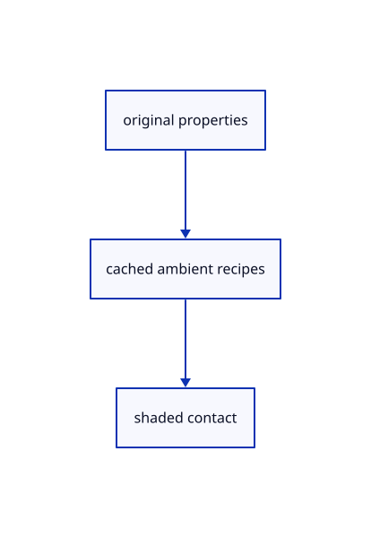

# 18.2.18 · Build the depth-equal original property pass

**Chapter 18 · Lighting, render quality and comparison · Section 18.2 · Contact and ambient light** · [Contents](contents.md)

**Typing: 20–40 minutes.** [Estimate](typing-load.md).

Build the depth-equal original property pass.

## Type

Continue from [Write original surface contact properties](90f-write-original-surface-contact-properties.md). [Save or recover your work](recovery.md).

### 1. `src/depth.rs`

Add an explicit depth-equal read-only property state.

<details>
<summary>Locate the existing block</summary>

```rust
        stencil: Default::default(), bias: Default::default() }
}
```

</details>

After that block, type:

```rust
--8<-- "journey/code/90g-build-the-depth-equal-original-property-pass-01.rs" skip=66
```

### 2. `src/ambient_source_pipeline.rs`

Build the compatible original property pass.

Create the file and type:

```rust
--8<-- "journey/code/90g-build-the-depth-equal-original-property-pass-02.rs"
```

### 3. `src/lib.rs`

Register the completed section component.

<details>
<summary>Locate the existing block</summary>

```rust

pub mod ambient_rows;
```

</details>

After that block, type:

```rust
--8<-- "journey/code/90g-build-the-depth-equal-original-property-pass-03.rs" skip=23
```

## Run and check

Run this from `session_viewer` to select the fixed dependency versions and install supplied binary assets. It updates Cargo.lock and preserves the previous lock. It does not write implementation code:

```sh
npm --prefix ../session_tests run course -- dependencies 18.2.18
```

In your project:

```sh
cd workspace/journey
REGEN_PROTO=0 cargo build --lib --locked --target wasm32-unknown-unknown -j1
REGEN_PROTO=0 CARGO_BUILD_JOBS=1 trunk serve --port 8780
```

Open `http://127.0.0.1:8780/`. Keep an existing Trunk server running; saving rebuilds it.


### Recorded visual result

**Previous native render — current verification pending.**

The original section color is unchanged; supplied readback checks inspect all six actual depth/radius levels.


*This recorded image predates a source or checker change. Rebuild this checkpoint before using it as current evidence; browser controls require separate acceptance.*

This reference image is shared with [18.1.1 · Reduce depth and radius at a bounded display resolution](89-copy-density-scaled-depth-reduction.md). It does not demonstrate a new feature by itself.

<details>
<summary>Code explanation and diagram</summary>


original properties → cached ambient recipes → shaded contact.



Should the property pass move the visible surface?

No. Require the existing opaque depth and disable writes. Its compatible source/model/clip/radius layouts fit four groups.

Study estimate, including typing and experiments: 0.5–1 hours.

</details>

<details>
<summary>Optional experiment</summary>

Inspect matching source vertex/normal streams and R32Float/RG8Unorm outputs.

</details>

<details>
<summary>Check and save your work</summary>

Restore experimental edits, then run from `session_viewer`:

```sh
npm --prefix ../session_tests run course -- check 18.2.18
npm --prefix ../session_tests run course -- save 18.2.18
```

Source comparison leaves your project untouched. [Save and recovery instructions](recovery.md).

</details>

<details>
<summary>Viewer coverage and verification</summary>


The supplied real-browser contract checks actual Arctic On/Off state, allocation and errors. It is syntaxchecked and requires an actual enabled browser. Software-GPU fixtures do not measure Lenovo navigation speed.

[Full validation scope](release.md).

To reproduce the scripted acceptance of the reference checkpoint, run from `session_viewer` with the [course bundle server](release.md#reproduce) running on port 8781:

```sh
npm --prefix ../session_tests run course -- capture 18.2.18
```

This uses the verified reference bundle; it does not check or change your typed project.

</details>
