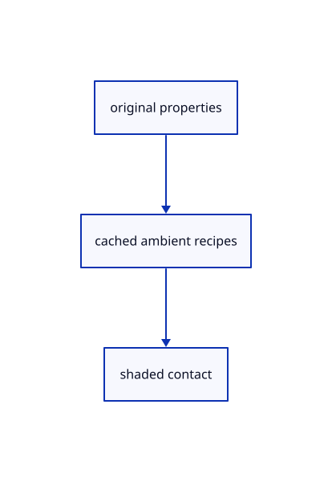

# 18.2.25 · Bind exact current ambient source images

**Chapter 18 · Lighting, render quality and comparison · Section 18.2 · Contact and ambient light** · [Contents](contents.md)

**Typing: 9–18 minutes.** [Estimate](typing-load.md).

Bind exact current ambient source images.

## Type

Continue from [Cache reduced levels and filtered samples](90m-cache-reduced-levels-and-filtered-samples.md). [Save or recover your work](recovery.md).

### 1. `src/ambient_groups.rs`

Bind exact current original inputs and camera resources.

<details>
<summary>Locate the existing block</summary>

```rust
  let buffers=std::array::from_fn(|_|device.create_buffer(&wgpu::BufferDescriptor{label:Some("ambient reserved single-sample work"),size:16,usage:wgpu::BufferUsages::STORAGE|wgpu::BufferUsages::COPY_DST,mapped_at_creation:false}));let mut entries=buffers.iter().enumerate().map(|(i,b)|wgpu::BindGroupEntry{binding:i as u32,resource:b.as_entire_binding()}).collect::<Vec<_>>();entries.push(wgpu::BindGroupEntry{binding:4,resource:wgpu::BindingResource::TextureView(&images.history.view)});entries.push(wgpu::BindGroupEntry{binding:5,resource:wgpu::BindingResource::TextureView(&images.history_depth.view)});let history=device.create_bind_group(&wgpu::BindGroupDescriptor{label:Some("ambient inactive single-sample history"),layout:&pipes.history,entries:&entries});Self{levels,occupancy,ground,ao,history,buffers}
 }

}
```

</details>

Edit the existing block to match this code; keep unchanged lines:

```rust
--8<-- "journey/code/90n-bind-exact-current-ambient-source-images-01.rs"
```

## Run and check

Run this from `session_viewer` to select the fixed dependency versions and install supplied binary assets. It updates Cargo.lock and preserves the previous lock. It does not write implementation code:

```sh
npm --prefix ../session_tests run course -- dependencies 18.2.25
```

In your project:

```sh
cd workspace/journey
REGEN_PROTO=0 cargo build --lib --locked --target wasm32-unknown-unknown -j1
REGEN_PROTO=0 CARGO_BUILD_JOBS=1 trunk serve --port 8780
```

Open `http://127.0.0.1:8780/`. Keep an existing Trunk server running; saving rebuilds it.


### Recorded visual result

**Previous native render — current verification pending.**

The original section color is unchanged; supplied readback checks inspect all six actual depth/radius levels.


*This recorded image predates a source or checker change. Rebuild this checkpoint before using it as current evidence; browser controls require separate acceptance.*

This reference image is shared with [18.1.1 · Reduce depth and radius at a bounded display resolution](89-copy-density-scaled-depth-reduction.md). It does not demonstrate a new feature by itself.

<details>
<summary>Code explanation and diagram</summary>


original properties → cached ambient recipes → shaded contact.



Can resizing keep the previous depth view?

No. Bind current original depth, property images, section data and the shared clipping uniform together.

Study estimate, including typing and experiments: 0.5–1 hours.

</details>

<details>
<summary>Optional experiment</summary>

Compare changed depth/section view identity and the stable320-byte camera buffer.

</details>

<details>
<summary>Check and save your work</summary>

Restore experimental edits, then run from `session_viewer`:

```sh
npm --prefix ../session_tests run course -- check 18.2.25
npm --prefix ../session_tests run course -- save 18.2.25
```

Source comparison leaves your project untouched. [Save and recovery instructions](recovery.md).

</details>

<details>
<summary>Viewer coverage and verification</summary>


The supplied real-browser contract checks actual Arctic On/Off state, allocation and errors. It is syntaxchecked and requires an actual enabled browser. Software-GPU fixtures do not measure Lenovo navigation speed.

[Full validation scope](release.md).

To reproduce the scripted acceptance of the reference checkpoint, run from `session_viewer` with the [course bundle server](release.md#reproduce) running on port 8781:

```sh
npm --prefix ../session_tests run course -- capture 18.2.25
```

This uses the verified reference bundle; it does not check or change your typed project.

</details>
