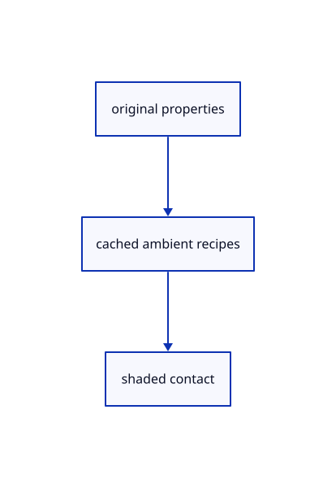

# 18.2.27 · Own cached ambient pipelines and release images

**Chapter 18 · Lighting, render quality and comparison · Section 18.2 · Contact and ambient light** · [Contents](contents.md)

**Typing: 11–22 minutes.** [Estimate](typing-load.md).

Own cached ambient pipelines and release images.

## Type

Continue from [Record explicit ambient passes](90o-record-explicit-ambient-passes.md). [Save or recover your work](recovery.md).

### 1. `src/ambient_gpu.rs`

Own lazy ambient state and cached pipelines.

Create the file and type:

```rust
--8<-- "journey/code/90p-own-cached-ambient-pipelines-and-release-images-01.rs"
```

### 2. `src/lib.rs`

Register the completed section component.

<details>
<summary>Locate the existing block</summary>

```rust

pub mod ambient_pass;
```

</details>

After that block, type:

```rust
--8<-- "journey/code/90p-own-cached-ambient-pipelines-and-release-images-02.rs" skip=23
```

## Run and check

Run this from `session_viewer` to select the fixed dependency versions and install supplied binary assets. It updates Cargo.lock and preserves the previous lock. It does not write implementation code:

```sh
npm --prefix ../session_tests run course -- dependencies 18.2.27
```

In your project:

```sh
cd workspace/journey
REGEN_PROTO=0 cargo build --lib --locked --target wasm32-unknown-unknown -j1
REGEN_PROTO=0 CARGO_BUILD_JOBS=1 trunk serve --port 8780
```

Open `http://127.0.0.1:8780/`. Keep an existing Trunk server running; saving rebuilds it.


### Recorded visual result

**Previous native render — current verification pending.**

The original section color is unchanged; supplied readback checks inspect all six actual depth/radius levels.


*This recorded image predates a source or checker change. Rebuild this checkpoint before using it as current evidence; browser controls require separate acceptance.*

This reference image is shared with [18.1.1 · Reduce depth and radius at a bounded display resolution](89-copy-density-scaled-depth-reduction.md). It does not demonstrate a new feature by itself.

<details>
<summary>Code explanation and diagram</summary>


original properties → cached ambient recipes → shaded contact.



Should Arctic Off discard compiled pipelines?

No. Release derived images and radius rows while retaining compiled pipelines and their320-byte camera buffer.

Study estimate, including typing and experiments: 0.5–1 hours.

</details>

<details>
<summary>Optional experiment</summary>

Compare disabled allocation with retained pipeline ownership and explicit cache reset.

</details>

<details>
<summary>Check and save your work</summary>

Restore experimental edits, then run from `session_viewer`:

```sh
npm --prefix ../session_tests run course -- check 18.2.27
npm --prefix ../session_tests run course -- save 18.2.27
```

Source comparison leaves your project untouched. [Save and recovery instructions](recovery.md).

</details>

<details>
<summary>Viewer coverage and verification</summary>


The supplied real-browser contract checks actual Arctic On/Off state, allocation and errors. It is syntaxchecked and requires an actual enabled browser. Software-GPU fixtures do not measure Lenovo navigation speed.

[Full validation scope](release.md).

To reproduce the scripted acceptance of the reference checkpoint, run from `session_viewer` with the [course bundle server](release.md#reproduce) running on port 8781:

```sh
npm --prefix ../session_tests run course -- capture 18.2.27
```

This uses the verified reference bundle; it does not check or change your typed project.

</details>
