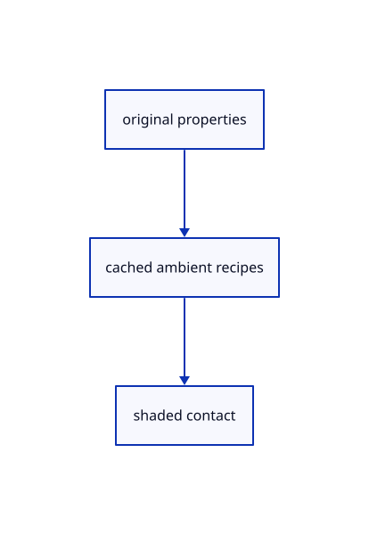

# 18.2.28 · Prepare changed ambient framebuffer inputs

**Chapter 18 · Lighting, render quality and comparison · Section 18.2 · Contact and ambient light** · [Contents](contents.md)

**Typing: 9–18 minutes.** [Estimate](typing-load.md).

Prepare changed ambient framebuffer inputs.

## Type

Continue from [Own cached ambient pipelines and release images](90p-own-cached-ambient-pipelines-and-release-images.md). [Save or recover your work](recovery.md).

### 1. `src/ambient_gpu.rs`

Prepare exact current ambient images and source bindings.

<details>
<summary>Locate the existing block</summary>

```rust
 pub fn new(device:&wgpu::Device,format:wgpu::TextureFormat)->Self{Self{pipes:crate::ambient_pipeline::Pipelines::new(device,format),sources:crate::ambient_source_gpu::Sources::new(device),frame:device.create_buffer(&wgpu::BufferDescriptor{label:Some("current ambient camera"),size:320,usage:wgpu::BufferUsages::UNIFORM|wgpu::BufferUsages::COPY_DST,mapped_at_creation:false}),state:None,cached:None,preparations:0,writes:0,passes:0,error:None}}
 pub fn clear(&mut self,device:&wgpu::Device,queue:&wgpu::Queue){self.state=None;self.cached=None;self.sources.set(device,queue,&[]);self.error=None;}
```

</details>

Edit the existing block to match this code; keep unchanged lines:

```rust
--8<-- "journey/code/90q-prepare-changed-ambient-framebuffer-inputs-01.rs"
```

## Run and check

Run this from `session_viewer` to select the fixed dependency versions and install supplied binary assets. It updates Cargo.lock and preserves the previous lock. It does not write implementation code:

```sh
npm --prefix ../session_tests run course -- dependencies 18.2.28
```

In your project:

```sh
cd workspace/journey
REGEN_PROTO=0 cargo build --lib --locked --target wasm32-unknown-unknown -j1
REGEN_PROTO=0 CARGO_BUILD_JOBS=1 trunk serve --port 8780
```

Open `http://127.0.0.1:8780/`. Keep an existing Trunk server running; saving rebuilds it.


### Recorded visual result

**Previous native render — current verification pending.**

The original section color is unchanged; supplied readback checks inspect all six actual depth/radius levels.


*This recorded image predates a source or checker change. Rebuild this checkpoint before using it as current evidence; browser controls require separate acceptance.*

This reference image is shared with [18.1.1 · Reduce depth and radius at a bounded display resolution](89-copy-density-scaled-depth-reduction.md). It does not demonstrate a new feature by itself.

<details>
<summary>Code explanation and diagram</summary>


original properties → cached ambient recipes → shaded contact.



Does a density change always need new images?

Reallocate only when the maintained reduced size or full framebuffer changes. A new depth/section view invalidates cached input bindings.

Study estimate, including typing and experiments: 0.5–1 hours.

</details>

<details>
<summary>Optional experiment</summary>

Compare physical and reduced extents, input-view witnesses and actual preparation counts.

</details>

<details>
<summary>Check and save your work</summary>

Restore experimental edits, then run from `session_viewer`:

```sh
npm --prefix ../session_tests run course -- check 18.2.28
npm --prefix ../session_tests run course -- save 18.2.28
```

Source comparison leaves your project untouched. [Save and recovery instructions](recovery.md).

</details>

<details>
<summary>Viewer coverage and verification</summary>


The supplied real-browser contract checks actual Arctic On/Off state, allocation and errors. It is syntaxchecked and requires an actual enabled browser. Software-GPU fixtures do not measure Lenovo navigation speed.

[Full validation scope](release.md).

To reproduce the scripted acceptance of the reference checkpoint, run from `session_viewer` with the [course bundle server](release.md#reproduce) running on port 8781:

```sh
npm --prefix ../session_tests run course -- capture 18.2.28
```

This uses the verified reference bundle; it does not check or change your typed project.

</details>
