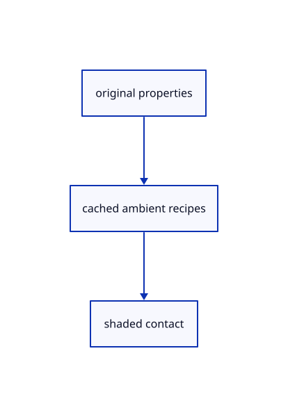

# 18.2.33 · Exercise actual contacts cache and source ownership

**Chapter 18 · Lighting, render quality and comparison · Section 18.2 · Contact and ambient light** · [Contents](contents.md)

**Typing: 0–0 minutes.** [Estimate](typing-load.md).

Exercise actual contacts cache and source ownership.

## Type

Continue from [Enable Arctic as a presentation change](90u-enable-arctic-as-a-presentation-change.md). [Save or recover your work](recovery.md).

<details>
<summary>Supplied validation fixture</summary>

Copy this supplied authoring fixture once. Continue with the browser build below; the course does not require running native tests.

### 1. `src/ambient_gpu_tests.rs`

Copy supplied actual contact/frame/cache/release fixtures.

Copy this supplied file:

```text
--8<-- "journey/code/90v-exercise-actual-contacts-cache-and-source-ownership-01.rs"
```

</details>

<details>
<summary>Supplied validation fixture</summary>

Copy this supplied authoring fixture once. Continue with the browser build below; the course does not require running native tests.

### 2. `src/renderer.rs`

Register actual renderer-local ambient fixtures.

<details>
<summary>Locate the existing block</summary>

```text
#[path="pyramid_gpu_tests.rs"]
mod pyramid_gpu_tests;
```

</details>

After that block, append this supplied code:

```text
--8<-- "journey/code/90v-exercise-actual-contacts-cache-and-source-ownership-02.rs" skip=54
```

</details>

<details>
<summary>Supplied validation fixture</summary>

Copy this supplied authoring fixture once. Continue with the browser build below; the course does not require running native tests.

### 3. `src/arctic_tests.rs`

Copy supplied current presentation and original-history fixtures.

Copy this supplied file:

```text
--8<-- "journey/code/90v-exercise-actual-contacts-cache-and-source-ownership-03.rs"
```

</details>

<details>
<summary>Supplied validation fixture</summary>

Copy this supplied authoring fixture once. Continue with the browser build below; the course does not require running native tests.

### 4. `src/lib.rs`

Register the completed section component.

<details>
<summary>Locate the existing block</summary>

```text

pub mod ambient_gpu;
```

</details>

After that block, append this supplied code:

```text
--8<-- "journey/code/90v-exercise-actual-contacts-cache-and-source-ownership-04.rs" skip=22
```

</details>

## Run and check

Run this from `session_viewer` to select the fixed dependency versions and install supplied binary assets. It updates Cargo.lock and preserves the previous lock. It does not write implementation code:

```sh
npm --prefix ../session_tests run course -- dependencies 18.2.33
```

In your project:

```sh
cd workspace/journey
REGEN_PROTO=0 cargo build --lib --locked --target wasm32-unknown-unknown -j1
REGEN_PROTO=0 CARGO_BUILD_JOBS=1 trunk serve --port 8780
```

Open `http://127.0.0.1:8780/`. Keep an existing Trunk server running; saving rebuilds it.

The original solid casts soft contact shading on the virtual ground while its source and black ink remain unchanged.

### Recorded visual result

**Previous native render — current verification pending.**

Actual isometric original geometry and contact shading are rendered in one completed frame.


*This recorded image predates a source or checker change. Rebuild this checkpoint before using it as current evidence; browser controls require separate acceptance.*

<details>
<summary>Code explanation and diagram</summary>


original properties → cached ambient recipes → shaded contact.



What proves the contact chapter works?

Compare rendered isometric contact pixels and virtual-ground shadows, then check complete first/resting frames, pipeline reuse, release and unchanged originals.

Study estimate, including typing and experiments: 0.5–1 hours.

</details>

<details>
<summary>Optional experiment</summary>

Show Example CAD, use View Isometric and Fit, then compare Arctic On and Off. Orbit to inspect the virtual ground shadow. Start a Line with one point, toggle Arctic and confirm the draft survives before cancelling it. Exact contact pixels and cache counters are separate supplied validation.

</details>

<details>
<summary>Check and save your work</summary>

Restore experimental edits, then run from `session_viewer`:

```sh
npm --prefix ../session_tests run course -- check 18.2.33
npm --prefix ../session_tests run course -- save 18.2.33
```

Source comparison leaves your project untouched. [Save and recovery instructions](recovery.md).

</details>

<details>
<summary>Viewer coverage and verification</summary>

Retain maintained original bounds radius, pixel rays, GTAO horizons, ground contacts, bilateral filters and upsampling. Adapt the earlier forward depth through an explicit original-normal/radius prepass. Temporal history stays inactive here; full primitive/MRT/packed-arena/MSAA geometry integration follows94–95. Arctic global outlines follow91.

Retain earlier checks. Supplied GPU checks compare actual contact pixels, complete first/resting frames, geometry uploads, pipeline reuse and released images. Presentation checks retain exact originals, annotations, pending points, command capture and Redo.

The supplied real-browser contract checks actual Arctic On/Off state, allocation and errors. It is syntaxchecked and requires an actual enabled browser. Software-GPU fixtures do not measure Lenovo navigation speed.

[Full validation scope](release.md).

To reproduce the scripted acceptance of the reference checkpoint, run from `session_viewer` with the [course bundle server](release.md#reproduce) running on port 8781:

```sh
npm --prefix ../session_tests run course -- capture 18.2.33
```

This uses the verified reference bundle; it does not check or change your typed project.

</details>
