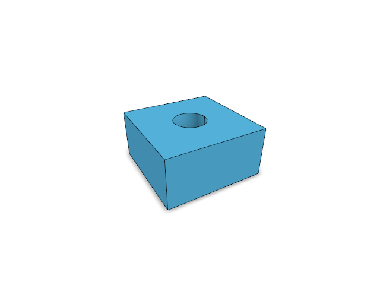
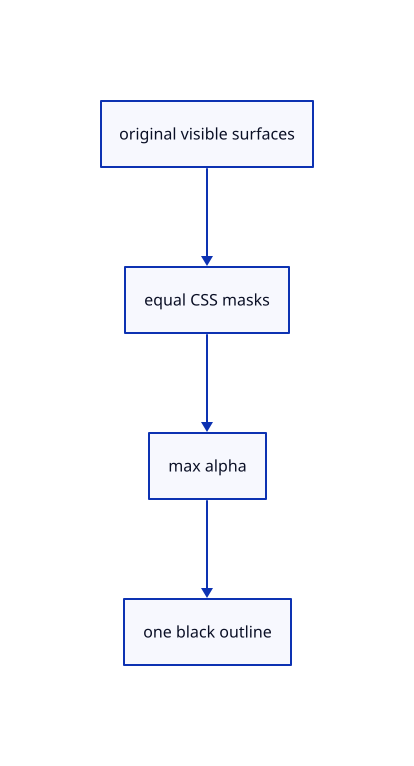

# 18.3.1 · Include visible section coverage

**Chapter 18 · Lighting, render quality and comparison · Section 18.3 · Section coverage and Wood builders** · [Contents](contents.md)

**Typing: 7–13 minutes.** [Estimate](typing-load.md).

Include visible section coverage.

## Type

Continue from [Exercise actual contacts cache and source ownership](90v-exercise-actual-contacts-cache-and-source-ownership.md). [Save or recover your work](recovery.md).

### 1. `src/outline_caps.wgsl`

Add exact visible section coverage without source mutation.

Create the file and type:

```wgsl
--8<-- "journey/code/91-include-visible-section-coverage-01.rs"
```

## Run and check

Run this from `session_viewer` to select the fixed dependency versions and install supplied binary assets. It updates Cargo.lock and preserves the previous lock. It does not write implementation code:

```sh
npm --prefix ../session_tests run course -- dependencies 18.3.1
```

In your project:

```sh
cd workspace/journey
REGEN_PROTO=0 cargo build --lib --locked --target wasm32-unknown-unknown -j1
REGEN_PROTO=0 CARGO_BUILD_JOBS=1 trunk serve --port 8780
```

Open `http://127.0.0.1:8780/`. Keep an existing Trunk server running; saving rebuilds it.


### Recorded visual result

**Previous native render — current verification pending.**

Actual isometric original geometry and contact shading are rendered in one completed frame.



*This recorded image predates a source or checker change. Rebuild this checkpoint before using it as current evidence; browser controls require separate acceptance.*

<details>
<summary>Code explanation and diagram</summary>


original visible surfaces → equal CSS masks → max alpha → one black outline.



Can a section outline invent a new original face?

No. Read the visible cap depth and original selection marker. Reject absent or nonselected caps before adding coverage.

Study estimate, including typing and experiments: 0.5–1 hours.

</details>

<details>
<summary>Optional experiment</summary>

Compare all-solid and selected-only cap pixels, saved forward depth and the one-pixel inactive section image.

</details>

<details>
<summary>Check and save your work</summary>

Restore experimental edits, then run from `session_viewer`:

```sh
npm --prefix ../session_tests run course -- check 18.3.1
npm --prefix ../session_tests run course -- save 18.3.1
```

Source comparison leaves your project untouched. [Save and recovery instructions](recovery.md).

</details>

<details>
<summary>Viewer coverage and verification</summary>


The supplied browser contract checks View Outline and Arctic activation, explicit Off, hidden/empty release and unchanged command behavior. It is syntaxchecked and requires an actual enabled browser; software-GPU results do not measure Lenovo performance.

[Full validation scope](release.md).

To reproduce the scripted acceptance of the reference checkpoint, run from `session_viewer` with the [course bundle server](release.md#reproduce) running on port 8781:

```sh
npm --prefix ../session_tests run course -- capture 18.3.1
```

This uses the verified reference bundle; it does not check or change your typed project.

</details>
