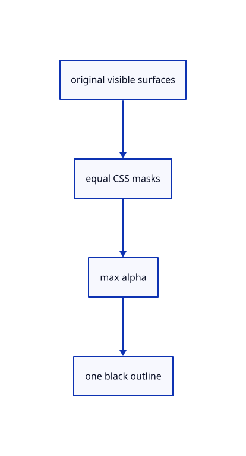

# 18.3.4 · Cache one black outline composite

**Chapter 18 · Lighting, render quality and comparison · Section 18.3 · Section coverage and Wood builders** · [Contents](contents.md)

**Typing: 26–51 minutes.** [Estimate](typing-load.md).

Cache one black outline composite.

## Type

Continue from [Combine outline alpha once](91b-combine-outline-alpha-once.md). [Save or recover your work](recovery.md).

### 1. `src/outline_composite.rs`

Own one compatible cached outline composition.

Create the file and type:

```rust
--8<-- "journey/code/91c-cache-one-black-outline-composite-01.rs"
```

### 2. `src/lib.rs`

Register the completed outline component.

<details>
<summary>Locate the existing block</summary>

```rust

pub mod outline_caps;
```

</details>

After that block, type:

```rust
--8<-- "journey/code/91c-cache-one-black-outline-composite-02.rs" skip=23
```

## Run and check

Run this from `session_viewer` to select the fixed dependency versions and install supplied binary assets. It updates Cargo.lock and preserves the previous lock. It does not write implementation code:

```sh
npm --prefix ../session_tests run course -- dependencies 18.3.4
```

In your project:

```sh
cd workspace/journey
REGEN_PROTO=0 cargo build --lib --locked --target wasm32-unknown-unknown -j1
REGEN_PROTO=0 CARGO_BUILD_JOBS=1 trunk serve --port 8780
```

Open `http://127.0.0.1:8780/`. Keep an existing Trunk server running; saving rebuilds it.


### Recorded visual result

**Previous native render — current verification pending.**

Actual isometric original geometry and contact shading are rendered in one completed frame.


*This recorded image predates a source or checker change. Rebuild this checkpoint before using it as current evidence; browser controls require separate acceptance.*

This reference image is shared with [18.3.1 · Include visible section coverage](91-include-visible-section-coverage.md). It does not demonstrate a new feature by itself.

<details>
<summary>Code explanation and diagram</summary>


original visible surfaces → equal CSS masks → max alpha → one black outline.



Must the compositor keep obsolete resized images?

No. Replace its bindings when either alpha view changes; release it with global outline ownership.

Study estimate, including typing and experiments: 0.5–1 hours.

</details>

<details>
<summary>Optional experiment</summary>

Trace two exact input views, one alpha blend and physical resource lifetime.

</details>

<details>
<summary>Check and save your work</summary>

Restore experimental edits, then run from `session_viewer`:

```sh
npm --prefix ../session_tests run course -- check 18.3.4
npm --prefix ../session_tests run course -- save 18.3.4
```

Source comparison leaves your project untouched. [Save and recovery instructions](recovery.md).

</details>

<details>
<summary>Viewer coverage and verification</summary>


The supplied browser contract checks View Outline and Arctic activation, explicit Off, hidden/empty release and unchanged command behavior. It is syntaxchecked and requires an actual enabled browser; software-GPU results do not measure Lenovo performance.

[Full validation scope](release.md).

To reproduce the scripted acceptance of the reference checkpoint, run from `session_viewer` with the [course bundle server](release.md#reproduce) running on port 8781:

```sh
npm --prefix ../session_tests run course -- capture 18.3.4
```

This uses the verified reference bundle; it does not check or change your typed project.

</details>
