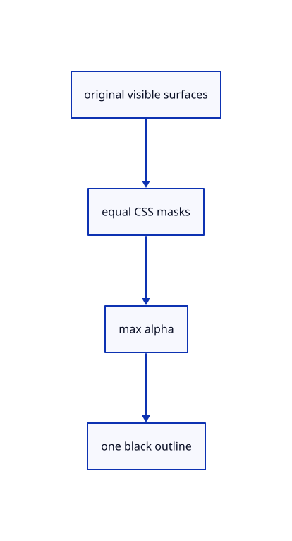

# 18.3.8 · Draw all-solid and selected coverage consistently

**Chapter 18 · Lighting, render quality and comparison · Section 18.3 · Section coverage and Wood builders** · [Contents](contents.md)

**Typing: 17–34 minutes.** [Estimate](typing-load.md).

Draw all-solid and selected coverage consistently.

## Type

Continue from [Own independent global outline resources](91f-own-independent-global-outline-resources.md). [Save or recover your work](recovery.md).

### 1. `src/renderer.rs`

Route visible original and cap masks into one black outline pass.

<details>
<summary>Locate the existing block</summary>

```rust
        {let mut pass=encoder.begin_render_pass(&wgpu::RenderPassDescriptor{label:Some("measurement overlay"),color_attachments:&[Some(wgpu::RenderPassColorAttachment{view,depth_slice:None,resolve_target:None,ops:wgpu::Operations{load:wgpu::LoadOp::Load,store:wgpu::StoreOp::Store}})],depth_stencil_attachment:Some(wgpu::RenderPassDepthStencilAttachment{view:&self.depth,depth_ops:Some(wgpu::Operations{load:wgpu::LoadOp::Load,store:wgpu::StoreOp::Store}),stencil_ops:None}),timestamp_writes:None,occlusion_query_set:None,multiview_mask:None});self.measurement.draw(&mut pass);self.guides.draw(&mut pass);}
        if self.meshes.iter().any(GpuMesh::selected) {
            let mut outline=self.outline.borrow_mut();let outline=outline.get_or_insert_with(||crate::outline_gpu::Outline::new(&self.text_context(),self.format));outline.encode(&self.text_context(),&mut encoder,view,&self.depth,&self.view_group,&self.meshes,*transform,self.size,self.density,&clip_group,clip_revision);
        } else {self.outline.borrow_mut().take();}
        self.widget.draw(&mut encoder,view);
        self.text_error.borrow_mut().take();
```

</details>

Edit the existing block to match this code; keep unchanged lines:

```rust
--8<-- "journey/code/91g-draw-all-solid-and-selected-coverage-consistently-01.rs"
```

## Run and check

Run this from `session_viewer` to select the fixed dependency versions and install supplied binary assets. It updates Cargo.lock and preserves the previous lock. It does not write implementation code:

```sh
npm --prefix ../session_tests run course -- dependencies 18.3.8
```

In your project:

```sh
cd workspace/journey
REGEN_PROTO=0 cargo build --lib --locked --target wasm32-unknown-unknown -j1
REGEN_PROTO=0 CARGO_BUILD_JOBS=1 trunk serve --port 8780
```

Open `http://127.0.0.1:8780/`. Keep an existing Trunk server running; saving rebuilds it.


### Recorded visual result

**Previous native render — current verification pending.**

Actual isometric original geometry and contact shading are rendered in one completed frame.


*This recorded image predates a source or checker change. Rebuild this checkpoint before using it as current evidence; browser controls require separate acceptance.*

This reference image is shared with [18.3.1 · Include visible section coverage](91-include-visible-section-coverage.md). It does not demonstrate a new feature by itself.

<details>
<summary>Code explanation and diagram</summary>


original visible surfaces → equal CSS masks → max alpha → one black outline.



Can highlighting narrow a curved silhouette?

No. Source ink and selection stay separate. Both scopes use the maintained CSS radius, and their completed alpha images feed one black blend.

Study estimate, including typing and experiments: 0.5–1 hours.

</details>

<details>
<summary>Optional experiment</summary>

Enable global outlines on a cylinder, select it and compare the same outer boundary at two densities.

</details>

<details>
<summary>Check and save your work</summary>

Restore experimental edits, then run from `session_viewer`:

```sh
npm --prefix ../session_tests run course -- check 18.3.8
npm --prefix ../session_tests run course -- save 18.3.8
```

Source comparison leaves your project untouched. [Save and recovery instructions](recovery.md).

</details>

<details>
<summary>Viewer coverage and verification</summary>


The supplied browser contract checks View Outline and Arctic activation, explicit Off, hidden/empty release and unchanged command behavior. It is syntaxchecked and requires an actual enabled browser; software-GPU results do not measure Lenovo performance.

[Full validation scope](release.md).

To reproduce the scripted acceptance of the reference checkpoint, run from `session_viewer` with the [course bundle server](release.md#reproduce) running on port 8781:

```sh
npm --prefix ../session_tests run course -- capture 18.3.8
```

This uses the verified reference bundle; it does not check or change your typed project.

</details>
