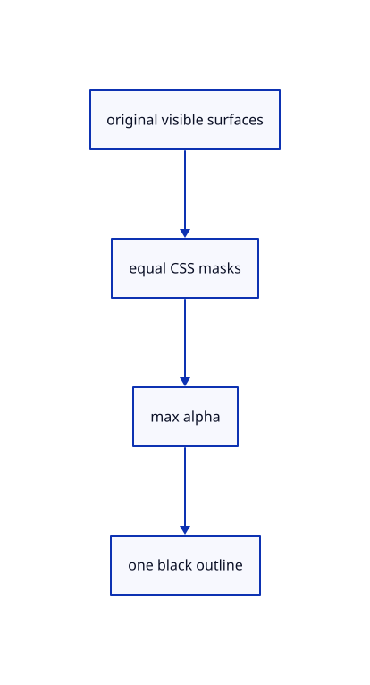

# 18.3.10 · Prove actual outlines and original ownership

**Chapter 18 · Lighting, render quality and comparison · Section 18.3 · Section coverage and Wood builders** · [Contents](contents.md)

**Typing: 0–0 minutes.** [Estimate](typing-load.md).

Prove actual outlines and original ownership.

## Type

Continue from [Connect Outline and Arctic presentation commands](91h-connect-outline-and-arctic-presentation-commands.md). [Save or recover your work](recovery.md).

<details>
<summary>Supplied validation fixture</summary>

Copy this supplied authoring fixture once. Continue with the browser build below; the course does not require running native tests.

### 1. `src/global_outline_tests.rs`

Copy supplied actual outline width, cap, cache and original-owner fixtures.

Copy this supplied file:

```text
--8<-- "journey/code/91i-prove-actual-outlines-and-original-ownership-01.rs"
```

</details>

<details>
<summary>Supplied validation fixture</summary>

Copy this supplied authoring fixture once. Continue with the browser build below; the course does not require running native tests.

### 2. `src/renderer.rs`

Register actual renderer-local outline fixtures.

<details>
<summary>Locate the existing block</summary>

```text
#[path="ambient_gpu_tests.rs"]
mod ambient_gpu_tests;
```

</details>

After that block, append this supplied code:

```text
--8<-- "journey/code/91i-prove-actual-outlines-and-original-ownership-02.rs" skip=54
```

</details>

<details>
<summary>Supplied validation fixture</summary>

Copy this supplied authoring fixture once. Continue with the browser build below; the course does not require running native tests.

### 3. `src/global_outline_command_tests.rs`

Copy supplied strict presentation/history/original fixtures.

Copy this supplied file:

```text
--8<-- "journey/code/91i-prove-actual-outlines-and-original-ownership-03.rs"
```

</details>

<details>
<summary>Supplied validation fixture</summary>

Copy this supplied authoring fixture once. Continue with the browser build below; the course does not require running native tests.

### 4. `src/lib.rs`

Register the completed outline component.

<details>
<summary>Locate the existing block</summary>

```text

pub mod outline_composite;
```

</details>

After that block, append this supplied code:

```text
--8<-- "journey/code/91i-prove-actual-outlines-and-original-ownership-04.rs" skip=28
```

</details>

## Run and check

Run this from `session_viewer` to select the fixed dependency versions and install supplied binary assets. It updates Cargo.lock and preserves the previous lock. It does not write implementation code:

```sh
npm --prefix ../session_tests run course -- dependencies 18.3.10
```

In your project:

```sh
cd workspace/journey
REGEN_PROTO=0 cargo build --lib --locked --target wasm32-unknown-unknown -j1
REGEN_PROTO=0 CARGO_BUILD_JOBS=1 trunk serve --port 8780
```

Open `http://127.0.0.1:8780/`. Keep an existing Trunk server running; saving rebuilds it.

The original curved pedestal has a continuous black silhouette with one consistent CSS width.

### Recorded visual result

**Previous native render — current verification pending.**

Actual original curved and flat surfaces use the same black outline width.


*This recorded image predates a source or checker change. Rebuild this checkpoint before using it as current evidence; browser controls require separate acceptance.*

<details>
<summary>Code explanation and diagram</summary>


original visible surfaces → equal CSS masks → max alpha → one black outline.



What verifies consistent curved-surface outlines?

Actual alpha and color pixels, original integer picks and source equality. Verify two densities, visible caps, one-blend overlap, cache reuse and resource release.

Study estimate, including typing and experiments: 0.5–1 hours.

</details>

<details>
<summary>Optional experiment</summary>

Fit Example CAD and compare View Outline On and Off while orbiting its curved silhouette. Select an original and clear selection to compare its boundary with the global outline. The supplied two-density masks and cap cases document numerical coverage beyond this browser inspection.

</details>

<details>
<summary>Check and save your work</summary>

Restore experimental edits, then run from `session_viewer`:

```sh
npm --prefix ../session_tests run course -- check 18.3.10
npm --prefix ../session_tests run course -- save 18.3.10
```

Source comparison leaves your project untouched. [Save and recovery instructions](recovery.md).

</details>

<details>
<summary>Viewer coverage and verification</summary>

Keep the current1.6875 CSS-pixel radius, pooled coverage and sorted alpha search. Global and selected originals use independent masks; combine their maximum alpha in one black blend. Visible section pixels join coverage using their original selection marker and saved depth. Full primitive/MRT/MSAA integration follows94; originals and integer pick ownership remain independent.

Retain earlier checks. Supplied GPU fixtures inspect actual curved/flat CSS width at two densities, equal selected/global masks, one-blend boundary pixels, visible caps, changed clipping, original pick IDs, cache reuse and hidden/locked/empty release. Presentation fixtures preserve pending points, originals, epoch and Redo.

The supplied browser contract checks View Outline and Arctic activation, explicit Off, hidden/empty release and unchanged command behavior. It is syntaxchecked and requires an actual enabled browser; software-GPU results do not measure Lenovo performance.

[Full validation scope](release.md).

To reproduce the scripted acceptance of the reference checkpoint, run from `session_viewer` with the [course bundle server](release.md#reproduce) running on port 8781:

```sh
npm --prefix ../session_tests run course -- capture 18.3.10
```

This uses the verified reference bundle; it does not check or change your typed project.

</details>
