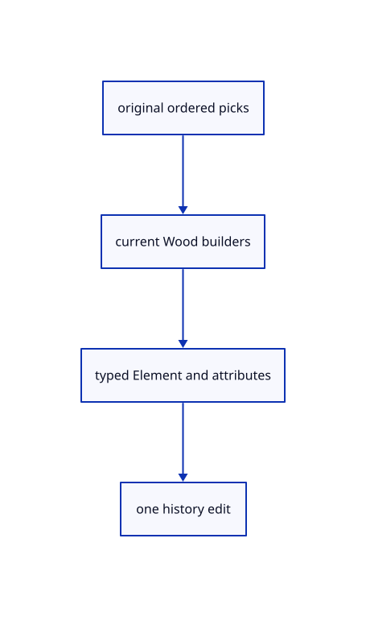

# 18.4.1 · Link current Wood element builders

**Chapter 18 · Lighting, render quality and comparison · Section 18.4 · Wood Elements and archives** · [Contents](contents.md)

**Typing: 1–1 minutes.** [Estimate](typing-load.md).

Link current Wood element builders.

## Type

Continue from [Prove actual outlines and original ownership](91i-prove-actual-outlines-and-original-ownership.md). [Save or recover your work](recovery.md).

### 1. `Cargo.toml`

Link current Wood element builders beside the original kernel.

<details>
<summary>Locate the existing block</summary>

```toml

[dependencies]
wasm-bindgen = "=0.2.128"
web-sys = { version = "=0.3.105", features = ["console", "Window", "Document", "Element", "HtmlCanvasElement", "EventTarget", "AddEventListenerOptions", "PageTransitionEvent", "ErrorEvent", "PromiseRejectionEvent", "Location", "History", "UrlSearchParams", "Navigator", "Storage", "Performance", "PerformanceResourceTiming", "PerformanceEntry", "Event", "MouseEvent", "PointerEvent", "DomRect", "KeyboardEvent", "WheelEvent", "AddEventListenerOptions", "HtmlElement", "HtmlInputElement", "File", "FileList", "Blob", "ReadableWritablePair", "CustomEvent", "CustomEventInit", "FocusOptions", "Url", "HtmlAnchorElement", "AbortController", "AbortSignal", "RequestInit", "RequestMode", "RequestCache", "EventSource", "MessageEvent", "Response", "Headers", "ReadableStream", "ReadableStreamDefaultReader"] }
```

</details>

Edit the existing block to match this code; keep unchanged lines:

```toml
--8<-- "journey/code/92-link-current-wood-element-builders-01-console.rs"
```

## Run and check

Run this from `session_viewer` to select the fixed dependency versions and install supplied binary assets. It updates Cargo.lock and preserves the previous lock. It does not write implementation code:

```sh
npm --prefix ../session_tests run course -- dependencies 18.4.1
```

In your project:

```sh
cd workspace/journey
REGEN_PROTO=0 cargo build --lib --locked --target wasm32-unknown-unknown -j1
REGEN_PROTO=0 CARGO_BUILD_JOBS=1 trunk serve --port 8780
```

Open `http://127.0.0.1:8780/`. Keep an existing Trunk server running; saving rebuilds it.


### Recorded visual result

**Previous native render — current verification pending.**

Actual original curved and flat surfaces use the same black outline width.


*This recorded image predates a source or checker change. Rebuild this checkpoint before using it as current evidence; browser controls require separate acceptance.*

This reference image is shared with [18.3.10 · Prove actual outlines and original ownership](91i-prove-actual-outlines-and-original-ownership.md). It does not demonstrate a new feature by itself.

<details>
<summary>Code explanation and diagram</summary>


original ordered picks → current Wood builders → typed Element and attributes → one history edit.



Should the viewer invent a second beam solid builder?

No. Link the maintained Wood crate beside Session. Keep its shared kernel and the supplied dependency lock.

Study estimate, including typing and experiments: 0.5–1 hours.

</details>

<details>
<summary>Optional experiment</summary>

Inspect the relative path from the reconstructed lesson and the unchanged dependency versions.

</details>

<details>
<summary>Check and save your work</summary>

Restore experimental edits, then run from `session_viewer`:

```sh
npm --prefix ../session_tests run course -- check 18.4.1
npm --prefix ../session_tests run course -- save 18.4.1
```

Source comparison leaves your project untouched. [Save and recovery instructions](recovery.md).

</details>

<details>
<summary>Viewer coverage and verification</summary>


The supplied browser contract uses the command dock to create a beam from original lines, adjust named values, show features, measure bounds and Undo/Redo. It is syntaxchecked and requires an actual enabled browser. Native fixtures do not constitute browser acceptance.

[Full validation scope](release.md).

To reproduce the scripted acceptance of the reference checkpoint, run from `session_viewer` with the [course bundle server](release.md#reproduce) running on port 8781:

```sh
npm --prefix ../session_tests run course -- capture 18.4.1
```

This uses the verified reference bundle; it does not check or change your typed project.

</details>
