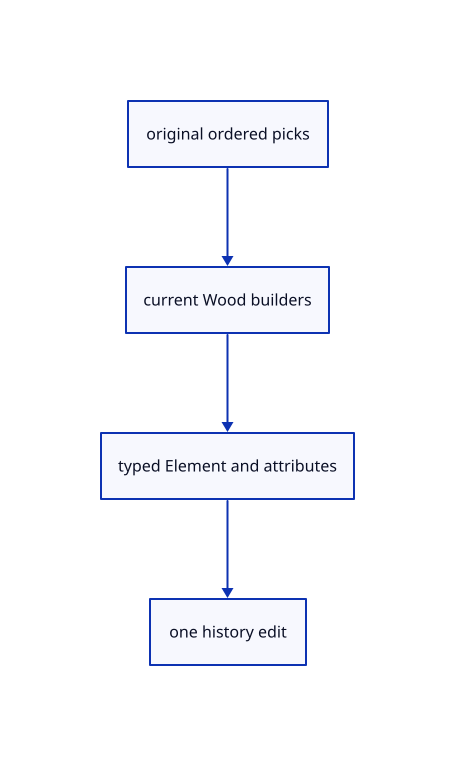

# 18.4.6 · Build typed Elements from ordered world picks

**Chapter 18 · Lighting, render quality and comparison · Section 18.4 · Wood Elements and archives** · [Contents](contents.md)

**Typing: 15–30 minutes.** [Estimate](typing-load.md).

Build typed Elements from ordered world picks.

## Type

Continue from [Read current Element command defaults](92c-read-current-element-command-defaults.md). [Save or recover your work](recovery.md).

### 1. `src/element_input.rs`

Route ordered original sources into current Wood builders and base planes.

<details>
<summary>Locate the existing block</summary>

```rust
#[derive(Clone,Copy,Debug,PartialEq)]
pub struct Param{pub name:&'static str,pub value:f64}
```

</details>

After that block, type:

```rust
--8<-- "journey/code/92d-build-typed-elements-from-ordered-world-picks-01.rs" skip=92
```

## Run and check

Run this from `session_viewer` to select the fixed dependency versions and install supplied binary assets. It updates Cargo.lock and preserves the previous lock. It does not write implementation code:

```sh
npm --prefix ../session_tests run course -- dependencies 18.4.6
```

In your project:

```sh
cd workspace/journey
REGEN_PROTO=0 cargo build --lib --locked --target wasm32-unknown-unknown -j1
REGEN_PROTO=0 CARGO_BUILD_JOBS=1 trunk serve --port 8780
```

Open `http://127.0.0.1:8780/`. Keep an existing Trunk server running; saving rebuilds it.


### Recorded visual result

**Previous native render — current verification pending.**

Actual original curved and flat surfaces use the same black outline width.


*This recorded image predates a source or checker change. Rebuild this checkpoint before using it as current evidence; browser controls require separate acceptance.*

This reference image is shared with [18.3.10 · Prove actual outlines and original ownership](91i-prove-actual-outlines-and-original-ownership.md). It does not demonstrate a new feature by itself.

<details>
<summary>Code explanation and diagram</summary>


original ordered picks → current Wood builders → typed Element and attributes → one history edit.



Can original curve placement be ignored?

No. Transform each original into world space in pick order before calling the current builder. Retain closed-loop filtering and the typed Element payload.

Study estimate, including typing and experiments: 0.5–1 hours.

</details>

<details>
<summary>Optional experiment</summary>

Compare a translated beam axis, variable-beam stations, paired block holes and a point support.

</details>

<details>
<summary>Check and save your work</summary>

Restore experimental edits, then run from `session_viewer`:

```sh
npm --prefix ../session_tests run course -- check 18.4.6
npm --prefix ../session_tests run course -- save 18.4.6
```

Source comparison leaves your project untouched. [Save and recovery instructions](recovery.md).

</details>

<details>
<summary>Viewer coverage and verification</summary>


The supplied browser contract uses the command dock to create a beam from original lines, adjust named values, show features, measure bounds and Undo/Redo. It is syntaxchecked and requires an actual enabled browser. Native fixtures do not constitute browser acceptance.

[Full validation scope](release.md).

To reproduce the scripted acceptance of the reference checkpoint, run from `session_viewer` with the [course bundle server](release.md#reproduce) running on port 8781:

```sh
npm --prefix ../session_tests run course -- capture 18.4.6
```

This uses the verified reference bundle; it does not check or change your typed project.

</details>
