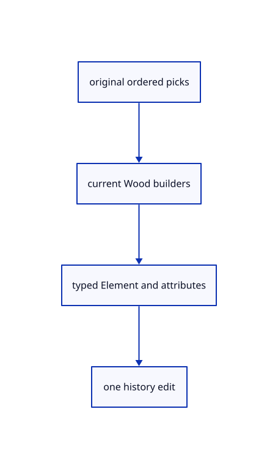

# 18.4.9 · Make Element input batches atomic

**Chapter 18 · Lighting, render quality and comparison · Section 18.4 · Wood Elements and archives** · [Contents](contents.md)

**Typing: 3–5 minutes.** [Estimate](typing-load.md).

Make Element input batches atomic.

## Type

Continue from [Teach named and bare Element values](92f-teach-named-and-bare-element-values.md). [Save or recover your work](recovery.md).

### 1. `src/element_draft.rs`

Adopt only validated current parameter batches.

<details>
<summary>Locate the existing block</summary>

```rust
 pub fn valid(&self,scene:&Scene)->Result<(),String>{for o in &self.picked{o.valid(scene).map_err(str::to_owned)?;}Ok(())}
 pub fn build(&self,scene:&Scene)->Result<Vec<Made>,String>{self.valid(scene)?;crate::element_input::build(self.kind,&self.params,&self.picked.iter().map(|o|(o.source.clone(),o.model.clone())).collect::<Vec<_>>())}

 pub fn values(&self)->String{self.params.iter().map(|p|format!("{} {}",p.name,p.value)).collect::<Vec<_>>().join(" · ")}
 pub fn prompt(&self)->String{if let Some(i)=self.asking{format!("{} <{}>: type a number · Enter keeps it",self.params[i].name,self.params[i].value)}else{format!("{} · pick original sources ({} picked) · Enter creates · Esc cancels",self.kind.name(),self.picked.len())}}
```

</details>

Edit the existing block to match this code; keep unchanged lines:

```rust
--8<-- "journey/code/92g-make-element-input-batches-atomic-01.rs"
```

## Run and check

Run this from `session_viewer` to select the fixed dependency versions and install supplied binary assets. It updates Cargo.lock and preserves the previous lock. It does not write implementation code:

```sh
npm --prefix ../session_tests run course -- dependencies 18.4.9
```

In your project:

```sh
cd workspace/journey
REGEN_PROTO=0 cargo build --lib --locked --target wasm32-unknown-unknown -j1
REGEN_PROTO=0 CARGO_BUILD_JOBS=1 trunk serve --port 8780
```

Open `http://127.0.0.1:8780/`. Keep an existing Trunk server running; saving rebuilds it.


### Recorded visual result

**Previous native render — current verification pending.**

Actual original curved and flat surfaces use the same black outline width.


*This recorded image predates a source or checker change. Rebuild this checkpoint before using it as current evidence; browser controls require separate acceptance.*

This reference image is shared with [18.3.10 · Prove actual outlines and original ownership](91i-prove-actual-outlines-and-original-ownership.md). It does not demonstrate a new feature by itself.

<details>
<summary>Code explanation and diagram</summary>


original ordered picks → current Wood builders → typed Element and attributes → one history edit.



Should Width=99 Height=-1 keep the first edit?

No. Read into a cloned draft and adopt only a completely valid batch. Enter creates only when no parameter is being asked.

Study estimate, including typing and experiments: 0.5–1 hours.

</details>

<details>
<summary>Optional experiment</summary>

Compare draft parameters before and after an invalid two-word batch.

</details>

<details>
<summary>Check and save your work</summary>

Restore experimental edits, then run from `session_viewer`:

```sh
npm --prefix ../session_tests run course -- check 18.4.9
npm --prefix ../session_tests run course -- save 18.4.9
```

Source comparison leaves your project untouched. [Save and recovery instructions](recovery.md).

</details>

<details>
<summary>Viewer coverage and verification</summary>


The supplied browser contract uses the command dock to create a beam from original lines, adjust named values, show features, measure bounds and Undo/Redo. It is syntaxchecked and requires an actual enabled browser. Native fixtures do not constitute browser acceptance.

[Full validation scope](release.md).

To reproduce the scripted acceptance of the reference checkpoint, run from `session_viewer` with the [course bundle server](release.md#reproduce) running on port 8781:

```sh
npm --prefix ../session_tests run course -- capture 18.4.9
```

This uses the verified reference bundle; it does not check or change your typed project.

</details>
