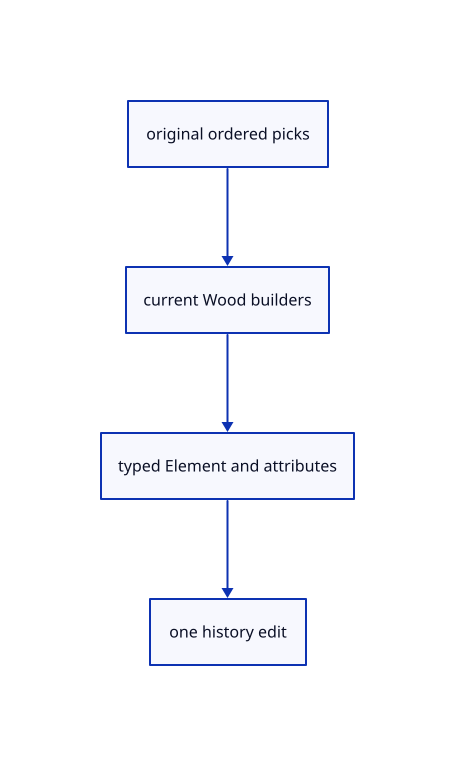

# 18.4.12 · Save and open original Element records

**Chapter 18 · Lighting, render quality and comparison · Section 18.4 · Wood Elements and archives** · [Contents](contents.md)

**Typing: 10–19 minutes.** [Estimate](typing-load.md).

Save and open original Element records.

## Type

Continue from [Adopt Elements and consume sources once](92i-adopt-elements-and-consume-sources-once.md). [Save or recover your work](recovery.md).

### 1. `src/geometry_snapshot.rs`

Route original Element records through mixed-document archives.

<details>
<summary>Locate the existing block</summary>

```rust
    }
    for row in scene.objects().iter().filter(|row|ids.contains(&row.id)&&!scene.instances.contains_key(&row.id)) {
        if let Some(session_rust::Geometry::Plane(source))=&row.original {push!(planes,row.id,source.to_proto());}
        else if let Some(session_rust::Geometry::OBB(source))=&row.original {push!(bboxes,row.id,source.to_proto());}
        else if let Some(cad)=row.cad.as_ref() {push!(breps,row.id,cad.source.to_proto());}
```

</details>

Edit the existing block to match this code; keep unchanged lines:

```rust
--8<-- "journey/code/92j-save-and-open-original-element-records-01.rs"
```

### 2. `src/archive_identity.rs`

Route original Element records through mixed-document archives.

<details>
<summary>Locate the existing block</summary>

```rust
pub(crate) fn objects(objects:&mut proto::Objects,names:&HashMap<String,String>) {
    macro_rules! remap {($field:ident)=>{for object in &mut objects.$field {if let Some(guid)=names.get(&object.guid) {object.guid=guid.clone();}}};}
    remap!(planes);remap!(bboxes);remap!(meshes);remap!(lines);remap!(points);remap!(polylines);remap!(nurbscurves);remap!(nurbssurfaces);remap!(breps);remap!(pointclouds);remap!(instances);remap!(sheets);
}
pub(crate) fn tree(node:&mut proto::TreeNode,names:&HashMap<String,String>) {
```

</details>

Edit the existing block to match this code; keep unchanged lines:

```rust
--8<-- "journey/code/92j-save-and-open-original-element-records-02.rs"
```

### 3. `src/document_source.rs`

Route original Element records through mixed-document archives.

<details>
<summary>Locate the existing block</summary>

```rust
use session_rust::{proto,Session,Xform};
use prost::Message;
use std::{collections::{HashMap,HashSet},rc::Rc};

pub(crate) struct Source {pub document:Rc<Session>,pub origin:Rc<crate::origin::Origin>,pub tree:Option<proto::TreeNode>,pub world:HashMap<String,Xform>,pub sheets:Vec<Rc<crate::sheet_source::Prepared>>}
pub(crate) fn prepare(bytes:&[u8],place:&Xform,point_px:f32)->Result<Source,String> {
    if bytes.len()>crate::archive::LIMIT {return Err("Session exceeds the 512 MiB file limit".into());}
    let message=proto::Session::decode(bytes).map_err(|e|e.to_string())?;
    crate::source_validate::session(&message)?;
    supported(&message)?;
    if !crate::placement::valid(&place.m)||!point_px.is_finite() {return Err("Invalid document placement or point size".into());}
    let tree=message.tree.as_ref().and_then(|tree|tree.root.clone());
    let mut guids=HashSet::new();let objects=message.objects.as_ref().ok_or("Session has no objects")?;
    macro_rules! identity {($field:ident)=>{for object in &objects.$field {if object.guid.is_empty()||!guids.insert(object.guid.as_str()) {return Err("Source GUIDs must be distinct within a document".into());}}};}
    identity!(planes);identity!(bboxes);identity!(meshes);identity!(points);identity!(lines);identity!(polylines);identity!(nurbscurves);identity!(nurbssurfaces);identity!(breps);identity!(pointclouds);identity!(instances);identity!(sheets);
    if let Some(root)=tree.as_ref() {crate::hierarchy::validate(root,&guids).map_err(str::to_owned)?;}
    let mut placed=HashSet::new();for entry in &message.xforms {if !placed.insert(entry.guid.as_str())||!crate::placement::valid(&entry.xform.as_ref().ok_or("Missing placement matrix")?.matrix) {return Err("Invalid source placement".into());}}
    let sheets=objects.sheets.iter().cloned().map(|sheet|crate::sheet_source::Prepared::new(Rc::new(sheet)).map(Rc::new).map_err(str::to_owned)).collect::<Result<Vec<_>,_>>()?;
    let origin=Rc::new(crate::origin::Origin::new(&message,bytes));
    let document=Rc::new(Session::from_proto(message).map_err(|e|e.to_string())?);
    let world=crate::nested_placement::prepare(&document,place).map_err(str::to_owned)?;
    Ok(Source {document,origin,tree,world,sheets})
}

fn supported(source:&proto::Session)->Result<(),String> {
    crate::instance_plan::validate(source)?;
    if !source.interactions.is_empty() {return Err("Interactions arrive with element features".into());}
    let objects=source.objects.as_ref().ok_or("Session has no objects")?;
    if !objects.elements.is_empty()||!objects.components.is_empty() {return Err("This subject cannot open assemblies yet".into());}
    Ok(())
}
```

</details>

Edit the existing block to match this code; keep unchanged lines:

```rust
use session_rust::{proto,Session,Xform};
use prost::Message;
use std::{collections::{HashMap,HashSet},rc::Rc};

pub(crate) struct Source {pub document:Rc<Session>,pub origin:Rc<crate::origin::Origin>,pub tree:Option<proto::TreeNode>,pub world:HashMap<String,Xform>,pub sheets:Vec<Rc<crate::sheet_source::Prepared>>}
pub(crate) fn prepare(bytes:&[u8],place:&Xform,point_px:f32)->Result<Source,String> {
    if bytes.len()>crate::archive::LIMIT {return Err("Session exceeds the 512 MiB file limit".into());}
    let message=proto::Session::decode(bytes).map_err(|e|e.to_string())?;
    crate::source_validate::session(&message)?;
    supported(&message)?;
    if !crate::placement::valid(&place.m)||!point_px.is_finite() {return Err("Invalid document placement or point size".into());}
    let tree=message.tree.as_ref().and_then(|tree|tree.root.clone());
    let mut guids=HashSet::new();let objects=message.objects.as_ref().ok_or("Session has no objects")?;
    macro_rules! identity {($field:ident)=>{for object in &objects.$field {if object.guid.is_empty()||!guids.insert(object.guid.as_str()) {return Err("Source GUIDs must be distinct within a document".into());}}};}
    identity!(elements);identity!(planes);identity!(bboxes);identity!(meshes);identity!(points);identity!(lines);identity!(polylines);identity!(nurbscurves);identity!(nurbssurfaces);identity!(breps);identity!(pointclouds);identity!(instances);identity!(sheets);
    if let Some(root)=tree.as_ref() {crate::hierarchy::validate(root,&guids).map_err(str::to_owned)?;}
    let mut placed=HashSet::new();for entry in &message.xforms {if !placed.insert(entry.guid.as_str())||!crate::placement::valid(&entry.xform.as_ref().ok_or("Missing placement matrix")?.matrix) {return Err("Invalid source placement".into());}}
    let sheets=objects.sheets.iter().cloned().map(|sheet|crate::sheet_source::Prepared::new(Rc::new(sheet)).map(Rc::new).map_err(str::to_owned)).collect::<Result<Vec<_>,_>>()?;
    let origin=Rc::new(crate::origin::Origin::new(&message,bytes));
    let document=Rc::new(Session::from_proto(message).map_err(|e|e.to_string())?);
    let world=crate::nested_placement::prepare(&document,place).map_err(str::to_owned)?;
    Ok(Source {document,origin,tree,world,sheets})
}

fn supported(source:&proto::Session)->Result<(),String> {
    crate::instance_plan::validate(source)?;
    if !source.interactions.is_empty() {return Err("Interactions arrive with element features".into());}
    let objects=source.objects.as_ref().ok_or("Session has no objects")?;
    if !objects.components.is_empty() {return Err("This subject cannot open assemblies yet".into());}
    Ok(())
}
```

<details>
<summary>Optional patch references</summary>

Use these original edit fragments when comparing a saved checkpoint. Apply the complete blocks above.

```text
--8<-- "journey/code/92j-save-and-open-original-element-records-03.rs"
```

```text
--8<-- "journey/code/92j-save-and-open-original-element-records-04.rs"
```

</details>

### 4. `src/document_geometry.rs`

Route original Element records through mixed-document archives.

<details>
<summary>Locate the existing block</summary>

```rust
    let mut owners=Vec::new();let mut shapes=crate::cad_shape_cache::Cache::default();
    macro_rules! add {($source:expr,$insert:expr)=>{{let source=$source;let guid=source.guid().to_owned();let label=source.name.clone();let model=crate::nested_placement::model(&loaded.world,place,&guid);let id=$insert.map_err(str::to_owned)?;scene.place_following(id,model).map_err(str::to_owned)?;owners.push((guid,id,label));id}};}
    for source in &loaded.document.objects.meshes {
        let mut prepared=crate::prepared::PreparedMesh::from_shared(source.clone()).map_err(str::to_owned)?;
```

</details>

Edit the existing block to match this code; keep unchanged lines:

```rust
--8<-- "journey/code/92j-save-and-open-original-element-records-05.rs"
```

## Run and check

Run this from `session_viewer` to select the fixed dependency versions and install supplied binary assets. It updates Cargo.lock and preserves the previous lock. It does not write implementation code:

```sh
npm --prefix ../session_tests run course -- dependencies 18.4.12
```

In your project:

```sh
cd workspace/journey
REGEN_PROTO=0 cargo build --lib --locked --target wasm32-unknown-unknown -j1
REGEN_PROTO=0 CARGO_BUILD_JOBS=1 trunk serve --port 8780
```

Open `http://127.0.0.1:8780/`. Keep an existing Trunk server running; saving rebuilds it.


### Recorded visual result

**Previous native render — current verification pending.**

Actual original curved and flat surfaces use the same black outline width.


*This recorded image predates a source or checker change. Rebuild this checkpoint before using it as current evidence; browser controls require separate acceptance.*

This reference image is shared with [18.3.10 · Prove actual outlines and original ownership](91i-prove-actual-outlines-and-original-ownership.md). It does not demonstrate a new feature by itself.

<details>
<summary>Code explanation and diagram</summary>


original ordered picks → current Wood builders → typed Element and attributes → one history edit.



Should Save serialize the display mesh?

No. Save the original Element record and its payload, retain attribute ancestry and remap original GUIDs consistently.

Study estimate, including typing and experiments: 0.5–1 hours.

</details>

<details>
<summary>Optional experiment</summary>

Save, open and compare the typed payload and readonly base-plane/feature branches.

</details>

<details>
<summary>Check and save your work</summary>

Restore experimental edits, then run from `session_viewer`:

```sh
npm --prefix ../session_tests run course -- check 18.4.12
npm --prefix ../session_tests run course -- save 18.4.12
```

Source comparison leaves your project untouched. [Save and recovery instructions](recovery.md).

</details>

<details>
<summary>Viewer coverage and verification</summary>


The supplied browser contract uses the command dock to create a beam from original lines, adjust named values, show features, measure bounds and Undo/Redo. It is syntaxchecked and requires an actual enabled browser. Native fixtures do not constitute browser acceptance.

[Full validation scope](release.md).

To reproduce the scripted acceptance of the reference checkpoint, run from `session_viewer` with the [course bundle server](release.md#reproduce) running on port 8781:

```sh
npm --prefix ../session_tests run course -- capture 18.4.12
```

This uses the verified reference bundle; it does not check or change your typed project.

</details>
