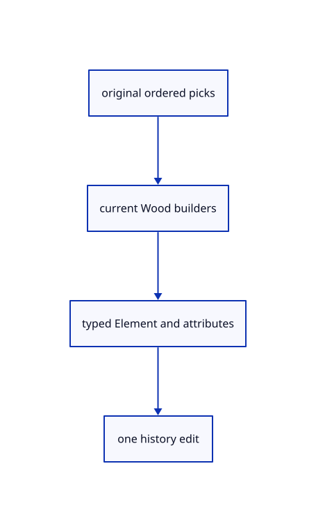

# 18.4.16 · Pick Elements through the real command dock

**Chapter 18 · Lighting, render quality and comparison · Section 18.4 · Wood Elements and archives** · [Contents](contents.md)

**Typing: 29–58 minutes.** [Estimate](typing-load.md).

Pick Elements through the real command dock.

## Type

Continue from [Route Element commands and independent visibility](92m-route-current-element-commands-and-feature-visibility.md). [Save or recover your work](recovery.md).

### 1. `src/browser.rs`

Route actual browser original picks, command results and Element parameter controls.

Edit these blocks from bottom to top. Keep the surrounding lines unchanged.

<details>
<summary>Locate this block</summary>

```rust
        panel.lasso=editor.lasso.as_ref().map_or_else(Vec::new,|l|l.points.iter().map(|p|[(p.0/l.density) as f32,(p.1/l.density) as f32]).collect());
        panel.tree.refresh(&editor.scene,editor.selected_objects());
        if let Err(error) = renderer.set_preview(editor.draft.as_ref()) { panel.result(error); }
        renderer.set_pick_mode(if editor.trimming_picks()||editor.split.is_some()||editor.editing_boundaries()||editor.gathering_curves(){crate::pick_sources::Mode::Object}else{editor.pick_mode});
        if highlight_changed {
            if let Err(error) = renderer.set_highlight(editor.display_scene(), editor.selection())
                .and_then(|()| renderer.select_objects(editor.display_scene(), &editor.highlighted_objects())) { report(error); return; }
```

</details>

Replace it with:

```rust
        panel.lasso=editor.lasso.as_ref().map_or_else(Vec::new,|l|l.points.iter().map(|p|[(p.0/l.density) as f32,(p.1/l.density) as f32]).collect());
        panel.tree.refresh(&editor.scene,editor.selected_objects());
        if let Err(error) = renderer.set_preview(editor.draft.as_ref()) { panel.result(error); }
        renderer.set_pick_mode(if editor.element.is_some()||editor.trimming_picks()||editor.split.is_some()||editor.editing_boundaries()||editor.gathering_curves(){crate::pick_sources::Mode::Object}else{editor.pick_mode});
        if highlight_changed {
            if let Err(error) = renderer.set_highlight(editor.display_scene(), editor.selection())
                .and_then(|()| renderer.select_objects(editor.display_scene(), &editor.highlighted_objects())) { report(error); return; }
```

<details>
<summary>Locate this block</summary>

```rust
                }
            }
        }
        if editor.plane_menu {panel.tool(editor.tool_status.clone(),crate::drawing_input::buttons());}
        else if let Some(trim)=&editor.trim{panel.tool(trim.prompt(),vec![("Enter".into(),"Trim".into()),("Cancel".into(),"Escape".into())]);}
        else if let Some(split)=&editor.split{panel.tool(split.prompt(),vec![("Split".into(),"Split".into()),("Cancel".into(),"Escape".into())]);}
        else if let Some(draft) = editor.draft.as_ref() {let mut buttons=draft.tool.buttons();if draft.text.is_some(){buttons.push(("Height".into(),"Height".into()));}buttons.extend(crate::drawing_input::buttons());panel.tool(draft.prompt(),buttons);}
```

</details>

Replace it with:

```rust
                }
            }
        }
        if let Some(element)=&editor.element{panel.tool(element.prompt(),element.buttons());}
        else if editor.plane_menu {panel.tool(editor.tool_status.clone(),crate::drawing_input::buttons());}
        else if let Some(trim)=&editor.trim{panel.tool(trim.prompt(),vec![("Enter".into(),"Trim".into()),("Cancel".into(),"Escape".into())]);}
        else if let Some(split)=&editor.split{panel.tool(split.prompt(),vec![("Split".into(),"Split".into()),("Cancel".into(),"Escape".into())]);}
        else if let Some(draft) = editor.draft.as_ref() {let mut buttons=draft.tool.buttons();if draft.text.is_some(){buttons.push(("Height".into(),"Height".into()));}buttons.extend(crate::drawing_input::buttons());panel.tool(draft.prompt(),buttons);}
```

<details>
<summary>Locate this block</summary>

```rust
            highlight_changed |= matches!(&action, Action::SelectAll);
            let group_action=matches!(&action,Action::AddGroup(_));let graph_action=matches!(&action,Action::AddEdge);
            let rename_action=matches!(&action,Action::LayerEdit {edit:crate::layer_edit::Edit::Rename(_),..});
            let tool_action = matches!(&action, Action::AddGroup(_) | Action::AddEdge | Action::SelectLasso | Action::LassoRelease{..} | Action::LassoCancel | Action::TextBegin(_) | Action::Trim | Action::TrimPick(_) | Action::TrimScreen{commit:true,..} | Action::CancelTrim | Action::Arrowhead(_) | Action::Explode | Action::Query(_) | Action::Measure(_) | Action::MeasureDistance(_) | Action::BoundingBox | Action::Split | Action::SplitPick(_) | Action::CancelSplit | Action::BeginTool(_) | Action::GatherBegin{..} | Action::GatherPick(_) | Action::Project(_) | Action::ExtendBegin{..} | Action::ExtendPick(_) | Action::Interval(_) | Action::ToolPoint(_) | Action::CancelTool | Action::Snap(_) | Action::GizmoRelease {..} | Action::GizmoCancel | Action::GizmoNumber(_) | Action::ToolScreen { commit:true,.. });
            if matches!(&action, Action::CancelTool | Action::CancelSplit | Action::CancelTrim) { panel.cancel_input(); }
            if matches!(&action, Action::Close | Action::UnloadSources | Action::Live(_) | Action::Undo | Action::Redo
                | Action::Adopt {..} | Action::Replace(_) | Action::ReplaceAt(_, _)) { reload.borrow_mut().cancel(); }
```

</details>

Replace it with:

```rust
            highlight_changed |= matches!(&action, Action::SelectAll);
            let group_action=matches!(&action,Action::AddGroup(_));let graph_action=matches!(&action,Action::AddEdge);
            let rename_action=matches!(&action,Action::LayerEdit {edit:crate::layer_edit::Edit::Rename(_),..});
            let tool_action = matches!(&action, Action::ElementBegin{..}|Action::ElementText(_)|Action::ElementPick(_)|Action::ElementAttributes(_)| Action::AddGroup(_) | Action::AddEdge | Action::SelectLasso | Action::LassoRelease{..} | Action::LassoCancel | Action::TextBegin(_) | Action::Trim | Action::TrimPick(_) | Action::TrimScreen{commit:true,..} | Action::CancelTrim | Action::Arrowhead(_) | Action::Explode | Action::Query(_) | Action::Measure(_) | Action::MeasureDistance(_) | Action::BoundingBox | Action::Split | Action::SplitPick(_) | Action::CancelSplit | Action::BeginTool(_) | Action::GatherBegin{..} | Action::GatherPick(_) | Action::Project(_) | Action::ExtendBegin{..} | Action::ExtendPick(_) | Action::Interval(_) | Action::ToolPoint(_) | Action::CancelTool | Action::Snap(_) | Action::GizmoRelease {..} | Action::GizmoCancel | Action::GizmoNumber(_) | Action::ToolScreen { commit:true,.. });
            if matches!(&action, Action::CancelTool | Action::CancelSplit | Action::CancelTrim) { panel.cancel_input(); }
            if matches!(&action, Action::Close | Action::UnloadSources | Action::Live(_) | Action::Undo | Action::Redo
                | Action::Adopt {..} | Action::Replace(_) | Action::ReplaceAt(_, _)) { reload.borrow_mut().cancel(); }
```

<details>
<summary>Locate this block</summary>

```rust
            Some(Action::Touch(actions))=> {
                let mut applied=Vec::new();
                for action in actions {match action {
                    Action::Pick(screen)=>{if editor.trimming_parts(){let r=pointer_canvas.get_bounding_client_rect();applied.push(Action::TrimScreen{screen,size:[r.width(),r.height()],commit:true});}else if editor.trimming_picks()||editor.split.is_some()||editor.editing_boundaries()||editor.gathering_curves(){pick_additive.set(false);pick_remove.set(false);if let Err(error)=renderer.request_pick(screen,editor.camera.uniform()){report(error)}}else if editor.draft.is_some() {let r=pointer_canvas.get_bounding_client_rect();applied.push(Action::ToolScreen {screen,size:[r.width(),r.height()],commit:true});} else {pick_additive.set(false);pick_remove.set(false);if let Err(error)=renderer.request_pick(screen,editor.camera.uniform()) {report(error);}}},
                    action=>{renderer.cancel_pick();applied.push(action);}
                }}Some(Action::Touch(applied))
            },
```

</details>

Replace it with:

```rust
            Some(Action::Touch(actions))=> {
                let mut applied=Vec::new();
                for action in actions {match action {
                    Action::Pick(screen)=>{if editor.trimming_parts(){let r=pointer_canvas.get_bounding_client_rect();applied.push(Action::TrimScreen{screen,size:[r.width(),r.height()],commit:true});}else if editor.element.is_some()||editor.trimming_picks()||editor.split.is_some()||editor.editing_boundaries()||editor.gathering_curves(){pick_additive.set(false);pick_remove.set(false);if let Err(error)=renderer.request_pick(screen,editor.camera.uniform()){report(error)}}else if editor.draft.is_some() {let r=pointer_canvas.get_bounding_client_rect();applied.push(Action::ToolScreen {screen,size:[r.width(),r.height()],commit:true});} else {pick_additive.set(false);pick_remove.set(false);if let Err(error)=renderer.request_pick(screen,editor.camera.uniform()) {report(error);}}},
                    action=>{renderer.cancel_pick();applied.push(action);}
                }}Some(Action::Touch(applied))
            },
```

<details>
<summary>Locate this block</summary>

```rust
            }
        } else { match action {
            Some(Action::Pick(screen)) if editor.trimming_parts()=>{let r=pointer_canvas.get_bounding_client_rect();Some(Action::TrimScreen{screen,size:[r.width(),r.height()],commit:true})},
            Some(Action::Pick(screen)) if editor.trimming_picks()||editor.split.is_some()||editor.editing_boundaries()||editor.gathering_curves()=>{pick_additive.set(false);pick_remove.set(false);if let Err(error)=renderer.request_pick(screen,editor.camera.uniform()){report(error)}None},
            Some(Action::Pick(screen)) if editor.draft.is_some() => {
                Some(Action::ToolScreen { screen,size:[pointer_canvas.get_bounding_client_rect().width(),pointer_canvas.get_bounding_client_rect().height()],commit:true })
            }
```

</details>

Replace it with:

```rust
            }
        } else { match action {
            Some(Action::Pick(screen)) if editor.trimming_parts()=>{let r=pointer_canvas.get_bounding_client_rect();Some(Action::TrimScreen{screen,size:[r.width(),r.height()],commit:true})},
            Some(Action::Pick(screen)) if editor.element.is_some()||editor.trimming_picks()||editor.split.is_some()||editor.editing_boundaries()||editor.gathering_curves()=>{pick_additive.set(false);pick_remove.set(false);if let Err(error)=renderer.request_pick(screen,editor.camera.uniform()){report(error)}None},
            Some(Action::Pick(screen)) if editor.draft.is_some() => {
                Some(Action::ToolScreen { screen,size:[pointer_canvas.get_bounding_client_rect().width(),pointer_canvas.get_bounding_client_rect().height()],commit:true })
            }
```

<details>
<summary>Locate this block</summary>

```rust
            match renderer.take_pick(editor.camera.uniform()) {
                Some(Ok(hit)) => {
                    let target=hit.and_then(|hit|renderer.resolve_pick(&editor.scene,hit));
                    if editor.trimming_picks(){Some(Action::TrimPick(target.map(|t|t.owner)))}else if editor.split.is_some(){Some(Action::SplitPick(target.map(|t|t.owner)))}else if editor.editing_boundaries(){Some(Action::ExtendPick(target.map(|t|t.owner)))}else if editor.gathering_curves(){Some(Action::GatherPick(target.map(|t|t.owner)))}
                    else if editor.canvas_drag.is_some() {Some(Action::CanvasHit(target.map(|t|t.owner)))}
                    else if pick_remove.get() {Some(Action::SelectRows {ids:target.filter(|t|t.part==crate::pick_sources::Part::Object).map(|t|t.owner).into_iter().collect(),add:false,remove:true})}
                    else {Some(Action::PickedMany {target,additive:pick_additive.get()})}
```

</details>

Replace it with:

```rust
            match renderer.take_pick(editor.camera.uniform()) {
                Some(Ok(hit)) => {
                    let target=hit.and_then(|hit|renderer.resolve_pick(&editor.scene,hit));
                    if editor.element.is_some(){Some(Action::ElementPick(target.map(|t|t.owner)))}else if editor.trimming_picks(){Some(Action::TrimPick(target.map(|t|t.owner)))}else if editor.split.is_some(){Some(Action::SplitPick(target.map(|t|t.owner)))}else if editor.editing_boundaries(){Some(Action::ExtendPick(target.map(|t|t.owner)))}else if editor.gathering_curves(){Some(Action::GatherPick(target.map(|t|t.owner)))}
                    else if editor.canvas_drag.is_some() {Some(Action::CanvasHit(target.map(|t|t.owner)))}
                    else if pick_remove.get() {Some(Action::SelectRows {ids:target.filter(|t|t.part==crate::pick_sources::Part::Object).map(|t|t.owner).into_iter().collect(),add:false,remove:true})}
                    else {Some(Action::PickedMany {target,additive:pick_additive.get()})}
```

<details>
<summary>Complete updated block reference</summary>

```rust
use crate::background::Background;
use crate::editor::{Action, Change, Editor};
use crate::gesture::Gesture;
use crate::renderer::Renderer;
use crate::viewport::Viewport;
use wasm_bindgen::{JsCast, JsValue, closure::Closure};

pub fn report(message: &str) {
    if let Some(document) = web_sys::window().and_then(|window| window.document()) {
        if let Some(status) = document.get_element_by_id("status") {
            status.set_text_content(Some(message));
            if message.starts_with("Cannot draw:") { let _ = status.remove_attribute("hidden"); }
        }
    }
}

fn failed(fault: crate::gpu_fault::Fault, message: String) {
    if !fault.remember(message.clone()) { return; }
    wasm_bindgen_futures::spawn_local(async move {
        if crate::browser_runtime::stop_if(&fault) {
            crate::browser_report::fatal(&message);
            if crate::browser_recovery::request(&message) { return; }
            report(&format!("Cannot draw: {message}"));
        }
    });
}

fn save_result(bytes: &[u8]) -> Result<String, String> {
    crate::file_output::download(bytes)
        .map(|()| format!("Saved editable document ({} bytes)", bytes.len()))
        .map_err(|error| format!("Save failed: {error:?}"))
}

pub async fn run() -> Result<(), JsValue> { run_with(crate::drawing_document::new()).await }

pub async fn run_with(shared: crate::drawing_document::Shared) -> Result<(), JsValue> {
    let window = web_sys::window().ok_or("No browser window")?;
    let document = window.document().ok_or("No document")?;
    let canvas: web_sys::HtmlCanvasElement = document
        .get_element_by_id("canvas")
        .ok_or("Missing canvas")?
        .dyn_into()?;
    let recovery = crate::browser_recovery::adopt()?;
    crate::browser_report::start()?;
    let startup = crate::browser_startup::Guard::new()?;
    let instance = wgpu::Instance::new(wgpu::InstanceDescriptor {
        backends: wgpu::Backends::BROWSER_WEBGPU,
        flags: Default::default(),
        memory_budget_thresholds: Default::default(),
        backend_options: Default::default(),
        display: None,
    });
    let surface = instance
        .create_surface(wgpu::SurfaceTarget::Canvas(canvas.clone()))
        .map_err(|error| JsValue::from_str(&error.to_string()))?;
    let adapter_started = crate::browser_phase::now();
    let probe = crate::browser_adapter::Probe::new().ok();
    let adapter = instance
        .request_adapter(&wgpu::RequestAdapterOptions {
            compatible_surface: Some(&surface),
            ..Default::default()
        })
        .await;
    if !startup.permits() { return Ok(()); }
    crate::browser_phase::finish("adapter request", adapter_started, 0, "GPU");
    let adapter = adapter.map_err(|error| JsValue::from_str(&error.to_string()))?;
    if let Some(info) = probe.as_ref().and_then(|probe| probe.info()) { let _ = crate::browser_report::adapter(info); }
    else { let _ = crate::browser_report::observe("diagnostic", "Adapter identity unavailable"); }
    drop(probe);
    let device_started = crate::browser_phase::now();
    let device = adapter
        .request_device(&wgpu::DeviceDescriptor::default())
        .await;
    if !startup.permits() {
        if let Ok((device, _)) = device { device.destroy(); }
        return Ok(());
    }
    crate::browser_phase::finish("device request", device_started, 0, "GPU");
    let (device, queue) = device.map_err(|error| JsValue::from_str(&error.to_string()))?;
    let fault = crate::gpu_fault::Fault::default();
    let errors = fault.clone();
    device.on_uncaptured_error(std::sync::Arc::new(move |error| failed(errors.clone(), format!("WebGPU error: {error}"))));
    let lost = fault.clone();
    device.set_device_lost_callback(move |reason, message| failed(lost.clone(), format!("WebGPU device lost ({reason:?}): {message}")));
    let limit = device.limits().max_texture_dimension_2d;
    let width = (window.inner_width()?.as_f64().ok_or("No window width")? as u32).clamp(1, limit);
    let height = (window.inner_height()?.as_f64().ok_or("No window height")? as u32).clamp(1, limit);
    canvas.set_width(width);
    canvas.set_height(height);
    let mut config = surface
        .get_default_config(&adapter, width, height)
        .ok_or("No compatible surface format")?;
    config.view_formats = vec![config.format.add_srgb_suffix()];
    surface.configure(&device, &config);
    let mut editor = shared.borrow_mut();
    let pipeline_started = crate::browser_phase::now();
    let text_fonts=std::rc::Rc::new(crate::text_fonts::Inbox::default());
    let mut renderer = Renderer::new(
        device,
        queue,
        config.format.add_srgb_suffix(),
        &editor.scene,
    );
    crate::browser_phase::finish("renderer setup", pipeline_started, 0, "GPU");
    renderer.resize(Viewport { width, height });
    inspect(&editor, &renderer)?;
    let mut panel = crate::panel::Panel::new(
        &renderer,
        config.format.add_srgb_suffix(),
        crate::commands::names(),
    );
    if let Some(message) = crate::browser_report::previous_notice() { panel.result(message); }
    if let Some(message) = &recovery { panel.result(message); }
    panel.update(None, &canvas)?;
    if resize(
        &window,
        &canvas,
        &surface,
        &mut config,
        &mut renderer,
        &mut editor,
    ) {
        panel.update(None, &canvas)?;
        let frame_started = crate::browser_phase::now();
        present(
            &surface,
            &renderer,
            &editor.background,
            &editor.camera.uniform(),
            editor.normal_view,
            &mut panel,
        )?;
        let completing = fault.clone();
        // Queue completion runs after submitted GPU work; checking the current device prevents a late result from reviving an exited runtime.
        renderer.queue.on_submitted_work_done(move || {
            if crate::browser_runtime::owns(&completing) && completing.message().is_none() {
                crate::browser_phase::finish("first frame complete", frame_started, 0, "GPU");
                let _ = crate::browser_report::observe("milestone", "geometry on screen");
            }
        });
    }
    let input_canvas = canvas.clone();
    let browser_window = window.clone();
    let pointer_canvas = canvas.clone();
    let mut gesture = Gesture::default();
    let mut touch=crate::touch::Touch::default();
    let pick_remove=std::cell::Cell::new(false);
    let pick_additive = std::rc::Rc::new(std::cell::Cell::new(false));
    let request = std::rc::Rc::new(std::cell::RefCell::new(crate::read_gate::ReadGate::default()));
    let read_mode = std::cell::Cell::new(crate::file_input::Mode::Append);
    let delivery: crate::file_input::Delivery = std::rc::Rc::new(std::cell::RefCell::new(None));
    let reload: crate::browser_reload::Shared = std::rc::Rc::new(std::cell::RefCell::new(Default::default()));
    let reload_delivery: crate::browser_reload::Delivery = std::rc::Rc::new(std::cell::RefCell::new(None));
    let publication=crate::browser_publication::Publication::new(std::rc::Rc::clone(&shared),fault.clone())?;
    let publication_control=publication.control();let start_publication=publication_control.clone();
    let owned_request = std::rc::Rc::clone(&request);
    let owned_reload = std::rc::Rc::clone(&reload);
    let active_fault = fault.clone();
    drop(editor);
    let sheet_query=crate::browser_sheet::Control::default();
    let owned_editor = std::rc::Rc::clone(&shared);
    let update = Closure::<dyn FnMut(web_sys::Event)>::new(move |event: web_sys::Event| {
        if active_fault.message().is_some() { return; }
        let mut editor = shared.borrow_mut();
        if matches!(event.type_().as_str(), "blur" | "pagehide" | "viewer-reload") { renderer.cancel_pick(); }
        if event.type_() == "pagehide" {
            gesture.cancel();touch.cancel();let _=editor.apply(Action::CanvasCancel); let _=editor.apply(Action::GizmoCancel);
            crate::browser_upload::prepare(&mut renderer,editor.display_scene(),editor.whole_selection(),active_fault.clone());renderer.set_gizmo(&editor.camera,None,-1.);
            if event.dyn_ref::<web_sys::PageTransitionEvent>().is_some_and(|event| event.persisted()) { return; }
            wasm_bindgen_futures::spawn_local(async { crate::browser_runtime::stop(); });
            return;
        }
        if matches!(event.type_().as_str(),"blur"|"resize"|"pointercancel")||event.dyn_ref::<web_sys::KeyboardEvent>().is_some_and(|key|key.key()=="Escape"&&!key.is_composing()) {
            gesture.cancel();touch.cancel();renderer.cancel_pick();if editor.apply(Action::CanvasCancel)==Ok(Change::Preview) {crate::browser_upload::prepare(&mut renderer,&editor.scene,editor.whole_selection(),active_fault.clone());}
        }
        if event.type_()=="lostpointercapture"&&event.dyn_ref::<web_sys::PointerEvent>().is_some_and(|p|editor.canvas_drag.as_ref().is_some_and(|d|d.pointer==p.pointer_id()&&d.released.is_none())) {
            gesture.cancel();renderer.cancel_pick();if editor.apply(Action::CanvasCancel)==Ok(Change::Preview) {crate::browser_upload::prepare(&mut renderer,&editor.scene,editor.whole_selection(),active_fault.clone());}
        }
        if event.type_()=="pointerdown"&&event.dyn_ref::<web_sys::PointerEvent>().is_some_and(|p|p.is_primary())&&editor.canvas_drag.as_ref().is_none_or(|d|d.released.is_some()) {renderer.cancel_pick();let _=editor.apply(Action::CanvasCancel);}
        let shortcut = event.dyn_ref::<web_sys::KeyboardEvent>().and_then(|key| panel.shortcut(key));
        let line = if let Some(shortcut) = shortcut {
            event.prevent_default();
            panel.answer(shortcut.command(), "");
            Some(shortcut.command().to_ascii_lowercase())
        } else { match panel.update(Some(&event), &input_canvas) {
            Ok(line) => line,
            Err(error) => {
                report(&format!("Cannot read command: {error:?}"));
                return;
            }
        } };

        let navigation=if line.is_none()&&!panel.consumed {navigation_action(&event,&pointer_canvas,&mut gesture,&mut touch)} else {None};
        let line=if gesture.take_repeat() {event.prevent_default();if editor.draft.is_some()||editor.gizmo_edit.is_some() {Some(String::new())} else {panel.repeat_line()}} else {line};
        let line = if (editor.lasso.is_some() || editor.trim.is_some() || editor.mark.is_some() || editor.split.is_some() || editor.draft.is_some() || editor.gizmo_edit.is_some()) && event.dyn_ref::<web_sys::KeyboardEvent>()
            .is_some_and(|key| event.type_() == "keydown" && key.key() == "Escape" && !key.is_composing()) {
            event.prevent_default(); gesture.cancel(); Some("Escape".into())
        } else { line };

        let mut highlight_changed = false;
        let action = if event.type_() == "cancel" && event.target()
            .and_then(|target| target.dyn_into::<web_sys::HtmlInputElement>().ok())
            .is_some_and(|input| input.id() == "open")
        {
            request.borrow_mut().cancel();
            report("Open cancelled.");
            panel.answer("Open", "Open cancelled.");
            None
        } else if event.type_() == "change" {
            crate::file_input::choose(&event, std::rc::Rc::clone(&request), read_mode.get(), std::rc::Rc::clone(&delivery));
            None
        } else if event.type_() == "viewer-file-error" {
            if let Some(message) = event.dyn_ref::<web_sys::CustomEvent>().and_then(|event| event.detail().as_string()) {
                report(&message);
                panel.answer("Open", &message);
            }
            None
        } else if event.type_() == "viewer-reload" {
            if let Some(reply) = reload_delivery.borrow_mut().take() {
                let command = reply.intent.as_ref().map_or("Reload Sources", |intent| intent.command());
                match reply.complete(&mut editor) {
                    Ok(Some(crate::edit_replay::Reply::Changed(_))) => {
                        highlight_changed = true;
                        crate::browser_upload::prepare(&mut renderer, editor.display_scene(), editor.whole_selection(), active_fault.clone());
                        crate::browser_phase::revision(&editor.scene);
                        let message = if command == "Reload Sources" {
                            "Editable sources restored; display retained.".to_owned()
                        } else { format!("{command} completed after source reload.") };
                        report(&message); panel.answer(command, &message);
                    }
                    Ok(Some(crate::edit_replay::Reply::Saved(bytes))) => {
                        let message = save_result(&bytes).unwrap_or_else(|error| error);
                        report(&message); panel.answer(command, &message);
                    }
                    Ok(None) => {}
                    Err(error) => { report(&error); panel.answer(command, &error); }
                }
            }
            None
        } else if event.type_() == "viewer-stream-page" {
            renderer.cancel_pick();Some(Action::StreamRefresh)
        } else if event.type_() == "viewer-publication" {
            match publication_control.take() {Ok(action)=>action,Err(error)=>{let message=format!("Cannot load scene: {error}");report(&message);panel.result(&message);None}}
        } else if event.type_() == "viewer-file" {
            match crate::file_input::action(&event, &delivery, &editor.scene) {
                Ok(action) => action,
                Err(error) => { let message = format!("Cannot open file: {error:?}");
                    report(&message); panel.answer("Open", &message); None }
            }
        } else if let Some(line) = line {
            let command = editor.tool_line(&line).map(|result| result.map(crate::commands::Command::Editor).map_err(str::to_owned))
                .unwrap_or_else(|| crate::commands::parse(&line));
            editor.mark=None;
            match command {
            Err(error) => { panel.result(&error); None }
            Ok(crate::commands::Command::Editor(mut action)) => {
                if matches!(action, Action::Close) { crate::stream::reset_range_gate();publication_control.cancel();request.borrow_mut().cancel();let _={text_fonts.clear();renderer.clear_text_fonts();renderer.set_text(Vec::new())}; }
                if shortcut.is_some() && editor.selected.is_some() && matches!(action, Action::Fit) { action = Action::FitSelected; }
                Some(action)
            }
            Ok(crate::commands::Command::Host(host)) => {
            use crate::commands::Host;
            match host {
            Host::TextDemo=>{if let Err(error)=renderer.text_demo() {panel.result(&error.to_string());}None},
            Host::Help => { panel.result(&crate::commands::names().join(" · ")); None }
            Host::Selection => {
                let rows = editor.selected_objects();
                panel.result(&if rows.len() > 1 { format!("Objects {:?}", rows.iter().map(|id| id.value()).collect::<Vec<_>>()) }
                    else { editor.selection().map_or_else(|| "Nothing selected".to_owned(), |target| target.describe()) });
                None
            }
            Host::Reload => {
                let result = crate::browser_reload::start(std::rc::Rc::clone(&reload), editor.reload_keys(), std::rc::Rc::clone(&reload_delivery));
                match result {
                    Ok(()) => panel.result("Reloading editable sources…"),
                    Err(error) => { report(&error); panel.result(&error); }
                }
                None
            }
            Host::CancelReload => {
                reload.borrow_mut().cancel();
                report("Reload cancelled."); panel.result("Reload cancelled.");
                None
            }
            Host::CancelOpen => {
                request.borrow_mut().cancel();
                report("Open cancelled.");
                panel.result("Open cancelled.");
                None
            }
            Host::Open | Host::Replace => {
                publication_control.cancel();
                let ticket = request.borrow_mut().begin();
                if let Err(error) = ticket { report(error); panel.result(error); return; }
                if host == Host::Replace { reload.borrow_mut().cancel(); }
                read_mode.set(if host == Host::Replace { crate::file_input::Mode::Replace }
                    else { crate::file_input::Mode::Append });
                if let Some(input) = web_sys::window()
                    .and_then(|window| window.document())
                    .and_then(|document| document.get_element_by_id("open"))
                    .and_then(|element| element.dyn_into::<web_sys::HtmlInputElement>().ok())
                {
                    input.click();
                }
                None
            }
            Host::Report | Host::PreviousReport => {
                let output = if host == Host::PreviousReport { crate::browser_report::download_previous() }
                    else { crate::browser_report::download() };
                let result = output.map(|()| "Diagnostic report downloaded.".to_owned())
                    .unwrap_or_else(|error| format!("Diagnostic report failed: {error:?}"));
                panel.result(&result);
                None
            }
            Host::LayersOn=>{panel.tree.open=true;None},
            Host::LayersOff=>{panel.tree.open=false;None},
            Host::LayersAll=>{panel.tree.all();None},
            Host::Save => {
                let result = crate::browser_reload::restore_for(crate::edit_intent::Intent::Save,
                    &editor, std::rc::Rc::clone(&reload), std::rc::Rc::clone(&reload_delivery))
                    .and_then(|waiting| {
                        if waiting { Ok("Reloading editable sources…".to_owned()) }
                        else { crate::scene_archive::save(&editor.scene)
                            .and_then(|bytes| save_result(&bytes)) }
                    });
                panel.result(&result.unwrap_or_else(|error| error));
                None
            }
            }
            }
            }
        } else if !panel.consumed {
            navigation
        } else {
            None
        };
        let handle_action=lasso_action(&event,&pointer_canvas,&editor,panel.consumed).or_else(||gizmo_action(&event,&pointer_canvas,&editor,panel.consumed));
        let action = if let Some((key,edit))=panel.tree.edit.take() {
            renderer.cancel_pick();gesture.cancel();Some(Action::LayerEdit {key,edit})
        } else if let Some((key,property))=panel.tree.property.take() {
            renderer.cancel_pick();gesture.cancel();Some(Action::LayerProperty {key,property})
        } else if let Some((ids,additive))=panel.tree.action.take() {
            renderer.cancel_pick();gesture.cancel();Some(Action::TreePick {ids,additive})
        } else if let Some(handle_action)=handle_action {
            renderer.cancel_pick();gesture.cancel();Some(handle_action)
        } else if event.type_() == "viewer-pick" {
            match renderer.take_pick(editor.camera.uniform()) {
                Some(Ok(hit)) => {
                    let target=hit.and_then(|hit|renderer.resolve_pick(&editor.scene,hit));
                    if editor.element.is_some(){Some(Action::ElementPick(target.map(|t|t.owner)))}else if editor.trimming_picks(){Some(Action::TrimPick(target.map(|t|t.owner)))}else if editor.split.is_some(){Some(Action::SplitPick(target.map(|t|t.owner)))}else if editor.editing_boundaries(){Some(Action::ExtendPick(target.map(|t|t.owner)))}else if editor.gathering_curves(){Some(Action::GatherPick(target.map(|t|t.owner)))}
                    else if editor.canvas_drag.is_some() {Some(Action::CanvasHit(target.map(|t|t.owner)))}
                    else if pick_remove.get() {Some(Action::SelectRows {ids:target.filter(|t|t.part==crate::pick_sources::Part::Object).map(|t|t.owner).into_iter().collect(),add:false,remove:true})}
                    else {Some(Action::PickedMany {target,additive:pick_additive.get()})}
                },
                Some(Err(error)) => { report(error); None },
                None => None,
            }
        } else { match action {
            Some(Action::Pick(screen)) if editor.trimming_parts()=>{let r=pointer_canvas.get_bounding_client_rect();Some(Action::TrimScreen{screen,size:[r.width(),r.height()],commit:true})},
            Some(Action::Pick(screen)) if editor.element.is_some()||editor.trimming_picks()||editor.split.is_some()||editor.editing_boundaries()||editor.gathering_curves()=>{pick_additive.set(false);pick_remove.set(false);if let Err(error)=renderer.request_pick(screen,editor.camera.uniform()){report(error)}None},
            Some(Action::Pick(screen)) if editor.draft.is_some() => {
                Some(Action::ToolScreen { screen,size:[pointer_canvas.get_bounding_client_rect().width(),pointer_canvas.get_bounding_client_rect().height()],commit:true })
            }
            None if editor.trimming_parts()&&event.type_()=="pointermove"=>{let r=pointer_canvas.get_bounding_client_rect();event.dyn_ref::<web_sys::PointerEvent>().and_then(|e|(r.width()>0.&&r.height()>0.).then(||[(2.*(e.client_x()as f64-r.left())/r.width()-1.)as f32,(1.-2.*(e.client_y()as f64-r.top())/r.height())as f32])).map(|screen|Action::TrimScreen{screen,size:[r.width(),r.height()],commit:false})},
            None if editor.draft.is_some() && matches!(event.type_().as_str(), "blur" | "resize" | "pointercancel" | "lostpointercapture") => Some(Action::ToolHover(None)),
            None if editor.draft.is_some() && !panel.consumed && event.type_() == "pointermove" => {
                event.dyn_ref::<web_sys::PointerEvent>().filter(|p| p.buttons() == 0).map(|p| {
                    let r = pointer_canvas.get_bounding_client_rect();
                    let screen = [(2. * (p.client_x() as f64-r.left())/r.width()-1.) as f32, (1.-2.*(p.client_y() as f64-r.top())/r.height()) as f32];
                    Action::ToolScreen { screen,size:[r.width(),r.height()],commit:false }
                })
            }
            Some(Action::Touch(actions))=> {
                let mut applied=Vec::new();
                for action in actions {match action {
                    Action::Pick(screen)=>{if editor.trimming_parts(){let r=pointer_canvas.get_bounding_client_rect();applied.push(Action::TrimScreen{screen,size:[r.width(),r.height()],commit:true});}else if editor.element.is_some()||editor.trimming_picks()||editor.split.is_some()||editor.editing_boundaries()||editor.gathering_curves(){pick_additive.set(false);pick_remove.set(false);if let Err(error)=renderer.request_pick(screen,editor.camera.uniform()){report(error)}}else if editor.draft.is_some() {let r=pointer_canvas.get_bounding_client_rect();applied.push(Action::ToolScreen {screen,size:[r.width(),r.height()],commit:true});} else {pick_additive.set(false);pick_remove.set(false);if let Err(error)=renderer.request_pick(screen,editor.camera.uniform()) {report(error);}}},
                    action=>{renderer.cancel_pick();applied.push(action);}
                }}Some(Action::Touch(applied))
            },
            Some(Action::CanvasStart {from,to,size,modified,pointer}) if editor.draft.is_none()=> {
                renderer.cancel_pick();
                let modified=modified||editor.pick_mode!=crate::pick_sources::Mode::Object;
                let start=Action::CanvasStart {from,to,size,modified,pointer};
                let release=event.dyn_ref::<web_sys::PointerEvent>().filter(|_|event.type_()=="pointerup").map(|pointer|Action::CanvasRelease {screen:to,size,add:pointer.shift_key(),remove:pointer.ctrl_key()||pointer.meta_key()});
                if !modified {if let Err(error)=renderer.request_pick(from,editor.camera.uniform()) {report(error);return;}}
                Some(Action::Touch(std::iter::once(start).chain(release).collect()))
            },
            Some(Action::CanvasStart {..}|Action::CanvasMove {..}|Action::CanvasRelease {..}) if editor.draft.is_some()=>None,
            Some(action @ (Action::CanvasMove {..}|Action::CanvasRelease {..}))=>Some(action),
            Some(Action::Pick(screen)) => {
                pick_remove.set(event.dyn_ref::<web_sys::PointerEvent>().is_some_and(|p|p.ctrl_key()||p.meta_key()));
                pick_additive.set(event.dyn_ref::<web_sys::PointerEvent>().is_some_and(|p| p.shift_key() && !p.ctrl_key() && !p.meta_key()));
                if let Err(error) = renderer.request_pick(screen, editor.camera.uniform()) { report(error); }
                None
            }
            Some(action) => { renderer.cancel_pick(); Some(action) },
            None => None,
        } };
        if let Some(action) = action {
            highlight_changed |= matches!(&action, Action::SelectAll);
            let group_action=matches!(&action,Action::AddGroup(_));let graph_action=matches!(&action,Action::AddEdge);
            let rename_action=matches!(&action,Action::LayerEdit {edit:crate::layer_edit::Edit::Rename(_),..});
            let tool_action = matches!(&action, Action::ElementBegin{..}|Action::ElementText(_)|Action::ElementPick(_)|Action::ElementAttributes(_)| Action::AddGroup(_) | Action::AddEdge | Action::SelectLasso | Action::LassoRelease{..} | Action::LassoCancel | Action::TextBegin(_) | Action::Trim | Action::TrimPick(_) | Action::TrimScreen{commit:true,..} | Action::CancelTrim | Action::Arrowhead(_) | Action::Explode | Action::Query(_) | Action::Measure(_) | Action::MeasureDistance(_) | Action::BoundingBox | Action::Split | Action::SplitPick(_) | Action::CancelSplit | Action::BeginTool(_) | Action::GatherBegin{..} | Action::GatherPick(_) | Action::Project(_) | Action::ExtendBegin{..} | Action::ExtendPick(_) | Action::Interval(_) | Action::ToolPoint(_) | Action::CancelTool | Action::Snap(_) | Action::GizmoRelease {..} | Action::GizmoCancel | Action::GizmoNumber(_) | Action::ToolScreen { commit:true,.. });
            if matches!(&action, Action::CancelTool | Action::CancelSplit | Action::CancelTrim) { panel.cancel_input(); }
            if matches!(&action, Action::Close | Action::UnloadSources | Action::Live(_) | Action::Undo | Action::Redo
                | Action::Adopt {..} | Action::Replace(_) | Action::ReplaceAt(_, _)) { reload.borrow_mut().cancel(); }
            if closing_action(&action) {publication_control.cancel();}
            let replacement = matches!(&action, Action::Adopt {replace:true,..} | Action::Replace(_) | Action::ReplaceAt(_, _));
            let closing = matches!(&action, Action::Close);
            let unloading = matches!(&action, Action::UnloadSources);
            let waiting = crate::edit_intent::Intent::capture_for(&action,&editor)
                .map_err(str::to_owned).and_then(|intent| match intent {
                    Some(intent) => crate::browser_reload::restore_for(intent, &editor,
                        std::rc::Rc::clone(&reload), std::rc::Rc::clone(&reload_delivery)),
                    None => Ok(false),
                });
            let change = waiting.and_then(|waiting| {
                if waiting { panel.result("Reloading editable sources…"); Ok(None) }
                else { editor.apply(action).map(Some).map_err(str::to_owned) }
            });
            if change.is_ok()&&(group_action||graph_action){panel.tree.open=true;if graph_action{panel.tree.graph_open=true;}}
            if rename_action {panel.tree.rename_result(change.as_ref().err().map(String::as_str));}
            if tool_action && change.is_ok() {highlight_changed=true;panel.result(&editor.tool_status); }
            match change {
                Ok(Some(Change::Scene)) => {
                    highlight_changed = true;
                    crate::browser_upload::prepare(&mut renderer, &editor.scene, editor.whole_selection(), active_fault.clone());
                    if unloading {
                        report("Editable sources unloaded; display retained.");
                        panel.result("Editable sources unloaded; display retained.");
                    } else if closing {
                        report("Document closed.");
                        panel.result("Document closed.");
                    } else if event.type_() == "viewer-publication" {
                        crate::browser_phase::revision(&editor.scene);let _=crate::browser_report::observe("live-reload","source bytes changed");report("URL scene replaced.");panel.result("URL scene replaced.");
                    } else if event.type_() == "viewer-file" {
                        crate::browser_phase::revision(&editor.scene);
                        let message = if replacement { "Document replaced. Undo restores the previous document." }
                            else { "File imported. Undo removes the entire import." };
                        report(message);
                        panel.answer(if replacement { "Open Replace" } else { "Open" }, message);
                    }
                }
                Ok(Some(Change::Preview)) => {
                    highlight_changed=true;
                    crate::browser_upload::prepare(&mut renderer,editor.display_scene(),editor.whole_selection(),active_fault.clone());
                }
                Ok(Some(Change::View)) | Ok(None) => {}
                Err(error) => {
                    let error=if error=="Shape input invalid" {editor.tool_status.as_str()}else{error.as_str()};
                    report(error);
                    if event.type_() == "viewer-file" { panel.answer("Open", &error); }
                    else { panel.result(&error); }
                }
            }
        }
        if let Some(element)=&editor.element{panel.tool(element.prompt(),element.buttons());}
        else if editor.plane_menu {panel.tool(editor.tool_status.clone(),crate::drawing_input::buttons());}
        else if let Some(trim)=&editor.trim{panel.tool(trim.prompt(),vec![("Enter".into(),"Trim".into()),("Cancel".into(),"Escape".into())]);}
        else if let Some(split)=&editor.split{panel.tool(split.prompt(),vec![("Split".into(),"Split".into()),("Cancel".into(),"Escape".into())]);}
        else if let Some(draft) = editor.draft.as_ref() {let mut buttons=draft.tool.buttons();if draft.text.is_some(){buttons.push(("Height".into(),"Height".into()));}buttons.extend(crate::drawing_input::buttons());panel.tool(draft.prompt(),buttons);}
        else { panel.tool(String::new(), Vec::new()); }
        if let Some(reply)=text_fonts.reply.borrow_mut().take() {match reply {Ok(fonts)=>{if let Err(error)=renderer.replace_text_fonts(fonts) {text_fonts.failed();panel.result(&format!("Text: {error}"));}},Err(error)=>panel.result(&format!("Text: {error}"))}}
        sheet_query.observe(&editor.scene,editor.selection(),&active_fault);
        if let Some(reply)=sheet_query.take() {match reply {Ok(entity)=>panel.result(&format!("{} · {} · {}",entity.name,entity.kind,entity.guid)),Err(error)=>panel.result(&error)}}
        if let Err(error)=renderer.set_guides(&editor.guide_overlay()){panel.result(error);}
        if let Err(error)=renderer.set_measurement(editor.mark.as_ref()){panel.result(error);}
        renderer.refresh_text_bounds(&mut editor.scene);
        text_fonts.need(editor.scene.texts().iter().filter(|row|editor.scene.visible(row.id)).map(|row|row.prepared.source.label.text.as_str()));
        let rect=pointer_canvas.get_bounding_client_rect();
        let number=editor.number_prompt([rect.width(),rect.height()]);
        if editor.gizmo_edit.as_ref().is_some_and(|e|e.gizmo.typing.is_some()) && number.is_none() {
            if editor.apply(Action::GizmoCancel).is_ok() {highlight_changed=true;crate::browser_upload::prepare(&mut renderer,editor.display_scene(),editor.whole_selection(),active_fault.clone());}
        }
        panel.rectangle=editor.canvas_drag.as_ref().filter(|d|d.missed).and_then(|d|d.rectangle());
        panel.number(number);
        panel.lasso=editor.lasso.as_ref().map_or_else(Vec::new,|l|l.points.iter().map(|p|[(p.0/l.density) as f32,(p.1/l.density) as f32]).collect());
        panel.tree.refresh(&editor.scene,editor.selected_objects());
        if let Err(error) = renderer.set_preview(editor.draft.as_ref()) { panel.result(error); }
        renderer.set_pick_mode(if editor.element.is_some()||editor.trimming_picks()||editor.split.is_some()||editor.editing_boundaries()||editor.gathering_curves(){crate::pick_sources::Mode::Object}else{editor.pick_mode});
        if highlight_changed {
            if let Err(error) = renderer.set_highlight(editor.display_scene(), editor.selection())
                .and_then(|()| renderer.select_objects(editor.display_scene(), &editor.highlighted_objects())) { report(error); return; }
        }
        renderer.set_clipping(editor.clipping_enabled,editor.clipping_solid);
        renderer.set_ambient(editor.arctic);renderer.set_outlines(editor.outlines);
        if let Err(error) = renderer.set_grid_on(editor.camera.grid,editor.drawing_plane()) {
            report(error); return;
        }
        if resize(
            &browser_window,
            &pointer_canvas,
            &surface,
            &mut config,
            &mut renderer,
            &mut editor,
        ) {
            if let Err(error) = panel.update(None, &input_canvas) {
                report(&format!("Cannot lay out commands: {error:?}"));
                return;
            }
            if let Some(frame)=panel.free_frame([rect.width(),rect.height()]) {if editor.camera.frame(frame) {renderer.cancel_pick();let _=editor.apply(Action::CanvasCancel);}}
            let hover=event.dyn_ref::<web_sys::PointerEvent>().filter(|p|event.type_()=="pointermove" && p.buttons()==0 && !panel.consumed).map(|p| {
                let r=pointer_canvas.get_bounding_client_rect();
                ([(2.*(p.client_x() as f64-r.left())/r.width()-1.) as f32,(1.-2.*(p.client_y() as f64-r.top())/r.height()) as f32],[r.width(),r.height()])
            });
            editor.hover_gizmo(hover);
            renderer.set_gizmo(&editor.camera,editor.gizmo_origin(),editor.gizmo_active());
            renderer.cloud_camera(&editor.camera);
            if let Err(error) = inspect(&editor, &renderer) {
            report(&format!("Cannot report projection: {error:?}"));
            return;
        }
            if let Err(error) = present(
                &surface,
                &renderer,
                &editor.background,
                &editor.camera.uniform(),
                editor.normal_view,
                &mut panel,
            ) {
                report(&format!("Cannot redraw: {error:?}"));
            }
        }
    });
    let mut listeners = crate::listeners::Listeners::new(update);
    for name in [
        "pointerdown",
        "pointermove",
        "pointerup",
        "pointercancel",
        "lostpointercapture",
        "contextmenu",
        "keydown",
        "keyup",
        "blur",
    ] {
        listeners.listen(canvas.as_ref(), name)?;
    }
    listeners.listen(canvas.as_ref(), "wheel")?;
    listeners.listen(window.as_ref(), "resize")?;
    listeners.listen(window.as_ref(), "blur")?;
    listeners.listen(document.as_ref(), "change")?;
    listeners.listen(document.as_ref(), "cancel")?;
    listeners.listen(window.as_ref(), "viewer-pick")?;
    listeners.listen(window.as_ref(), "viewer-tiles")?;
    listeners.listen(window.as_ref(), "viewer-publication")?;
    listeners.listen(window.as_ref(), "viewer-sheet-entity")?;
    listeners.listen(window.as_ref(), "viewer-stream-page")?;
    listeners.listen(window.as_ref(), "viewer-file")?;
    listeners.listen(window.as_ref(), "viewer-file-error")?;
    listeners.listen(window.as_ref(), "viewer-reload")?;
    listeners.listen(window.as_ref(), "pagehide")?;
    crate::browser_runtime::install(listeners, owned_request, owned_reload, fault, owned_editor, publication);
    report(&recovery.unwrap_or_else(|| "Wheel zooms; type commands anywhere in the drawing. Escape cancels a drag.".into()));
    start_publication.begin();
    Ok(())
}

fn closing_action(action:&Action)->bool {matches!(action,Action::Close|Action::Adopt {..}|Action::Replace(_)|Action::ReplaceAt(_, _))}

fn inspect(editor: &Editor, renderer: &Renderer) -> Result<(), JsValue> {
    let document = web_sys::window()
        .and_then(|window| window.document())
        .ok_or("No document")?;
    let canvas = document
        .get_element_by_id("canvas")
        .ok_or("Missing canvas")?;
    let placements: Vec<_> = editor.scene.objects().iter().map(|row| (format!("{:?}", row.id), row.model.m)).collect();
    let view_ids=editor.scene.objects().iter().map(|row|row.id).chain(editor.scene.lines().iter().map(|row|row.id)).chain(editor.scene.paths().iter().map(|row|row.id)).chain(editor.scene.points().iter().map(|row|row.id)).chain(editor.scene.texts().iter().map(|row|row.id)).chain(editor.scene.clouds().iter().map(|row|row.id));
    let view_rows=view_ids.map(|id|serde_json::json!({"id":id.value(),"visible":editor.scene.visible(id),"locked":editor.scene.view.locked.contains(&id),"faces":editor.scene.view.faces.get(&id),"edges":editor.scene.view.edges.get(&id)})).collect::<Vec<_>>();
    canvas.set_attribute("data-canvas-drag",&editor.canvas_drag.as_ref().map_or_else(||"null".into(),|d|serde_json::json!({"from":d.from,"to":d.to,"released":d.released,"missed":d.missed,"preview":d.preview.as_ref().map(|p|p.matrix())}).to_string()))?;
    let local=editor.scene.forest.documents.iter().flat_map(|doc|doc.nodes.iter().map(move |node|serde_json::json!({"document":doc.key,"name":node.source.name,"object":node.object.map(|id|id.value()),"local":node.placement.local.m,"original_world":node.placement.world.m}))).collect::<Vec<_>>();
    canvas.set_attribute("data-original-tree-placements",&serde_json::to_string(&local).unwrap())?;
    canvas.set_attribute("data-camera-frame",&serde_json::to_string(&editor.camera.frame).unwrap())?;
    canvas.set_attribute("data-view-flags",&serde_json::json!({"current":crate::layer_edit::current_key(&editor.scene),"rows":view_rows}).to_string())?;
    canvas.set_attribute("data-groups",&serde_json::json!(editor.scene.groups.iter().collect::<Vec<_>>()).to_string())?;
    canvas.set_attribute("data-graph",&serde_json::json!(crate::graph_edit::rows(&editor.scene)).to_string())?;
    canvas.set_attribute("data-lasso",&editor.lasso.as_ref().map_or_else(||"null".into(),|l|serde_json::json!({"points":l.points.len(),"spacing":l.spacing,"density":l.density}).to_string()))?;
    canvas.set_attribute("data-tree",&serde_json::json!(crate::hierarchy::rows(&editor.scene).iter().map(|r|serde_json::json!({"key":r.key,"label":r.label,"depth":r.depth,"end":r.end,"readonly":r.readonly,"ids":r.ids.iter().map(|id|id.value()).collect::<Vec<_>>()})).collect::<Vec<_>>()).to_string())?;
    canvas.set_attribute("data-gizmo",&serde_json::json!({"origin":editor.gizmo_origin(),"active":editor.gizmo_active(),"pointer":editor.gizmo_edit.as_ref().and_then(|e|e.pointer),"typing":editor.gizmo_edit.as_ref().and_then(|e|e.gizmo.typing).map(|h|h.title()),"matrix":editor.gizmo_edit.as_ref().map(|e|e.preview.matrix()),"gpu":renderer.gizmo_usage()}).to_string())?;
    canvas.set_attribute("data-row-placements", &serde_json::to_string(&placements).map_err(|error| JsValue::from_str(&error.to_string()))?)?;
    canvas.set_attribute("data-clipping",&serde_json::json!({"usage":renderer.clipping_usage(),"caps":renderer.cap_usage(),"ambient":renderer.ambient_usage(),"ambient_error":renderer.ambient_error(),"arctic":editor.arctic,"outlines":editor.outlines,"global_outline":renderer.global_outline_usage(),"pyramid":renderer.depth_pyramid_usage(),"pyramid_error":renderer.depth_pyramid_error(),"cap_error":renderer.cap_error(),"ink_flags":renderer.clipping_ink_bytes(),"error":renderer.clipping_error(),"rows":crate::clipping_rows::current(&editor.scene).ok().map(|rows|rows.iter().map(|r|serde_json::json!({"id":r.id.value(),"normal":r.plane.normal,"offset":r.plane.offset})).collect::<Vec<_>>())}).to_string())?;
    canvas.set_attribute("data-triangle-tiles",&serde_json::to_string(&renderer.tile_usage()).unwrap())?;
    canvas.set_attribute("data-pick-gpu", &serde_json::to_string(&renderer.pick_usage()).unwrap())?;
    canvas.set_attribute("data-point-gpu", &serde_json::to_string(&renderer.point_usage()).unwrap())?;
    canvas.set_attribute("data-cloud-cpu",&serde_json::to_string(&crate::memory::clouds(editor.presentation_scenes())).unwrap())?;
    canvas.set_attribute("data-cloud-gpu",&serde_json::to_string(&renderer.cloud_usage()).unwrap())?;
    canvas.set_attribute("data-cloud-error",&renderer.cloud_error().unwrap_or_default())?;
    canvas.set_attribute("data-cloud-sources",&serde_json::json!(editor.scene.clouds().iter().map(|row|serde_json::json!({"id":row.id.value(),"guid":row.guid,"source_guid":row.prepared.source.guid(),"point_size":row.prepared.source.point_size,"point_px":row.point_px,"points":row.prepared.source.len(),"nodes":row.prepared.nodes.len(),"model":row.model.m})).collect::<Vec<_>>()).to_string())?;
    canvas.set_attribute("data-surface-outline",&serde_json::to_string(&renderer.outline_usage()).unwrap())?;
    canvas.set_attribute("data-scene-text-stats",&serde_json::to_string(&renderer.text_stats()).unwrap())?;
    canvas.set_attribute("data-scene-text-cpu",&serde_json::to_string(&crate::memory::texts(editor.presentation_scenes())).unwrap())?;
    canvas.set_attribute("data-scene-text-gpu",&serde_json::to_string(&renderer.text_scene_usage()).unwrap())?;
    canvas.set_attribute("data-scene-texts",&serde_json::json!(editor.scene.texts().iter().map(|row|serde_json::json!({"id":row.id.value(),"guid":row.guid,"source":row.prepared.source,"model":row.model.m})).collect::<Vec<_>>()).to_string())?;
    canvas.set_attribute("data-text-error",&renderer.text_error().unwrap_or_default())?;
    canvas.set_attribute("data-text-atlas",&serde_json::to_string(&renderer.text_usage()).unwrap())?;
    canvas.set_attribute("data-cad-walks",&serde_json::json!({"scope":"last imported original document","walks":editor.scene.cad_walks[0],"replays":editor.scene.cad_walks[1]}).to_string())?;
    canvas.set_attribute("data-cad-cache",&serde_json::to_string(&crate::memory::cads(editor.presentation_scenes())).unwrap())?;
    let cads=editor.scene.objects().iter().filter_map(|row|row.cad.as_ref().map(|cad|serde_json::json!({"id":row.id.value(),"source":cad.source.guid(),"faces":row.mesh.parts.faces,"edges":cad.edges.iter().map(|border|border.edge).collect::<Vec<_>>(),"vertices":cad.samples.len()}))).collect::<Vec<_>>();
    canvas.set_attribute("data-cads",&serde_json::to_string(&cads).unwrap())?;
    canvas.set_attribute("data-surface-cpu",&serde_json::to_string(&crate::memory::surfaces(editor.presentation_scenes())).unwrap())?;
    let surfaces=editor.scene.objects().iter().filter_map(|row|row.surface.as_ref().map(|s|serde_json::json!({"id":row.id.value(),"source":s.source.guid(),"controls":s.source.m_cv_count,"steps":s.grid.steps,"samples":s.grid.samples.len(),"faces":row.mesh.parts.faces,"edges":s.grid.boundaries.iter().map(|b|b.edge).collect::<Vec<_>>()}))).collect::<Vec<_>>();
    canvas.set_attribute("data-surfaces",&serde_json::to_string(&surfaces).unwrap())?;
    canvas.set_attribute("data-curve-cpu", &serde_json::to_string(&crate::memory::curves(editor.presentation_scenes())).unwrap())?;
    canvas.set_attribute("data-control-count", &editor.scene.control_markers().len().to_string())?;
    canvas.set_attribute("data-point-cpu", &serde_json::to_string(&crate::memory::points(editor.presentation_scenes())).unwrap())?;
    canvas.set_attribute("data-path-gpu", &serde_json::to_string(&renderer.path_usage()).unwrap())?;
    canvas.set_attribute("data-path-cpu", &serde_json::to_string(&crate::memory::paths(editor.presentation_scenes())).unwrap())?;
    canvas.set_attribute("data-stroke-usage", &serde_json::to_string(&renderer.stroke_usage()).unwrap())?;
    canvas.set_attribute("data-line-usage", &serde_json::to_string(&crate::memory::lines(editor.presentation_scenes())).unwrap())?;
    canvas.set_attribute("data-edit-preview", &editor.edit_preview.as_ref().map_or_else(|| "null".into(),|p| serde_json::json!({"ids":p.ids().iter().map(|id| id.value()).collect::<Vec<_>>(),"matrix":p.matrix()}).to_string()))?;
    let originals=serde_json::json!({"points":editor.scene.points().iter().map(|row|(0..3).map(|i|row.prepared.source[i]).collect::<Vec<_>>()).collect::<Vec<_>>(),"lines":editor.scene.lines().iter().map(|row|{let s=&row.prepared.source;[s.start(),s.end()].map(|p|[p[0],p[1],p[2]])}).collect::<Vec<_>>(),"polylines":editor.scene.paths().iter().filter(|row|matches!(row.prepared.source,crate::chain::Source::Polyline(_))).map(|row|row.prepared.source.coordinates()).collect::<Vec<_>>()});
    canvas.set_attribute("data-curve-originals",&serde_json::to_string(&editor.scene.paths().iter().filter_map(|row|match &row.prepared.source {crate::chain::Source::Curve(source,_)=>Some(serde_json::json!({"guid":source.guid(),"controls":source.m_cv,"knots":source.m_nurbsknot,"rational":source.m_is_rat,"count":source.cv_count()})),_=>None}).collect::<Vec<_>>()).unwrap())?;
    canvas.set_attribute("data-drawing-originals",&originals.to_string())?;
    canvas.set_attribute("data-cplane",&serde_json::json!({"fixed":editor.construction_plane.is_some(),"mode":format!("{:?}",editor.construction_plane),"chooser":editor.plane_menu}).to_string())?;
    canvas.set_attribute("data-measurement",&editor.mark.as_ref().map_or_else(||"null".into(),|m|serde_json::json!({"points":m.points,"label":m.label}).to_string()))?;
    canvas.set_attribute("data-measurement-gpu-bytes",&renderer.measurement_bytes().to_string())?;
    canvas.set_attribute("data-guide-gpu-bytes",&renderer.guide_bytes().to_string())?;
    canvas.set_attribute("data-trim",&editor.trim.as_ref().map_or_else(||"null".into(),|t|serde_json::json!({"phase":format!("{:?}",t.phase),"targets":t.targets.iter().map(|o|o.id.value()).collect::<Vec<_>>(),"cutters":t.cutters.iter().map(|o|o.id.value()).collect::<Vec<_>>(),"parts":t.cuts.iter().map(|c|c.parts.count()).collect::<Vec<_>>(),"removed":t.cuts.iter().map(|c|&c.removed).collect::<Vec<_>>(),"hover":t.hover}).to_string()))?;
    canvas.set_attribute("data-split", &editor.split.as_ref().map_or_else(||"null".into(),|s|serde_json::json!({"target":s.target.id.value(),"face":s.face,"cutters":s.cutters.iter().map(|o|o.id.value()).collect::<Vec<_>>()}).to_string()))?;
    canvas.set_attribute("data-project", &editor.draft.as_ref().and_then(|d|d.project.as_ref()).map_or_else(||"null".into(), |p|serde_json::json!({"targets":p.targets.iter().map(|o|o.id.value()).collect::<Vec<_>>(),"points":p.points,"unsupported":p.unsupported}).to_string()))?;
    canvas.set_attribute("data-extend", &editor.draft.as_ref().and_then(|d|d.extend.as_ref()).map_or_else(||"null".into(), |e|serde_json::json!({"boundaries":e.boundaries.iter().map(|o|o.id.value()).collect::<Vec<_>>(),"curves":e.curves,"distance":e.distance,"asking":e.asking,"candidates":e.candidates.len(),"hover":e.hover.as_ref().map(|h|serde_json::json!({"owner":h.owner.id.value(),"end":format!("{:?}",h.end),"tail":h.tail})),"error":e.error}).to_string()))?;
    canvas.set_attribute("data-gather",&editor.draft.as_ref().and_then(|d|d.gather.as_ref()).map_or_else(||"null".into(),|g|serde_json::json!({"name":g.recipe.name,"step":g.progress.step,"rows":g.progress.rows,"answered":g.progress.answered,"choice":g.choice}).to_string()))?;
    canvas.set_attribute("data-tool", &editor.draft.as_ref().map_or_else(|| "null".into(), |d| serde_json::json!({"name":d.tool.name(),"points":d.points,"cursor":d.cursor,"snap":d.snapped.map(|kind| format!("{kind:?}"))}).to_string()))?;
    canvas.set_attribute("data-snap-settings", &serde_json::json!({"objects":editor.snapping.objects,"modes":editor.snapping.modes,"grid":editor.snapping.grid,"step":editor.snapping.step}).to_string())?;
    canvas.set_attribute("data-snap-usage", &serde_json::to_string(&editor.snap_usage()).unwrap())?;
    canvas.set_attribute("data-preview-bytes", &renderer.preview_bytes().to_string())?;
    canvas.set_attribute("data-highlight-bytes", &renderer.highlight_bytes().to_string())?;
    canvas.set_attribute("data-selection-part", &editor.selection().map_or_else(String::new, |target| target.describe()))?;
    let sheets=editor.scene.sheets().iter().map(|row|serde_json::json!({"row":row.id.value(),"guid":row.guid,"source":row.prepared.original.guid,"model":row.model.m,"segments":row.prepared.original.segment_count,"entities":row.prepared.original.entity_count,"meta":row.prepared.original.meta,"streamed":row.prepared.streamed.is_some(),"resident":row.prepared.pages().iter().map(|page|page.rows.end-page.rows.start).sum::<u32>()})).collect::<Vec<_>>();canvas.set_attribute("data-sheets",&serde_json::to_string(&sheets).unwrap())?;canvas.set_attribute("data-sheet-cpu",&serde_json::to_string(&crate::memory::sheets(editor.scenes())).unwrap())?;canvas.set_attribute("data-sheet-gpu",&serde_json::to_string(&renderer.sheet_usage()).unwrap())?;
    canvas.set_attribute("data-instance-cpu",&serde_json::to_string(&crate::memory::instances(editor.scenes())).unwrap())?;
    canvas.set_attribute("data-instance-gpu",&serde_json::to_string(&renderer.instance_usage()).unwrap())?;
    let instances=editor.scene.instances.iter().map(|(id,owner)|serde_json::json!({"id":id.value(),"guid":editor.scene.row_guid(*id),"source_guid":owner.instance.guid(),"definition_guid":owner.definition.guid(),"document_guid":owner.document.guid(),"model":editor.scene.placement(*id).map(|m|m.m),"flags":owner.instance.flags,"colour":editor.scene.face_rgba(*id)})).collect::<Vec<_>>();
    canvas.set_attribute("data-instances",&serde_json::to_string(&instances).unwrap())?;
    let stream_usage=crate::memory::streams(editor.scenes());
    canvas.set_attribute("data-range-sources",&serde_json::to_string(&stream_usage).unwrap())?;
    let streamed=editor.scene.streams().iter().map(|row|serde_json::json!({"id":row.id.value(),"guid":row.guid,"source_guid":row.prepared.source.guid,"name":row.prepared.source.name,"url":row.prepared.source.url,"revision":row.prepared.source.fields.revision,"total":row.prepared.source.fields.count,"model":row.model.m,"point_px":row.point_px,"controls":row.controls_visible})).collect::<Vec<_>>();
    canvas.set_attribute("data-range-documents",&serde_json::to_string(&streamed).unwrap())?;

    canvas.set_attribute("data-pick-mode", &format!("{:?}", editor.pick_mode))?;
    canvas.set_attribute("data-part-usage", &serde_json::to_string(&renderer.part_usage()).unwrap())?;
    canvas.set_attribute("data-selected-ids", &serde_json::to_string(&editor.selected_objects().iter().map(|id| id.value()).collect::<Vec<_>>()).unwrap())?;
    canvas.set_attribute("data-selected-id", &editor.selected.map(|id| format!("{id:?}")).unwrap_or_default())?;
    canvas.set_attribute("data-grid-plane",&serde_json::json!({"origin":(0..3).map(|i|editor.drawing_plane().origin()[i]).collect::<Vec<_>>(),"matrix":editor.drawing_plane().matrix()}).to_string())?;
    canvas.set_attribute("data-grid-enabled", if editor.camera.grid.is_some() { "true" } else { "false" })?;
    canvas.set_attribute("data-grid-gpu", &serde_json::to_string(&renderer.grid_usage()).unwrap())?;
    canvas.set_attribute("data-normal-view", if editor.normal_view { "true" } else { "false" })?;
    canvas.set_attribute("data-camera-matrix", &serde_json::to_string(&editor.camera.view_projection().m).map_err(|error| JsValue::from_str(&error.to_string()))?)?;
    canvas.set_attribute("data-object-count", &editor.scene.objects().len().to_string())?;
    let metadata: Vec<_> = editor.scene.objects().iter().map(|row| {
        let m = &row.metadata;
        (&row.guid, &m.source_guid, &m.name, m.is_visible, m.is_locked)
    }).collect();
    let origins: Vec<_> = editor.scene.objects().iter().filter_map(|row| row.origin().map(|origin|
        (&row.guid, origin.id.to_string(), origin.version.hex(),
            origin.location.as_ref().map(|location| location.value())))).collect();
    let residency: Vec<_> = editor.scene.objects().iter().map(|row|
        (&row.guid, row.geometry().is_some(), row.release_epoch())).collect();
    canvas.set_attribute("data-source-residency", &serde_json::to_string(&residency)
        .map_err(|error| JsValue::from_str(&error.to_string()))?)?;
    canvas.set_attribute("data-source-origins", &serde_json::to_string(&origins)
        .map_err(|error| JsValue::from_str(&error.to_string()))?)?;
    canvas.set_attribute("data-row-metadata", &serde_json::to_string(&metadata)
        .map_err(|error| JsValue::from_str(&error.to_string()))?)?;
    canvas.set_attribute("data-gpu-stats", &format!("{:?}", renderer.stats()))?;
    let cpu = crate::memory::cpu(editor.presentation_scenes(), renderer.geometry_owners().map(|owner| &owner.source));
    canvas.set_attribute("data-cpu-usage", &format!("{cpu:?}"))?;
    canvas.set_attribute("data-gpu-usage", &format!("{:?}", renderer.usage()))?;
    canvas.set_attribute("data-projection", &format!("{:?}", editor.camera.projection))
}

fn navigation_action(
    event: &web_sys::Event,
    canvas: &web_sys::HtmlCanvasElement,
    gesture: &mut Gesture,
    touch:&mut crate::touch::Touch,
) -> Option<Action> {
    let action = match event.type_().as_str() {
        "wheel" => {
            let wheel = event.dyn_ref::<web_sys::WheelEvent>()?;
            let mode = wheel.delta_mode();
            let rect=canvas.get_bounding_client_rect();
            let Action::Zoom(factor)=crate::navigation::wheel(wheel.delta_y(),mode,rect.height())? else {return None;};
            let screen=[(2.*(wheel.client_x() as f64-rect.left())/rect.width()-1.) as f32,(1.-2.*(wheel.client_y() as f64-rect.top())/rect.height()) as f32];
            Some(Action::ZoomAt {factor,screen})
        }
        "keydown" => {
            let key = event.dyn_ref::<web_sys::KeyboardEvent>()?;
            if key.is_composing() || key.alt_key() {
                return None;
            }
            if key.key() == "Escape" {
                gesture.cancel();
                event.prevent_default();
                return None;
            }
            return None;
        }
        _=>{
            if let Some(pointer)=event.dyn_ref::<web_sys::PointerEvent>().filter(|p|p.pointer_type()=="touch") {
                event.prevent_default();let r=canvas.get_bounding_client_rect();let rect=[r.left(),r.top(),r.width(),r.height()];let at=[pointer.client_x() as f64,pointer.client_y() as f64];let id=pointer.pointer_id();
                let actions=match event.type_().as_str() {
                    "pointerdown"=>{gesture.cancel();let multiple=touch.count()>0;if touch.press(id,at,event.time_stamp()) {if canvas.set_pointer_capture(id).is_err() {touch.cancel();}}if multiple {vec![Action::GizmoCancel,Action::CanvasCancel]} else {Vec::new()}},
                    "pointermove"=>touch.move_to(id,at,rect),
                    "pointerup"=>{let actions=touch.release(id,at,event.time_stamp(),rect);let _=canvas.release_pointer_capture(id);actions},
                    "pointercancel"=>{touch.cancel();Vec::new()},"lostpointercapture"=>{if touch.contains(id) {touch.cancel();}Vec::new()},_=>Vec::new(),
                };return (!actions.is_empty()).then_some(Action::Touch(actions));
            }
            return pointer_action(event,canvas,gesture);
        },
    }?;
    event.prevent_default();
    Some(action)
}

fn pointer_action(
    event: &web_sys::Event,
    canvas: &web_sys::HtmlCanvasElement,
    gesture: &mut Gesture,
) -> Option<Action> {
    match event.type_().as_str() {
        "contextmenu" => {
            event.prevent_default();
            return None;
        }
        "blur" | "resize" => {
            gesture.cancel();
            return None;
        }
        _ => {}
    }
    let pointer = event.dyn_ref::<web_sys::PointerEvent>()?;
    let id = pointer.pointer_id();
    let position = [pointer.client_x() as f64, pointer.client_y() as f64];
    let motion = match event.type_().as_str() {
        "pointerdown" => {
            if pointer.is_primary() && gesture.press_at(id, pointer.button(), position,pointer.ctrl_key()||pointer.meta_key(),pointer.time_stamp()) {
                event.prevent_default();
                let options = web_sys::FocusOptions::new();
                options.set_prevent_scroll(true);
                if canvas.focus_with_options(&options).is_err()
                    || canvas.set_pointer_capture(id).is_err()
                {
                    gesture.cancel();
                }
            }
            None
        }
        "pointermove" => gesture.move_at(id, position,pointer.time_stamp()),
        "pointerup" => {
            let motion = gesture.release_at(id, position,pointer.time_stamp());
            let _ = canvas.release_pointer_capture(id);
            motion
        }
        "pointercancel" | "lostpointercapture" => {
            gesture.cancel_pointer(id);
            None
        }
        _ => None,
    }?;
    let rect = canvas.get_bounding_client_rect();
    let mut action=motion.action([rect.left(),rect.top(),rect.width(),rect.height()])?;
    match &mut action {
        Action::CanvasStart {modified,pointer:id,..}=>{*id=pointer.pointer_id();*modified=pointer.shift_key()||pointer.ctrl_key()||pointer.meta_key();},
        Action::CanvasRelease {add,remove,..}=>{*add=pointer.shift_key();*remove=pointer.ctrl_key()||pointer.meta_key();},_=>{}
    }Some(action)
}

fn resize(
    window: &web_sys::Window,
    canvas: &web_sys::HtmlCanvasElement,
    surface: &wgpu::Surface<'_>,
    config: &mut wgpu::SurfaceConfiguration,
    renderer: &mut Renderer,
    editor: &mut Editor,
) -> bool {
    let rect = canvas.get_bounding_client_rect();
    let limit = renderer.device.limits().max_texture_dimension_2d;
    let density = crate::browser_recovery::density(window.device_pixel_ratio());
    renderer.set_density(density as f32);
    let Some(size) = Viewport::from_css(
        rect.width(),
        rect.height(),
        density,
        limit,
    ) else {
        return false;
    };
    if size.width != config.width || size.height != config.height {
        canvas.set_width(size.width);
        canvas.set_height(size.height);
        config.width = size.width;
        config.height = size.height;
        surface.configure(&renderer.device, config);
        renderer.resize(size);
    }
    editor.camera.aspect = size.aspect();
    true
}

fn present(
    surface: &wgpu::Surface<'_>,
    renderer: &Renderer,
    background: &Background,
    transform: &[f32; 16],
    normals: bool,
    panel: &mut crate::panel::Panel,
) -> Result<(), JsValue> {
    let frame = match surface.get_current_texture() {
        wgpu::CurrentSurfaceTexture::Success(frame)
        | wgpu::CurrentSurfaceTexture::Suboptimal(frame) => frame,
        other => {
            return Err(JsValue::from_str(&format!(
                "Surface unavailable: {other:?}"
            )));
        }
    };
    let view = frame.texture.create_view(&wgpu::TextureViewDescriptor {
        format: Some(frame.texture.format().add_srgb_suffix()),
        ..Default::default()
    });
    renderer.draw_mode(&view, background, transform, normals);
    if let Some(error)=renderer.cloud_error() {panel.result(&format!("Cloud: {error}"));}
    if let Some(error)=renderer.text_error() {panel.result(&format!("Text: {error}"));}
    panel.draw(renderer, &view);
    frame.present();
    Ok(())
}

fn gizmo_action(event:&web_sys::Event,canvas:&web_sys::HtmlCanvasElement,editor:&Editor,consumed:bool)->Option<Action> {
    if matches!(event.type_().as_str(),"blur"|"resize") && editor.gizmo_edit.is_some() {return Some(Action::GizmoCancel);}
    let pointer=event.dyn_ref::<web_sys::PointerEvent>()?;
    if matches!(event.type_().as_str(),"pointercancel"|"lostpointercapture") {
        return editor.gizmo_edit.as_ref().filter(|e|e.pointer==Some(pointer.pointer_id())).map(|_|Action::GizmoCancel);
    }
    let rect=canvas.get_bounding_client_rect();let size=[rect.width(),rect.height()];
    if size.iter().any(|v| !v.is_finite() || *v<=0.) {return None;}
    let screen=[(2.*(pointer.client_x() as f64-rect.left())/size[0]-1.) as f32,(1.-2.*(pointer.client_y() as f64-rect.top())/size[1]) as f32];
    let id=pointer.pointer_id();
    if editor.gizmo_edit.as_ref().is_some_and(|e|e.pointer==Some(id)) {
        event.prevent_default();
        return match event.type_().as_str() {
            "pointermove"=>Some(Action::GizmoMove {pointer:id,screen,size,shift:pointer.shift_key()}),
            "pointerup"=>{let _=canvas.release_pointer_capture(id);Some(Action::GizmoRelease {pointer:id,screen,size,shift:pointer.shift_key()})},
            _=>None,
        };
    }
    if consumed || event.type_()!="pointerdown" || !pointer.is_primary() || pointer.button()!=0 {return None;}
    if pointer.shift_key() || pointer.ctrl_key() || pointer.meta_key() {return None;}
    let finger=pointer.pointer_type()=="touch";
    if editor.gizmo_hit_radius(screen,size,if finger {18.} else {8.}).is_some() {
        event.prevent_default();
        if canvas.set_pointer_capture(id).is_err() {return Some(Action::GizmoCancel);}
        Some(if finger {Action::GizmoTouch {pointer:id,screen,size}} else {Action::GizmoPress {pointer:id,screen,size,modified:false}})
    } else if editor.gizmo_edit.is_some() {Some(Action::GizmoCancel)} else {None}
}

fn lasso_action(event:&web_sys::Event,canvas:&web_sys::HtmlCanvasElement,editor:&Editor,consumed:bool)->Option<Action>{
    let lasso=editor.lasso.as_ref()?;if matches!(event.type_().as_str(),"resize"|"blur"){return Some(Action::LassoCancel)}
    let pointer=event.dyn_ref::<web_sys::PointerEvent>()?;let id=pointer.pointer_id();let r=canvas.get_bounding_client_rect();let at=[pointer.client_x() as f64-r.left(),pointer.client_y() as f64-r.top()];
    if lasso.pointer==Some(id){event.prevent_default();return match event.type_().as_str(){"pointermove"=>Some(Action::LassoMove{at,pointer:id}),"pointerup"=>{let _=canvas.release_pointer_capture(id);Some(Action::LassoRelease{at,pointer:id,add:pointer.shift_key(),remove:pointer.ctrl_key()||pointer.meta_key()})},"pointercancel"|"lostpointercapture"=>Some(Action::LassoCancel),_=>None}}
    if consumed||event.type_()!="pointerdown"||pointer.button()!=0||!pointer.is_primary(){return None}event.prevent_default();if canvas.set_pointer_capture(id).is_err(){return Some(Action::LassoCancel)}Some(Action::LassoPress{at,size:[r.width(),r.height()],density:canvas.width() as f64/r.width(),pointer:id})
}
```

</details>

<details>
<summary>Optional patch references</summary>

Use these original edit fragments when comparing a saved checkpoint. Apply the complete blocks above.

```text
--8<-- "journey/code/92n-pick-elements-through-the-real-command-dock-01.rs"
```

```text
--8<-- "journey/code/92n-pick-elements-through-the-real-command-dock-02.rs"
```

```text
--8<-- "journey/code/92n-pick-elements-through-the-real-command-dock-03.rs"
```

```text
--8<-- "journey/code/92n-pick-elements-through-the-real-command-dock-04.rs"
```

```text
--8<-- "journey/code/92n-pick-elements-through-the-real-command-dock-05.rs"
```

```text
--8<-- "journey/code/92n-pick-elements-through-the-real-command-dock-06.rs"
```

</details>

## Run and check

Run this from `session_viewer` to select the fixed dependency versions and install supplied binary assets. It updates Cargo.lock and preserves the previous lock. It does not write implementation code:

```sh
npm --prefix ../session_tests run course -- dependencies 18.4.16
```

In your project:

```sh
cd workspace/journey
REGEN_PROTO=0 cargo build --lib --locked --target wasm32-unknown-unknown -j1
REGEN_PROTO=0 CARGO_BUILD_JOBS=1 trunk serve --port 8780
```

Open `http://127.0.0.1:8780/`. Keep an existing Trunk server running; saving rebuilds it.


### Recorded visual result

**Previous native render — current verification pending.**

Actual original curved and flat surfaces use the same black outline width.


*This recorded image predates a source or checker change. Rebuild this checkpoint before using it as current evidence; browser controls require separate acceptance.*

This reference image is shared with [18.3.10 · Prove actual outlines and original ownership](91i-prove-actual-outlines-and-original-ownership.md). It does not demonstrate a new feature by itself.

<details>
<summary>Code explanation and diagram</summary>


original ordered picks → current Wood builders → typed Element and attributes → one history edit.



Can a browser point gesture create an Element axis implicitly?

No. Read actual original integer picks in object mode; typed parameters and Enter still pass through the drawn command dock.

Study estimate, including typing and experiments: 0.5–1 hours.

</details>

<details>
<summary>Optional experiment</summary>

Compare Element tool buttons, repeated source picks, named values and tool cancellation.

</details>

<details>
<summary>Check and save your work</summary>

Restore experimental edits, then run from `session_viewer`:

```sh
npm --prefix ../session_tests run course -- check 18.4.16
npm --prefix ../session_tests run course -- save 18.4.16
```

Source comparison leaves your project untouched. [Save and recovery instructions](recovery.md).

</details>

<details>
<summary>Viewer coverage and verification</summary>

Use the maintained Wood Rust builders and current Element command defaults, longest-name matching, positive lengths and ordered world-space picks. Keep the original typed Element payload, exact solid and serialized features; display meshes and topology addresses remain derived. Base planes and features live under readonly attributes/features and follow their parent. Current source validation is retained; the complete raw-file/definition/interaction audit follows96.

The supplied browser contract uses the command dock to create a beam from original lines, adjust named values, show features, measure bounds and Undo/Redo. It is syntaxchecked and requires an actual enabled browser. Native fixtures do not constitute browser acceptance.

[Full validation scope](release.md).

To reproduce the scripted acceptance of the reference checkpoint, run from `session_viewer` with the [course bundle server](release.md#reproduce) running on port 8781:

```sh
npm --prefix ../session_tests run course -- capture 18.4.16
```

This uses the verified reference bundle; it does not check or change your typed project.

</details>
