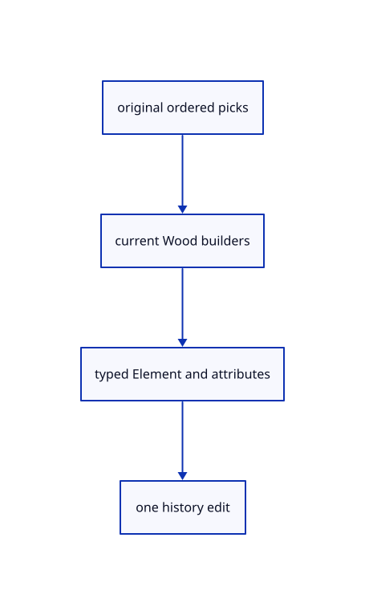

# 18.4.17 · Prove Element recipes source history and archives

**Chapter 18 · Lighting, render quality and comparison · Section 18.4 · Wood Elements and archives** · [Contents](contents.md)

**Typing: 0–0 minutes.** [Estimate](typing-load.md).

Prove Element recipes source history and archives.

## Type

Continue from [Pick Elements through the real command dock](92n-pick-elements-through-the-real-command-dock.md). [Save or recover your work](recovery.md).

<details>
<summary>Supplied validation fixture</summary>

Copy this supplied authoring fixture once. Continue with the browser build below; the course does not require running native tests.

### 1. `src/element_tests.rs`

Copy supplied original Element adapter and archive fixtures.

Copy this supplied file:

```text
--8<-- "journey/code/92o-prove-element-recipes-source-history-and-archives-01.rs"
```

</details>

<details>
<summary>Supplied validation fixture</summary>

Copy this supplied authoring fixture once. Continue with the browser build below; the course does not require running native tests.

### 2. `src/lib.rs`

Register the completed Element component.

<details>
<summary>Locate the existing block</summary>

```text

pub mod element_adopt;
```

</details>

After that block, append this supplied code:

```text
--8<-- "journey/code/92o-prove-element-recipes-source-history-and-archives-02.rs" skip=24
```

</details>

<details>
<summary>Supplied validation fixture</summary>

Copy this supplied authoring fixture once. Continue with the browser build below; the course does not require running native tests.

### 3. `src/element_beam.rs`

Copy maintained beam solid and command fixtures.

<details>
<summary>Locate the existing block</summary>

```text
}
```

</details>

After that block, append this supplied code:

```text
--8<-- "journey/code/92o-prove-element-recipes-source-history-and-archives-03.rs" skip=3
```

</details>

<details>
<summary>Supplied validation fixture</summary>

Copy this supplied authoring fixture once. Continue with the browser build below; the course does not require running native tests.

### 4. `src/element_column.rs`

Copy maintained column solid and command fixtures.

<details>
<summary>Locate the existing block</summary>

```text
}
```

</details>

After that block, append this supplied code:

```text
--8<-- "journey/code/92o-prove-element-recipes-source-history-and-archives-04.rs" skip=3
```

</details>

<details>
<summary>Supplied validation fixture</summary>

Copy this supplied authoring fixture once. Continue with the browser build below; the course does not require running native tests.

### 5. `src/element_plate.rs`

Copy maintained plate solid and command fixtures.

<details>
<summary>Locate the existing block</summary>

```text
}
```

</details>

After that block, append this supplied code:

```text
--8<-- "journey/code/92o-prove-element-recipes-source-history-and-archives-05.rs" skip=3
```

</details>

<details>
<summary>Supplied validation fixture</summary>

Copy this supplied authoring fixture once. Continue with the browser build below; the course does not require running native tests.

### 6. `src/element_support.rs`

Copy maintained support solid and command fixtures.

<details>
<summary>Locate the existing block</summary>

```text
}
```

</details>

After that block, append this supplied code:

```text
--8<-- "journey/code/92o-prove-element-recipes-source-history-and-archives-06.rs" skip=3
```

</details>

<details>
<summary>Supplied validation fixture</summary>

Copy this supplied authoring fixture once. Continue with the browser build below; the course does not require running native tests.

### 7. `src/element_beam_variable.rs`

Copy maintained beam variable solid and command fixtures.

<details>
<summary>Locate the existing block</summary>

```text
    Ok(BeamVariable::through(sections, "beam_variable"))
}
```

</details>

After that block, append this supplied code:

```text
--8<-- "journey/code/92o-prove-element-recipes-source-history-and-archives-07.rs" skip=60
```

</details>

<details>
<summary>Supplied validation fixture</summary>

Copy this supplied authoring fixture once. Continue with the browser build below; the course does not require running native tests.

### 8. `src/element_block.rs`

Copy maintained block solid and command fixtures.

<details>
<summary>Locate the existing block</summary>

```text
    Ok(Block::new(loops, "block"))
}
```

</details>

After that block, append this supplied code:

```text
--8<-- "journey/code/92o-prove-element-recipes-source-history-and-archives-08.rs" skip=38
```

</details>

## Run and check

Run this from `session_viewer` to select the fixed dependency versions and install supplied binary assets. It updates Cargo.lock and preserves the previous lock. It does not write implementation code:

```sh
npm --prefix ../session_tests run course -- dependencies 18.4.17
```

In your project:

```sh
cd workspace/journey
REGEN_PROTO=0 cargo build --lib --locked --target wasm32-unknown-unknown -j1
REGEN_PROTO=0 CARGO_BUILD_JOBS=1 trunk serve --port 8780
```

Open `http://127.0.0.1:8780/`. Keep an existing Trunk server running; saving rebuilds it.

Original typed beams, columns and a plate retain their current Wood solids, features and editable parent ownership. Element Attributes starts Off; Element Interactions starts On. The native feature fixture checks each category independently without changing the original Element payload.

### Recorded visual result

**Previous native render — current verification pending.**

Actual typed Element solids have consistent black outlines and contact shading.


*This recorded image predates a source or checker change. Rebuild this checkpoint before using it as current evidence; browser controls require separate acceptance.*

<details>
<summary>Code explanation and diagram</summary>


original ordered picks → current Wood builders → typed Element and attributes → one history edit.



What verifies the Element chapter?

Current builder solids plus exact source, history, archive and attribute behavior. Verify world placements, all six builders, strict input, feature movement, bounds and cascading Delete.

Study estimate, including typing and experiments: 0.5–1 hours.

</details>

<details>
<summary>Optional experiment</summary>

Inspect the original Element frame in the browser. Toggle Element Attributes and Element Interactions independently, then compare the supplied original-payload fixture.

</details>

<details>
<summary>Check and save your work</summary>

Restore experimental edits, then run from `session_viewer`:

```sh
npm --prefix ../session_tests run course -- check 18.4.17
npm --prefix ../session_tests run course -- save 18.4.17
```

Source comparison leaves your project untouched. [Save and recovery instructions](recovery.md).

</details>

<details>
<summary>Viewer coverage and verification</summary>

Use the maintained Wood Rust builders and current Element command defaults, longest-name matching, positive lengths and ordered world-space picks. Keep the original typed Element payload, exact solid and serialized features; display meshes and topology addresses remain derived. Base planes and features live under readonly attributes/features and follow their parent. Current source validation is retained; the complete raw-file/definition/interaction audit follows96.

[October 9 behavior](current-viewer.md): independent layer lamps, panel selection Fit, Element Attributes Off and Element Interactions On. The dated comparison preserves the earlier baseline; browser and handwritten-runtime coverage remain separate.

Retain earlier checks. Supplied maintained builder fixtures test all six families. Adapter fixtures test defaults, named/bare values, atomic invalid input, source order and world placements, stale picks, source consumption in one undo, exact Element archive payload, readonly attributes, feature visibility, parent movement, BoundingBox lengths and cascading Delete/Undo.

The supplied browser contract uses the command dock to create a beam from original lines, adjust named values, show features, measure bounds and Undo/Redo. It is syntaxchecked and requires an actual enabled browser. Native fixtures do not constitute browser acceptance.

[Full validation scope](release.md).

To reproduce the scripted acceptance of the reference checkpoint, run from `session_viewer` with the [course bundle server](release.md#reproduce) running on port 8781:

```sh
npm --prefix ../session_tests run course -- capture 18.4.17
```

This uses the verified reference bundle; it does not check or change your typed project.

</details>
