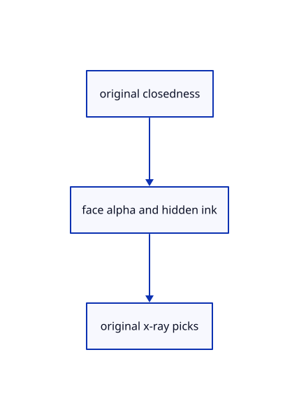

# 18.5.3 · Blend closed faces and retain opaque open surfaces

**Chapter 18 · Lighting, render quality and comparison · Section 18.5 · Glass and X-ray** · [Contents](contents.md)

**Typing: 7–13 minutes.** [Estimate](typing-load.md).

Blend closed faces and retain opaque open surfaces.

## Type

Continue from [Own opacity in the existing surface frame](93a-own-opacity-in-the-existing-surface-frame.md). [Save or recover your work](recovery.md).

### 1. `src/triangle.wgsl`

Adapt current closed/open alpha and mirrored-front behavior to the earlier source shader.

<details>
<summary>Locate the existing block</summary>

```wgsl
struct ViewSettings { transform: mat4x4<f32>, display: vec4<f32>, }
@group(0) @binding(0) var<uniform> view: ViewSettings;
struct ObjectSettings {
    model: mat4x4<f32>,
    selection: vec4<u32>,
    normal_matrix: mat4x4<f32>,
    face_colour:vec4<f32>,
}
@group(1) @binding(0) var<uniform> object: ObjectSettings;

struct VertexOutput {
    @builtin(position) position: vec4<f32>,
    @location(0) colour: vec3<f32>,
    @location(1) world: vec3<f32>,
    @location(2) normal: vec3<f32>,
    @location(3) @interpolate(flat) clip_flags:u32,
}

fn geometry(position: vec3<f32>, colour: vec3<f32>, normal: vec3<f32>) -> VertexOutput {
    var output: VertexOutput;
    let world = object.model * vec4<f32>(position, 1.0);
    output.position = view.transform * world;
    let displayed=select(colour,object.face_colour.xyz,object.face_colour.w>0.5);
    output.colour = select(displayed, vec3<f32>(1.0, 0.75, 0.05), object.selection.x != 0u);
    output.world = world.xyz;output.clip_flags=object.selection.z;
    output.normal = (object.normal_matrix * vec4<f32>(normal, 0.0)).xyz;
    return output;
}

@fragment
fn fragment(input: VertexOutput, @builtin(front_facing) front: bool) -> @location(0) vec4<f32> {
    // Derivatives require neighbouring fragments; calculate the sharp face direction before choosing a potentially smooth interpolated source direction.
    let derivative = cross(dpdx(input.world), dpdy(input.world));
    // Screen derivatives ignore vertex order; front-facing restores the original face orientation for reversed winding and world-normal inspection.
    let face = select(derivative, -derivative, front);
    if(clip_active()&&clip_cut(input.clip_flags,input.world)){discard;}
    let direction = select(face, input.normal, dot(input.normal, input.normal) > 0.0);
    let scale = max(max(abs(direction.x), abs(direction.y)), abs(direction.z));
    let bounded = direction / max(scale, 1e-30);
    let normal = bounded / max(length(bounded), 1e-30);
    if view.display.x > 0.5 { return vec4<f32>(normal * 0.5 + vec3<f32>(0.5), 1.0); }
    let light = normalize(vec3<f32>(0.4, -0.6, 1.0));
    // abs lights both sides of an open face; 0.3 keeps unlit faces readable.
    let brightness = 0.3 + 0.7 * abs(dot(normal, light));
    return vec4<f32>(input.colour * brightness, 1.0);
}

@vertex
fn vertex(@location(0) position: vec3<f32>, @location(1) colour: vec3<f32>, @location(2) normal: vec3<f32>) -> VertexOutput { return geometry(position, colour, normal); }
```

</details>

Edit the existing block to match this code; keep unchanged lines:

```wgsl
struct ViewSettings { transform: mat4x4<f32>, display: vec4<f32>, }
@group(0) @binding(0) var<uniform> view: ViewSettings;
struct ObjectSettings {
    model: mat4x4<f32>,
    selection: vec4<u32>,
    normal_matrix: mat4x4<f32>,
    face_colour:vec4<f32>,
}
@group(1) @binding(0) var<uniform> object: ObjectSettings;

struct VertexOutput {
    @builtin(position) position: vec4<f32>,
    @location(0) colour: vec3<f32>,
    @location(1) world: vec3<f32>,
    @location(2) normal: vec3<f32>,
    @location(3) @interpolate(flat) clip_flags:u32,
    @location(4) @interpolate(flat) mirrored:u32,
}

fn geometry(position: vec3<f32>, colour: vec3<f32>, normal: vec3<f32>) -> VertexOutput {
    var output: VertexOutput;
    let world = object.model * vec4<f32>(position, 1.0);
    output.position = view.transform * world;
    let displayed=select(colour,object.face_colour.xyz,object.face_colour.w>0.5);
    output.colour = select(displayed, vec3<f32>(1.0, 0.75, 0.05), object.selection.x != 0u);
    output.mirrored=select(0u,1u,determinant(mat3x3<f32>(object.model[0].xyz,object.model[1].xyz,object.model[2].xyz))<0.);
    output.world = world.xyz;output.clip_flags=object.selection.z;
    output.normal = (object.normal_matrix * vec4<f32>(normal, 0.0)).xyz;
    return output;
}

@fragment
fn fragment(input: VertexOutput, @builtin(front_facing) front: bool) -> @location(0) vec4<f32> {
    // Derivatives require neighbouring fragments; calculate the sharp face direction before choosing a potentially smooth interpolated source direction.
    let derivative = cross(dpdx(input.world), dpdy(input.world));
    // Screen derivatives ignore vertex order; front-facing restores the original face orientation for reversed winding and world-normal inspection.
    let face = select(derivative, -derivative, front);
    if(clip_active()&&clip_cut(input.clip_flags,input.world)){discard;}
    let closed=(input.clip_flags&8192u)!=0u;
    let source_front=(front!=(input.mirrored!=0u))!=((input.clip_flags&16384u)!=0u);
    if((input.clip_flags&32768u)!=0u || (closed&&!source_front&&view.display.y>0.&&view.display.y<1.)){discard;}
    let direction = select(face, input.normal, dot(input.normal, input.normal) > 0.0);
    let scale = max(max(abs(direction.x), abs(direction.y)), abs(direction.z));
    let bounded = direction / max(scale, 1e-30);
    let normal = bounded / max(length(bounded), 1e-30);
    if view.display.x > 0.5 { return vec4<f32>(normal * 0.5 + vec3<f32>(0.5), select(1.,view.display.y,closed)); }
    let light = normalize(vec3<f32>(0.4, -0.6, 1.0));
    // abs lights both sides of an open face; 0.3 keeps unlit faces readable.
    let brightness = 0.3 + 0.7 * abs(dot(normal, light));
    return vec4<f32>(input.colour * brightness, select(1.,view.display.y,closed));
}

@vertex
fn vertex(@location(0) position: vec3<f32>, @location(1) colour: vec3<f32>, @location(2) normal: vec3<f32>) -> VertexOutput { return geometry(position, colour, normal); }
```

<details>
<summary>Optional patch references</summary>

Use these original edit fragments when comparing a saved checkpoint. Apply the complete blocks above.

```text
--8<-- "journey/code/93b-blend-closed-faces-and-retain-opaque-open-surfaces-01.rs"
```

```text
--8<-- "journey/code/93b-blend-closed-faces-and-retain-opaque-open-surfaces-02.rs"
```

```text
--8<-- "journey/code/93b-blend-closed-faces-and-retain-opaque-open-surfaces-03.rs"
```

</details>

## Run and check

Run this from `session_viewer` to select the fixed dependency versions and install supplied binary assets. It updates Cargo.lock and preserves the previous lock. It does not write implementation code:

```sh
npm --prefix ../session_tests run course -- dependencies 18.5.3
```

In your project:

```sh
cd workspace/journey
REGEN_PROTO=0 cargo build --lib --locked --target wasm32-unknown-unknown -j1
REGEN_PROTO=0 CARGO_BUILD_JOBS=1 trunk serve --port 8780
```

Open `http://127.0.0.1:8780/`. Keep an existing Trunk server running; saving rebuilds it.


### Recorded visual result

**Previous native render — current verification pending.**

Actual typed Element solids have consistent black outlines and contact shading.


*This recorded image predates a source or checker change. Rebuild this checkpoint before using it as current evidence; browser controls require separate acceptance.*

This reference image is shared with [18.5.1 · Classify original solids independently of clipping](93-classify-original-solids-independently-of-clipping.md). It does not demonstrate a new feature by itself.

<details>
<summary>Code explanation and diagram</summary>


original closedness → face alpha and hidden ink → original x-ray picks.



Should a half-transparent solid draw its back face again?

No. Reject closed back faces while glass is active, respecting original winding and mirrored placement. Open surfaces remain opaque.

Study estimate, including typing and experiments: 0.5–1 hours.

</details>

<details>
<summary>Optional experiment</summary>

Compare one front-face blend, a mirrored solid and an open surface at 0.5.

</details>

<details>
<summary>Check and save your work</summary>

Restore experimental edits, then run from `session_viewer`:

```sh
npm --prefix ../session_tests run course -- check 18.5.3
npm --prefix ../session_tests run course -- save 18.5.3
```

Source comparison leaves your project untouched. [Save and recovery instructions](recovery.md).

</details>

<details>
<summary>Viewer coverage and verification</summary>


The supplied browser contract types Opacity 0/0.4/0.7/1 through the real command dock and checks its state, original geometry and history. It is syntaxchecked and requires an actual enabled browser. Native software-GPU results do not establish Lenovo speed.

[Full validation scope](release.md).

To reproduce the scripted acceptance of the reference checkpoint, run from `session_viewer` with the [course bundle server](release.md#reproduce) running on port 8781:

```sh
npm --prefix ../session_tests run course -- capture 18.5.3
```

This uses the verified reference bundle; it does not check or change your typed project.

</details>
