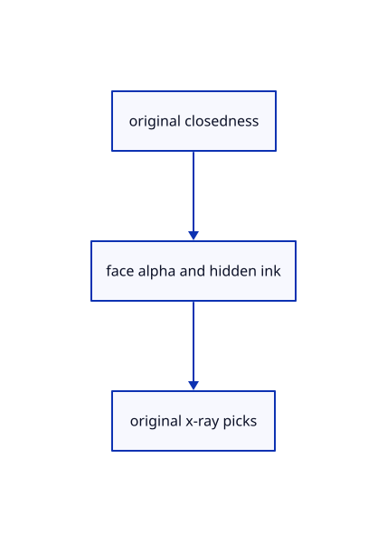

# 18.5.4 · Exclude x-ray faces from original picks and masks

**Chapter 18 · Lighting, render quality and comparison · Section 18.5 · Glass and X-ray** · [Contents](contents.md)

**Typing: 7–14 minutes.** [Estimate](typing-load.md).

Exclude x-ray faces from original picks and masks.

## Type

Continue from [Blend closed faces and retain opaque open surfaces](93b-blend-closed-faces-and-retain-opaque-open-surfaces.md). [Save or recover your work](recovery.md).

### 1. `src/triangle_pick.wgsl`

Apply one derived x-ray face predicate without source mutation.

<details>
<summary>Locate the existing block</summary>

```wgsl
struct MeshPickOutput{@builtin(position) position:vec4<f32>,@location(0) world:vec3<f32>,@location(1) @interpolate(flat) flags:u32}
@vertex fn pick_vertex(@location(0) position:vec3<f32>,@location(1) colour:vec3<f32>,@location(2) normal:vec3<f32>)->MeshPickOutput{let placed=geometry(position,colour,normal);return MeshPickOutput(crop.transform*placed.position,placed.world,placed.clip_flags);}
@fragment fn pick_fragment(input:MeshPickOutput)->@location(0) vec2<u32>{if(clip_active()&&clip_cut(input.flags,input.world)){discard;}return vec2<u32>(select(0u,object.selection.y,crop.mode==0u),0u);}
```

</details>

Edit the existing block to match this code; keep unchanged lines:

```wgsl
--8<-- "journey/code/93c-exclude-x-ray-faces-from-original-picks-and-masks-01.rs"
```

### 2. `src/face_pick.wgsl`

Apply one derived x-ray face predicate without source mutation.

<details>
<summary>Locate the existing block</summary>

```wgsl
@fragment
fn face_fragment(input: FaceOutput) -> @location(0) vec2<u32> {
    if(clip_active()&&clip_cut(input.flags,input.world)){discard;}
    return vec2<u32>(object.selection.y, (0x20000000u | input.face) + 1u);
}
```

</details>

Edit the existing block to match this code; keep unchanged lines:

```wgsl
--8<-- "journey/code/93c-exclude-x-ray-faces-from-original-picks-and-masks-02.rs"
```

### 3. `src/outline_mask.wgsl`

Apply one derived x-ray face predicate without source mutation.

<details>
<summary>Locate the existing block</summary>

```wgsl
struct Output{@builtin(position) position:vec4<f32>,@location(0) world:vec3<f32>,@location(1) @interpolate(flat) flags:u32}
@vertex fn vertex(@location(0) position:vec3<f32>)->Output{let world=object.model*vec4<f32>(position,1.0);return Output(view.transform*world,world.xyz,object.selection.z);}
@fragment fn fragment(input:Output)->@location(0) vec4<f32>{if(clip_active()&&clip_cut(input.flags,input.world)){discard;}return vec4<f32>(1.0);}
```

</details>

Edit the existing block to match this code; keep unchanged lines:

```wgsl
--8<-- "journey/code/93c-exclude-x-ray-faces-from-original-picks-and-masks-03.rs"
```

### 4. `src/ambient_sources.wgsl`

Apply one derived x-ray face predicate without source mutation.

<details>
<summary>Locate the existing block</summary>

```wgsl
struct Source{@location(0) radius:f32,@location(1) normal:vec2<f32>}
@fragment fn fs_main(in:Vertex,@builtin(front_facing) front:bool)->Source{
 let face=cross(dpdx(in.world),dpdy(in.world));if(clip_active()&&clip_cut(in.flags,in.world)){discard;}
 let normal=normalize(select(select(face,-face,front),in.normal,dot(in.normal,in.normal)>0.));
 return Source(ambient_radius.x,encode_normal(normal)*0.5+0.5);
```

</details>

Edit the existing block to match this code; keep unchanged lines:

```wgsl
--8<-- "journey/code/93c-exclude-x-ray-faces-from-original-picks-and-masks-04.rs"
```

## Run and check

Run this from `session_viewer` to select the fixed dependency versions and install supplied binary assets. It updates Cargo.lock and preserves the previous lock. It does not write implementation code:

```sh
npm --prefix ../session_tests run course -- dependencies 18.5.4
```

In your project:

```sh
cd workspace/journey
REGEN_PROTO=0 cargo build --lib --locked --target wasm32-unknown-unknown -j1
REGEN_PROTO=0 CARGO_BUILD_JOBS=1 trunk serve --port 8780
```

Open `http://127.0.0.1:8780/`. Keep an existing Trunk server running; saving rebuilds it.


### Recorded visual result

**Previous native render — current verification pending.**

Actual typed Element solids have consistent black outlines and contact shading.


*This recorded image predates a source or checker change. Rebuild this checkpoint before using it as current evidence; browser controls require separate acceptance.*

This reference image is shared with [18.5.1 · Classify original solids independently of clipping](93-classify-original-solids-independently-of-clipping.md). It does not demonstrate a new feature by itself.

<details>
<summary>Code explanation and diagram</summary>


original closedness → face alpha and hidden ink → original x-ray picks.



Does Opacity 0 erase the original object?

No. Closed faces stop drawing and taking face picks; original edge and line owners remain available. Open surfaces still draw their faces.

Study estimate, including typing and experiments: 0.5–1 hours.

</details>

<details>
<summary>Optional experiment</summary>

Inspect derived x-ray flags in surface IDs, face IDs, outline coverage and ambient properties.

</details>

<details>
<summary>Check and save your work</summary>

Restore experimental edits, then run from `session_viewer`:

```sh
npm --prefix ../session_tests run course -- check 18.5.4
npm --prefix ../session_tests run course -- save 18.5.4
```

Source comparison leaves your project untouched. [Save and recovery instructions](recovery.md).

</details>

<details>
<summary>Viewer coverage and verification</summary>


The supplied browser contract types Opacity 0/0.4/0.7/1 through the real command dock and checks its state, original geometry and history. It is syntaxchecked and requires an actual enabled browser. Native software-GPU results do not establish Lenovo speed.

[Full validation scope](release.md).

To reproduce the scripted acceptance of the reference checkpoint, run from `session_viewer` with the [course bundle server](release.md#reproduce) running on port 8781:

```sh
npm --prefix ../session_tests run course -- capture 18.5.4
```

This uses the verified reference bundle; it does not check or change your typed project.

</details>
