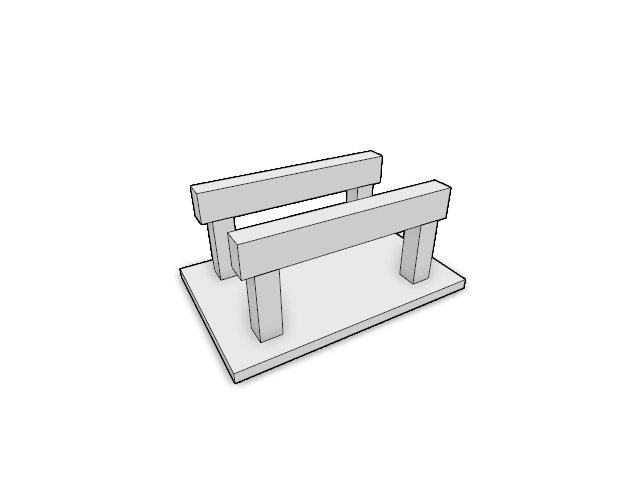
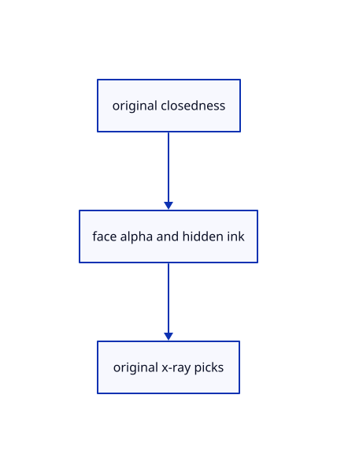

# 18.5.6 · Fade hidden ink without showing clipped geometry

**Chapter 18 · Lighting, render quality and comparison · Section 18.5 · Glass and X-ray** · [Contents](contents.md)

**Typing: 11–22 minutes.** [Estimate](typing-load.md).

Fade hidden ink without showing clipped geometry.

## Type

Continue from [Carry opacity into finite original ink](93d-carry-opacity-into-finite-original-ink.md). [Save or recover your work](recovery.md).

### 1. `src/finite_stroke.wgsl`

Use the same original ink visibility alpha for color and integer picks.

<details>
<summary>Locate the existing block</summary>

```wgsl
    @builtin(vertex_index) index: u32,@location(8) flags:u32) -> Output { return geometry(start, end, colour, width, index,flags); }
@fragment
fn fragment(input: Output) -> @location(0) vec4<f32> {if(!finite_visible(input.finite_pixel,input.finite_axis_value,input.finite_depths,input.clip_flags)){discard;}return colour(input);}
```

</details>

Edit the existing block to match this code; keep unchanged lines:

```wgsl
--8<-- "journey/code/93e-fade-hidden-ink-without-showing-clipped-geometry-01.rs"
```

### 2. `src/finite_chain.wgsl`

Use the same original ink visibility alpha for color and integer picks.

<details>
<summary>Locate the existing block</summary>

```wgsl
    @location(6) heads: u32, @builtin(vertex_index) index: u32,@location(8) flags:u32) -> Output { return geometry(start, end, colour, width, previous, next, heads, index,flags); }
@fragment
fn fragment(input: Output) -> @location(0) vec4<f32> {if(!finite_visible(input.finite_pixel,input.finite_axis_value,input.finite_depths,input.clip_flags)){discard;}return colour(input);}
```

</details>

Edit the existing block to match this code; keep unchanged lines:

```wgsl
--8<-- "journey/code/93e-fade-hidden-ink-without-showing-clipped-geometry-02.rs"
```

### 3. `src/finite_marker.wgsl`

Use the same original ink visibility alpha for color and integer picks.

<details>
<summary>Locate the existing block</summary>

```wgsl
    @location(2) colour: vec4<f32>, @builtin(vertex_index) index: u32,@location(8) flags:u32) -> Output { return geometry(center, diameter, colour, index,flags); }
@fragment
fn fragment(input: Output) -> @location(0) vec4<f32> {if(!finite_visible(input.finite_pixel,input.finite_axis_value,input.finite_depths,input.clip_flags)){discard;}return colour(input);}
```

</details>

Edit the existing block to match this code; keep unchanged lines:

```wgsl
--8<-- "journey/code/93e-fade-hidden-ink-without-showing-clipped-geometry-03.rs"
```

### 4. `src/finite_stroke_pick.wgsl`

Use the same original ink visibility alpha for color and integer picks.

<details>
<summary>Locate the existing block</summary>

```wgsl
    if (!wanted(input.id.y, crop.mode)) { discard; }
    if (colour(source).a <= 0.0) { discard; }
    if(!finite_visible(input.finite_pixel,input.finite_axis_value,input.finite_depths,input.clip_flags)){discard;}
    return input.id;
}
```

</details>

Edit the existing block to match this code; keep unchanged lines:

```wgsl
--8<-- "journey/code/93e-fade-hidden-ink-without-showing-clipped-geometry-04.rs"
```

### 5. `src/finite_chain_pick.wgsl`

Use the same original ink visibility alpha for color and integer picks.

<details>
<summary>Locate the existing block</summary>

```wgsl
    if (!wanted(input.id.y, crop.mode)) { discard; }
    if (colour(source).a <= 0.0) { discard; }
    if(!finite_visible(input.finite_pixel,input.finite_axis_value,input.finite_depths,input.clip_flags)){discard;}
    return input.id;
}
```

</details>

Edit the existing block to match this code; keep unchanged lines:

```wgsl
--8<-- "journey/code/93e-fade-hidden-ink-without-showing-clipped-geometry-05.rs"
```

### 6. `src/finite_marker_pick.wgsl`

Use the same original ink visibility alpha for color and integer picks.

<details>
<summary>Locate the existing block</summary>

```wgsl
    if (!wanted(input.id.y, crop.mode)) { discard; }
    if (colour(source).a <= 0.0) { discard; }
    if(!finite_visible(input.finite_pixel,input.finite_axis_value,input.finite_depths,input.clip_flags)){discard;}
    return input.id;
}
```

</details>

Edit the existing block to match this code; keep unchanged lines:

```wgsl
--8<-- "journey/code/93e-fade-hidden-ink-without-showing-clipped-geometry-06.rs"
```

## Run and check

Run this from `session_viewer` to select the fixed dependency versions and install supplied binary assets. It updates Cargo.lock and preserves the previous lock. It does not write implementation code:

```sh
npm --prefix ../session_tests run course -- dependencies 18.5.6
```

In your project:

```sh
cd workspace/journey
REGEN_PROTO=0 cargo build --lib --locked --target wasm32-unknown-unknown -j1
REGEN_PROTO=0 CARGO_BUILD_JOBS=1 trunk serve --port 8780
```

Open `http://127.0.0.1:8780/`. Keep an existing Trunk server running; saving rebuilds it.


### Recorded visual result

**Previous native render — current verification pending.**

Actual typed Element solids have consistent black outlines and contact shading.



*This recorded image predates a source or checker change. Rebuild this checkpoint before using it as current evidence; browser controls require separate acceptance.*

This reference image is shared with [18.5.1 · Classify original solids independently of clipping](93-classify-original-solids-independently-of-clipping.md). It does not demonstrate a new feature by itself.

<details>
<summary>Code explanation and diagram</summary>


original closedness → face alpha and hidden ink → original x-ray picks.



Should clipping be treated as merely hidden glass ink?

No. Clipped originals stay absent. Visible ink has full alpha, hidden glass ink has 1-opacity, and x-ray exposes original ink.

Study estimate, including typing and experiments: 0.5–1 hours.

</details>

<details>
<summary>Optional experiment</summary>

Compare a hidden line behind a closed face with a line cut away by a clipping plane.

</details>

<details>
<summary>Check and save your work</summary>

Restore experimental edits, then run from `session_viewer`:

```sh
npm --prefix ../session_tests run course -- check 18.5.6
npm --prefix ../session_tests run course -- save 18.5.6
```

Source comparison leaves your project untouched. [Save and recovery instructions](recovery.md).

</details>

<details>
<summary>Viewer coverage and verification</summary>


The supplied browser contract types Opacity 0/0.4/0.7/1 through the real command dock and checks its state, original geometry and history. It is syntaxchecked and requires an actual enabled browser. Native software-GPU results do not establish Lenovo speed.

[Full validation scope](release.md).

To reproduce the scripted acceptance of the reference checkpoint, run from `session_viewer` with the [course bundle server](release.md#reproduce) running on port 8781:

```sh
npm --prefix ../session_tests run course -- capture 18.5.6
```

This uses the verified reference bundle; it does not check or change your typed project.

</details>
