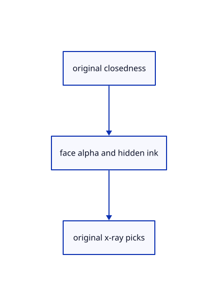

# 18.5.7 · Invalidate presentation and preserve cached geometry

**Chapter 18 · Lighting, render quality and comparison · Section 18.5 · Glass and X-ray** · [Contents](contents.md)

**Typing: 7–13 minutes.** [Estimate](typing-load.md).

Invalidate presentation and preserve cached geometry.

## Type

Continue from [Fade hidden ink without showing clipped geometry](93e-fade-hidden-ink-without-showing-clipped-geometry.md). [Save or recover your work](recovery.md).

### 1. `src/renderer.rs`

Connect opacity changes to compatible original source flags and presentation caches.

<details>
<summary>Locate the existing block</summary>

```rust
        if let Some(lane)=self.clouds.borrow_mut().as_mut() {lane.set_clipping(self.clipping.borrow().writes);if let Err(error)=lane.prepare(&self.text_context(),transform,self.size,self.density,self.cloud_view.get()) {lane.failed();*self.cloud_error.borrow_mut()=Some(error.to_string());} else {self.cloud_error.borrow_mut().take();}}
    }
    pub fn set_outlines(&self,on:bool){self.outlines_enabled.set(on);if !on{self.global_outline.borrow_mut().take();self.outline_composite.borrow_mut().take();}}
    pub fn global_outline_usage(&self)->[u64;4]{self.global_outline.borrow().as_ref().map_or([0;4],|o|o.usage())}
```

</details>

Edit the existing block to match this code; keep unchanged lines:

```rust
--8<-- "journey/code/93f-invalidate-presentation-and-preserve-cached-geometry-01.rs"
```

## Run and check

Run this from `session_viewer` to select the fixed dependency versions and install supplied binary assets. It updates Cargo.lock and preserves the previous lock. It does not write implementation code:

```sh
npm --prefix ../session_tests run course -- dependencies 18.5.7
```

In your project:

```sh
cd workspace/journey
REGEN_PROTO=0 cargo build --lib --locked --target wasm32-unknown-unknown -j1
REGEN_PROTO=0 CARGO_BUILD_JOBS=1 trunk serve --port 8780
```

Open `http://127.0.0.1:8780/`. Keep an existing Trunk server running; saving rebuilds it.


### Recorded visual result

**Previous native render — current verification pending.**

Actual typed Element solids have consistent black outlines and contact shading.


*This recorded image predates a source or checker change. Rebuild this checkpoint before using it as current evidence; browser controls require separate acceptance.*

This reference image is shared with [18.5.1 · Classify original solids independently of clipping](93-classify-original-solids-independently-of-clipping.md). It does not demonstrate a new feature by itself.

<details>
<summary>Code explanation and diagram</summary>


original closedness → face alpha and hidden ink → original x-ray picks.



Does an opacity change reupload original vertices?

No. Patch the derived x-ray flags, cancel obsolete picks and invalidate presentation masks. Earlier glass draws use retained per-owner geometry; opaque instance batching remains available.

Study estimate, including typing and experiments: 0.5–1 hours.

</details>

<details>
<summary>Optional experiment</summary>

Change 0.5 to 0 to 1 and compare original geometry uploads and restored solid pixels.

</details>

<details>
<summary>Check and save your work</summary>

Restore experimental edits, then run from `session_viewer`:

```sh
npm --prefix ../session_tests run course -- check 18.5.7
npm --prefix ../session_tests run course -- save 18.5.7
```

Source comparison leaves your project untouched. [Save and recovery instructions](recovery.md).

</details>

<details>
<summary>Viewer coverage and verification</summary>


The supplied browser contract types Opacity 0/0.4/0.7/1 through the real command dock and checks its state, original geometry and history. It is syntaxchecked and requires an actual enabled browser. Native software-GPU results do not establish Lenovo speed.

[Full validation scope](release.md).

To reproduce the scripted acceptance of the reference checkpoint, run from `session_viewer` with the [course bundle server](release.md#reproduce) running on port 8781:

```sh
npm --prefix ../session_tests run course -- capture 18.5.7
```

This uses the verified reference bundle; it does not check or change your typed project.

</details>
