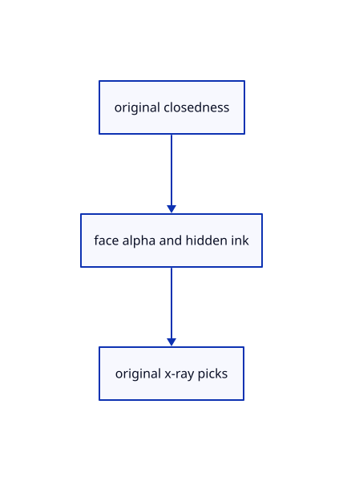

# 18.5.9 · Prove actual glass x-ray and source ownership

**Chapter 18 · Lighting, render quality and comparison · Section 18.5 · Glass and X-ray** · [Contents](contents.md)

**Typing: 0–0 minutes.** [Estimate](typing-load.md).

Prove actual glass x-ray and source ownership.

## Type

Continue from [Connect strict Opacity presentation commands](93g-connect-strict-opacity-presentation-commands.md). [Save or recover your work](recovery.md).

<details>
<summary>Supplied validation fixture</summary>

Copy this supplied authoring fixture once. Continue with the browser build below; the course does not require running native tests.

### 1. `src/opacity_gpu_tests.rs`

Copy supplied actual alpha, hidden ink, original pick and refresh fixtures.

Copy this supplied file:

```text
--8<-- "journey/code/93h-prove-actual-glass-x-ray-and-source-ownership-01.rs"
```

</details>

<details>
<summary>Supplied validation fixture</summary>

Copy this supplied authoring fixture once. Continue with the browser build below; the course does not require running native tests.

### 2. `src/renderer.rs`

Register actual renderer-local transparency fixtures.

<details>
<summary>Locate the existing block</summary>

```text
#[path="global_outline_tests.rs"]
mod global_outline_tests;
```

</details>

After that block, append this supplied code:

```text
--8<-- "journey/code/93h-prove-actual-glass-x-ray-and-source-ownership-02.rs" skip=60
```

</details>

<details>
<summary>Supplied validation fixture</summary>

Copy this supplied authoring fixture once. Continue with the browser build below; the course does not require running native tests.

### 3. `src/opacity_command_tests.rs`

Copy supplied strict presentation/pending-point/history fixtures.

Copy this supplied file:

```text
--8<-- "journey/code/93h-prove-actual-glass-x-ray-and-source-ownership-03.rs"
```

</details>

<details>
<summary>Supplied validation fixture</summary>

Copy this supplied authoring fixture once. Continue with the browser build below; the course does not require running native tests.

### 4. `src/lib.rs`

Register the completed transparency component.

<details>
<summary>Locate the existing block</summary>

```text
#[cfg(test)]
mod element_tests;
```

</details>

After that block, append this supplied code:

```text
--8<-- "journey/code/93h-prove-actual-glass-x-ray-and-source-ownership-04.rs" skip=32
```

</details>

## Run and check

Run this from `session_viewer` to select the fixed dependency versions and install supplied binary assets. It updates Cargo.lock and preserves the previous lock. It does not write implementation code:

```sh
npm --prefix ../session_tests run course -- dependencies 18.5.9
```

In your project:

```sh
cd workspace/journey
REGEN_PROTO=0 cargo build --lib --locked --target wasm32-unknown-unknown -j1
REGEN_PROTO=0 CARGO_BUILD_JOBS=1 trunk serve --port 8780
```

Open `http://127.0.0.1:8780/`. Keep an existing Trunk server running; saving rebuilds it.

The original closed pedestal is translucent while its black original ink and consistent silhouette remain visible.

### Recorded visual result

**Previous native render — current verification pending.**

Actual closed original faces blend over the background while curved and flat outlines retain their CSS width.


*This recorded image predates a source or checker change. Rebuild this checkpoint before using it as current evidence; browser controls require separate acceptance.*

<details>
<summary>Code explanation and diagram</summary>


original closedness → face alpha and hidden ink → original x-ray picks.



What proves transparency works?

Actual face/ink color and integer picks. Verify open/mirrored/refreshed sources, unchanged originals, no vertex reupload and exact solid restoration.

Study estimate, including typing and experiments: 0.5–1 hours.

</details>

<details>
<summary>Optional experiment</summary>

Fit Example CAD in an isometric view. Compare Opacity 1, 0.4 and 0 while inspecting the closed solid and its original ink; restore 1. Select the solid, move it and Undo, then compare its restored drawing. Native fixtures separately check exact blended pixels, mirrored originals and upload reuse.

</details>

<details>
<summary>Check and save your work</summary>

Restore experimental edits, then run from `session_viewer`:

```sh
npm --prefix ../session_tests run course -- check 18.5.9
npm --prefix ../session_tests run course -- save 18.5.9
```

Source comparison leaves your project untouched. [Save and recovery instructions](recovery.md).

</details>

<details>
<summary>Viewer coverage and verification</summary>

Retain current closed-solid alpha, opaque open surfaces, translucent back-face rejection, mirrored originals, hidden ink alpha 1-opacity and x-ray original ink picking. Reuse weak original closedness independently of clipping; cap tokens remain lazy. This explicit earlier-renderer adapter still uses its earlier lighting and per-owner glass drawing. Full primitive/MRT/MSAA/packed-arena/current shader comparison follows 94–95.

Retain earlier checks. Supplied actual GPU fixtures test blended closed faces, opaque open surfaces, hidden line fading and integer picks, x-ray face exclusion, scene refresh, mirrored originals, exact source equality, restored solid pixels and unchanged geometry uploads. Strict presentation tests retain pending points, epoch and Redo.

The supplied browser contract types Opacity 0/0.4/0.7/1 through the real command dock and checks its state, original geometry and history. It is syntaxchecked and requires an actual enabled browser. Native software-GPU results do not establish Lenovo speed.

[Full validation scope](release.md).

To reproduce the scripted acceptance of the reference checkpoint, run from `session_viewer` with the [course bundle server](release.md#reproduce) running on port 8781:

```sh
npm --prefix ../session_tests run course -- capture 18.5.9
```

This uses the verified reference bundle; it does not check or change your typed project.

</details>
