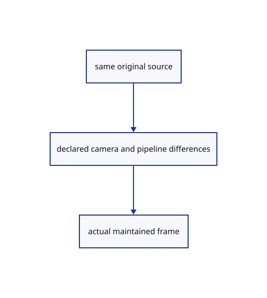

# 18.6.2 · Link the maintained native rendering reference

**Chapter 18 · Lighting, render quality and comparison · Section 18.6 · Rendering comparisons** · [Contents](contents.md)

**Typing: 2–3 minutes.** [Estimate](typing-load.md).

Link the maintained native rendering reference.

## Type

Continue from [Declare the rendering comparison contract](94-declare-the-rendering-comparison-contract.md). [Save or recover your work](recovery.md).

### 1. `Cargo.toml`

Link the exact maintained viewer from the reconstructed checkpoint.

<details>
<summary>Locate the existing block</summary>

```toml
pollster = "=0.4.0"
log = "=0.4.34"
```

</details>

After that block, type:

```toml
--8<-- "journey/code/94a-link-the-maintained-native-rendering-reference-01.rs" skip=36
```

## Run and check

Run this from `session_viewer` to select the fixed dependency versions and install supplied binary assets. It updates Cargo.lock and preserves the previous lock. It does not write implementation code:

```sh
npm --prefix ../session_tests run course -- dependencies 18.6.2
```

In your project:

```sh
cd workspace/journey
REGEN_PROTO=0 cargo build --lib --locked --target wasm32-unknown-unknown -j1
REGEN_PROTO=0 CARGO_BUILD_JOBS=1 trunk serve --port 8780
```

Open `http://127.0.0.1:8780/`. Keep an existing Trunk server running; saving rebuilds it.


### Recorded visual result

**Previous native render — current verification pending.**

Actual closed original faces blend over the background while curved and flat outlines retain their CSS width.


*This recorded image predates a source or checker change. Rebuild this checkpoint before using it as current evidence; browser controls require separate acceptance.*

This reference image is shared with [18.5.9 · Prove actual glass x-ray and source ownership](93h-prove-actual-glass-x-ray-and-source-ownership.md). It does not demonstrate a new feature by itself.

<details>
<summary>Code explanation and diagram</summary>


same original source → declared camera and pipeline differences → actual maintained frame.



Should this chapter copy another version of the production GPU pipeline?

Use the maintained library as a native reference. The WebAssembly teaching application keeps its own earlier renderer; the native comparison executes the actual current shader and pipeline implementation.

Study estimate, including typing and experiments: 0.5–1 hours.

</details>

<details>
<summary>Optional experiment</summary>

Inspect the optional authoring reference and its recorded camera and environment settings. Compare the supplied reference image with the browser result using the declared viewport and settings. The earlier Fit and maintained corner-fitting camera differ; this comparison does not require running a native program.

</details>

<details>
<summary>Check and save your work</summary>

Restore experimental edits, then run from `session_viewer`:

```sh
npm --prefix ../session_tests run course -- check 18.6.2
npm --prefix ../session_tests run course -- save 18.6.2
```

Source comparison leaves your project untouched. [Save and recovery instructions](recovery.md).

</details>

<details>
<summary>Viewer coverage and verification</summary>


The supplied browser contract exercises the same original pedestal in the teaching renderer. It is syntaxchecked; real browser acceptance remains separate from native software-GPU rendering.

[Full validation scope](release.md).

To reproduce the scripted acceptance of the reference checkpoint, run from `session_viewer` with the [course bundle server](release.md#reproduce) running on port 8781:

```sh
npm --prefix ../session_tests run course -- capture 18.6.2
```

This uses the verified reference bundle; it does not check or change your typed project.

</details>
