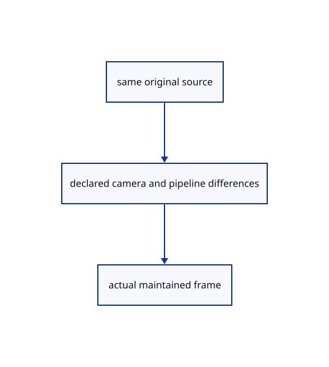

# 18.6.3 · Read actual maintained frames without source mutation

**Chapter 18 · Lighting, render quality and comparison · Section 18.6 · Rendering comparisons** · [Contents](contents.md)

**Typing: 2–3 minutes.** [Estimate](typing-load.md).

Read the recorded maintained frame using the same original data. The headless PPM wrapper is an optional authoring fixture; continue running your viewer in the browser.

## Type

Continue from [Link the maintained native rendering reference](94a-link-the-maintained-native-rendering-reference.md). [Save or recover your work](recovery.md).

<details>
<summary>Optional authoring helper</summary>

Copy this supplied authoring helper once. Use the linked data or recorded comparison for the browser exercise; you do not need to compile or run this native helper.

### 1. `src/reference_example.rs`

Copy the supplied maintained-frame command line example.

Copy this supplied file:

```text
--8<-- "journey/code/94b-read-actual-maintained-frames-without-source-mutation-01.rs"
```

</details>

### 2. `Cargo.toml`

Expose the maintained reference as a native example.

<details>
<summary>Locate the existing block</summary>

```toml
[target.'cfg(not(target_arch = "wasm32"))'.dependencies]
current_viewer = { package = "session_viewer", path = "../.." }
```

</details>

After that block, type:

```toml
--8<-- "journey/code/94b-read-actual-maintained-frames-without-source-mutation-02.rs" skip=121
```

<details>
<summary>Optional authoring helper</summary>

Copy this supplied authoring helper once. Use the linked data or recorded comparison for the browser exercise; you do not need to compile or run this native helper.

### 3. `src/reference_frame.rs`

Supply the optional native comparison wrapper; the browser application does not call it.

Copy this supplied file:

```text
--8<-- "journey/code/94b-read-actual-maintained-frames-without-source-mutation-03.rs"
```

</details>

### 4. `src/lib.rs`

Keep the maintained reference native-only.

<details>
<summary>Locate the existing block</summary>

```rust

pub mod comparison;
```

</details>

After that block, type:

```rust
--8<-- "journey/code/94b-read-actual-maintained-frames-without-source-mutation-04.rs" skip=21
```

## Run and check

Run this from `session_viewer` to select the fixed dependency versions and install supplied binary assets. It updates Cargo.lock and preserves the previous lock. It does not write implementation code:

```sh
npm --prefix ../session_tests run course -- dependencies 18.6.3
```

In your project:

```sh
cd workspace/journey
REGEN_PROTO=0 cargo build --lib --locked --target wasm32-unknown-unknown -j1
REGEN_PROTO=0 CARGO_BUILD_JOBS=1 trunk serve --port 8780
```

Open `http://127.0.0.1:8780/`. Keep an existing Trunk server running; saving rebuilds it.


### Recorded visual result

**Previous native render — current verification pending.**

Actual closed original faces blend over the background while curved and flat outlines retain their CSS width.


*This recorded image predates a source or checker change. Rebuild this checkpoint before using it as current evidence; browser controls require separate acceptance.*

This reference image is shared with [18.5.9 · Prove actual glass x-ray and source ownership](93h-prove-actual-glass-x-ray-and-source-ownership.md). It does not demonstrate a new feature by itself.

<details>
<summary>Code explanation and diagram</summary>


same original source → declared camera and pipeline differences → actual maintained frame.



Does an output filename prove a valid rendered image?

Check the exact framebuffer dimensions, P6 header and byte count, then inspect rendered face coverage. A missing or truncated frame fails. Compare the input file bytes before and after rendering.

Study estimate, including typing and experiments: 0.5–1 hours.

</details>

<details>
<summary>Optional experiment</summary>

Use a 640 by 480 browser viewport. Inspect the source file, supplied maintained frame and declared default differences.

</details>

<details>
<summary>Check and save your work</summary>

Restore experimental edits, then run from `session_viewer`:

```sh
npm --prefix ../session_tests run course -- check 18.6.3
npm --prefix ../session_tests run course -- save 18.6.3
```

Source comparison leaves your project untouched. [Save and recovery instructions](recovery.md).

</details>

<details>
<summary>Viewer coverage and verification</summary>


The supplied browser contract exercises the same original pedestal in the teaching renderer. It is syntaxchecked; real browser acceptance remains separate from native software-GPU rendering.

[Full validation scope](release.md).

To reproduce the scripted acceptance of the reference checkpoint, run from `session_viewer` with the [course bundle server](release.md#reproduce) running on port 8781:

```sh
npm --prefix ../session_tests run course -- capture 18.6.3
```

This uses the verified reference bundle; it does not check or change your typed project.

</details>
