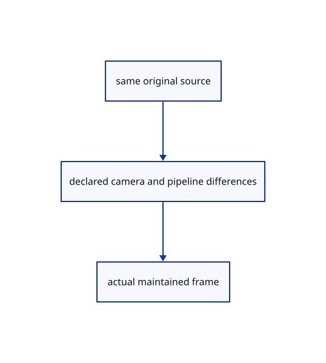

# 18.6.4 · Prove the original comparison and inspect differences

**Chapter 18 · Lighting, render quality and comparison · Section 18.6 · Rendering comparisons** · [Contents](contents.md)

**Typing: 1–2 minutes.** [Estimate](typing-load.md).

Prove the original comparison and inspect differences.

## Type

Continue from [Read actual maintained frames without source mutation](94b-read-actual-maintained-frames-without-source-mutation.md). [Save or recover your work](recovery.md).

<details>
<summary>Supplied validation fixture</summary>

Copy this supplied authoring fixture once. Continue with the browser build below; the course does not require running native tests.

### 1. `src/comparison_tests.rs`

Copy supplied actual source and maintained-frame fixtures.

Copy this supplied file:

```text
--8<-- "journey/code/94c-prove-the-original-comparison-and-inspect-differences-01.rs"
```

</details>

<details>
<summary>Supplied validation fixture</summary>

Copy this supplied authoring fixture once. Continue with the browser build below; the course does not require running native tests.

### 2. `src/lib.rs`

Register supplied comparison fixtures.

<details>
<summary>Locate the existing block</summary>

```text
#[cfg(not(target_arch="wasm32"))]
pub mod reference_frame;
```

</details>

After that block, append this supplied code:

```text
--8<-- "journey/code/94c-prove-the-original-comparison-and-inspect-differences-02.rs" skip=59
```

</details>

### 3. `index.html`

Package the actual original comparison and later metadata protobuf fixtures for browser acceptance.

<details>
<summary>Locate the existing block</summary>

```html
  <link data-trunk rel="copy-dir" href="assets/text" data-target-path="text">
```

</details>

After that block, type:

```html
--8<-- "journey/code/94c-prove-the-original-comparison-and-inspect-differences-package-original-fixtures.html" skip=78
```

## Run and check

Run this from `session_viewer` to select the fixed dependency versions and install supplied binary assets. It updates Cargo.lock and preserves the previous lock. It does not write implementation code:

```sh
npm --prefix ../session_tests run course -- dependencies 18.6.4
```

In your project:

```sh
cd workspace/journey
REGEN_PROTO=0 cargo build --lib --locked --target wasm32-unknown-unknown -j1
REGEN_PROTO=0 CARGO_BUILD_JOBS=1 trunk serve --port 8780
```

Open `http://127.0.0.1:8780/`. Keep an existing Trunk server running; saving rebuilds it.

The teaching renderer draws the same four original solids used by the maintained native reference.

### Recorded visual result

**Previous native render — current verification pending.**

Four blue original solids retain continuous black curved and flat boundaries. The maintained native frame is inspected separately; exact pixel equality is not asserted.


*This recorded image predates a source or checker change. Rebuild this checkpoint before using it as current evidence; browser controls require separate acceptance.*

<details>
<summary>Code explanation and diagram</summary>


same original source → declared camera and pipeline differences → actual maintained frame.



Should a visual difference be fixed before finding its cause?

First normalize settings and inspect IDs/source ownership. Flat shading, grid, opacity, camera fit and MSAA can explain differences. Investigate missing originals, incorrect picking or broken boundaries independently.

Study estimate, including typing and experiments: 0.5–1 hours.

</details>

<details>
<summary>Optional experiment</summary>

Inspect the supplied original-source and actual maintained GPU fixtures. Inspect the teaching frame, then compare the maintained reference under the same declared settings.

</details>

<details>
<summary>Check and save your work</summary>

Restore experimental edits, then run from `session_viewer`:

```sh
npm --prefix ../session_tests run course -- check 18.6.4
npm --prefix ../session_tests run course -- save 18.6.4
```

Source comparison leaves your project untouched. [Save and recovery instructions](recovery.md).

</details>

<details>
<summary>Viewer coverage and verification</summary>

This is a comparison chapter, not a claim that two renderers are pixel-identical. The native reference links the maintained viewer in this checkout and invokes its real headless renderer. Its camera, packed arenas, primitive/MRT/MSAA, current finite ink and pass order execute directly. The browser teaching renderer retains the explicit earlier adapters. Normalize camera/units, viewport, DPR, MSAA, lighting, opacity, grid, selection and clipping before interpreting a difference. A source revision or settings change invalidates comparison evidence.

Keep earlier tests. Supplied fixtures load the same four original BReps, check scene-scale camera bounds, call the maintained GPU renderer, inspect actual blue face pixels and reject truncated readbacks while preserving exact input bytes. These checks establish a rendered reference, not exact image equality, browser acceptance or Lenovo frame times.

The supplied browser contract exercises the same original pedestal in the teaching renderer. It is syntaxchecked; real browser acceptance remains separate from native software-GPU rendering.

[Full validation scope](release.md).

To reproduce the scripted acceptance of the reference checkpoint, run from `session_viewer` with the [course bundle server](release.md#reproduce) running on port 8781:

```sh
npm --prefix ../session_tests run course -- capture 18.6.4
```

This uses the verified reference bundle; it does not check or change your typed project.

</details>
