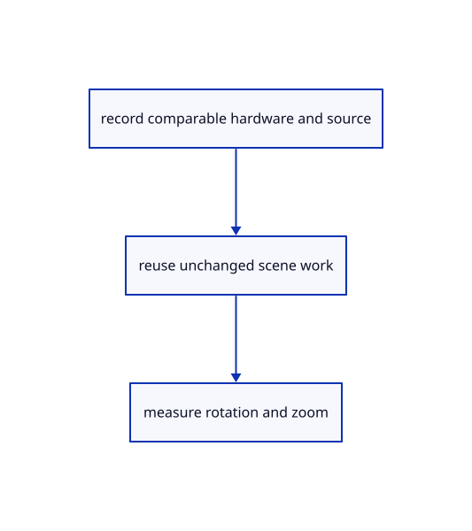

# 18.7.1 · Record comparable large scene conditions

**Chapter 18 · Lighting, render quality and comparison · Section 18.7 · Performance and cache reports** · [Contents](contents.md)

**Typing: 9–18 minutes.** [Estimate](typing-load.md).

Record comparable large scene conditions.

## Type

Continue from [Prove the original comparison and inspect differences](94c-prove-the-original-comparison-and-inspect-differences.md). [Save or recover your work](recovery.md).

### 1. `src/bench_config.rs`

Own explicit conditions instead of unqualified performance claims.

Create the file and type:

```rust
--8<-- "journey/code/95-record-comparable-large-scene-conditions-01.rs"
```

### 2. `src/lib.rs`

Register the completed performance owner.

<details>
<summary>Locate the existing block</summary>

```rust
#[cfg(test)]
mod comparison_tests;
```

</details>

After that block, type:

```rust
--8<-- "journey/code/95-record-comparable-large-scene-conditions-02.rs" skip=35
```

## Run and check

Run this from `session_viewer` to select the fixed dependency versions and install supplied binary assets. It updates Cargo.lock and preserves the previous lock. It does not write implementation code:

```sh
npm --prefix ../session_tests run course -- dependencies 18.7.1
```

In your project:

```sh
cd workspace/journey
REGEN_PROTO=0 cargo build --lib --locked --target wasm32-unknown-unknown -j1
REGEN_PROTO=0 CARGO_BUILD_JOBS=1 trunk serve --port 8780
```

Open `http://127.0.0.1:8780/`. Keep an existing Trunk server running; saving rebuilds it.


### Recorded visual result

**Previous native render — current verification pending.**

Four blue original solids retain continuous black curved and flat boundaries. The maintained native frame is inspected separately; exact pixel equality is not asserted.


*This recorded image predates a source or checker change. Rebuild this checkpoint before using it as current evidence; browser controls require separate acceptance.*

This reference image is shared with [18.6.4 · Prove the original comparison and inspect differences](94c-prove-the-original-comparison-and-inspect-differences.md). It does not demonstrate a new feature by itself.

<details>
<summary>Code explanation and diagram</summary>


record comparable hardware and source → reuse unchanged scene work → measure rotation and zoom.



Can another GPU or smaller viewport validate the Lenovo fix?

No. Record the machine, browser, adapter, exact original scene hash, viewport/DPR, saved camera, display settings and measurement method. Keep load time separate from rotation and zoom.

Study estimate, including typing and experiments: 0.5–1 hours.

</details>

<details>
<summary>Optional experiment</summary>

Fill the conditions for the complete floor and the 40 by 20 dome; do not substitute a smaller fixture without labeling it.

</details>

<details>
<summary>Check and save your work</summary>

Restore experimental edits, then run from `session_viewer`:

```sh
npm --prefix ../session_tests run course -- check 18.7.1
npm --prefix ../session_tests run course -- save 18.7.1
```

Source comparison leaves your project untouched. [Save and recovery instructions](recovery.md).

</details>

<details>
<summary>Viewer coverage and verification</summary>


The supplied browser contract exercises rotation, zoom, selection and visibility on the actual teaching comparison scene. It is syntaxchecked and remains unrun until a real browser is enabled. Lenovo Chrome/Firefox timings are not available.

[Full validation scope](release.md).

To reproduce the scripted acceptance of the reference checkpoint, run from `session_viewer` with the [course bundle server](release.md#reproduce) running on port 8781:

```sh
npm --prefix ../session_tests run course -- capture 18.7.1
```

This uses the verified reference bundle; it does not check or change your typed project.

</details>
