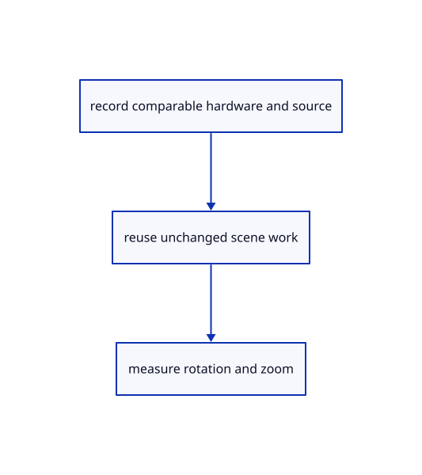

# 18.7.5 · Reuse layer rows while rotating and zooming

**Chapter 18 · Lighting, render quality and comparison · Section 18.7 · Performance and cache reports** · [Contents](contents.md)

**Typing: 11–22 minutes.** [Estimate](typing-load.md).

Reuse layer rows while rotating and zooming.

## Type

Continue from [Witness immutable tree inputs across camera frames](95c-witness-immutable-tree-inputs-across-camera-frames.md). [Save or recover your work](recovery.md).

### 1. `src/tree_panel.rs`

Cache unchanged scene/selection/epoch inputs before rebuilding layer state.

<details>
<summary>Locate the existing block</summary>

```rust

#[derive(Default)]
pub struct TreePanel {pub graph_open:bool,pub graph:Vec<(String,String,String,String)>,pub edit:Option<(String,crate::layer_edit::Edit)>,pub rename:Option<(String,String)>,pub rename_error:String,rename_focus:bool,pub confirm:Option<(String,usize)>,pub property:Option<(String,crate::layer_properties::Property)>,pub menu_rects:Vec<egui::Rect>,states:std::collections::HashMap<String,RowState>,pub open:bool,pub rows:Vec<Row>,pub selected:Vec<ObjectId>,expanded:HashSet<String>,pub rect:Option<egui::Rect>,pub action:Option<(Vec<ObjectId>,bool)>,page:usize}
impl TreePanel {
    pub fn refresh(&mut self,scene:&crate::scene::Scene,selected:Vec<ObjectId>) {
        self.graph=crate::graph_edit::rows(scene);
        for doc in &scene.forest.documents{for(index,node)in doc.nodes.iter().enumerate(){if scene.groups.contains(&(doc.key,node.source.guid.clone()))&&doc.nodes[index+1..node.end].iter().filter_map(|n|n.object).any(|id|selected.contains(&id)){let mut parent=Some(index);while let Some(i)=parent{self.expanded.insert(format!("{}/{}",doc.key,doc.nodes[i].source.guid));parent=doc.nodes[i].parent;}}}}
```

</details>

Edit the existing block to match this code; keep unchanged lines:

```rust
--8<-- "journey/code/95d-reuse-layer-rows-while-rotating-and-zooming-01.rs"
```

### 2. `src/browser.rs`

Use the cache from the actual teaching frame loop.

<details>
<summary>Locate the existing block</summary>

```rust
        panel.number(number);
        panel.lasso=editor.lasso.as_ref().map_or_else(Vec::new,|l|l.points.iter().map(|p|[(p.0/l.density) as f32,(p.1/l.density) as f32]).collect());
        panel.tree.refresh(&editor.scene,editor.selected_objects());
        if let Err(error) = renderer.set_preview(editor.draft.as_ref()) { panel.result(error); }
        renderer.set_pick_mode(if editor.element.is_some()||editor.trimming_picks()||editor.split.is_some()||editor.editing_boundaries()||editor.gathering_curves(){crate::pick_sources::Mode::Object}else{editor.pick_mode});
```

</details>

Edit the existing block to match this code; keep unchanged lines:

```rust
--8<-- "journey/code/95d-reuse-layer-rows-while-rotating-and-zooming-02.rs"
```

## Run and check

Run this from `session_viewer` to select the fixed dependency versions and install supplied binary assets. It updates Cargo.lock and preserves the previous lock. It does not write implementation code:

```sh
npm --prefix ../session_tests run course -- dependencies 18.7.5
```

In your project:

```sh
cd workspace/journey
REGEN_PROTO=0 cargo build --lib --locked --target wasm32-unknown-unknown -j1
REGEN_PROTO=0 CARGO_BUILD_JOBS=1 trunk serve --port 8780
```

Open `http://127.0.0.1:8780/`. Keep an existing Trunk server running; saving rebuilds it.


### Recorded visual result

**Previous native render — current verification pending.**

Four blue original solids retain continuous black curved and flat boundaries. The maintained native frame is inspected separately; exact pixel equality is not asserted.


*This recorded image predates a source or checker change. Rebuild this checkpoint before using it as current evidence; browser controls require separate acceptance.*

This reference image is shared with [18.6.4 · Prove the original comparison and inspect differences](94c-prove-the-original-comparison-and-inspect-differences.md). It does not demonstrate a new feature by itself.

<details>
<summary>Code explanation and diagram</summary>


record comparable hardware and source → reuse unchanged scene work → measure rotation and zoom.



Should caching hide a newly deleted or renamed object?

No. Rebuild on changed inputs; camera-only movement reuses the cache. Existing explicit refresh invalidates its witness. Keep tree expansion and editing state independent.

Study estimate, including typing and experiments: 0.5–1 hours.

</details>

<details>
<summary>Optional experiment</summary>

Inspect the actual browser frame call, then compare refresh counts before and after twenty orbit frames.

</details>

<details>
<summary>Check and save your work</summary>

Restore experimental edits, then run from `session_viewer`:

```sh
npm --prefix ../session_tests run course -- check 18.7.5
npm --prefix ../session_tests run course -- save 18.7.5
```

Source comparison leaves your project untouched. [Save and recovery instructions](recovery.md).

</details>

<details>
<summary>Viewer coverage and verification</summary>


The supplied browser contract exercises rotation, zoom, selection and visibility on the actual teaching comparison scene. It is syntaxchecked and remains unrun until a real browser is enabled. Lenovo Chrome/Firefox timings are not available.

[Full validation scope](release.md).

To reproduce the scripted acceptance of the reference checkpoint, run from `session_viewer` with the [course bundle server](release.md#reproduce) running on port 8781:

```sh
npm --prefix ../session_tests run course -- capture 18.7.5
```

This uses the verified reference bundle; it does not check or change your typed project.

</details>
