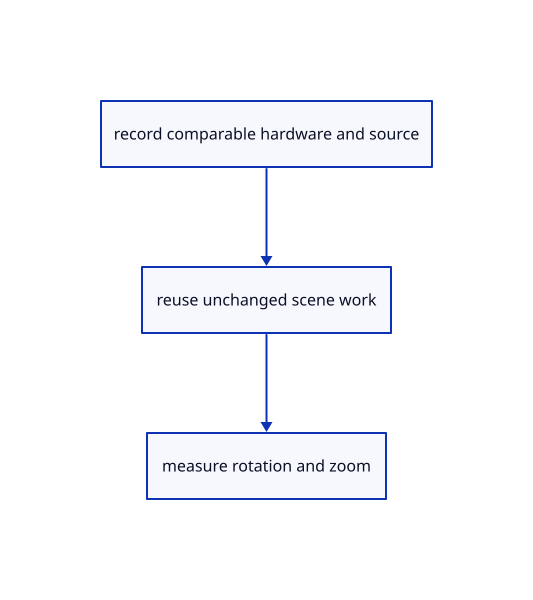

# 18.7.6 · Borrow graph edges and index their labels

**Chapter 18 · Lighting, render quality and comparison · Section 18.7 · Performance and cache reports** · [Contents](contents.md)

**Typing: 10–20 minutes.** [Estimate](typing-load.md).

Borrow graph edges and index their labels.

## Type

Continue from [Reuse layer rows while rotating and zooming](95d-reuse-layer-rows-while-rotating-and-zooming.md). [Save or recover your work](recovery.md).

### 1. `src/graph_edit.rs`

Avoid full graph protobuf conversion and repeated node scans for display rows.

<details>
<summary>Locate the existing block</summary>

```rust

pub fn rows(scene:&Scene)->Vec<(String,String,String,String)>{
    scene.forest.documents.iter().flat_map(|doc|{let graph=scene.graphs.get(&doc.key).map(|g|g.to_proto()).or_else(||doc.header.as_ref().and_then(|h|h.header.graph.clone()));let name=|guid:&str|doc.nodes.iter().find(|n|n.source.name==guid||n.object.is_some_and(|id|scene.row_guid(id)==Some(guid))).map_or_else(||guid.to_owned(),|n|n.label.clone());graph.into_iter().flat_map(|g|g.edges.into_iter().map(|edge|(doc.label.clone(),name(&edge.v0),name(&edge.v1),edge.attribute))).collect::<Vec<_>>()}).collect()
}
```

</details>

Edit the existing block to match this code; keep unchanged lines:

```rust
--8<-- "journey/code/95e-borrow-graph-edges-and-index-their-labels-01.rs"
```

## Run and check

Run this from `session_viewer` to select the fixed dependency versions and install supplied binary assets. It updates Cargo.lock and preserves the previous lock. It does not write implementation code:

```sh
npm --prefix ../session_tests run course -- dependencies 18.7.6
```

In your project:

```sh
cd workspace/journey
REGEN_PROTO=0 cargo build --lib --locked --target wasm32-unknown-unknown -j1
REGEN_PROTO=0 CARGO_BUILD_JOBS=1 trunk serve --port 8780
```

Open `http://127.0.0.1:8780/`. Keep an existing Trunk server running; saving rebuilds it.


### Recorded visual result

**Previous native render — current verification pending.**

Four blue original solids retain continuous black curved and flat boundaries. The maintained native frame is inspected separately; exact pixel equality is not asserted.


*This recorded image predates a source or checker change. Rebuild this checkpoint before using it as current evidence; browser controls require separate acceptance.*

This reference image is shared with [18.6.4 · Prove the original comparison and inspect differences](94c-prove-the-original-comparison-and-inspect-differences.md). It does not demonstrate a new feature by itself.

<details>
<summary>Code explanation and diagram</summary>


record comparable hardware and source → reuse unchanged scene work → measure rotation and zoom.



Must the graph table clone every vertex attribute?

Read retained original edges directly and derive only display rows. Build the document label index once, keep the first matching alias and list an undirected edge once.

Study estimate, including typing and experiments: 0.5–1 hours.

</details>

<details>
<summary>Optional experiment</summary>

Check both original protobuf graph headers and edited kernel graphs, including Undo/Redo and unchanged edge attributes.

</details>

<details>
<summary>Check and save your work</summary>

Restore experimental edits, then run from `session_viewer`:

```sh
npm --prefix ../session_tests run course -- check 18.7.6
npm --prefix ../session_tests run course -- save 18.7.6
```

Source comparison leaves your project untouched. [Save and recovery instructions](recovery.md).

</details>

<details>
<summary>Viewer coverage and verification</summary>


The supplied browser contract exercises rotation, zoom, selection and visibility on the actual teaching comparison scene. It is syntaxchecked and remains unrun until a real browser is enabled. Lenovo Chrome/Firefox timings are not available.

[Full validation scope](release.md).

To reproduce the scripted acceptance of the reference checkpoint, run from `session_viewer` with the [course bundle server](release.md#reproduce) running on port 8781:

```sh
npm --prefix ../session_tests run course -- capture 18.7.6
```

This uses the verified reference bundle; it does not check or change your typed project.

</details>
