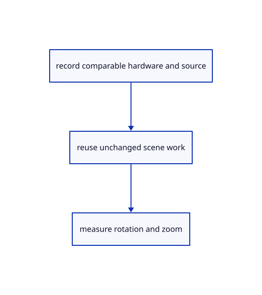

# 18.7.7 · Prove cache invalidation and honest performance reports

**Chapter 18 · Lighting, render quality and comparison · Section 18.7 · Performance and cache reports** · [Contents](contents.md)

**Typing: 0–0 minutes.** [Estimate](typing-load.md).

Prove cache invalidation and honest performance reports.

## Type

Continue from [Borrow graph edges and index their labels](95e-borrow-graph-edges-and-index-their-labels.md). [Save or recover your work](recovery.md).

<details>
<summary>Supplied validation fixture</summary>

Copy this supplied authoring fixture once. Continue with the browser build below; the course does not require running native tests.

### 1. `src/bench_tests.rs`

Copy supplied invalid-data, comparability, original-source, cache and history fixtures.

Copy this supplied file:

```text
--8<-- "journey/code/95f-prove-cache-invalidation-and-honest-performance-reports-01.rs"
```

</details>

<details>
<summary>Supplied validation fixture</summary>

Copy this supplied authoring fixture once. Continue with the browser build below; the course does not require running native tests.

### 2. `src/lib.rs`

Register supplied performance correctness fixtures.

<details>
<summary>Locate the existing block</summary>

```text

pub mod tree_witness;
```

</details>

After that block, append this supplied code:

```text
--8<-- "journey/code/95f-prove-cache-invalidation-and-honest-performance-reports-02.rs" skip=23
```

</details>

## Run and check

Run this from `session_viewer` to select the fixed dependency versions and install supplied binary assets. It updates Cargo.lock and preserves the previous lock. It does not write implementation code:

```sh
npm --prefix ../session_tests run course -- dependencies 18.7.7
```

In your project:

```sh
cd workspace/journey
REGEN_PROTO=0 cargo build --lib --locked --target wasm32-unknown-unknown -j1
REGEN_PROTO=0 CARGO_BUILD_JOBS=1 trunk serve --port 8780
```

Open `http://127.0.0.1:8780/`. Keep an existing Trunk server running; saving rebuilds it.

The original comparison scene stays visible; cache fixtures prove that camera movement avoids repeated tree reconstruction.

### Recorded visual result

**Previous native render — current verification pending.**

Original blue solids and black boundaries remain intact after the performance changes.


*This recorded image predates a source or checker change. Rebuild this checkpoint before using it as current evidence; browser controls require separate acceptance.*

This reference image is shared with [18.6.4 · Prove the original comparison and inspect differences](94c-prove-the-original-comparison-and-inspect-differences.md). It does not demonstrate a new feature by itself.

<details>
<summary>Code explanation and diagram</summary>


record comparable hardware and source → reuse unchanged scene work → measure rotation and zoom.



What completes a performance investigation?

Correctness checks plus comparable measurements on the affected hardware. A cache test proves avoided work; it does not prove a frame-rate improvement on a different machine.

Study estimate, including typing and experiments: 0.5–1 hours.

</details>

<details>
<summary>Optional experiment</summary>

Inspect the supplied cache, graph and measurement fixtures. Follow the linked floor/dome recipe; record browser errors, raw timing data, quality and memory release separately.

</details>

<details>
<summary>Check and save your work</summary>

Restore experimental edits, then run from `session_viewer`:

```sh
npm --prefix ../session_tests run course -- check 18.7.7
npm --prefix ../session_tests run course -- save 18.7.7
```

Source comparison leaves your project untouched. [Save and recovery instructions](recovery.md).

</details>

<details>
<summary>Viewer coverage and verification</summary>

Follow current scene walking, shared BRep shapes, f64 camera/rebased anchors, packed arenas, bounded finite tiles, demand-driven frames, one in-flight GPU completion fence and interaction quality tiers. These execute in the maintained native reference from94; the teaching browser retains its explicit earlier renderer. This subject additionally removes repeated teaching layer/graph rebuilds on camera-only frames. [Large-scene measurement recipe](large-scenes.md) records floor/dome source, same-hardware conditions and separate rotation/zoom results. Software-GPU or readback-inclusive native times do not establish Lenovo browser speed.

Retain earlier checks. Supplied fixtures reject invalid timings and incomparable hardware/source/settings, retain measured tails after warmup, round-trip explicit records, reuse the tree through twenty orbit frames, invalidate it for selection/visibility/Undo/Close, and preserve original graph edge data through Undo/Redo. The maintained large-scene run is separate evidence; no synthetic timings are presented as hardware measurements.

The supplied browser contract exercises rotation, zoom, selection and visibility on the actual teaching comparison scene. It is syntaxchecked and remains unrun until a real browser is enabled. Lenovo Chrome/Firefox timings are not available.

[Full validation scope](release.md).

To reproduce the scripted acceptance of the reference checkpoint, run from `session_viewer` with the [course bundle server](release.md#reproduce) running on port 8781:

```sh
npm --prefix ../session_tests run course -- capture 18.7.7
```

This uses the verified reference bundle; it does not check or change your typed project.

</details>
