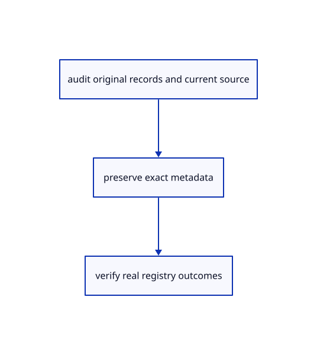

# 19.1.2 · Merge unused definitions with displayed instances

**Chapter 19 · Integration and original ownership · Section 19.1 · Metadata and current command contracts** · [Contents](contents.md)

**Typing: 9–17 minutes.** [Estimate](typing-load.md).

Merge unused definitions with displayed instances.

## Type

Continue from [Retain non drawing originals and validate raw planes](96-retain-non-drawing-originals-and-validate-raw-planes.md). [Save or recover your work](recovery.md).

### 1. `src/definition_merge.rs`

Merge exact retained definitions without losing unused originals.

Create the file and type:

```rust
--8<-- "journey/code/96a-merge-unused-definitions-with-displayed-instances-01.rs"
```

### 2. `src/lib.rs`

Register the completed audit owner.

<details>
<summary>Locate the existing block</summary>

```rust

pub mod source_metadata;
```

</details>

After that block, type:

```rust
--8<-- "journey/code/96a-merge-unused-definitions-with-displayed-instances-02.rs" skip=26
```

## Run and check

Run this from `session_viewer` to select the fixed dependency versions and install supplied binary assets. It updates Cargo.lock and preserves the previous lock. It does not write implementation code:

```sh
npm --prefix ../session_tests run course -- dependencies 19.1.2
```

In your project:

```sh
cd workspace/journey
REGEN_PROTO=0 cargo build --lib --locked --target wasm32-unknown-unknown -j1
REGEN_PROTO=0 CARGO_BUILD_JOBS=1 trunk serve --port 8780
```

Open `http://127.0.0.1:8780/`. Keep an existing Trunk server running; saving rebuilds it.


### Recorded visual result

**Previous native render — current verification pending.**

Original blue solids and black boundaries remain intact after the performance changes.


*This recorded image predates a source or checker change. Rebuild this checkpoint before using it as current evidence; browser controls require separate acceptance.*

This reference image is shared with [18.6.4 · Prove the original comparison and inspect differences](94c-prove-the-original-comparison-and-inspect-differences.md). It does not demonstrate a new feature by itself.

<details>
<summary>Code explanation and diagram</summary>


audit original records and current source → preserve exact metadata → verify real registry outcomes.



Does saving only displayed instance definitions preserve the whole document?

Keep the unused originals too. Merge by original family and GUID, sort deterministically and reject conflicting payloads instead of choosing one silently.

Study estimate, including typing and experiments: 0.5–1 hours.

</details>

<details>
<summary>Optional experiment</summary>

Compare a used definition, an unused definition and two different originals sharing one GUID.

</details>

<details>
<summary>Check and save your work</summary>

Restore experimental edits, then run from `session_viewer`:

```sh
npm --prefix ../session_tests run course -- check 19.1.2
npm --prefix ../session_tests run course -- save 19.1.2
```

Source comparison leaves your project untouched. [Save and recovery instructions](recovery.md).

</details>

<details>
<summary>Viewer coverage and verification</summary>


The supplied contract imports the real original metadata fixture, saves and reopens it through the teaching command dock, and checks retained metadata accounting. It is syntaxchecked; it has not been run in a browser.

[Full validation scope](release.md).

To reproduce the scripted acceptance of the reference checkpoint, run from `session_viewer` with the [course bundle server](release.md#reproduce) running on port 8781:

```sh
npm --prefix ../session_tests run course -- capture 19.1.2
```

This uses the verified reference bundle; it does not check or change your typed project.

</details>
