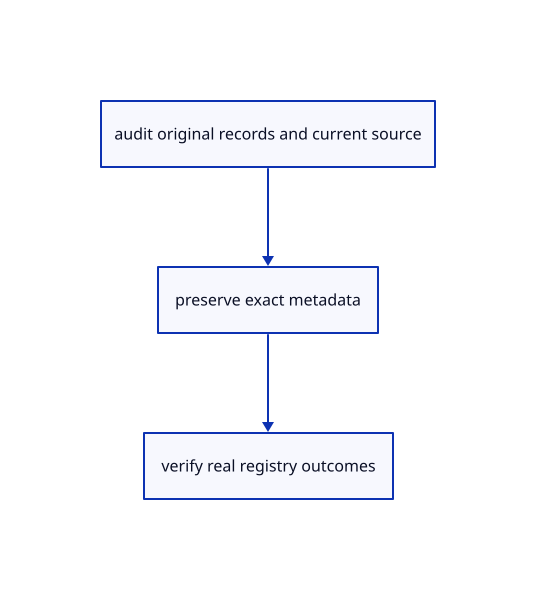

# 19.1.4 · Keep current Element and frame definition families

**Chapter 19 · Integration and original ownership · Section 19.1 · Metadata and current command contracts** · [Contents](contents.md)

**Typing: 15–30 minutes.** [Estimate](typing-load.md).

Keep current Element and frame definition families.

## Type

Continue from [Preserve component and interaction metadata in archives](96b-preserve-component-and-interaction-metadata-in-archives.md). [Save or recover your work](recovery.md).

### 1. `src/instance_plan.rs`

Retain supported original definition families and per-instance feature records.

<details>
<summary>Locate the existing block</summary>

```rust
use session_rust::{proto,Geometry,InstanceRef,Session};
use std::{collections::HashSet,rc::Rc};

pub fn validate(message:&proto::Session)->Result<(),String> {
    let instances=message.objects.as_ref().map_or(&[][..],|objects|objects.instances.as_slice());
    let Some(definitions)=message.definitions.as_ref() else {return if instances.is_empty() {Ok(())} else {Err("Instances have no original definitions".into())};};
    crate::source_validate::definitions(definitions,instances.len())?;
    if !definitions.planes.is_empty()||!definitions.bboxes.is_empty()||!definitions.elements.is_empty()||!definitions.components.is_empty()||!definitions.sheets.is_empty()||!definitions.instances.is_empty() {return Err("Unsupported original definition family".into());}
    let mut guids=HashSet::new();
    macro_rules! identity {($field:ident)=>{for object in &definitions.$field {if object.guid.is_empty()||!guids.insert(object.guid.as_str()) {return Err("Definition GUIDs must be distinct".into());}}};}
    identity!(meshes);identity!(points);identity!(lines);identity!(polylines);identity!(nurbscurves);identity!(nurbssurfaces);identity!(breps);identity!(pointclouds);
    let mut refs=HashSet::new();
    for instance in instances {
        if instance.guid.is_empty()||!refs.insert(instance.guid.as_str())||!guids.contains(instance.definition_guid.as_str()) {return Err("Invalid original instance reference".into());}
        if instance.flags&InstanceRef::FLAG_COLOR!=0 {
            let color=instance.color.as_ref().ok_or("Instance colour flag has no original colour")?;
            if [color.r,color.g,color.b,color.a].iter().any(|value|!value.is_finite()||!(0.0..=1.0).contains(value)) {return Err("Invalid original instance colour".into());}
        }
        if !instance.features.is_empty() {return Err("Instance features connect with element features".into());}
    }
    Ok(())
}

#[derive(Clone)]
pub struct Owner {pub document:Rc<Session>,pub instance:Rc<InstanceRef>,pub definition:Geometry}
impl Owner {
    pub fn new(document:Rc<Session>,instance:Rc<InstanceRef>)->Result<Self,&'static str> {
        let definition=document.definition_lookup.get(&instance.definition_guid).ok_or("Missing original instance definition")?.clone();
        Ok(Self {document,instance,definition})
    }
}

#[cfg(test)]
mod tests {
    use super::*;
    pub fn message()->proto::Session {
        let mesh=crate::prepared::PreparedMesh::triangle([[0.,0.,0.],[1.,0.,0.],[0.,1.,0.]],[0.1,0.3,0.8]).unwrap().geometry;
        proto::Session {objects:Some(proto::Objects {instances:vec![proto::InstanceRef {guid:"first".into(),name:"First".into(),definition_guid:mesh.guid().into(),..Default::default()},proto::InstanceRef {guid:"second".into(),name:"Second".into(),definition_guid:mesh.guid().into(),..Default::default()}],..Default::default()}),definitions:Some(proto::Objects {meshes:vec![mesh.to_proto()],..Default::default()}),..Default::default()}
    }
    #[test]
    fn checked_original_references_share_definition_identity_without_copying_geometry() {
        let message=message();validate(&message).unwrap();let document=Rc::new(Session::from_proto(message).unwrap());let first=Owner::new(document.clone(),document.objects.instances[0].clone()).unwrap();let second=Owner::new(document.clone(),document.objects.instances[1].clone()).unwrap();let (Geometry::Mesh(a),Geometry::Mesh(b))=(&first.definition,&second.definition) else {panic!("Original mesh definition")};assert!(Rc::ptr_eq(a,b));assert_eq!(first.instance.guid(),"first");assert_eq!(second.instance.guid(),"second");let weak=Rc::downgrade(a);drop(document);drop(first);assert!(weak.upgrade().is_some());drop(second);assert!(weak.upgrade().is_none());
    }
    #[test]
    fn missing_duplicate_and_unsupported_original_definitions_are_refused() {
        let mut source=message();source.definitions=None;assert!(validate(&source).is_err());let mut source=message();source.objects.as_mut().unwrap().instances[0].definition_guid="missing".into();assert!(validate(&source).is_err());let mut source=message();let duplicate=source.definitions.as_ref().unwrap().meshes[0].clone();source.definitions.as_mut().unwrap().meshes.push(duplicate);assert!(validate(&source).is_err());let mut source=message();source.definitions.as_mut().unwrap().instances.push(Default::default());assert!(validate(&source).is_err());
    }
}
```

</details>

Edit the existing block to match this code; keep unchanged lines:

```rust
use session_rust::{proto,Geometry,InstanceRef,Session};
use std::{collections::HashSet,rc::Rc};

pub fn validate(message:&proto::Session)->Result<(),String> {
    let instances=message.objects.as_ref().map_or(&[][..],|objects|objects.instances.as_slice());
    let Some(definitions)=message.definitions.as_ref() else {return if instances.is_empty() {Ok(())} else {Err("Instances have no original definitions".into())};};
    crate::source_validate::definitions(definitions,instances.len())?;
    if !definitions.components.is_empty()||!definitions.sheets.is_empty()||!definitions.instances.is_empty() {return Err("Unsupported original definition family".into());}
    let mut guids=HashSet::new();
    macro_rules! identity {($field:ident)=>{for object in &definitions.$field {if object.guid.is_empty()||!guids.insert(object.guid.as_str()) {return Err("Definition GUIDs must be distinct".into());}}};}
    identity!(elements);identity!(planes);identity!(bboxes);identity!(meshes);identity!(points);identity!(lines);identity!(polylines);identity!(nurbscurves);identity!(nurbssurfaces);identity!(breps);identity!(pointclouds);
    let mut refs=HashSet::new();
    for instance in instances {
        if instance.guid.is_empty()||!refs.insert(instance.guid.as_str())||!guids.contains(instance.definition_guid.as_str()) {return Err("Invalid original instance reference".into());}
        if instance.flags&InstanceRef::FLAG_COLOR!=0 {
            let color=instance.color.as_ref().ok_or("Instance colour flag has no original colour")?;
            if [color.r,color.g,color.b,color.a].iter().any(|value|!value.is_finite()||!(0.0..=1.0).contains(value)) {return Err("Invalid original instance colour".into());}
        }
    }
    Ok(())
}

#[derive(Clone)]
pub struct Owner {pub document:Rc<Session>,pub instance:Rc<InstanceRef>,pub definition:Geometry}
impl Owner {
    pub fn new(document:Rc<Session>,instance:Rc<InstanceRef>)->Result<Self,&'static str> {
        let definition=document.definition_lookup.get(&instance.definition_guid).ok_or("Missing original instance definition")?.clone();
        Ok(Self {document,instance,definition})
    }
}

#[cfg(test)]
mod tests {
    use super::*;
    pub fn message()->proto::Session {
        let mesh=crate::prepared::PreparedMesh::triangle([[0.,0.,0.],[1.,0.,0.],[0.,1.,0.]],[0.1,0.3,0.8]).unwrap().geometry;
        proto::Session {objects:Some(proto::Objects {instances:vec![proto::InstanceRef {guid:"first".into(),name:"First".into(),definition_guid:mesh.guid().into(),..Default::default()},proto::InstanceRef {guid:"second".into(),name:"Second".into(),definition_guid:mesh.guid().into(),..Default::default()}],..Default::default()}),definitions:Some(proto::Objects {meshes:vec![mesh.to_proto()],..Default::default()}),..Default::default()}
    }
    #[test]
    fn checked_original_references_share_definition_identity_without_copying_geometry() {
        let message=message();validate(&message).unwrap();let document=Rc::new(Session::from_proto(message).unwrap());let first=Owner::new(document.clone(),document.objects.instances[0].clone()).unwrap();let second=Owner::new(document.clone(),document.objects.instances[1].clone()).unwrap();let (Geometry::Mesh(a),Geometry::Mesh(b))=(&first.definition,&second.definition) else {panic!("Original mesh definition")};assert!(Rc::ptr_eq(a,b));assert_eq!(first.instance.guid(),"first");assert_eq!(second.instance.guid(),"second");let weak=Rc::downgrade(a);drop(document);drop(first);assert!(weak.upgrade().is_some());drop(second);assert!(weak.upgrade().is_none());
    }
    #[test]
    fn missing_duplicate_and_unsupported_original_definitions_are_refused() {
        let mut source=message();source.definitions=None;assert!(validate(&source).is_err());let mut source=message();source.objects.as_mut().unwrap().instances[0].definition_guid="missing".into();assert!(validate(&source).is_err());let mut source=message();let duplicate=source.definitions.as_ref().unwrap().meshes[0].clone();source.definitions.as_mut().unwrap().meshes.push(duplicate);assert!(validate(&source).is_err());let mut source=message();source.definitions.as_mut().unwrap().instances.push(Default::default());assert!(validate(&source).is_err());
    }
}
```

<details>
<summary>Optional patch references</summary>

Use these original edit fragments when comparing a saved checkpoint. Apply the complete blocks above.

```text
--8<-- "journey/code/96c-keep-current-element-and-frame-definition-families-01.rs"
```

```text
--8<-- "journey/code/96c-keep-current-element-and-frame-definition-families-02.rs"
```

</details>

### 2. `src/instance_definition.rs`

Retain supported original definition families and per-instance feature records.

<details>
<summary>Locate the existing block</summary>

```rust
    let mut scene=Scene::empty();
    match &owner.definition {
        Geometry::Mesh(source)=>{scene.insert(crate::prepared::PreparedMesh::from_shared(source.clone())?)?;},
        Geometry::BRep(source)=>{scene.insert_prepared_cad(shapes.prepare(source.clone())?)?;},
```

</details>

Edit the existing block to match this code; keep unchanged lines:

```rust
--8<-- "journey/code/96c-keep-current-element-and-frame-definition-families-03.rs"
```

### 3. `src/instance_snapshot.rs`

Retain supported original definition families and per-instance feature records.

<details>
<summary>Locate the existing block</summary>

```rust
    for (_,owner) in scene.instances.iter().filter(|(id,_)|ids.contains(id)) {
        match &owner.definition {
            Geometry::Mesh(source)=>keep!(meshes,source),Geometry::BRep(source)=>keep!(breps,source),Geometry::NurbsSurface(source)=>keep!(nurbssurfaces,source),Geometry::NurbsCurve(source)=>keep!(nurbscurves,source),Geometry::Polyline(source)=>keep!(polylines,source),Geometry::Line(source)=>keep!(lines,source),Geometry::Point(source)=>keep!(points,source),Geometry::PointCloud(source)=>keep!(pointclouds,source),_=>return Err("Unsupported saved original definition".into()),
        }
    }
    macro_rules! order {($field:ident)=>{out.$field.sort_by(|a,b|a.guid.cmp(&b.guid));};}
    order!(meshes);order!(breps);order!(nurbssurfaces);order!(nurbscurves);order!(polylines);order!(lines);order!(points);order!(pointclouds);
    Ok((!records.is_empty()).then_some(out))
}
```

</details>

Edit the existing block to match this code; keep unchanged lines:

```rust
--8<-- "journey/code/96c-keep-current-element-and-frame-definition-families-04.rs"
```

## Run and check

Run this from `session_viewer` to select the fixed dependency versions and install supplied binary assets. It updates Cargo.lock and preserves the previous lock. It does not write implementation code:

```sh
npm --prefix ../session_tests run course -- dependencies 19.1.4
```

In your project:

```sh
cd workspace/journey
REGEN_PROTO=0 cargo build --lib --locked --target wasm32-unknown-unknown -j1
REGEN_PROTO=0 CARGO_BUILD_JOBS=1 trunk serve --port 8780
```

Open `http://127.0.0.1:8780/`. Keep an existing Trunk server running; saving rebuilds it.


### Recorded visual result

**Previous native render — current verification pending.**

Original blue solids and black boundaries remain intact after the performance changes.


*This recorded image predates a source or checker change. Rebuild this checkpoint before using it as current evidence; browser controls require separate acceptance.*

This reference image is shared with [18.6.4 · Prove the original comparison and inspect differences](94c-prove-the-original-comparison-and-inspect-differences.md). It does not demonstrate a new feature by itself.

<details>
<summary>Code explanation and diagram</summary>


audit original records and current source → preserve exact metadata → verify real registry outcomes.



Can an instance of an Element be flattened into a mesh for Save?

Retain its typed Element definition and its own instance-feature records. Plane and box definitions retain their original families too. Derived display does not replace those records.

Study estimate, including typing and experiments: 0.5–1 hours.

</details>

<details>
<summary>Optional experiment</summary>

Inspect current instance originals, shared templates, exact definition payloads and feature records. Use the maintained destination for its complete derived instance-feature display.

</details>

<details>
<summary>Check and save your work</summary>

Restore experimental edits, then run from `session_viewer`:

```sh
npm --prefix ../session_tests run course -- check 19.1.4
npm --prefix ../session_tests run course -- save 19.1.4
```

Source comparison leaves your project untouched. [Save and recovery instructions](recovery.md).

</details>

<details>
<summary>Viewer coverage and verification</summary>


The supplied contract imports the real original metadata fixture, saves and reopens it through the teaching command dock, and checks retained metadata accounting. It is syntaxchecked; it has not been run in a browser.

[Full validation scope](release.md).

To reproduce the scripted acceptance of the reference checkpoint, run from `session_viewer` with the [course bundle server](release.md#reproduce) running on port 8781:

```sh
npm --prefix ../session_tests run course -- capture 19.1.4
```

This uses the verified reference bundle; it does not check or change your typed project.

</details>
