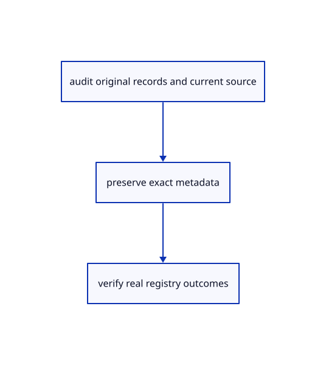

# 19.1.5 · Observe the real current registry and parser

**Chapter 19 · Integration and original ownership · Section 19.1 · Metadata and current command contracts** · [Contents](contents.md)

**Typing: 13–25 minutes.** [Estimate](typing-load.md).

Observe the real current registry and parser.

## Type

Continue from [Keep current Element and frame definition families](96c-keep-current-element-and-frame-definition-families.md). [Save or recover your work](recovery.md).

### 1. `src/registry_audit.rs`

Observe the compiled maintained command registry directly.

Create the file and type:

```rust
--8<-- "journey/code/96d-observe-the-real-current-registry-and-parser-01.rs"
```

### 2. `src/lib.rs`

Register the completed audit owner.

<details>
<summary>Locate the existing block</summary>

```rust

pub mod definition_merge;
```

</details>

After that block, type:

```rust
--8<-- "journey/code/96d-observe-the-real-current-registry-and-parser-02.rs" skip=27
```

<details>
<summary>Optional authoring helper</summary>

Copy this supplied authoring helper once. Use the linked data or recorded comparison for the browser exercise; you do not need to compile or run this native helper.

### 3. `src/inventory_example.rs`

Copy the supplied native registry observation example.

Copy this supplied file:

```text
--8<-- "journey/code/96d-observe-the-real-current-registry-and-parser-03.rs"
```

</details>

### 4. `Cargo.toml`

Expose the maintained registry observation as a native example.

<details>
<summary>Locate the existing block</summary>

```toml
name = "reference"
path = "src/reference_example.rs"
```

</details>

After that block, type:

```toml
--8<-- "journey/code/96d-observe-the-real-current-registry-and-parser-04.rs" skip=53
```

## Run and check

Run this from `session_viewer` to select the fixed dependency versions and install supplied binary assets. It updates Cargo.lock and preserves the previous lock. It does not write implementation code:

```sh
npm --prefix ../session_tests run course -- dependencies 19.1.5
```

In your project:

```sh
cd workspace/journey
REGEN_PROTO=0 cargo build --lib --locked --target wasm32-unknown-unknown -j1
REGEN_PROTO=0 CARGO_BUILD_JOBS=1 trunk serve --port 8780
```

Open `http://127.0.0.1:8780/`. Keep an existing Trunk server running; saving rebuilds it.


### Recorded visual result

**Previous native render — current verification pending.**

Original blue solids and black boundaries remain intact after the performance changes.


*This recorded image predates a source or checker change. Rebuild this checkpoint before using it as current evidence; browser controls require separate acceptance.*

This reference image is shared with [18.6.4 · Prove the original comparison and inspect differences](94c-prove-the-original-comparison-and-inspect-differences.md). It does not demonstrate a new feature by itself.

<details>
<summary>Code explanation and diagram</summary>


audit original records and current source → preserve exact metadata → verify real registry outcomes.



Does a literal search find the complete runtime option list?

Read every real Spec and call its parser for names, static options and aliases. Record canonical spelling, prompts, arity, selection/draft flags and actual errors. A parsed action still needs a real execution context.

Study estimate, including typing and experiments: 0.5–1 hours.

</details>

<details>
<summary>Optional experiment</summary>

Read the supplied runtime registry and grammar observations. Compare its 115 recorded static options with the earlier 149 literal strings, then inspect pending bare forms and Controls/Opacity differences. The authoring inventory helper is optional.

</details>

<details>
<summary>Check and save your work</summary>

Restore experimental edits, then run from `session_viewer`:

```sh
npm --prefix ../session_tests run course -- check 19.1.5
npm --prefix ../session_tests run course -- save 19.1.5
```

Source comparison leaves your project untouched. [Save and recovery instructions](recovery.md).

</details>

<details>
<summary>Viewer coverage and verification</summary>


The supplied contract imports the real original metadata fixture, saves and reopens it through the teaching command dock, and checks retained metadata accounting. It is syntaxchecked; it has not been run in a browser.

[Full validation scope](release.md).

To reproduce the scripted acceptance of the reference checkpoint, run from `session_viewer` with the [course bundle server](release.md#reproduce) running on port 8781:

```sh
npm --prefix ../session_tests run course -- capture 19.1.5
```

This uses the verified reference bundle; it does not check or change your typed project.

</details>
