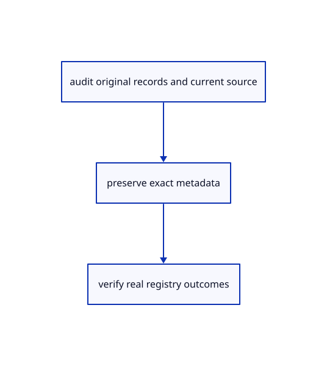

# 19.1.6 · Verify the complete declared current source closure

**Chapter 19 · Integration and original ownership · Section 19.1 · Metadata and current command contracts** · [Contents](contents.md)

**Typing: 20–40 minutes.** [Estimate](typing-load.md).

Verify the complete declared current source closure.

## Type

Continue from [Observe the real current registry and parser](96d-observe-the-real-current-registry-and-parser.md). [Save or recover your work](recovery.md).

<details>
<summary>Supplied data</summary>

Copy this supplied data once; it is excluded from the typing estimate.

### 1. `src/current_inventory.json`

Copy the supplied full current Rust source/build closure and ownership snapshot.

Copy this supplied file:

```text
--8<-- "journey/code/96e-verify-the-complete-declared-current-source-closure-01.rs"
```

</details>

### 2. `src/source_audit.rs`

Verify actual source bytes and the complete declared file set.

Create the file and type:

```rust
--8<-- "journey/code/96e-verify-the-complete-declared-current-source-closure-02.rs"
```

### 3. `src/lib.rs`

Register the completed audit owner.

<details>
<summary>Locate the existing block</summary>

```rust

pub mod registry_audit;
```

</details>

After that block, type:

```rust
--8<-- "journey/code/96e-verify-the-complete-declared-current-source-closure-03.rs" skip=25
```

## Run and check

Run this from `session_viewer` to select the fixed dependency versions and install supplied binary assets. It updates Cargo.lock and preserves the previous lock. It does not write implementation code:

```sh
npm --prefix ../session_tests run course -- dependencies 19.1.6
```

In your project:

```sh
cd workspace/journey
REGEN_PROTO=0 cargo build --lib --locked --target wasm32-unknown-unknown -j1
REGEN_PROTO=0 CARGO_BUILD_JOBS=1 trunk serve --port 8780
```

Open `http://127.0.0.1:8780/`. Keep an existing Trunk server running; saving rebuilds it.


### Recorded visual result

**Previous native render — current verification pending.**

Original blue solids and black boundaries remain intact after the performance changes.


*This recorded image predates a source or checker change. Rebuild this checkpoint before using it as current evidence; browser controls require separate acceptance.*

This reference image is shared with [18.6.4 · Prove the original comparison and inspect differences](94c-prove-the-original-comparison-and-inspect-differences.md). It does not demonstrate a new feature by itself.

<details>
<summary>Code explanation and diagram</summary>


audit original records and current source → preserve exact metadata → verify real registry outcomes.

 The resumed October 11 inventory includes the preserved local hierarchy-path and parent Element-lamp changes; the October 9 document snapshot remains historical.

Can a matching Git commit prove matching source contents?

Hash the actual files, including uncommitted edits, and require the complete declared file set. Record the scope and local heads; do not imply that excluded C++/assets or remote commits were checked.

Study estimate, including typing and experiments: 0.5–1 hours.

</details>

<details>
<summary>Optional experiment</summary>

Read the supplied 428-file inventory, follow its lesson ownership and change one scratch record hash to see the audit fail.

</details>

<details>
<summary>Check and save your work</summary>

Restore experimental edits, then run from `session_viewer`:

```sh
npm --prefix ../session_tests run course -- check 19.1.6
npm --prefix ../session_tests run course -- save 19.1.6
```

Source comparison leaves your project untouched. [Save and recovery instructions](recovery.md).

</details>

<details>
<summary>Viewer coverage and verification</summary>


The supplied contract imports the real original metadata fixture, saves and reopens it through the teaching command dock, and checks retained metadata accounting. It is syntaxchecked; it has not been run in a browser.

[Full validation scope](release.md).

To reproduce the scripted acceptance of the reference checkpoint, run from `session_viewer` with the [course bundle server](release.md#reproduce) running on port 8781:

```sh
npm --prefix ../session_tests run course -- capture 19.1.6
```

This uses the verified reference bundle; it does not check or change your typed project.

</details>
