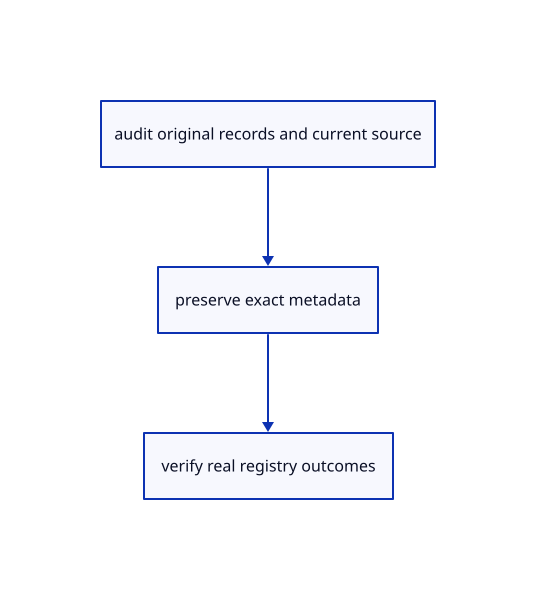

# 19.1.7 · Report retained original metadata in the real viewer

**Chapter 19 · Integration and original ownership · Section 19.1 · Metadata and current command contracts** · [Contents](contents.md)

**Typing: 2–3 minutes.** [Estimate](typing-load.md).

Report retained original metadata in the real viewer.

## Type

Continue from [Verify the complete declared current source closure](96e-verify-the-complete-declared-current-source-closure.md). [Save or recover your work](recovery.md).

### 1. `src/browser.rs`

Expose truthful serialized original metadata accounting in the teaching inspector.

<details>
<summary>Locate the existing block</summary>

```rust
    canvas.set_attribute("data-camera-frame",&serde_json::to_string(&editor.camera.frame).unwrap())?;
    canvas.set_attribute("data-view-flags",&serde_json::json!({"current":crate::layer_edit::current_key(&editor.scene),"rows":view_rows}).to_string())?;
    canvas.set_attribute("data-groups",&serde_json::json!(editor.scene.groups.iter().collect::<Vec<_>>()).to_string())?;
    canvas.set_attribute("data-graph",&serde_json::json!(crate::graph_edit::rows(&editor.scene)).to_string())?;
```

</details>

Edit the existing block to match this code; keep unchanged lines:

```rust
--8<-- "journey/code/96f-report-retained-original-metadata-in-the-real-viewer-01.rs"
```

## Run and check

Run this from `session_viewer` to select the fixed dependency versions and install supplied binary assets. It updates Cargo.lock and preserves the previous lock. It does not write implementation code:

```sh
npm --prefix ../session_tests run course -- dependencies 19.1.7
```

In your project:

```sh
cd workspace/journey
REGEN_PROTO=0 cargo build --lib --locked --target wasm32-unknown-unknown -j1
REGEN_PROTO=0 CARGO_BUILD_JOBS=1 trunk serve --port 8780
```

Open `http://127.0.0.1:8780/`. Keep an existing Trunk server running; saving rebuilds it.


### Recorded visual result

**Previous native render — current verification pending.**

Original blue solids and black boundaries remain intact after the performance changes.


*This recorded image predates a source or checker change. Rebuild this checkpoint before using it as current evidence; browser controls require separate acceptance.*

This reference image is shared with [18.6.4 · Prove the original comparison and inspect differences](94c-prove-the-original-comparison-and-inspect-differences.md). It does not demonstrate a new feature by itself.

<details>
<summary>Code explanation and diagram</summary>


audit original records and current source → preserve exact metadata → verify real registry outcomes.



Does a byte counter measure driver memory?

This counter reports unique retained origins and their serialized header size. Keep it distinct from allocated CPU/GPU bytes and process/driver memory.

Study estimate, including typing and experiments: 0.5–1 hours.

</details>

<details>
<summary>Optional experiment</summary>

Import and Close the metadata fixture and inspect the actual canvas report. Compare shared source origins across snapshots without counting them twice.

</details>

<details>
<summary>Check and save your work</summary>

Restore experimental edits, then run from `session_viewer`:

```sh
npm --prefix ../session_tests run course -- check 19.1.7
npm --prefix ../session_tests run course -- save 19.1.7
```

Source comparison leaves your project untouched. [Save and recovery instructions](recovery.md).

</details>

<details>
<summary>Viewer coverage and verification</summary>


The supplied contract imports the real original metadata fixture, saves and reopens it through the teaching command dock, and checks retained metadata accounting. It is syntaxchecked; it has not been run in a browser.

[Full validation scope](release.md).

To reproduce the scripted acceptance of the reference checkpoint, run from `session_viewer` with the [course bundle server](release.md#reproduce) running on port 8781:

```sh
npm --prefix ../session_tests run course -- capture 19.1.7
```

This uses the verified reference bundle; it does not check or change your typed project.

</details>
