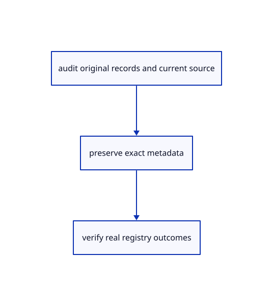

# 19.1.8 · Prove exact metadata and definition round trips

**Chapter 19 · Integration and original ownership · Section 19.1 · Metadata and current command contracts** · [Contents](contents.md)

**Typing: 0–0 minutes.** [Estimate](typing-load.md).

Prove exact metadata and definition round trips.

## Type

Continue from [Report retained original metadata in the real viewer](96f-report-retained-original-metadata-in-the-real-viewer.md). [Save or recover your work](recovery.md).

<details>
<summary>Supplied validation fixture</summary>

Copy this supplied authoring fixture once. Continue with the browser build below; the course does not require running native tests.

### 1. `src/metadata_tests.rs`

Copy supplied exact archive, original-family and malformed-input fixtures.

Copy this supplied file:

```text
--8<-- "journey/code/96g-prove-exact-metadata-and-definition-round-trips-01.rs"
```

</details>

<details>
<summary>Supplied validation fixture</summary>

Copy this supplied authoring fixture once. Continue with the browser build below; the course does not require running native tests.

### 2. `src/lib.rs`

Register supplied metadata fixtures.

<details>
<summary>Locate the existing block</summary>

```text

pub mod source_audit;
```

</details>

After that block, append this supplied code:

```text
--8<-- "journey/code/96g-prove-exact-metadata-and-definition-round-trips-02.rs" skip=23
```

</details>

## Run and check

Run this from `session_viewer` to select the fixed dependency versions and install supplied binary assets. It updates Cargo.lock and preserves the previous lock. It does not write implementation code:

```sh
npm --prefix ../session_tests run course -- dependencies 19.1.8
```

In your project:

```sh
cd workspace/journey
REGEN_PROTO=0 cargo build --lib --locked --target wasm32-unknown-unknown -j1
REGEN_PROTO=0 CARGO_BUILD_JOBS=1 trunk serve --port 8780
```

Open `http://127.0.0.1:8780/`. Keep an existing Trunk server running; saving rebuilds it.

The archive implementation is unchanged. Optional cases cover retained custom metadata, unknown interactions and unused original definitions.

### Recorded visual result

**Previous native render — current verification pending.**

Original blue solids and black boundaries remain intact after the performance changes.


*This recorded image predates a source or checker change. Rebuild this checkpoint before using it as current evidence; browser controls require separate acceptance.*

This reference image is shared with [18.6.4 · Prove the original comparison and inspect differences](94c-prove-the-original-comparison-and-inspect-differences.md). It does not demonstrate a new feature by itself.

<details>
<summary>Code explanation and diagram</summary>


audit original records and current source → preserve exact metadata → verify real registry outcomes.



What catches an apparently successful but incomplete Save?

Compare the original records after reopening. Include raw JSON formatting, opaque interaction bytes, unused typed definitions, instance-feature records and invalid planes.

Study estimate, including typing and experiments: 0.5–1 hours.

</details>

<details>
<summary>Optional experiment</summary>

Save an imported original document, reopen it and compare its editable source families. Read the supplied archive cases to identify metadata that has no visible drawing. Do not infer preservation of invisible fields from the screenshot alone.

</details>

<details>
<summary>Check and save your work</summary>

Restore experimental edits, then run from `session_viewer`:

```sh
npm --prefix ../session_tests run course -- check 19.1.8
npm --prefix ../session_tests run course -- save 19.1.8
```

Source comparison leaves your project untouched. [Save and recovery instructions](recovery.md).

</details>

<details>
<summary>Viewer coverage and verification</summary>

[Current source inventory](inventory.md) hashes all 306 maintained viewer files, 109 kernel Rust files and 13 Wood Rust files in the declared source/build scope. It excludes C++/assets/docs/targets and does not establish remote freshness. [Current command grammar](current-command-grammar.md) invokes the real registry: 86 names, 117 static options and 15 aliases. Parser success and source hashes are narrower than browser action acceptance. [Rendering differences](rendering-differences.md) explicitly separates teaching adapters from the maintained destination; the final runtime handoff follows97.

The supplied contract imports the real original metadata fixture, saves and reopens it through the teaching command dock, and checks retained metadata accounting. It is syntaxchecked; it has not been run in a browser.

[Full validation scope](release.md).

To reproduce the scripted acceptance of the reference checkpoint, run from `session_viewer` with the [course bundle server](release.md#reproduce) running on port 8781:

```sh
npm --prefix ../session_tests run course -- capture 19.1.8
```

This uses the verified reference bundle; it does not check or change your typed project.

</details>
