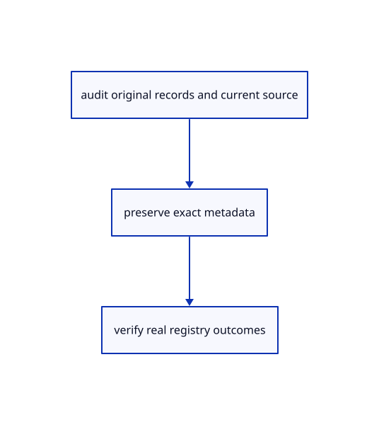

# 19.1.9 · Prove current source grammar and explicit differences

**Chapter 19 · Integration and original ownership · Section 19.1 · Metadata and current command contracts** · [Contents](contents.md)

**Typing: 0–0 minutes.** [Estimate](typing-load.md).

Prove current source grammar and explicit differences.

## Type

Continue from [Prove exact metadata and definition round trips](96g-prove-exact-metadata-and-definition-round-trips.md). [Save or recover your work](recovery.md).

<details>
<summary>Supplied data</summary>

Copy this supplied data once; it is excluded from the typing estimate.

### 1. `src/current_registry.json`

Copy real observed current parser outcomes, prompts, aliases and action flags.

Copy this supplied file:

```text
--8<-- "journey/code/96h-prove-current-source-grammar-and-explicit-differences-01.rs"
```

</details>

<details>
<summary>Supplied validation fixture</summary>

Copy this supplied authoring fixture once. Continue with the browser build below; the course does not require running native tests.

### 2. `src/inventory_tests.rs`

Copy supplied complete source/registry and explicit grammar/shortcut fixtures.

Copy this supplied file:

```text
--8<-- "journey/code/96h-prove-current-source-grammar-and-explicit-differences-02.rs"
```

</details>

<details>
<summary>Supplied validation fixture</summary>

Copy this supplied authoring fixture once. Continue with the browser build below; the course does not require running native tests.

### 3. `src/lib.rs`

Register supplied complete source and registry fixtures.

<details>
<summary>Locate the existing block</summary>

```text
#[cfg(test)]
mod metadata_tests;
```

</details>

After that block, append this supplied code:

```text
--8<-- "journey/code/96h-prove-current-source-grammar-and-explicit-differences-03.rs" skip=33
```

</details>

## Run and check

Run this from `session_viewer` to select the fixed dependency versions and install supplied binary assets. It updates Cargo.lock and preserves the previous lock. It does not write implementation code:

```sh
npm --prefix ../session_tests run course -- dependencies 19.1.9
```

In your project:

```sh
cd workspace/journey
REGEN_PROTO=0 cargo build --lib --locked --target wasm32-unknown-unknown -j1
REGEN_PROTO=0 CARGO_BUILD_JOBS=1 trunk serve --port 8780
```

Open `http://127.0.0.1:8780/`. Keep an existing Trunk server running; saving rebuilds it.

The original comparison scene remains intact while source and registry fixtures verify the complete declared maintained Rust inventory.

### Recorded visual result

**Previous native render — current verification pending.**

Original blue solids and black boundaries remain; source and parser coverage are checked independently of this illustration.


*This recorded image predates a source or checker change. Rebuild this checkpoint before using it as current evidence; browser controls require separate acceptance.*

This reference image is shared with [18.6.4 · Prove the original comparison and inspect differences](94c-prove-the-original-comparison-and-inspect-differences.md). It does not demonstrate a new feature by itself.

<details>
<summary>Code explanation and diagram</summary>


audit original records and current source → preserve exact metadata → verify real registry outcomes.



Does one green parser test cover the current viewer?

Check every recorded name, static option and alias against the compiled registry, every source hash/file against this checkout, and selected deliberate differences explicitly. Runtime browser actions remain separate acceptance.

Study estimate, including typing and experiments: 0.5–1 hours.

</details>

<details>
<summary>Optional experiment</summary>

Read the dated source inventory and grammar observations beside the explicit implementation differences. Choose one listed command and execute it on an original selection in the browser. Distinguish that observed action from the optional source-hash and parser fixtures; complete viewer parity remains open.

</details>

<details>
<summary>Check and save your work</summary>

Restore experimental edits, then run from `session_viewer`:

```sh
npm --prefix ../session_tests run course -- check 19.1.9
npm --prefix ../session_tests run course -- save 19.1.9
```

Source comparison leaves your project untouched. [Save and recovery instructions](recovery.md).

</details>

<details>
<summary>Viewer coverage and verification</summary>

[Current source inventory](inventory.md) hashes all 306 maintained viewer files, 109 kernel Rust files and 13 Wood Rust files in the declared source/build scope. It excludes C++/assets/docs/targets and does not establish remote freshness. [Current command grammar](current-command-grammar.md) invokes the real registry: 86 names, 117 static options and 15 aliases. Parser success and source hashes are narrower than browser action acceptance. [Rendering differences](rendering-differences.md) explicitly separates teaching adapters from the maintained destination; the final runtime handoff follows97.

[October 9 behavior](current-viewer.md): independent layer lamps, panel selection Fit, Element Attributes Off and Element Interactions On. The dated comparison preserves the earlier baseline; browser and handwritten-runtime coverage remain separate.

Keep earlier checks. Supplied fixtures preserve component JSON, unknown interaction bytes, unused definitions, typed Element definitions and instance-feature records through archives; reject conflicting originals and malformed raw planes; verify every declared current source hash/file, every observed registered parser outcome and explicit Controls/Opacity/letter-shortcut differences. Per-instance feature records are retained here; their current derived display belongs to the maintained runtime.

The supplied contract imports the real original metadata fixture, saves and reopens it through the teaching command dock, and checks retained metadata accounting. It is syntaxchecked; it has not been run in a browser.

[Full validation scope](release.md).

To reproduce the scripted acceptance of the reference checkpoint, run from `session_viewer` with the [course bundle server](release.md#reproduce) running on port 8781:

```sh
npm --prefix ../session_tests run course -- capture 19.1.9
```

This uses the verified reference bundle; it does not check or change your typed project.

</details>
