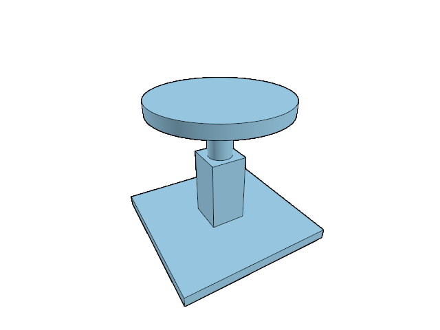

# 19.2.5 · Project original outlines without changing their coordinates

**Chapter 19 · Integration and original ownership · Section 19.2 · Elements and feature hierarchies** · [Contents](contents.md)

**Typing: 26–51 minutes.** [Estimate](typing-load.md).

Display preparation clones each original outline, gives the display copy its own identity, and prepares a black path.

## Type

Continue from [Attach a bounded feature tree to its host](96l-attach-a-bounded-derived-feature-tree.md). [Save or recover your work](recovery.md).

### 1. `src/feature_display.rs`

Give this operation its own small owner.

Create the file and type:

```rust
--8<-- "journey/code/96m-project-original-feature-outlines-01.rs"
```

### 2. `src/lib.rs`

Register the new owner without changing the browser entry point.

<details>
<summary>Locate the existing block</summary>

```rust
#[cfg(test)]
mod inventory_tests;
```

</details>

Edit the existing block to match this code; keep unchanged lines:

```rust
pub mod feature_display;

#[cfg(test)]
mod inventory_tests;
```

<details>
<summary>Optional patch references</summary>

Use these original edit fragments when comparing a saved checkpoint. Apply the complete blocks above.

```text
--8<-- "journey/code/96m-project-original-feature-outlines-02.rs"
```

</details>

## Run and check

In your project:

```sh
cd workspace/journey
REGEN_PROTO=0 cargo build --lib --locked --target wasm32-unknown-unknown -j1
REGEN_PROTO=0 CARGO_BUILD_JOBS=1 trunk serve --port 8780
```

Open `http://127.0.0.1:8780/`. Keep an existing Trunk server running; saving rebuilds it.

Placed original outlines produce derived black paths with independent attribute and interaction visibility defaults.

### Recorded visual result

**Previous native render — current verification pending.**

The existing original comparison scene is unchanged; this step prepares imported Element ownership.



*This recorded image predates a source or checker change. Rebuild this checkpoint before using it as current evidence; browser controls require separate acceptance.*

This reference image is shared with [19.2.1 · Separate own attributes from hosted features](96i-separate-own-and-hosted-element-features.md). It does not demonstrate a new feature by itself.

<details>
<summary>Code explanation and diagram</summary>

Apply the host placement once after preparation. Temporarily detach the hierarchy/current-layer routing while allocating pieces so these paths cannot be inserted into a user layer as independent originals. Restore routing before attaching the bounded feature tree. Import and editor history provide the surrounding rollback transaction.

original source → bounded feature plan → derived display → source-preserving archive.


Which transform belongs on a generated piece?

The already resolved host placement. Original outline coordinates stay local, and applying an additional parent placement would move nested features twice.

Study estimate, including typing and experiments: 0.5–1 hours.

</details>

<details>
<summary>Optional experiment</summary>

Use a translated parent and a translated child Element. Compare each feature path’s placement with its own host, then repeat at a large world coordinate.

</details>

<details>
<summary>Check and save your work</summary>

Restore experimental edits, then run from `session_viewer`:

```sh
npm --prefix ../session_tests run course -- check 19.2.5
npm --prefix ../session_tests run course -- save 19.2.5
```

Source comparison leaves your project untouched. [Save and recovery instructions](recovery.md).

</details>

<details>
<summary>Viewer coverage and verification</summary>

This bridge extends the handwritten viewer. Compare the full interaction type and source-name grouping with maintained `app/interactions.rs` and `app/hierarchy.rs`. Native, browser and hardware evidence remain separate; see [local checks](local-checks.md).


[Full validation scope](release.md).

</details>
