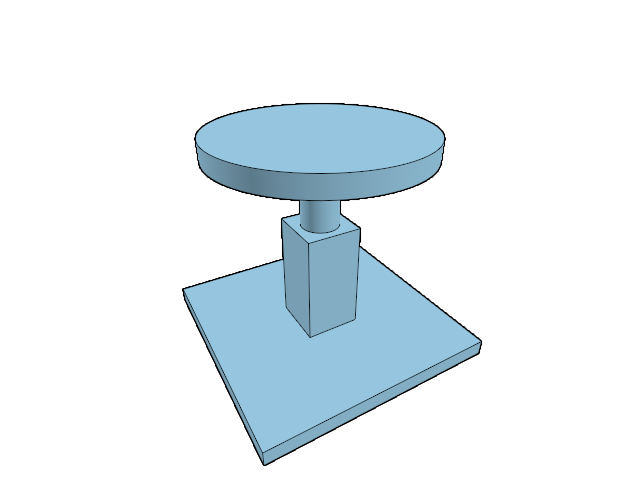

# 19.3.7 · Address feature pixels to original CAD owners

**Chapter 19 · Integration and original ownership · Section 19.3 · Original owners across selection, copying and display** · [Contents](contents.md)

**Typing: 24–47 minutes.** [Estimate](typing-load.md).

The integer picking pass must write original editing identities.

## Type

Continue from [Regenerate display for copied feature owners](96x-regenerate-display-for-copied-feature-owners.md). [Save or recover your work](recovery.md).

### 1. `src/feature_owner.rs`

Reuse the existing original-owner traversal for a displayed GPU primitive.

<details>
<summary>Locate the existing block</summary>

```rust
pub fn row_owner(scene: &Scene, key: &str) -> Option<ObjectId> {
```

</details>

Edit the existing block to match this code; keep unchanged lines:

```rust
pub fn display_owner(scene: &Scene, id: ObjectId) -> Option<ObjectId> {
    if !scene.forest.derived(id) { return scene.pick_id(id.value()); }
    for doc in &scene.forest.documents {
        if let Some(index) = doc.nodes.iter().position(|node| node.object == Some(id)) {
            return ancestor(scene, doc, index);
        }
    }
    None
}

pub fn row_owner(scene: &Scene, key: &str) -> Option<ObjectId> {
```

<details>
<summary>Optional patch references</summary>

Use these original edit fragments when comparing a saved checkpoint. Apply the complete blocks above.

```text
--8<-- "journey/code/96y-address-feature-pixels-to-original-cad-owners-01.rs"
```

</details>

### 2. `src/pick_sources.rs`

Write an original editing ID and suppress invented subpart tags for derived ink.

<details>
<summary>Locate the existing block</summary>

```rust
        let id = |owner: ObjectId, tag| [scene.pick_id(owner.value()).map_or(0, ObjectId::value), tag];
```

</details>

Edit the existing block to match this code; keep unchanged lines:

```rust
        let id = |owner: ObjectId, tag| [crate::feature_owner::display_owner(scene, owner).map_or(0, ObjectId::value),
            if scene.forest.derived(owner) { 0 } else { tag }];
```

<details>
<summary>Optional patch references</summary>

Use these original edit fragments when comparing a saved checkpoint. Apply the complete blocks above.

```text
--8<-- "journey/code/96y-address-feature-pixels-to-original-cad-owners-02.rs"
```

</details>

<details>
<summary>Supplied validation fixture</summary>

Copy this supplied authoring fixture once. Continue with the browser build below; the course does not require running native tests.

### 3. `src/feature_pick_tests.rs`

Supply independent original-owner address and guard witnesses.

Copy this supplied file:

```text
--8<-- "journey/code/96y-address-feature-pixels-to-original-cad-owners-03.rs"
```

</details>

### 4. `src/lib.rs`

Register the supplied original-owner address fixture.

<details>
<summary>Locate the existing block</summary>

```rust
mod copy_feature_tests;
```

</details>

After that block, type:

```rust
#[cfg(test)]
mod feature_pick_tests;
```

<details>
<summary>Optional patch references</summary>

Use these original edit fragments when comparing a saved checkpoint. Apply the complete blocks above.

```text
--8<-- "journey/code/96y-address-feature-pixels-to-original-cad-owners-04.rs"
```

</details>

<details>
<summary>Supplied validation fixture</summary>

Copy this supplied authoring fixture once. Continue with the browser build below; the course does not require running native tests.

### 5. `src/pick_gpu_tests.rs`

Supply a real integer GPU feature-pixel readback witness.

<details>
<summary>Locate the existing block</summary>

```text
#[test]
fn actual_integer_pick_preserves_high_ids_depth_and_locked_occlusion()
```

</details>

Update the existing block with this supplied code; keep unchanged lines:

```text
--8<-- "journey/code/96y-address-feature-pixels-to-original-cad-owners-05.rs"
```

</details>

### 6. `src/hierarchy.rs`

Keep original editing targets separate from all display members of a tree row. Count and select original descendants in editable rows; retain read-only feature identities and complete display membership. Give ordinary and created rows the same explicit display-membership contract.

Edit these blocks from bottom to top. Keep the surrounding lines unchanged.

<details>
<summary>Locate this block</summary>

```rust
        }
        let start=rows.len();
        for &index in &visible {
            let node=&doc.nodes[index];let ids=doc.nodes[index..node.end].iter().filter_map(|n|n.object).filter(|id|scene.contains(*id)).collect::<Vec<_>>();
            placed.extend(node.object);let end=start+visible.partition_point(|i|*i<node.end);
            rows.push(Row {key:format!("{}/{}",doc.key,node.source.guid),label:if index==0 {doc.label.clone()} else {node.label.clone()},depth:node.depth,end,ids,readonly:node.readonly});
        }
    }
    for row in scene.objects().iter().filter(|r|!placed.contains(&r.id)) {let index=rows.len();rows.push(Row {key:format!("created/{}",row.id.value()),label:row.metadata.name.clone(),depth:0,end:index+1,ids:vec![row.id],readonly:false});}
    let other=scene.lines().iter().map(|r|(r.id,r.prepared.source.name.as_str())).chain(scene.paths().iter().map(|r|(r.id,r.prepared.source.name()))).chain(scene.points().iter().map(|r|(r.id,r.prepared.source.name.as_str()))).chain(scene.texts().iter().map(|r|(r.id,r.prepared.source.name.as_str()))).chain(scene.clouds().iter().map(|r|(r.id,r.prepared.source.name.as_str()))).chain(scene.streams().iter().map(|r|(r.id,r.prepared.source.name.as_str())));
    for (id,label) in other.filter(|(id,_)|!placed.contains(id)) {let index=rows.len();rows.push(Row {key:format!("created/{}",id.value()),label:label.to_owned(),depth:0,end:index+1,ids:vec![id],readonly:false});}
    rows
}
```

</details>

Replace it with:

```rust
        }
        let start=rows.len();
        for &index in &visible {
            let node=&doc.nodes[index];
            let members=doc.nodes[index..node.end].iter().filter_map(|n|n.object).filter(|id|scene.contains(*id)).collect::<Vec<_>>();
            let ids=doc.nodes[index..node.end].iter().filter(|n|node.readonly || !n.derived).filter_map(|n|n.object).filter(|id|scene.contains(*id)).collect::<Vec<_>>();
            placed.extend(node.object);let end=start+visible.partition_point(|i|*i<node.end);
            rows.push(Row {key:format!("{}/{}",doc.key,node.source.guid),label:if index==0 {doc.label.clone()} else {node.label.clone()},depth:node.depth,end,ids,members,readonly:node.readonly});
        }
    }
    for row in scene.objects().iter().filter(|r|!placed.contains(&r.id)) {let index=rows.len();rows.push(Row {key:format!("created/{}",row.id.value()),label:row.metadata.name.clone(),depth:0,end:index+1,ids:vec![row.id],members:vec![row.id],readonly:false});}
    let other=scene.lines().iter().map(|r|(r.id,r.prepared.source.name.as_str())).chain(scene.paths().iter().map(|r|(r.id,r.prepared.source.name()))).chain(scene.points().iter().map(|r|(r.id,r.prepared.source.name.as_str()))).chain(scene.texts().iter().map(|r|(r.id,r.prepared.source.name.as_str()))).chain(scene.clouds().iter().map(|r|(r.id,r.prepared.source.name.as_str()))).chain(scene.streams().iter().map(|r|(r.id,r.prepared.source.name.as_str())));
    for (id,label) in other.filter(|(id,_)|!placed.contains(id)) {let index=rows.len();rows.push(Row {key:format!("created/{}",id.value()),label:label.to_owned(),depth:0,end:index+1,ids:vec![id],members:vec![id],readonly:false});}
    rows
}
```

<details>
<summary>Locate this block</summary>

```rust
}

#[derive(Clone)]
pub struct Row {pub key:String,pub label:String,pub depth:usize,pub end:usize,pub ids:Vec<ObjectId>,pub readonly:bool}
pub fn rows(scene:&Scene)->Vec<Row> {
    let mut rows=Vec::new();let mut placed=HashSet::new();
    for doc in &scene.forest.documents {
```

</details>

Replace it with:

```rust
}

#[derive(Clone)]
pub struct Row {pub key:String,pub label:String,pub depth:usize,pub end:usize,pub ids:Vec<ObjectId>,pub members:Vec<ObjectId>,pub readonly:bool}
pub fn rows(scene:&Scene)->Vec<Row> {
    let mut rows=Vec::new();let mut placed=HashSet::new();
    for doc in &scene.forest.documents {
```

<details>
<summary>Complete updated block reference</summary>

```rust
use crate::scene::{Scene,ObjectId};
use session_rust::{proto,Xform};
use std::{collections::{HashMap,HashSet},rc::Rc};

pub const MAX_NODES:usize=4096;
pub const MAX_DEPTH:usize=64;

pub fn validate(root:&proto::TreeNode,guids:&HashSet<&str>)->Result<(), &'static str> {
    let mut stack=vec![(root,0)];let mut seen=HashSet::new();let mut count=0;
    while let Some((node,depth))=stack.pop() {
        count+=1;if count>MAX_NODES || depth>MAX_DEPTH {return Err("Tree exceeds this checkpoint's node or depth limit");}
        if guids.contains(node.name.as_str()) && !seen.insert(node.name.as_str()) {return Err("A source object occurs twice in the tree");}
        stack.extend(node.children.iter().rev().map(|child|(child,depth+1)));
    }
    if seen!=*guids {return Err("The tree must contain every source mesh once");} Ok(())
}

pub fn world(root:Option<&proto::TreeNode>,xforms:&HashMap<String,Xform>,guid:&str)->Xform {
    let mut stack=root.into_iter().map(|node|(node,Xform::identity())).collect::<Vec<_>>();
    while let Some((node,parent))=stack.pop() {
        let local=xforms.get(&node.name).cloned().unwrap_or_else(Xform::identity);let matrix=&parent*&local;
        if node.name==guid {return matrix;}
        stack.extend(node.children.iter().rev().map(|child|(child,matrix.clone())));
    }
    xforms.get(guid).cloned().unwrap_or_else(Xform::identity)
}

#[derive(Clone)]
pub struct Node {pub derived:bool,pub placement:crate::nested_placement::Node,pub portable_guid:String, pub source:proto::TreeNode,pub object:Option<ObjectId>,pub label:String,pub parent:Option<usize>,pub depth:usize,pub end:usize,pub readonly:bool }
#[derive(Clone)]
pub struct Document {pub header:Option<Rc<crate::origin::Origin>>,pub key:u32,pub label:String,pub nodes:Vec<Node>}
#[derive(Clone,Default)]
pub struct Forest { pub documents:Vec<Rc<Document>>,readonly_ids:Rc<HashSet<ObjectId>> }

impl Forest {
    pub fn add(&mut self,key:u32,label:String,root:Option<proto::TreeNode>,objects:&[(String,ObjectId,String)]) {
        let fallback=proto::TreeNode {name:label.clone(),children:objects.iter().map(|(guid,_,_)|proto::TreeNode {name:guid.clone(),..Default::default()}).collect(),..Default::default()};
        let root=root.unwrap_or(fallback);let lookup=objects.iter().map(|(guid,id,name)|(guid.as_str(),(*id,name.as_str()))).collect::<HashMap<_,_>>();
        let mut nodes:Vec<Node>=Vec::new();let mut stack=vec![(&root,None::<usize>,0,false,false,false)];
        while let Some((node,parent,depth,inside,readonly,exit))=stack.pop() {
            if exit {nodes[parent.unwrap()].end=nodes.len();continue;}
            let object=lookup.get(node.name.as_str()).copied();let readonly=readonly || inside && matches!(node.name.as_str(),"attributes"|"interactions");
            let index=nodes.len();let source=proto::TreeNode {guid:if node.guid.is_empty() {uuid::Uuid::new_v4().to_string()} else {node.guid.clone()},name:node.name.clone(),parent_guid:node.parent_guid.clone(),color:node.color.clone(),children:Vec::new()};
            nodes.push(Node {derived:false,placement:Default::default(),portable_guid:uuid::Uuid::new_v4().to_string(),source,object:object.map(|v|v.0),label:object.map_or_else(||node.name.clone(),|v|v.1.to_owned()),parent,depth,end:index+1,readonly});
            stack.push((node,Some(index),depth,inside,readonly,true));
            stack.extend(node.children.iter().rev().map(|child|(child,Some(index),depth+1,inside||object.is_some(),readonly,false)));
        }
        Rc::make_mut(&mut self.readonly_ids).extend(nodes.iter().filter(|node|node.readonly).filter_map(|node|node.object));
        self.documents.push(Rc::new(Document {header:None,key,label,nodes}));
    }

    pub(crate) fn original_placements(&mut self,key:u32,source:&session_rust::Session,place:&Xform,world:&HashMap<String,Xform>) {
        let doc=Rc::make_mut(self.documents.iter_mut().find(|doc|doc.key==key).unwrap());
        for i in 0..doc.nodes.len() {
            let node=&doc.nodes[i];let parent=node.parent.map_or_else(Xform::identity,|p|doc.nodes[p].placement.world.clone());let local=source.xforms.get(&node.source.name).cloned().unwrap_or_else(Xform::identity);let local=if node.parent.is_none() {place*&local} else {local};let matrix=world.get(&node.source.name).cloned().unwrap_or_else(||&parent*&local);doc.nodes[i].placement=crate::nested_placement::Node {local,world:matrix,parent};
        }
    }

    pub(crate) fn push(&mut self,document:Document) {
        Rc::make_mut(&mut self.readonly_ids).extend(document.nodes.iter().filter(|node|node.readonly).filter_map(|node|node.object));
        self.documents.push(Rc::new(document));
    }

    pub fn colours(&self,key:u32)->HashMap<ObjectId,[u8;3]> {
        let mut out=HashMap::new();let Some(doc)=self.documents.iter().find(|doc|doc.key==key) else {return out;};
        let mut inherited=vec![None;doc.nodes.len()];
        for (index,node) in doc.nodes.iter().enumerate() {
            let colour=node.source.color.as_ref().map(|colour|[colour.r,colour.g,colour.b].map(|value|(value.clamp(0.,1.)*255.).round() as u8)).or_else(||node.parent.and_then(|parent|inherited[parent]));
            inherited[index]=colour;if let (Some(id),Some(colour))=(node.object,colour) {out.insert(id,colour);}
        }
        out
    }

    pub(crate) fn replace(&mut self,index:usize,document:Document) {
        self.documents[index]=Rc::new(document);
        self.readonly_ids=Rc::new(self.documents.iter().flat_map(|doc|doc.nodes.iter()).filter(|node|node.readonly).filter_map(|node|node.object).collect());
    }

    pub fn classify_elements(&mut self, key: u32, elements: &HashSet<ObjectId>) {
        let owner = self.documents.iter().position(|doc| doc.key == key).unwrap();
        let mut doc = (*self.documents[owner]).clone();
        let mut inside = vec![false; doc.nodes.len()];
        for i in 0..doc.nodes.len() {
            let parent = doc.nodes[i].parent;
            let element = doc.nodes[i].object.is_some_and(|id| elements.contains(&id));
            let inherited = parent.is_some_and(|p| inside[p]);
            let held = parent.is_some_and(|p| doc.nodes[p].readonly);
            if element || inherited {
                doc.nodes[i].readonly = !element && (held
                    || matches!(doc.nodes[i].source.name.as_str(), "attributes" | "interactions"));
            }
            inside[i] = element || inherited;
        }
        self.replace(owner, doc);
    }

    pub fn derived(&self, id: ObjectId) -> bool {
        self.documents.iter().any(|doc| doc.nodes.iter()
            .any(|node| node.object == Some(id) && node.derived))
    }

    pub fn readonly(&self,id:ObjectId)->bool {self.readonly_ids.contains(&id)}
    pub fn descendants(&self,ids:&[ObjectId])->Vec<ObjectId> {
        let mut out=ids.to_vec();
        for doc in &self.documents {for (index,node) in doc.nodes.iter().enumerate() {if node.object.is_some_and(|id|ids.contains(&id)) {out.extend(doc.nodes[index+1..node.end].iter().filter_map(|n|n.object));}}}
        out.sort_unstable_by_key(|id|id.value());out.dedup();out
    }

    pub fn snapshot(&self,scene:&Scene,xforms:&mut Vec<proto::XformEntry>)->Result<(Vec<proto::TreeNode>,HashSet<ObjectId>), &'static str> {
        let mut roots=Vec::new();let mut placed=HashSet::new();
        for doc in &self.documents {if let Some(root)=save_node(doc,0,scene,&Xform::identity(),"",xforms,&mut placed)? {roots.push(root);}}
        Ok((roots,placed))
    }
}

fn save_node(doc:&Document,index:usize,scene:&Scene,parent:&Xform,parent_guid:&str,xforms:&mut Vec<proto::XformEntry>,placed:&mut HashSet<ObjectId>)->Result<Option<proto::TreeNode>, &'static str> {
    let original=&doc.nodes[index];if original.derived {return Ok(None);}
    let mut node=original.source.clone();node.guid=original.portable_guid.clone();node.parent_guid=parent_guid.to_owned();let mut matrix=parent*&original.placement.local;let mut local=original.placement.local.clone();
    if let Some(id)=original.object {
        let Some(guid)=scene.row_guid(id) else {return Ok(None);};
        node.name=guid.to_owned();matrix=scene.placement(id).ok_or("Saved source placement is missing")?;local=crate::nested_placement::saved_local(&original.placement,parent,&matrix)?;
        placed.insert(id);
    }
    if local.m!=Xform::identity().m {
        let guid=node.name.clone();if let Some(previous)=xforms.iter().find(|entry|entry.guid==guid) {if previous.xform.as_ref()!=Some(&local.to_proto()) {return Err("Different saved tree placements share a name");}}
        else {xforms.push(proto::XformEntry {guid,xform:Some(local.to_proto())});}
    }
    for child in index+1..original.end {if doc.nodes[child].parent==Some(index) {if let Some(child)=save_node(doc,child,scene,&matrix,&node.guid,xforms,placed)? {node.children.push(child);}}}
    Ok(Some(node))
}

#[derive(Clone)]
pub struct Row {pub key:String,pub label:String,pub depth:usize,pub end:usize,pub ids:Vec<ObjectId>,pub members:Vec<ObjectId>,pub readonly:bool}
pub fn rows(scene:&Scene)->Vec<Row> {
    let mut rows=Vec::new();let mut placed=HashSet::new();
    for doc in &scene.forest.documents {
        let mut visible=Vec::new();let mut index=0;
        while index<doc.nodes.len() {
            let node=&doc.nodes[index];
            if node.object.is_some_and(|id|!scene.contains(id)) {index=node.end;continue;}
            visible.push(index);index+=1;
        }
        let start=rows.len();
        for &index in &visible {
            let node=&doc.nodes[index];
            let members=doc.nodes[index..node.end].iter().filter_map(|n|n.object).filter(|id|scene.contains(*id)).collect::<Vec<_>>();
            let ids=doc.nodes[index..node.end].iter().filter(|n|node.readonly || !n.derived).filter_map(|n|n.object).filter(|id|scene.contains(*id)).collect::<Vec<_>>();
            placed.extend(node.object);let end=start+visible.partition_point(|i|*i<node.end);
            rows.push(Row {key:format!("{}/{}",doc.key,node.source.guid),label:if index==0 {doc.label.clone()} else {node.label.clone()},depth:node.depth,end,ids,members,readonly:node.readonly});
        }
    }
    for row in scene.objects().iter().filter(|r|!placed.contains(&r.id)) {let index=rows.len();rows.push(Row {key:format!("created/{}",row.id.value()),label:row.metadata.name.clone(),depth:0,end:index+1,ids:vec![row.id],members:vec![row.id],readonly:false});}
    let other=scene.lines().iter().map(|r|(r.id,r.prepared.source.name.as_str())).chain(scene.paths().iter().map(|r|(r.id,r.prepared.source.name()))).chain(scene.points().iter().map(|r|(r.id,r.prepared.source.name.as_str()))).chain(scene.texts().iter().map(|r|(r.id,r.prepared.source.name.as_str()))).chain(scene.clouds().iter().map(|r|(r.id,r.prepared.source.name.as_str()))).chain(scene.streams().iter().map(|r|(r.id,r.prepared.source.name.as_str())));
    for (id,label) in other.filter(|(id,_)|!placed.contains(id)) {let index=rows.len();rows.push(Row {key:format!("created/{}",id.value()),label:label.to_owned(),depth:0,end:index+1,ids:vec![id],members:vec![id],readonly:false});}
    rows
}
```

</details>

<details>
<summary>Optional patch references</summary>

Use these original edit fragments when comparing a saved checkpoint. Apply the complete blocks above.

```text
--8<-- "journey/code/96y-address-feature-pixels-to-original-cad-owners-06.rs"
```

```text
--8<-- "journey/code/96y-address-feature-pixels-to-original-cad-owners-07.rs"
```

```text
--8<-- "journey/code/96y-address-feature-pixels-to-original-cad-owners-08.rs"
```

```text
--8<-- "journey/code/96y-address-feature-pixels-to-original-cad-owners-09.rs"
```

```text
--8<-- "journey/code/96y-address-feature-pixels-to-original-cad-owners-10.rs"
```

</details>

### 7. `src/tree_panel.rs`

Read presentation state from every display member while selection eligibility and actions keep original targets.

<details>
<summary>Locate the existing block</summary>

```rust
        self.rows=crate::hierarchy::rows(scene);self.selected=selected;self.states=self.rows.iter().map(|row|(row.key.clone(),RowState {hidden:scene.view.lamps.contains(&row.key)||!row.ids.is_empty()&&row.ids.iter().all(|id|scene.view.hidden.contains(id)),locked:!row.ids.is_empty()&&row.ids.iter().all(|id|scene.view.locked.contains(id)),selectable:crate::feature_owner::row_owner(scene,&row.key).is_some() || row.ids.iter().any(|id|scene.pick_id(id.value()).is_some()),owner:crate::feature_owner::row_owner(scene,&row.key),current:crate::layer_edit::current_key(scene).as_ref()==Some(&row.key),has_faces:row.ids.iter().any(|id|scene.objects().iter().any(|mesh|mesh.id==*id)),colours:[row.ids.iter().find_map(|id|scene.view.faces.get(id).copied()),row.ids.iter().find_map(|id|scene.view.edges.get(id).copied())],group:crate::layer_edit::locate(scene,&row.key).is_ok(),root:row.depth==0,holds_current:crate::layer_edit::holds_current(scene,&row.key)})).collect();
```

</details>

Edit the existing block to match this code; keep unchanged lines:

```rust
        self.rows=crate::hierarchy::rows(scene);self.selected=selected;self.states=self.rows.iter().map(|row|(row.key.clone(),RowState {hidden:scene.view.lamps.contains(&row.key)||!row.members.is_empty()&&row.members.iter().all(|id|scene.view.hidden.contains(id)),locked:!row.members.is_empty()&&row.members.iter().all(|id|scene.view.locked.contains(id)),selectable:crate::feature_owner::row_owner(scene,&row.key).is_some() || row.ids.iter().any(|id|scene.pick_id(id.value()).is_some()),owner:crate::feature_owner::row_owner(scene,&row.key),current:crate::layer_edit::current_key(scene).as_ref()==Some(&row.key),has_faces:row.members.iter().any(|id|scene.objects().iter().any(|mesh|mesh.id==*id)),colours:[row.members.iter().find_map(|id|scene.view.faces.get(id).copied()),row.members.iter().find_map(|id|scene.view.edges.get(id).copied())],group:crate::layer_edit::locate(scene,&row.key).is_ok(),root:row.depth==0,holds_current:crate::layer_edit::holds_current(scene,&row.key)})).collect();
```

<details>
<summary>Optional patch references</summary>

Use these original edit fragments when comparing a saved checkpoint. Apply the complete blocks above.

```text
--8<-- "journey/code/96y-address-feature-pixels-to-original-cad-owners-11.rs"
```

</details>

### 8. `src/layer_properties.rs`

Apply visibility, locking and colours to all display members without widening editing selection.

<details>
<summary>Locate the existing block</summary>

```rust
use crate::{scene::Scene,hierarchy};
use std::rc::Rc;

#[derive(Clone,Copy)]
pub enum Property {Hidden(bool),Locked(bool),Colour {edge:bool,rgb:Option<[u8;3]>}}
pub fn apply(scene:&mut Scene,key:&str,property:Property)->Result<(), &'static str> {
    let rows=hierarchy::rows(scene);let index=rows.iter().position(|row|row.key==key).ok_or("This layer row is gone")?;let row=&rows[index];
    if matches!(property,Property::Hidden(true)) && crate::layer_edit::holds_current(scene,key) {return Err("The current layer cannot be hidden");}
    let view=Rc::make_mut(&mut scene.view);
    match property {
        Property::Hidden(on)=>{
            let group=scene.forest.documents.iter().any(|doc|doc.nodes.iter().any(|node|node.object.is_none()&&format!("{}/{}",doc.key,node.source.guid)==key));
            if group {if on {view.lamps.insert(key.to_owned());}else{view.lamps.remove(key);}} else {view.hide(&row.ids,on);}
            view.refresh(&scene.forest);
        },
        Property::Locked(on)=>view.lock(&row.ids,on),
        Property::Colour {edge,rgb}=>{let colours=if edge {&mut view.edges} else {&mut view.faces};for id in &row.ids {if let Some(rgb)=rgb {colours.insert(*id,rgb);} else {colours.remove(id);}}},
    }
    Ok(())
}
```

</details>

Edit the existing block to match this code; keep unchanged lines:

```rust
use crate::{scene::Scene,hierarchy};
use std::rc::Rc;

#[derive(Clone,Copy)]
pub enum Property {Hidden(bool),Locked(bool),Colour {edge:bool,rgb:Option<[u8;3]>}}
pub fn apply(scene:&mut Scene,key:&str,property:Property)->Result<(), &'static str> {
    let rows=hierarchy::rows(scene);let index=rows.iter().position(|row|row.key==key).ok_or("This layer row is gone")?;let row=&rows[index];
    if matches!(property,Property::Hidden(true)) && crate::layer_edit::holds_current(scene,key) {return Err("The current layer cannot be hidden");}
    let view=Rc::make_mut(&mut scene.view);
    match property {
        Property::Hidden(on)=>{
            let group=scene.forest.documents.iter().any(|doc|doc.nodes.iter().any(|node|node.object.is_none()&&format!("{}/{}",doc.key,node.source.guid)==key));
            if group {if on {view.lamps.insert(key.to_owned());}else{view.lamps.remove(key);}} else {view.hide(&row.members,on);}
            view.refresh(&scene.forest);
        },
        Property::Locked(on)=>view.lock(&row.members,on),
        Property::Colour {edge,rgb}=>{let colours=if edge {&mut view.edges} else {&mut view.faces};for id in &row.members {if let Some(rgb)=rgb {colours.insert(*id,rgb);} else {colours.remove(id);}}},
    }
    Ok(())
}
```

<details>
<summary>Optional patch references</summary>

Use these original edit fragments when comparing a saved checkpoint. Apply the complete blocks above.

```text
--8<-- "journey/code/96y-address-feature-pixels-to-original-cad-owners-12.rs"
```

```text
--8<-- "journey/code/96y-address-feature-pixels-to-original-cad-owners-13.rs"
```

```text
--8<-- "journey/code/96y-address-feature-pixels-to-original-cad-owners-14.rs"
```

</details>

## Run and check

Run this from `session_viewer` to select the fixed dependency versions and install supplied binary assets. It updates Cargo.lock and preserves the previous lock. It does not write implementation code:

```sh
npm --prefix ../session_tests run course -- dependencies 19.3.7
```

In your project:

```sh
cd workspace/journey
REGEN_PROTO=0 cargo build --lib --locked --target wasm32-unknown-unknown -j1
REGEN_PROTO=0 CARGO_BUILD_JOBS=1 trunk serve --port 8780
```

Open `http://127.0.0.1:8780/`. Keep an existing Trunk server running; saving rebuilds it.


### Recorded visual result

**Previous native render — current verification pending.**

This supporting frame has no instances; use the supplied original Session specimen for the browser exercise.



*This recorded image predates a source or checker change. Rebuild this checkpoint before using it as current evidence; browser controls require separate acceptance.*

This reference image is shared with [19.3.3 · Fit original box corners to the free canvas](96u-fit-original-box-corners-to-the-free-canvas.md). It does not demonstrate a new feature by itself.

<details>
<summary>Code explanation and diagram</summary>

A derived feature path is visible geometry, but it is not an editable Session object. Resolve its nearest original Element or InstanceRef with the ownership traversal already taught for tree rows. Original paths keep their existing IDs.

Use this resolver when building the GPU ink-ID arrays. A generated feature gets its owner ID and a zero subpart tag: its tessellated segments are display data, not original PathEdge indices. Object mode therefore selects the original CAD owner; edge and control modes cannot invent a source subpart. Hidden and locked original owners still fail the existing eligibility guard.

This change reuses the integer target, readback and stale-result handling already developed. It adds no second picking pass. The supplied GPU witness clicks a feature line away from its Element mesh and verifies the returned owner ID, then locks the original and repeats the click.

The dependency command also supplies assets/pb/course-feature-pick.pb: two original Elements with feature lines away from their meshes, with the second Element locked. Open it in the browser and use object selection to check the original-owner address directly.

Keep an editable tree row's original targets separate from its full display membership. Generated paths still appear as read-only feature children and follow their original owner. Parent selection and the object count use originals; visibility, locking and colour continue to reach every display member.

original source → fresh copy identity → original placement → regenerated display.


Why is the subpart tag zero for a generated feature outline?

A tessellated display segment has no editable original PathEdge index. Zero identifies only the original object; it prevents the edge-mode resolver from treating generated geometry as a kernel source part.

Study estimate, including typing and experiments: 0.5–1 hours.

</details>

<details>
<summary>Optional experiment</summary>

Click a visible interaction outline in object mode and Delete, then Undo. The original Element and its features disappear and return together. Try edge mode: it must not expose a generated outline segment as an original editable edge. Lock the owner and repeat.

</details>

<details>
<summary>Check and save your work</summary>

Restore experimental edits, then run from `session_viewer`:

```sh
npm --prefix ../session_tests run course -- check 19.3.7
npm --prefix ../session_tests run course -- save 19.3.7
```

Source comparison leaves your project untouched. [Save and recovery instructions](recovery.md).

</details>

<details>
<summary>Viewer coverage and verification</summary>

Current app/walk/mod.rs draws features with cx.row, the original Element or instance row. This stage gives the cumulative integer pick pass the same original ownership. Current packed draw formats remain a separate rendering bridge.

An original interaction fixture checks six generated path addresses, nearest child ownership, zero subparts and locked/hidden guards. A real integer GPU readback clicks an isolated feature line and verifies original-owner selection and locked rejection. The hierarchy regression separately checks original-only parent targets, retained read-only feature rows, original selection and full-member visibility, locking and colour changes.

Actual browser feature-pixel ownership and original archive regeneration acceptance pending.

[Full validation scope](release.md).

To reproduce the scripted acceptance of the reference checkpoint, run from `session_viewer` with the [course bundle server](release.md#reproduce) running on port 8781:

```sh
npm --prefix ../session_tests run course -- capture 19.3.7
```

This uses the verified reference bundle; it does not check or change your typed project.

</details>
