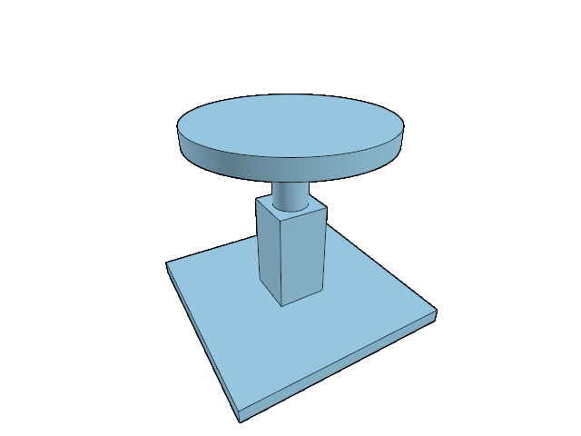

# 20.2.12 · Connect fitted surfaces and exact stroke occlusion

**Chapter 20 · Shared GPU rendering · Section 20.2 · Surface-fitted finite ink** · [Contents](contents.md)

**Typing: 20–39 minutes.** [Estimate](typing-load.md).

Build an InkAxis from the original segment and fit the physical triangle under its coverage pixel.

## Type

Continue from [Test rasterized neighbors at the stroke source](96zx-test-the-rasterized-neighbors-at-the-stroke-source.md). [Save or recover your work](recovery.md).

### 1. `src/finite_visibility.wgsl`

Retain the strict construction-grid rule while original strokes use the current fitted and exact predicates. Connect current surface fitting, exact source neighbors and conservative bounded tile traversal without changing the grid predicate.

<details>
<summary>Locate the existing block</summary>

```wgsl
// The tutorial still converts forward depth; allow two float rounding units until the reversed camera connects.
const FINITE_GRID:bool=false;
@group(1) @binding(0) var<storage,read> finite_projected:array<ProjectedTriangle>;
@group(1) @binding(1) var<storage,read> finite_tiles:array<vec4<u32>>;
@group(1) @binding(2) var finite_depth:texture_depth_2d;
@group(1) @binding(3) var finite_sections:texture_2d<f32>;
@group(1) @binding(4) var finite_primitive:texture_2d<u32>;
#include "ink_plane.wgsl"
fn finite_section(pixel:vec2<f32>,depth:f32,tolerance:f32)->bool{
 let at=finite_depth_pixel(pixel);let size=vec2<i32>(textureDimensions(finite_sections));if(any(at<vec2<i32>(0))||any(at>=size)){return true;}let cap=textureLoad(finite_sections,at,0).xy;if(cap.y<0.5){return true;}let plane=(u32(cap.y)-1u)&7u;let z=1.0-clip_plane_depth(plane,clip_ndc(pixel,view.size,0.0).xy);return select(z<=depth+tolerance,z<depth-tolerance,FINITE_GRID);
}
fn finite_physical(pixel:vec2<f32>,depth:f32,tolerance:f32)->bool{let at=finite_depth_pixel(pixel);let size=vec2<i32>(textureDimensions(finite_depth));if(any(at<vec2<i32>(0))||any(at>=size)){return false;}let z=1.0-textureLoad(finite_depth,at,0);return select(z<=depth+tolerance,z<depth-tolerance,FINITE_GRID);}
fn finite_screen(p:vec4<f32>)->vec2<f32>{return(p.xy/p.w*vec2<f32>(0.5,-0.5)+0.5)*view.size;}
fn finite_axis(a:vec4<f32>,b:vec4<f32>)->vec4<f32>{return vec4<f32>(finite_screen(a),finite_screen(b));}
fn finite_visible(pixel:vec2<f32>,axis:vec4<f32>,depths:vec2<f32>,flags:u32)->bool{
 let delta=axis.zw-axis.xy;let length2=dot(delta,delta);let t=clamp(dot(pixel-axis.xy,delta)/max(length2,1e-20),0.0,1.0);let at=axis.xy+t*delta;let depth=mix(depths.x,depths.y,t);let relative=abs(depth)*1.9073486e-6+abs(1.0-depth)*2.3841858e-7;
 if(!finite_section(at,depth,relative)){return false;}
 if(clip_active()&&clip_cut_ink_ndc(flags,clip_ndc(at,view.size,1.0-depth))){return false;}
 if(any(at<vec2<f32>(0.0))||any(at>=view.size)){return finite_physical(pixel,depth,relative);}
 if(finite_tiles[0].x==0u){return finite_physical(pixel,depth,relative);}
 let span=f32(visibility_tile_span_of(u32(view.size.x),u32(view.size.y)));let size=vec2<u32>(ceil(view.size/span));let cell=vec2<u32>(at/span);let head=finite_tiles[1u+cell.y*size.x+cell.x];
 if(head.w!=0u||head.z!=head.x){return finite_physical(pixel,depth,relative);}
 for(var i=0u;i<head.x;i++){
  let offset=head.y+i*2u;let nearest=bitcast<f32>(finite_tiles[(offset+1u)/4u][(offset+1u)%4u]);if(nearest<depth-relative||(!FINITE_GRID&&nearest<=depth+relative)){continue;}
  let primitive=finite_tiles[offset/4u][offset%4u];if(primitive==0u||primitive>arrayLength(&finite_projected)){continue;}
  let triangle=finite_projected[primitive-1u];let hit=projected_triangle_at(triangle,at);let tolerance=relative+0.00390625*(abs(triangle.gradient.x)+abs(triangle.gradient.y));
  if(hit.y>0.5&&!(clip_active()&&clip_cut_ndc(0u,clip_ndc(at,view.size,1.0-hit.x)))&&select(hit.x>depth+tolerance,hit.x>=depth-tolerance,FINITE_GRID)){return false;}
 }
 return true;
}


fn finite_alpha(pixel:vec2<f32>,axis:vec4<f32>,depths:vec2<f32>,flags:u32)->f32{
 let delta=axis.zw-axis.xy;let t=clamp(dot(pixel-axis.xy,delta)/max(dot(delta,delta),1e-20),0.,1.);let at=axis.xy+t*delta;let depth=mix(depths.x,depths.y,t);
 if(clip_active()&&clip_cut_ink_ndc(flags,clip_ndc(at,view.size,1.-depth))){return 0.;}
 let hidden=!finite_visible(pixel,axis,depths,flags);let glass=view.opacity>0.&&view.opacity<1.;return select(1.,select(0.,1.-view.opacity,glass),hidden&&view.opacity>0.);
}

fn finite_disc_alpha(pixel:vec2<f32>,centre:vec2<f32>,depth:f32,flags:u32)->f32{
 if(clip_active()&&clip_cut_ink_ndc(flags,clip_ndc(centre,view.size,1.-depth))){return 0.;}
 let tolerance=abs(depth)*DEPTH_REL_TOL+abs(1.-depth)*2.3841858e-7;
 let hidden=!finite_section(centre,depth,tolerance)||!ink_disc_visible(pixel,centre,depth,0u);
 let glass=view.opacity>0.&&view.opacity<1.;
 return select(1.,select(0.,1.-view.opacity,glass),hidden&&view.opacity>0.);
}
```

</details>

Edit the existing block to match this code; keep unchanged lines:

```wgsl
// The tutorial still converts forward depth; allow two float rounding units until the reversed camera connects.
const FINITE_GRID:bool=false;
@group(1) @binding(0) var<storage,read> finite_projected:array<ProjectedTriangle>;
@group(1) @binding(1) var<storage,read> finite_tiles:array<vec4<u32>>;
@group(1) @binding(2) var finite_depth:texture_depth_2d;
@group(1) @binding(3) var finite_sections:texture_2d<f32>;
@group(1) @binding(4) var finite_primitive:texture_2d<u32>;
#include "ink_plane.wgsl"
fn finite_section(pixel:vec2<f32>,depth:f32,tolerance:f32)->bool{
 let at=finite_depth_pixel(pixel);let size=vec2<i32>(textureDimensions(finite_sections));if(any(at<vec2<i32>(0))||any(at>=size)){return true;}let cap=textureLoad(finite_sections,at,0).xy;if(cap.y<0.5){return true;}let plane=(u32(cap.y)-1u)&7u;let z=1.0-clip_plane_depth(plane,clip_ndc(pixel,view.size,0.0).xy);return select(z<=depth+tolerance,z<depth-tolerance,FINITE_GRID);
}
fn finite_physical(pixel:vec2<f32>,depth:f32,tolerance:f32)->bool{let at=finite_depth_pixel(pixel);let size=vec2<i32>(textureDimensions(finite_depth));if(any(at<vec2<i32>(0))||any(at>=size)){return false;}let z=1.0-textureLoad(finite_depth,at,0);return select(z<=depth+tolerance,z<depth-tolerance,FINITE_GRID);}
fn finite_screen(p:vec4<f32>)->vec2<f32>{return(p.xy/p.w*vec2<f32>(0.5,-0.5)+0.5)*view.size;}
fn finite_axis(a:vec4<f32>,b:vec4<f32>)->vec4<f32>{return vec4<f32>(finite_screen(a),finite_screen(b));}
fn finite_grid_visible(pixel:vec2<f32>,axis:vec4<f32>,depths:vec2<f32>,flags:u32)->bool{
 let delta=axis.zw-axis.xy;let length2=dot(delta,delta);let t=clamp(dot(pixel-axis.xy,delta)/max(length2,1e-20),0.0,1.0);let at=axis.xy+t*delta;let depth=mix(depths.x,depths.y,t);let relative=abs(depth)*1.9073486e-6+abs(1.0-depth)*2.3841858e-7;
 if(!finite_section(at,depth,relative)){return false;}
 if(clip_active()&&clip_cut_ink_ndc(flags,clip_ndc(at,view.size,1.0-depth))){return false;}
 if(any(at<vec2<f32>(0.0))||any(at>=view.size)){return finite_physical(pixel,depth,relative);}
 if(finite_tiles[0].x==0u){return finite_physical(pixel,depth,relative);}
 let span=f32(visibility_tile_span_of(u32(view.size.x),u32(view.size.y)));let size=vec2<u32>(ceil(view.size/span));let cell=vec2<u32>(at/span);let head=finite_tiles[1u+cell.y*size.x+cell.x];
 if(head.w!=0u||head.z!=head.x){return finite_physical(pixel,depth,relative);}
 for(var i=0u;i<head.x;i++){
  let offset=head.y+i*2u;let nearest=bitcast<f32>(finite_tiles[(offset+1u)/4u][(offset+1u)%4u]);if(nearest<depth-relative||(!FINITE_GRID&&nearest<=depth+relative)){continue;}
  let primitive=finite_tiles[offset/4u][offset%4u];if(primitive==0u||primitive>arrayLength(&finite_projected)){continue;}
  let triangle=finite_projected[primitive-1u];let hit=projected_triangle_at(triangle,at);let tolerance=relative+0.00390625*(abs(triangle.gradient.x)+abs(triangle.gradient.y));
  if(hit.y>0.5&&!(clip_active()&&clip_cut_ndc(0u,clip_ndc(at,view.size,1.0-hit.x)))&&select(hit.x>depth+tolerance,hit.x>=depth-tolerance,FINITE_GRID)){return false;}
 }
 return true;
}


fn finite_alpha(pixel:vec2<f32>,axis:vec4<f32>,depths:vec2<f32>,flags:u32)->f32{
 let delta=axis.zw-axis.xy;let t=clamp(dot(pixel-axis.xy,delta)/max(dot(delta,delta),1e-20),0.,1.);let at=axis.xy+t*delta;let depth=mix(depths.x,depths.y,t);
 if(clip_active()&&clip_cut_ink_ndc(flags,clip_ndc(at,view.size,1.-depth))){return 0.;}
 let hidden=!finite_visible(pixel,axis,depths,flags);let glass=view.opacity>0.&&view.opacity<1.;return select(1.,select(0.,1.-view.opacity,glass),hidden&&view.opacity>0.);
}

fn finite_disc_alpha(pixel:vec2<f32>,centre:vec2<f32>,depth:f32,flags:u32)->f32{
 if(clip_active()&&clip_cut_ink_ndc(flags,clip_ndc(centre,view.size,1.-depth))){return 0.;}
 let tolerance=abs(depth)*DEPTH_REL_TOL+abs(1.-depth)*2.3841858e-7;
 let hidden=!finite_section(centre,depth,tolerance)||!ink_disc_visible(pixel,centre,depth,0u);
 let glass=view.opacity>0.&&view.opacity<1.;
 return select(1.,select(0.,1.-view.opacity,glass),hidden&&view.opacity>0.);
}

fn finite_visible(pixel:vec2<f32>,ends:vec4<f32>,depths:vec2<f32>,flags:u32)->bool{
 if(FINITE_GRID){return finite_grid_visible(pixel,ends,depths,flags);}
 let axis=finite_ink_axis(pixel,ends,depths);let tolerance=abs(axis.depth)*DEPTH_REL_TOL+abs(1.-axis.depth)*2.3841858e-7;
 if(!finite_section(axis.at,axis.depth,tolerance)){return false;}
 if(clip_active()&&clip_cut_ink_ndc(flags,clip_ndc(axis.at,view.size,1.-axis.depth))){return false;}
 var fit_at=pixel;let source_at=floor(axis.at)+fract(pixel);
 let at=finite_depth_pixel(pixel);let size=vec2<i32>(textureDimensions(finite_sections));
 if(all(at>=vec2<i32>(0))&&all(at<size)&&textureLoad(finite_sections,at,0).y>=0.5){fit_at=source_at;}
 let plane_visible=ink_visible_plane(fit_at,axis,0u);
 if(finite_tiles[0].x==0u){return plane_visible;}
 if(finite_source_hidden(fit_at,axis)){return false;}
 if(plane_visible){return true;}
 if(any(axis.at<vec2<f32>(0.))||any(axis.at>=view.size)){return false;}
 let span=f32(visibility_tile_span_of(u32(view.size.x),u32(view.size.y)));let size_px=vec2<u32>(ceil(view.size/span));let cell=vec2<u32>(axis.at/span);let head=finite_tiles[1u+cell.y*size_px.x+cell.x];
 if(head.w!=0u||head.z!=head.x){return false;}
 for(var i=0u;i<head.x;i++){
  let offset=head.y+i*2u;let nearest=bitcast<f32>(finite_tiles[(offset+1u)/4u][(offset+1u)%4u]);
  if(nearest<=axis.depth+abs(axis.depth)*DEPTH_REL_TOL){continue;}
  let primitive=finite_tiles[offset/4u][offset%4u];if(primitive==0u||primitive>arrayLength(&finite_projected)){continue;}
  let bounds=finite_projected[primitive-1u].bounds;
  if(any(axis.at<bounds.xy-vec2<f32>(SLOPE_PX))||any(axis.at>bounds.zw+vec2<f32>(SLOPE_PX))){continue;}
  if(finite_triangle_hides(primitive,axis)){return false;}
 }
 return true;
}
```

<details>
<summary>Optional patch references</summary>

Use these original edit fragments when comparing a saved checkpoint. Apply the complete blocks above.

```text
--8<-- "journey/code/96zy-connect-fitted-surfaces-and-exact-stroke-occlusion-1.wgsl"
```

```text
--8<-- "journey/code/96zy-connect-fitted-surfaces-and-exact-stroke-occlusion-2.wgsl"
```

</details>

### 2. `src/ink_plane.wgsl`

Retain the declared forward-depth rounding allowance in exact source tests until the reversed camera replaces this adapter.

<details>
<summary>Locate the existing block</summary>

```wgsl
 return axis.depth+abs(axis.depth)*DEPTH_REL_TOL+ink_sag_slack(axis.sag,triangle.gradient.xy);
```

</details>

Edit the existing block to match this code; keep unchanged lines:

```wgsl
 return axis.depth+abs(axis.depth)*DEPTH_REL_TOL+abs(1.-axis.depth)*2.3841858e-7+ink_sag_slack(axis.sag,triangle.gradient.xy);
```

<details>
<summary>Optional patch references</summary>

Use these original edit fragments when comparing a saved checkpoint. Apply the complete blocks above.

```text
--8<-- "journey/code/96zy-connect-fitted-surfaces-and-exact-stroke-occlusion-3.wgsl"
```

</details>

## Run and check

Run this from `session_viewer` to select the fixed dependency versions and install supplied binary assets. It updates Cargo.lock and preserves the previous lock. It does not write implementation code:

```sh
npm --prefix ../session_tests run course -- dependencies 20.2.12
```

In your project:

```sh
cd workspace/journey
REGEN_PROTO=0 cargo build --lib --locked --target wasm32-unknown-unknown -j1
REGEN_PROTO=0 CARGO_BUILD_JOBS=1 trunk serve --port 8780
```

Open `http://127.0.0.1:8780/`. Keep an existing Trunk server running; saving rebuilds it.

Coplanar ordinary strokes retain their CSS width. With opaque faces, front strokes draw and pick their original owner; hidden strokes do neither.

### Recorded visual result

**Previous native render — current verification pending.**

This supporting frame has no instances; use the supplied original Session specimen for the browser exercise.



*This recorded image predates a source or checker change. Rebuild this checkpoint before using it as current evidence; browser controls require separate acceptance.*

<details>
<summary>Code explanation and diagram</summary>

A cap under the source is checked on its clipping plane; a cap only beside the source makes the source pixel decide the fit. Test the fringe and source neighbors exactly before accepting a fitted surface. If the fit rejects the stroke, traverse its bounded tile list with the same exact triangle predicate. An absent list leaves the fit in charge; an incomplete or overflowing list conservatively hides the stroke. Keep the strict construction-grid rule separately: coplanar grid lines must remain hidden. Source sag is still zero, so curved source-edge slack needs its next data bridge.

The current helpers use reversed depth, while this checkpoint still converts a forward-depth image. Carry its existing two-float-rounding allowance into the exact depth floor. The allowance follows the represented forward depth; it is not a world-space offset. This prevents coplanar original surface and CAD edges from hiding themselves at the far end of the teaching camera range. Remove the conversion allowance when the reversed camera connects.

Stroke axis → surface fit and section check → exact source hits → bounded tile fallback.


What supplies visibility when a projected tile list is unavailable?

The bounded physical-depth fallback remains available. Otherwise the [source-neighbor helper](96zx-test-the-rasterized-neighbors-at-the-stroke-source.md) resolves the original center line against projected triangles.

Study estimate, including typing and experiments: 0.5–1 hours.

</details>

<details>
<summary>Optional experiment</summary>

Create a Box and a Line on one face. Orbit to a grazing view: the coplanar line keeps its CSS width. Move the line behind an opaque face; it must neither draw nor win the original pick. Undo the move.

</details>

<details>
<summary>Check and save your work</summary>

Restore experimental edits, then run from `session_viewer`:

```sh
npm --prefix ../session_tests run course -- check 20.2.12
npm --prefix ../session_tests run course -- save 20.2.12
```

Source comparison leaves your project untouched. [Save and recovery instructions](recovery.md).

</details>

<details>
<summary>Viewer coverage and verification</summary>

Bridge current surface fitting and exact source-neighbor tests to the existing single-sample forward-depth adapter. Source sag, cap primitive sentinels, the smooth-boundary flag and multisampling remain later bridges.

Chrome acceptance for shared vertex reads, original normal pixels, placed instances and selection is pending. Integer primitive readback has separate GPU fixture evidence.

[Full validation scope](release.md).

To reproduce the scripted acceptance of the reference checkpoint, run from `session_viewer` with the [course bundle server](release.md#reproduce) running on port 8781:

```sh
npm --prefix ../session_tests run course -- capture 20.2.12
```

This uses the verified reference bundle; it does not check or change your typed project.

</details>
