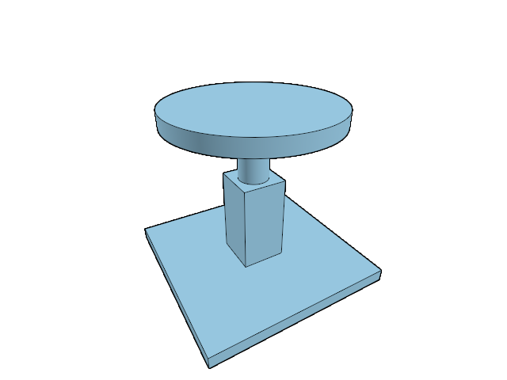

# 20.2.14 · Connect section primitives to color and first picking

**Chapter 20 · Shared GPU rendering · Section 20.2 · Surface-fitted finite ink** · [Contents](contents.md)

**Typing: 21–42 minutes.** [Estimate](typing-load.md).

Connect a section cap to the same physical primitive images used by mesh surfaces.

## Type

Continue from [Separate hidden ink color from pick ownership](96zz-separate-hidden-ink-color-from-pick-ownership.md). [Save or recover your work](recovery.md).

### 1. `src/physical.wgsl`

Own one lossless primitive encoder in the shared physical shader.

Create the file and type:

```wgsl
--8<-- "journey/code/96zza-connect-section-primitive-images-15.wgsl"
```

### 2. `src/clipping_gpu.rs`

Assemble physical declarations once alongside clipping in every relevant shader.

<details>
<summary>Locate the existing block</summary>

```rust
pub fn source(base:&str,group:u32,binding:u32)->String{format!("@group({group}) @binding({binding}) var<uniform> clipping:ClipUniform;\n{}\n{base}",include_str!("clip.wgsl"))}
```

</details>

Edit the existing block to match this code; keep unchanged lines:

```rust
pub fn source(base:&str,group:u32,binding:u32)->String{format!("@group({group}) @binding({binding}) var<uniform> clipping:ClipUniform;\n{}\n{base}",concat!(include_str!("physical.wgsl"),"\n",include_str!("clip.wgsl")))}
```

<details>
<summary>Optional patch references</summary>

Use these original edit fragments when comparing a saved checkpoint. Apply the complete blocks above.

```text
--8<-- "journey/code/96zza-connect-section-primitive-images-16.rs"
```

</details>

### 3. `src/triangle.wgsl`

Reuse the shared encoder instead of repeating the bit packing.

<details>
<summary>Locate the existing block</summary>

```wgsl
    return FragmentOutput(shade(input,front),vec2<u32>(input.primitive&0xffffu,input.primitive>>16u));
```

</details>

Edit the existing block to match this code; keep unchanged lines:

```wgsl
    return FragmentOutput(shade(input,front),physical_primitive(input.primitive));
```

<details>
<summary>Optional patch references</summary>

Use these original edit fragments when comparing a saved checkpoint. Apply the complete blocks above.

```text
--8<-- "journey/code/96zza-connect-section-primitive-images-17.wgsl"
```

</details>

### 4. `src/triangle_pick.wgsl`

Reuse the shared encoder instead of repeating the bit packing.

<details>
<summary>Locate the existing block</summary>

```wgsl
    return PickFragment(vec2<u32>(select(0u,object_settings.selection.y,crop.mode==0u),0u),vec2<u32>(input.primitive&0xffffu,input.primitive>>16u));
```

</details>

Edit the existing block to match this code; keep unchanged lines:

```wgsl
    return PickFragment(vec2<u32>(select(0u,object_settings.selection.y,crop.mode==0u),0u),physical_primitive(input.primitive));
```

<details>
<summary>Optional patch references</summary>

Use these original edit fragments when comparing a saved checkpoint. Apply the complete blocks above.

```text
--8<-- "journey/code/96zza-connect-section-primitive-images-18.wgsl"
```

</details>

### 5. `src/ink_plane.wgsl`

Decode a cap before any mesh lookup; reject unavailable projected addresses without clamping them to a different triangle.

<details>
<summary>Locate the existing block</summary>

```wgsl
    if (primitive != 0u) {
        let triangle = min(primitive, arrayLength(&finite_projected)) - 1u;
```

</details>

Edit the existing block to match this code; keep unchanged lines:

```wgsl
    if (clip_is_cap(primitive)) {
        let plane = clip_cap_plane(primitive);
        if (plane >= clipping.count) {
            return ink_axis_visible(pixel, axis, sample);
        }
        gradient = -clip_plane_slope(plane, view.size);
    } else if (primitive != 0u) {
        if (primitive > arrayLength(&finite_projected)) {
            return ink_axis_visible(pixel, axis, sample);
        }
        let triangle = primitive - 1u;
```

<details>
<summary>Optional patch references</summary>

Use these original edit fragments when comparing a saved checkpoint. Apply the complete blocks above.

```text
--8<-- "journey/code/96zza-connect-section-primitive-images-1.wgsl"
```

</details>

### 6. `src/cap_color.wgsl`

Add the integer output while keeping existing section consumers working. Write low and high words without float conversion.

Edit these blocks from bottom to top. Keep the surrounding lines unchanged.

<details>
<summary>Locate this block</summary>

```wgsl
    edge = max(edge, section_outline(in.pos.xy));
    let color = mix(select(hatched, solid, clipping.fill == 1u), vec3<f32>(0.0), edge);
    let marker = CAP_PRIMITIVE + i * 2u + select(0u, 1u, selected);
    return CapOut(vec4<f32>(color, 1.0), vec2<f32>(z,f32(i+1u)+select(0.0,8.0,selected)), z, mask);
}
```

</details>

Replace it with:

```wgsl
    edge = max(edge, section_outline(in.pos.xy));
    let color = mix(select(hatched, solid, clipping.fill == 1u), vec3<f32>(0.0), edge);
    let marker = CAP_PRIMITIVE + i * 2u + select(0u, 1u, selected);
    return CapOut(vec4<f32>(color, 1.0), vec2<f32>(z,f32(i+1u)+select(0.0,8.0,selected)), physical_primitive(marker), z, mask);
}
```

<details>
<summary>Locate this block</summary>

```wgsl
struct CapOut {
    @location(0) color: vec4<f32>, // hatch or light grey, with a black boundary
    @location(1) section_depth: vec2<f32>, // visible section depth and presence
    @builtin(frag_depth) depth: f32, // depth of the plane here
    @builtin(sample_mask) mask: u32, // samples inside a solid and kept by the other planes
}
```

</details>

Replace it with:

```wgsl
struct CapOut {
    @location(0) color: vec4<f32>, // hatch or light grey, with a black boundary
    @location(1) section_depth: vec2<f32>, // visible section depth and presence
    @location(2) primitive: vec2<u32>,
    @builtin(frag_depth) depth: f32, // depth of the plane here
    @builtin(sample_mask) mask: u32, // samples inside a solid and kept by the other planes
}
```

<details>
<summary>Complete updated block reference</summary>

```wgsl
struct CapFrame{size:vec2<f32>,origin:vec2<f32>}
@group(0) @binding(0) var<uniform> cap_frame:CapFrame;
@group(2) @binding(0) var counts:texture_2d<f32>;
const SAMPLES:u32=1u;const SELECT_COLOR:vec3<f32>=vec3<f32>(1.0,1.0,0.0);
fn count_at(at:vec2<i32>,sample:u32)->f32{return textureLoad(counts,at,0).x;}
// Prefixed in Rust: `counts` and `primitives` at group 3, SAMPLES, `count_at` and `primitive_at`.

// One corner of a fullscreen triangle; the instance picks the plane or the caps.
struct CapVertex {
    @builtin(position) pos: vec4<f32>, // clip position
    @location(0) @interpolate(flat) plane: u32, // clipping plane; for the masks 1 = selected caps only
}

@vertex
// A triangle over the whole target.
fn vs_cap(@builtin(vertex_index) vertex: u32, @builtin(instance_index) plane: u32) -> CapVertex {
    let xy = vec2<f32>(f32((vertex << 1u) & 2u), f32(vertex & 2u));
    var out: CapVertex;
    out.pos = vec4<f32>(xy * 2.0 - 1.0, 0.0, 1.0);
    out.plane = plane;
    return out;
}

// A section cap fragment: color, triangle id, the plane's depth and the samples it covers.
struct CapOut {
    @location(0) color: vec4<f32>, // hatch or light grey, with a black boundary
    @location(1) section_depth: vec2<f32>, // visible section depth and presence
    @location(2) primitive: vec2<u32>,
    @builtin(frag_depth) depth: f32, // depth of the plane here
    @builtin(sample_mask) mask: u32, // samples inside a solid and kept by the other planes
}

// Fraction of a pixel square lying below signed distance `t` from a line; the ribbon filter.
fn box_cdf(t: f32, hi: f32, lo: f32, m: f32, q: f32) -> f32 {
    let s = clamp(t, -hi, hi);
    let e = hi - abs(s);
    let tail = select(e * e / q, 1.0 - e * e / q, s > 0.0);
    return select(tail, 0.5 + s / m, abs(s) <= lo);
}

// Exact area of this pixel within `hw` of a line `d` away, across direction `g`.
fn band_area(d: f32, hw: f32, g: vec2<f32>) -> f32 {
    let a = abs(g.x);
    let b = abs(g.y);
    let hi = 0.5 * (a + b);
    let lo = 0.5 * abs(a - b);
    let m = max(max(a, b), 1e-6);
    let q = max(2.0 * a * b, 1e-6);
    return box_cdf(hw - d, hi, lo, m, q) + box_cdf(hw + d, hi, lo, m, q) - 1.0;
}


// Coverage of the nearest hatch line; `slope` is the change of `u` per pixel.
fn hatch_ink(u: f32, slope: vec2<f32>) -> f32 {
    let rate = max(length(slope), 1e-30); // scene units per pixel across the lines
    let level = log2(clipping.spacing * rate);
    // lines every power of two in scene units; every other one fades out over the last half octave
    let step = exp2(floor(level));
    let fade = smoothstep(0.5, 1.0, fract(level));
    let n = u / step;
    let nearest = round(n);
    let distance = abs(n - nearest) * step / rate;
    let odd = abs(nearest - 2.0 * round(nearest * 0.5)) > 0.5;
    let ink = clamp(band_area(distance, clipping.width * 0.5, slope / rate), 0.0, 1.0);
    return ink * select(1.0, 1.0 - fade, odd);
}

// Coverage of the section's union, including holes, without a border at the viewport edge.
fn section_coverage(at: vec2<i32>) -> f32 {
    if (any(at < vec2<i32>(0)) || any(at >= vec2<i32>(textureDimensions(counts)))) {
        return 1.0;
    }
    var covered = 0.0;
    for (var k = 0u; k < SAMPLES; k++) {
        covered += select(0.0, 1.0, count_at(at, k) > 0.5);
    }
    return covered / f32(SAMPLES);
}

fn section_outline(at: vec2<f32>) -> f32 {
    let directions = array<vec2<f32>, 8>(
        vec2<f32>(1.0, 0.0), vec2<f32>(-1.0, 0.0),
        vec2<f32>(0.0, 1.0), vec2<f32>(0.0, -1.0),
        vec2<f32>(0.7071, 0.7071), vec2<f32>(-0.7071, 0.7071),
        vec2<f32>(0.7071, -0.7071), vec2<f32>(-0.7071, -0.7071)
    );
    var edge = 0.0;
    for (var k = 0u; k < 8u; k++) {
        edge = max(edge, 1.0 - section_coverage(vec2<i32>(floor(at + directions[k] * clipping.outline))));
    }
    return edge;
}


@fragment
// Where the view ray meets a plane inside a closed solid: outlined hatch or solid grey.
fn fs_cap(in: CapVertex) -> CapOut {
    let i = in.plane;
    let ndc = clip_ndc(in.pos.xy + cap_frame.origin, cap_frame.size, 0.0).xy;
    let z = clip_plane_depth(i, ndc);
    let h = vec3<f32>(ndc, 1.0);
    // scene units across the hatch lines, and their change per pixel
    let u = dot(clipping.hatch[i].xyz, h) / dot(clipping.hatch_w[i].xyz, h);
    let slope = vec2<f32>(dpdx(u), dpdy(u));
    var kept = 0xffffffffu;
    var edge = 0.0;

    // the other planes cut the cap sample by sample
    for (var j = 0u; j < clipping.count; j++) {
        let t = dot(clipping.screen[j], vec4<f32>(ndc, z, 1.0));
        let gradient = vec2<f32>(dpdx(t), dpdy(t));
        let samples = clip_samples(t, gradient);
        kept &= select(samples, 0xffffffffu, j == i);
        if (j != i && dot(gradient, gradient) > 1e-30) {
            let distance = t / max(length(gradient), 1e-20);
            edge = max(edge, 1.0 - smoothstep(clipping.outline - 0.5, clipping.outline + 0.5, distance));
        }
    }

    let at = vec2<i32>(in.pos.xy);
    var inside = 0u;
    var selected = false;

    // inside a solid where more crossings leave than enter behind the plane
    for (var k = 0u; k < SAMPLES; k++) {
        let count = count_at(at, k);
        inside |= select(0u, 1u << k, count > 0.5);
        selected = selected || count > SELECTED_CROSSING - 0.5;
    }

    let mask = inside & kept;

    if (mask == 0u || !(z >= 0.0 && z <= 1.0)) {
        discard;
    }

    let paper = select(vec3<f32>(1.0), SELECT_COLOR, selected);
    let hatched = mix(paper, vec3<f32>(0.0), hatch_ink(u, slope));
    let solid = select(vec3<f32>(0.6), SELECT_COLOR, selected);
    edge = max(edge, section_outline(in.pos.xy));
    let color = mix(select(hatched, solid, clipping.fill == 1u), vec3<f32>(0.0), edge);
    let marker = CAP_PRIMITIVE + i * 2u + select(0u, 1u, selected);
    return CapOut(vec4<f32>(color, 1.0), vec2<f32>(z,f32(i+1u)+select(0.0,8.0,selected)), physical_primitive(marker), z, mask);
}
```

</details>

<details>
<summary>Optional patch references</summary>

Use these original edit fragments when comparing a saved checkpoint. Apply the complete blocks above.

```text
--8<-- "journey/code/96zza-connect-section-primitive-images-2.wgsl"
```

```text
--8<-- "journey/code/96zza-connect-section-primitive-images-3.wgsl"
```

</details>

### 7. `src/cap_pipeline.rs`

Reuse the shared unblended integer target.

<details>
<summary>Locate the existing block</summary>

```rust
  let color=pipeline(device,crate::clipping_gpu::source(include_str!("cap_color.wgsl"),1,0),&[&frame,&clip,&counts],"vs_cap","fs_cap",&[wgpu::ColorTargetState{format,blend:None,write_mask:wgpu::ColorWrites::ALL},wgpu::ColorTargetState{format:wgpu::TextureFormat::Rg32Float,blend:None,write_mask:wgpu::ColorWrites::ALL}],false);Self{count,color,counts,frame}
```

</details>

Edit the existing block to match this code; keep unchanged lines:

```rust
  let color=pipeline(device,crate::clipping_gpu::source(include_str!("cap_color.wgsl"),1,0),&[&frame,&clip,&counts],"vs_cap","fs_cap",&[wgpu::ColorTargetState{format,blend:None,write_mask:wgpu::ColorWrites::ALL},wgpu::ColorTargetState{format:wgpu::TextureFormat::Rg32Float,blend:None,write_mask:wgpu::ColorWrites::ALL},crate::primitive_image::target(true)],false);Self{count,color,counts,frame}
```

<details>
<summary>Optional patch references</summary>

Use these original edit fragments when comparing a saved checkpoint. Apply the complete blocks above.

```text
--8<-- "journey/code/96zza-connect-section-primitive-images-4.rs"
```

</details>

### 8. `src/caps_gpu.rs`

Accept the renderer’s existing primitive view. Load mesh addresses and replace only pixels covered by a visible section.

<details>
<summary>Locate the existing block</summary>

```rust
use wgpu::util::DeviceExt;
use crate::{gpu_mesh::GpuMesh,solid_orientation::CLOSED};
use crate::cap_image::Image;
struct Counts{image:Image,group:wgpu::BindGroup}
pub struct Caps{pub enabled:bool,planes:u32,pick:Option<crate::cap_pick_gpu::Pick>,pub pick_error:Option<&'static str>,bounds:crate::cap_source_bounds::Bounds,targets:std::collections::HashMap<u32,u32>,pub solids:crate::solid_cache::Solids,pipes:Option<crate::cap_pipeline::Pipelines>,counts:Option<Counts>,pub depth:Image,frame:wgpu::Buffer,frame_group:Option<wgpu::BindGroup>,pub rows:Vec<[u32;2]>,pub draws:u64,pub passes:u64}
impl Caps{
 pub fn new(device:&wgpu::Device)->Self{let frame=device.create_buffer_init(&wgpu::util::BufferInitDescriptor{label:Some("section canvas frame"),contents:&[0;16],usage:wgpu::BufferUsages::UNIFORM|wgpu::BufferUsages::COPY_DST});Self{enabled:true,planes:0,pick:None,pick_error:None,bounds:Default::default(),targets:Default::default(),solids:Default::default(),pipes:None,counts:None,depth:Image::new(device,[1,1],wgpu::TextureFormat::Rg32Float,8),frame,frame_group:None,rows:Vec::new(),draws:0,passes:0}}
 pub fn set_scene(&mut self,queue:&wgpu::Queue,scene:&crate::scene::Scene,meshes:&mut[GpuMesh],planes:&[crate::clipping_rows::Row]){
  self.planes=planes.len()as u32;self.rows.clear();self.targets.clear();for(mesh,object)in meshes.iter_mut().zip(scene.objects().iter().filter(|r|scene.visible(r.id))){assert_eq!(mesh.id,object.id);let flags=self.solids.flags(object);let token=if !planes.is_empty()&&flags&CLOSED!=0{self.rows.push([mesh.id.value(),u32::from(mesh.pickable())]);self.rows.len()as u32}else{0};mesh.set_caps(queue,flags,token);if token>0{if let Some(bounds)=self.bounds.placed(&object.mesh,&object.model){let mask=planes.iter().enumerate().fold(0,|mask,(i,row)|mask|if row.plane.crosses(&bounds,[0.;3]){1<<i}else{0});self.targets.insert(mesh.id.value(),mask);}}}
  self.solids.prune();self.bounds.prune();if self.rows.is_empty(){self.rows.shrink_to_fit();self.targets.shrink_to_fit();}
 }
 pub fn prepare(&mut self,device:&wgpu::Device,queue:&wgpu::Queue,format:wgpu::TextureFormat,size:[u32;2],active:bool){
  let size=if active&&!self.rows.is_empty(){size}else{[1,1]};if self.depth.size!=size{self.depth=Image::new(device,size,wgpu::TextureFormat::Rg32Float,8);}
  if size==[1,1]{self.counts=None;return;}
  if self.pipes.is_none(){let pipes=crate::cap_pipeline::Pipelines::new(device,format);self.frame_group=Some(crate::gpu_layout::group(device,&pipes.frame,&self.frame));self.pipes=Some(pipes);}
  let pipes=self.pipes.as_ref().unwrap();if self.counts.as_ref().is_none_or(|c|c.image.size!=size){let image=Image::new(device,size,wgpu::TextureFormat::R16Float,2);let group=device.create_bind_group(&wgpu::BindGroupDescriptor{label:Some("original section crossings"),layout:&pipes.counts,entries:&[wgpu::BindGroupEntry{binding:0,resource:wgpu::BindingResource::TextureView(&image.view)}]});self.counts=Some(Counts{image,group});}
  let bytes=[size[0]as f32,size[1]as f32,0.,0.].into_iter().flat_map(f32::to_ne_bytes).collect::<Vec<_>>();queue.write_buffer(&self.frame,0,&bytes);
 }
 pub fn draw(&mut self,encoder:&mut wgpu::CommandEncoder,color:&wgpu::TextureView,depth:&wgpu::TextureView,view:&wgpu::BindGroup,clipping:&wgpu::BindGroup,meshes:&[GpuMesh],planes:u32){
  let(Some(pipes),Some(counts))=(&self.pipes,&self.counts)else{return};
  for plane in 0..planes{
   {let mut pass=encoder.begin_render_pass(&wgpu::RenderPassDescriptor{label:Some("original closed-solid crossings"),color_attachments:&[Some(wgpu::RenderPassColorAttachment{view:&counts.image.view,depth_slice:None,resolve_target:None,ops:wgpu::Operations{load:wgpu::LoadOp::Clear(wgpu::Color::TRANSPARENT),store:wgpu::StoreOp::Store}})],..Default::default()});pass.set_pipeline(&pipes.count);pass.set_bind_group(0,view,&[]);pass.set_bind_group(2,clipping,&[]);for mesh in meshes.iter().filter(|m|m.closed()&&self.targets.get(&m.id.value()).is_some_and(|mask|mask&(1<<plane)!=0)){mesh.bind_model(&mut pass);pass.set_vertex_buffer(0,mesh.geometry.vertices.slice(..));pass.set_index_buffer(mesh.geometry.indices.slice(..),wgpu::IndexFormat::Uint32);pass.draw_indexed(0..mesh.geometry.index_count,0,plane..plane+1);self.draws+=1;}}
   {let mut pass=encoder.begin_render_pass(&wgpu::RenderPassDescriptor{label:Some("original section color and depth"),color_attachments:&[Some(wgpu::RenderPassColorAttachment{view:color,depth_slice:None,resolve_target:None,ops:wgpu::Operations{load:wgpu::LoadOp::Load,store:wgpu::StoreOp::Store}}),Some(wgpu::RenderPassColorAttachment{view:&self.depth.view,depth_slice:None,resolve_target:None,ops:wgpu::Operations{load:if plane==0{wgpu::LoadOp::Clear(wgpu::Color::TRANSPARENT)}else{wgpu::LoadOp::Load},store:wgpu::StoreOp::Store}})],depth_stencil_attachment:Some(wgpu::RenderPassDepthStencilAttachment{view:depth,depth_ops:Some(wgpu::Operations{load:wgpu::LoadOp::Load,store:wgpu::StoreOp::Store}),stencil_ops:None}),..Default::default()});pass.set_pipeline(&pipes.color);pass.set_bind_group(0,self.frame_group.as_ref().unwrap(),&[]);pass.set_bind_group(1,clipping,&[]);pass.set_bind_group(2,&counts.group,&[]);pass.draw(0..3,plane..plane+1);self.draws+=1;}
   self.passes+=2;
  }
 }
 pub fn encode_pick(&mut self,device:&wgpu::Device,queue:&wgpu::Queue,encoder:&mut wgpu::CommandEncoder,image:&crate::pick_image::Image,window:crate::pick_window::Window,view:&wgpu::BindGroup,crop:&wgpu::Buffer,clipping:&wgpu::BindGroup,meshes:&[GpuMesh],mode:crate::pick_sources::Mode){
  if !self.enabled||self.planes==0||self.rows.is_empty(){self.pick=None;self.pick_error=None;return;}
  let pick=self.pick.get_or_insert_with(||crate::cap_pick_gpu::Pick::new(device));if let Err(error)=pick.prepare(device,queue,window,crop,&self.rows,self.planes,mode){self.pick_error=Some(error);self.pick=None;return;}self.pick_error=None;pick.encode(encoder,image,window,view,clipping,meshes,&self.targets,self.planes);
 }
 pub fn pick_bytes(&self)->u64{self.pick.as_ref().map_or(0,crate::cap_pick_gpu::Pick::bytes)}
 pub fn usage(&self)->[u64;5]{[self.frame.size()+self.depth.bytes+self.pick_bytes()+self.counts.as_ref().map_or(0,|c|c.image.bytes),self.rows.len()as u64,self.solids.checks,self.draws,self.passes]}
}
```

</details>

Edit the existing block to match this code; keep unchanged lines:

```rust
use wgpu::util::DeviceExt;
use crate::{gpu_mesh::GpuMesh,solid_orientation::CLOSED};
use crate::cap_image::Image;
struct Counts{image:Image,group:wgpu::BindGroup}
pub struct Caps{pub enabled:bool,planes:u32,pick:Option<crate::cap_pick_gpu::Pick>,pub pick_error:Option<&'static str>,bounds:crate::cap_source_bounds::Bounds,targets:std::collections::HashMap<u32,u32>,pub solids:crate::solid_cache::Solids,pipes:Option<crate::cap_pipeline::Pipelines>,counts:Option<Counts>,pub depth:Image,frame:wgpu::Buffer,frame_group:Option<wgpu::BindGroup>,pub rows:Vec<[u32;2]>,pub draws:u64,pub passes:u64}
impl Caps{
 pub fn new(device:&wgpu::Device)->Self{let frame=device.create_buffer_init(&wgpu::util::BufferInitDescriptor{label:Some("section canvas frame"),contents:&[0;16],usage:wgpu::BufferUsages::UNIFORM|wgpu::BufferUsages::COPY_DST});Self{enabled:true,planes:0,pick:None,pick_error:None,bounds:Default::default(),targets:Default::default(),solids:Default::default(),pipes:None,counts:None,depth:Image::new(device,[1,1],wgpu::TextureFormat::Rg32Float,8),frame,frame_group:None,rows:Vec::new(),draws:0,passes:0}}
 pub fn set_scene(&mut self,queue:&wgpu::Queue,scene:&crate::scene::Scene,meshes:&mut[GpuMesh],planes:&[crate::clipping_rows::Row]){
  self.planes=planes.len()as u32;self.rows.clear();self.targets.clear();for(mesh,object)in meshes.iter_mut().zip(scene.objects().iter().filter(|r|scene.visible(r.id))){assert_eq!(mesh.id,object.id);let flags=self.solids.flags(object);let token=if !planes.is_empty()&&flags&CLOSED!=0{self.rows.push([mesh.id.value(),u32::from(mesh.pickable())]);self.rows.len()as u32}else{0};mesh.set_caps(queue,flags,token);if token>0{if let Some(bounds)=self.bounds.placed(&object.mesh,&object.model){let mask=planes.iter().enumerate().fold(0,|mask,(i,row)|mask|if row.plane.crosses(&bounds,[0.;3]){1<<i}else{0});self.targets.insert(mesh.id.value(),mask);}}}
  self.solids.prune();self.bounds.prune();if self.rows.is_empty(){self.rows.shrink_to_fit();self.targets.shrink_to_fit();}
 }
 pub fn prepare(&mut self,device:&wgpu::Device,queue:&wgpu::Queue,format:wgpu::TextureFormat,size:[u32;2],active:bool){
  let size=if active&&!self.rows.is_empty(){size}else{[1,1]};if self.depth.size!=size{self.depth=Image::new(device,size,wgpu::TextureFormat::Rg32Float,8);}
  if size==[1,1]{self.counts=None;return;}
  if self.pipes.is_none(){let pipes=crate::cap_pipeline::Pipelines::new(device,format);self.frame_group=Some(crate::gpu_layout::group(device,&pipes.frame,&self.frame));self.pipes=Some(pipes);}
  let pipes=self.pipes.as_ref().unwrap();if self.counts.as_ref().is_none_or(|c|c.image.size!=size){let image=Image::new(device,size,wgpu::TextureFormat::R16Float,2);let group=device.create_bind_group(&wgpu::BindGroupDescriptor{label:Some("original section crossings"),layout:&pipes.counts,entries:&[wgpu::BindGroupEntry{binding:0,resource:wgpu::BindingResource::TextureView(&image.view)}]});self.counts=Some(Counts{image,group});}
  let bytes=[size[0]as f32,size[1]as f32,0.,0.].into_iter().flat_map(f32::to_ne_bytes).collect::<Vec<_>>();queue.write_buffer(&self.frame,0,&bytes);
 }
 pub fn draw(&mut self,encoder:&mut wgpu::CommandEncoder,color:&wgpu::TextureView,primitive:&wgpu::TextureView,depth:&wgpu::TextureView,view:&wgpu::BindGroup,clipping:&wgpu::BindGroup,meshes:&[GpuMesh],planes:u32){
  let(Some(pipes),Some(counts))=(&self.pipes,&self.counts)else{return};
  for plane in 0..planes{
   {let mut pass=encoder.begin_render_pass(&wgpu::RenderPassDescriptor{label:Some("original closed-solid crossings"),color_attachments:&[Some(wgpu::RenderPassColorAttachment{view:&counts.image.view,depth_slice:None,resolve_target:None,ops:wgpu::Operations{load:wgpu::LoadOp::Clear(wgpu::Color::TRANSPARENT),store:wgpu::StoreOp::Store}})],..Default::default()});pass.set_pipeline(&pipes.count);pass.set_bind_group(0,view,&[]);pass.set_bind_group(2,clipping,&[]);for mesh in meshes.iter().filter(|m|m.closed()&&self.targets.get(&m.id.value()).is_some_and(|mask|mask&(1<<plane)!=0)){mesh.bind_model(&mut pass);pass.set_vertex_buffer(0,mesh.geometry.vertices.slice(..));pass.set_index_buffer(mesh.geometry.indices.slice(..),wgpu::IndexFormat::Uint32);pass.draw_indexed(0..mesh.geometry.index_count,0,plane..plane+1);self.draws+=1;}}
   {let mut pass=encoder.begin_render_pass(&wgpu::RenderPassDescriptor{label:Some("original section color and depth"),color_attachments:&[Some(wgpu::RenderPassColorAttachment{view:color,depth_slice:None,resolve_target:None,ops:wgpu::Operations{load:wgpu::LoadOp::Load,store:wgpu::StoreOp::Store}}),Some(wgpu::RenderPassColorAttachment{view:&self.depth.view,depth_slice:None,resolve_target:None,ops:wgpu::Operations{load:if plane==0{wgpu::LoadOp::Clear(wgpu::Color::TRANSPARENT)}else{wgpu::LoadOp::Load},store:wgpu::StoreOp::Store}}),Some(wgpu::RenderPassColorAttachment{view:primitive,depth_slice:None,resolve_target:None,ops:wgpu::Operations{load:wgpu::LoadOp::Load,store:wgpu::StoreOp::Store}})],depth_stencil_attachment:Some(wgpu::RenderPassDepthStencilAttachment{view:depth,depth_ops:Some(wgpu::Operations{load:wgpu::LoadOp::Load,store:wgpu::StoreOp::Store}),stencil_ops:None}),..Default::default()});pass.set_pipeline(&pipes.color);pass.set_bind_group(0,self.frame_group.as_ref().unwrap(),&[]);pass.set_bind_group(1,clipping,&[]);pass.set_bind_group(2,&counts.group,&[]);pass.draw(0..3,plane..plane+1);self.draws+=1;}
   self.passes+=2;
  }
 }
 pub fn encode_pick(&mut self,device:&wgpu::Device,queue:&wgpu::Queue,encoder:&mut wgpu::CommandEncoder,image:&crate::pick_image::Image,window:crate::pick_window::Window,view:&wgpu::BindGroup,crop:&wgpu::Buffer,clipping:&wgpu::BindGroup,meshes:&[GpuMesh],mode:crate::pick_sources::Mode){
  if !self.enabled||self.planes==0||self.rows.is_empty(){self.pick=None;self.pick_error=None;return;}
  let pick=self.pick.get_or_insert_with(||crate::cap_pick_gpu::Pick::new(device));if let Err(error)=pick.prepare(device,queue,window,crop,&self.rows,self.planes,mode){self.pick_error=Some(error);self.pick=None;return;}self.pick_error=None;pick.encode(encoder,image,window,view,clipping,meshes,&self.targets,self.planes);
 }
 pub fn pick_bytes(&self)->u64{self.pick.as_ref().map_or(0,crate::cap_pick_gpu::Pick::bytes)}
 pub fn usage(&self)->[u64;5]{[self.frame.size()+self.depth.bytes+self.pick_bytes()+self.counts.as_ref().map_or(0,|c|c.image.bytes),self.rows.len()as u64,self.solids.checks,self.draws,self.passes]}
}
```

<details>
<summary>Optional patch references</summary>

Use these original edit fragments when comparing a saved checkpoint. Apply the complete blocks above.

```text
--8<-- "journey/code/96zza-connect-section-primitive-images-5.rs"
```

```text
--8<-- "journey/code/96zza-connect-section-primitive-images-6.rs"
```

</details>

### 9. `src/renderer.rs`

Pass the matching physical primitive image into the section pass.

<details>
<summary>Locate the existing block</summary>

```rust
        self.caps.borrow_mut().draw(&mut encoder,view,&self.depth,&self.view_group,&clip_group,&self.meshes,if self.clipping.borrow().enabled{self.clipping.borrow().rows.len()as u32}else{0});
```

</details>

Edit the existing block to match this code; keep unchanged lines:

```rust
        self.caps.borrow_mut().draw(&mut encoder,view,&self.primitive.view,&self.depth,&self.view_group,&clip_group,&self.meshes,if self.clipping.borrow().enabled{self.clipping.borrow().rows.len()as u32}else{0});
```

<details>
<summary>Optional patch references</summary>

Use these original edit fragments when comparing a saved checkpoint. Apply the complete blocks above.

```text
--8<-- "journey/code/96zza-connect-section-primitive-images-7.rs"
```

</details>

### 10. `src/cap_pick.wgsl`

Keep the original owner and section record beside the primitive output. Use the current pick marker, independently of selection. Store lossless low and high halves in the cropped target.

<details>
<summary>Locate the existing block</summary>

```wgsl
struct PickFrame{full:vec2<u32>,size:vec2<u32>,origin:vec2<u32>,mode:u32,pad:u32}
@group(0) @binding(0) var<uniform> frame:PickFrame;
@group(2) @binding(0) var<storage,read_write> pick_caps:array<atomic<u32>>;
@group(2) @binding(1) var<storage,read> owners:array<vec2<u32>>;
struct CapVertex {
    @builtin(position) pos: vec4<f32>, // clip position
    @location(0) @interpolate(flat) plane: u32, // clipping plane; for the masks 1 = selected caps only
}

@vertex
// A triangle over the whole target.
fn vs_cap(@builtin(vertex_index) vertex: u32, @builtin(instance_index) plane: u32) -> CapVertex {
    let xy = vec2<f32>(f32((vertex << 1u) & 2u), f32(vertex & 2u));
    var out: CapVertex;
    out.pos = vec4<f32>(xy * 2.0 - 1.0, 0.0, 1.0);
    out.plane = plane;
    return out;
}

struct CapId{@location(0) id:vec2<u32>,@location(1) section_depth:vec2<f32>,@builtin(frag_depth) depth:f32}
@fragment
fn fs_cap_id(in: CapVertex) -> CapId {
    let i = in.plane;
    let ndc = clip_ndc(in.pos.xy + vec2<f32>(frame.origin), vec2<f32>(frame.full), 0.0).xy;
    let z = clip_plane_depth(i, ndc);
    let word = clip_pick_word(i, in.pos.xy, frame.size);
    let count = bitcast<i32>(atomicLoad(&pick_caps[word]));
    let owner = select(atomicLoad(&pick_caps[word + 3u]), atomicLoad(&pick_caps[word + 1u]), count == 1);
    var kept = true;

    for (var j = 0u; j < clipping.count; j++) {
        kept = kept && (j == i || dot(clipping.screen[j], vec4<f32>(ndc, z, 1.0)) >= 0.0);
    }

    if (count < 1 || owner == 0u || owner>arrayLength(&owners) || !kept || !(z >= 0.0 && z <= 1.0)) {
        discard;
    }

    let source=owners[owner-1u];return CapId(vec2<u32>(select(0u,source.x,source.y!=0u),0u),vec2<f32>(z,f32(i+1u)),z);
}
```

</details>

Edit the existing block to match this code; keep unchanged lines:

```wgsl
struct PickFrame{full:vec2<u32>,size:vec2<u32>,origin:vec2<u32>,mode:u32,pad:u32}
@group(0) @binding(0) var<uniform> frame:PickFrame;
@group(2) @binding(0) var<storage,read_write> pick_caps:array<atomic<u32>>;
@group(2) @binding(1) var<storage,read> owners:array<vec2<u32>>;
struct CapVertex {
    @builtin(position) pos: vec4<f32>, // clip position
    @location(0) @interpolate(flat) plane: u32, // clipping plane; for the masks 1 = selected caps only
}

@vertex
// A triangle over the whole target.
fn vs_cap(@builtin(vertex_index) vertex: u32, @builtin(instance_index) plane: u32) -> CapVertex {
    let xy = vec2<f32>(f32((vertex << 1u) & 2u), f32(vertex & 2u));
    var out: CapVertex;
    out.pos = vec4<f32>(xy * 2.0 - 1.0, 0.0, 1.0);
    out.plane = plane;
    return out;
}

struct CapId{@location(0) id:vec2<u32>,@location(1) section_depth:vec2<f32>,@location(2) primitive:vec2<u32>,@builtin(frag_depth) depth:f32}
@fragment
fn fs_cap_id(in: CapVertex) -> CapId {
    let i = in.plane;
    let ndc = clip_ndc(in.pos.xy + vec2<f32>(frame.origin), vec2<f32>(frame.full), 0.0).xy;
    let z = clip_plane_depth(i, ndc);
    let word = clip_pick_word(i, in.pos.xy, frame.size);
    let count = bitcast<i32>(atomicLoad(&pick_caps[word]));
    let owner = select(atomicLoad(&pick_caps[word + 3u]), atomicLoad(&pick_caps[word + 1u]), count == 1);
    var kept = true;

    for (var j = 0u; j < clipping.count; j++) {
        kept = kept && (j == i || dot(clipping.screen[j], vec4<f32>(ndc, z, 1.0)) >= 0.0);
    }

    if (count < 1 || owner == 0u || owner>arrayLength(&owners) || !kept || !(z >= 0.0 && z <= 1.0)) {
        discard;
    }

    let marker=CAP_PRIMITIVE+i*2u;let source=owners[owner-1u];return CapId(vec2<u32>(select(0u,source.x,source.y!=0u),0u),vec2<f32>(z,f32(i+1u)),physical_primitive(marker),z);
}
```

<details>
<summary>Optional patch references</summary>

Use these original edit fragments when comparing a saved checkpoint. Apply the complete blocks above.

```text
--8<-- "journey/code/96zza-connect-section-primitive-images-9.wgsl"
```

```text
--8<-- "journey/code/96zza-connect-section-primitive-images-10.wgsl"
```

```text
--8<-- "journey/code/96zza-connect-section-primitive-images-11.wgsl"
```

</details>

### 11. `src/cap_pick_pipeline.rs`

Reuse the same integer target format without blending.

<details>
<summary>Locate the existing block</summary>

```rust
  let ids=crate::cap_pipeline::pipeline(device,crate::clipping_gpu::source(include_str!("cap_pick.wgsl"),1,0),&[&frame,&clip,&owners],"vs_cap","fs_cap_id",&[wgpu::ColorTargetState{format:wgpu::TextureFormat::Rg32Uint,blend:None,write_mask:wgpu::ColorWrites::ALL},wgpu::ColorTargetState{format:wgpu::TextureFormat::Rg32Float,blend:None,write_mask:wgpu::ColorWrites::ALL}],false);
```

</details>

Edit the existing block to match this code; keep unchanged lines:

```rust
  let ids=crate::cap_pipeline::pipeline(device,crate::clipping_gpu::source(include_str!("cap_pick.wgsl"),1,0),&[&frame,&clip,&owners],"vs_cap","fs_cap_id",&[wgpu::ColorTargetState{format:wgpu::TextureFormat::Rg32Uint,blend:None,write_mask:wgpu::ColorWrites::ALL},wgpu::ColorTargetState{format:wgpu::TextureFormat::Rg32Float,blend:None,write_mask:wgpu::ColorWrites::ALL},crate::primitive_image::target(true)],false);
```

<details>
<summary>Optional patch references</summary>

Use these original edit fragments when comparing a saved checkpoint. Apply the complete blocks above.

```text
--8<-- "journey/code/96zza-connect-section-primitive-images-12.rs"
```

</details>

### 12. `src/cap_pick_gpu.rs`

Attach the existing bounded crop image, loading previous mesh addresses.

<details>
<summary>Locate the existing block</summary>

```rust
  let mut pass=encoder.begin_render_pass(&wgpu::RenderPassDescriptor{label:Some("original section integer owners"),color_attachments:&[Some(wgpu::RenderPassColorAttachment{view:&image.colour,depth_slice:None,resolve_target:None,ops:wgpu::Operations{load:wgpu::LoadOp::Load,store:wgpu::StoreOp::Store}}),Some(wgpu::RenderPassColorAttachment{view:&image.section,depth_slice:None,resolve_target:None,ops:wgpu::Operations{load:wgpu::LoadOp::Load,store:wgpu::StoreOp::Store}})],depth_stencil_attachment:Some(wgpu::RenderPassDepthStencilAttachment{view:&image.depth,depth_ops:Some(wgpu::Operations{load:wgpu::LoadOp::Load,store:wgpu::StoreOp::Store}),stencil_ops:None}),..Default::default()});pass.set_pipeline(&self.pipes.ids);pass.set_bind_group(0,&self.frame_group,&[]);pass.set_bind_group(1,clipping,&[]);pass.set_bind_group(2,self.owner_group.as_ref().unwrap(),&[]);pass.draw(0..3,0..planes);let _=window;
```

</details>

Edit the existing block to match this code; keep unchanged lines:

```rust
  let mut pass=encoder.begin_render_pass(&wgpu::RenderPassDescriptor{label:Some("original section integer owners"),color_attachments:&[Some(wgpu::RenderPassColorAttachment{view:&image.colour,depth_slice:None,resolve_target:None,ops:wgpu::Operations{load:wgpu::LoadOp::Load,store:wgpu::StoreOp::Store}}),Some(wgpu::RenderPassColorAttachment{view:&image.section,depth_slice:None,resolve_target:None,ops:wgpu::Operations{load:wgpu::LoadOp::Load,store:wgpu::StoreOp::Store}}),Some(wgpu::RenderPassColorAttachment{view:&image.primitive.view,depth_slice:None,resolve_target:None,ops:wgpu::Operations{load:wgpu::LoadOp::Load,store:wgpu::StoreOp::Store}})],depth_stencil_attachment:Some(wgpu::RenderPassDepthStencilAttachment{view:&image.depth,depth_ops:Some(wgpu::Operations{load:wgpu::LoadOp::Load,store:wgpu::StoreOp::Store}),stencil_ops:None}),..Default::default()});pass.set_pipeline(&self.pipes.ids);pass.set_bind_group(0,&self.frame_group,&[]);pass.set_bind_group(1,clipping,&[]);pass.set_bind_group(2,self.owner_group.as_ref().unwrap(),&[]);pass.draw(0..3,0..planes);let _=window;
```

<details>
<summary>Optional patch references</summary>

Use these original edit fragments when comparing a saved checkpoint. Apply the complete blocks above.

```text
--8<-- "journey/code/96zza-connect-section-primitive-images-13.rs"
```

</details>

<details>
<summary>Supplied validation fixture</summary>

Copy this supplied authoring fixture once. Continue with the browser build below; the course does not require running native tests.

### 13. `src/global_outline_tests.rs`

Supply actual integer color, selection, clearing and pre-color cropped ownership checks at both physical display scales.

<details>
<summary>Locate the existing block</summary>

```text
u);assert_eq!(gpu.take_pick(matrix()).unwrap().unwrap().unwrap()[0],b.value());let(texture,window)=gpu.picker.primitive_for_tests().unwrap();let pixels=primitive_pixels(&gpu,&texture);let x=window.copy[0]+window.cursor[0]-window.draw[0];let y=window.copy[1]+window.cursor[1]-window.draw[1];assert_eq!(pixels[(y*texture.width()+x)as usize],1,"Visible intervals must rebuild without a color frame");
}
```

</details>

After that block, append this supplied code:

```text
--8<-- "journey/code/96zza-connect-section-primitive-images-fixtures.rs" skip=400
```

</details>

## Run and check

Run this from `session_viewer` to select the fixed dependency versions and install supplied binary assets. It updates Cargo.lock and preserves the previous lock. It does not write implementation code:

```sh
npm --prefix ../session_tests run course -- dependencies 20.2.14
```

In your project:

```sh
cd workspace/journey
REGEN_PROTO=0 cargo build --lib --locked --target wasm32-unknown-unknown -j1
REGEN_PROTO=0 CARGO_BUILD_JOBS=1 trunk serve --port 8780
```

Open `http://127.0.0.1:8780/`. Keep an existing Trunk server running; saving rebuilds it.

Color and cropped first picks retain exact section addresses, matching depth and original ownership.

### Recorded visual result

**Previous native render — current verification pending.**

This supporting frame has no instances; use the supplied original Session specimen for the browser exercise.



*This recorded image predates a source or checker change. Rebuild this checkpoint before using it as current evidence; browser controls require separate acceptance.*

<details>
<summary>Code explanation and diagram</summary>

Decode the reserved address before a projected-triangle lookup and use the clipping plane’s slope. Its low bit records selection; the rest identifies the plane. Negate the slope for the existing one-minus-forward depth adapter. Add the shared unblended RG16Uint target to both existing cap passes. Reuse one physical_primitive encoder for mesh and cap color/pick fragments. Write the marker’s low and high halves without float conversion, and load earlier mesh addresses so only covered cap pixels change. The color marker records selection; the first-pick marker is even, as in the current viewer. Keep original ownership and the separate float section output for existing masks and source tests. The supplied fixtures read both integer images at physical DPR1/2, including selected caps, empty pixels and picks before any color draw.

Reserved plane address → shared integer output → matching color or cropped pick image → fitted ink.


Why must a cap address bypass projected mesh storage?

It describes a clipping plane, rather than a mesh triangle. Its plane gives the surface gradient, while the original owner still comes from the existing cap-picking records.

Study estimate, including typing and experiments: 0.5–1 hours.

</details>

<details>
<summary>Optional experiment</summary>

Cut and select a closed solid, then pick the section. Verify selected color, original ownership, and release. The supplied GPU checks additionally inspect the exact integer address before the first color frame.

</details>

<details>
<summary>Check and save your work</summary>

Restore experimental edits, then run from `session_viewer`:

```sh
npm --prefix ../session_tests run course -- check 20.2.14
npm --prefix ../session_tests run course -- save 20.2.14
```

Source comparison leaves your project untouched. [Save and recovery instructions](recovery.md).

</details>

<details>
<summary>Viewer coverage and verification</summary>

Connect current reserved cap addresses to the existing single-sample forward-depth adapter. The separate section texture remains for existing masks and source-point tests; current reverse depth and multisampling remain later work.

Chrome checks focused clipping, cap cache retention and finite ink at DPR1/2, then shows an actual selected section through the original CAD bore. Supplied GPU fixtures separately read exact color and first-pick cap addresses.

[Full validation scope](release.md).

To reproduce the scripted acceptance of the reference checkpoint, run from `session_viewer` with the [course bundle server](release.md#reproduce) running on port 8781:

```sh
npm --prefix ../session_tests run course -- capture 20.2.14
```

This uses the verified reference bundle; it does not check or change your typed project.

</details>
