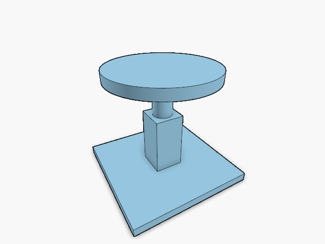

# 20.8.2 · Share changed record runs

**Chapter 20 · Shared GPU rendering · Section 20.8 · Background and shared object records** · [Contents](contents.md)

**Typing: 6–12 minutes.** [Estimate](typing-load.md).

Move the slot comparison into one generic helper. Keep the existing sentinel offset, tail append, shrink and release behavior. The next object table will use this same scan instead of teaching a second upload algorithm.

## Type

Continue from [Clear the current Arctic background](96zzzg-clear-the-current-arctic-background.md). [Save or recover your work](recovery.md).

### 1. `src/draw_slots.rs`

Extract the existing comparison, retaining its order. Use one changed-run owner; keep slot zero outside the scan.

<details>
<summary>Locate the existing block</summary>

```rust
use crate::text_gpu_support::{GpuCtx,GrowBuf};
pub const OWN_ROW:u32=u32::MAX;
pub fn sentinel_shader()->String{format!("const OWN_ROW:u32={OWN_ROW}u;")}
pub type Slot=[u32;2];
const ATTRIBUTES:[wgpu::VertexAttribute;2]=[
 wgpu::VertexAttribute {offset:0,shader_location:0,format:wgpu::VertexFormat::Uint32},
 wgpu::VertexAttribute {offset:4,shader_location:1,format:wgpu::VertexFormat::Uint32},
];
pub fn layout()->wgpu::VertexBufferLayout<'static>{wgpu::VertexBufferLayout {array_stride:8,step_mode:wgpu::VertexStepMode::Instance,attributes:&ATTRIBUTES}}
pub struct Slots {pub(crate) buffer:GrowBuf,previous:Vec<Slot>,pub written_bytes:u64}
impl Slots {
 pub fn new(ctx:&GpuCtx)->Self {
  let mut slots=Self {buffer:GrowBuf::new(ctx,"instance draw slots",8,wgpu::BufferUsages::VERTEX),previous:Vec::new(),written_bytes:0};
  slots.set(ctx,&[]);slots
 }
 pub fn set(&mut self,ctx:&GpuCtx,rows:&[Slot])->bool{
  self.written_bytes=0;
  let bytes=|rows:&[Slot]|rows.iter().flatten().flat_map(|v|v.to_ne_bytes()).collect::<Vec<_>>();
  if self.buffer.len()==0 {
   self.buffer.append_bytes(ctx,&bytes(&[[OWN_ROW,0]]));self.written_bytes=8;
  }
  let inside=self.previous.len().min(rows.len());let mut at=0;
  while at<inside {
   if self.previous[at]==rows[at]{at+=1;continue;}
   let first=at;while at<inside&&self.previous[at]!=rows[at]{at+=1;}
   self.buffer.write_bytes_at(ctx,(first+1)as u32,&bytes(&rows[first..at]));
   self.written_bytes+=(at-first)as u64*8;
  }
  if rows.len()>self.previous.len(){
   let tail=bytes(&rows[inside..]);self.buffer.append_bytes(ctx,&tail);self.written_bytes+=tail.len()as u64;
  }else if rows.len()<self.previous.len(){
   self.buffer.reset();self.buffer.append_bytes(ctx,&bytes(&[[OWN_ROW,0]]));self.buffer.append_bytes(ctx,&bytes(rows));
   self.written_bytes=(rows.len()as u64+1)*8;
  }
  self.previous.clear();self.previous.extend_from_slice(rows);self.written_bytes>0
 }
 pub fn clear(&mut self,ctx:&GpuCtx,free:bool){if free {self.buffer.release(ctx);}self.set(ctx,&[]);}
 pub fn bind(&self,pass:&mut wgpu::RenderPass<'_>,slot:u32,first:u32){
  assert!(first<self.buffer.len());pass.set_vertex_buffer(slot,self.buffer.buf.slice(u64::from(first)*8..));
 }
 pub fn instances(&self)->u32{self.buffer.len()-1}
 pub fn allocated_bytes(&self)->u64{self.buffer.buf.size()}
}
```

</details>

Edit the existing block to match this code; keep unchanged lines:

```rust
use crate::text_gpu_support::{GpuCtx,GrowBuf};
pub const OWN_ROW:u32=u32::MAX;
pub fn sentinel_shader()->String{format!("const OWN_ROW:u32={OWN_ROW}u;")}
pub type Slot=[u32;2];
const ATTRIBUTES:[wgpu::VertexAttribute;2]=[
 wgpu::VertexAttribute {offset:0,shader_location:0,format:wgpu::VertexFormat::Uint32},
 wgpu::VertexAttribute {offset:4,shader_location:1,format:wgpu::VertexFormat::Uint32},
];
pub fn layout()->wgpu::VertexBufferLayout<'static>{wgpu::VertexBufferLayout {array_stride:8,step_mode:wgpu::VertexStepMode::Instance,attributes:&ATTRIBUTES}}
pub(crate) fn changed_runs<T:PartialEq>(previous:&[T],next:&[T])->Vec<std::ops::Range<usize>> {
 let end=previous.len().min(next.len());let mut at=0;let mut runs=Vec::new();
 while at<end {
  if previous[at]==next[at]{at+=1;continue;}
  let first=at;while at<end&&previous[at]!=next[at]{at+=1;}
  runs.push(first..at);
 }
 runs
}
pub struct Slots {pub(crate) buffer:GrowBuf,previous:Vec<Slot>,pub written_bytes:u64}
impl Slots {
 pub fn new(ctx:&GpuCtx)->Self {
  let mut slots=Self {buffer:GrowBuf::new(ctx,"instance draw slots",8,wgpu::BufferUsages::VERTEX),previous:Vec::new(),written_bytes:0};
  slots.set(ctx,&[]);slots
 }
 pub fn set(&mut self,ctx:&GpuCtx,rows:&[Slot])->bool{
  self.written_bytes=0;
  let bytes=|rows:&[Slot]|rows.iter().flatten().flat_map(|v|v.to_ne_bytes()).collect::<Vec<_>>();
  if self.buffer.len()==0 {
   self.buffer.append_bytes(ctx,&bytes(&[[OWN_ROW,0]]));self.written_bytes=8;
  }
  let inside=self.previous.len().min(rows.len());
  for run in changed_runs(&self.previous,rows) {
   self.buffer.write_bytes_at(ctx,(run.start+1)as u32,&bytes(&rows[run.clone()]));
   self.written_bytes+=run.len()as u64*8;
  }
  if rows.len()>self.previous.len(){
   let tail=bytes(&rows[inside..]);self.buffer.append_bytes(ctx,&tail);self.written_bytes+=tail.len()as u64;
  }else if rows.len()<self.previous.len(){
   self.buffer.reset();self.buffer.append_bytes(ctx,&bytes(&[[OWN_ROW,0]]));self.buffer.append_bytes(ctx,&bytes(rows));
   self.written_bytes=(rows.len()as u64+1)*8;
  }
  self.previous.clear();self.previous.extend_from_slice(rows);self.written_bytes>0
 }
 pub fn clear(&mut self,ctx:&GpuCtx,free:bool){if free {self.buffer.release(ctx);}self.set(ctx,&[]);}
 pub fn bind(&self,pass:&mut wgpu::RenderPass<'_>,slot:u32,first:u32){
  assert!(first<self.buffer.len());pass.set_vertex_buffer(slot,self.buffer.buf.slice(u64::from(first)*8..));
 }
 pub fn instances(&self)->u32{self.buffer.len()-1}
 pub fn allocated_bytes(&self)->u64{self.buffer.buf.size()}
}
```

<details>
<summary>Optional patch references</summary>

Use these original edit fragments when comparing a saved checkpoint. Apply the complete blocks above.

```text
--8<-- "journey/code/96zzzh-share-changed-record-runs-01.rs"
```

```text
--8<-- "journey/code/96zzzh-share-changed-record-runs-02.rs"
```

</details>

## Run and check

Run this from `session_viewer` to select the fixed dependency versions and install supplied binary assets. It updates Cargo.lock and preserves the previous lock. It does not write implementation code:

```sh
npm --prefix ../session_tests run course -- dependencies 20.8.2
```

In your project:

```sh
cd workspace/journey
REGEN_PROTO=0 cargo build --lib --locked --target wasm32-unknown-unknown -j1
REGEN_PROTO=0 CARGO_BUILD_JOBS=1 trunk serve --port 8780
```

Open `http://127.0.0.1:8780/`. Keep an existing Trunk server running; saving rebuilds it.

The browser scene is unchanged. Slot writes reuse one changed-run scan.

### Recorded visual result

**Previous native render — current verification pending.**



*This recorded image predates a source or checker change. Rebuild this checkpoint before using it as current evidence; browser controls require separate acceptance.*

This reference image is shared with [20.8.1 · Clear the current Arctic background](96zzzg-clear-the-current-arctic-background.md). It does not demonstrate a new feature by itself.

<details>
<summary>Code explanation and diagram</summary>


previous records → changed contiguous runs → existing bounded buffer writes.


Why stop the comparison at the shorter slice?

Only records present in both slices can be updated in place. Existing append and shrink paths handle the remaining records.

Study estimate, including typing and experiments: 0.8–1 hours.

</details>

<details>
<summary>Optional experiment</summary>

Repeat the existing instance selection and Undo exercise. Selection changes only the changed slot bytes; drawing and original IDs stay the same.

</details>

<details>
<summary>Check and save your work</summary>

Restore experimental edits, then run from `session_viewer`:

```sh
npm --prefix ../session_tests run course -- check 20.8.2
npm --prefix ../session_tests run course -- save 20.8.2
```

Source comparison leaves your project untouched. [Save and recovery instructions](recovery.md).

</details>

<details>
<summary>Viewer coverage and verification</summary>

This shares the incremental upload rule before connecting one object-record table. No new drawing path is introduced.


[Full validation scope](release.md).

To reproduce the scripted acceptance of the reference checkpoint, run from `session_viewer` with the [course bundle server](release.md#reproduce) running on port 8781:

```sh
npm --prefix ../session_tests run course -- capture 20.8.2
```

This uses the verified reference bundle; it does not check or change your typed project.

</details>
