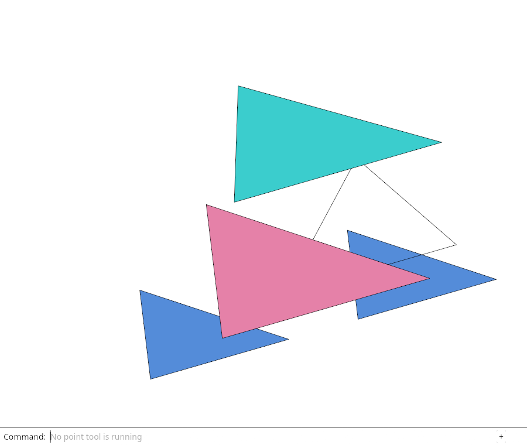

# 21.4.3 · Use reversed depth across the frame

**Chapter 21 · Precise camera and browser coordinates · Section 21.4 · Reversed depth and near clipping** · [Contents](contents.md)

**Typing: 30–59 minutes.** [Estimate](typing-load.md).

Give every depth reader and writer the same near-one convention.

## Type

Continue from [Share homogeneous near-plane ink clipping](96zzzzzu-share-homogeneous-near-plane-ink-clipping.md). [Save or recover your work](recovery.md).

### 1. `src/depth.rs`

Use the same reversed depth in projection, original visibility and reconstruction.

<details>
<summary>Locate the existing block</summary>

```rust
pub const FORMAT: wgpu::TextureFormat = wgpu::TextureFormat::Depth32Float;
pub const NEAR:f64=0.;
pub const FAR:f64=1.;
pub const CLOSER:wgpu::CompareFunction=wgpu::CompareFunction::Less;
pub const CLOSER_EQUAL:wgpu::CompareFunction=wgpu::CompareFunction::LessEqual;

pub fn surface() -> wgpu::DepthStencilState { state(true, crate::depth::CLOSER) }
pub fn ink() -> wgpu::DepthStencilState { state(false, crate::depth::CLOSER_EQUAL) }
pub fn grid() -> wgpu::DepthStencilState { state(false, crate::depth::CLOSER) }

fn state(write: bool, compare: wgpu::CompareFunction) -> wgpu::DepthStencilState {
    wgpu::DepthStencilState { format: FORMAT, depth_write_enabled: Some(write), depth_compare: Some(compare),
        stencil: Default::default(), bias: Default::default() }
}

pub fn state_for_ambient()->wgpu::DepthStencilState{state(false,wgpu::CompareFunction::Equal)}

#[cfg(test)]
mod tests {
 #[test]
 fn every_frame_depth_state_uses_the_same_endpoints(){
  use super::*;
  assert_eq!((NEAR,FAR),(0.,1.));
  assert_eq!(surface().depth_compare,Some(CLOSER));
  assert_eq!(grid().depth_compare,Some(CLOSER));
  assert_eq!(ink().depth_compare,Some(CLOSER_EQUAL));
  assert_eq!(surface().depth_write_enabled,Some(true));
  assert_eq!(ink().depth_write_enabled,Some(false));
  assert_eq!(grid().depth_write_enabled,Some(false));
  assert_eq!(state_for_ambient().depth_compare,Some(wgpu::CompareFunction::Equal));
 }
}
```

</details>

Edit the existing block to match this code; keep unchanged lines:

```rust
--8<-- "journey/code/96zzzzzz-use-reversed-depth-across-the-frame-01.rs"
```

### 2. `src/camera.rs`

Map perspective near to one and far to zero. Reverse the orthographic depth interval too.

Edit these blocks from bottom to top. Keep the surrounding lines unchanged.

<details>
<summary>Locate this block</summary>

```rust
        let reach=reach*scale;
        let far = (distance * 10.0).max(distance + 2.0 * reach);
        let projection = match self.projection {
            Projection::Perspective => Xform::perspective(2.0 * HALF_FOV, self.aspect, near, far),
            Projection::Orthographic => {
                let h = distance * HALF_FOV.tan();
                let w = h * self.aspect;
                let depth_range = (distance + 2.0 * reach).max(1.0e-6*scale);
                Xform::orthographic(-w, w, -h, h, -depth_range, depth_range)
            }
        };
        let shift=self.shift();
```

</details>

Replace it with:

```rust
        let reach=reach*scale;
        let far = (distance * 10.0).max(distance + 2.0 * reach);
        let projection = match self.projection {
            Projection::Perspective => Xform::perspective(2.0 * HALF_FOV, self.aspect, far, near),
            Projection::Orthographic => {
                let h = distance * HALF_FOV.tan();
                let w = h * self.aspect;
                let depth_range = (distance + 2.0 * reach).max(1.0e-6*scale);
                Xform::orthographic(-w, w, -h, h, depth_range, -depth_range)
            }
        };
        let shift=self.shift();
```

<details>
<summary>Complete updated block reference</summary>

```rust
use session_rust::{Point, Quaternion, Vector, Xform};

#[derive(Clone,Copy,Debug,PartialEq,Eq)]
pub enum Unit {Millimeters,Meters}
impl Unit {pub fn to_meters(self)->f64 {match self {Self::Millimeters=>0.001,Self::Meters=>1.}}
    pub fn suffix(self, power: usize) -> &'static str {
        let values = match self {
            Self::Millimeters => ["mm", "mm²", "mm³"],
            Self::Meters => ["m", "m²", "m³"],
        };
        values[power.clamp(1, 3) - 1]
    }
}


pub const NEAR_FRACTION:f64=1.0e-4;

const HALF_FOV: f64 = std::f64::consts::FRAC_PI_6;

#[derive(Clone, Copy, Debug, PartialEq, Eq)]
pub enum Projection {
    Perspective,
    Orthographic,
}

pub struct Ray {
    pub origin: Point,
    pub direction: Vector,
    pub max_distance: f64,
}

#[derive(Clone, Copy, Debug)]
pub enum View {
    Front,
    Back,
    Left,
    Right,
    Top,
    Bottom,
    Iso,
    IsoBack,
}


pub struct Camera {
    pub unit:Unit,
    pub target: [f64; 3],
    pub distance: f64,
    pub radius: f64,
    pub orientation: Quaternion,
    pub aspect: f64,
    pub projection: Projection,
    pub grid: Option<crate::grid::Settings>,
    pub grid_plane:Option<crate::cplane::CPlane>,
    pub frame:[f64;4],
}

impl Default for Camera {
    fn default() -> Self {
        Self {
            unit:Unit::Millimeters,
            target: [0.0; 3],
            distance: 3.0,
            radius: 1.0,
            orientation: Quaternion::from_axis_angle(Vector::x_axis(), -std::f64::consts::FRAC_PI_2),
            aspect: 640.0 / 480.0,
            projection: Projection::Perspective,
            grid: None,grid_plane:None,
            frame:[0.,0.,1.,1.],
        }
    }
}

impl Camera {
    pub fn fit(&mut self, bounds: &crate::bounds::Bounds) {
        if bounds.min.iter().chain(&bounds.max).any(|v| !v.is_finite())
            || (0..3).any(|i| bounds.min[i] > bounds.max[i])
        {
            return;
        }
        let centre = bounds.centre();
        let radius = bounds.radius();
        if !radius.is_finite() || centre.iter().any(|v| !v.is_finite()) {
            return;
        }
        if radius == 0.0 {
            self.target = centre;
            return;
        }
        let tx = self.aspect * HALF_FOV.tan() * (self.frame[2] - self.frame[0]);
        let ty = HALF_FOV.tan() * (self.frame[3] - self.frame[1]);
        if !tx.is_finite() || tx <= 0.0 || !ty.is_finite() || ty <= 0.0 {
            return;
        }
        let right = self.orientation.rotate_vector(Vector::x_axis());
        let up = self.orientation.rotate_vector(Vector::z_axis());
        let forward = self.orientation.rotate_vector(Vector::y_axis());
        let mut distance: f64 = 0.0;
        for corner in 0..8 {
            let p: [f64; 3] = std::array::from_fn(|i| {
                let coordinate = if corner & (1 << i) == 0 { bounds.min[i] } else { bounds.max[i] };
                coordinate - centre[i]
            });
            let dot = |axis: &Vector| (0..3).map(|i| p[i] * axis[i]).sum::<f64>();
            let z = dot(&forward);
            distance = distance.max(dot(&right).abs() / tx + z);
            distance = distance.max(dot(&up).abs() / ty + z);
        }
        self.target = centre;
        self.radius = radius;
        self.distance = (distance * 1.05).max(1.0e-6);
    }

    pub fn pan(&mut self, dx: f32, dy: f32) {
        let right = self.orientation.rotate_vector(Vector::x_axis());
        let up = self.orientation.rotate_vector(Vector::z_axis());
        for i in 0..3 {
            self.target[i] += dx as f64 * right[i] + dy as f64 * up[i];
        }
    }

    pub fn zoom(&mut self, factor: f32) {
        if factor.is_finite() && factor > 0.0 {
            self.distance = (self.distance / factor as f64).clamp(self.radius * 0.2, self.radius * 50.0);
        }
    }

    pub fn rotate(&mut self, radians: f32) {
        self.orbit(radians as f64, 0.0);
    }

    pub fn orbit(&mut self, yaw: f64, pitch: f64) {
        let right = self.orientation.rotate_vector(Vector::x_axis());
        let turn = Quaternion::from_axis_angle(Vector::z_axis(), yaw);
        let tilt = Quaternion::from_axis_angle(right, pitch);
        self.orientation = (turn * (tilt * self.orientation.duplicate())).normalized();
    }

    pub fn set_view(&mut self, view: View) {
        use std::f64::consts::{FRAC_PI_2, FRAC_PI_6, PI};
        let z = Vector::z_axis();
        let x = Vector::x_axis();
        self.orientation = match view {
            View::Front => Quaternion::from_axis_angle(z, 0.0),
            View::Back => Quaternion::from_axis_angle(z, PI),
            View::Right => Quaternion::from_axis_angle(z, FRAC_PI_2),
            View::Left => Quaternion::from_axis_angle(z, -FRAC_PI_2),
            View::Top => Quaternion::from_axis_angle(x, -FRAC_PI_2),
            View::Bottom => Quaternion::from_axis_angle(x, FRAC_PI_2),
            View::Iso => {
                let yaw_q = Quaternion::from_axis_angle(z, -FRAC_PI_6);
                let rv = yaw_q.rotate_vector(x);
                (Quaternion::from_axis_angle(rv, -FRAC_PI_6) * yaw_q).normalized()
            }
            View::IsoBack => {
                // the isometric from the opposite corner: turned half round
                let yaw_q = Quaternion::from_axis_angle(z, PI - FRAC_PI_6);
                let rv = yaw_q.rotate_vector(x);
                (Quaternion::from_axis_angle(rv, -FRAC_PI_6) * yaw_q).normalized()
            }
        };

        self.projection = Projection::Orthographic;
    }

    pub fn isometric(&mut self) {
        let turn = Quaternion::from_axis_angle(Vector::z_axis(), -std::f64::consts::FRAC_PI_6);
        let right = turn.rotate_vector(Vector::x_axis());
        let tilt = Quaternion::from_axis_angle(right, -std::f64::consts::FRAC_PI_6);
        self.orientation = (tilt * turn).normalized();
    }

    pub fn view_projection(&self)->Xform {self.view_projection_anchored([0.;3])}

    pub fn view_projection_anchored(&self,anchor:[f64;3])->Xform {
        let scale=self.unit.to_meters();
        let local: [f64;3]=std::array::from_fn(|i|(self.target[i]-anchor[i])*scale);
        let distance=self.distance*scale;
        let forward = self.orientation.rotate_vector(Vector::y_axis());
        let up = self.orientation.rotate_vector(Vector::z_axis());
        let target = Point::new(local[0], local[1], local[2]);
        let eye = Point::new(
            local[0] - forward[0] * distance,
            local[1] - forward[1] * distance,
            local[2] - forward[2] * distance,
        );
        let view = Xform::look_at_right_handed(&eye, &target, &up);
        let near = distance * NEAR_FRACTION;
        let reach = self.grid.and_then(|grid| grid.reach_on(self.grid_plane.unwrap_or_else(||crate::cplane::CPlane::view(&self.orientation.rotate_vector(Vector::y_axis()))),self.target).ok()).map_or(self.radius, |reach| self.radius.max(reach));
        let reach=reach*scale;
        let far = (distance * 10.0).max(distance + 2.0 * reach);
        let projection = match self.projection {
            Projection::Perspective => Xform::perspective(2.0 * HALF_FOV, self.aspect, far, near),
            Projection::Orthographic => {
                let h = distance * HALF_FOV.tan();
                let w = h * self.aspect;
                let depth_range = (distance + 2.0 * reach).max(1.0e-6*scale);
                Xform::orthographic(-w, w, -h, h, depth_range, -depth_range)
            }
        };
        let shift=self.shift();
        let mut matrix=Xform::translation(shift[0],shift[1],0.) * projection * view * Xform::scale_xyz(scale,scale,scale);
        if self.projection==Projection::Perspective {for value in &mut matrix.m {*value/=scale;}}
        matrix
    }

    pub fn shift(&self)->[f64;2] { [self.frame[0]+self.frame[2]-1.,1.-self.frame[1]-self.frame[3]] }

    pub fn frame(&mut self,frame:[f64;4])->bool {
        if frame.iter().any(|v|!v.is_finite()||*v<0.||*v>1.)||frame[0]>=frame[2]||frame[1]>=frame[3] {return false;}
        if self.frame==frame {return false;}self.frame=frame;true
    }

    pub fn pan_screen(&mut self,delta:[f64;2],size:[f64;2]) {
        if delta.iter().any(|v|!v.is_finite())||size.iter().any(|v|!v.is_finite()||*v<=0.) {return;}
        let scale=self.distance*0.0015;
        let right=self.orientation.rotate_vector(Vector::x_axis());let up=self.orientation.rotate_vector(Vector::z_axis());
        for i in 0..3 {self.target[i]+=scale*(-delta[0]*right[i]+delta[1]*up[i]);}
    }

    pub fn zoom_at(&mut self,factor:f32,screen:[f32;2]) {
        if screen.iter().any(|v|!v.is_finite()||v.abs()>1.) {return;}
        let old=self.distance;self.zoom(factor);let k=self.distance/old;let shift=self.shift();
        let h=old*HALF_FOV.tan();let right=self.orientation.rotate_vector(Vector::x_axis());let up=self.orientation.rotate_vector(Vector::z_axis());
        for i in 0..3 {self.target[i]+=(1.-k)*h*(right[i]*(screen[0] as f64-shift[0])*self.aspect+up[i]*(screen[1] as f64-shift[1]));}
    }

    pub fn uniform(&self) -> [f32; 16] {
        self.view_projection().to_f32()
    }

    pub fn ray(&self, screen: [f32; 2]) -> Option<Ray> {
        if screen.iter().any(|value| !value.is_finite() || value.abs() > 1.0) {
            return None;
        }
        self.ray_unbounded(screen)
    }

    pub fn ray_unbounded(&self,screen:[f32;2])->Option<Ray> {
        if screen.iter().any(|v|!v.is_finite()) {return None;}
        let inverse = self.view_projection_anchored(self.target).inverse()?;
        let origin = inverse.transform_point(&Point::new(screen[0] as f64, screen[1] as f64, crate::depth::NEAR));
        let end = inverse.transform_point(&Point::new(screen[0] as f64, screen[1] as f64, crate::depth::FAR));
        let delta = &end - &origin;
        let max_distance = delta.magnitude();
        if !max_distance.is_finite() || max_distance <= 0.0 {
            return None;
        }
        let origin=Point::new(origin[0]+self.target[0],origin[1]+self.target[1],origin[2]+self.target[2]);
        Some(Ray { origin, direction: delta.normalized(), max_distance })
    }
}

#[cfg(test)]
mod tests {
    use super::*;

    #[test]
    fn the_target_stays_centred_after_pan_zoom_and_turn() {
        let mut camera = Camera::default();
        camera.pan(0.25, -0.5);
        camera.zoom(2.0);
        camera.rotate(0.7);
        camera.orbit(0.3, 0.2);
        let target = Point::new(camera.target[0], camera.target[1], camera.target[2]);
        let screen = camera.view_projection().transform_point(&target);
        assert!(screen[0].abs() < 1.0e-9 && screen[1].abs() < 1.0e-9);
        assert!((0.0..1.0).contains(&screen[2]));
    }

    #[test]
    fn repeated_orbit_keeps_the_camera_axes_orthonormal() {
        let mut camera = Camera::default();
        for _ in 0..1_000 {
            camera.orbit(0.01, 0.02);
        }
        let right = camera.orientation.rotate_vector(Vector::x_axis());
        let forward = camera.orientation.rotate_vector(Vector::y_axis());
        let up = camera.orientation.rotate_vector(Vector::z_axis());
        for axis in [&right, &forward, &up] {
            assert!((axis.magnitude() - 1.0).abs() < 1.0e-10);
        }
        assert!(right.dot(&forward).abs() < 1.0e-10);
        assert!(right.dot(&up).abs() < 1.0e-10);
        assert!(forward.dot(&up).abs() < 1.0e-10);
    }

    #[test]
    fn a_projected_point_lies_on_its_unprojected_ray() {
        let camera = Camera::default();
        let world = Point::new(0.4, 0.2, 0.75);
        let screen = camera.view_projection().transform_point(&world);
        let ray = camera.ray([screen[0] as f32, screen[1] as f32]).unwrap();
        let offset = &world - &ray.origin;
        assert!(offset.cross(&ray.direction).magnitude() < 1.0e-6);
        assert!(offset.dot(&ray.direction) > 0.0);
        assert!(offset.magnitude() < ray.max_distance);
        assert!(camera.ray([f32::NAN, 0.0]).is_none());
    }
}

#[cfg(test)]
mod near_range_tests{
 use super::*;
 #[test]
 fn large_scene_radius_does_not_cut_geometry_just_ahead_of_the_eye(){
  for distance in [0.001,1.,1000.]{let mut camera=Camera::default();camera.distance=distance;camera.radius=distance*100000.;
   let forward=camera.orientation.rotate_vector(Vector::y_axis());let point=|gap:f64|Point::new(camera.target[0]+forward[0]*(gap-distance),camera.target[1]+forward[1]*(gap-distance),camera.target[2]+forward[2]*(gap-distance));
   let matrix=camera.view_projection();let inside=matrix.transform_point(&point(distance*NEAR_FRACTION*2.));let cut=matrix.transform_point(&point(distance*NEAR_FRACTION*0.5));
   assert!((0.0..1.0).contains(&inside[2]),"near geometry remains in view: {inside:?}");assert!(cut[2]<0.,"the near plane still cuts ahead of the eye");
  }
 }
}

#[cfg(test)]
mod orthographic_range_tests{
 use super::*;
 #[test]
 fn orthographic_depth_retains_four_millimetres_at_a_distant_camera(){
  let mut camera=Camera::default();camera.projection=Projection::Orthographic;camera.distance=1_000_000.;camera.radius=1000.;
  let forward=camera.orientation.rotate_vector(Vector::y_axis());let center=Point::new(camera.target[0],camera.target[1],camera.target[2]);let behind=&center+&(forward*4.);
  let matrix=camera.view_projection();let a=matrix.transform_point(&center);let b=matrix.transform_point(&behind);
  assert!((0.0..1.0).contains(&a[2])&&(0.0..1.0).contains(&b[2]));let front=a[2]as f32;let rear=b[2]as f32;
  assert!((front-rear).abs()>rear.abs()*1.9073486e-6,"four millimetres exceed the ink visibility tolerance");
 }
}
```

</details>

<details>
<summary>Optional patch references</summary>

Use these original edit fragments when comparing a saved checkpoint. Apply the complete blocks above.

```text
--8<-- "journey/code/96zzzzzz-use-reversed-depth-across-the-frame-02.rs"
```

```text
--8<-- "journey/code/96zzzzzz-use-reversed-depth-across-the-frame-03.rs"
```

</details>

### 3. `src/near_clip.wgsl`

Use the same reversed depth in projection, original visibility and reconstruction.

<details>
<summary>Locate the existing block</summary>

```wgsl
fn near_distance(point:vec4<f32>)->f32{return point.z;}
fn near_endpoint(a:vec4<f32>,b:vec4<f32>)->vec4<f32>{
 let distance=near_distance(a);
 if(distance>=0.){return a;}
 return mix(a,b,distance/(distance-near_distance(b)));
}
```

</details>

Edit the existing block to match this code; keep unchanged lines:

```wgsl
--8<-- "journey/code/96zzzzzz-use-reversed-depth-across-the-frame-04.rs"
```

### 4. `src/clipping_gpu.rs`

Prepare section depths and bias in the reversed frame.

<details>
<summary>Locate the existing block</summary>

```rust
    pub fn frame_anchored(&mut self,queue:&wgpu::Queue,matrix:[f32;16],anchor:[f64;3],height:u32,density:f32){let matrix=session_rust::Xform::from_matrix(matrix.map(f64::from));let planes=if self.enabled{self.rows.iter().map(|r|r.plane).collect::<Vec<_>>()}else{Vec::new()};let uniform=clip_uniform(&planes,u32::from(self.solid),&ClipView{view_proj:&matrix,anchor,height,pixel_scale:f64::from(density),samples:1,forward_depth:true});let bytes=bytes(&uniform);if bytes!=self.key{queue.write_buffer(&self.buffer,0,&bytes);self.key=bytes;self.writes+=1;}}
```

</details>

Edit the existing block to match this code; keep unchanged lines:

```rust
    pub fn frame_anchored(&mut self,queue:&wgpu::Queue,matrix:[f32;16],anchor:[f64;3],height:u32,density:f32){let matrix=session_rust::Xform::from_matrix(matrix.map(f64::from));let planes=if self.enabled{self.rows.iter().map(|r|r.plane).collect::<Vec<_>>()}else{Vec::new()};let uniform=clip_uniform(&planes,u32::from(self.solid),&ClipView{view_proj:&matrix,anchor,height,pixel_scale:f64::from(density),samples:1,forward_depth:false});let bytes=bytes(&uniform);if bytes!=self.key{queue.write_buffer(&self.buffer,0,&bytes);self.key=bytes;self.writes+=1;}}
```

<details>
<summary>Optional patch references</summary>

Use these original edit fragments when comparing a saved checkpoint. Apply the complete blocks above.

```text
--8<-- "journey/code/96zzzzzz-use-reversed-depth-across-the-frame-05.rs"
```

</details>

### 5. `src/ambient_camera.rs`

Use the same reversed depth in projection, original visibility and reconstruction.

<details>
<summary>Locate the existing block</summary>

```rust
pub fn pixel_rays(inverse: &[f32; 16], size: (u32, u32)) -> [f32; 24] {
    // world point at a pixel and depth, as the shader's `world`
    let world = |x: f64, y: f64, z: f64| -> [f64; 3] {
        let ndc = [
            x / f64::from(size.0) * 2.0 - 1.0,
            1.0 - y / f64::from(size.1) * 2.0,
            z,
            1.0,
        ];
        let p: [f64; 4] = std::array::from_fn(|row| {
            (0..4)
                .map(|col| f64::from(inverse[col * 4 + row]) * ndc[col])
                .sum()
        });
        [p[0] / p[3], p[1] / p[3], p[2] / p[3]]
    };
    let near = [
        world(0.0, 0.0, 1.0),
        world(1.0, 0.0, 1.0),
        world(0.0, 1.0, 1.0),
    ];
    let half = [
        world(0.0, 0.0, 0.5),
        world(1.0, 0.0, 0.5),
        world(0.0, 1.0, 0.5),
    ];
    let ray: [[f64; 3]; 3] =
        std::array::from_fn(|i| std::array::from_fn(|k| half[i][k] - near[i][k]));
    let mut out = [0.0; 24];
    for (i, base) in [near, ray].iter().enumerate() {
        for k in 0..3 {
            out[i * 12 + k] = base[0][k] as f32;
            out[i * 12 + 4 + k] = (base[1][k] - base[0][k]) as f32;
            out[i * 12 + 8 + k] = (base[2][k] - base[0][k]) as f32;
        }
    }
    out
}


pub fn uniform(matrix:[f32;16],full:[u32;2],size:[u32;2],ground:[f32;2])->Option<[f32;80]>{
 let forward=session_rust::Xform::from_matrix(matrix.map(f64::from));let mut flip=session_rust::Xform::identity();flip.m[10]=-1.;flip.m[14]=1.;let mvp=&flip*&forward;let inverse=mvp.inverse()?.m.map(|v|v as f32);if inverse.iter().any(|v|!v.is_finite()){return None;}
 let mut out=[0.;80];out[..16].copy_from_slice(&inverse);out[16..32].copy_from_slice(&mvp.m.map(|v|v as f32));out[32..40].copy_from_slice(&[ground[0],ground[1],full[0]as f32,full[1]as f32,size[0]as f32,size[0]as f32,size[1]as f32,size[1]as f32]);out[40..64].copy_from_slice(&pixel_rays(&inverse,(full[0],full[1])));Some(out)
}
```

</details>

Edit the existing block to match this code; keep unchanged lines:

```rust
--8<-- "journey/code/96zzzzzz-use-reversed-depth-across-the-frame-06.rs"
```

### 6. `src/ambient.wgsl`

Use the same reversed depth in projection, original visibility and reconstruction.

Edit these blocks from bottom to top. Keep the surrounding lines unchanged.

<details>
<summary>Locate this block</summary>

```wgsl
    return ambient.ray.xyz+ambient.ray_x.xyz*pixel.x+ambient.ray_y.xyz*pixel.y;
}
fn depth_sample(pixel: vec2<f32>, sample: i32) -> f32 {
    return 1.0-textureLoad(depth,clamp(vec2<i32>(pixel),vec2<i32>(0),vec2<i32>(ambient.params.zw)-1),sample);
}
fn surface_at_depth(pixel: vec2<f32>, z: f32) -> vec4<f32> {
    if z>0.0 { return vec4<f32>(world(pixel,z),1.0); }
```

</details>

Replace it with:

```wgsl
    return ambient.ray.xyz+ambient.ray_x.xyz*pixel.x+ambient.ray_y.xyz*pixel.y;
}
fn depth_sample(pixel: vec2<f32>, sample: i32) -> f32 {
    return textureLoad(depth,clamp(vec2<i32>(pixel),vec2<i32>(0),vec2<i32>(ambient.params.zw)-1),sample);
}
fn surface_at_depth(pixel: vec2<f32>, z: f32) -> vec4<f32> {
    if z>0.0 { return vec4<f32>(world(pixel,z),1.0); }
```

<details>
<summary>Complete updated block reference</summary>

```wgsl
--8<-- "journey/code/96zzzzzz-use-reversed-depth-across-the-frame-07.rs"
```

</details>

### 7. `src/pyramid_prepare.wgsl`

Use the same reversed depth in projection, original visibility and reconstruction.

<details>
<summary>Locate the existing block</summary>

```wgsl
struct Frame{inverse:mat4x4<f32>,full:vec2<f32>,size:vec2<f32>,radius:f32,pad:vec3<f32>}
@group(0) @binding(0) var depth:texture_depth_2d;
@group(0) @binding(1) var<uniform> frame:Frame;
@vertex fn vs_main(@builtin(vertex_index) i:u32)->@builtin(position) vec4<f32>{let p=array<vec2<f32>,3>(vec2<f32>(-1.,-1.),vec2<f32>(3.,-1.),vec2<f32>(-1.,3.));return vec4<f32>(p[i],0.,1.);}
struct DepthRadius{@location(0) depth:f32,@location(1) radius:u32}
fn world(at:vec2<f32>,z:f32)->vec3<f32>{let uv=at/frame.full;let p=frame.inverse*vec4<f32>(uv.x*2.-1.,1.-uv.y*2.,z,1.);return p.xyz/p.w;}
@fragment fn fs_prepare(@builtin(position) pixel:vec4<f32>)->DepthRadius{
 let at=floor(pixel.xy/frame.size*frame.full)+0.5;let z=textureLoad(depth,vec2<i32>(at),0);if(z>=1.){return DepthRadius(0.,0u);}
 let origin=world(at,0.);let direction=normalize(world(at,1.)-origin);let p=world(at,z);let along=dot(p-origin,direction)/dot(direction,direction);
 let bits=(pack2x16float(vec2<f32>(frame.radius,0.))+2u)>>2u;let coord=vec2<u32>(pixel.xy);let encoded=(bits<<4u)|(coord.x&3u)|((coord.y&3u)<<2u);
 return DepthRadius(along,encoded);
}
```

</details>

Edit the existing block to match this code; keep unchanged lines:

```wgsl
--8<-- "journey/code/96zzzzzz-use-reversed-depth-across-the-frame-08.rs"
```

### 8. `src/finite_project.wgsl`

Use the same reversed depth in projection, original visibility and reconstruction.

Edit these blocks from bottom to top. Keep the surrounding lines unchanged.

<details>
<summary>Locate this block</summary>

```wgsl
 let object=object_at(row);
 let point=packed_position(physical_vertices[physical_indices[index+first]]);
 let clip=view.transform*object.model*vec4<f32>(point,1.0);
 return vec4<f32>(clip.xy,clip.w-clip.z,clip.w);
}

fn project_physical_triangle(primitive: u32, row: u32, first:u32) -> ProjectedPolygon {
```

</details>

Replace it with:

```wgsl
 let object=object_at(row);
 let point=packed_position(physical_vertices[physical_indices[index+first]]);
 let clip=view.transform*object.model*vec4<f32>(point,1.0);
 return clip;
}

fn project_physical_triangle(primitive: u32, row: u32, first:u32) -> ProjectedPolygon {
```

<details>
<summary>Complete updated block reference</summary>

```wgsl
--8<-- "journey/code/96zzzzzz-use-reversed-depth-across-the-frame-09.rs"
```

</details>

### 9. `src/finite_stroke.wgsl`

Use the same reversed depth in projection, original visibility and reconstruction.

<details>
<summary>Locate the existing block</summary>

```wgsl
#include "near_clip.wgsl"
struct View { transform: mat4x4<f32>, size: vec2<f32>, density: f32, opacity:f32 }
@group(0) @binding(0) var<uniform> view: View;

struct Output {
    @builtin(position) position: vec4<f32>,
    @location(0) colour: vec4<f32>,
    @location(1) @interpolate(linear) side: f32,
    @location(2) @interpolate(flat) half_width: f32,
    @location(8) @interpolate(flat) clip_flags:u32,
    @location(9) @interpolate(flat) finite_axis_value:vec4<f32>,
    @location(10) @interpolate(flat) finite_depths:vec2<f32>,
    @location(11) @interpolate(linear) finite_pixel:vec2<f32>,
}

fn hidden(colour: vec4<f32>,flags:u32) -> Output {
    return Output(vec4<f32>(2.0, 2.0, 2.0, 1.0), colour, 0.0, 0.0,flags,vec4<f32>(0.0),vec2<f32>(0.0),vec2<f32>(0.0));
}

fn geometry(start: vec3<f32>, end: vec3<f32>, colour: vec4<f32>, width: f32, index: u32,flags:u32) -> Output {
    var a = view.transform * vec4<f32>(start, 1.0);
    var b = view.transform * vec4<f32>(end, 1.0);
    if (near_distance(a) < 0.0 && near_distance(b) < 0.0) { return hidden(colour,flags); }
    a=near_endpoint(a,b);
    b=near_endpoint(b,a);
    if (a.w <= 0.0 || b.w <= 0.0) { return hidden(colour,flags); }
    let delta = (b.xy / b.w - a.xy / a.w) * view.size;
    let length2 = dot(delta, delta);
    if (length2 < 0.000001) { return hidden(colour,flags); }
    let normal = vec2<f32>(-delta.y, delta.x) * inverseSqrt(length2);
    let corners = array<vec2<f32>, 6>(vec2<f32>(0.0, -1.0), vec2<f32>(1.0, -1.0),
        vec2<f32>(0.0, 1.0), vec2<f32>(0.0, 1.0), vec2<f32>(1.0, -1.0), vec2<f32>(1.0, 1.0));
    let corner = corners[index];
    let half_width = width * view.density * 0.5;
    let extent = half_width + 0.70711;
    var position = select(a, b, corner.x > 0.5);
    position = vec4<f32>(position.xy + normal * extent * 2.0 / view.size * corner.y * position.w, position.zw);
    return Output(position, colour, corner.y * extent, half_width,flags,finite_axis(a,b),vec2<f32>(1.0-a.z/a.w,1.0-b.z/b.w),finite_screen(position));
}

#include "stroke_coverage.wgsl"

@vertex
fn vertex(@location(0) start: vec3<f32>, @location(1) end: vec3<f32>,
    @location(2) colour: vec4<f32>, @location(3) width: f32,
    @builtin(vertex_index) index: u32,@location(8) flags:u32) -> Output { return geometry(start, end, colour, width, index,flags); }
@fragment
fn fragment(input: Output) -> @location(0) vec4<f32> {let alpha=finite_alpha(input.finite_pixel,input.finite_axis_value,input.finite_depths,input.clip_flags,false);if(alpha<=0.){discard;}let c=colour(input);return vec4<f32>(c.rgb,c.a*alpha);}


#include "projected_triangle.wgsl"
#include "finite_visibility.wgsl"
fn finite_depth_pixel(pixel:vec2<f32>)->vec2<i32>{return vec2<i32>(pixel);}
```

</details>

Edit the existing block to match this code; keep unchanged lines:

```wgsl
--8<-- "journey/code/96zzzzzz-use-reversed-depth-across-the-frame-10.rs"
```

### 10. `src/finite_chain.wgsl`

Use the same reversed depth in projection, original visibility and reconstruction.

Edit these blocks from bottom to top. Keep the surrounding lines unchanged.

<details>
<summary>Locate this block</summary>

```wgsl
        * 2.0 / view.size * position.w, position.zw);
    let offset = select(left, right, corner.x > 0.5) * (half_width + 0.70711) * corner.y;
    position = vec4<f32>(position.xy + offset * 2.0 / view.size * position.w, position.zw);
    return Output(position, colour, screen(position), screen(a), direction, half_width, 0u, 0.0,flags,finite_axis(a,b),vec2<f32>(1.0-a.z/a.w,1.0-b.z/b.w),finite_screen(position));
}
#include "chain_coverage.wgsl"
```

</details>

Replace it with:

```wgsl
        * 2.0 / view.size * position.w, position.zw);
    let offset = select(left, right, corner.x > 0.5) * (half_width + 0.70711) * corner.y;
    position = vec4<f32>(position.xy + offset * 2.0 / view.size * position.w, position.zw);
    return Output(position, colour, screen(position), screen(a), direction, half_width, 0u, 0.0,flags,finite_axis(a,b),vec2<f32>(a.z/a.w,b.z/b.w),finite_screen(position));
}
#include "chain_coverage.wgsl"
```

<details>
<summary>Locate this block</summary>

```wgsl
        let offset = -aim * mix(-0.70711, head_length + 0.70711, corner.x)
            + perpendicular(aim) * (head_length * 0.4 + 0.70711) * corner.y;
        let position = vec4<f32>(tip.xy + offset * 2.0 / view.size * tip.w, tip.zw);
        return Output(position, colour, screen(position), screen(tip), aim, half_width, 1u, head_length,flags,finite_axis(a,b),vec2<f32>(1.0-a.z/a.w,1.0-b.z/b.w),finite_screen(position));
    }
    let start_offset = direction * select(0.0, head_length, at_start);
    let end_offset = -direction * select(0.0, head_length, at_end);
```

</details>

Replace it with:

```wgsl
        let offset = -aim * mix(-0.70711, head_length + 0.70711, corner.x)
            + perpendicular(aim) * (head_length * 0.4 + 0.70711) * corner.y;
        let position = vec4<f32>(tip.xy + offset * 2.0 / view.size * tip.w, tip.zw);
        return Output(position, colour, screen(position), screen(tip), aim, half_width, 1u, head_length,flags,finite_axis(a,b),vec2<f32>(a.z/a.w,b.z/b.w),finite_screen(position));
    }
    let start_offset = direction * select(0.0, head_length, at_start);
    let end_offset = -direction * select(0.0, head_length, at_end);
```

<details>
<summary>Complete updated block reference</summary>

```wgsl
--8<-- "journey/code/96zzzzzz-use-reversed-depth-across-the-frame-11.rs"
```

</details>

### 11. `src/finite_marker.wgsl`

Use the same reversed depth in projection, original visibility and reconstruction.

<details>
<summary>Locate the existing block</summary>

```wgsl
struct View { transform: mat4x4<f32>, size: vec2<f32>, density: f32, opacity:f32 }
@group(0) @binding(0) var<uniform> view: View;
struct Output {
    @builtin(position) position: vec4<f32>,
    @location(0) colour: vec4<f32>,
    @location(1) @interpolate(linear) offset: vec2<f32>,
    @location(2) @interpolate(flat) radius: f32,
    @location(8) @interpolate(flat) clip_flags:u32,
    @location(9) @interpolate(flat) finite_axis_value:vec4<f32>,
    @location(10) @interpolate(flat) finite_depths:vec2<f32>,
    @location(11) @interpolate(linear) finite_pixel:vec2<f32>,
}
fn geometry(center: vec3<f32>, diameter: f32, colour: vec4<f32>, index: u32,flags:u32) -> Output {
    var position = view.transform * vec4<f32>(center, 1.0);
    if (position.w <= 0.0 || position.z < 0.0 || position.z > position.w) {
        return Output(vec4<f32>(2.0, 2.0, 2.0, 1.0), colour, vec2<f32>(0.0), 0.0,flags,vec4<f32>(0.0),vec2<f32>(0.0),vec2<f32>(0.0));
    }
    let corners = array<vec2<f32>, 6>(vec2<f32>(-1.0, -1.0), vec2<f32>(1.0, -1.0), vec2<f32>(-1.0, 1.0),
        vec2<f32>(-1.0, 1.0), vec2<f32>(1.0, -1.0), vec2<f32>(1.0, 1.0));
    let radius = diameter * view.density * 0.5;
    let offset = corners[index] * (radius + 0.70711);
    let axis=finite_axis(position,position);let depths=vec2<f32>(1.0-position.z/position.w);
    position = vec4<f32>(position.xy + offset * 2.0 / view.size * position.w, position.zw);
    return Output(position, colour, offset, radius,flags,axis,depths,finite_screen(position));
}
#include "marker_coverage.wgsl"

@vertex
fn vertex(@location(0) center: vec3<f32>, @location(1) diameter: f32,
    @location(2) colour: vec4<f32>, @builtin(vertex_index) index: u32,@location(8) flags:u32) -> Output { return geometry(center, diameter, colour, index,flags); }
@fragment
fn fragment(input: Output) -> @location(0) vec4<f32> {let alpha=finite_disc_alpha(input.finite_pixel,input.finite_axis_value.xy,input.finite_depths.x,input.clip_flags,false);if(alpha<=0.){discard;}let c=colour(input);return vec4<f32>(c.rgb,c.a*alpha);}


#include "projected_triangle.wgsl"
#include "finite_visibility.wgsl"
fn finite_depth_pixel(pixel:vec2<f32>)->vec2<i32>{return vec2<i32>(pixel);}
```

</details>

Edit the existing block to match this code; keep unchanged lines:

```wgsl
--8<-- "journey/code/96zzzzzz-use-reversed-depth-across-the-frame-12.rs"
```

### 12. `src/ink_plane.wgsl`

Use the same reversed depth in projection, original visibility and reconstruction.

Edit these blocks from bottom to top. Keep the surrounding lines unchanged.

<details>
<summary>Locate this block</summary>

```wgsl
fn finite_triangle_hides(primitive:u32,axis:InkAxis)->bool{
 if(primitive==0u||primitive>arrayLength(&finite_projected)){return false;}
 let triangle=finite_projected[primitive-1u];let hit=projected_triangle_at(triangle,axis.at);
 return hit.y>0.5&&hit.x>ink_exact_floor(axis,triangle)&&!(clip_active()&&clip_cut_ndc(0u,clip_ndc(axis.at,view.size,1.-hit.x)));
}
fn finite_source_hidden(pixel:vec2<f32>,axis:InkAxis)->bool{
 let fringe=ink_primitive(pixel,0u);if(finite_triangle_hides(fringe,axis)){return true;}
```

</details>

Replace it with:

```wgsl
fn finite_triangle_hides(primitive:u32,axis:InkAxis)->bool{
 if(primitive==0u||primitive>arrayLength(&finite_projected)){return false;}
 let triangle=finite_projected[primitive-1u];let hit=projected_triangle_at(triangle,axis.at);
 return hit.y>0.5&&hit.x>ink_exact_floor(axis,triangle)&&!(clip_active()&&clip_cut_ndc(0u,clip_ndc(axis.at,view.size,hit.x)));
}
fn finite_source_hidden(pixel:vec2<f32>,axis:InkAxis)->bool{
 let fringe=ink_primitive(pixel,0u);if(finite_triangle_hides(fringe,axis)){return true;}
```

<details>
<summary>Locate this block</summary>

```wgsl
fn ink_depth(pixel:vec2<f32>,sample:u32)->f32{
    let at=finite_depth_pixel(pixel);let size=vec2<i32>(textureDimensions(finite_depth));
    if(any(at<vec2<i32>(0))||any(at>=size)){return 0.;}
    return 1.-textureLoad(finite_depth,at,0);
}
fn ink_sag_slack(sag: vec2<f32>, gradient: vec2<f32>) -> f32 {
    return sag.x + sag.y * (abs(gradient.x) + abs(gradient.y));
```

</details>

Replace it with:

```wgsl
fn ink_depth(pixel:vec2<f32>,sample:u32)->f32{
    let at=finite_depth_pixel(pixel);let size=vec2<i32>(textureDimensions(finite_depth));
    if(any(at<vec2<i32>(0))||any(at>=size)){return 0.;}
    return textureLoad(finite_depth,at,0);
}
fn ink_sag_slack(sag: vec2<f32>, gradient: vec2<f32>) -> f32 {
    return sag.x + sag.y * (abs(gradient.x) + abs(gradient.y));
```

<details>
<summary>Complete updated block reference</summary>

```wgsl
--8<-- "journey/code/96zzzzzz-use-reversed-depth-across-the-frame-13.rs"
```

</details>

### 13. `src/finite_visibility.wgsl`

Use the same reversed depth in projection, original visibility and reconstruction.

<details>
<summary>Locate the existing block</summary>

```wgsl
// The tutorial still converts forward depth; allow two float rounding units until the reversed camera connects.
const FINITE_GRID:bool=false;
@group(1) @binding(0) var<storage,read> finite_projected:array<ProjectedTriangle>;
@group(1) @binding(1) var<storage,read> finite_tiles:array<vec4<u32>>;
@group(1) @binding(2) var finite_depth:texture_depth_2d;
@group(1) @binding(4) var finite_primitive:texture_2d<u32>;
#include "ink_plane.wgsl"
fn finite_section(pixel:vec2<f32>,depth:f32,tolerance:f32)->bool{
 let primitive=ink_primitive(pixel,0u);
 if(!clip_is_cap(primitive)){return true;}
 let plane=clip_cap_plane(primitive);
 if(plane>=clipping.count){return true;}
 let z=1.-clip_plane_depth(plane,clip_ndc(pixel,view.size,0.).xy);
 return select(z<=depth+tolerance,z<depth-tolerance,FINITE_GRID);
}
fn finite_physical(pixel:vec2<f32>,depth:f32,tolerance:f32)->bool{let at=finite_depth_pixel(pixel);let size=vec2<i32>(textureDimensions(finite_depth));if(any(at<vec2<i32>(0))||any(at>=size)){return false;}let z=1.0-textureLoad(finite_depth,at,0);return select(z<=depth+tolerance,z<depth-tolerance,FINITE_GRID);}
fn finite_screen(p:vec4<f32>)->vec2<f32>{return(p.xy/p.w*vec2<f32>(0.5,-0.5)+0.5)*view.size;}
fn finite_axis(a:vec4<f32>,b:vec4<f32>)->vec4<f32>{return vec4<f32>(finite_screen(a),finite_screen(b));}
fn finite_grid_visible(pixel:vec2<f32>,axis:vec4<f32>,depths:vec2<f32>,flags:u32)->bool{
 let delta=axis.zw-axis.xy;let length2=dot(delta,delta);let t=clamp(dot(pixel-axis.xy,delta)/max(length2,1e-20),0.0,1.0);let at=axis.xy+t*delta;let depth=mix(depths.x,depths.y,t);let relative=abs(depth)*1.9073486e-6+abs(1.0-depth)*2.3841858e-7;
 if(!finite_section(at,depth,relative)){return false;}
 if(clip_active()&&clip_cut_ink_ndc(flags,clip_ndc(at,view.size,1.0-depth))){return false;}
 if(any(at<vec2<f32>(0.0))||any(at>=view.size)){return finite_physical(pixel,depth,relative);}
 if(finite_tiles[0].x==0u){return finite_physical(pixel,depth,relative);}
 let span=f32(visibility_tile_span_of(u32(view.size.x),u32(view.size.y)));let size=vec2<u32>(ceil(view.size/span));let cell=vec2<u32>(at/span);let head=finite_tiles[1u+cell.y*size.x+cell.x];
 if(head.w!=0u||head.z!=head.x){return finite_physical(pixel,depth,relative);}
 for(var i=0u;i<head.x;i++){
  let offset=head.y+i*2u;let nearest=bitcast<f32>(finite_tiles[(offset+1u)/4u][(offset+1u)%4u]);if(nearest<depth-relative||(!FINITE_GRID&&nearest<=depth+relative)){continue;}
  let primitive=finite_tiles[offset/4u][offset%4u];if(primitive==0u||primitive>arrayLength(&finite_projected)){continue;}
  let triangle=finite_projected[primitive-1u];let hit=projected_triangle_at(triangle,at);let tolerance=relative+0.00390625*(abs(triangle.gradient.x)+abs(triangle.gradient.y));
  if(hit.y>0.5&&!(clip_active()&&clip_cut_ndc(0u,clip_ndc(at,view.size,1.0-hit.x)))&&select(hit.x>depth+tolerance,hit.x>=depth-tolerance,FINITE_GRID)){return false;}
 }
 return true;
}


fn finite_alpha(pixel:vec2<f32>,axis:vec4<f32>,depths:vec2<f32>,flags:u32,picking:bool)->f32{
 let delta=axis.zw-axis.xy;let t=clamp(dot(pixel-axis.xy,delta)/max(dot(delta,delta),1e-20),0.,1.);let at=axis.xy+t*delta;let depth=mix(depths.x,depths.y,t);
 if(clip_active()&&clip_cut_ink_ndc(flags,clip_ndc(at,view.size,1.-depth))){return 0.;}
 let hidden=!finite_visible(pixel,axis,depths,flags);return finite_hidden_alpha(hidden,picking);
}

fn finite_disc_alpha(pixel:vec2<f32>,centre:vec2<f32>,depth:f32,flags:u32,picking:bool)->f32{
 if(clip_active()&&clip_cut_ink_ndc(flags,clip_ndc(centre,view.size,1.-depth))){return 0.;}
 let tolerance=abs(depth)*DEPTH_REL_TOL+abs(1.-depth)*2.3841858e-7;
 let hidden=!finite_section(centre,depth,tolerance)||!ink_disc_visible(pixel,centre,depth,0u);
 return finite_hidden_alpha(hidden,picking);
}

fn finite_visible(pixel:vec2<f32>,ends:vec4<f32>,depths:vec2<f32>,flags:u32)->bool{
 if(FINITE_GRID){return finite_grid_visible(pixel,ends,depths,flags);}
 let axis=finite_ink_axis(pixel,ends,depths);let tolerance=abs(axis.depth)*DEPTH_REL_TOL+abs(1.-axis.depth)*2.3841858e-7;
 if(!finite_section(axis.at,axis.depth,tolerance)){return false;}
 if(clip_active()&&clip_cut_ink_ndc(flags,clip_ndc(axis.at,view.size,1.-axis.depth))){return false;}
 var fit_at=pixel;let source_at=floor(axis.at)+fract(pixel);
 if(clip_is_cap(ink_primitive(pixel,0u))){fit_at=source_at;}
 let plane_visible=ink_visible_plane(fit_at,axis,0u);
 if(finite_tiles[0].x==0u){return plane_visible;}
 if(finite_source_hidden(fit_at,axis)){return false;}
 if(plane_visible){return true;}
 if(any(axis.at<vec2<f32>(0.))||any(axis.at>=view.size)){return false;}
 let span=f32(visibility_tile_span_of(u32(view.size.x),u32(view.size.y)));let size_px=vec2<u32>(ceil(view.size/span));let cell=vec2<u32>(axis.at/span);let head=finite_tiles[1u+cell.y*size_px.x+cell.x];
 if(head.w!=0u||head.z!=head.x){return false;}
 for(var i=0u;i<head.x;i++){
  let offset=head.y+i*2u;let nearest=bitcast<f32>(finite_tiles[(offset+1u)/4u][(offset+1u)%4u]);
  if(nearest<=axis.depth+abs(axis.depth)*DEPTH_REL_TOL){continue;}
  let primitive=finite_tiles[offset/4u][offset%4u];if(primitive==0u||primitive>arrayLength(&finite_projected)){continue;}
  let bounds=finite_projected[primitive-1u].bounds;
  if(any(axis.at<bounds.xy-vec2<f32>(SLOPE_PX))||any(axis.at>bounds.zw+vec2<f32>(SLOPE_PX))){continue;}
  if(finite_triangle_hides(primitive,axis)){return false;}
 }
 return true;
}

fn finite_hidden_alpha(hidden:bool,picking:bool)->f32{
 if(picking){return select(1.,0.,hidden);}
 let glass=view.opacity>0.&&view.opacity<1.;
 return select(1.,select(0.,1.-view.opacity,glass),hidden&&view.opacity>0.);
}
```

</details>

Edit the existing block to match this code; keep unchanged lines:

```wgsl
--8<-- "journey/code/96zzzzzz-use-reversed-depth-across-the-frame-14.rs"
```

### 14. `src/cap_count.wgsl`

Use the same reversed depth in projection, original visibility and reconstruction.

Edit these blocks from bottom to top. Keep the surrounding lines unchanged.

<details>
<summary>Locate this block</summary>

```wgsl

    let word = pick_cap_word(in.plane, in.pos.xy);

    if (bitcast<u32>(1.0-in.pos.z) == atomicLoad(&pick_caps[word + 2u])) {
        atomicStore(&pick_caps[word + 3u], in.inst_id);
    }
```

</details>

Replace it with:

```wgsl

    let word = pick_cap_word(in.plane, in.pos.xy);

    if (bitcast<u32>(in.pos.z) == atomicLoad(&pick_caps[word + 2u])) {
        atomicStore(&pick_caps[word + 3u], in.inst_id);
    }
```

<details>
<summary>Locate this block</summary>

```wgsl
    atomicAdd(&pick_caps[word + 1u], bitcast<u32>(sign * i32(in.inst_id)));

    if (leaves) {
        atomicMax(&pick_caps[word + 2u], bitcast<u32>(1.0-in.pos.z));
    }

    return vec4<f32>(0.0);
```

</details>

Replace it with:

```wgsl
    atomicAdd(&pick_caps[word + 1u], bitcast<u32>(sign * i32(in.inst_id)));

    if (leaves) {
        atomicMax(&pick_caps[word + 2u], bitcast<u32>(in.pos.z));
    }

    return vec4<f32>(0.0);
```

<details>
<summary>Complete updated block reference</summary>

```wgsl
--8<-- "journey/code/96zzzzzz-use-reversed-depth-across-the-frame-15.rs"
```

</details>

### 15. `src/cloud_resolve.wgsl`

Use the same reversed depth in projection, original visibility and reconstruction.

<details>
<summary>Locate the existing block</summary>

```wgsl
@group(0) @binding(0) var sdepth:texture_depth_2d;
@group(0) @binding(1) var scolor:texture_2d<f32>;
@group(0) @binding(2) var sids:texture_2d<u32>;
struct Window {origin:vec2<u32>,mode:u32,padding:u32}
@group(1) @binding(0) var<uniform> window:Window;
@vertex fn vertex(@builtin(vertex_index) i:u32)->@builtin(position) vec4<f32> {
    let xy=vec2<f32>(f32((i<<1u)&2u),f32(i&2u));return vec4<f32>(xy*2.0-1.0,0.0,1.0);
}
struct Pixel {@location(0) color:vec4<f32>,@builtin(frag_depth) depth:f32}
@fragment fn color(@builtin(position) p:vec4<f32>)->Pixel {
    let q=vec2<i32>(p.xy);let d=textureLoad(sdepth,q,0);if (d>=1.0) {discard;}
    return Pixel(textureLoad(scolor,q,0),d);
}
struct Pick {@location(0) owner:vec2<u32>,@builtin(frag_depth) depth:f32}
@fragment fn pick(@builtin(position) p:vec4<f32>)->Pick {
    let q=vec2<i32>(p.xy)+vec2<i32>(window.origin);let d=textureLoad(sdepth,q,0);if (d>=1.0) {discard;}
    let ids=textureLoad(sids,q,0).xy;
    var hit=vec2<u32>(0u);
    if (window.mode==0u) {hit=vec2<u32>(ids.x,0u);}
    if (window.mode==3u && ids.x!=0u && ids.y!=0u) {hit=vec2<u32>(ids.x,(0x40000000u|(ids.y-1u))+1u);}
    return Pick(hit,d);
}
```

</details>

Edit the existing block to match this code; keep unchanged lines:

```wgsl
--8<-- "journey/code/96zzzzzz-use-reversed-depth-across-the-frame-16.rs"
```

<details>
<summary>Supplied validation fixture</summary>

Copy this supplied authoring fixture once. Continue with the browser build below; the course does not require running native tests.

### 16. `src/depth.rs`

Update the supplied endpoint assertion to the new convention; retain all state checks.

<details>
<summary>Locate the existing block</summary>

```text
pub const FORMAT: wgpu::TextureFormat = wgpu::TextureFormat::Depth32Float;
pub const NEAR:f64=1.;
pub const FAR:f64=0.;
pub const CLOSER:wgpu::CompareFunction=wgpu::CompareFunction::Greater;
pub const CLOSER_EQUAL:wgpu::CompareFunction=wgpu::CompareFunction::GreaterEqual;

pub fn surface() -> wgpu::DepthStencilState { state(true, crate::depth::CLOSER) }
pub fn ink() -> wgpu::DepthStencilState { state(false, crate::depth::CLOSER_EQUAL) }
pub fn grid() -> wgpu::DepthStencilState { state(false, crate::depth::CLOSER) }

fn state(write: bool, compare: wgpu::CompareFunction) -> wgpu::DepthStencilState {
    wgpu::DepthStencilState { format: FORMAT, depth_write_enabled: Some(write), depth_compare: Some(compare),
        stencil: Default::default(), bias: Default::default() }
}

pub fn state_for_ambient()->wgpu::DepthStencilState{state(false,wgpu::CompareFunction::Equal)}

#[cfg(test)]
mod tests {
 #[test]
 fn every_frame_depth_state_uses_the_same_endpoints(){
  use super::*;
  assert_eq!((NEAR,FAR),(0.,1.));
  assert_eq!(surface().depth_compare,Some(CLOSER));
  assert_eq!(grid().depth_compare,Some(CLOSER));
  assert_eq!(ink().depth_compare,Some(CLOSER_EQUAL));
  assert_eq!(surface().depth_write_enabled,Some(true));
  assert_eq!(ink().depth_write_enabled,Some(false));
  assert_eq!(grid().depth_write_enabled,Some(false));
  assert_eq!(state_for_ambient().depth_compare,Some(wgpu::CompareFunction::Equal));
 }
}
```

</details>

Update the existing block with this supplied code; keep unchanged lines:

```text
--8<-- "journey/code/96zzzzzz-use-reversed-depth-across-the-frame-17.rs"
```

</details>

<details>
<summary>Supplied validation fixture</summary>

Copy this supplied authoring fixture once. Continue with the browser build below; the course does not require running native tests.

### 17. `src/camera.rs`

Keep the same physical near-plane exclusion assertion in reversed NDC.

<details>
<summary>Locate the existing block</summary>

```text
use session_rust::{Point, Quaternion, Vector, Xform};

#[derive(Clone,Copy,Debug,PartialEq,Eq)]
pub enum Unit {Millimeters,Meters}
impl Unit {pub fn to_meters(self)->f64 {match self {Self::Millimeters=>0.001,Self::Meters=>1.}}
    pub fn suffix(self, power: usize) -> &'static str {
        let values = match self {
            Self::Millimeters => ["mm", "mm²", "mm³"],
            Self::Meters => ["m", "m²", "m³"],
        };
        values[power.clamp(1, 3) - 1]
    }
}


pub const NEAR_FRACTION:f64=1.0e-4;

const HALF_FOV: f64 = std::f64::consts::FRAC_PI_6;

#[derive(Clone, Copy, Debug, PartialEq, Eq)]
pub enum Projection {
    Perspective,
    Orthographic,
}

pub struct Ray {
    pub origin: Point,
    pub direction: Vector,
    pub max_distance: f64,
}

#[derive(Clone, Copy, Debug)]
pub enum View {
    Front,
    Back,
    Left,
    Right,
    Top,
    Bottom,
    Iso,
    IsoBack,
}


pub struct Camera {
    pub unit:Unit,
    pub target: [f64; 3],
    pub distance: f64,
    pub radius: f64,
    pub orientation: Quaternion,
    pub aspect: f64,
    pub projection: Projection,
    pub grid: Option<crate::grid::Settings>,
    pub grid_plane:Option<crate::cplane::CPlane>,
    pub frame:[f64;4],
}

impl Default for Camera {
    fn default() -> Self {
        Self {
            unit:Unit::Millimeters,
            target: [0.0; 3],
            distance: 3.0,
            radius: 1.0,
            orientation: Quaternion::from_axis_angle(Vector::x_axis(), -std::f64::consts::FRAC_PI_2),
            aspect: 640.0 / 480.0,
            projection: Projection::Perspective,
            grid: None,grid_plane:None,
            frame:[0.,0.,1.,1.],
        }
    }
}

impl Camera {
    pub fn fit(&mut self, bounds: &crate::bounds::Bounds) {
        if bounds.min.iter().chain(&bounds.max).any(|v| !v.is_finite())
            || (0..3).any(|i| bounds.min[i] > bounds.max[i])
        {
            return;
        }
        let centre = bounds.centre();
        let radius = bounds.radius();
        if !radius.is_finite() || centre.iter().any(|v| !v.is_finite()) {
            return;
        }
        if radius == 0.0 {
            self.target = centre;
            return;
        }
        let tx = self.aspect * HALF_FOV.tan() * (self.frame[2] - self.frame[0]);
        let ty = HALF_FOV.tan() * (self.frame[3] - self.frame[1]);
        if !tx.is_finite() || tx <= 0.0 || !ty.is_finite() || ty <= 0.0 {
            return;
        }
        let right = self.orientation.rotate_vector(Vector::x_axis());
        let up = self.orientation.rotate_vector(Vector::z_axis());
        let forward = self.orientation.rotate_vector(Vector::y_axis());
        let mut distance: f64 = 0.0;
        for corner in 0..8 {
            let p: [f64; 3] = std::array::from_fn(|i| {
                let coordinate = if corner & (1 << i) == 0 { bounds.min[i] } else { bounds.max[i] };
                coordinate - centre[i]
            });
            let dot = |axis: &Vector| (0..3).map(|i| p[i] * axis[i]).sum::<f64>();
            let z = dot(&forward);
            distance = distance.max(dot(&right).abs() / tx + z);
            distance = distance.max(dot(&up).abs() / ty + z);
        }
        self.target = centre;
        self.radius = radius;
        self.distance = (distance * 1.05).max(1.0e-6);
    }

    pub fn pan(&mut self, dx: f32, dy: f32) {
        let right = self.orientation.rotate_vector(Vector::x_axis());
        let up = self.orientation.rotate_vector(Vector::z_axis());
        for i in 0..3 {
            self.target[i] += dx as f64 * right[i] + dy as f64 * up[i];
        }
    }

    pub fn zoom(&mut self, factor: f32) {
        if factor.is_finite() && factor > 0.0 {
            self.distance = (self.distance / factor as f64).clamp(self.radius * 0.2, self.radius * 50.0);
        }
    }

    pub fn rotate(&mut self, radians: f32) {
        self.orbit(radians as f64, 0.0);
    }

    pub fn orbit(&mut self, yaw: f64, pitch: f64) {
        let right = self.orientation.rotate_vector(Vector::x_axis());
        let turn = Quaternion::from_axis_angle(Vector::z_axis(), yaw);
        let tilt = Quaternion::from_axis_angle(right, pitch);
        self.orientation = (turn * (tilt * self.orientation.duplicate())).normalized();
    }

    pub fn set_view(&mut self, view: View) {
        use std::f64::consts::{FRAC_PI_2, FRAC_PI_6, PI};
        let z = Vector::z_axis();
        let x = Vector::x_axis();
        self.orientation = match view {
            View::Front => Quaternion::from_axis_angle(z, 0.0),
            View::Back => Quaternion::from_axis_angle(z, PI),
            View::Right => Quaternion::from_axis_angle(z, FRAC_PI_2),
            View::Left => Quaternion::from_axis_angle(z, -FRAC_PI_2),
            View::Top => Quaternion::from_axis_angle(x, -FRAC_PI_2),
            View::Bottom => Quaternion::from_axis_angle(x, FRAC_PI_2),
            View::Iso => {
                let yaw_q = Quaternion::from_axis_angle(z, -FRAC_PI_6);
                let rv = yaw_q.rotate_vector(x);
                (Quaternion::from_axis_angle(rv, -FRAC_PI_6) * yaw_q).normalized()
            }
            View::IsoBack => {
                // the isometric from the opposite corner: turned half round
                let yaw_q = Quaternion::from_axis_angle(z, PI - FRAC_PI_6);
                let rv = yaw_q.rotate_vector(x);
                (Quaternion::from_axis_angle(rv, -FRAC_PI_6) * yaw_q).normalized()
            }
        };

        self.projection = Projection::Orthographic;
    }

    pub fn isometric(&mut self) {
        let turn = Quaternion::from_axis_angle(Vector::z_axis(), -std::f64::consts::FRAC_PI_6);
        let right = turn.rotate_vector(Vector::x_axis());
        let tilt = Quaternion::from_axis_angle(right, -std::f64::consts::FRAC_PI_6);
        self.orientation = (tilt * turn).normalized();
    }

    pub fn view_projection(&self)->Xform {self.view_projection_anchored([0.;3])}

    pub fn view_projection_anchored(&self,anchor:[f64;3])->Xform {
        let scale=self.unit.to_meters();
        let local: [f64;3]=std::array::from_fn(|i|(self.target[i]-anchor[i])*scale);
        let distance=self.distance*scale;
        let forward = self.orientation.rotate_vector(Vector::y_axis());
        let up = self.orientation.rotate_vector(Vector::z_axis());
        let target = Point::new(local[0], local[1], local[2]);
        let eye = Point::new(
            local[0] - forward[0] * distance,
            local[1] - forward[1] * distance,
            local[2] - forward[2] * distance,
        );
        let view = Xform::look_at_right_handed(&eye, &target, &up);
        let near = distance * NEAR_FRACTION;
        let reach = self.grid.and_then(|grid| grid.reach_on(self.grid_plane.unwrap_or_else(||crate::cplane::CPlane::view(&self.orientation.rotate_vector(Vector::y_axis()))),self.target).ok()).map_or(self.radius, |reach| self.radius.max(reach));
        let reach=reach*scale;
        let far = (distance * 10.0).max(distance + 2.0 * reach);
        let projection = match self.projection {
            Projection::Perspective => Xform::perspective(2.0 * HALF_FOV, self.aspect, far, near),
            Projection::Orthographic => {
                let h = distance * HALF_FOV.tan();
                let w = h * self.aspect;
                let depth_range = (distance + 2.0 * reach).max(1.0e-6*scale);
                Xform::orthographic(-w, w, -h, h, depth_range, -depth_range)
            }
        };
        let shift=self.shift();
        let mut matrix=Xform::translation(shift[0],shift[1],0.) * projection * view * Xform::scale_xyz(scale,scale,scale);
        if self.projection==Projection::Perspective {for value in &mut matrix.m {*value/=scale;}}
        matrix
    }

    pub fn shift(&self)->[f64;2] { [self.frame[0]+self.frame[2]-1.,1.-self.frame[1]-self.frame[3]] }

    pub fn frame(&mut self,frame:[f64;4])->bool {
        if frame.iter().any(|v|!v.is_finite()||*v<0.||*v>1.)||frame[0]>=frame[2]||frame[1]>=frame[3] {return false;}
        if self.frame==frame {return false;}self.frame=frame;true
    }

    pub fn pan_screen(&mut self,delta:[f64;2],size:[f64;2]) {
        if delta.iter().any(|v|!v.is_finite())||size.iter().any(|v|!v.is_finite()||*v<=0.) {return;}
        let scale=self.distance*0.0015;
        let right=self.orientation.rotate_vector(Vector::x_axis());let up=self.orientation.rotate_vector(Vector::z_axis());
        for i in 0..3 {self.target[i]+=scale*(-delta[0]*right[i]+delta[1]*up[i]);}
    }

    pub fn zoom_at(&mut self,factor:f32,screen:[f32;2]) {
        if screen.iter().any(|v|!v.is_finite()||v.abs()>1.) {return;}
        let old=self.distance;self.zoom(factor);let k=self.distance/old;let shift=self.shift();
        let h=old*HALF_FOV.tan();let right=self.orientation.rotate_vector(Vector::x_axis());let up=self.orientation.rotate_vector(Vector::z_axis());
        for i in 0..3 {self.target[i]+=(1.-k)*h*(right[i]*(screen[0] as f64-shift[0])*self.aspect+up[i]*(screen[1] as f64-shift[1]));}
    }

    pub fn uniform(&self) -> [f32; 16] {
        self.view_projection().to_f32()
    }

    pub fn ray(&self, screen: [f32; 2]) -> Option<Ray> {
        if screen.iter().any(|value| !value.is_finite() || value.abs() > 1.0) {
            return None;
        }
        self.ray_unbounded(screen)
    }

    pub fn ray_unbounded(&self,screen:[f32;2])->Option<Ray> {
        if screen.iter().any(|v|!v.is_finite()) {return None;}
        let inverse = self.view_projection_anchored(self.target).inverse()?;
        let origin = inverse.transform_point(&Point::new(screen[0] as f64, screen[1] as f64, crate::depth::NEAR));
        let end = inverse.transform_point(&Point::new(screen[0] as f64, screen[1] as f64, crate::depth::FAR));
        let delta = &end - &origin;
        let max_distance = delta.magnitude();
        if !max_distance.is_finite() || max_distance <= 0.0 {
            return None;
        }
        let origin=Point::new(origin[0]+self.target[0],origin[1]+self.target[1],origin[2]+self.target[2]);
        Some(Ray { origin, direction: delta.normalized(), max_distance })
    }
}

#[cfg(test)]
mod tests {
    use super::*;

    #[test]
    fn the_target_stays_centred_after_pan_zoom_and_turn() {
        let mut camera = Camera::default();
        camera.pan(0.25, -0.5);
        camera.zoom(2.0);
        camera.rotate(0.7);
        camera.orbit(0.3, 0.2);
        let target = Point::new(camera.target[0], camera.target[1], camera.target[2]);
        let screen = camera.view_projection().transform_point(&target);
        assert!(screen[0].abs() < 1.0e-9 && screen[1].abs() < 1.0e-9);
        assert!((0.0..1.0).contains(&screen[2]));
    }

    #[test]
    fn repeated_orbit_keeps_the_camera_axes_orthonormal() {
        let mut camera = Camera::default();
        for _ in 0..1_000 {
            camera.orbit(0.01, 0.02);
        }
        let right = camera.orientation.rotate_vector(Vector::x_axis());
        let forward = camera.orientation.rotate_vector(Vector::y_axis());
        let up = camera.orientation.rotate_vector(Vector::z_axis());
        for axis in [&right, &forward, &up] {
            assert!((axis.magnitude() - 1.0).abs() < 1.0e-10);
        }
        assert!(right.dot(&forward).abs() < 1.0e-10);
        assert!(right.dot(&up).abs() < 1.0e-10);
        assert!(forward.dot(&up).abs() < 1.0e-10);
    }

    #[test]
    fn a_projected_point_lies_on_its_unprojected_ray() {
        let camera = Camera::default();
        let world = Point::new(0.4, 0.2, 0.75);
        let screen = camera.view_projection().transform_point(&world);
        let ray = camera.ray([screen[0] as f32, screen[1] as f32]).unwrap();
        let offset = &world - &ray.origin;
        assert!(offset.cross(&ray.direction).magnitude() < 1.0e-6);
        assert!(offset.dot(&ray.direction) > 0.0);
        assert!(offset.magnitude() < ray.max_distance);
        assert!(camera.ray([f32::NAN, 0.0]).is_none());
    }
}

#[cfg(test)]
mod near_range_tests{
 use super::*;
 #[test]
 fn large_scene_radius_does_not_cut_geometry_just_ahead_of_the_eye(){
  for distance in [0.001,1.,1000.]{let mut camera=Camera::default();camera.distance=distance;camera.radius=distance*100000.;
   let forward=camera.orientation.rotate_vector(Vector::y_axis());let point=|gap:f64|Point::new(camera.target[0]+forward[0]*(gap-distance),camera.target[1]+forward[1]*(gap-distance),camera.target[2]+forward[2]*(gap-distance));
   let matrix=camera.view_projection();let inside=matrix.transform_point(&point(distance*NEAR_FRACTION*2.));let cut=matrix.transform_point(&point(distance*NEAR_FRACTION*0.5));
   assert!((0.0..1.0).contains(&inside[2]),"near geometry remains in view: {inside:?}");assert!(cut[2]<0.,"the near plane still cuts ahead of the eye");
  }
 }
}

#[cfg(test)]
mod orthographic_range_tests{
 use super::*;
 #[test]
 fn orthographic_depth_retains_four_millimetres_at_a_distant_camera(){
  let mut camera=Camera::default();camera.projection=Projection::Orthographic;camera.distance=1_000_000.;camera.radius=1000.;
  let forward=camera.orientation.rotate_vector(Vector::y_axis());let center=Point::new(camera.target[0],camera.target[1],camera.target[2]);let behind=&center+&(forward*4.);
  let matrix=camera.view_projection();let a=matrix.transform_point(&center);let b=matrix.transform_point(&behind);
  assert!((0.0..1.0).contains(&a[2])&&(0.0..1.0).contains(&b[2]));let front=a[2]as f32;let rear=b[2]as f32;
  assert!((front-rear).abs()>rear.abs()*1.9073486e-6,"four millimetres exceed the ink visibility tolerance");
 }
}
```

</details>

Update the existing block with this supplied code; keep unchanged lines:

```text
--8<-- "journey/code/96zzzzzz-use-reversed-depth-across-the-frame-18.rs"
```

</details>

<details>
<summary>Supplied validation fixture</summary>

Copy this supplied authoring fixture once. Continue with the browser build below; the course does not require running native tests.

### 18. `src/camera_reverse_tests.rs`

Supply exact unit/projection/depth/ray and distant-origin coverage.

Copy this supplied file:

```text
--8<-- "journey/code/96zzzzzz-use-reversed-depth-across-the-frame-19.rs"
```

</details>

<details>
<summary>Supplied validation fixture</summary>

Copy this supplied authoring fixture once. Continue with the browser build below; the course does not require running native tests.

### 19. `src/lib.rs`

Register the optional native camera fixture.

<details>
<summary>Locate the existing block</summary>

```text
#[cfg(test)]
mod diagnostic_shape_tests;
pub mod load_measure;
#[cfg(test)]
mod load_measure_tests;
pub mod report_recency;
#[cfg(test)]
mod report_recency_tests;
pub mod report_store;
#[cfg(test)]
mod report_store_tests;
pub mod diagnostic;
pub mod adapter_info;
pub mod load_phase;
#[cfg(test)]
mod load_phase_tests;
#[cfg(test)]
mod adapter_info_tests;
pub mod suspension;
pub mod startup;
pub mod error_message;
#[cfg(test)]
mod error_message_tests;
#[cfg(test)]
mod startup_tests;
#[cfg(test)]
mod suspension_tests;
#[cfg(test)]
mod close_report_tests;
#[cfg(test)]
mod heartbeat_tests;
#[cfg(test)]
mod diagnostic_tests;
pub mod gpu_fault;
#[cfg(test)]
mod gpu_fault_tests;
pub mod background;
pub mod camera;
mod render_space;
#[cfg(test)] mod scene_origin_tests;
#[cfg(test)] mod camera_space_tests;
pub mod bounds;
pub mod memory;
pub mod stroke_gpu;
pub mod stroke;
pub mod chain;
pub mod marker;
pub mod controls;
#[cfg(test)]
mod control_parent_tests;
pub mod curve;
#[cfg(test)]
mod curve_input_tests;
#[cfg(test)]
mod curve_source_tests;
#[cfg(test)]
mod curve_sample_tests;
#[cfg(test)]
mod curve_layout_tests;
#[cfg(test)]
mod control_tests;
#[cfg(test)]
mod point_input_tests;
#[cfg(test)]
mod point_document_tests;
#[cfg(test)]
mod marker_tests;
#[cfg(test)]
mod path_input_tests;
#[cfg(test)]
mod path_placement_tests;
#[cfg(test)]
mod path_document_tests;
#[cfg(test)]
mod chain_link_tests;
#[cfg(test)]
mod chain_tests;
#[cfg(test)]
mod stroke_input_tests;
#[cfg(test)]
mod stroke_tests;
pub mod mesh;
pub mod normals;
pub mod normal_example;
pub mod grid;
#[cfg(test)]
mod grid_input_tests;
#[cfg(test)]
mod grid_source_tests;
#[cfg(test)]
mod normal_input_tests;

#[cfg(test)]
mod normal_view_tests;

#[cfg(test)]
mod normal_gpu_tests;
#[cfg(test)]
mod normal_matrix_tests;
#[cfg(test)]
mod normal_source_tests;
#[cfg(test)]
mod index_width_tests;
pub mod colour;
#[cfg(test)]
mod colour_input_tests;
#[cfg(test)]
mod colour_tests;
pub mod prepared;
pub mod row_metadata;
pub mod origin;
pub mod reload_url;
pub mod rehydrate;
pub mod reload_job;
pub mod edit_intent;
pub mod edit_replay;
pub mod reload_reply;
#[cfg(test)]
mod reload_reply_tests;
#[cfg(test)]
mod reload_complete_tests;
#[cfg(test)]
mod reload_precision_tests;
#[cfg(test)]
mod reload_failure_tests;
#[cfg(test)]
mod edit_owner_tests;
#[cfg(test)]
mod edit_scope_tests;
#[cfg(test)]
mod edit_move_tests;
#[cfg(test)]
mod edit_delete_tests;
mod edit_source;
#[cfg(test)]
mod origin_tests;
#[cfg(test)]
mod unload_tests;
#[cfg(test)]
mod rehydrate_tests;
pub mod placement;
#[cfg(test)]
mod line_scene_tests;
pub mod scene;
#[cfg(test)]
mod source_visibility_tests;
pub mod picking;
pub mod history;
pub mod recovery;
#[cfg(test)]
mod recovery_tests;
pub mod drawing_document;
pub mod editor;
pub mod offset;
pub mod viewport;
pub mod gesture;
pub mod shortcuts;
#[cfg(test)]
mod shortcuts_tests;

pub mod navigation;

#[cfg(test)]
mod document_phase_tests;
pub mod revision;
pub mod document;
pub mod read_gate;
pub mod specimen;
#[cfg(test)]
mod document_tests;
#[cfg(test)]
mod fit_tests;
#[cfg(test)]
mod move_tests;
#[cfg(test)]
mod prepared_tests;
#[cfg(test)]
mod source_tests;
#[cfg(test)]
mod file_identity_tests;
#[cfg(test)]
mod snapshot_tests;
#[cfg(test)]
mod placement_load_tests;
#[cfg(test)]
mod save_roundtrip_tests;
#[cfg(test)]
mod replace_tests;
#[cfg(test)]
mod imported_source_tests;
#[cfg(test)]
mod placement_tests;
#[cfg(test)]
mod selected_fit_tests;
#[cfg(test)]
mod projection_tests;
#[cfg(test)]
mod navigation_tests;
#[cfg(test)]
mod gesture_tests;
pub mod geometry_cache;
pub mod gpu_geometry;
pub mod packed_vertex;
pub mod arena_spans;
mod arena_rows;
pub mod mesh_arena;
pub mod object_record;
#[cfg(test)]
mod geometry_storage_tests;
#[cfg(test)]
mod object_record_tests;
#[cfg(test)]
mod mesh_arena_tests;
#[cfg(test)]
mod arena_rows_tests;
pub mod browser_defaults;
#[cfg(test)]
mod browser_defaults_tests;
#[cfg(test)]
mod display_rgba_tests;
#[cfg(test)]
mod packed_vertex_tests;
mod primitive_image;
pub mod gpu_mesh;
pub mod renderer;
pub mod depth;
#[cfg(target_arch = "wasm32")]
mod browser_reload;
#[cfg(target_arch = "wasm32")]
mod browser_network;
#[cfg(target_arch = "wasm32")]
mod source_fetch;
#[cfg(target_arch = "wasm32")]
mod browser_recovery;
#[cfg(target_arch = "wasm32")]
mod browser;
#[cfg(target_arch = "wasm32")]
mod file_input;
#[cfg(target_arch = "wasm32")]
mod file_output;

use wasm_bindgen::prelude::*;

#[wasm_bindgen(start)]
pub fn start() {
    console_error_panic_hook::set_once();
    #[cfg(target_arch = "wasm32")]
    wasm_bindgen_futures::spawn_local(async {
        if let Err(error) = browser::run().await {
            browser_report::fatal(&format!("Cannot draw: {error:?}"));
            browser::report(&format!("Cannot draw: {error:?}"));
        }
    });
}

#[cfg(any(test, target_arch = "wasm32"))]
mod command_dock;

#[cfg(test)]
#[path = "command_dock/tool_buttons_tests.rs"]
mod tool_buttons_tests;
#[cfg(any(test, target_arch = "wasm32"))]
mod command_vocabulary;
pub mod feature_owner;
#[cfg(test)]
mod feature_owner_tests;
#[cfg(test)]
mod projected_fit_tests;
#[cfg(test)]
mod instance_feature_tests;
#[cfg(test)]
mod copy_feature_tests;
#[cfg(test)]
mod feature_pick_tests;
#[cfg(test)]
mod feature_style_tests;

#[cfg(target_arch = "wasm32")]
mod panel;
#[cfg(target_arch = "wasm32")]
mod listeners;
#[cfg(target_arch = "wasm32")]
mod browser_runtime;
#[cfg(target_arch = "wasm32")]
mod browser_report;
#[cfg(target_arch = "wasm32")]
pub mod report_storage;
#[cfg(target_arch = "wasm32")]
mod timer;
#[cfg(target_arch = "wasm32")]
mod browser_rebase;
#[cfg(target_arch = "wasm32")]
mod report_lifecycle;
#[cfg(target_arch = "wasm32")]
mod browser_startup;
#[cfg(target_arch = "wasm32")]
mod browser_errors;
#[cfg(target_arch = "wasm32")]
mod browser_adapter;
#[cfg(target_arch = "wasm32")]
mod browser_upload;
#[cfg(target_arch = "wasm32")]
mod browser_phase;

pub mod pick_window;

#[cfg(test)]
mod pick_window_tests;

pub mod gpu_layout;

pub mod pick_pipeline;

mod pick_image;

pub mod pick_gpu;

mod pick_encode;

#[cfg(target_arch = "wasm32")]
pub mod browser_pick;

#[cfg(test)]
mod pick_input_tests;

pub mod pick_gate;
pub mod pick_view;
#[cfg(test)]
mod pick_view_tests;

pub mod mesh_parts;

#[cfg(test)]
mod mesh_parts_tests;

pub mod sub_id;
pub mod pick_sources;

pub mod selection;

#[cfg(test)]
mod pick_sources_tests;

pub mod face_pick;

pub mod highlight;

#[cfg(test)]
mod selection_tests;

pub mod object_selection;

#[cfg(test)]
mod object_selection_tests;

#[cfg(test)]
mod multi_selection_tests;

pub mod commands;

#[cfg(test)]
mod commands_tests;

pub mod tool_coords;
#[cfg(test)]
mod tool_coords_tests;

pub mod tool;

pub mod tool_preview;

#[cfg(test)]
mod tool_tests;

#[cfg(test)]
mod selection_cycle_tests;

pub mod snap;

pub mod snap_math;

pub mod snap_sources;

pub mod snap_bins;

pub mod snap_index;

#[cfg(test)]
mod snap_tests;

pub mod edit_preview;

#[cfg(test)]
mod edit_preview_tests;

pub mod gizmo;

#[cfg(test)]
mod gizmo_tests;

pub mod widget_mesh;

pub mod widget_layout;

pub mod widget_pipelines;

pub mod widget;

#[cfg(test)]
mod widget_tests;

pub mod part_preview;

pub mod gizmo_edit;

pub mod number_box;

#[cfg(test)]
mod gizmo_edit_tests;
#[cfg(test)]
mod number_box_tests;

pub mod hierarchy;

pub mod tree_panel;

pub mod tree_specimen;

#[cfg(test)]
mod hierarchy_tests;

pub mod view_flags;

pub mod layer_properties;

pub mod layer_edit;

pub mod layer_palette;

#[cfg(test)]
mod view_flags_tests;

#[cfg(test)]
mod layer_edit_tests;

#[cfg(test)]
mod layer_ui_tests;

pub mod rect_select;

#[cfg(test)]
mod rect_select_tests;

pub mod canvas_drag;

pub mod touch;

#[cfg(test)]
mod navigation_complete_tests;

#[cfg(test)]
mod shortcut_focus_tests;

pub mod surface;

#[cfg(test)]
mod surface_tests;

pub mod cad_edges;

pub mod cad_boundary;

#[cfg(test)]
mod cad_boundary_tests;

pub mod cad_samples;

#[cfg(test)]
mod cad_trim_tests;

pub mod cad_seams;

#[cfg(test)]
mod cad_seam_tests;

pub mod cad_orient;

pub mod cad_face;

pub mod cad_display;

#[cfg(test)]
mod cad_display_tests;

pub mod text;

pub mod text_atlas;

pub mod text_example;

#[cfg(test)]
mod text_atlas_tests;

pub mod scene_label;

pub mod scene_label_screen;

pub mod text_gpu_support;
#[cfg(test)]
mod growing_buffer_tests;

pub mod scene_text_gpu;

pub mod text_fonts;

#[cfg(test)]
mod scene_label_tests;

pub mod outline_math;

pub mod outline_gpu;

#[cfg(test)]
mod outline_math_tests;

pub mod cloud;

pub mod cloud_lod;

#[cfg(test)]
mod cloud_tests;

pub mod cloud_normals;

pub mod cloud_gpu;

pub mod cloud_pick;

#[cfg(test)]
mod cloud_pick_tests;

pub mod manifest;

pub mod live_revision;

pub mod source_validate;

pub mod archive;

pub mod geometry_snapshot;

pub mod scene_archive;

pub mod archive_identity;

pub mod archive_document;

pub mod archive_presentation;

pub mod document_source;

pub mod document_geometry;

pub mod scene_document;

pub mod archive_restore_texts;

pub mod archive_restore_flags;

pub mod publication;

pub mod scene_manifest;

pub mod publication_route;

pub mod publication_index;

#[cfg(target_arch = "wasm32")]
pub mod publication_fetch;

#[cfg(target_arch = "wasm32")]
pub mod browser_publication;

pub mod stream;

pub mod range_gate;

pub mod range_rules;

pub mod range_page;

#[cfg(target_arch = "wasm32")]
pub mod range_fetch;

pub mod range_source;

pub mod page_cache;

pub mod stream_generation;

pub mod stream_budget;

pub mod stream_properties;

pub mod range_cloud;

pub mod range_example;

#[cfg(test)]
mod stream_row_tests;

pub mod source_encoding;

#[cfg(target_arch = "wasm32")]
pub mod source_unpack;

#[cfg(target_arch = "wasm32")]
pub mod stream_load;

pub mod range_shape;

pub mod instance_plan;
mod instance_features;

pub mod instance_definition;

pub mod instance_snapshot;

pub mod instance_specimen;

#[cfg(test)]
mod instance_scene_tests;

pub mod instance_members;
mod instance_gpu;

pub mod cad_shape_key;

pub mod cad_shape_cache;

pub mod cad_shape_example;

pub mod nested_placement;

pub mod nested_example;

#[cfg(test)]
mod nested_placement_tests;

pub mod sheet_entity;

pub mod sheet_example;

#[cfg(target_arch="wasm32")]
pub mod sheet_entity_fetch;

pub mod sheet_page;

pub mod sheet_stream;

pub mod sheet_source;

pub mod sheet_range;

pub mod sheet_lookup;

pub mod sheet_pipeline;

pub mod sheet_gpu;

#[cfg(target_arch="wasm32")]
pub mod browser_sheet;

#[cfg(test)]
mod sheet_scene_tests;

pub mod cplane;

pub mod drawing_coords;

pub mod drawing_input;

#[cfg(test)]
mod drawing_tests;

pub mod planar;

#[cfg(test)]
mod planar_tests;

pub mod primitive_options;

pub mod primitive_shape;

pub mod primitive_box;

pub mod primitive_pyramid;

pub mod primitive_block_with_hole;

pub mod primitive_tetrahedron;

pub mod primitive_octahedron;

pub mod primitive_icosahedron;

pub mod primitive_dodecahedron;

pub mod primitive_draft;

pub mod primitive_geometry;

pub mod primitive_registry;

#[cfg(test)]
mod primitive_tests;

pub mod round_cylinder;

pub mod round_cone;

pub mod round_sphere;

pub mod round_torus;

pub mod round_capsule;

pub mod round_quad_sphere;

#[cfg(test)]
mod round_tests;

pub mod freeform_circle;

pub mod freeform_ellipse;

pub mod freeform_arc;

pub mod freeform_parabola;

pub mod freeform_curve;

#[cfg(test)]
mod freeform_tests;

pub mod transform_scale;

pub mod transform_rotate;

pub mod source_controls;
#[cfg(test)]
mod original_control_tests;

pub mod source_deform;

pub mod source_topology_colour;

pub mod transform_draft;

pub mod source_part;

pub mod transform_commands;

#[cfg(test)]
mod transform_tests;

pub mod gather_input;

pub mod surfacing;

pub mod extrude_geometry;

pub mod revolve_geometry;

pub mod gather_draft;

pub mod gather_registry;

#[cfg(test)]
mod gather_tests;

pub mod loft_geometry;

pub mod nurbs_loft_geometry;

pub mod sweep1_geometry;

pub mod sweep2_geometry;

#[cfg(test)]
mod loft_tests;

pub mod network_geometry;

pub mod patch_geometry;

#[cfg(test)]
mod network_tests;

pub mod project_geometry;

pub mod source_cut;

pub mod extend_reach;

pub mod interval_geometry;

pub mod source_edit;

pub mod project_draft;

pub mod extend_draft;

pub mod editing_commands;

#[cfg(test)]
mod editing_tests;

pub mod split_geometry;

pub mod split_draft;

#[cfg(test)]
mod split_tests;

#[cfg(test)]
mod split_face_tests;

pub mod measure_math;

pub mod measure_length;

pub mod measure_area;

pub mod measure_volume;

pub mod bounds_original;

pub mod measure_mark;

pub mod measure_gpu;

#[cfg(test)]
mod measure_tests;

pub mod trim_parts;

pub mod explode_geometry;

pub mod text_geometry;

pub mod curve_heads;

pub mod selection_region;

pub mod source_shape;

pub mod plane_original;

pub mod selection_query;

pub mod explode_edit;

pub mod text_draft;

pub mod guide_gpu;

pub mod trim_draft;

pub mod lasso;

pub mod graph_edit;

pub mod group_plan;

pub mod command_request;

#[cfg(test)]
mod command_inventory_tests;

#[cfg(test)]
mod command_owner_tests;

#[cfg(test)]
mod command_fetch_tests;

#[cfg(test)]
mod lasso_geometry_tests;

pub mod tile_math;

pub mod browser_tiles;

pub mod tile_report;

pub mod tile_pipelines;

pub mod tile_gpu;

pub mod finite_sources;

pub mod finite_ink;

#[cfg(test)]
mod tile_shader_tests;

#[cfg(test)]
mod tile_gpu_tests;

#[cfg(test)]
mod finite_visibility_tests;

pub mod clipping_geometry;

pub mod clipping_rows;

pub mod clipping_uniform;

pub mod clipping_input;

pub mod clipping_tool;

pub mod clipping_gpu;

#[cfg(test)]
mod clipping_source_tests;

#[cfg(test)]
mod clipping_gpu_tests;

#[cfg(test)]
mod clipping_uniform_tests;

pub mod solid_orientation;

pub mod solid_cache;

pub mod cap_bounds;

pub mod cap_source_bounds;

pub mod cap_image;

pub mod cap_geometry;
mod cap_pipeline;

pub mod cap_pick_pipeline;

pub mod cap_pick_gpu;

pub mod caps_gpu;

#[cfg(test)]
mod cap_gpu_tests;

pub mod pyramid_size;

pub mod pyramid_image;

pub mod pyramid_pipeline;

pub mod pyramid_gpu;

pub mod ambient_radius;

pub mod ambient_camera;

pub mod ambient_rows;

pub mod ambient_source_pipeline;

pub mod ambient_source_gpu;

pub mod ambient_image;

pub mod ambient_images;

pub mod ambient_pipeline;

pub mod ambient_groups;

pub mod ambient_pass;

pub mod ambient_gpu;

#[cfg(test)]
mod arctic_tests;

pub mod outline_caps;

pub mod outline_composite;

#[cfg(test)]
mod global_outline_command_tests;

pub mod element_values;

pub mod element_beam;

pub mod element_column;

pub mod element_plate;

pub mod element_support;

pub mod element_beam_variable;

pub mod element_block;

pub mod element_original;

pub mod element_input;

pub mod element_draft;

pub mod element_adopt;

#[cfg(test)]
mod element_tests;

#[cfg(test)]
mod opacity_command_tests;

pub mod comparison;

#[cfg(not(target_arch="wasm32"))]
pub mod reference_frame;

#[cfg(test)]
mod comparison_tests;

pub mod bench_config;

pub mod bench_samples;

pub mod bench_compare;

pub mod tree_witness;

#[cfg(test)]
mod bench_tests;

pub mod source_metadata;

pub mod definition_merge;

pub mod registry_audit;

pub mod source_audit;

#[cfg(test)]
mod metadata_tests;

pub mod feature_plan;

pub mod feature_display;

pub mod interaction_example;

#[cfg(test)]
mod interaction_bridge_tests;

#[cfg(test)]
mod inventory_tests;
#[cfg(test)]
mod ambient_shader_contract;
pub mod projection_lookup;
mod finite_project_source;
#[cfg(test)]
mod finite_scan_contract;
#[cfg(test)]
mod finite_tiles_contract;
pub mod source_mesh_topology;

#[cfg(target_arch="wasm32")]
#[wasm_bindgen]
pub fn validate_source_json(text: &str) -> Result<(), JsValue> {
    source_validate::json(text).map_err(|error| JsValue::from_str(&error))
}

mod shader_check;
#[cfg(test)]
mod cloud_shader_contract;

mod draw_slots;
mod object_rows;
mod primitive_slot_table;
mod slot_space;
#[cfg(test)] mod draw_slots_tests;
#[cfg(test)] mod primitive_slot_table_tests;

#[cfg(test)] mod source_phase_tests;

#[cfg(test)]
mod current_command_tests;

#[cfg(test)]
mod full_source_action_tests;
```

</details>

After that block, append this supplied code:

```text
--8<-- "journey/code/96zzzzzz-use-reversed-depth-across-the-frame-20.rs" skip=16071
```

</details>

<details>
<summary>Supplied validation fixture</summary>

Copy this supplied authoring fixture once. Continue with the browser build below; the course does not require running native tests.

### 20. `src/cap_gpu_tests.rs`

Preserve the original cap fixture world pose with reversed depth; supply a shared fixture-only conversion for arbitrary forward matrices.

<details>
<summary>Locate the existing block</summary>

```text
use crate::{scene::Scene,renderer::Renderer,viewport::Viewport};
use std::rc::Rc;
pub(crate) fn source(open:bool)->session_rust::Mesh{
 let corners=(0..8).map(|i|session_rust::Point::new(if i%4==1||i%4==2{0.6}else{-0.6},if i%4>=2{0.6}else{-0.6},if i>=4{-0.2}else{-0.8})).collect();let mut faces=vec![vec![0,3,2,1],vec![0,1,5,4],vec![2,3,7,6],vec![0,4,7,3],vec![1,2,6,5]];if !open{faces.push(vec![4,5,6,7]);}let mut mesh=session_rust::Mesh::from_vertices_and_faces(corners,faces);mesh.set_objectcolor(session_rust::Color::new(1.,0.,0.,1.));mesh
}
pub(crate) fn scene(open:bool)->(Scene,crate::scene::ObjectId){let mut scene=Scene::empty();let owner=scene.insert(crate::prepared::PreparedMesh::new(source(open)).unwrap()).unwrap();let plane=crate::clipping_geometry::plane_from(crate::clipping_geometry::Mode::Xy,&[[0.,0.,-0.5]],0.9).unwrap();crate::plane_original::insert(&mut scene,Rc::new(plane)).unwrap();(scene,owner)}
pub(crate) fn matrix()->[f32;16]{session_rust::Xform::orthographic(-1.,1.,-1.,1.,0.,1.).m.map(|v|v as f32)}
pub(crate) fn renderer(scene:&Scene)->Renderer{let instance=wgpu::Instance::new(wgpu::InstanceDescriptor{backends:wgpu::Backends::VULKAN,flags:Default::default(),memory_budget_thresholds:Default::default(),backend_options:Default::default(),display:None});let adapter=pollster::block_on(instance.request_adapter(&Default::default())).unwrap();let(device,queue)=pollster::block_on(adapter.request_device(&Default::default())).unwrap();device.on_uncaptured_error(std::sync::Arc::new(|e|panic!("actual original cap: {e}")));let mut renderer=Renderer::new(device,queue,wgpu::TextureFormat::Rgba8Unorm,scene);renderer.resize(Viewport{width:320,height:240});renderer}
pub(crate) fn wait(r:&Renderer){r.device.poll(wgpu::PollType::Wait{submission_index:None,timeout:Some(std::time::Duration::from_secs(5))}).unwrap();}
pub(crate) fn pixels(r:&Renderer)->Vec<u8>{pixels_at(r,matrix())}
pub(crate) fn pixels_at(r:&Renderer,transform:[f32;16])->Vec<u8>{let texture=r.device.create_texture(&wgpu::TextureDescriptor{label:Some("original cap pixel fixture"),size:wgpu::Extent3d{width:320,height:240,depth_or_array_layers:1},mip_level_count:1,sample_count:1,dimension:wgpu::TextureDimension::D2,format:wgpu::TextureFormat::Rgba8Unorm,usage:wgpu::TextureUsages::RENDER_ATTACHMENT|wgpu::TextureUsages::COPY_SRC,view_formats:&[]});r.draw(&texture.create_view(&Default::default()),&Default::default(),&transform);let pitch=1280;let read=r.device.create_buffer(&wgpu::BufferDescriptor{label:None,size:pitch*240,usage:wgpu::BufferUsages::MAP_READ|wgpu::BufferUsages::COPY_DST,mapped_at_creation:false});let mut encoder=r.device.create_command_encoder(&Default::default());encoder.copy_texture_to_buffer(texture.as_image_copy(),wgpu::TexelCopyBufferInfo{buffer:&read,layout:wgpu::TexelCopyBufferLayout{offset:0,bytes_per_row:Some(pitch as u32),rows_per_image:Some(240)}},texture.size());r.queue.submit([encoder.finish()]);let(tx,rx)=std::sync::mpsc::channel();read.slice(..).map_async(wgpu::MapMode::Read,move|v|tx.send(v).unwrap());wait(r);rx.recv().unwrap().unwrap();let data=read.slice(..).get_mapped_range().to_vec();read.unmap();data}
pub(crate) fn at(data:&[u8],x:usize,y:usize)->&[u8]{&data[(y*320+x)*4..(y*320+x+1)*4]}
#[test]
fn actual_closed_original_sections_draw_grey_hatch_and_selected_color_then_release_large_images(){
 let(mut scene,owner)=scene(false);let mut r=renderer(&scene);let solid=pixels(&r);let center=at(&solid,208,96);assert!(center[..3].iter().all(|v|(150..=155).contains(v)),"solid section: {center:?}");assert_eq!(r.cap_usage()[1],1);assert_eq!(r.cap_usage()[2],1);assert_eq!(r.cap_usage()[0],16+16+320*240*2);let uploads=r.stats()[0];r.set_clipping(true,false);let hatch=pixels(&r);assert_ne!(hatch,solid);assert!(hatch.chunks_exact(4).filter(|p|p[..3].iter().all(|v|*v<20)).count()>400,"hatch has actual black ink");r.set_clipping(true,true);r.select_objects(&scene,&[owner]).unwrap();let selected=pixels(&r);let center=at(&selected,208,96);assert!(center[0]>240&&center[1]>240&&center[2]<20,"selected original section: {center:?}");assert_eq!(r.stats()[0],uploads);assert_eq!(r.cap_usage()[2],1,"selection retains original closedness cache");let stored=selected.clone();r.use_uniform_surface_records();assert_eq!(pixels(&r),stored,"Exact uniform and shared cap crossing pixels");r.set_scene(&scene,None);r.select_objects(&scene,&[owner]).unwrap();assert_eq!(pixels(&r),stored);assert_eq!(r.stats()[0],uploads);scene.clear();r.set_scene(&scene,None);pixels(&r);assert_eq!(r.cap_usage()[0],16);assert_eq!(r.cap_usage()[1],0);
}
#[test]
fn actual_open_originals_get_no_section_fill(){let(scene,_)=scene(true);let r=renderer(&scene);let image=pixels(&r);assert_eq!(r.cap_usage()[1],0);let center=at(&image,160,120);assert!(center[0]>center[1]+80&&center[0]>center[2]+80,"open back face remains red: {center:?}");}
```

</details>

Update the existing block with this supplied code; keep unchanged lines:

```text
--8<-- "journey/code/96zzzzzz-use-reversed-depth-across-the-frame-21.rs"
```

</details>

<details>
<summary>Supplied validation fixture</summary>

Copy this supplied authoring fixture once. Continue with the browser build below; the course does not require running native tests.

### 21. `src/finite_visibility_tests.rs`

Keep every original finite-visibility world fixture, pixel assertion and pick assertion while reversing its arbitrary projection.

<details>
<summary>Locate the existing block</summary>

```text
use crate::{scene::{Scene,ObjectId},renderer::Renderer,viewport::Viewport};
use std::rc::Rc;
fn scene(depth:f64,kind:u8,sloped:bool)->(Scene,ObjectId,ObjectId){
 let mut scene=Scene::empty();let points=if sloped{[[-0.8,-0.8,0.1],[0.8,-0.8,0.1],[0.,0.8,0.9]]}else{[[-0.8,-0.8,0.5],[0.8,-0.8,0.5],[0.,0.8,0.5]]};let solid=scene.insert(crate::prepared::PreparedMesh::triangle(points,[0.1,0.5,0.8]).unwrap()).unwrap();let color=session_rust::Color::new(1.,0.,0.,1.);
 let ink=if kind==2{let mut p=session_rust::Point::new(0.,0.,depth);p.width=10.;p.pointcolor=color;scene.insert_point(crate::marker::PreparedPoint::new(Rc::new(p)).unwrap()).unwrap()}else{let mut line=session_rust::Line::new(-0.25,0.,depth,0.25,0.,depth);line.width=4.;line.linecolor=color;if kind==1{line.arrowhead=session_rust::Arrowhead::END;scene.insert_path(crate::chain::PreparedChain::line(Rc::new(line)).unwrap()).unwrap()}else{scene.insert_line(crate::stroke::PreparedLine::new(Rc::new(line)).unwrap()).unwrap()}};(scene,solid,ink)
}
fn renderer(scene:&Scene,size:[u32;2],density:f32)->Renderer{renderer_limit(scene,size,density,None)}
fn renderer_limit(scene:&Scene,size:[u32;2],density:f32,storage:Option<u64>)->Renderer{let instance=wgpu::Instance::new(wgpu::InstanceDescriptor{backends:wgpu::Backends::VULKAN,flags:Default::default(),memory_budget_thresholds:Default::default(),backend_options:Default::default(),display:None});let adapter=pollster::block_on(instance.request_adapter(&Default::default())).unwrap();let mut descriptor=wgpu::DeviceDescriptor::default();if let Some(bytes)=storage{descriptor.required_limits.max_storage_buffer_binding_size=bytes;}let(device,queue)=pollster::block_on(adapter.request_device(&descriptor)).unwrap();device.on_uncaptured_error(std::sync::Arc::new(|error|panic!("actual finite visibility: {error}")));let mut renderer=Renderer::new(device,queue,wgpu::TextureFormat::Rgba8Unorm,scene);renderer.resize(Viewport{width:size[0],height:size[1]});renderer.set_density(density);renderer}
fn wait(renderer:&Renderer){renderer.device.poll(wgpu::PollType::Wait{submission_index:None,timeout:Some(std::time::Duration::from_secs(5))}).unwrap();}
fn red_pixels(renderer:&Renderer,size:[u32;2])->usize{red_frame(renderer,size,session_rust::Xform::identity().m.map(|v|v as f32))}
fn red_frame(renderer:&Renderer,size:[u32;2],matrix:[f32;16])->usize{let texture=renderer.device.create_texture(&wgpu::TextureDescriptor{label:Some("finite visibility pixels"),size:wgpu::Extent3d{width:size[0],height:size[1],depth_or_array_layers:1},mip_level_count:1,sample_count:1,dimension:wgpu::TextureDimension::D2,format:wgpu::TextureFormat::Rgba8Unorm,usage:wgpu::TextureUsages::RENDER_ATTACHMENT|wgpu::TextureUsages::COPY_SRC,view_formats:&[]});renderer.draw(&texture.create_view(&Default::default()),&Default::default(),&matrix);let pitch=(size[0]*4).div_ceil(256)*256;let read=renderer.device.create_buffer(&wgpu::BufferDescriptor{label:None,size:u64::from(pitch)*u64::from(size[1]),usage:wgpu::BufferUsages::MAP_READ|wgpu::BufferUsages::COPY_DST,mapped_at_creation:false});let mut encoder=renderer.device.create_command_encoder(&Default::default());encoder.copy_texture_to_buffer(texture.as_image_copy(),wgpu::TexelCopyBufferInfo{buffer:&read,layout:wgpu::TexelCopyBufferLayout{offset:0,bytes_per_row:Some(pitch),rows_per_image:Some(size[1])}},texture.size());renderer.queue.submit([encoder.finish()]);let(tx,rx)=std::sync::mpsc::channel();read.slice(..).map_async(wgpu::MapMode::Read,move|r|tx.send(r).unwrap());wait(renderer);rx.recv().unwrap().unwrap();let bytes=read.slice(..).get_mapped_range();let count=bytes.chunks_exact(pitch as usize).flat_map(|row|row[..size[0]as usize*4].chunks_exact(4)).filter(|p|p[0]>200&&p[1]<50&&p[2]<50).count();drop(bytes);read.unmap();count}
fn picked(renderer:&mut Renderer,at:[f32;2])->Option<[u32;2]>{pick_frame(renderer,at,session_rust::Xform::identity().m.map(|v|v as f32))}
fn pick_frame(renderer:&mut Renderer,at:[f32;2],matrix:[f32;16])->Option<[u32;2]>{renderer.request_pick(at,matrix).unwrap();wait(renderer);renderer.take_pick(matrix).unwrap().unwrap()}
#[test]
fn original_lines_headed_chains_and_points_share_actual_color_and_integer_occlusion(){
 for density in [1u32,2]{let size=[320*density,240*density];for kind in 0..3{
  let(hidden,solid,_)=scene(0.7,kind,false);let mut renderer=renderer(&hidden,size,density as f32);
  assert_eq!(picked(&mut renderer,[0.,0.]).unwrap()[0],solid.value(),"a hidden original cannot win a pick before the first color frame");assert_eq!(red_pixels(&renderer,size),0,"hidden family{kind}, density{density}");
  let(front,_,ink)=scene(0.3,kind,false);renderer.set_scene(&front,None);assert!(red_pixels(&renderer,size)>30,"actual visible family{kind}, density{density}");assert_eq!(picked(&mut renderer,[0.,0.]).unwrap()[0],ink.value());
 }}
}
#[test]
fn a_line_on_a_sloping_original_face_keeps_its_full_css_width(){
 for density in [1u32,2]{let size=[320*density,240*density];let(front,_,_)=scene(0.3,0,false);let mut renderer=renderer(&front,size,density as f32);let flat=red_pixels(&renderer,size);let(sloped,_,ink)=scene(0.5,0,true);renderer.set_scene(&sloped,None);let grazing=red_pixels(&renderer,size);assert_eq!(grazing,flat,"finite center-line visibility preserves both sides of the four-CSS-pixel ribbon");assert_eq!(picked(&mut renderer,[0.,0.]).unwrap()[0],ink.value());}
}

#[test]
fn shifted_view_frames_keep_original_color_and_crop_ownership(){
 let size=[320,240];let mut matrix=session_rust::Xform::identity().m.map(|v|v as f32);matrix[12]=0.35;matrix[13]=-0.25;
 for kind in 0..3{let(hidden,solid,_)=scene(0.7,kind,false);let mut renderer=renderer(&hidden,size,1.);assert_eq!(red_frame(&renderer,size,matrix),0);assert_eq!(pick_frame(&mut renderer,[0.35,-0.25],matrix).unwrap()[0],solid.value());let(front,_,ink)=scene(0.3,kind,false);renderer.set_scene(&front,None);assert!(red_frame(&renderer,size,matrix)>30);assert_eq!(pick_frame(&mut renderer,[0.35,-0.25],matrix).unwrap()[0],ink.value());}
}
#[test]
fn a_device_limit_retains_physical_color_and_pick_occlusion(){
 let size=[320,240];let(hidden,solid,_)=scene(0.7,0,false);let mut renderer=renderer_limit(&hidden,size,1.,Some(64*1024));assert_eq!(red_pixels(&renderer,size),0);assert_eq!(renderer.tile_usage()[..2],[96,16]);assert_eq!(picked(&mut renderer,[0.,0.]).unwrap()[0],solid.value());let(front,_,ink)=scene(0.3,0,false);renderer.set_scene(&front,None);assert!(red_pixels(&renderer,size)>30);assert_eq!(picked(&mut renderer,[0.,0.]).unwrap()[0],ink.value());
}
#[test]
fn an_unchanged_dense_view_consumes_actual_overflow_and_stops_rebuilding(){
 let mut scene=Scene::empty();for _ in 0..8{scene.insert(crate::prepared::PreparedMesh::triangle([[-10.,-10.,0.5],[10.,-10.,0.5],[0.,10.,0.5]],[0.1,0.5,0.8]).unwrap()).unwrap();}let size=[320,240];let renderer=renderer(&scene,size,1.);let mut matrix=session_rust::Xform::identity().m.map(|v|v as f32);
 let texture=renderer.device.create_texture(&wgpu::TextureDescriptor{label:None,size:wgpu::Extent3d{width:320,height:240,depth_or_array_layers:1},mip_level_count:1,sample_count:1,dimension:wgpu::TextureDimension::D2,format:wgpu::TextureFormat::Rgba8Unorm,usage:wgpu::TextureUsages::RENDER_ATTACHMENT,view_formats:&[]});let view=texture.create_view(&Default::default());renderer.draw(&view,&Default::default(),&matrix);let initial=renderer.tile_usage()[4];matrix[12]=0.01;renderer.draw(&view,&Default::default(),&matrix);wait(&renderer);
 for _ in 0..6{renderer.draw(&view,&Default::default(),&matrix);wait(&renderer);}let settled=renderer.tile_usage();assert!(settled[4]>initial,"actual overlapping triangles require a larger shared pool");assert!(settled[6]<=6,"actual growth converges");for _ in 0..3{renderer.draw(&view,&Default::default(),&matrix);wait(&renderer);}assert_eq!(renderer.tile_usage(),settled,"a resting view has no redraw or report-copy loop");
}

#[test]
fn coplanar_construction_grid_is_hidden_without_hiding_original_ink(){
 let size=[320,240];let(scene,_,_)=scene(0.3,0,false);let mut renderer=renderer(&scene,size,1.);let baseline=red_pixels(&renderer,size);let plane=crate::cplane::CPlane::Frame{origin:[0.,0.,0.5],x:[1.,0.,0.],y:[0.,1.,0.]};renderer.set_grid_on(Some(crate::grid::Settings{spacing:0.1,half_cells:1,..Default::default()}),plane).unwrap();assert_eq!(red_pixels(&renderer,size),baseline,"coplanar red construction grid cannot paint over the solid");let first=renderer.tile_usage();renderer.resize(crate::viewport::Viewport{width:319,height:239});let _=red_pixels(&renderer,[319,239]);assert_eq!(renderer.tile_usage()[5],first[5]+1,"physical viewport change invalidates projection even with the same tile dimensions");
}

#[test]
fn a_point_on_a_sloping_original_face_keeps_its_disc_and_first_pick(){
 for density in [1u32,2]{
  let size=[320*density,240*density];let(front,_,_)=scene(0.3,2,false);let mut renderer=renderer(&front,size,density as f32);let flat=red_pixels(&renderer,size);
  let(sloped,_,point)=scene(0.5,2,true);renderer.set_scene(&sloped,None);
  assert_eq!(picked(&mut renderer,[0.,0.]).unwrap()[0],point.value(),"surface-fitted point owns the first pick before color");
  assert_eq!(red_pixels(&renderer,size),flat,"a coplanar point keeps the same full CSS disc on a sloping face");
  let(hidden,solid,_)=scene(0.7,2,true);renderer.set_scene(&hidden,None);assert_eq!(picked(&mut renderer,[0.,0.]).unwrap()[0],solid.value());assert_eq!(red_pixels(&renderer,size),0);
 }
}

#[test]
fn translucent_faces_reveal_original_ink_without_giving_it_pick_ownership(){
 for density in [1u32,2]{let size=[320*density,240*density];for kind in 0..3{
  let(hidden,solid,_)=scene(0.7,kind,false);let mut renderer=renderer(&hidden,size,density as f32);renderer.set_opacity(0.1);
  assert_eq!(picked(&mut renderer,[0.,0.]).unwrap()[0],solid.value(),"occluded family{kind} cannot win the first pick through glass at DPR{density}");
  assert!(red_pixels(&renderer,size)>30,"hidden family{kind} still contributes its through-glass color");
  assert_eq!(picked(&mut renderer,[0.,0.]).unwrap()[0],solid.value(),"drawing the translucent frame does not change pick ownership");
 }}
}
```

</details>

Update the existing block with this supplied code; keep unchanged lines:

```text
--8<-- "journey/code/96zzzzzz-use-reversed-depth-across-the-frame-22.rs"
```

</details>

### 22. `src/text_plate.rs`

Place overlay nameplates at the shared near endpoint in both color and original-ID passes.

<details>
<summary>Locate the existing block</summary>

```rust
                        rectangle.depth.unwrap_or(0.0),
```

</details>

Edit the existing block to match this code; keep unchanged lines:

```rust
                        rectangle.depth.unwrap_or(crate::depth::NEAR as f32),
```

<details>
<summary>Optional patch references</summary>

Use these original edit fragments when comparing a saved checkpoint. Apply the complete blocks above.

```text
--8<-- "journey/code/96zzzzzz-use-reversed-depth-across-the-frame-23.rs"
```

</details>

<details>
<summary>Supplied validation fixture</summary>

Copy this supplied authoring fixture once. Continue with the browser build below; the course does not require running native tests.

### 23. `src/finite_visibility_tests.rs`

Retain all original finite fixtures and additionally compare actual near-clipped line/chain pixels, original picks and source identity against explicitly clipped geometry at DPR1/2.

<details>
<summary>Locate the existing block</summary>

```text
use crate::{scene::{Scene,ObjectId},renderer::Renderer,viewport::Viewport};
use std::rc::Rc;
fn scene(depth:f64,kind:u8,sloped:bool)->(Scene,ObjectId,ObjectId){
 let mut scene=Scene::empty();let points=if sloped{[[-0.8,-0.8,0.1],[0.8,-0.8,0.1],[0.,0.8,0.9]]}else{[[-0.8,-0.8,0.5],[0.8,-0.8,0.5],[0.,0.8,0.5]]};let solid=scene.insert(crate::prepared::PreparedMesh::triangle(points,[0.1,0.5,0.8]).unwrap()).unwrap();let color=session_rust::Color::new(1.,0.,0.,1.);
 let ink=if kind==2{let mut p=session_rust::Point::new(0.,0.,depth);p.width=10.;p.pointcolor=color;scene.insert_point(crate::marker::PreparedPoint::new(Rc::new(p)).unwrap()).unwrap()}else{let mut line=session_rust::Line::new(-0.25,0.,depth,0.25,0.,depth);line.width=4.;line.linecolor=color;if kind==1{line.arrowhead=session_rust::Arrowhead::END;scene.insert_path(crate::chain::PreparedChain::line(Rc::new(line)).unwrap()).unwrap()}else{scene.insert_line(crate::stroke::PreparedLine::new(Rc::new(line)).unwrap()).unwrap()}};(scene,solid,ink)
}
fn renderer(scene:&Scene,size:[u32;2],density:f32)->Renderer{renderer_limit(scene,size,density,None)}
fn renderer_limit(scene:&Scene,size:[u32;2],density:f32,storage:Option<u64>)->Renderer{let instance=wgpu::Instance::new(wgpu::InstanceDescriptor{backends:wgpu::Backends::VULKAN,flags:Default::default(),memory_budget_thresholds:Default::default(),backend_options:Default::default(),display:None});let adapter=pollster::block_on(instance.request_adapter(&Default::default())).unwrap();let mut descriptor=wgpu::DeviceDescriptor::default();if let Some(bytes)=storage{descriptor.required_limits.max_storage_buffer_binding_size=bytes;}let(device,queue)=pollster::block_on(adapter.request_device(&descriptor)).unwrap();device.on_uncaptured_error(std::sync::Arc::new(|error|panic!("actual finite visibility: {error}")));let mut renderer=Renderer::new(device,queue,wgpu::TextureFormat::Rgba8Unorm,scene);renderer.resize(Viewport{width:size[0],height:size[1]});renderer.set_density(density);renderer}
fn wait(renderer:&Renderer){renderer.device.poll(wgpu::PollType::Wait{submission_index:None,timeout:Some(std::time::Duration::from_secs(5))}).unwrap();}
fn red_pixels(renderer:&Renderer,size:[u32;2])->usize{red_frame(renderer,size,crate::cap_gpu_tests::reversed(session_rust::Xform::identity().m.map(|v|v as f32)))}
fn red_frame(renderer:&Renderer,size:[u32;2],matrix:[f32;16])->usize{let texture=renderer.device.create_texture(&wgpu::TextureDescriptor{label:Some("finite visibility pixels"),size:wgpu::Extent3d{width:size[0],height:size[1],depth_or_array_layers:1},mip_level_count:1,sample_count:1,dimension:wgpu::TextureDimension::D2,format:wgpu::TextureFormat::Rgba8Unorm,usage:wgpu::TextureUsages::RENDER_ATTACHMENT|wgpu::TextureUsages::COPY_SRC,view_formats:&[]});renderer.draw(&texture.create_view(&Default::default()),&Default::default(),&matrix);let pitch=(size[0]*4).div_ceil(256)*256;let read=renderer.device.create_buffer(&wgpu::BufferDescriptor{label:None,size:u64::from(pitch)*u64::from(size[1]),usage:wgpu::BufferUsages::MAP_READ|wgpu::BufferUsages::COPY_DST,mapped_at_creation:false});let mut encoder=renderer.device.create_command_encoder(&Default::default());encoder.copy_texture_to_buffer(texture.as_image_copy(),wgpu::TexelCopyBufferInfo{buffer:&read,layout:wgpu::TexelCopyBufferLayout{offset:0,bytes_per_row:Some(pitch),rows_per_image:Some(size[1])}},texture.size());renderer.queue.submit([encoder.finish()]);let(tx,rx)=std::sync::mpsc::channel();read.slice(..).map_async(wgpu::MapMode::Read,move|r|tx.send(r).unwrap());wait(renderer);rx.recv().unwrap().unwrap();let bytes=read.slice(..).get_mapped_range();let count=bytes.chunks_exact(pitch as usize).flat_map(|row|row[..size[0]as usize*4].chunks_exact(4)).filter(|p|p[0]>200&&p[1]<50&&p[2]<50).count();drop(bytes);read.unmap();count}
fn picked(renderer:&mut Renderer,at:[f32;2])->Option<[u32;2]>{pick_frame(renderer,at,crate::cap_gpu_tests::reversed(session_rust::Xform::identity().m.map(|v|v as f32)))}
fn pick_frame(renderer:&mut Renderer,at:[f32;2],matrix:[f32;16])->Option<[u32;2]>{renderer.request_pick(at,matrix).unwrap();wait(renderer);renderer.take_pick(matrix).unwrap().unwrap()}
#[test]
fn original_lines_headed_chains_and_points_share_actual_color_and_integer_occlusion(){
 for density in [1u32,2]{let size=[320*density,240*density];for kind in 0..3{
  let(hidden,solid,_)=scene(0.7,kind,false);let mut renderer=renderer(&hidden,size,density as f32);
  assert_eq!(picked(&mut renderer,[0.,0.]).unwrap()[0],solid.value(),"a hidden original cannot win a pick before the first color frame");assert_eq!(red_pixels(&renderer,size),0,"hidden family{kind}, density{density}");
  let(front,_,ink)=scene(0.3,kind,false);renderer.set_scene(&front,None);assert!(red_pixels(&renderer,size)>30,"actual visible family{kind}, density{density}");assert_eq!(picked(&mut renderer,[0.,0.]).unwrap()[0],ink.value());
 }}
}
#[test]
fn a_line_on_a_sloping_original_face_keeps_its_full_css_width(){
 for density in [1u32,2]{let size=[320*density,240*density];let(front,_,_)=scene(0.3,0,false);let mut renderer=renderer(&front,size,density as f32);let flat=red_pixels(&renderer,size);let(sloped,_,ink)=scene(0.5,0,true);renderer.set_scene(&sloped,None);let grazing=red_pixels(&renderer,size);assert_eq!(grazing,flat,"finite center-line visibility preserves both sides of the four-CSS-pixel ribbon");assert_eq!(picked(&mut renderer,[0.,0.]).unwrap()[0],ink.value());}
}

#[test]
fn shifted_view_frames_keep_original_color_and_crop_ownership(){
 let size=[320,240];let mut matrix=crate::cap_gpu_tests::reversed(session_rust::Xform::identity().m.map(|v|v as f32));matrix[12]=0.35;matrix[13]=-0.25;
 for kind in 0..3{let(hidden,solid,_)=scene(0.7,kind,false);let mut renderer=renderer(&hidden,size,1.);assert_eq!(red_frame(&renderer,size,matrix),0);assert_eq!(pick_frame(&mut renderer,[0.35,-0.25],matrix).unwrap()[0],solid.value());let(front,_,ink)=scene(0.3,kind,false);renderer.set_scene(&front,None);assert!(red_frame(&renderer,size,matrix)>30);assert_eq!(pick_frame(&mut renderer,[0.35,-0.25],matrix).unwrap()[0],ink.value());}
}
#[test]
fn a_device_limit_retains_physical_color_and_pick_occlusion(){
 let size=[320,240];let(hidden,solid,_)=scene(0.7,0,false);let mut renderer=renderer_limit(&hidden,size,1.,Some(64*1024));assert_eq!(red_pixels(&renderer,size),0);assert_eq!(renderer.tile_usage()[..2],[96,16]);assert_eq!(picked(&mut renderer,[0.,0.]).unwrap()[0],solid.value());let(front,_,ink)=scene(0.3,0,false);renderer.set_scene(&front,None);assert!(red_pixels(&renderer,size)>30);assert_eq!(picked(&mut renderer,[0.,0.]).unwrap()[0],ink.value());
}
#[test]
fn an_unchanged_dense_view_consumes_actual_overflow_and_stops_rebuilding(){
 let mut scene=Scene::empty();for _ in 0..8{scene.insert(crate::prepared::PreparedMesh::triangle([[-10.,-10.,0.5],[10.,-10.,0.5],[0.,10.,0.5]],[0.1,0.5,0.8]).unwrap()).unwrap();}let size=[320,240];let renderer=renderer(&scene,size,1.);let mut matrix=crate::cap_gpu_tests::reversed(session_rust::Xform::identity().m.map(|v|v as f32));
 let texture=renderer.device.create_texture(&wgpu::TextureDescriptor{label:None,size:wgpu::Extent3d{width:320,height:240,depth_or_array_layers:1},mip_level_count:1,sample_count:1,dimension:wgpu::TextureDimension::D2,format:wgpu::TextureFormat::Rgba8Unorm,usage:wgpu::TextureUsages::RENDER_ATTACHMENT,view_formats:&[]});let view=texture.create_view(&Default::default());renderer.draw(&view,&Default::default(),&matrix);let initial=renderer.tile_usage()[4];matrix[12]=0.01;renderer.draw(&view,&Default::default(),&matrix);wait(&renderer);
 for _ in 0..6{renderer.draw(&view,&Default::default(),&matrix);wait(&renderer);}let settled=renderer.tile_usage();assert!(settled[4]>initial,"actual overlapping triangles require a larger shared pool");assert!(settled[6]<=6,"actual growth converges");for _ in 0..3{renderer.draw(&view,&Default::default(),&matrix);wait(&renderer);}assert_eq!(renderer.tile_usage(),settled,"a resting view has no redraw or report-copy loop");
}

#[test]
fn coplanar_construction_grid_is_hidden_without_hiding_original_ink(){
 let size=[320,240];let(scene,_,_)=scene(0.3,0,false);let mut renderer=renderer(&scene,size,1.);let baseline=red_pixels(&renderer,size);let plane=crate::cplane::CPlane::Frame{origin:[0.,0.,0.5],x:[1.,0.,0.],y:[0.,1.,0.]};renderer.set_grid_on(Some(crate::grid::Settings{spacing:0.1,half_cells:1,..Default::default()}),plane).unwrap();assert_eq!(red_pixels(&renderer,size),baseline,"coplanar red construction grid cannot paint over the solid");let first=renderer.tile_usage();renderer.resize(crate::viewport::Viewport{width:319,height:239});let _=red_pixels(&renderer,[319,239]);assert_eq!(renderer.tile_usage()[5],first[5]+1,"physical viewport change invalidates projection even with the same tile dimensions");
}

#[test]
fn a_point_on_a_sloping_original_face_keeps_its_disc_and_first_pick(){
 for density in [1u32,2]{
  let size=[320*density,240*density];let(front,_,_)=scene(0.3,2,false);let mut renderer=renderer(&front,size,density as f32);let flat=red_pixels(&renderer,size);
  let(sloped,_,point)=scene(0.5,2,true);renderer.set_scene(&sloped,None);
  assert_eq!(picked(&mut renderer,[0.,0.]).unwrap()[0],point.value(),"surface-fitted point owns the first pick before color");
  assert_eq!(red_pixels(&renderer,size),flat,"a coplanar point keeps the same full CSS disc on a sloping face");
  let(hidden,solid,_)=scene(0.7,2,true);renderer.set_scene(&hidden,None);assert_eq!(picked(&mut renderer,[0.,0.]).unwrap()[0],solid.value());assert_eq!(red_pixels(&renderer,size),0);
 }
}

#[test]
fn translucent_faces_reveal_original_ink_without_giving_it_pick_ownership(){
 for density in [1u32,2]{let size=[320*density,240*density];for kind in 0..3{
  let(hidden,solid,_)=scene(0.7,kind,false);let mut renderer=renderer(&hidden,size,density as f32);renderer.set_opacity(0.1);
  assert_eq!(picked(&mut renderer,[0.,0.]).unwrap()[0],solid.value(),"occluded family{kind} cannot win the first pick through glass at DPR{density}");
  assert!(red_pixels(&renderer,size)>30,"hidden family{kind} still contributes its through-glass color");
  assert_eq!(picked(&mut renderer,[0.,0.]).unwrap()[0],solid.value(),"drawing the translucent frame does not change pick ownership");
 }}
}
```

</details>

Update the existing block with this supplied code; keep unchanged lines:

```text
--8<-- "journey/code/96zzzzzz-use-reversed-depth-across-the-frame-24.rs"
```

</details>

<details>
<summary>Supplied validation fixture</summary>

Copy this supplied authoring fixture once. Continue with the browser build below; the course does not require running native tests.

### 24. `src/pick_gpu_tests.rs`

Keep all original picking, cloud, text, sheet, outline, density, cancellation and upload assertions with the same physical fixture poses under reversed projection.

<details>
<summary>Locate the existing block</summary>

```text
use super::*;
use crate::{renderer::Renderer, viewport::Viewport};

fn renderer(scene: &Scene) -> Renderer {
    let instance = wgpu::Instance::new(wgpu::InstanceDescriptor { backends: wgpu::Backends::VULKAN, flags: Default::default(), memory_budget_thresholds: Default::default(), backend_options: Default::default(), display: None });
    let adapter = pollster::block_on(instance.request_adapter(&Default::default())).expect("Actual GPU adapter");
    let (device, queue) = pollster::block_on(adapter.request_device(&Default::default())).expect("Actual GPU device");
    let mut renderer = Renderer::new(device, queue, wgpu::TextureFormat::Rgba8Unorm, scene);
    renderer.resize(Viewport { width: 320, height: 240 }); renderer
}

fn finish(renderer: &mut Renderer) -> Option<[u32; 2]> {
    renderer.device.poll(wgpu::PollType::Wait { submission_index: None, timeout: Some(std::time::Duration::from_secs(5)) }).unwrap();
    renderer.take_pick(identity()).expect("Map callback completed").unwrap()
}

fn identity() -> [f32; 16] { session_rust::Xform::identity().m.map(|n| n as f32) }
fn triangle(z: f64) -> PreparedMesh {
    PreparedMesh::triangle([[-0.8, -0.8, z], [0.8, -0.8, z], [0.0, 0.8, z]], [0.8, 0.2, 0.1]).unwrap()
}


#[test]
fn actual_projected_feature_pixel_selects_original_element_not_display_path() {
    let mut scene = Scene::empty();
    let mut element = session_rust::Element::new("feature pick");
    element.set_geometry(session_rust::Mesh::create_box(0.2,0.2,0.2));
    let outline = session_rust::Polyline::new(vec![session_rust::Point::new(-0.8,0.4,0.2),session_rust::Point::new(0.8,0.4,0.2)]);
    element.add_feature(session_rust::element::ElementFeature::new("cut", 0, vec![outline], "pick line"));
    let original = Rc::new(element);
    let owner = crate::element_original::insert(&mut scene, original.clone()).unwrap();
    crate::feature_display::append(&mut scene,owner,&session_rust::Session::new("test"),&original).unwrap();
    assert_eq!(scene.paths().len(),1); let path=scene.paths()[0].id;
    let mut renderer=renderer(&scene); renderer.request_pick([0.,0.4],identity()).unwrap();
    let pixel=finish(&mut renderer).unwrap();assert_eq!(pixel,[owner.value(),0]);assert_ne!(pixel[0],path.value());
    assert_eq!(renderer.resolve_pick(&scene,pixel),Some(crate::pick_sources::Target {owner,part:crate::pick_sources::Part::Object}));
    Rc::make_mut(&mut scene.view).lock(&[owner],true);renderer.set_scene(&scene,None);
    renderer.request_pick([0.,0.4],identity()).unwrap();assert_eq!(finish(&mut renderer),None);
}

#[test]
fn actual_feature_point_disc_uses_original_owner_and_css_diameter() {
    let mut scene = Scene::empty();
    let mut element = session_rust::Element::new("feature dot");
    element.set_geometry(session_rust::Mesh::create_box(0.2, 0.2, 0.2));
    let mut dot = session_rust::Polyline::new(vec![session_rust::Point::new(0.5, 0.4, 0.2), session_rust::Point::new(0.5, 0.4, 0.2)]);
    dot.linecolor = session_rust::Color::new(0.9, 0.1, 0.1, 1.);
    element.add_feature(session_rust::element::ElementFeature::new("drill", -1, vec![dot], "dot"));
    let original = Rc::new(element);
    let owner = crate::element_original::insert(&mut scene, original.clone()).unwrap();
    crate::feature_display::append(&mut scene, owner, &session_rust::Session::new("dot"), &original).unwrap();
    assert_eq!(scene.points().len(), 1);
    let mut renderer = renderer(&scene);
    for density in [1., 2.] {
        renderer.resize(Viewport {width: 320, height: 240});
        renderer.set_density(density);
        let image = colour_pixels(&mut renderer);
        let pixels: Vec<_> = image.chunks_exact(4).enumerate().filter_map(|(index, pixel)| {
            let (x, y) = (index % 320, index / 320);
            (x > 210 && (40..105).contains(&y) && u16::from(pixel[0]) > 2 * u16::from(pixel[1])
                && u16::from(pixel[0]) > 2 * u16::from(pixel[2])).then_some((x, y))
        }).collect();
        assert!(!pixels.is_empty());
        for axis in [0, 1] {
            let values: Vec<_> = pixels.iter().map(|&(x, y)| if axis == 0 { x } else { y }).collect();
            let span = values.iter().max().unwrap() - values.iter().min().unwrap() + 1;
            assert!((span as f32 - 12. * density).abs() <= 1., "DPR {density}, axis {axis}, physical span {span}");
        }
        // Picking searches the already-taught six-CSS-pixel neighbourhood around the disc.
        for (offset, expected) in [(0., Some([owner.value(), 0])), (5., Some([owner.value(), 0])), (13., None)] {
            renderer.request_pick([0.5 + 2. * offset * density / 320., 0.4], identity()).unwrap();
            assert_eq!(finish(&mut renderer), expected, "DPR {density}, CSS offset {offset}");
        }
    }
}

#[test]
fn actual_integer_pick_preserves_high_ids_depth_and_locked_occlusion() {
    let mut scene = Scene::demo(); scene.clear(); scene.next_id = 16_777_217;
    let back = scene.insert(triangle(0.6)).unwrap(); let mut renderer = renderer(&scene);
    renderer.request_pick([0.0, 0.0], identity()).unwrap(); assert_eq!(finish(&mut renderer), Some([back.value(), 0]));
    let front = scene.insert(triangle(0.2)).unwrap(); renderer.set_scene(&scene, None);
    renderer.request_pick([0.0, 0.0], identity()).unwrap(); assert_eq!(finish(&mut renderer), Some([front.value(), 0]));
    Rc::make_mut(&mut scene.view).lock(&[front],true);renderer.set_scene(&scene,None);
    renderer.request_pick([0.0, 0.0], identity()).unwrap(); assert_eq!(finish(&mut renderer), None);
    assert_eq!(scene.pick_id(front.value()), None);
    Rc::make_mut(&mut scene.view).hide(&[front],true);renderer.set_scene(&scene,None);
    renderer.request_pick([0.0, 0.0], identity()).unwrap(); assert_eq!(finish(&mut renderer), Some([back.value(), 0]));
    renderer.request_pick([0.95, 0.95], identity()).unwrap(); assert_eq!(finish(&mut renderer), None);
}

#[test]
fn actual_ink_pick_uses_coverage_depth_density_and_bounded_coalescing() {
    let mut scene = Scene::demo(); scene.clear();
    let mesh = scene.insert(triangle(0.5)).unwrap();
    let mut point = session_rust::Point::new(0.0, 0.0, 0.2); point.width = 12.0;
    let point = scene.insert_point(crate::marker::PreparedPoint::new(Rc::new(point)).unwrap()).unwrap();
    let mut line = session_rust::Line::new(-0.4, 0.4, 0.2, 0.4, 0.4, 0.2); line.width = 5.0;
    let line = scene.insert_line(crate::stroke::PreparedLine::new(Rc::new(line)).unwrap()).unwrap();
    let mut path = session_rust::Polyline::new(vec![session_rust::Point::new(-0.4, -0.4, 0.2), session_rust::Point::new(0.4, -0.4, 0.2)]);
    path.width = 5.0;
    let path = scene.insert_path(crate::chain::PreparedChain::polyline(Rc::new(path)).unwrap()).unwrap();
    let mut renderer = renderer(&scene); let geometry = renderer.stats();
    for density in [1.0, 2.0] {
        renderer.set_density(density); renderer.resize(Viewport { width: (320.0 * density) as u32, height: (240.0 * density) as u32 });
        for (cursor, expected) in [([0.0, 0.0], point), ([0.0, 0.4], line), ([0.0, -0.4], path), ([0.0, 0.65], mesh)] {
            renderer.request_pick(cursor, identity()).unwrap(); assert_eq!(finish(&mut renderer).unwrap()[0], expected.value());
        }
    }
    assert_eq!(renderer.stats(), geometry, "Picking and resize reuse visible geometry");
    renderer.request_pick([0.0, 0.0], identity()).unwrap();
    for _ in 0..20 { renderer.request_pick([0.95, 0.95], identity()).unwrap(); }
    assert_eq!(&renderer.pick_usage()[..2], &[1, 1]); assert_eq!(renderer.pick_usage()[4], 19);
    renderer.device.poll(wgpu::PollType::Wait { submission_index: None, timeout: Some(std::time::Duration::from_secs(5)) }).unwrap();
    assert!(renderer.take_pick(identity()).is_none(), "A newer cursor supersedes the first result");
    assert_eq!(finish(&mut renderer), None);
    assert_eq!(&renderer.pick_usage()[..2], &[0, 0]);
    assert!(renderer.pick_usage()[2] <= 25 * 256 + 31 * 31 * 16 + 192 + 3 * 52, "Readback does not grow with the full drawing");
}

#[test]
fn cancelled_readback_cannot_select_a_new_document_or_keep_its_source_alive() {
    let mut scene = Scene::demo(); scene.clear(); let old = scene.insert(triangle(0.2)).unwrap();
    let weak = Rc::downgrade(&scene.objects[0].mesh); let mut renderer = renderer(&scene);
    renderer.request_pick([0.0, 0.0], identity()).unwrap(); scene.clear(); renderer.set_scene(&scene, None);
    assert!(weak.upgrade().is_none()); assert_eq!(&renderer.pick_usage()[..3], &[0, 0, 160]);
    let new = scene.insert(triangle(0.3)).unwrap(); assert_ne!(old, new); renderer.set_scene(&scene, None);
    renderer.request_pick([0.0, 0.0], identity()).unwrap(); assert_eq!(finish(&mut renderer), Some([new.value(), 0]));
    assert!(renderer.take_pick(identity()).is_none(), "The cancelled map has no result for the replacement");
    let uploads = renderer.stats(); renderer.request_pick([0.0, 0.0], identity()).unwrap(); renderer.cancel_pick();
    renderer.device.poll(wgpu::PollType::Wait { submission_index: None, timeout: Some(std::time::Duration::from_secs(5)) }).unwrap();
    assert!(renderer.take_pick(identity()).is_none()); assert_eq!(renderer.stats(), uploads);
}

#[test]
fn a_real_readback_from_an_old_camera_cannot_select_in_the_current_view() {
    let mut scene = Scene::demo(); scene.clear(); scene.insert(triangle(0.2)).unwrap(); let mut renderer = renderer(&scene);
    renderer.request_pick([0.0, 0.0], identity()).unwrap();
    renderer.device.poll(wgpu::PollType::Wait { submission_index: None, timeout: Some(std::time::Duration::from_secs(5)) }).unwrap();
    let mut moved = identity(); moved[12] = 0.2;
    assert!(renderer.take_pick(moved).is_none(), "Same scene, different camera: no accepted hit");
    assert_eq!(&renderer.pick_usage()[..2], &[0, 0]);
    let submitted = renderer.pick_usage()[3]; let mut invalid = moved; invalid[0] = f32::NAN;
    assert!(renderer.request_pick([0.0, 0.0], invalid).is_err()); assert_eq!(renderer.pick_usage()[3], submitted);
    renderer.request_pick([0.0, 0.0], identity()).unwrap(); assert!(finish(&mut renderer).is_some());
    renderer.request_pick([0.0, 0.0], identity()).unwrap(); renderer.set_density(2.0);
    renderer.device.poll(wgpu::PollType::Wait { submission_index: None, timeout: Some(std::time::Duration::from_secs(5)) }).unwrap();
    assert!(renderer.take_pick(identity()).is_none(), "Density changed while the map was pending");
}

#[test]
fn actual_face_and_edge_ids_preserve_sparse_source_keys_and_exclude_a_rendering_diagonal() {
    let mut source = session_rust::Mesh::new();
    for (key, p) in [(10, [-0.5, -0.5, 0.5]), (20, [0.5, -0.5, 0.5]), (30, [0.5, 0.5, 0.5]), (40, [-0.5, 0.5, 0.5])] {
        source.add_vertex(session_rust::Point::new(p[0], p[1], p[2]), Some(key));
    }
    source.add_face(vec![10, 20, 30, 40], Some(37)); source.set_face_triangulation(37, vec![[10, 20, 40], [20, 30, 40]]);
    source.set_facecolors(vec![session_rust::Color::new(0.8, 0.2, 0.1, 1.)]);
    let mut scene = Scene::demo(); scene.clear(); let id = scene.insert(PreparedMesh::new(source).unwrap()).unwrap(); let mut renderer = renderer(&scene);
    let before = renderer.stats(); renderer.set_pick_mode(crate::pick_sources::Mode::Face);
    renderer.request_pick([0., 0.], identity()).unwrap(); let hit = finish(&mut renderer).unwrap();
    assert_eq!(renderer.resolve_pick(&scene, hit), Some(crate::pick_sources::Target { owner: id, part: crate::pick_sources::Part::Face(37) }));
    renderer.set_pick_mode(crate::pick_sources::Mode::Edge); renderer.request_pick([0., -0.5], identity()).unwrap(); let hit = finish(&mut renderer).unwrap();
    assert_eq!(renderer.resolve_pick(&scene, hit), Some(crate::pick_sources::Target { owner: id, part: crate::pick_sources::Part::MeshEdge(10, 20) }));
    renderer.request_pick([0., 0.], identity()).unwrap(); assert!(finish(&mut renderer).is_none(), "The triangulation diagonal is not an editable edge");
    renderer.set_pick_mode(crate::pick_sources::Mode::Object); renderer.request_pick([0., 0.], identity()).unwrap();
    assert_eq!(finish(&mut renderer).unwrap()[0], id.value()); assert_eq!(renderer.stats(), before);
}

#[test]
fn actual_control_hits_resolve_the_original_curve_control_instead_of_a_sample() {
    let mut editor = crate::editor::Editor::default(); editor.apply(crate::editor::Action::Close).unwrap();
    editor.apply(crate::editor::Action::AddCurve).unwrap(); editor.apply(crate::editor::Action::Controls(true)).unwrap();
    let id = editor.scene.paths()[0].id; let mut renderer = renderer(&editor.scene);
    renderer.set_pick_mode(crate::pick_sources::Mode::Control); renderer.request_pick([0., 0.6], identity()).unwrap();
    let hit = finish(&mut renderer).unwrap(); assert_eq!(renderer.resolve_pick(&editor.scene, hit), Some(crate::pick_sources::Target { owner: id, part: crate::pick_sources::Part::Control(1) }));
    renderer.set_pick_mode(crate::pick_sources::Mode::Edge); renderer.request_pick([0., 0.1], identity()).unwrap();
    let hit = finish(&mut renderer).unwrap(); assert_eq!(renderer.resolve_pick(&editor.scene, hit), Some(crate::pick_sources::Target { owner: id, part: crate::pick_sources::Part::Curve }));
    editor.scene.show_controls(false); renderer.set_scene(&editor.scene, None);
    renderer.set_pick_mode(crate::pick_sources::Mode::Control); renderer.request_pick([0., 0.6], identity()).unwrap(); assert!(finish(&mut renderer).is_none());
}

fn colour_pixels(renderer: &mut Renderer) -> Vec<u8> {colour_pixels_at(renderer,identity())}
fn colour_pixels_at(renderer:&mut Renderer,transform:[f32;16])->Vec<u8> {colour_pixels_display(renderer,transform,false)}
fn colour_pixels_display(renderer:&mut Renderer,transform:[f32;16],normals:bool)->Vec<u8> {
    let texture = renderer.device.create_texture(&wgpu::TextureDescriptor { label: Some("selection pixels"),
        size: wgpu::Extent3d { width: 320, height: 240, depth_or_array_layers: 1 }, mip_level_count: 1, sample_count: 1,
        dimension: wgpu::TextureDimension::D2, format: wgpu::TextureFormat::Rgba8Unorm,
        usage: wgpu::TextureUsages::RENDER_ATTACHMENT | wgpu::TextureUsages::COPY_SRC, view_formats: &[] });
    renderer.draw_mode(&texture.create_view(&Default::default()), &Default::default(), &transform, normals);
    let bytes = renderer.device.create_buffer(&wgpu::BufferDescriptor { label: Some("selection readback"), size: 320 * 240 * 4,
        usage: wgpu::BufferUsages::COPY_DST | wgpu::BufferUsages::MAP_READ, mapped_at_creation: false });
    let mut encoder = renderer.device.create_command_encoder(&Default::default());
    encoder.copy_texture_to_buffer(texture.as_image_copy(), wgpu::TexelCopyBufferInfo { buffer: &bytes,
        layout: wgpu::TexelCopyBufferLayout { offset: 0, bytes_per_row: Some(1280), rows_per_image: Some(240) } }, texture.size());
    renderer.queue.submit([encoder.finish()]); let (send, receive) = std::sync::mpsc::channel();
    bytes.slice(..).map_async(wgpu::MapMode::Read, move |result| { let _ = send.send(result); });
    renderer.device.poll(wgpu::PollType::Wait { submission_index: None, timeout: Some(std::time::Duration::from_secs(5)) }).unwrap();
    receive.recv_timeout(std::time::Duration::from_secs(5)).unwrap().unwrap();
    let result = bytes.slice(..).get_mapped_range().to_vec(); bytes.unmap(); result
}

#[test]
fn actual_part_highlights_are_local_leave_black_edges_and_release_derived_data() {
    use crate::pick_sources::{Part, Target};
    let mut source = session_rust::Mesh::new();
    for (key, p) in [(10, [-0.8, -0.6, 0.5]), (20, [0., -0.6, 0.5]), (30, [0., 0.6, 0.5]), (40, [-0.8, 0.6, 0.5]),
                     (50, [0.8, -0.6, 0.5]), (60, [0.8, 0.6, 0.5])] {
        source.add_vertex(session_rust::Point::new(p[0], p[1], p[2]), Some(key));
    }
    source.add_face(vec![10, 20, 30, 40], Some(37)); source.add_face(vec![20, 50, 60, 30], Some(91));
    let mut scene = Scene::demo(); scene.clear(); let owner = scene.insert(PreparedMesh::new(source).unwrap()).unwrap();
    let weak = Rc::downgrade(&scene.objects()[0].mesh); let mut renderer = renderer(&scene); let stats = renderer.stats();
    let before = colour_pixels(&mut renderer);
    renderer.set_highlight(&scene, Some(Target { owner, part: Part::Face(37) })).unwrap();
    let face = colour_pixels(&mut renderer); assert!(renderer.highlight_bytes() > 0); let mut changed = 0;
    for (index, (a, b)) in before.chunks_exact(4).zip(face.chunks_exact(4)).enumerate() { if a != b {
        let x = index % 320; let y = index / 320; assert!((31..=160).contains(&x) && (47..=192).contains(&y)); changed += 1;
    } }
    assert!(changed > 10000, "The original face, rather than the whole object, is visibly selected");
    renderer.set_highlight(&scene, Some(Target { owner, part: Part::MeshEdge(10, 20) })).unwrap();
    let edge = colour_pixels(&mut renderer); let mut changed = 0; let mut black = 0;
    for (index, (a, b)) in before.chunks_exact(4).zip(edge.chunks_exact(4)).enumerate() {
        let x = index % 320; let y = index / 320;
        if a != b { assert!((30..=161).contains(&x) && (190..=193).contains(&y)); changed += 1; }
        if (35..150).contains(&x) && (191..=192).contains(&y) && b[0] < 160 && b[1] < 140 && b[2] < 80 { black += 1; }
    }
    assert!(changed > 80 && black > 80, "A yellow fringe surrounds the original black edge: changed={changed}, dark={black}");
    assert_eq!(renderer.stats(), stats, "Highlights reuse primary geometry");
    renderer.set_highlight(&scene, None).unwrap(); assert_eq!(renderer.highlight_bytes(), 0); assert_eq!(colour_pixels(&mut renderer), before);
    scene.clear(); renderer.set_scene(&scene, None); assert!(weak.upgrade().is_none()); assert_eq!(renderer.highlight_bytes(), 0);
}

#[test]
fn actual_control_highlight_surrounds_only_the_original_marker_and_keeps_source_precision() {
    let mut editor = crate::editor::Editor::default(); editor.apply(crate::editor::Action::Close).unwrap();
    editor.apply(crate::editor::Action::AddCurve).unwrap(); editor.apply(crate::editor::Action::Controls(true)).unwrap();
    let owner = editor.scene.paths()[0].id; let original = editor.scene.paths()[0].points(); let mut renderer = renderer(&editor.scene);
    let before = colour_pixels(&mut renderer); renderer.set_highlight(&editor.scene, Some(crate::pick_sources::Target {
        owner, part: crate::pick_sources::Part::Control(1) })).unwrap(); let after = colour_pixels(&mut renderer); let mut changed = 0;
    for (index, (a, b)) in before.chunks_exact(4).zip(after.chunks_exact(4)).enumerate() { if a != b {
        let x = index % 320; let y = index / 320; assert!((151..=168).contains(&x) && (39..=56).contains(&y)); changed += 1;
    } }
    assert!(changed > 20, "The halo belongs to the original control rather than a curve sample");
    assert_eq!(editor.scene.paths()[0].points(), original);
    editor.apply(crate::editor::Action::Close).unwrap(); renderer.set_scene(&editor.scene, None); assert_eq!(renderer.highlight_bytes(), 0);
}

#[test]
fn actual_multiple_mesh_selection_reuses_geometry_and_pick_ownership() {
    let mut scene = Scene::demo(); scene.clear();
    let panel = |x: f64| PreparedMesh::triangle([[x - 0.25, -0.4, 0.5], [x + 0.25, -0.4, 0.5], [x, 0.4, 0.5]], [0.5, 0.5, 0.5]).unwrap();
    let a = scene.insert(panel(-0.4)).unwrap(); let b = scene.insert(panel(0.4)).unwrap(); let mut renderer = renderer(&scene);
    let baseline = colour_pixels(&mut renderer); let geometry = renderer.stats();
    renderer.select_objects(&scene, &[a, b]).unwrap(); let selected = colour_pixels(&mut renderer);
    let pixel = |bytes: &[u8], x: usize| bytes[(120 * 320 + x) * 4..(120 * 320 + x) * 4 + 3].to_vec();
    for x in [96, 224] { let p = pixel(&selected, x); assert!(p[0] > 0 && p[0] == p[1] && p[2] == 0); }
    renderer.select_objects(&scene, &[b]).unwrap(); let one = colour_pixels(&mut renderer);
    assert_eq!(pixel(&one, 96), pixel(&baseline, 96)); assert_eq!(pixel(&one, 224), pixel(&selected, 224));
    assert_eq!(&renderer.stats()[..2], &geometry[..2], "Only selected settings change, not primary geometry");
    for (x, id) in [(-0.4, a), (0.4, b)] { renderer.request_pick([x, 0.], identity()).unwrap(); assert_eq!(finish(&mut renderer).unwrap()[0], id.value()); }
}

#[test]
fn actual_tool_preview_is_temporary_bounded_and_absent_from_object_picking() {
    let mut scene = Scene::demo(); scene.clear(); let mut renderer = renderer(&scene);
    let before = colour_pixels(&mut renderer); let stats = renderer.stats();
    let mut draft = crate::tool::Draft::new(crate::tool::Shape::Line);
    draft.submit([-0.5, 0., 0.2]).unwrap(); draft.hover(Some([0.5, 0., 0.2])).unwrap();
    renderer.set_preview(Some(&draft)).unwrap(); assert_eq!(renderer.preview_bytes(), 76);
    let after = colour_pixels(&mut renderer);
    let changed = before.chunks_exact(4).zip(after.chunks_exact(4)).filter(|(a,b)| a!=b).count();
    assert!(changed > 100, "The actual unfinished rubber band and cursor render");
    let p = &after[(120*320+160)*4..(120*320+160)*4+3]; assert_eq!(p, &[255,255,0], "The preview uses current selection yellow: {p:?}");
    renderer.request_pick([0., 0.], identity()).unwrap(); assert!(finish(&mut renderer).is_none(), "Drafts have no saved-object pick owner");
    assert_eq!(renderer.stats(), stats); assert!(scene.lines().is_empty());
    renderer.set_preview(None).unwrap(); assert_eq!(renderer.preview_bytes(), 0); assert_eq!(colour_pixels(&mut renderer), before);
    renderer.set_preview(Some(&draft)).unwrap(); scene.clear(); renderer.set_scene(&scene, None); assert_eq!(renderer.preview_bytes(), 0);
}

#[test]
fn actual_layer_colours_change_display_settings_without_editing_or_reuploading_original_geometry() {
    let mut scene=Scene::demo();scene.clear();let id=scene.insert(triangle(0.5)).unwrap();let source=Rc::clone(scene.objects()[0].geometry().unwrap());let original=source.to_proto();
    let mut renderer=renderer(&scene);let before=colour_pixels(&mut renderer);let allocations=renderer.stats();
    Rc::make_mut(&mut scene.view).faces.insert(id,[0,0,255]);renderer.set_scene(&scene,None);let blue=colour_pixels(&mut renderer);
    assert_ne!(blue,before);let centre=(120*320+160)*4;assert!(blue[centre+2]>blue[centre].saturating_add(100)&&blue[centre+2]>blue[centre+1].saturating_add(100));
    assert_eq!(&renderer.stats()[..2],&allocations[..2],"Layer colour reuses primary geometry and its settings allocation");assert_eq!(scene.objects()[0].geometry().unwrap().to_proto(),original);
    Rc::make_mut(&mut scene.view).edges.insert(id,[0,255,0]);renderer.set_scene(&scene,None);let green_edges=colour_pixels(&mut renderer);let count=green_edges.chunks_exact(4).filter(|p|p[1]>p[0].saturating_add(100)&&p[1]>p[2].saturating_add(100)).count();assert!(count>100,"Actual source boundary colour is independent: {count}");
    Rc::make_mut(&mut scene.view).faces.remove(&id);renderer.set_scene(&scene,None);let restored_faces=colour_pixels(&mut renderer);assert_eq!(&restored_faces[centre..centre+4],&before[centre..centre+4]);assert_ne!(restored_faces,before,"Restoring Faces leaves the independent edge override");
    Rc::make_mut(&mut scene.view).edges.remove(&id);renderer.set_scene(&scene,None);assert_eq!(colour_pixels(&mut renderer),before);assert!(Rc::ptr_eq(&source,scene.objects()[0].geometry().unwrap()));
}

#[test]
fn actual_delayed_gpu_answer_finishes_a_released_drag_and_reuses_its_geometry() {
    use crate::editor::{Editor,Action,Change};
    let mut e=Editor::default();e.scene.clear();let id=e.scene.insert(triangle(0.2)).unwrap();let original=e.scene.placement(id).unwrap().m;let source=e.scene.objects()[0].geometry().unwrap().clone();
    let mut renderer=renderer(&e.scene);let transform=e.camera.uniform();let gpu=renderer.stats();let size=[320.,240.];
    e.apply(Action::CanvasStart {from:[0.,0.],to:[0.2,0.],size,modified:false,pointer:1}).unwrap();renderer.request_pick([0.,0.],transform).unwrap();
    e.apply(Action::CanvasRelease {screen:[0.4,0.],size,add:false,remove:false}).unwrap();assert_eq!(e.scene.placement(id).unwrap().m,original);
    renderer.device.poll(wgpu::PollType::Wait {submission_index:None,timeout:Some(std::time::Duration::from_secs(5))}).unwrap();let hit=renderer.take_pick(transform).unwrap().unwrap().and_then(|pixel|renderer.resolve_pick(&e.scene,pixel));assert_eq!(hit.unwrap().owner,id);
    assert_eq!(e.apply(Action::CanvasHit(hit.map(|target|target.owner))).unwrap(),Change::Scene);assert_ne!(e.scene.placement(id).unwrap().m,original);assert!(Rc::ptr_eq(&source,e.scene.objects()[0].geometry().unwrap()));
    renderer.set_scene(&e.scene,e.selected);assert_eq!(&renderer.stats()[..2],&gpu[..2]);e.apply(Action::Undo).unwrap();assert_eq!(e.scene.placement(id).unwrap().m,original);
}

#[test]
fn actual_surface_pick_keeps_one_cad_face_and_four_domain_edge_ids() {
    use crate::pick_sources::{Mode,Part};
    let mut scene=Scene::demo();scene.clear();let source=Rc::new(crate::surface::example());let _=source.guid();let before=source.to_proto();let id=scene.insert_surface(source.clone()).unwrap();let mut renderer=renderer(&scene);let camera=crate::camera::Camera::default();let transform=camera.uniform();let gpu=renderer.stats();
    let finish_at=|renderer:&mut Renderer|{renderer.device.poll(wgpu::PollType::Wait {submission_index:None,timeout:Some(std::time::Duration::from_secs(5))}).unwrap();renderer.take_pick(transform).unwrap().unwrap().and_then(|hit|renderer.resolve_pick(&scene,hit))};
    renderer.set_pick_mode(Mode::Face);renderer.request_pick([0.,0.],transform).unwrap();assert_eq!(finish_at(&mut renderer).unwrap().part,Part::Face(0));
    renderer.set_pick_mode(Mode::Edge);for (point,edge) in [([-1.,0.,0.],0),([1.,0.,0.],1),([0.,-1.,0.],2),([0.,1.,0.],3)] {
        let point=camera.view_projection().transform_point(&session_rust::Point::new(point[0],point[1],point[2]));renderer.request_pick([point[0] as f32,point[1] as f32],transform).unwrap();let target=finish_at(&mut renderer).unwrap();assert_eq!(target.owner,id);assert_eq!(target.part,Part::SurfaceEdge(edge));
    }
    assert_eq!(renderer.stats(),gpu);assert_eq!(source.to_proto(),before);
}

#[test]
fn actual_cad_hole_has_no_face_pick_and_integer_faces_retain_original_identity() {
    use crate::pick_sources::{Mode,Part};
    let mut scene=Scene::demo();scene.clear();let mut original=session_rust::BRep::create_block_with_hole(1.6,1.2,0.24,0.26);original.surfacecolor=session_rust::Color::new(0.35,0.65,0.85,1.);let source=Rc::new(original);let _=source.guid();let before=source.to_proto();let id=scene.insert_cad(source.clone()).unwrap();let mut renderer=renderer(&scene);let camera=crate::camera::Camera::default();let transform=camera.uniform();let gpu=renderer.stats();
    let finish_at=|renderer:&mut Renderer|{renderer.device.poll(wgpu::PollType::Wait {submission_index:None,timeout:Some(std::time::Duration::from_secs(5))}).unwrap();renderer.take_pick(transform).unwrap().unwrap().and_then(|hit|renderer.resolve_pick(&scene,hit))};
    renderer.set_pick_mode(Mode::Face);renderer.request_pick([0.,0.],transform).unwrap();assert!(finish_at(&mut renderer).is_none(),"The actual shaded hole stays empty");
    let p=camera.view_projection().transform_point(&session_rust::Point::new(0.5,0.,0.12));renderer.request_pick([p[0] as f32,p[1] as f32],transform).unwrap();let target=finish_at(&mut renderer).unwrap();assert_eq!(target.owner,id);assert_eq!(target.part,Part::Face(6),"The visible top cap retains its original CAD identity");renderer.set_pick_mode(Mode::Edge);let mut seen=0;
    for border in &scene.objects()[0].cad.as_ref().unwrap().edges {
        let points=&border.points;if !points.iter().all(|p|(p[2]-0.12).abs()<1e-10) {continue;}
        let middle=points.windows(2).nth((points.len()-1)/2).unwrap();let p=std::array::from_fn::<_,3,_>(|i|(middle[0][i]+middle[1][i])*0.5);let p=camera.view_projection().transform_point(&session_rust::Point::new(p[0],p[1],p[2]));renderer.request_pick([p[0] as f32,p[1] as f32],transform).unwrap();assert_eq!(finish_at(&mut renderer).unwrap_or_else(||panic!("Missing original CAD edge {} at {:?}",border.edge,p)).part,Part::BRepEdge(border.edge));seen+=1;
    }
    assert_eq!(seen,5,"All four outer edges and the original hole rim resolve");assert_eq!(renderer.stats(),gpu);assert_eq!(source.to_proto(),before);
}

#[test]
fn actual_screen_text_overlay_does_not_create_scene_pick_owners_or_reupload_geometry() {
    let mut scene=Scene::demo();scene.clear();let id=scene.insert(triangle(0.2)).unwrap();let original=scene.objects()[0].geometry().unwrap().to_proto();let mut renderer=renderer(&scene);let before=colour_pixels(&mut renderer);let gpu=renderer.stats();renderer.text_demo().unwrap();let with_text=colour_pixels(&mut renderer);assert_ne!(with_text,before);assert_eq!(renderer.text_error(),None);assert_eq!(renderer.stats(),gpu);assert_eq!(scene.objects().len(),1);assert_eq!(scene.objects()[0].geometry().unwrap().to_proto(),original);
    renderer.request_pick([0.,0.],identity()).unwrap();assert_eq!(finish(&mut renderer).unwrap()[0],id.value());renderer.request_pick([-0.85,0.8],identity()).unwrap();assert!(finish(&mut renderer).is_none());assert_eq!(renderer.text_usage()[0],1);renderer.set_text(Vec::new()).unwrap();assert_eq!(renderer.text_usage(),[0;6]);assert_eq!(colour_pixels(&mut renderer),before);
}

#[test]
fn actual_owned_text_plane_respects_depth_integer_picks_selection_cache_and_close() {
    use crate::{scene_label::{Prepared,example},text::TextPlacement};
    let mut scene=Scene::demo();scene.clear();let mesh=scene.insert(triangle(0.2)).unwrap();let mut renderer=renderer(&scene);let before=colour_pixels(&mut renderer);let gpu=renderer.stats();
    let mut source=example(TextPlacement::WorldPlane {world:[-0.1,0.05,0.6],right:[1.,0.,0.],up:[0.,1.,0.],world_height:0.08});source.label.text="Hi".into();let source=Rc::new(source);let original=serde_json::to_string(&*source).unwrap();let weak=Rc::downgrade(&source);let id=scene.insert_text(Prepared::new(source.clone()).unwrap()).unwrap();drop(source);renderer.set_scene(&scene,None);
    assert_eq!(colour_pixels(&mut renderer),before,"Actual fixed text behind the opaque solid is hidden");renderer.request_pick([-0.06,0.02],identity()).unwrap();assert_eq!(finish(&mut renderer).unwrap()[0],mesh.value());
    scene.place_text(id,session_rust::Xform::translation(0.,0.,-0.45)).unwrap();renderer.set_scene(&scene,None);let front=colour_pixels(&mut renderer);assert_ne!(front,before);assert_eq!(renderer.text_error(),None);assert!(front.chunks_exact(4).filter(|p|p[0]<10&&p[1]<10&&p[2]<10).count()>20);let raster=renderer.text_scene_usage()[2];assert_eq!(raster,1,"Placement reuses already rasterized original words");assert_eq!(renderer.text_usage()[0],1);
    renderer.request_pick([-0.06,0.02],identity()).unwrap();assert_eq!(finish(&mut renderer).unwrap(),[id.value(),0]);renderer.select_objects(&scene,&[id]).unwrap();let selected=colour_pixels(&mut renderer);assert!(selected.chunks_exact(4).filter(|p|p[0]>200&&p[1]>200&&p[2]<40).count()>20);assert_eq!(renderer.text_scene_usage()[2],raster);assert_eq!(renderer.text_usage()[0],1);assert_eq!(&renderer.stats()[..2],&gpu[..2]);assert_eq!(serde_json::to_string(&*scene.texts()[0].prepared.source).unwrap(),original);
    Rc::make_mut(&mut scene.view).lock(&[id],true);renderer.set_scene(&scene,None);renderer.request_pick([-0.06,-0.008],identity()).unwrap();assert!(finish(&mut renderer).is_none(),"The locked plate remains an occluder without a selectable id");Rc::make_mut(&mut scene.view).hide(&[id],true);renderer.set_scene(&scene,None);renderer.request_pick([-0.06,0.02],identity()).unwrap();assert_eq!(finish(&mut renderer).unwrap()[0],mesh.value());
    scene.clear();renderer.set_scene(&scene,None);assert!(weak.upgrade().is_none());assert_eq!(renderer.text_scene_usage(),[0;4]);assert_eq!(renderer.text_usage(),[0;6]);
}

#[test]
fn actual_anchor_nameplate_and_billboard_follow_the_current_depth_and_plate_rules() {
    use crate::{scene_label::{Prepared,example},text::TextPlacement};
    for (placement,overlay) in [(TextPlacement::Anchor {world:[0.,0.,0.6],offset:[0.;2]},false),(TextPlacement::Nameplate {world:[0.,0.,0.6],padding:[17.,4.],rounded:true},true),(TextPlacement::WorldBillboard {world:[0.,0.,0.6],world_height:0.08},false)] {
        let mut scene=Scene::demo();scene.clear();let mesh=scene.insert(triangle(0.2)).unwrap();let mut renderer=renderer(&scene);let before=colour_pixels(&mut renderer);let mut source=example(placement);source.label.text="Hi".into();let id=scene.insert_text(Prepared::new(Rc::new(source)).unwrap()).unwrap();renderer.set_scene(&scene,None);let after=colour_pixels(&mut renderer);assert_eq!(after!=before,overlay,"Only the nameplate overlays its own solid");renderer.request_pick([0.,0.],identity()).unwrap();assert_eq!(finish(&mut renderer).unwrap()[0],if overlay {id.value()} else {mesh.value()});assert_eq!(renderer.text_error(),None);
        let fonts=vec![crate::text::FONT_BYTES.to_vec(),crate::text::FALLBACK_BYTES.to_vec(),crate::text::SYMBOL_BYTES.to_vec()];assert!(renderer.replace_text_fonts(vec![vec![0;8]]).is_err());assert_eq!(colour_pixels(&mut renderer),after);renderer.replace_text_fonts(fonts).unwrap();assert_eq!(colour_pixels(&mut renderer),after);assert_eq!(renderer.text_usage()[5],1);
    }
}

#[test]
fn actual_world_text_clip_uses_canvas_coordinates_in_the_small_integer_pick_window() {
    use crate::{scene_label::{Prepared,example},text::TextPlacement};
    let mut scene=Scene::demo();scene.clear();let mut source=example(TextPlacement::WorldPlane {world:[-0.2,0.1,0.3],right:[1.,0.,0.],up:[0.,1.,0.],world_height:0.2});source.label.text="Hi".into();source.label.clip=Some([140.,100.,160.,140.]);let id=scene.insert_text(Prepared::new(Rc::new(source)).unwrap()).unwrap();let mut renderer=renderer(&scene);let before=colour_pixels(&mut renderer);assert_eq!(renderer.text_error(),None);
    let mut clean=Scene::demo();clean.clear();let mut no_text=super::pick_gpu_tests::renderer(&clean);let baseline=colour_pixels(&mut no_text);let mut changed=0;
    for (i,(p,b)) in before.chunks_exact(4).zip(baseline.chunks_exact(4)).enumerate() {let (x,y)=(i%320,i/320);if x<140||x>=160||y<100||y>=140 {assert_eq!(p,b,"Clipped text does not affect pixels outside the CSS clip");} else {changed+=usize::from(p!=b);}}
    assert!(changed>50);renderer.request_pick([-0.0625,0.],identity()).unwrap();assert_eq!(finish(&mut renderer).unwrap()[0],id.value());renderer.request_pick([0.125,0.],identity()).unwrap();assert!(finish(&mut renderer).is_none());
}

#[test]
fn actual_selected_silhouette_has_one_union_no_internal_diagonal_and_keeps_source_and_picks() {
    let mut scene=Scene::demo();scene.clear();let mesh=|x:f64|{let mut source=session_rust::Mesh::create_box(0.6,0.8,0.1);source.set_objectcolor(session_rust::Color::new(0.5,0.5,0.5,1.));let mut prepared=PreparedMesh::new(source).unwrap();prepared.model=session_rust::Xform::translation(x,0.,0.5);prepared};let a=scene.insert(mesh(-0.3)).unwrap();let b=scene.insert(mesh(0.3)).unwrap();let sources=scene.objects().iter().map(|row|row.geometry().unwrap().to_proto()).collect::<Vec<_>>();let mut renderer=renderer(&scene);let geometry=renderer.stats();renderer.select_objects(&scene,&[a,b]).unwrap();let first=colour_pixels(&mut renderer);let alpha=renderer.outline_alpha();assert_eq!(alpha.len(),320*240);assert!(alpha.iter().filter(|v|**v>0).count()>300);for y in 90..150 {for x in 90..230 {assert_eq!(alpha[y*320+x],0,"The combined coverage has no outline along the shared object join or tessellation diagonals");}}
    let stats=renderer.outline_usage();assert_eq!(colour_pixels(&mut renderer),first);assert_eq!(renderer.outline_alpha(),alpha);assert_eq!(renderer.outline_usage()[1],stats[1]);assert!(renderer.outline_usage()[2]>stats[2]);assert_eq!(&renderer.stats()[..2],&geometry[..2]);assert_eq!(scene.objects().iter().map(|row|row.geometry().unwrap().to_proto()).collect::<Vec<_>>(),sources);renderer.request_pick([-0.3,0.],identity()).unwrap();assert_eq!(finish(&mut renderer).unwrap()[0],a.value());renderer.request_pick([0.3,0.],identity()).unwrap();assert_eq!(finish(&mut renderer).unwrap()[0],b.value());
    renderer.select_objects(&scene,&[]).unwrap();colour_pixels(&mut renderer);assert!(renderer.outline_alpha().is_empty());assert_eq!(renderer.outline_usage()[0],0);
}

#[test]
fn actual_surface_outline_culls_occluded_selection_and_selected_edge_ink_cannot_narrow_its_alpha() {
    use crate::pick_sources::{Target,Part};
    let mut scene=Scene::demo();scene.clear();let back=scene.insert(triangle(0.6)).unwrap();let front=scene.insert(triangle(0.2)).unwrap();let mut renderer=renderer(&scene);renderer.select_objects(&scene,&[back]).unwrap();colour_pixels(&mut renderer);assert!(renderer.outline_alpha().iter().all(|v|*v==0),"A selected surface wholly behind the current opaque depth adds no silhouette");renderer.select_objects(&scene,&[front]).unwrap();let plain=colour_pixels(&mut renderer);let alpha=renderer.outline_alpha();assert!(alpha.iter().any(|v|*v>128));let edge=scene.objects().iter().find(|row|row.id==front).unwrap().mesh.parts.edges[0];renderer.set_highlight(&scene,Some(Target {owner:front,part:Part::MeshEdge(edge.0,edge.1)})).unwrap();let inked=colour_pixels(&mut renderer);assert_eq!(renderer.outline_alpha(),alpha,"Source edge highlighting cannot change the actual outline width");let mut opaque=0;for ((a,b),coverage) in plain.chunks_exact(4).zip(inked.chunks_exact(4)).zip(&alpha) {if *coverage>=250&&a[..3].iter().all(|c|*c<8) {opaque+=1;assert!(b[..3].iter().all(|c|*c<12),"Yellow source edge ink cannot paint over black outline pixels");}}assert!(opaque>100);scene.clear();renderer.set_scene(&scene,None);colour_pixels(&mut renderer);assert_eq!(renderer.outline_usage()[0],0);
}

#[test]
fn actual_curved_and_flat_silhouettes_keep_the_same_css_width_at_two_densities() {
    let mut widths=Vec::new();
    for curved in [false,true] {
        let mut scene=Scene::demo();scene.clear();let id=if curved {scene.insert_cad(Rc::new(session_rust::BRep::create_cylinder(0.4,0.8))).unwrap()} else {let mut prepared=PreparedMesh::new(session_rust::Mesh::create_box(0.8,0.8,0.2)).unwrap();prepared.model=session_rust::Xform::translation(0.,0.,0.5);scene.insert(prepared).unwrap()};let mut renderer=renderer(&scene);renderer.select_objects(&scene,&[id]).unwrap();let geometry=renderer.stats();let mut css=Vec::new();
        for density in [1.,2.] {renderer.set_density(density);colour_pixels(&mut renderer);let alpha=renderer.outline_alpha();assert!(alpha.iter().any(|v|*v==255));let row=&alpha[120*320..121*320];let width=row[160..].iter().map(|v|*v as f64/255.).sum::<f64>()/density as f64;assert!((0.7..1.7).contains(&width),"Actual outer silhouette CSS coverage remains bounded: {width}");css.push(width);assert_eq!(&renderer.stats()[..2],&geometry[..2]);}
        assert!((css[0]-css[1]).abs()<0.5,"DPI keeps the outline in CSS units: {css:?}");widths.push(css);
    }
    for i in 0..2 {assert!((widths[0][i]-widths[1][i]).abs()<0.25,"A smooth cylinder and flat box use one coverage width: {widths:?}");}
}

#[test]
fn actual_selected_bore_keeps_its_open_center_and_black_inner_contour() {
    let source=Rc::new(session_rust::BRep::create_block_with_hole(1.2,1.2,0.4,0.25));
    let _=source.guid();let original=source.to_proto();let mut scene=Scene::demo();scene.clear();
    let id=scene.insert_cad(source.clone()).unwrap();let mut renderer=renderer(&scene);
    renderer.select_objects(&scene,&[id]).unwrap();let pixels=colour_pixels(&mut renderer);
    let alpha=renderer.outline_alpha();
    for y in 112..128 {for x in 152..168 {assert_eq!(alpha[y*320+x],0,"The bore center stays open");}}
    let mut inner=0;
    for y in 80..160 {for x in 110..210 {
        let i=y*320+x;
        if alpha[i]>=250 {inner+=1;assert!(pixels[i*4..i*4+3].iter().all(|c|*c<12),"The actual inner silhouette is black");}
    }}
    assert!(inner>100,"The real bore boundary has an inner outline: {inner}");
    renderer.request_pick([0.,0.],identity()).unwrap();assert!(finish(&mut renderer).is_none());
    renderer.request_pick([0.4,0.],identity()).unwrap();assert_eq!(finish(&mut renderer).unwrap()[0],id.value());
    assert_eq!(source.to_proto(),original,"Coverage cannot change original topology");
}

#[test]
fn actual_cloud_pixels_and_whole_ids_keep_cached_source_uploads_density_and_locked_occlusion() {
    let mut source=session_rust::PointCloud::from_coords(vec![0.,0.,0.2],vec![255,0,0,255],vec![]);source.point_size=16.;let source=Rc::new(source);let _=source.guid();let before=source.to_proto();
    let mut scene=Scene::demo();scene.clear();let mesh=scene.insert(triangle(0.6)).unwrap();let cloud=scene.insert_cloud(crate::cloud::Prepared::new(source.clone()).unwrap()).unwrap();let mut renderer=renderer(&scene);
    for density in [1.,2.] {renderer.set_density(density);let first=colour_pixels(&mut renderer);let center=&first[(120*320+160)*4..(120*320+160)*4+4];assert!(center[0]>240&&center[1]<10&&center[2]<10,"Original cloud color covers the solid behind it");let usage=renderer.cloud_usage();assert_eq!(usage[0],1);assert_eq!(usage[2],1);assert!(usage[1]>320*240*16);assert_eq!(colour_pixels(&mut renderer),first);assert_eq!(renderer.cloud_usage()[3],usage[3]);assert!(renderer.cloud_usage()[4]>usage[4]);renderer.request_pick([0.,0.],identity()).unwrap();assert_eq!(finish(&mut renderer),Some([cloud.value(),0]));}
    renderer.set_density(1.);Rc::make_mut(&mut scene.view).lock(&[cloud],true);renderer.set_scene(&scene,None);renderer.request_pick([0.,0.],identity()).unwrap();assert_eq!(finish(&mut renderer),None,"The locked cloud writes zero while occluding the mesh");
    Rc::make_mut(&mut scene.view).hide(&[cloud],true);renderer.set_scene(&scene,None);renderer.request_pick([0.,0.],identity()).unwrap();assert_eq!(finish(&mut renderer),Some([mesh.value(),0]));assert_eq!(source.to_proto(),before);
    scene.clear();renderer.set_scene(&scene,None);assert_eq!(renderer.cloud_usage(),[0;5]);
}
#[test]
fn actual_cloud_copy_and_normal_shading_preserve_one_source_and_release_all_derived_owners() {
    let source=Rc::new(session_rust::PointCloud::from_coords(vec![-0.3,0.,0.2,0.3,0.,0.2],vec![0,255,0,255,0,255,0,255],vec![0.,0.,1.,0.,0.,1.]));let weak=Rc::downgrade(&source);let mut scene=Scene::demo();scene.clear();let cloud=scene.insert_cloud(crate::cloud::Prepared::new(source.clone()).unwrap()).unwrap();let mut renderer=renderer(&scene);let pixels=colour_pixels(&mut renderer);assert!(pixels.chunks_exact(4).any(|p|p[1]>160&&p[0]<10&&p[2]<10));assert_eq!(renderer.cloud_usage()[2],1);
    let copy=scene.copy_row(cloud,false).unwrap();scene.translate(copy,[0.,0.3,0.]).unwrap();renderer.set_scene(&scene,None);colour_pixels(&mut renderer);assert_eq!(renderer.cloud_usage()[2],1,"Copies share one original upload");assert_eq!(renderer.cloud_usage()[0],4);renderer.request_pick([-0.3,0.3],identity()).unwrap();assert_eq!(finish(&mut renderer).unwrap()[0],copy.value());drop(source);scene.clear();renderer.set_scene(&scene,None);assert_eq!(renderer.cloud_usage(),[0;5]);assert!(weak.upgrade().is_none());
}

fn camera_pixels(renderer: &mut Renderer,camera:&crate::camera::Camera) -> Vec<u8> {
    let texture = renderer.device.create_texture(&wgpu::TextureDescriptor { label: Some("selection pixels"),
        size: wgpu::Extent3d { width: 320, height: 240, depth_or_array_layers: 1 }, mip_level_count: 1, sample_count: 1,
        dimension: wgpu::TextureDimension::D2, format: wgpu::TextureFormat::Rgba8Unorm,
        usage: wgpu::TextureUsages::RENDER_ATTACHMENT | wgpu::TextureUsages::COPY_SRC, view_formats: &[] });
    renderer.cloud_camera(camera);renderer.draw_mode(&texture.create_view(&Default::default()), &Default::default(), &camera.uniform(), false);
    let bytes = renderer.device.create_buffer(&wgpu::BufferDescriptor { label: Some("selection readback"), size: 320 * 240 * 4,
        usage: wgpu::BufferUsages::COPY_DST | wgpu::BufferUsages::MAP_READ, mapped_at_creation: false });
    let mut encoder = renderer.device.create_command_encoder(&Default::default());
    encoder.copy_texture_to_buffer(texture.as_image_copy(), wgpu::TexelCopyBufferInfo { buffer: &bytes,
        layout: wgpu::TexelCopyBufferLayout { offset: 0, bytes_per_row: Some(1280), rows_per_image: Some(240) } }, texture.size());
    renderer.queue.submit([encoder.finish()]); let (send, receive) = std::sync::mpsc::channel();
    bytes.slice(..).map_async(wgpu::MapMode::Read, move |result| { let _ = send.send(result); });
    renderer.device.poll(wgpu::PollType::Wait { submission_index: None, timeout: Some(std::time::Duration::from_secs(5)) }).unwrap();
    receive.recv_timeout(std::time::Duration::from_secs(5)).unwrap().unwrap();
    let result = bytes.slice(..).get_mapped_range().to_vec(); bytes.unmap(); result
}

#[test]
fn actual_large_cloud_changes_detail_with_the_view_and_reuses_its_original_upload() {
    let source=Rc::new(crate::cloud::large_example());assert_eq!(source.len(),2_000_064);let mut scene=Scene::demo();scene.clear();scene.insert_cloud(crate::cloud::Prepared::new(source.clone()).unwrap()).unwrap();let mut renderer=renderer(&scene);
    let mut camera=crate::camera::Camera::default();camera.aspect=320./240.;camera.projection=crate::camera::Projection::Orthographic;camera.distance=100./std::f64::consts::FRAC_PI_6.tan();
    let coarse=camera_pixels(&mut renderer,&camera);assert_eq!(renderer.cloud_usage()[0],64);let uploads=renderer.cloud_usage()[2];let prepared=renderer.cloud_usage()[3];assert_eq!(camera_pixels(&mut renderer,&camera),coarse);assert_eq!(renderer.cloud_usage()[3],prepared);
    camera.distance=0.7/std::f64::consts::FRAC_PI_6.tan();let fine=camera_pixels(&mut renderer,&camera);assert_eq!(renderer.cloud_usage()[0],2_000_064);assert_ne!(fine,coarse);assert_eq!(renderer.cloud_usage()[2],uploads);assert_eq!(source.point_id(64),64);assert_eq!(source.point_id(source.len()-1),2_000_063);
    camera.distance=100./std::f64::consts::FRAC_PI_6.tan();assert_eq!(camera_pixels(&mut renderer,&camera),coarse);assert_eq!(renderer.cloud_usage()[0],64);assert_eq!(renderer.cloud_usage()[2],uploads);
    scene.clear();renderer.set_scene(&scene,None);assert_eq!(renderer.cloud_usage(),[0;5]);
}

#[test]
fn actual_cloud_control_pick_preserves_full_u32_source_ids_and_local_highlight() {
    use crate::pick_sources::{Mode,Part};
    let mut proto=session_rust::PointCloud::from_coords(vec![-0.4,0.,0.2,0.4,0.,0.2],vec![],vec![]).to_proto();
    proto.point_size=16.;proto.point_ids=vec![u32::MAX,16_777_217];let source=Rc::new(session_rust::PointCloud::from_proto(proto));let _=source.guid();let original=source.to_proto();
    let mut scene=Scene::demo();scene.clear();let owner=scene.insert_cloud(crate::cloud::Prepared::new(source.clone()).unwrap()).unwrap();scene.cloud_controls(Some(owner));let mut renderer=renderer(&scene);renderer.set_pick_mode(Mode::Control);
    let uploaded=renderer.cloud_usage()[2];let geometry=renderer.stats();
    for density in [1.,2.] {
        renderer.set_density(density);renderer.resize(Viewport {width:(320.*density) as u32,height:(240.*density) as u32});
        for (x,id) in [(-0.4,u32::MAX),(0.4,16_777_217)] {
            renderer.request_pick([x,0.],identity()).unwrap();let pixel=finish(&mut renderer).unwrap();let target=renderer.resolve_pick(&scene,pixel).unwrap();assert_eq!(target.part,Part::CloudPoint(id));assert_eq!(target.owner,owner);
            renderer.set_highlight(&scene,Some(target)).unwrap();assert!(renderer.highlight_bytes()>0);assert_eq!(renderer.stats(),geometry);
        }
    }
    assert_eq!(renderer.cloud_usage()[2],uploaded);assert_eq!(source.to_proto(),original);
    Rc::make_mut(&mut scene.view).lock(&[owner],true);renderer.set_density(1.);renderer.resize(Viewport {width:320,height:240});renderer.set_scene(&scene,None);
    renderer.request_pick([-0.4,0.],identity()).unwrap();assert!(finish(&mut renderer).is_none());
    scene.clear();renderer.set_scene(&scene,None);renderer.set_highlight(&scene,None).unwrap();assert_eq!(renderer.cloud_usage(),[0;5]);assert_eq!(renderer.highlight_bytes(),0);
}

#[test]
fn actual_resident_cloud_controls_query_original_points_outside_the_coarse_display_subset() {
    use crate::pick_sources::{Mode,Part};
    let mut proto=crate::cloud::large_example().to_proto();for xyz in proto.coords[..64*3].chunks_exact_mut(3) {xyz[2]=0.;}
    let source=Rc::new(session_rust::PointCloud::from_proto(proto));let mut scene=Scene::demo();scene.clear();let owner=scene.insert_cloud(crate::cloud::Prepared::new(source.clone()).unwrap()).unwrap();let mut renderer=renderer(&scene);
    let mut camera=crate::camera::Camera::default();camera.aspect=320./240.;camera.projection=crate::camera::Projection::Orthographic;camera.distance=100./std::f64::consts::FRAC_PI_6.tan();
    camera_pixels(&mut renderer,&camera);assert_eq!(renderer.cloud_usage()[0],64);let uploads=renderer.cloud_usage()[2];
    scene.cloud_controls(Some(owner));renderer.set_scene(&scene,None);renderer.set_pick_mode(Mode::Control);camera_pixels(&mut renderer,&camera);assert_eq!(renderer.cloud_usage()[0],2_000_064);
    let transform=camera.view_projection().to_f32();let p=camera.view_projection().transform_point(&session_rust::Point::new(0.25,0.25,0.2));renderer.request_pick([p[0] as f32,p[1] as f32],transform).unwrap();renderer.device.poll(wgpu::PollType::Wait {submission_index:None,timeout:Some(std::time::Duration::from_secs(5))}).unwrap();
    let pixel=renderer.take_pick(transform).unwrap().unwrap().unwrap();let target=renderer.resolve_pick(&scene,pixel).unwrap();let Part::CloudPoint(id)=target.part else {panic!("Original cloud point identity");};assert!(id>=64);assert!(target.valid(&scene));assert_eq!(renderer.cloud_usage()[2],uploads);
    renderer.request_pick([0.,0.],transform).unwrap();renderer.cancel_pick();assert!(renderer.take_pick(transform).is_none());
    scene.cloud_controls(None);renderer.set_scene(&scene,None);renderer.set_pick_mode(Mode::Object);camera_pixels(&mut renderer,&camera);assert_eq!(renderer.cloud_usage()[0],64);assert_eq!(renderer.cloud_usage()[2],uploads);
    scene.clear();renderer.set_scene(&scene,None);assert_eq!(renderer.cloud_usage(),[0;5]);
}

#[test]
fn actual_streamed_pages_pick_original_ids_share_uploads_and_release_after_eviction() {
    use crate::pick_sources::{Mode,Part};
    let prepared=crate::range_example::prepared();let weak=Rc::downgrade(&prepared.source);
    let mut scene=Scene::empty();let owner=scene.insert_stream(prepared.clone(),session_rust::Xform::identity(),12.).unwrap();scene.cloud_controls(Some(owner));
    let mut renderer=renderer(&scene);renderer.set_pick_mode(Mode::Control);
    for (cursor,id) in [([-0.5,0.5],u32::MAX),([0.5,0.5],16_777_217),([-0.5,-0.5],10)] {
        renderer.request_pick(cursor,identity()).unwrap();let hit=finish(&mut renderer).expect("Actual streamed point coverage");let target=renderer.resolve_pick(&scene,hit).unwrap();assert_eq!(target.owner,owner);assert_eq!(target.part,Part::CloudPoint(id));
    }
    let pixels=colour_pixels(&mut renderer);assert!(pixels.chunks_exact(4).any(|p|p[2]>160&&p[0]<10));assert!(pixels.chunks_exact(4).any(|p|p[0]>160&&p[2]<10));
    let uploads=renderer.cloud_usage()[2];let copy=scene.copy_row(owner,false).unwrap();scene.translate(copy,[0.2,0.,0.]).unwrap();renderer.set_scene(&scene,None);colour_pixels(&mut renderer);assert_eq!(renderer.cloud_usage()[2],uploads,"Placed owners share original page uploads");
    Rc::make_mut(&mut scene.view).lock(&[owner,copy],true);renderer.set_scene(&scene,None);renderer.request_pick([-0.5,0.5],identity()).unwrap();assert!(finish(&mut renderer).is_none());
    Rc::make_mut(&mut scene.view).lock(&[owner,copy],false);let held=Rc::downgrade(&prepared.page(2).unwrap());prepared.pages.borrow_mut().clear();assert!(held.upgrade().is_some(),"GPU page owner retains precise pick identities");renderer.set_scene(&scene,None);assert!(held.upgrade().is_none());renderer.request_pick([-0.5,0.5],identity()).unwrap();assert!(finish(&mut renderer).is_none(),"Evicted detailed points are absent");
    renderer.request_pick([-0.5,-0.5],identity()).unwrap();let hit=finish(&mut renderer).unwrap();assert_eq!(renderer.resolve_pick(&scene,hit).unwrap().part,Part::CloudPoint(10));
    scene.clear();renderer.set_scene(&scene,None);drop(prepared);assert_eq!(renderer.cloud_usage(),[0;5]);assert!(weak.upgrade().is_none());
}

#[test]
fn actual_definition_instances_batch_one_geometry_keep_integer_picks_and_release_records() {
    let mut original=crate::instance_specimen::message();original.objects.as_mut().unwrap().instances[0].xform=None;original.objects.as_mut().unwrap().instances[1].flags=0;
    original.xforms=vec![session_rust::proto::XformEntry {guid:"first".into(),xform:Some(session_rust::Xform::translation(-0.5,0.,0.3).to_proto())},session_rust::proto::XformEntry {guid:"second".into(),xform:Some(session_rust::Xform::translation(0.5,0.,0.3).to_proto())}];
    let mut scene=Scene::empty();scene.next_id=16_777_217;crate::scene_document::import(&mut scene,&prost::Message::encode_to_vec(&original),"",&session_rust::Xform::identity(),0.).unwrap();let a=scene.objects()[0].id;let b=scene.objects()[1].id;let weak=Rc::downgrade(scene.objects()[0].geometry().unwrap());let mut renderer=renderer(&scene);assert_eq!(&renderer.instance_usage()[..3],&[1,2,16760]);let source_uploads=renderer.stats()[0];let pixels=colour_pixels(&mut renderer);assert!(pixels.chunks_exact(4).filter(|p|p[2]>p[0].saturating_add(20)&&p[2]>p[1].saturating_add(10)).count()>1000);
    for (cursor,id) in [([-0.5,-0.1],a),([0.5,-0.1],b)] {renderer.request_pick(cursor,identity()).unwrap();assert_eq!(finish(&mut renderer).unwrap()[0],id.value());}
    let mut coloured=original.clone();let first=&mut coloured.objects.as_mut().unwrap().instances[0];first.flags|=session_rust::InstanceRef::FLAG_COLOR;first.color=Some(session_rust::proto::Color {r:0.9,g:0.08,b:0.05,a:0.5,..Default::default()});let mut colour_scene=Scene::empty();crate::scene_document::import(&mut colour_scene,&prost::Message::encode_to_vec(&coloured),"",&session_rust::Xform::identity(),0.).unwrap();let mut colour_renderer=super::pick_gpu_tests::renderer(&colour_scene);let colours=colour_pixels(&mut colour_renderer);assert!(colours.chunks_exact(4).filter(|p|p[0]>p[1].saturating_add(50)&&p[0]>p[2].saturating_add(50)).count()>500);assert!(colours.chunks_exact(4).filter(|p|p[2]>p[0].saturating_add(20)).count()>500);
    let writes=renderer.instance_usage()[3];colour_pixels(&mut renderer);assert_eq!(renderer.instance_usage()[3],writes);scene.translate(a,[0.,0.2,0.]).unwrap();renderer.set_scene(&scene,None);assert_eq!(renderer.stats()[0],source_uploads);assert!(renderer.instance_usage()[3]>writes);renderer.select_objects(&scene,&[a]).unwrap();let selected=colour_pixels(&mut renderer);assert!(selected.chunks_exact(4).any(|p|p[0]>140&&p[1]>90&&p[2]<40));
    Rc::make_mut(&mut scene.view).hide(&[b],true);renderer.set_scene(&scene,None);assert_eq!(renderer.instance_usage()[1],1);scene.clear();renderer.set_scene(&scene,None);assert_eq!(&renderer.instance_usage()[..3],&[0,0,0]);assert!(weak.upgrade().is_none());
}

#[test]
fn actual_congruent_cad_replay_matches_independent_faces_ink_and_owner_picks() {
    let first=Rc::new(session_rust::BRep::create_block_with_hole(0.7,0.6,0.2,0.12).transformed(&session_rust::Xform::translation(-0.35,-0.3,0.3)));let mut cache=crate::cad_shape_cache::Cache::default();cache.prepare(first.clone()).unwrap();let motion=&session_rust::Xform::translation(0.1,-0.1,0.)*&session_rust::Xform::rotation_z(90.,true);let copy=Rc::new(first.transformed(&motion));let mut shared=Scene::empty();let id=shared.insert_prepared_cad(cache.prepare(copy.clone()).unwrap()).unwrap();assert_eq!(cache.replays,1);let mut alone=Scene::empty();alone.insert_cad(copy.clone()).unwrap();let mut shared_renderer=renderer(&shared);let mut independent_renderer=renderer(&alone);let a=colour_pixels(&mut shared_renderer);let b=colour_pixels(&mut independent_renderer);let changed=a.chunks_exact(4).zip(b.chunks_exact(4)).filter(|(a,b)|a[..3].iter().zip(&b[..3]).any(|(a,b)|a.abs_diff(*b)>3)).count();assert!(changed<100,"Congruent faces and source ink differed at {changed} pixels");assert!(a.chunks_exact(4).filter(|p|p[0]<180&&p[1]<180&&p[2]<180).count()>500);
    let mut hits=0;for point in [[-0.1,-0.05],[0.25,-0.05],[0.1,0.15]] {shared_renderer.request_pick(point,identity()).unwrap();independent_renderer.request_pick(point,identity()).unwrap();let actual=finish(&mut shared_renderer);let independent=finish(&mut independent_renderer);assert_eq!(actual,independent);if let Some(actual)=actual {assert_eq!(actual[0],id.value());hits+=1;}}assert!(hits>0,"Actual original CAD ownership must be picked");
    let weak=Rc::downgrade(&copy);drop(copy);shared.clear();alone.clear();shared_renderer.set_scene(&shared,None);independent_renderer.set_scene(&alone,None);drop(cache);assert!(weak.upgrade().is_none());
}

#[test]
fn actual_nested_rotated_and_mirrored_definition_placements_keep_independent_integer_owners() {
    let mut scene=Scene::empty();scene.next_id=16_777_217;crate::scene_document::import(&mut scene,&crate::nested_example::bytes(),"",&session_rust::Xform::identity(),0.).unwrap();let mut gpu=renderer(&scene);assert_eq!(&gpu.instance_usage()[..3],&[1,2,16760]);for row in scene.objects() {let point=row.model.transform_point(&session_rust::Point::new((0.123456789012345+0.8)/3.,0.8/3.,0.));gpu.request_pick([point[0] as f32,point[1] as f32],identity()).unwrap();assert_eq!(finish(&mut gpu).unwrap()[0],row.id.value());}
    let id=scene.objects()[1].id;gpu.select_objects(&scene,&[id]).unwrap();let pixels=colour_pixels(&mut gpu);assert!(pixels.chunks_exact(4).filter(|p|p[0]>140&&p[1]>90&&p[2]<40).count()>500);let bytes=crate::scene_archive::save(&scene).unwrap();let mut restored=Scene::empty();crate::scene_document::open(&mut restored,&bytes).unwrap();for a in scene.objects() {let guid=scene.instances[&a.id].instance.guid();let b=restored.objects().iter().find(|row|restored.instances[&row.id].instance.guid()==guid).unwrap();for (a,b) in a.model.m.iter().zip(&b.model.m) {assert!((a-b).abs()<1e-12,"Canonical placement for {guid}: {a} {b}");}}
}

#[test]
fn actual_sheet_batches_share_source_uploads_keep_world_pens_full_entity_ids_and_locked_occlusion() {
    use crate::pick_sources::{Part,Mode,Target};
    let mut source=crate::sheet_example::source();source.entity_count=u32::MAX;source.source_ids=vec![u32::MAX-1;5];let mut scene=Scene::empty();scene.next_id=16_777_217;let id=scene.insert_sheet(Rc::new(crate::sheet_source::Prepared::new(Rc::new(source)).unwrap())).unwrap();let copy=scene.copy_row(id,false).unwrap();scene.place_sheet(copy,session_rust::Xform::translation(0.,0.1,0.)).unwrap();let weak=Rc::downgrade(&scene.sheets()[0].prepared);let mut renderer=renderer(&scene);assert_eq!(renderer.sheet_usage()[..2],[2,1]);let uploads=renderer.sheet_usage()[3];renderer.set_scene(&scene,None);assert_eq!(renderer.sheet_usage()[3],uploads);
    renderer.set_pick_mode(Mode::Edge);renderer.request_pick([0.,-0.5],identity()).unwrap();let hit=finish(&mut renderer).unwrap();assert_eq!(renderer.resolve_pick(&scene,hit),Some(Target {owner:id,part:Part::SheetEntity(u32::MAX-1)}));renderer.request_pick([0.,-0.4],identity()).unwrap();let hit=finish(&mut renderer).unwrap();assert_eq!(renderer.resolve_pick(&scene,hit),Some(Target {owner:copy,part:Part::SheetEntity(u32::MAX-1)}));assert!(hit[1]<u32::MAX-1);
    let pixels=colour_pixels(&mut renderer);let black=(0..240).filter(|y| {let p=&pixels[(*y*320+160)*4..][..4];p[0]<30&&p[1]<30&&p[2]<30}).count();assert!(black>=8&&black<20,"Physical .025mm pens draw separate three-pixel boundaries: {black}");scene.place_sheet(copy,session_rust::Xform::translation(0.,0.2,0.)).unwrap();renderer.set_scene(&scene,None);assert_eq!(renderer.sheet_usage()[3],uploads);
    let front=scene.insert(triangle(0.1)).unwrap();renderer.set_scene(&scene,None);renderer.set_pick_mode(Mode::Object);renderer.request_pick([0.,-0.5],identity()).unwrap();assert_eq!(finish(&mut renderer).unwrap()[0],front.value());Rc::make_mut(&mut scene.view).lock(&[front],true);renderer.set_scene(&scene,None);renderer.request_pick([0.,-0.5],identity()).unwrap();assert!(finish(&mut renderer).is_none());Rc::make_mut(&mut scene.view).hide(&[front],true);Rc::make_mut(&mut scene.view).lock(&[id],true);renderer.set_scene(&scene,None);renderer.request_pick([0.,-0.5],identity()).unwrap();assert!(finish(&mut renderer).is_none());scene.clear();renderer.set_scene(&scene,None);assert_eq!(renderer.sheet_usage()[..2],[0,0]);assert!(weak.upgrade().is_none());
}

#[test]
fn actual_evicted_sheet_pages_remain_charged_until_renderer_refresh_cancels_old_picks() {
    let budget=crate::page_cache::Budget::new(256);let source=Rc::new(crate::sheet_range::Source {guid:crate::sheet_example::source().guid,name:"paged drawing".into(),url:"plan.pb".into(),fields:crate::stream::SheetFields {count:2,entities:u32::MAX,..Default::default()}});let stream=crate::sheet_stream::Stream::new(source,budget.clone());let raw=[-0.5f64,0.,0.3,0.5,0.,0.3].into_iter().flat_map(f64::to_le_bytes).collect::<Vec<_>>();let page=crate::sheet_page::Page::decode(0..1,2,u32::MAX,&raw,None,None,Some(&(u32::MAX-1).to_le_bytes())).unwrap();let held=stream.adopt(page,budget.reserve(192).unwrap()).unwrap();let weak=Rc::downgrade(&held);let mut scene=Scene::empty();let id=scene.insert_sheet(Rc::new(crate::sheet_source::Prepared::streamed(stream.clone()))).unwrap();let mut renderer=renderer(&scene);drop(held);renderer.set_pick_mode(crate::pick_sources::Mode::Edge);renderer.request_pick([0.,0.],identity()).unwrap();let hit=finish(&mut renderer).unwrap();assert_eq!(hit[0],id.value());assert!(renderer.resolve_pick(&scene,hit).is_some());assert_eq!(budget.used(),84);stream.pages.borrow_mut().clear();assert_eq!(budget.used(),84);assert!(budget.reserve(192).is_err());renderer.request_pick([0.,0.],identity()).unwrap();renderer.set_scene(&scene,None);assert!(renderer.take_pick(identity()).is_none());assert_eq!(budget.used(),0);assert!(weak.upgrade().is_none());assert!(renderer.resolve_pick(&scene,hit).is_none());renderer.request_pick([0.,0.],identity()).unwrap();assert!(finish(&mut renderer).is_none());
}

#[test]
fn actual_sheet_pen_projection_uses_camera_lens_independently_of_panel_frame_shift() {
    let source=session_rust::proto::Sheet {guid:crate::sheet_example::source().guid,coords:vec![-0.6,0.,0.3,0.6,0.,0.3],widths:vec![0.35],segment_count:1,..Default::default()};let mut scene=Scene::empty();scene.insert_sheet(Rc::new(crate::sheet_source::Prepared::new(Rc::new(source)).unwrap())).unwrap();let mut renderer=renderer(&scene);let mut camera=crate::camera::Camera::default();let pen_rows=|pixels:Vec<u8>|pixels.chunks_exact(320*4).filter(|row|row[160*4..][..3].iter().all(|v|*v<30)).count();renderer.sheet_camera(&camera);let first=pen_rows(colour_pixels_at(&mut renderer,camera.uniform()));assert!(first>20);camera.frame=[0.,0.,1.,0.2];renderer.sheet_camera(&camera);let shifted=pen_rows(colour_pixels_at(&mut renderer,camera.uniform()));assert_eq!(shifted,first,"A panel shifts the frame without changing the original world pen");
}

#[test]
fn actual_mesh_control_pixel_keeps_sparse_vertex_key_at_both_densities() {
    let mut mesh=session_rust::Mesh::new();
    for(key,p)in[(10,[-0.5,-0.5,0.25]),(20,[0.5,-0.5,0.25]),(30,[0.,0.5,0.25])]{mesh.add_vertex(session_rust::Point::new(p[0],p[1],p[2]),Some(key));}
    mesh.add_face(vec![10,20,30],Some(37));let mut scene=Scene::empty();let owner=scene.insert(PreparedMesh::new(mesh).unwrap()).unwrap();scene.show_controls(true);
    let source=crate::source_edit::original(&scene,owner).unwrap();let model=session_rust::Xform::translation(0.125,0.25,0.);scene.place(owner,model).unwrap();
    for density in [1.,2.] {
        let mut renderer=renderer(&scene);renderer.set_density(density);renderer.resize(Viewport{width:(320.*density)as u32,height:(240.*density)as u32});
        renderer.set_pick_mode(crate::pick_sources::Mode::Control);renderer.request_pick([-0.375,-0.25],identity()).unwrap();
        let pixel=finish(&mut renderer).expect("Actual placed control pixel");
        assert_eq!(renderer.resolve_pick(&scene,pixel),Some(crate::pick_sources::Target{owner,part:crate::pick_sources::Part::SourceControl(crate::source_controls::ControlId::Vertex(10))}));
        scene.show_controls(false);renderer.set_scene(&scene,None);renderer.request_pick([-0.375,-0.25],identity()).unwrap();assert!(finish(&mut renderer).is_none());scene.show_controls(true);
    }
    assert!(crate::source_edit::same(&source,&crate::source_edit::original(&scene,owner).unwrap()));
}

#[test]
fn actual_controls_are_blue_seven_css_pixels_and_selected_yellow_at_both_densities() {
    let mut mesh=session_rust::Mesh::new();
    for(key,p)in[(10,[-0.5,-0.5,0.25]),(20,[0.1,0.1,0.25]),(30,[0.8,0.1,0.25]),(40,[0.1,0.8,0.25])]{mesh.add_vertex(session_rust::Point::new(p[0],p[1],p[2]),Some(key));}
    mesh.add_face(vec![20,30,40],Some(37));let mut scene=Scene::empty();let owner=scene.insert(PreparedMesh::new(mesh).unwrap()).unwrap();scene.show_controls(true);
    assert!(scene.control_markers().iter().all(|m|m.display.diameter==7.&&m.display.colour==[0.15,0.35,0.9,1.]));
    let source=crate::source_edit::original(&scene,owner).unwrap();let target=crate::pick_sources::Target{owner,part:crate::pick_sources::Part::SourceControl(crate::source_controls::ControlId::Vertex(10))};
    for density in [1.,2.] {
        let mut renderer=renderer(&scene);renderer.set_density(density);
        let pixels=colour_pixels(&mut renderer);let center=(180*320+80)*4;
        for (actual,expected) in pixels[center..center+4].iter().zip([38_i16,89,230,255]){assert!((*actual as i16-expected).abs()<=2,"Actual blue control pixel {:?}",&pixels[center..center+4]);}
        let coverage:f32=(60..100).map(|x|(255.-pixels[(180*320+x)*4]as f32)/217.).sum();
        assert!((coverage/density-7.).abs()<0.6,"Seven CSS pixel row coverage at density {density}: {coverage}");
        renderer.set_highlight(&scene,Some(target)).unwrap();let selected=colour_pixels(&mut renderer);
        assert_eq!(&selected[center..center+4],&[255,255,0,255]);
        renderer.set_pick_mode(crate::pick_sources::Mode::Control);renderer.request_pick([-0.5,-0.5],identity()).unwrap();let pixel=finish(&mut renderer).unwrap();assert_eq!(renderer.resolve_pick(&scene,pixel),Some(target));
    }
    assert!(crate::source_edit::same(&source,&crate::source_edit::original(&scene,owner).unwrap()));
}

#[test]
fn actual_control_net_pixel_addresses_parent_without_a_fake_edge_or_control() {
    let mut editor=crate::editor::Editor::default();editor.apply(crate::editor::Action::Close).unwrap();editor.apply(crate::editor::Action::AddCurve).unwrap();editor.apply(crate::editor::Action::Controls(true)).unwrap();
    let owner=editor.scene.paths()[0].id;let nets=editor.scene.control_nets();assert_eq!(nets.len(),2);let markers=editor.scene.control_markers();
    for(parent,line)in &nets{assert_eq!(*parent,owner);assert!(markers.iter().any(|m|m.display.center==line.start));assert!(markers.iter().any(|m|m.display.center==line.end));assert_eq!(line.width,1.);}
    let source=crate::source_edit::original(&editor.scene,owner).unwrap();
    for density in [1.,2.] {
        let mut renderer=renderer(&editor.scene);renderer.set_density(density);renderer.resize(Viewport{width:(320.*density)as u32,height:(240.*density)as u32});renderer.set_pick_mode(crate::pick_sources::Mode::Object);renderer.request_pick([-0.3,0.1],identity()).unwrap();assert_eq!(finish(&mut renderer),Some([owner.value(),0]));
        for mode in [crate::pick_sources::Mode::Edge,crate::pick_sources::Mode::Control]{renderer.set_pick_mode(mode);renderer.request_pick([-0.3,0.1],identity()).unwrap();assert!(finish(&mut renderer).is_none());}
    }
    assert!(crate::source_edit::same(&source,&crate::source_edit::original(&editor.scene,owner).unwrap()));editor.scene.show_controls(false);assert!(editor.scene.control_nets().is_empty());
}

#[test]
fn actual_edited_element_controls_move_their_integer_pixels_and_undo() {
    use crate::pick_sources::{Mode,Part,Target};
    let mut mesh=session_rust::Mesh::new();for(key,p)in[(10,[-0.5,-0.5,0.25]),(20,[0.5,-0.5,0.25]),(30,[0.,0.5,0.25])]{mesh.add_vertex(session_rust::Point::new(p[0],p[1],p[2]),Some(key));}mesh.add_face(vec![10,20,30],Some(37));
    let mut element=session_rust::Element::new("edited control pixel");element.set_geometry(mesh);let mut base=Scene::empty();let owner=crate::element_original::insert(&mut base,std::rc::Rc::new(element)).unwrap();base.owner_controls(owner).unwrap();let original=crate::source_edit::original(&base,owner).unwrap();let target=Target{owner,part:Part::SourceControl(crate::source_controls::ControlId::Vertex(10))};
    for density in [1.,2.] {
        let mut scene=base.clone();let mut renderer=renderer(&scene);renderer.set_density(density);renderer.resize(Viewport{width:(320.*density)as u32,height:(240.*density)as u32});renderer.set_pick_mode(Mode::Control);renderer.request_pick([-0.5,-0.5],identity()).unwrap();let pixel=finish(&mut renderer).unwrap();assert_eq!(renderer.resolve_pick(&scene,pixel),Some(target));
        let mut preview=crate::part_preview::Preview::new(&scene,target).unwrap();preview.set(session_rust::Xform::translation(0.25,0.,0.)).unwrap();renderer.set_scene(&preview.scene,None);renderer.request_pick([-0.25,-0.5],identity()).unwrap();let pixel=finish(&mut renderer).unwrap();assert_eq!(renderer.resolve_pick(&preview.scene,pixel),Some(target));renderer.request_pick([-0.5,-0.5],identity()).unwrap();assert!(finish(&mut renderer).is_none());
        let mut history=crate::history::History::default();assert!(preview.commit(&mut scene,&mut history).unwrap());renderer.set_scene(&scene,None);renderer.request_pick([-0.25,-0.5],identity()).unwrap();let pixel=finish(&mut renderer).unwrap();assert_eq!(renderer.resolve_pick(&scene,pixel),Some(target));
        assert!(history.undo(&mut scene));renderer.set_scene(&scene,None);renderer.request_pick([-0.5,-0.5],identity()).unwrap();let pixel=finish(&mut renderer).unwrap();assert_eq!(renderer.resolve_pick(&scene,pixel),Some(target));assert!(crate::source_edit::same(&original,&crate::source_edit::original(&scene,owner).unwrap()));
    }
}

#[test]
fn actual_pulled_source_normals_keep_shared_reflected_placements_and_original_picks() {
    let mut source=session_rust::Mesh::new();
    for(key,p)in[(10,[-0.2,-0.4,0.3]),(20,[0.2,-0.4,0.3]),(30,[0.,0.4,0.3])]{source.add_vertex(session_rust::Point::new(p[0],p[1],p[2]),Some(key));for(name,value)in[("nx",4.),("ny",0.),("nz",3.)]{source.set_vertex_attribute(key,name,value);}}
    source.add_face(vec![30,10,20],Some(37));let mut scene=Scene::empty();let a=scene.insert(PreparedMesh::new(source).unwrap()).unwrap();let original=scene.objects()[0].geometry().unwrap().to_proto();let b=scene.copy_row(a,false).unwrap();
    scene.place(a,session_rust::Xform::translation(-0.5,0.,0.)).unwrap();let mut reflected=session_rust::Xform::identity();reflected.m[0]=-1.;reflected.m[12]=0.5;scene.place(b,reflected).unwrap();assert!(Rc::ptr_eq(scene.objects()[0].geometry().unwrap(),scene.objects()[1].geometry().unwrap()));
    let mut gpu=renderer(&scene);let usage=gpu.stats();
    for density in [1.,2.] {gpu.set_density(density);let pixels=colour_pixels_display(&mut gpu,identity(),true);
        for(x,expected,owner,position)in[(80,[230u8,128,204],a,-0.5),(240,[230u8,128,51],b,0.5)]{let pixel=&pixels[(132*320+x)*4..][..3];for(actual,expected)in pixel.iter().zip(expected){assert!(actual.abs_diff(expected)<=2,"Actual placed source normal: {pixel:?}");}gpu.request_pick([position,-0.1],identity()).unwrap();assert_eq!(finish(&mut gpu).unwrap()[0],owner.value());}
        assert_eq!(&gpu.stats()[..2],&usage[..2]);
    }
    assert_eq!(scene.objects()[0].geometry().unwrap().to_proto(),original);assert_eq!(scene.objects()[1].geometry().unwrap().to_proto(),original);
}

#[test]
fn actual_copied_originals_share_instance_records_keep_original_picks_and_return_to_ordinary_drawing() {
 let mut scene=Scene::empty();scene.next_id=16_777_217;let a=scene.insert(PreparedMesh::triangle([[-0.18,-0.2,0.4],[0.18,-0.2,0.4],[0.,0.2,0.4]],[0.1,0.4,0.9]).unwrap()).unwrap();scene.translate(a,[-0.45,0.,0.]).unwrap();let b=scene.copy_row(a,false).unwrap();scene.translate(b,[0.9,0.,0.]).unwrap();assert!(scene.instances.is_empty());assert!(Rc::ptr_eq(&scene.objects()[0].mesh,&scene.objects()[1].mesh));let original=scene.objects()[0].geometry().unwrap().to_proto();let weak=Rc::downgrade(&scene.objects()[0].mesh);
 {let classify=|limit,declared|crate::instance_gpu::batch_rows(scene.objects().iter().map(|row|(row.id,Rc::as_ptr(&row.mesh)as usize,declared==Some(row.id))),limit);assert!(classify(1,None).is_empty());assert_eq!(classify(2,None).len(),2);assert_eq!(classify(1,Some(b)),[b].into_iter().collect());}
 let mut gpu=renderer(&scene);gpu.set_opacity(1.);assert_eq!(&gpu.instance_usage()[..3],&[1,2,16760]);let uploads=gpu.stats()[0];let plain=colour_pixels(&mut gpu);let mut blue=[0;2];for line in plain.chunks_exact(320*4){for(x,p)in line.chunks_exact(4).enumerate(){if p[2]>p[0].saturating_add(20)&&p[2]>p[1].saturating_add(10){blue[x/160]+=1;}}}assert!(blue.into_iter().all(|n|n>100));
 for(id,x)in[(a,-0.45),(b,0.45)]{gpu.request_pick([x,0.],identity()).unwrap();assert_eq!(finish(&mut gpu).unwrap()[0],id.value());}
 gpu.select_objects(&scene,&[b]).unwrap();let selected=colour_pixels(&mut gpu);assert!(selected.chunks_exact(4).any(|p|p[0]>140&&p[1]>90&&p[2]<40));gpu.select_objects(&scene,&[]).unwrap();assert_eq!(colour_pixels(&mut gpu),plain);
 Rc::make_mut(&mut scene.view).hide(&[b],true);gpu.set_scene(&scene,None);assert_eq!(&gpu.instance_usage()[..3],&[0,0,16760]);gpu.request_pick([-0.45,0.],identity()).unwrap();assert_eq!(finish(&mut gpu).unwrap()[0],a.value());
 Rc::make_mut(&mut scene.view).hide(&[b],false);gpu.set_scene(&scene,None);assert_eq!(&gpu.instance_usage()[..3],&[1,2,16760]);assert_eq!(colour_pixels(&mut gpu),plain);assert_eq!(gpu.stats()[0],uploads);assert!(scene.instances.is_empty());for row in scene.objects(){assert_eq!(row.geometry().unwrap().to_proto(),original);}
 scene.clear();gpu.set_scene(&scene,None);assert_eq!(&gpu.instance_usage()[..3],&[0,0,0]);assert!(weak.upgrade().is_none());
}
```

</details>

Update the existing block with this supplied code; keep unchanged lines:

```text
--8<-- "journey/code/96zzzzzz-use-reversed-depth-across-the-frame-25.rs"
```

</details>

<details>
<summary>Supplied validation fixture</summary>

Copy this supplied authoring fixture once. Continue with the browser build below; the course does not require running native tests.

### 25. `src/grid_source_tests.rs`

Preserve the grid far-plane reach assertion with the same physical range and the reversed far endpoint.

<details>
<summary>Locate the existing block</summary>

```text
use crate::{grid::{Settings, AXIS_COLOURS}, camera::{Camera, Projection}};

#[test]
fn ground_grid_has_bounded_finite_lines_and_current_axis_colours() {
    let grid = Settings::default(); let strokes = grid.strokes().unwrap(); assert_eq!(strokes.len(), 25);
    assert!(strokes.iter().all(|s| s.values().iter().all(|v| v.is_finite())));
    assert_eq!(strokes[22].colour, AXIS_COLOURS[0]); assert_eq!(strokes[22].end, [5.0, 0.0, 0.0]);
    assert_eq!(strokes[23].colour, AXIS_COLOURS[1]); assert_eq!(strokes[24].colour, AXIS_COLOURS[2]); assert_eq!(strokes[24].end, [0.0, 0.0, 1.0]);
    assert_eq!(Settings { half_cells: 500, ..grid }.strokes().unwrap().len(), 2005);
    for bad in [Settings { spacing: 0.0, ..grid }, Settings { spacing: f64::NAN, ..grid }, Settings { spacing: f64::MAX, ..grid }, Settings { half_cells: 501, ..grid }, Settings { half_cells: 0, ..grid }] { assert!(bad.strokes().is_err()); }
    assert!(grid.reach([f64::NAN, 0.0, 0.0]).is_err()); assert_eq!(grid.reach([0.0; 3]).unwrap(), 50.0f64.sqrt());
}

#[test]
fn small_scene_camera_depth_reaches_visible_distant_grid_corners_without_changing_fit() {
    for projection in [Projection::Perspective, Projection::Orthographic] {
        let mut camera = Camera::default(); camera.projection = projection; camera.isometric();
        let bounds = crate::bounds::Bounds { min: [-0.1; 3], max: [0.1; 3] }; camera.fit(&bounds);
        let original = (camera.target, camera.radius, camera.distance); let without = camera.view_projection();
        camera.grid = Some(Settings::default()); let with = camera.view_projection(); assert_eq!((camera.target, camera.radius, camera.distance), original);
        let mut previously_clipped = 0;
        for point in Settings::default().points().unwrap() {
            let p = session_rust::Point::new(point[0], point[1], point[2]);
            let w = with.m[3] * point[0] + with.m[7] * point[1] + with.m[11] * point[2] + with.m[15];
            if w > 0.0 {
                let old = without.transform_point(&p); let new = with.transform_point(&p);
                if old[2] > 1.0 { previously_clipped += 1; }
                assert!(new[2] <= 1.0, "An in-front grid reference cannot exceed the far depth");
            }
        }
        assert!(previously_clipped > 0, "This fixture must exercise grid clipping under a small-scene range");
    }
}
```

</details>

Update the existing block with this supplied code; keep unchanged lines:

```text
--8<-- "journey/code/96zzzzzz-use-reversed-depth-across-the-frame-26.rs"
```

</details>

## Run and check

Run this from `session_viewer` to select the fixed dependency versions and install supplied binary assets. It updates Cargo.lock and preserves the previous lock. It does not write implementation code:

```sh
npm --prefix ../session_tests run course -- dependencies 21.4.3
```

In your project:

```sh
cd workspace/journey
REGEN_PROTO=0 cargo build --lib --locked --target wasm32-unknown-unknown -j1
REGEN_PROTO=0 CARGO_BUILD_JOBS=1 trunk serve --port 8780
```

Open `http://127.0.0.1:8780/`. Keep an existing Trunk server running; saving rebuilds it.

Original draw lanes, asynchronous picks and CPU rays use one reversed depth convention.

**Verified checkpoint in Chrome.**

**Feature-specific visual review pending.** Scripted acceptance and the final main-page capture are separate evidence. A checker may restore its general fixture after closing the feature-test page; this image does not establish the feature’s visual correctness.



[Verification scope](release.md).

This reference image is shared with [20.11.6 · Adopt retained GPU slots and physical bases](96zzzzn-adopt-retained-gpu-slots-and-physical-bases.md). It does not demonstrate a new feature by itself.

<details>
<summary>Code explanation and diagram</summary>

Map the near plane to one and the far plane to zero, where floating-point spacing is finer. Swap projection endpoints with the shared clear value and comparison direction. The common ink clipper now measures w minus z. Finite visibility and ambient shading already reason in reversed depth, so remove their forward adapters. CPU rays follow the shared endpoints; screen clipping still accepts zero through w.

Projection → shared depth writer → original visibility → readback and unprojection.


Why must the camera and depth consumers switch together?

A reversed camera with a forward comparison retains the farthest surface. A leftover one-minus adapter also inverts visibility or reconstructs the wrong point.

Study estimate, including typing and experiments: 0.8–1 hours.

</details>

<details>
<summary>Optional experiment</summary>

Overlap two boxes and pick the front original. Toggle clipping, control ink, points, sheets, text and Arctic; orbit close enough to cross the near plane. Repeat at a distant placement, then Undo and Save/reopen.

</details>

<details>
<summary>Check and save your work</summary>

Restore experimental edits, then run from `session_viewer`:

```sh
npm --prefix ../session_tests run course -- check 21.4.3
npm --prefix ../session_tests run course -- save 21.4.3
```

Source comparison leaves your project untouched. [Save and recovery instructions](recovery.md).

</details>

<details>
<summary>Viewer coverage and verification</summary>

Full native and actual-browser acceptance must cover every switched depth consumer. Contact rendering, boundaries, quality and later completion items remain.


[Full validation scope](release.md).

To reproduce the scripted acceptance of the reference checkpoint, run from `session_viewer` with the [course bundle server](release.md#reproduce) running on port 8781:

```sh
npm --prefix ../session_tests run course -- capture 21.4.3
```

This uses the verified reference bundle; it does not check or change your typed project.

</details>
