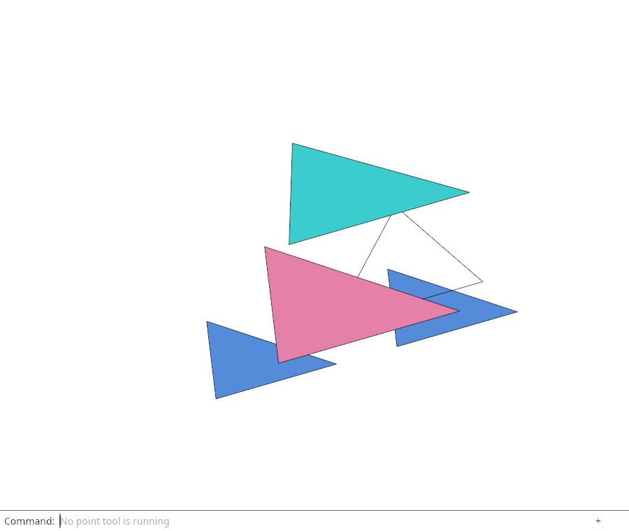

# 21.5.3 · Draw the construction grid as physical lines

**Chapter 21 · Precise camera and browser coordinates · Section 21.5 · Physical camera, grid and navigation** · [Contents](contents.md)

**Typing: 23–46 minutes.** [Estimate](typing-load.md).

Reuse the grid owner with a physical background pipeline.

## Type

Continue from [Omit unused background pick pipelines](96zzzzzzb-omit-unused-background-pick-pipelines.md). [Save or recover your work](recovery.md).

### 1. `src/grid.rs`

Use the maintained 1000-unit cell recipe. The hardware axes share one physical width.

<details>
<summary>Locate the existing block</summary>

```rust
use crate::stroke::Stroke;

pub const AXIS_COLOURS: [[f32; 4]; 3] = [
    [0.910, 0.278, 0.545, 1.0], [0.604, 0.804, 0.196, 1.0], [0.129, 0.588, 0.918, 1.0],
];

#[derive(Clone, Copy, Debug, PartialEq)]
pub struct Settings { pub spacing: f64, pub half_cells: u32 }

impl Default for Settings {
    fn default() -> Self { Self { spacing: 1.0, half_cells: 5 } }
}

impl Settings {
    pub fn half(self) -> Result<f64, &'static str> {
        let half = self.spacing * self.half_cells as f64;
        if !self.spacing.is_finite() || self.spacing <= 0.0 || self.half_cells == 0 || self.half_cells > 500
            || !(half as f32).is_finite() || self.spacing as f32 == 0.0 { return Err("Grid spacing or extent is invalid"); }
        Ok(half)
    }

    pub fn points(self) -> Result<Vec<[f64; 3]>, &'static str> {
        let h = self.half()?;
        Ok(vec![[-h, -h, 0.0], [-h, h, 0.0], [h, -h, 0.0], [h, h, 0.0],
            [h, 0.0, 0.0], [0.0, h, 0.0], [0.0, 0.0, self.spacing]])
    }

    pub fn reach(self,target:[f64;3])->Result<f64,&'static str>{self.reach_on(crate::cplane::CPlane::Xy,target)}
    pub fn reach_on(self,plane:crate::cplane::CPlane,target:[f64;3])->Result<f64,&'static str>{
        if target.iter().any(|v|!v.is_finite()){return Err("Grid target must be finite")}
        let reach=self.points()?.into_iter().map(|p|{let p=plane.world(p);(p[0]-target[0]).hypot(p[1]-target[1]).hypot(p[2]-target[2])}).fold(0.,f64::max);
        if !reach.is_finite(){return Err("Grid target exceeds the depth range")}Ok(reach)
    }
    pub fn strokes_on(self,plane:crate::cplane::CPlane)->Result<Vec<Stroke>,&'static str>{self.strokes_on_at(plane,[0.;3])}
    pub fn strokes_on_at(self,plane:crate::cplane::CPlane,anchor:[f64;3])->Result<Vec<Stroke>,&'static str>{
        let mut strokes=self.strokes()?;let model=crate::render_space::placed(&plane.matrix64(),anchor);
        for stroke in &mut strokes{for p in [&mut stroke.start,&mut stroke.end]{let values=model.transform_point(&session_rust::Point::new(f64::from(p[0]),f64::from(p[1]),f64::from(p[2]))).to_f32();if values.iter().any(|v|!v.is_finite()){return Err("Grid plane exceeds display range")}*p=values;}}
        Ok(strokes)
    }

    pub fn strokes(self) -> Result<Vec<Stroke>, &'static str> {
        let half = self.half()? as f32; let n = self.half_cells as i32; let mut strokes = Vec::new();
        for k in -n..=n {
            let t = (k as f64 * self.spacing) as f32;
            for (start, end) in [([-half, t, 0.0], [half, t, 0.0]), ([t, -half, 0.0], [t, half, 0.0])] {
                strokes.push(Stroke { start, end, colour: [0.55, 0.55, 0.55, 1.0], width: 1.0 });
            }
        }
        for (end, colour) in [[half, 0.0, 0.0], [0.0, half, 0.0], [0.0, 0.0, self.spacing as f32]].into_iter().zip(AXIS_COLOURS) {
            strokes.push(Stroke { start: [0.0; 3], end, colour, width: 2.0 });
        }
        Ok(strokes)
    }
}
```

</details>

Edit the existing block to match this code; keep unchanged lines:

```rust
use crate::stroke::Stroke;

pub const AXIS_COLOURS: [[f32; 4]; 3] = [
    [0.910, 0.278, 0.545, 1.0], [0.604, 0.804, 0.196, 1.0], [0.129, 0.588, 0.918, 1.0],
];

#[derive(Clone, Copy, Debug, PartialEq)]
pub struct Settings { pub spacing: f64, pub half_cells: u32 }

impl Default for Settings {
    fn default() -> Self { Self { spacing: 1000.0, half_cells: 5 } }
}

impl Settings {
    pub fn half(self) -> Result<f64, &'static str> {
        let half = self.spacing * self.half_cells as f64;
        if !self.spacing.is_finite() || self.spacing <= 0.0 || self.half_cells == 0 || self.half_cells > 500
            || !(half as f32).is_finite() || self.spacing as f32 == 0.0 { return Err("Grid spacing or extent is invalid"); }
        Ok(half)
    }

    pub fn points(self) -> Result<Vec<[f64; 3]>, &'static str> {
        let h = self.half()?;
        Ok(vec![[-h, -h, 0.0], [-h, h, 0.0], [h, -h, 0.0], [h, h, 0.0],
            [h, 0.0, 0.0], [0.0, h, 0.0], [0.0, 0.0, self.spacing]])
    }

    pub fn reach(self,target:[f64;3])->Result<f64,&'static str>{self.reach_on(crate::cplane::CPlane::Xy,target)}
    pub fn reach_on(self,plane:crate::cplane::CPlane,target:[f64;3])->Result<f64,&'static str>{
        if target.iter().any(|v|!v.is_finite()){return Err("Grid target must be finite")}
        let reach=self.points()?.into_iter().map(|p|{let p=plane.world(p);(p[0]-target[0]).hypot(p[1]-target[1]).hypot(p[2]-target[2])}).fold(0.,f64::max);
        if !reach.is_finite(){return Err("Grid target exceeds the depth range")}Ok(reach)
    }
    pub fn strokes_on(self,plane:crate::cplane::CPlane)->Result<Vec<Stroke>,&'static str>{self.strokes_on_at(plane,[0.;3])}
    pub fn strokes_on_at(self,plane:crate::cplane::CPlane,anchor:[f64;3])->Result<Vec<Stroke>,&'static str>{
        let mut strokes=self.strokes()?;let model=crate::render_space::placed(&plane.matrix64(),anchor);
        for stroke in &mut strokes{for p in [&mut stroke.start,&mut stroke.end]{let values=model.transform_point(&session_rust::Point::new(f64::from(p[0]),f64::from(p[1]),f64::from(p[2]))).to_f32();if values.iter().any(|v|!v.is_finite()){return Err("Grid plane exceeds display range")}*p=values;}}
        Ok(strokes)
    }

    pub fn strokes(self) -> Result<Vec<Stroke>, &'static str> {
        let half = self.half()? as f32; let n = self.half_cells as i32; let mut strokes = Vec::new();
        for k in -n..=n {
            let t = (k as f64 * self.spacing) as f32;
            for (start, end) in [([-half, t, 0.0], [half, t, 0.0]), ([t, -half, 0.0], [t, half, 0.0])] {
                strokes.push(Stroke { start, end, colour: [0.55, 0.55, 0.55, 1.0], width: 1.0 });
            }
        }
        for (end, colour) in [[half, 0.0, 0.0], [0.0, half, 0.0], [0.0, 0.0, self.spacing as f32]].into_iter().zip(AXIS_COLOURS) {
            strokes.push(Stroke { start: [0.0; 3], end, colour, width: 1.0 });
        }
        Ok(strokes)
    }
}
```

<details>
<summary>Optional patch references</summary>

Use these original edit fragments when comparing a saved checkpoint. Apply the complete blocks above.

```text
--8<-- "journey/code/96zzzzzzc-draw-the-construction-grid-as-physical-lines-01.rs"
```

```text
--8<-- "journey/code/96zzzzzzc-draw-the-construction-grid-as-physical-lines-02.rs"
```

</details>

### 2. `src/grid.wgsl`

Transform the existing endpoints and write physical color with primitive zero.

Create the file and type:

```wgsl
--8<-- "journey/code/96zzzzzzc-draw-the-construction-grid-as-physical-lines-03.rs"
```

### 3. `src/stroke_gpu.rs`

Declare the common target builder, then move the existing body into it immediately.

<details>
<summary>Locate the existing block</summary>

```rust
    fn layout_depth(device: &wgpu::Device, format: wgpu::TextureFormat, source: &str,
        stride: u64, vertices_per_instance: u32, attributes: &[wgpu::VertexAttribute], depth: wgpu::DepthStencilState, pickable:bool,
    ) -> Self {
        let view_layout = crate::gpu_layout::uniform(device, 80);
        let crop_layout = crate::gpu_layout::uniform(device, 80);
        let layout = device.create_pipeline_layout(&wgpu::PipelineLayoutDescriptor {
            label: Some("ink settings"), bind_group_layouts: &[Some(&view_layout)], immediate_size: 0 });
        let pick_layout = device.create_pipeline_layout(&wgpu::PipelineLayoutDescriptor {
            label: Some("ink pick settings"), bind_group_layouts: &[Some(&view_layout), Some(&crop_layout)], immediate_size: 0 });
        let pick_source = match stride { 48=>include_str!("guide_pick.wgsl"),44 => include_str!("stroke_pick.wgsl"), 72 => include_str!("chain_pick.wgsl"), 32 => include_str!("marker_pick.wgsl"), _ => unreachable!() };
        let pick_shader = pickable.then(||device.create_shader_module(wgpu::ShaderModuleDescriptor { label: Some("ink IDs"),
            source: wgpu::ShaderSource::Wgsl(format!("{source}\n{}\n{pick_source}", include_str!("pick_crop.wgsl")).into()) }));
        let shader = device.create_shader_module(wgpu::ShaderModuleDescriptor {
            label: Some("stroke"), source: wgpu::ShaderSource::Wgsl(source.into()),
        });
        let strict_depth=depth.depth_compare==Some(crate::depth::CLOSER);
        let pipeline = device.create_render_pipeline(&wgpu::RenderPipelineDescriptor {
            label: Some("stroke"), layout: Some(&layout),
            vertex: wgpu::VertexState { module: &shader, entry_point: Some("vertex"),
                compilation_options: Default::default(),
                buffers: &[wgpu::VertexBufferLayout { array_stride: stride, step_mode: wgpu::VertexStepMode::Instance, attributes }],
            },
            fragment: Some(wgpu::FragmentState { module: &shader, entry_point: Some("fragment"),
                compilation_options: Default::default(),
                targets: &[Some(wgpu::ColorTargetState { format, blend: Some(wgpu::BlendState::ALPHA_BLENDING),
                    write_mask: wgpu::ColorWrites::ALL })],
            }),
            primitive: Default::default(),
            depth_stencil: Some(depth),
            multisample: Default::default(), multiview_mask: None, cache: None,
        });
        let pick_pipeline = pick_shader.as_ref().map(|pick_shader|device.create_render_pipeline(&wgpu::RenderPipelineDescriptor {
            label: Some("ink IDs"), layout: Some(&pick_layout),
            vertex: wgpu::VertexState { module: &pick_shader, entry_point: Some("pick_vertex"), compilation_options: Default::default(),
                buffers: &[wgpu::VertexBufferLayout { array_stride: stride, step_mode: wgpu::VertexStepMode::Instance, attributes },
                    wgpu::VertexBufferLayout { array_stride: 8, step_mode: wgpu::VertexStepMode::Instance, attributes: &wgpu::vertex_attr_array![7 => Uint32x2] }] },
            fragment: Some(wgpu::FragmentState { module: &pick_shader, entry_point: Some("pick_fragment"), compilation_options: Default::default(),
                targets: &[Some(wgpu::TextureFormat::Rg32Uint.into())] }), primitive: Default::default(),
            depth_stencil: Some(crate::depth::ink()), multisample: Default::default(), multiview_mask: None, cache: None,
        }));
        let uniform = device.create_buffer(&wgpu::BufferDescriptor { label: Some("stroke view"), size: 80,
            usage: wgpu::BufferUsages::UNIFORM | wgpu::BufferUsages::COPY_DST, mapped_at_creation: false });
        let group = device.create_bind_group(&wgpu::BindGroupDescriptor { label: Some("stroke view"),
            layout: &pipeline.get_bind_group_layout(0),
            entries: &[wgpu::BindGroupEntry { binding: 0, resource: uniform.as_entire_binding() }] });
        Self {opacity:std::cell::Cell::new(1.),flags:None,flag_data:Vec::new(),finite:None,strict_depth, pipeline, pick_pipeline, ids: None, id_data: Vec::new(), uniform, group, vertices: None, data: Vec::new(), stride, vertices_per_instance, uploads: 0, uploaded_bytes: 0 }
    }
```

</details>

Edit the existing block to match this code; keep unchanged lines:

```rust
    fn layout_target(device: &wgpu::Device, format: wgpu::TextureFormat, source: &str,
        stride: u64, vertices_per_instance: u32, attributes: &[wgpu::VertexAttribute], depth: wgpu::DepthStencilState, pickable:bool, physical:bool,
    ) -> Self {}

    fn layout_depth(device: &wgpu::Device, format: wgpu::TextureFormat, source: &str,
        stride: u64, vertices_per_instance: u32, attributes: &[wgpu::VertexAttribute], depth: wgpu::DepthStencilState, pickable:bool,
    ) -> Self {
        let view_layout = crate::gpu_layout::uniform(device, 80);
        let crop_layout = crate::gpu_layout::uniform(device, 80);
        let layout = device.create_pipeline_layout(&wgpu::PipelineLayoutDescriptor {
            label: Some("ink settings"), bind_group_layouts: &[Some(&view_layout)], immediate_size: 0 });
        let pick_layout = device.create_pipeline_layout(&wgpu::PipelineLayoutDescriptor {
            label: Some("ink pick settings"), bind_group_layouts: &[Some(&view_layout), Some(&crop_layout)], immediate_size: 0 });
        let pick_source = match stride { 48=>include_str!("guide_pick.wgsl"),44 => include_str!("stroke_pick.wgsl"), 72 => include_str!("chain_pick.wgsl"), 32 => include_str!("marker_pick.wgsl"), _ => unreachable!() };
        let pick_shader = pickable.then(||device.create_shader_module(wgpu::ShaderModuleDescriptor { label: Some("ink IDs"),
            source: wgpu::ShaderSource::Wgsl(format!("{source}\n{}\n{pick_source}", include_str!("pick_crop.wgsl")).into()) }));
        let shader = device.create_shader_module(wgpu::ShaderModuleDescriptor {
            label: Some("stroke"), source: wgpu::ShaderSource::Wgsl(source.into()),
        });
        let strict_depth=depth.depth_compare==Some(crate::depth::CLOSER);
        let pipeline = device.create_render_pipeline(&wgpu::RenderPipelineDescriptor {
            label: Some("stroke"), layout: Some(&layout),
            vertex: wgpu::VertexState { module: &shader, entry_point: Some("vertex"),
                compilation_options: Default::default(),
                buffers: &[wgpu::VertexBufferLayout { array_stride: stride, step_mode: wgpu::VertexStepMode::Instance, attributes }],
            },
            fragment: Some(wgpu::FragmentState { module: &shader, entry_point: Some("fragment"),
                compilation_options: Default::default(),
                targets: &[Some(wgpu::ColorTargetState { format, blend: Some(wgpu::BlendState::ALPHA_BLENDING),
                    write_mask: wgpu::ColorWrites::ALL })],
            }),
            primitive: Default::default(),
            depth_stencil: Some(depth),
            multisample: Default::default(), multiview_mask: None, cache: None,
        });
        let pick_pipeline = pick_shader.as_ref().map(|pick_shader|device.create_render_pipeline(&wgpu::RenderPipelineDescriptor {
            label: Some("ink IDs"), layout: Some(&pick_layout),
            vertex: wgpu::VertexState { module: &pick_shader, entry_point: Some("pick_vertex"), compilation_options: Default::default(),
                buffers: &[wgpu::VertexBufferLayout { array_stride: stride, step_mode: wgpu::VertexStepMode::Instance, attributes },
                    wgpu::VertexBufferLayout { array_stride: 8, step_mode: wgpu::VertexStepMode::Instance, attributes: &wgpu::vertex_attr_array![7 => Uint32x2] }] },
            fragment: Some(wgpu::FragmentState { module: &pick_shader, entry_point: Some("pick_fragment"), compilation_options: Default::default(),
                targets: &[Some(wgpu::TextureFormat::Rg32Uint.into())] }), primitive: Default::default(),
            depth_stencil: Some(crate::depth::ink()), multisample: Default::default(), multiview_mask: None, cache: None,
        }));
        let uniform = device.create_buffer(&wgpu::BufferDescriptor { label: Some("stroke view"), size: 80,
            usage: wgpu::BufferUsages::UNIFORM | wgpu::BufferUsages::COPY_DST, mapped_at_creation: false });
        let group = device.create_bind_group(&wgpu::BindGroupDescriptor { label: Some("stroke view"),
            layout: &pipeline.get_bind_group_layout(0),
            entries: &[wgpu::BindGroupEntry { binding: 0, resource: uniform.as_entire_binding() }] });
        Self {opacity:std::cell::Cell::new(1.),flags:None,flag_data:Vec::new(),finite:None,strict_depth, pipeline, pick_pipeline, ids: None, id_data: Vec::new(), uniform, group, vertices: None, data: Vec::new(), stride, vertices_per_instance, uploads: 0, uploaded_bytes: 0 }
    }
```

<details>
<summary>Optional patch references</summary>

Use these original edit fragments when comparing a saved checkpoint. Apply the complete blocks above.

```text
--8<-- "journey/code/96zzzzzzc-draw-the-construction-grid-as-physical-lines-04.rs"
```

</details>

### 4. `src/stroke_gpu.rs`

Move the already-typed builder body unchanged; the following edits add the target choice.

Move the previously typed implementation as described. Keep its code; type the following wiring edits separately.

<details>
<summary>Previously typed code reference</summary>

Use this reference when moving the existing code; it is excluded from the typing estimate.

<details>
<summary>Locate the existing block</summary>

```text
    fn layout_target(device: &wgpu::Device, format: wgpu::TextureFormat, source: &str,
        stride: u64, vertices_per_instance: u32, attributes: &[wgpu::VertexAttribute], depth: wgpu::DepthStencilState, pickable:bool, physical:bool,
    ) -> Self {}
```

</details>

Reuse the existing code in this destination:

```text
--8<-- "journey/code/96zzzzzzc-draw-the-construction-grid-as-physical-lines-05.rs"
```

</details>

### 5. `src/stroke_gpu.rs`

Keep the existing color-only entry point as a thin call to the shared owner. Extend the single builder body with physical targets and LineList topology; the grid remains explicitly unpickable.

Edit these blocks from bottom to top. Keep the surrounding lines unchanged.

<details>
<summary>Locate this block</summary>

```rust
        Self::layout_depth(device,format,&crate::stroke::shader(),44,6,&wgpu::vertex_attr_array![0=>Float32x3,1=>Float32x3,2=>Float32x4,3=>Float32],depth,true)
    }
    pub fn grid(device: &wgpu::Device, format: wgpu::TextureFormat) -> Self {
        Self::layout_depth(device, format, &crate::stroke::shader(), 44, 6,
            &wgpu::vertex_attr_array![0 => Float32x3, 1 => Float32x3, 2 => Float32x4, 3 => Float32], crate::depth::grid(), false)
    }

    fn layout_target(device: &wgpu::Device, format: wgpu::TextureFormat, source: &str,
        stride: u64, vertices_per_instance: u32, attributes: &[wgpu::VertexAttribute], depth: wgpu::DepthStencilState, pickable:bool, physical:bool,
    ) -> Self {
        let view_layout = crate::gpu_layout::uniform(device, 80);
        let crop_layout = crate::gpu_layout::uniform(device, 80);
        let layout = device.create_pipeline_layout(&wgpu::PipelineLayoutDescriptor {
            label: Some("ink settings"), bind_group_layouts: &[Some(&view_layout)], immediate_size: 0 });
        let pick_layout = device.create_pipeline_layout(&wgpu::PipelineLayoutDescriptor {
            label: Some("ink pick settings"), bind_group_layouts: &[Some(&view_layout), Some(&crop_layout)], immediate_size: 0 });
        let pick_source = match stride { 48=>include_str!("guide_pick.wgsl"),44 => include_str!("stroke_pick.wgsl"), 72 => include_str!("chain_pick.wgsl"), 32 => include_str!("marker_pick.wgsl"), _ => unreachable!() };
        let pick_shader = pickable.then(||device.create_shader_module(wgpu::ShaderModuleDescriptor { label: Some("ink IDs"),
            source: wgpu::ShaderSource::Wgsl(format!("{source}\n{}\n{pick_source}", include_str!("pick_crop.wgsl")).into()) }));
        let shader = device.create_shader_module(wgpu::ShaderModuleDescriptor {
            label: Some("stroke"), source: wgpu::ShaderSource::Wgsl(source.into()),
        });
        let strict_depth=depth.depth_compare==Some(crate::depth::CLOSER);
        let pipeline = device.create_render_pipeline(&wgpu::RenderPipelineDescriptor {
            label: Some("stroke"), layout: Some(&layout),
            vertex: wgpu::VertexState { module: &shader, entry_point: Some("vertex"),
                compilation_options: Default::default(),
                buffers: &[wgpu::VertexBufferLayout { array_stride: stride, step_mode: wgpu::VertexStepMode::Instance, attributes }],
            },
            fragment: Some(wgpu::FragmentState { module: &shader, entry_point: Some("fragment"),
                compilation_options: Default::default(),
                targets: &[Some(wgpu::ColorTargetState { format, blend: Some(wgpu::BlendState::ALPHA_BLENDING),
                    write_mask: wgpu::ColorWrites::ALL })],
            }),
            primitive: Default::default(),
            depth_stencil: Some(depth),
            multisample: Default::default(), multiview_mask: None, cache: None,
        });
        let pick_pipeline = pick_shader.as_ref().map(|pick_shader|device.create_render_pipeline(&wgpu::RenderPipelineDescriptor {
            label: Some("ink IDs"), layout: Some(&pick_layout),
            vertex: wgpu::VertexState { module: &pick_shader, entry_point: Some("pick_vertex"), compilation_options: Default::default(),
                buffers: &[wgpu::VertexBufferLayout { array_stride: stride, step_mode: wgpu::VertexStepMode::Instance, attributes },
                    wgpu::VertexBufferLayout { array_stride: 8, step_mode: wgpu::VertexStepMode::Instance, attributes: &wgpu::vertex_attr_array![7 => Uint32x2] }] },
            fragment: Some(wgpu::FragmentState { module: &pick_shader, entry_point: Some("pick_fragment"), compilation_options: Default::default(),
                targets: &[Some(wgpu::TextureFormat::Rg32Uint.into())] }), primitive: Default::default(),
            depth_stencil: Some(crate::depth::ink()), multisample: Default::default(), multiview_mask: None, cache: None,
        }));
        let uniform = device.create_buffer(&wgpu::BufferDescriptor { label: Some("stroke view"), size: 80,
            usage: wgpu::BufferUsages::UNIFORM | wgpu::BufferUsages::COPY_DST, mapped_at_creation: false });
        let group = device.create_bind_group(&wgpu::BindGroupDescriptor { label: Some("stroke view"),
            layout: &pipeline.get_bind_group_layout(0),
            entries: &[wgpu::BindGroupEntry { binding: 0, resource: uniform.as_entire_binding() }] });
        Self {opacity:std::cell::Cell::new(1.),flags:None,flag_data:Vec::new(),finite:None,strict_depth, pipeline, pick_pipeline, ids: None, id_data: Vec::new(), uniform, group, vertices: None, data: Vec::new(), stride, vertices_per_instance, uploads: 0, uploaded_bytes: 0 }
    }

    fn layout_depth(device: &wgpu::Device, format: wgpu::TextureFormat, source: &str,
        stride: u64, vertices_per_instance: u32, attributes: &[wgpu::VertexAttribute], depth: wgpu::DepthStencilState, pickable:bool,
    ) -> Self {
        let view_layout = crate::gpu_layout::uniform(device, 80);
        let crop_layout = crate::gpu_layout::uniform(device, 80);
        let layout = device.create_pipeline_layout(&wgpu::PipelineLayoutDescriptor {
            label: Some("ink settings"), bind_group_layouts: &[Some(&view_layout)], immediate_size: 0 });
        let pick_layout = device.create_pipeline_layout(&wgpu::PipelineLayoutDescriptor {
            label: Some("ink pick settings"), bind_group_layouts: &[Some(&view_layout), Some(&crop_layout)], immediate_size: 0 });
        let pick_source = match stride { 48=>include_str!("guide_pick.wgsl"),44 => include_str!("stroke_pick.wgsl"), 72 => include_str!("chain_pick.wgsl"), 32 => include_str!("marker_pick.wgsl"), _ => unreachable!() };
        let pick_shader = pickable.then(||device.create_shader_module(wgpu::ShaderModuleDescriptor { label: Some("ink IDs"),
            source: wgpu::ShaderSource::Wgsl(format!("{source}\n{}\n{pick_source}", include_str!("pick_crop.wgsl")).into()) }));
        let shader = device.create_shader_module(wgpu::ShaderModuleDescriptor {
            label: Some("stroke"), source: wgpu::ShaderSource::Wgsl(source.into()),
        });
        let strict_depth=depth.depth_compare==Some(crate::depth::CLOSER);
        let pipeline = device.create_render_pipeline(&wgpu::RenderPipelineDescriptor {
            label: Some("stroke"), layout: Some(&layout),
            vertex: wgpu::VertexState { module: &shader, entry_point: Some("vertex"),
                compilation_options: Default::default(),
                buffers: &[wgpu::VertexBufferLayout { array_stride: stride, step_mode: wgpu::VertexStepMode::Instance, attributes }],
            },
            fragment: Some(wgpu::FragmentState { module: &shader, entry_point: Some("fragment"),
                compilation_options: Default::default(),
                targets: &[Some(wgpu::ColorTargetState { format, blend: Some(wgpu::BlendState::ALPHA_BLENDING),
                    write_mask: wgpu::ColorWrites::ALL })],
            }),
            primitive: Default::default(),
            depth_stencil: Some(depth),
            multisample: Default::default(), multiview_mask: None, cache: None,
        });
        let pick_pipeline = pick_shader.as_ref().map(|pick_shader|device.create_render_pipeline(&wgpu::RenderPipelineDescriptor {
            label: Some("ink IDs"), layout: Some(&pick_layout),
            vertex: wgpu::VertexState { module: &pick_shader, entry_point: Some("pick_vertex"), compilation_options: Default::default(),
                buffers: &[wgpu::VertexBufferLayout { array_stride: stride, step_mode: wgpu::VertexStepMode::Instance, attributes },
                    wgpu::VertexBufferLayout { array_stride: 8, step_mode: wgpu::VertexStepMode::Instance, attributes: &wgpu::vertex_attr_array![7 => Uint32x2] }] },
            fragment: Some(wgpu::FragmentState { module: &pick_shader, entry_point: Some("pick_fragment"), compilation_options: Default::default(),
                targets: &[Some(wgpu::TextureFormat::Rg32Uint.into())] }), primitive: Default::default(),
            depth_stencil: Some(crate::depth::ink()), multisample: Default::default(), multiview_mask: None, cache: None,
        }));
        let uniform = device.create_buffer(&wgpu::BufferDescriptor { label: Some("stroke view"), size: 80,
            usage: wgpu::BufferUsages::UNIFORM | wgpu::BufferUsages::COPY_DST, mapped_at_creation: false });
        let group = device.create_bind_group(&wgpu::BindGroupDescriptor { label: Some("stroke view"),
            layout: &pipeline.get_bind_group_layout(0),
            entries: &[wgpu::BindGroupEntry { binding: 0, resource: uniform.as_entire_binding() }] });
        Self {opacity:std::cell::Cell::new(1.),flags:None,flag_data:Vec::new(),finite:None,strict_depth, pipeline, pick_pipeline, ids: None, id_data: Vec::new(), uniform, group, vertices: None, data: Vec::new(), stride, vertices_per_instance, uploads: 0, uploaded_bytes: 0 }
    }
}
```

</details>

Replace it with:

```rust
        Self::layout_depth(device,format,&crate::stroke::shader(),44,6,&wgpu::vertex_attr_array![0=>Float32x3,1=>Float32x3,2=>Float32x4,3=>Float32],depth,true)
    }
    pub fn grid(device: &wgpu::Device, format: wgpu::TextureFormat) -> Self {
        Self::layout_target(device, format, include_str!("grid.wgsl"), 44, 2,
            &wgpu::vertex_attr_array![0 => Float32x3, 1 => Float32x3, 2 => Float32x4, 3 => Float32], crate::depth::grid(), false, true)
    }

    fn layout_target(device: &wgpu::Device, format: wgpu::TextureFormat, source: &str,
        stride: u64, vertices_per_instance: u32, attributes: &[wgpu::VertexAttribute], depth: wgpu::DepthStencilState, pickable:bool, physical:bool,
    ) -> Self {
        let view_layout = crate::gpu_layout::uniform(device, 80);
        let crop_layout = crate::gpu_layout::uniform(device, 80);
        let layout = device.create_pipeline_layout(&wgpu::PipelineLayoutDescriptor {
            label: Some("ink settings"), bind_group_layouts: &[Some(&view_layout)], immediate_size: 0 });
        let pick_layout = device.create_pipeline_layout(&wgpu::PipelineLayoutDescriptor {
            label: Some("ink pick settings"), bind_group_layouts: &[Some(&view_layout), Some(&crop_layout)], immediate_size: 0 });
        let pick_source = match stride { 48=>include_str!("guide_pick.wgsl"),44 => include_str!("stroke_pick.wgsl"), 72 => include_str!("chain_pick.wgsl"), 32 => include_str!("marker_pick.wgsl"), _ => unreachable!() };
        let pick_shader = pickable.then(||device.create_shader_module(wgpu::ShaderModuleDescriptor { label: Some("ink IDs"),
            source: wgpu::ShaderSource::Wgsl(format!("{source}\n{}\n{pick_source}", include_str!("pick_crop.wgsl")).into()) }));
        let shader = device.create_shader_module(wgpu::ShaderModuleDescriptor {
            label: Some("stroke"), source: wgpu::ShaderSource::Wgsl(source.into()),
        });
        let strict_depth=depth.depth_compare==Some(crate::depth::CLOSER);
        let mut targets=vec![Some(wgpu::ColorTargetState{format,blend:if physical{None}else{Some(wgpu::BlendState::ALPHA_BLENDING)},write_mask:wgpu::ColorWrites::ALL})];
        if physical{targets.push(Some(crate::primitive_image::target(true)));}
        let pipeline = device.create_render_pipeline(&wgpu::RenderPipelineDescriptor {
            label: Some("stroke"), layout: Some(&layout),
            vertex: wgpu::VertexState { module: &shader, entry_point: Some("vertex"),
                compilation_options: Default::default(),
                buffers: &[wgpu::VertexBufferLayout { array_stride: stride, step_mode: wgpu::VertexStepMode::Instance, attributes }],
            },
            fragment: Some(wgpu::FragmentState { module: &shader, entry_point: Some("fragment"),
                compilation_options: Default::default(),
                targets: &targets,
            }),
            primitive: wgpu::PrimitiveState{topology:if physical{wgpu::PrimitiveTopology::LineList}else{wgpu::PrimitiveTopology::TriangleList},..Default::default()},
            depth_stencil: Some(depth),
            multisample: Default::default(), multiview_mask: None, cache: None,
        });
        let pick_pipeline = pick_shader.as_ref().map(|pick_shader|device.create_render_pipeline(&wgpu::RenderPipelineDescriptor {
            label: Some("ink IDs"), layout: Some(&pick_layout),
            vertex: wgpu::VertexState { module: &pick_shader, entry_point: Some("pick_vertex"), compilation_options: Default::default(),
                buffers: &[wgpu::VertexBufferLayout { array_stride: stride, step_mode: wgpu::VertexStepMode::Instance, attributes },
                    wgpu::VertexBufferLayout { array_stride: 8, step_mode: wgpu::VertexStepMode::Instance, attributes: &wgpu::vertex_attr_array![7 => Uint32x2] }] },
            fragment: Some(wgpu::FragmentState { module: &pick_shader, entry_point: Some("pick_fragment"), compilation_options: Default::default(),
                targets: &[Some(wgpu::TextureFormat::Rg32Uint.into())] }), primitive: Default::default(),
            depth_stencil: Some(crate::depth::ink()), multisample: Default::default(), multiview_mask: None, cache: None,
        }));
        let uniform = device.create_buffer(&wgpu::BufferDescriptor { label: Some("stroke view"), size: 80,
            usage: wgpu::BufferUsages::UNIFORM | wgpu::BufferUsages::COPY_DST, mapped_at_creation: false });
        let group = device.create_bind_group(&wgpu::BindGroupDescriptor { label: Some("stroke view"),
            layout: &pipeline.get_bind_group_layout(0),
            entries: &[wgpu::BindGroupEntry { binding: 0, resource: uniform.as_entire_binding() }] });
        Self {opacity:std::cell::Cell::new(1.),flags:None,flag_data:Vec::new(),finite:None,strict_depth, pipeline, pick_pipeline, ids: None, id_data: Vec::new(), uniform, group, vertices: None, data: Vec::new(), stride, vertices_per_instance, uploads: 0, uploaded_bytes: 0 }
    }

    fn layout_depth(device: &wgpu::Device, format: wgpu::TextureFormat, source: &str,
        stride: u64, vertices_per_instance: u32, attributes: &[wgpu::VertexAttribute], depth: wgpu::DepthStencilState, pickable:bool,
    ) -> Self {
        Self::layout_target(device,format,source,stride,vertices_per_instance,attributes,depth,pickable,false)
    }
}
```

<details>
<summary>Complete updated block reference</summary>

```rust
pub struct Lane {
    opacity:std::cell::Cell<f32>,
    flags:Option<wgpu::Buffer>,flag_data:Vec<u32>,
    finite:Option<crate::finite_ink::Ink>,
    strict_depth:bool,
    pipeline: wgpu::RenderPipeline,
    pick_pipeline: Option<wgpu::RenderPipeline>,
    ids: Option<wgpu::Buffer>,
    id_data: Vec<u8>,
    uniform: wgpu::Buffer,
    group: wgpu::BindGroup,
    vertices: Option<wgpu::Buffer>,
    data: Vec<u8>,
    stride: u64,
    vertices_per_instance: u32,
    pub uploads: u64,
    pub uploaded_bytes: u64,
}

impl Lane {
    pub fn set(&mut self, device: &wgpu::Device, strokes: impl IntoIterator<Item = crate::stroke::Stroke>) -> Result<(), &'static str> {
        let mut data = Vec::new();
        for stroke in strokes {
            if stroke.width <= 0.0 || stroke.values().iter().any(|value| !value.is_finite()) {
                return Err("Invalid stroke display data");
            }
            data.extend(stroke.bytes());
        }
        if self.stride != 44 { return Err("Stroke data needs the stroke layout"); }
        self.set_bytes(device, data)
    }

    pub fn set_guides(&mut self,device:&wgpu::Device,segments:&[crate::guide_gpu::Segment])->Result<(),&'static str>{if self.stride!=48{return Err("Guide data needs the guide layout")}let mut bytes=Vec::with_capacity(segments.len()*48);for segment in segments{if segment.stroke.width<=0.||segment.stroke.values().iter().any(|v|!v.is_finite()){return Err("Invalid guide stroke")}bytes.extend(segment.stroke.bytes());bytes.extend(u32::from(segment.dashed).to_ne_bytes());}self.set_bytes(device,bytes)}
    pub fn set_chains(&mut self, device: &wgpu::Device, segments: impl IntoIterator<Item = crate::chain::Segment>) -> Result<(), &'static str> {
        if self.stride != 72 { return Err("Connected data needs the connected layout"); }
        let mut data = Vec::new();
        for segment in segments {
            if segment.stroke.width <= 0.0 || segment.heads > 3
                || segment.stroke.values().iter().chain(segment.previous.iter()).chain(segment.next.iter()).any(|v| !v.is_finite()) {
                return Err("Invalid connected display data");
            }
            data.extend(segment.bytes());
        }
        self.set_bytes(device, data)
    }

    pub fn set_points(&mut self, device: &wgpu::Device, markers: impl IntoIterator<Item = crate::marker::Marker>) -> Result<(), &'static str> {
        if self.stride != 32 { return Err("Marker data needs the marker layout"); }
        let mut data = Vec::new();
        for marker in markers {
            if marker.diameter <= 0.0 || marker.values().iter().any(|v| !v.is_finite()) { return Err("Invalid marker display data"); }
            data.extend(marker.bytes());
        }
        self.set_bytes(device, data)
    }

    fn set_bytes(&mut self, device: &wgpu::Device, data: Vec<u8>) -> Result<(), &'static str> {
        use wgpu::util::DeviceExt;
        u32::try_from(data.len() as u64 / self.stride).map_err(|_| "Too many stroke instances")?;
        if data == self.data { return Ok(()); }
        self.vertices = if data.is_empty() { None } else {
            self.uploads += 1; self.uploaded_bytes += data.len() as u64;
            Some(device.create_buffer_init(&wgpu::util::BufferInitDescriptor {
                label: Some("stroke instances"), contents: &data, usage: wgpu::BufferUsages::VERTEX,
            }))
        };
        self.data = data; if self.finite.is_some(){self.set_flags(device,vec![0;self.data.len()/self.stride as usize])?;} Ok(())
    }

    pub fn set_opacity(&self,value:f32){self.opacity.set(value);}
    pub fn view(&self, queue: &wgpu::Queue, transform: &[f32; 16], size: [u32; 2], density: f32) {
        if self.vertices.is_none() { return; }
        let bytes: Vec<u8> = transform.iter().copied().chain([size[0] as f32, size[1] as f32, density, self.opacity.get()])
            .flat_map(f32::to_ne_bytes).collect();
        queue.write_buffer(&self.uniform, 0, &bytes);
    }

    pub fn set_flags(&mut self,device:&wgpu::Device,flags:Vec<u32>)->Result<(),&'static str>{
        if flags.len()!=self.data.len()/self.stride as usize{return Err("Clipping flags must match original ink instances")}
        if flags==self.flag_data{return Ok(())}use wgpu::util::DeviceExt;self.flags=if flags.is_empty(){None}else{let bytes=flags.iter().copied().flat_map(u32::to_ne_bytes).collect::<Vec<_>>();Some(device.create_buffer_init(&wgpu::util::BufferInitDescriptor{label:Some("original ink clipping flags"),contents:&bytes,usage:wgpu::BufferUsages::VERTEX}))};self.flag_data=flags;Ok(())
    }
    pub fn clipping_bytes(&self)->[u64;2]{[self.flags.as_ref().map_or(0,wgpu::Buffer::size),self.flag_data.capacity()as u64*4]}
    pub fn enable_finite(&mut self,device:&wgpu::Device,format:wgpu::TextureFormat){self.finite=Some(crate::finite_ink::Ink::new(device,format,self.stride,self.strict_depth));self.set_flags(device,vec![0;self.data.len()/self.stride as usize]).expect("Original ink clipping flags");}
    pub fn finite_frame(&self,device:&wgpu::Device,tables:&crate::finite_ink::Tables,depth:&wgpu::TextureView){if let Some(ink)=&self.finite{ink.set(device,tables,depth)}}
    pub fn draw(&self, pass: &mut wgpu::RenderPass<'_>) {
        let Some(vertices) = &self.vertices else { return; };
        if self.finite.as_ref().is_some_and(|ink|ink.draw(pass,&self.group,vertices,self.flags.as_ref().expect("Finite original clipping flags"),(self.data.len()as u64/self.stride)as u32,self.vertices_per_instance)){return}
        pass.set_pipeline(&self.pipeline); pass.set_bind_group(0, &self.group, &[]);
        pass.set_vertex_buffer(0, vertices.slice(..));
        pass.draw(0..self.vertices_per_instance, 0..(self.data.len() as u64 / self.stride) as u32);
    }

    pub fn set_ids(&mut self, device: &wgpu::Device, ids: impl IntoIterator<Item = [u32; 2]>) -> Result<(), &'static str> {
        use wgpu::util::DeviceExt;
        let data: Vec<u8> = ids.into_iter().flatten().flat_map(u32::to_ne_bytes).collect();
        if data.len() as u64 / 8 != self.data.len() as u64 / self.stride { return Err("Pick IDs must match display instances"); }
        if data == self.id_data { return Ok(()); }
        self.ids = if data.is_empty() { None } else { Some(device.create_buffer_init(&wgpu::util::BufferInitDescriptor {
            label: Some("ink IDs"), contents: &data, usage: wgpu::BufferUsages::VERTEX })) };
        self.id_data = data; Ok(())
    }

    pub fn pick(&self, pass: &mut wgpu::RenderPass<'_>, crop: &wgpu::BindGroup) {
        let (Some(vertices), Some(ids), Some(pipeline)) = (&self.vertices, &self.ids, &self.pick_pipeline) else { return; };
        pass.set_pipeline(pipeline); pass.set_bind_group(0, &self.group, &[]); pass.set_bind_group(1, crop, &[]);
        pass.set_vertex_buffer(0, vertices.slice(..)); pass.set_vertex_buffer(1, ids.slice(..));
        pass.draw(0..self.vertices_per_instance, 0..(self.data.len() as u64 / self.stride) as u32);
    }

    pub fn pick_finite(&self,device:&wgpu::Device,pass:&mut wgpu::RenderPass<'_>,crop:&wgpu::BindGroup,tables:Option<&crate::finite_ink::Tables>,depth:&wgpu::TextureView){
        if let(Some(ink),Some(tables),Some(vertices),Some(ids))=(&self.finite,tables,&self.vertices,&self.ids){ink.pick(device,pass,&self.group,crop,vertices,ids,self.flags.as_ref().expect("Finite original clipping flags"),(self.data.len()as u64/self.stride)as u32,self.vertices_per_instance,tables,depth)}else{self.pick(pass,crop)}
    }
    pub fn pick_bytes(&self) -> u64 { self.ids.as_ref().map_or(0, wgpu::Buffer::size) }

    pub fn usage(&self) -> [u64; 2] {
        [self.data.len() as u64 / self.stride, self.vertices.as_ref().map_or(0, wgpu::Buffer::size)]
    }

    pub fn new(device: &wgpu::Device, format: wgpu::TextureFormat) -> Self {
        Self::layout(device, format, &crate::stroke::shader(), 44, 6,
            &wgpu::vertex_attr_array![0 => Float32x3, 1 => Float32x3, 2 => Float32x4, 3 => Float32])
    }

    pub fn joined(device: &wgpu::Device, format: wgpu::TextureFormat) -> Self {
        Self::layout(device, format, &crate::chain::shader(), 72, 18,
            &wgpu::vertex_attr_array![0 => Float32x3, 1 => Float32x3, 2 => Float32x4, 3 => Float32,
                4 => Float32x3, 5 => Float32x3, 6 => Uint32])
    }

    pub fn markers(device: &wgpu::Device, format: wgpu::TextureFormat) -> Self {
        Self::layout(device, format, &crate::marker::shader(), 32, 6,
            &wgpu::vertex_attr_array![0 => Float32x3, 1 => Float32, 2 => Float32x4])
    }

    fn layout(device: &wgpu::Device, format: wgpu::TextureFormat, source: &str,
        stride: u64, vertices_per_instance: u32, attributes: &[wgpu::VertexAttribute]) -> Self {
        Self::layout_depth(device, format, source, stride, vertices_per_instance, attributes, crate::depth::ink(), true)
    }

    pub fn guides(device:&wgpu::Device,format:wgpu::TextureFormat)->Self{let mut depth=crate::depth::ink();depth.depth_compare=Some(wgpu::CompareFunction::Always);Self::layout_depth(device,format,&crate::finite_project_source::expand(include_str!("guide.wgsl")),48,6,&wgpu::vertex_attr_array![0=>Float32x3,1=>Float32x3,2=>Float32x4,3=>Float32,4=>Uint32],depth,true)}
    pub fn overlay(device:&wgpu::Device,format:wgpu::TextureFormat)->Self{
        let mut depth=crate::depth::ink();depth.depth_compare=Some(wgpu::CompareFunction::Always);
        Self::layout_depth(device,format,&crate::stroke::shader(),44,6,&wgpu::vertex_attr_array![0=>Float32x3,1=>Float32x3,2=>Float32x4,3=>Float32],depth,true)
    }
    pub fn grid(device: &wgpu::Device, format: wgpu::TextureFormat) -> Self {
        Self::layout_target(device, format, include_str!("grid.wgsl"), 44, 2,
            &wgpu::vertex_attr_array![0 => Float32x3, 1 => Float32x3, 2 => Float32x4, 3 => Float32], crate::depth::grid(), false, true)
    }

    fn layout_target(device: &wgpu::Device, format: wgpu::TextureFormat, source: &str,
        stride: u64, vertices_per_instance: u32, attributes: &[wgpu::VertexAttribute], depth: wgpu::DepthStencilState, pickable:bool, physical:bool,
    ) -> Self {
        let view_layout = crate::gpu_layout::uniform(device, 80);
        let crop_layout = crate::gpu_layout::uniform(device, 80);
        let layout = device.create_pipeline_layout(&wgpu::PipelineLayoutDescriptor {
            label: Some("ink settings"), bind_group_layouts: &[Some(&view_layout)], immediate_size: 0 });
        let pick_layout = device.create_pipeline_layout(&wgpu::PipelineLayoutDescriptor {
            label: Some("ink pick settings"), bind_group_layouts: &[Some(&view_layout), Some(&crop_layout)], immediate_size: 0 });
        let pick_source = match stride { 48=>include_str!("guide_pick.wgsl"),44 => include_str!("stroke_pick.wgsl"), 72 => include_str!("chain_pick.wgsl"), 32 => include_str!("marker_pick.wgsl"), _ => unreachable!() };
        let pick_shader = pickable.then(||device.create_shader_module(wgpu::ShaderModuleDescriptor { label: Some("ink IDs"),
            source: wgpu::ShaderSource::Wgsl(format!("{source}\n{}\n{pick_source}", include_str!("pick_crop.wgsl")).into()) }));
        let shader = device.create_shader_module(wgpu::ShaderModuleDescriptor {
            label: Some("stroke"), source: wgpu::ShaderSource::Wgsl(source.into()),
        });
        let strict_depth=depth.depth_compare==Some(crate::depth::CLOSER);
        let mut targets=vec![Some(wgpu::ColorTargetState{format,blend:if physical{None}else{Some(wgpu::BlendState::ALPHA_BLENDING)},write_mask:wgpu::ColorWrites::ALL})];
        if physical{targets.push(Some(crate::primitive_image::target(true)));}
        let pipeline = device.create_render_pipeline(&wgpu::RenderPipelineDescriptor {
            label: Some("stroke"), layout: Some(&layout),
            vertex: wgpu::VertexState { module: &shader, entry_point: Some("vertex"),
                compilation_options: Default::default(),
                buffers: &[wgpu::VertexBufferLayout { array_stride: stride, step_mode: wgpu::VertexStepMode::Instance, attributes }],
            },
            fragment: Some(wgpu::FragmentState { module: &shader, entry_point: Some("fragment"),
                compilation_options: Default::default(),
                targets: &targets,
            }),
            primitive: wgpu::PrimitiveState{topology:if physical{wgpu::PrimitiveTopology::LineList}else{wgpu::PrimitiveTopology::TriangleList},..Default::default()},
            depth_stencil: Some(depth),
            multisample: Default::default(), multiview_mask: None, cache: None,
        });
        let pick_pipeline = pick_shader.as_ref().map(|pick_shader|device.create_render_pipeline(&wgpu::RenderPipelineDescriptor {
            label: Some("ink IDs"), layout: Some(&pick_layout),
            vertex: wgpu::VertexState { module: &pick_shader, entry_point: Some("pick_vertex"), compilation_options: Default::default(),
                buffers: &[wgpu::VertexBufferLayout { array_stride: stride, step_mode: wgpu::VertexStepMode::Instance, attributes },
                    wgpu::VertexBufferLayout { array_stride: 8, step_mode: wgpu::VertexStepMode::Instance, attributes: &wgpu::vertex_attr_array![7 => Uint32x2] }] },
            fragment: Some(wgpu::FragmentState { module: &pick_shader, entry_point: Some("pick_fragment"), compilation_options: Default::default(),
                targets: &[Some(wgpu::TextureFormat::Rg32Uint.into())] }), primitive: Default::default(),
            depth_stencil: Some(crate::depth::ink()), multisample: Default::default(), multiview_mask: None, cache: None,
        }));
        let uniform = device.create_buffer(&wgpu::BufferDescriptor { label: Some("stroke view"), size: 80,
            usage: wgpu::BufferUsages::UNIFORM | wgpu::BufferUsages::COPY_DST, mapped_at_creation: false });
        let group = device.create_bind_group(&wgpu::BindGroupDescriptor { label: Some("stroke view"),
            layout: &pipeline.get_bind_group_layout(0),
            entries: &[wgpu::BindGroupEntry { binding: 0, resource: uniform.as_entire_binding() }] });
        Self {opacity:std::cell::Cell::new(1.),flags:None,flag_data:Vec::new(),finite:None,strict_depth, pipeline, pick_pipeline, ids: None, id_data: Vec::new(), uniform, group, vertices: None, data: Vec::new(), stride, vertices_per_instance, uploads: 0, uploaded_bytes: 0 }
    }

    fn layout_depth(device: &wgpu::Device, format: wgpu::TextureFormat, source: &str,
        stride: u64, vertices_per_instance: u32, attributes: &[wgpu::VertexAttribute], depth: wgpu::DepthStencilState, pickable:bool,
    ) -> Self {
        Self::layout_target(device,format,source,stride,vertices_per_instance,attributes,depth,pickable,false)
    }
}

#[cfg(test)]
#[path="grid_pick_pipeline_tests.rs"]
mod pick_pipeline_tests;
```

</details>

<details>
<summary>Optional patch references</summary>

Use these original edit fragments when comparing a saved checkpoint. Apply the complete blocks above.

```text
--8<-- "journey/code/96zzzzzzc-draw-the-construction-grid-as-physical-lines-06.rs"
```

```text
--8<-- "journey/code/96zzzzzzc-draw-the-construction-grid-as-physical-lines-07.rs"
```

</details>

### 6. `src/renderer.rs`

Draw the grid in the physical background before surfaces and remove its finite setup/draw.

Edit these blocks from bottom to top. Keep the surrounding lines unchanged.

<details>
<summary>Locate this block</summary>

```rust
            pass.set_bind_group(2,&clip_group,&[]);
            self.highlight.ink(&mut pass);
            self.mesh_ink.draw(&mut pass);
            self.grid.draw(&mut pass);
            self.strokes.draw(&mut pass);self.sheets.draw(&mut pass);
            self.paths.draw(&mut pass);
            self.markers.draw(&mut pass);
```

</details>

Replace it with:

```rust
            pass.set_bind_group(2,&clip_group,&[]);
            self.highlight.ink(&mut pass);
            self.mesh_ink.draw(&mut pass);
            self.strokes.draw(&mut pass);self.sheets.draw(&mut pass);
            self.paths.draw(&mut pass);
            self.markers.draw(&mut pass);
```

<details>
<summary>Locate this block</summary>

```rust
                })],
                ..Default::default()
            });
            pass.set_bind_group(2,&clip_group,&[]);
            pass.set_pipeline(&self.pipeline);
            pass.set_bind_group(0, &self.view_group, &[]);
```

</details>

Replace it with:

```rust
                })],
                ..Default::default()
            });
            self.grid.draw(&mut pass);
            pass.set_bind_group(2,&clip_group,&[]);
            pass.set_pipeline(&self.pipeline);
            pass.set_bind_group(0, &self.view_group, &[]);
```

<details>
<summary>Locate this block</summary>

```rust
        let [r, g, b] = if self.ambient_enabled.get() { [0.94; 3] } else { background.rgb() };
        let mut encoder = self.device.create_command_encoder(&Default::default());
        let mut tiles=self.tiles.borrow_mut();tiles.prepare(&self.device,&self.queue,self.size);tiles.encode(&self.device,&mut encoder,&self.view_group,*transform);
        let tables=crate::finite_ink::Tables{projected:tiles.projected.clone(),tiles:tiles.buffer.clone(),primitive:self.primitive.view.clone()};for lane in [&self.mesh_ink,&self.strokes,&self.paths,&self.markers,&self.grid]{lane.finite_frame(&self.device,&tables,&self.depth);}self.highlight.finite_frame(&self.device,&tables,&self.depth);
        {
            // The pass borrows the encoder. This scope ends that borrow before finish takes it.
            let mut pass = encoder.begin_render_pass(&wgpu::RenderPassDescriptor {
```

</details>

Replace it with:

```rust
        let [r, g, b] = if self.ambient_enabled.get() { [0.94; 3] } else { background.rgb() };
        let mut encoder = self.device.create_command_encoder(&Default::default());
        let mut tiles=self.tiles.borrow_mut();tiles.prepare(&self.device,&self.queue,self.size);tiles.encode(&self.device,&mut encoder,&self.view_group,*transform);
        let tables=crate::finite_ink::Tables{projected:tiles.projected.clone(),tiles:tiles.buffer.clone(),primitive:self.primitive.view.clone()};for lane in [&self.mesh_ink,&self.strokes,&self.paths,&self.markers]{lane.finite_frame(&self.device,&tables,&self.depth);}self.highlight.finite_frame(&self.device,&tables,&self.depth);
        {
            // The pass borrows the encoder. This scope ends that borrow before finish takes it.
            let mut pass = encoder.begin_render_pass(&wgpu::RenderPassDescriptor {
```

<details>
<summary>Locate this block</summary>

```rust
        let mut renderer = Self {space:Default::default(),opacity:std::cell::Cell::new(1.),ambient_enabled:Default::default(),ambient:Default::default(),ambient_rows:Default::default(),pyramid:Default::default(),pyramid_revision:0,caps:std::cell::RefCell::new(crate::caps_gpu::Caps::new(&device)),clipping:std::cell::RefCell::new(crate::clipping_gpu::Clipping::new(&device)),tiles,guides,measurement,sheets,instances,instance_rows:Default::default(),clouds:Default::default(),cloud_view:Default::default(),cloud_error:Default::default(),outline:Default::default(),global_outline:Default::default(),outlines_enabled:Default::default(),outline_composite:Default::default(),full_text_fonts:Default::default(),presentation_text:Default::default(),scene_text:Default::default(), text:std::cell::RefCell::new(None),text_error:std::cell::RefCell::new(None),format,device, queue, pipeline, highlight_pipeline, highlight, preview, widget, meshes: Vec::new(),
            geometry: Default::default(), settings_allocations: 0, settings_writes: 0,
            settings_bytes: 0, uniform, view_group, depth, primitive, strokes, paths, markers, grid, grid_settings: None,grid_plane:crate::cplane::CPlane::Xy,grid_anchor:[0.;3], size: [640, 480], density: 1.0, picker, faces, mesh_ink, sources: Default::default(), pick_mode:Default::default(),pick_cursor:None };
        for lane in [&mut renderer.mesh_ink,&mut renderer.strokes,&mut renderer.paths,&mut renderer.markers,&mut renderer.grid]{lane.enable_finite(&renderer.device,format);}
        renderer.highlight.enable_finite(&renderer.device,format);
        renderer.set_scene(scene, None);
        renderer
```

</details>

Replace it with:

```rust
        let mut renderer = Self {space:Default::default(),opacity:std::cell::Cell::new(1.),ambient_enabled:Default::default(),ambient:Default::default(),ambient_rows:Default::default(),pyramid:Default::default(),pyramid_revision:0,caps:std::cell::RefCell::new(crate::caps_gpu::Caps::new(&device)),clipping:std::cell::RefCell::new(crate::clipping_gpu::Clipping::new(&device)),tiles,guides,measurement,sheets,instances,instance_rows:Default::default(),clouds:Default::default(),cloud_view:Default::default(),cloud_error:Default::default(),outline:Default::default(),global_outline:Default::default(),outlines_enabled:Default::default(),outline_composite:Default::default(),full_text_fonts:Default::default(),presentation_text:Default::default(),scene_text:Default::default(), text:std::cell::RefCell::new(None),text_error:std::cell::RefCell::new(None),format,device, queue, pipeline, highlight_pipeline, highlight, preview, widget, meshes: Vec::new(),
            geometry: Default::default(), settings_allocations: 0, settings_writes: 0,
            settings_bytes: 0, uniform, view_group, depth, primitive, strokes, paths, markers, grid, grid_settings: None,grid_plane:crate::cplane::CPlane::Xy,grid_anchor:[0.;3], size: [640, 480], density: 1.0, picker, faces, mesh_ink, sources: Default::default(), pick_mode:Default::default(),pick_cursor:None };
        for lane in [&mut renderer.mesh_ink,&mut renderer.strokes,&mut renderer.paths,&mut renderer.markers]{lane.enable_finite(&renderer.device,format);}
        renderer.highlight.enable_finite(&renderer.device,format);
        renderer.set_scene(scene, None);
        renderer
```

<details>
<summary>Complete updated block reference</summary>

```rust
--8<-- "journey/code/96zzzzzzc-draw-the-construction-grid-as-physical-lines-08.rs"
```

</details>

<details>
<summary>Supplied validation fixture</summary>

Copy this supplied authoring fixture once. Continue with the browser build below; the course does not require running native tests.

### 7. `src/widget_tests.rs`

Reuse the native pixel reader with a declared sRGB target; old callers remain unchanged.

<details>
<summary>Locate the existing block</summary>

```text
use crate::{scene::Scene,renderer::Renderer,viewport::Viewport};
fn renderer(scene: &Scene) -> Renderer {
    let instance = wgpu::Instance::new(wgpu::InstanceDescriptor { backends: wgpu::Backends::VULKAN, flags: Default::default(), memory_budget_thresholds: Default::default(), backend_options: Default::default(), display: None });
    let adapter = pollster::block_on(instance.request_adapter(&Default::default())).expect("Actual GPU adapter");
    let (device, queue) = pollster::block_on(adapter.request_device(&Default::default())).expect("Actual GPU device");
    let mut renderer = Renderer::new(device, queue, wgpu::TextureFormat::Rgba8Unorm, scene);
    renderer.resize(Viewport { width: 320, height: 240 }); renderer
}

pub(crate) fn pixels(renderer: &mut Renderer, transform:&[f32;16], size:[u32;2]) -> Vec<u8> {
    let texture = renderer.device.create_texture(&wgpu::TextureDescriptor { label: Some("selection pixels"),
        size: wgpu::Extent3d { width: size[0], height: size[1], depth_or_array_layers: 1 }, mip_level_count: 1, sample_count: 1,
        dimension: wgpu::TextureDimension::D2, format: wgpu::TextureFormat::Rgba8Unorm,
        usage: wgpu::TextureUsages::RENDER_ATTACHMENT | wgpu::TextureUsages::COPY_SRC, view_formats: &[] });
    renderer.draw_mode(&texture.create_view(&Default::default()), &Default::default(), transform, false);
    let bytes = renderer.device.create_buffer(&wgpu::BufferDescriptor { label: Some("selection readback"), size: (u64::from(size[0])*4).div_ceil(256)*256*u64::from(size[1]),
        usage: wgpu::BufferUsages::COPY_DST | wgpu::BufferUsages::MAP_READ, mapped_at_creation: false });
    let mut encoder = renderer.device.create_command_encoder(&Default::default());
    encoder.copy_texture_to_buffer(texture.as_image_copy(), wgpu::TexelCopyBufferInfo { buffer: &bytes,
        layout: wgpu::TexelCopyBufferLayout { offset: 0, bytes_per_row: Some((size[0]*4).div_ceil(256)*256), rows_per_image: Some(size[1]) } }, texture.size());
    renderer.queue.submit([encoder.finish()]); let (send, receive) = std::sync::mpsc::channel();
    bytes.slice(..).map_async(wgpu::MapMode::Read, move |result| { let _ = send.send(result); });
    renderer.device.poll(wgpu::PollType::Wait { submission_index: None, timeout: Some(std::time::Duration::from_secs(5)) }).unwrap();
    receive.recv_timeout(std::time::Duration::from_secs(5)).unwrap().unwrap();
    let mapped=bytes.slice(..).get_mapped_range(); let pitch=(size[0]*4).div_ceil(256)*256; let result=mapped.chunks_exact(pitch as usize).flat_map(|row|row[..size[0] as usize*4].iter().copied()).collect();drop(mapped); bytes.unmap(); result
}

#[test]
fn all_handles_have_finite_twenty_byte_vertices_and_layouts_keep_css_size() {
    let vertices=crate::widget_mesh::vertices();assert!(vertices.len()<20_000);let mut handles=[false;10];
    for vertex in vertices {handles[vertex.handle as usize]=true;assert_eq!(vertex.bytes().len(),20);assert!(vertex.position.iter().all(|v|v.is_finite() && v.abs()<=98.));}assert!(handles.into_iter().all(|v|v));
    let mut camera=crate::camera::Camera::default();camera.isometric();
    for projection in [crate::camera::Projection::Perspective,crate::camera::Projection::Orthographic] {camera.projection=projection;
        for distance in [3.,9.,30.] {camera.distance=distance;let matrix=camera.view_projection();let scale=crate::widget_layout::world_per_pixel(&matrix,[0.;3],480.).unwrap();
            let centre=matrix.transform_point(&session_rust::Point::new(0.,0.,0.));let world=camera.orientation.rotate_vector(session_rust::Vector::z_axis())*(96.*scale);let tip=matrix.transform_point(&session_rust::Point::new(world[0],world[1],world[2]));assert!(((tip[1]-centre[1])*240.-96.).abs()<1e-9);
            for density in [1u32,2] {let layout=crate::widget_layout::layout(&matrix,[0.;3],scale,[640*density,480*density],-1.).unwrap();assert!(layout.extent.into_iter().all(|v|v<=1024 && v%64==0));}
        }
    }
    assert!(crate::widget_layout::world_per_pixel(&session_rust::Xform::identity(),[0.;3],0.).is_none());
    let mut invalid=session_rust::Xform::identity();invalid.m[15]=-1.;assert!(crate::widget_layout::layout(&invalid,[0.;3],1.,[640,480],-1.).is_none());
}

#[test]
fn actual_widget_gpu_draws_over_geometry_reuses_tile_and_never_creates_pick_owners() {
    let mut scene=Scene::demo();scene.clear();let mut renderer=renderer(&scene);let mut camera=crate::camera_defaults_tests::top_fixture();camera.isometric();camera.aspect=320./240.;
    for projection in [crate::camera::Projection::Perspective,crate::camera::Projection::Orthographic] {camera.projection=projection;
        let inverse=camera.view_projection().inverse().unwrap();
        let points=[[-1.,-1.,0.001],[3.,-1.,0.001],[-1.,3.,0.001]].map(|p| {let p=inverse.transform_point(&session_rust::Point::new(p[0],p[1],p[2]));[p[0],p[1],p[2]]});
        scene.clear();scene.insert(crate::prepared::PreparedMesh::triangle(points,[0.5;3]).unwrap()).unwrap();renderer.set_scene(&scene,None);
        let stats=renderer.stats();let pick=renderer.pick_usage();
        for density in [1u32,2] {let size=[320*density,240*density];renderer.resize(Viewport {width:size[0],height:size[1]});renderer.set_density(density as f32);
            renderer.set_gizmo(&camera,Some([0.;3]),-1.);let usage=renderer.gizmo_usage();assert!(usage[0]<400_100 && usage[1]<=1024*1024*36 && usage[1]>0);
            let image=pixels(&mut renderer,&camera.uniform(),size);let mut colours=[0;3];
            for p in image.chunks_exact(4) {for i in 0..3 {if p[i]>140 && p[(i+1)%3]<130 && p[(i+2)%3]<130 {colours[i]+=1;}}}
            assert!(colours.into_iter().all(|n|n>100),"Three visible handle colours: {colours:?}");
            renderer.set_gizmo(&camera,Some([0.;3]),0.);assert_eq!(renderer.gizmo_usage()[2],usage[2],"Hover reuses the tile");let active=pixels(&mut renderer,&camera.uniform(),size);assert_ne!(active,image);
            let orange=active.chunks_exact(4).filter(|p|p[0]>180 && p[1]>100 && p[1]<210 && p[2]<90).count();assert!(orange>100);
            assert_eq!(renderer.stats(),stats);assert_eq!(renderer.pick_usage(),pick);
            renderer.set_gizmo(&camera,None,-1.);assert_eq!(renderer.gizmo_usage()[1],0);assert!(renderer.gizmo_extent().is_none());
        }
    }
}
```

</details>

Update the existing block with this supplied code; keep unchanged lines:

```text
--8<-- "journey/code/96zzzzzzc-draw-the-construction-grid-as-physical-lines-09.rs"
```

</details>

<details>
<summary>Supplied validation fixture</summary>

Copy this supplied authoring fixture once. Continue with the browser build below; the course does not require running native tests.

### 8. `src/grid_source_tests.rs`

Retain count, colors, bounds and invalid-input checks with current default spacing.

<details>
<summary>Locate the existing block</summary>

```text
use crate::{grid::{Settings, AXIS_COLOURS}, camera::{Camera, Projection}};

#[test]
fn ground_grid_has_bounded_finite_lines_and_current_axis_colours() {
    let grid = Settings::default(); let strokes = grid.strokes().unwrap(); assert_eq!(strokes.len(), 25);
    assert!(strokes.iter().all(|s| s.values().iter().all(|v| v.is_finite())));
    assert_eq!(strokes[22].colour, AXIS_COLOURS[0]); assert_eq!(strokes[22].end, [5.0, 0.0, 0.0]);
    assert_eq!(strokes[23].colour, AXIS_COLOURS[1]); assert_eq!(strokes[24].colour, AXIS_COLOURS[2]); assert_eq!(strokes[24].end, [0.0, 0.0, 1.0]);
    assert_eq!(Settings { half_cells: 500, ..grid }.strokes().unwrap().len(), 2005);
    for bad in [Settings { spacing: 0.0, ..grid }, Settings { spacing: f64::NAN, ..grid }, Settings { spacing: f64::MAX, ..grid }, Settings { half_cells: 501, ..grid }, Settings { half_cells: 0, ..grid }] { assert!(bad.strokes().is_err()); }
    assert!(grid.reach([f64::NAN, 0.0, 0.0]).is_err()); assert_eq!(grid.reach([0.0; 3]).unwrap(), 50.0f64.sqrt());
}

#[test]
fn small_scene_camera_depth_reaches_visible_distant_grid_corners_without_changing_fit() {
    for projection in [Projection::Perspective, Projection::Orthographic] {
        let mut camera = Camera::default(); camera.projection = projection; camera.isometric();
        let bounds = crate::bounds::Bounds { min: [-0.1; 3], max: [0.1; 3] }; camera.fit(&bounds);
        let original = (camera.target, camera.radius, camera.distance); let without = camera.view_projection();
        camera.grid = Some(Settings::default()); let with = camera.view_projection(); assert_eq!((camera.target, camera.radius, camera.distance), original);
        let mut previously_clipped = 0;
        for point in Settings::default().points().unwrap() {
            let p = session_rust::Point::new(point[0], point[1], point[2]);
            let w = with.m[3] * point[0] + with.m[7] * point[1] + with.m[11] * point[2] + with.m[15];
            if w > 0.0 {
                let old = without.transform_point(&p); let new = with.transform_point(&p);
                if old[2] < 0.0 { previously_clipped += 1; }
                assert!(new[2] >= 0.0, "An in-front grid reference cannot cross the far depth");
            }
        }
        assert!(previously_clipped > 0, "This fixture must exercise grid clipping under a small-scene range");
    }
}
```

</details>

Update the existing block with this supplied code; keep unchanged lines:

```text
--8<-- "journey/code/96zzzzzzc-draw-the-construction-grid-as-physical-lines-10.rs"
```

</details>

<details>
<summary>Supplied data</summary>

Copy this supplied data once; it is excluded from the typing estimate.

### 9. `src/grid_reference_fixture.json`

Supply dated independent native-grid pixels and declared physical poses.

Copy this supplied file:

```text
--8<-- "journey/code/96zzzzzzc-draw-the-construction-grid-as-physical-lines-11.rs"
```

</details>

<details>
<summary>Supplied validation fixture</summary>

Copy this supplied authoring fixture once. Continue with the browser build below; the course does not require running native tests.

### 10. `src/grid_hardware_tests.rs`

Supply exact native-grid raster, opaque/glass background order, no-owner, source reuse and release checks.

Copy this supplied file:

```text
--8<-- "journey/code/96zzzzzzc-draw-the-construction-grid-as-physical-lines-12.rs"
```

</details>

<details>
<summary>Supplied validation fixture</summary>

Copy this supplied authoring fixture once. Continue with the browser build below; the course does not require running native tests.

### 11. `src/lib.rs`

Register optional native grid validation outside the browser graph.

<details>
<summary>Locate the existing block</summary>

```text
#[cfg(test)]
mod diagnostic_shape_tests;
pub mod load_measure;
#[cfg(test)]
mod load_measure_tests;
pub mod report_recency;
#[cfg(test)]
mod report_recency_tests;
pub mod report_store;
#[cfg(test)]
mod report_store_tests;
pub mod diagnostic;
pub mod adapter_info;
pub mod load_phase;
#[cfg(test)]
mod load_phase_tests;
#[cfg(test)]
mod adapter_info_tests;
pub mod suspension;
pub mod startup;
pub mod error_message;
#[cfg(test)]
mod error_message_tests;
#[cfg(test)]
mod startup_tests;
#[cfg(test)]
mod suspension_tests;
#[cfg(test)]
mod close_report_tests;
#[cfg(test)]
mod heartbeat_tests;
#[cfg(test)]
mod diagnostic_tests;
pub mod gpu_fault;
#[cfg(test)]
mod gpu_fault_tests;
pub mod background;
pub mod camera;
mod render_space;
#[cfg(test)] mod scene_origin_tests;
#[cfg(test)] mod camera_space_tests;
pub mod bounds;
pub mod memory;
pub mod stroke_gpu;
pub mod stroke;
pub mod chain;
pub mod marker;
pub mod controls;
#[cfg(test)]
mod control_parent_tests;
pub mod curve;
#[cfg(test)]
mod curve_input_tests;
#[cfg(test)]
mod curve_source_tests;
#[cfg(test)]
mod curve_sample_tests;
#[cfg(test)]
mod curve_layout_tests;
#[cfg(test)]
mod control_tests;
#[cfg(test)]
mod point_input_tests;
#[cfg(test)]
mod point_document_tests;
#[cfg(test)]
mod marker_tests;
#[cfg(test)]
mod path_input_tests;
#[cfg(test)]
mod path_placement_tests;
#[cfg(test)]
mod path_document_tests;
#[cfg(test)]
mod chain_link_tests;
#[cfg(test)]
mod chain_tests;
#[cfg(test)]
mod stroke_input_tests;
#[cfg(test)]
mod stroke_tests;
pub mod mesh;
pub mod normals;
pub mod normal_example;
pub mod grid;
#[cfg(test)]
mod grid_input_tests;
#[cfg(test)]
mod grid_source_tests;
#[cfg(test)]
mod normal_input_tests;

#[cfg(test)]
mod normal_view_tests;

#[cfg(test)]
mod normal_gpu_tests;
#[cfg(test)]
mod normal_matrix_tests;
#[cfg(test)]
mod normal_source_tests;
#[cfg(test)]
mod index_width_tests;
pub mod colour;
#[cfg(test)]
mod colour_input_tests;
#[cfg(test)]
mod colour_tests;
pub mod prepared;
pub mod row_metadata;
pub mod origin;
pub mod reload_url;
pub mod rehydrate;
pub mod reload_job;
pub mod edit_intent;
pub mod edit_replay;
pub mod reload_reply;
#[cfg(test)]
mod reload_reply_tests;
#[cfg(test)]
mod reload_complete_tests;
#[cfg(test)]
mod reload_precision_tests;
#[cfg(test)]
mod reload_failure_tests;
#[cfg(test)]
mod edit_owner_tests;
#[cfg(test)]
mod edit_scope_tests;
#[cfg(test)]
mod edit_move_tests;
#[cfg(test)]
mod edit_delete_tests;
mod edit_source;
#[cfg(test)]
mod origin_tests;
#[cfg(test)]
mod unload_tests;
#[cfg(test)]
mod rehydrate_tests;
pub mod placement;
#[cfg(test)]
mod line_scene_tests;
pub mod scene;
#[cfg(test)]
mod source_visibility_tests;
pub mod picking;
pub mod history;
pub mod recovery;
#[cfg(test)]
mod recovery_tests;
pub mod drawing_document;
pub mod editor;
pub mod offset;
pub mod viewport;
pub mod gesture;
pub mod shortcuts;
#[cfg(test)]
mod shortcuts_tests;

pub mod navigation;

#[cfg(test)]
mod document_phase_tests;
pub mod revision;
pub mod document;
pub mod read_gate;
pub mod specimen;
#[cfg(test)]
mod document_tests;
#[cfg(test)]
mod fit_tests;
#[cfg(test)]
mod move_tests;
#[cfg(test)]
mod prepared_tests;
#[cfg(test)]
mod source_tests;
#[cfg(test)]
mod file_identity_tests;
#[cfg(test)]
mod snapshot_tests;
#[cfg(test)]
mod placement_load_tests;
#[cfg(test)]
mod save_roundtrip_tests;
#[cfg(test)]
mod replace_tests;
#[cfg(test)]
mod imported_source_tests;
#[cfg(test)]
mod placement_tests;
#[cfg(test)]
mod selected_fit_tests;
#[cfg(test)]
mod projection_tests;
#[cfg(test)]
mod navigation_tests;
#[cfg(test)]
mod gesture_tests;
pub mod geometry_cache;
pub mod gpu_geometry;
pub mod packed_vertex;
pub mod arena_spans;
mod arena_rows;
pub mod mesh_arena;
pub mod object_record;
#[cfg(test)]
mod geometry_storage_tests;
#[cfg(test)]
mod object_record_tests;
#[cfg(test)]
mod mesh_arena_tests;
#[cfg(test)]
mod arena_rows_tests;
pub mod browser_defaults;
#[cfg(test)]
mod browser_defaults_tests;
#[cfg(test)]
mod display_rgba_tests;
#[cfg(test)]
mod packed_vertex_tests;
mod primitive_image;
pub mod gpu_mesh;
pub mod renderer;
pub mod depth;
#[cfg(target_arch = "wasm32")]
mod browser_reload;
#[cfg(target_arch = "wasm32")]
mod browser_network;
#[cfg(target_arch = "wasm32")]
mod source_fetch;
#[cfg(target_arch = "wasm32")]
mod browser_recovery;
#[cfg(target_arch = "wasm32")]
mod browser;
#[cfg(target_arch = "wasm32")]
mod file_input;
#[cfg(target_arch = "wasm32")]
mod file_output;

use wasm_bindgen::prelude::*;

#[wasm_bindgen(start)]
pub fn start() {
    console_error_panic_hook::set_once();
    #[cfg(target_arch = "wasm32")]
    wasm_bindgen_futures::spawn_local(async {
        if let Err(error) = browser::run().await {
            browser_report::fatal(&format!("Cannot draw: {error:?}"));
            browser::report(&format!("Cannot draw: {error:?}"));
        }
    });
}

#[cfg(any(test, target_arch = "wasm32"))]
mod command_dock;

#[cfg(test)]
#[path = "command_dock/tool_buttons_tests.rs"]
mod tool_buttons_tests;
#[cfg(any(test, target_arch = "wasm32"))]
mod command_vocabulary;
pub mod feature_owner;
#[cfg(test)]
mod feature_owner_tests;
#[cfg(test)]
mod projected_fit_tests;
#[cfg(test)]
mod instance_feature_tests;
#[cfg(test)]
mod copy_feature_tests;
#[cfg(test)]
mod feature_pick_tests;
#[cfg(test)]
mod feature_style_tests;

#[cfg(target_arch = "wasm32")]
mod panel;
#[cfg(target_arch = "wasm32")]
mod listeners;
#[cfg(target_arch = "wasm32")]
mod browser_runtime;
#[cfg(target_arch = "wasm32")]
mod browser_report;
#[cfg(target_arch = "wasm32")]
pub mod report_storage;
#[cfg(target_arch = "wasm32")]
mod timer;
#[cfg(target_arch = "wasm32")]
mod browser_rebase;
#[cfg(target_arch = "wasm32")]
mod report_lifecycle;
#[cfg(target_arch = "wasm32")]
mod browser_startup;
#[cfg(target_arch = "wasm32")]
mod browser_errors;
#[cfg(target_arch = "wasm32")]
mod browser_adapter;
#[cfg(target_arch = "wasm32")]
mod browser_upload;
#[cfg(target_arch = "wasm32")]
mod browser_phase;

pub mod pick_window;

#[cfg(test)]
mod pick_window_tests;

pub mod gpu_layout;

pub mod pick_pipeline;

mod pick_image;

pub mod pick_gpu;

mod pick_encode;

#[cfg(target_arch = "wasm32")]
pub mod browser_pick;

#[cfg(test)]
mod pick_input_tests;

pub mod pick_gate;
pub mod pick_view;
#[cfg(test)]
mod pick_view_tests;

pub mod mesh_parts;

#[cfg(test)]
mod mesh_parts_tests;

pub mod sub_id;
pub mod pick_sources;

pub mod selection;

#[cfg(test)]
mod pick_sources_tests;

pub mod face_pick;

pub mod highlight;

#[cfg(test)]
mod selection_tests;

pub mod object_selection;

#[cfg(test)]
mod object_selection_tests;

#[cfg(test)]
mod multi_selection_tests;

pub mod commands;

#[cfg(test)]
mod commands_tests;

pub mod tool_coords;
#[cfg(test)]
mod tool_coords_tests;

pub mod tool;

pub mod tool_preview;

#[cfg(test)]
mod tool_tests;

#[cfg(test)]
mod selection_cycle_tests;

pub mod snap;

pub mod snap_math;

pub mod snap_sources;

pub mod snap_bins;

pub mod snap_index;

#[cfg(test)]
mod snap_tests;

pub mod edit_preview;

#[cfg(test)]
mod edit_preview_tests;

pub mod gizmo;

#[cfg(test)]
mod gizmo_tests;

pub mod widget_mesh;

pub mod widget_layout;

pub mod widget_pipelines;

pub mod widget;

#[cfg(test)]
mod widget_tests;

pub mod part_preview;

pub mod gizmo_edit;

pub mod number_box;

#[cfg(test)]
mod gizmo_edit_tests;
#[cfg(test)]
mod number_box_tests;

pub mod hierarchy;

pub mod tree_panel;

pub mod tree_specimen;

#[cfg(test)]
mod hierarchy_tests;

pub mod view_flags;

pub mod layer_properties;

pub mod layer_edit;

pub mod layer_palette;

#[cfg(test)]
mod view_flags_tests;

#[cfg(test)]
mod layer_edit_tests;

#[cfg(test)]
mod layer_ui_tests;

pub mod rect_select;

#[cfg(test)]
mod rect_select_tests;

pub mod canvas_drag;

pub mod touch;

#[cfg(test)]
mod navigation_complete_tests;

#[cfg(test)]
mod shortcut_focus_tests;

pub mod surface;

#[cfg(test)]
mod surface_tests;

pub mod cad_edges;

pub mod cad_boundary;

#[cfg(test)]
mod cad_boundary_tests;

pub mod cad_samples;

#[cfg(test)]
mod cad_trim_tests;

pub mod cad_seams;

#[cfg(test)]
mod cad_seam_tests;

pub mod cad_orient;

pub mod cad_face;

pub mod cad_display;

#[cfg(test)]
mod cad_display_tests;

pub mod text;

pub mod text_atlas;

pub mod text_example;

#[cfg(test)]
mod text_atlas_tests;

pub mod scene_label;

pub mod scene_label_screen;

pub mod text_gpu_support;
#[cfg(test)]
mod growing_buffer_tests;

pub mod scene_text_gpu;

pub mod text_fonts;

#[cfg(test)]
mod scene_label_tests;

pub mod outline_math;

pub mod outline_gpu;

#[cfg(test)]
mod outline_math_tests;

pub mod cloud;

pub mod cloud_lod;

#[cfg(test)]
mod cloud_tests;

pub mod cloud_normals;

pub mod cloud_gpu;

pub mod cloud_pick;

#[cfg(test)]
mod cloud_pick_tests;

pub mod manifest;

pub mod live_revision;

pub mod source_validate;

pub mod archive;

pub mod geometry_snapshot;

pub mod scene_archive;

pub mod archive_identity;

pub mod archive_document;

pub mod archive_presentation;

pub mod document_source;

pub mod document_geometry;

pub mod scene_document;

pub mod archive_restore_texts;

pub mod archive_restore_flags;

pub mod publication;

pub mod scene_manifest;

pub mod publication_route;

pub mod publication_index;

#[cfg(target_arch = "wasm32")]
pub mod publication_fetch;

#[cfg(target_arch = "wasm32")]
pub mod browser_publication;

pub mod stream;

pub mod range_gate;

pub mod range_rules;

pub mod range_page;

#[cfg(target_arch = "wasm32")]
pub mod range_fetch;

pub mod range_source;

pub mod page_cache;

pub mod stream_generation;

pub mod stream_budget;

pub mod stream_properties;

pub mod range_cloud;

pub mod range_example;

#[cfg(test)]
mod stream_row_tests;

pub mod source_encoding;

#[cfg(target_arch = "wasm32")]
pub mod source_unpack;

#[cfg(target_arch = "wasm32")]
pub mod stream_load;

pub mod range_shape;

pub mod instance_plan;
mod instance_features;

pub mod instance_definition;

pub mod instance_snapshot;

pub mod instance_specimen;

#[cfg(test)]
mod instance_scene_tests;

pub mod instance_members;
mod instance_gpu;

pub mod cad_shape_key;

pub mod cad_shape_cache;

pub mod cad_shape_example;

pub mod nested_placement;

pub mod nested_example;

#[cfg(test)]
mod nested_placement_tests;

pub mod sheet_entity;

pub mod sheet_example;

#[cfg(target_arch="wasm32")]
pub mod sheet_entity_fetch;

pub mod sheet_page;

pub mod sheet_stream;

pub mod sheet_source;

pub mod sheet_range;

pub mod sheet_lookup;

pub mod sheet_pipeline;

pub mod sheet_gpu;

#[cfg(target_arch="wasm32")]
pub mod browser_sheet;

#[cfg(test)]
mod sheet_scene_tests;

pub mod cplane;

pub mod drawing_coords;

pub mod drawing_input;

#[cfg(test)]
mod drawing_tests;

pub mod planar;

#[cfg(test)]
mod planar_tests;

pub mod primitive_options;

pub mod primitive_shape;

pub mod primitive_box;

pub mod primitive_pyramid;

pub mod primitive_block_with_hole;

pub mod primitive_tetrahedron;

pub mod primitive_octahedron;

pub mod primitive_icosahedron;

pub mod primitive_dodecahedron;

pub mod primitive_draft;

pub mod primitive_geometry;

pub mod primitive_registry;

#[cfg(test)]
mod primitive_tests;

pub mod round_cylinder;

pub mod round_cone;

pub mod round_sphere;

pub mod round_torus;

pub mod round_capsule;

pub mod round_quad_sphere;

#[cfg(test)]
mod round_tests;

pub mod freeform_circle;

pub mod freeform_ellipse;

pub mod freeform_arc;

pub mod freeform_parabola;

pub mod freeform_curve;

#[cfg(test)]
mod freeform_tests;

pub mod transform_scale;

pub mod transform_rotate;

pub mod source_controls;
#[cfg(test)]
mod original_control_tests;

pub mod source_deform;

pub mod source_topology_colour;

pub mod transform_draft;

pub mod source_part;

pub mod transform_commands;

#[cfg(test)]
mod transform_tests;

pub mod gather_input;

pub mod surfacing;

pub mod extrude_geometry;

pub mod revolve_geometry;

pub mod gather_draft;

pub mod gather_registry;

#[cfg(test)]
mod gather_tests;

pub mod loft_geometry;

pub mod nurbs_loft_geometry;

pub mod sweep1_geometry;

pub mod sweep2_geometry;

#[cfg(test)]
mod loft_tests;

pub mod network_geometry;

pub mod patch_geometry;

#[cfg(test)]
mod network_tests;

pub mod project_geometry;

pub mod source_cut;

pub mod extend_reach;

pub mod interval_geometry;

pub mod source_edit;

pub mod project_draft;

pub mod extend_draft;

pub mod editing_commands;

#[cfg(test)]
mod editing_tests;

pub mod split_geometry;

pub mod split_draft;

#[cfg(test)]
mod split_tests;

#[cfg(test)]
mod split_face_tests;

pub mod measure_math;

pub mod measure_length;

pub mod measure_area;

pub mod measure_volume;

pub mod bounds_original;

pub mod measure_mark;

pub mod measure_gpu;

#[cfg(test)]
mod measure_tests;

pub mod trim_parts;

pub mod explode_geometry;

pub mod text_geometry;

pub mod curve_heads;

pub mod selection_region;

pub mod source_shape;

pub mod plane_original;

pub mod selection_query;

pub mod explode_edit;

pub mod text_draft;

pub mod guide_gpu;

pub mod trim_draft;

pub mod lasso;

pub mod graph_edit;

pub mod group_plan;

pub mod command_request;

#[cfg(test)]
mod command_inventory_tests;

#[cfg(test)]
mod command_owner_tests;

#[cfg(test)]
mod command_fetch_tests;

#[cfg(test)]
mod lasso_geometry_tests;

pub mod tile_math;

pub mod browser_tiles;

pub mod tile_report;

pub mod tile_pipelines;

pub mod tile_gpu;

pub mod finite_sources;

pub mod finite_ink;

#[cfg(test)]
mod tile_shader_tests;

#[cfg(test)]
mod tile_gpu_tests;

#[cfg(test)]
mod finite_visibility_tests;

pub mod clipping_geometry;

pub mod clipping_rows;

pub mod clipping_uniform;

pub mod clipping_input;

pub mod clipping_tool;

pub mod clipping_gpu;

#[cfg(test)]
mod clipping_source_tests;

#[cfg(test)]
mod clipping_gpu_tests;

#[cfg(test)]
mod clipping_uniform_tests;

pub mod solid_orientation;

pub mod solid_cache;

pub mod cap_bounds;

pub mod cap_source_bounds;

pub mod cap_image;

pub mod cap_geometry;
mod cap_pipeline;

pub mod cap_pick_pipeline;

pub mod cap_pick_gpu;

pub mod caps_gpu;

#[cfg(test)]
mod cap_gpu_tests;

pub mod pyramid_size;

pub mod pyramid_image;

pub mod pyramid_pipeline;

pub mod pyramid_gpu;

pub mod ambient_radius;

pub mod ambient_camera;

pub mod ambient_rows;

pub mod ambient_source_pipeline;

pub mod ambient_source_gpu;

pub mod ambient_image;

pub mod ambient_images;

pub mod ambient_pipeline;

pub mod ambient_groups;

pub mod ambient_pass;

pub mod ambient_gpu;

#[cfg(test)]
mod arctic_tests;

pub mod outline_caps;

pub mod outline_composite;

#[cfg(test)]
mod global_outline_command_tests;

pub mod element_values;

pub mod element_beam;

pub mod element_column;

pub mod element_plate;

pub mod element_support;

pub mod element_beam_variable;

pub mod element_block;

pub mod element_original;

pub mod element_input;

pub mod element_draft;

pub mod element_adopt;

#[cfg(test)]
mod element_tests;

#[cfg(test)]
mod opacity_command_tests;

pub mod comparison;

#[cfg(not(target_arch="wasm32"))]
pub mod reference_frame;

#[cfg(test)]
mod comparison_tests;

pub mod bench_config;

pub mod bench_samples;

pub mod bench_compare;

pub mod tree_witness;

#[cfg(test)]
mod bench_tests;

pub mod source_metadata;

pub mod definition_merge;

pub mod registry_audit;

pub mod source_audit;

#[cfg(test)]
mod metadata_tests;

pub mod feature_plan;

pub mod feature_display;

pub mod interaction_example;

#[cfg(test)]
mod interaction_bridge_tests;

#[cfg(test)]
mod inventory_tests;
#[cfg(test)]
mod ambient_shader_contract;
pub mod projection_lookup;
mod finite_project_source;
#[cfg(test)]
mod finite_scan_contract;
#[cfg(test)]
mod finite_tiles_contract;
pub mod source_mesh_topology;

#[cfg(target_arch="wasm32")]
#[wasm_bindgen]
pub fn validate_source_json(text: &str) -> Result<(), JsValue> {
    source_validate::json(text).map_err(|error| JsValue::from_str(&error))
}

mod shader_check;
#[cfg(test)]
mod cloud_shader_contract;

mod draw_slots;
mod object_rows;
mod primitive_slot_table;
mod slot_space;
#[cfg(test)] mod draw_slots_tests;
#[cfg(test)] mod primitive_slot_table_tests;

#[cfg(test)] mod source_phase_tests;

#[cfg(test)]
mod current_command_tests;

#[cfg(test)]
mod full_source_action_tests;

#[cfg(test)]
mod camera_reverse_tests;

#[cfg(test)]
mod camera_reference_tests;
#[cfg(test)]
mod camera_defaults_tests;
```

</details>

After that block, append this supplied code:

```text
--8<-- "journey/code/96zzzzzzc-draw-the-construction-grid-as-physical-lines-13.rs" skip=16193
```

</details>

## Run and check

Run this from `session_viewer` to select the fixed dependency versions and install supplied binary assets. It updates Cargo.lock and preserves the previous lock. It does not write implementation code:

```sh
npm --prefix ../session_tests run course -- dependencies 21.5.3
```

In your project:

```sh
cd workspace/journey
REGEN_PROTO=0 cargo build --lib --locked --target wasm32-unknown-unknown -j1
REGEN_PROTO=0 CARGO_BUILD_JOBS=1 trunk serve --port 8780
```

Open `http://127.0.0.1:8780/`. Keep an existing Trunk server running; saving rebuilds it.

The construction grid has one-physical-pixel floor and axis lines, stays behind original faces and cannot become a document selection.

**Verified checkpoint in Chrome.**

**Feature-specific visual review pending.** Scripted acceptance and the final main-page capture are separate evidence. A checker may restore its general fixture after closing the feature-test page; this image does not establish the feature’s visual correctness.



[Verification scope](release.md).

This reference image is shared with [21.5.1 · Match physical camera defaults and limits](96zzzzzza-match-physical-camera-defaults-and-limits.md). It does not demonstrate a new feature by itself.

<details>
<summary>Code explanation and diagram</summary>

Retain the precise endpoints and grid cache. Reuse the builder body already taught, then extend its target choice for a hardware line: one physical pixel at either density, physical color and background primitive zero. Draw it before surfaces without changing depth, so transparent faces reveal the grid behind them. Regular finite ink keeps CSS coverage and original owners. Default cells are 1000 scene units, with 5000-unit half extent; custom settings retain the same recipe.

Existing builder body → physical LineList targets → precise grid endpoints → background pass → original surfaces.


Why separate pickability from the physical target?

Pickability controls integer selection resources. The physical target controls the color/primitive attachments and topology. Keeping those choices explicit lets the grid omit its pick pipeline while joining the scene background pass.

Study estimate, including typing and experiments: 0.8–1.5 hours.

</details>

<details>
<summary>Optional experiment</summary>

Use View Reset, View Top and Zoom Out twice, then compare View Grid On and Off. Inspect the 1000-unit cells at two device densities. Add a Box, Fit and compare Opacity 1 and 0.5. Click an empty grid line and a visible original: only the original can own a selection.

</details>

<details>
<summary>Check and save your work</summary>

Restore experimental edits, then run from `session_viewer`:

```sh
npm --prefix ../session_tests run course -- check 21.5.3
npm --prefix ../session_tests run course -- save 21.5.3
```

Source comparison leaves your project untouched. [Save and recovery instructions](recovery.md).

</details>

<details>
<summary>Viewer coverage and verification</summary>

Physical grid raster and pass order are connected. Native current-frame comparison and real browser density checks are distinct evidence. Camera depth reach, input details and full viewer parity remain open.


[Full validation scope](release.md).

To reproduce the scripted acceptance of the reference checkpoint, run from `session_viewer` with the [course bundle server](release.md#reproduce) running on port 8781:

```sh
npm --prefix ../session_tests run course -- capture 21.5.3
```

This uses the verified reference bundle; it does not check or change your typed project.

</details>
