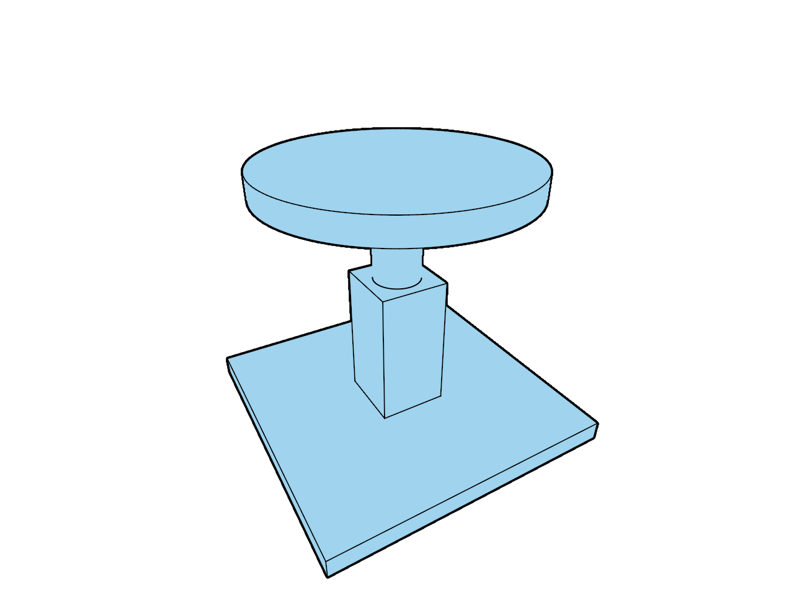

# 22.5.11 · Retarget cached text colour

**Chapter 22 · Surface lighting, contact and display quality · Section 22.5 · Coherent multisampling and frame-resource ownership** · [Contents](contents.md)

**Typing: 15–29 minutes.** [Estimate](typing-load.md).

Retarget world text, nameplates and screen glyph colour to the frame sample count. Keep original text, shaping, fonts, atlas contents and world-plane raster images retained, and keep original-owner queries independently single-sample.

## Type

Continue from [Cache cloud and sheet sample recipes](96zzzzzzzca-cache-cloud-and-sheet-samples.md). [Save or recover your work](recovery.md).

### 1. `src/text_plate.rs`

Retain original drawing, raster/font resources and independent owner queries while caching matching colour recipes.

Edit these blocks from bottom to top. Keep the surrounding lines unchanged.

<details>
<summary>Locate this block</summary>

```rust
            return 0;
        }

        pass.set_pipeline(&self.pipeline);
        pass.set_vertex_buffer(0, self.vertices.buf.slice(..));
        pass.draw(range, 0..1);
        1
```

</details>

Replace it with:

```rust
            return 0;
        }

        pass.set_pipeline(&self.pipeline.active);
        pass.set_vertex_buffer(0, self.vertices.buf.slice(..));
        pass.draw(range, 0..1);
        1
```

<details>
<summary>Locate this block</summary>

```rust
    pub(super) fn new(ctx: &GpuCtx, target: Target) -> Self {
        Self {
            vertices: GrowBuf::new(ctx, "text.plates", 40, VERTS),
            pipeline: pipeline(ctx, target, false),
            id_pipeline: pipeline(ctx, Target::ID, true),
            physical_vertices: 0,
        }
    }

    pub(super) fn retarget(&mut self, ctx: &GpuCtx, target: Target) {
        self.pipeline = pipeline(ctx, target, false);
    }

    pub(super) fn draw(&self, pass: &mut wgpu::RenderPass<'_>, overlay: bool) -> u32 {
```

</details>

Replace it with:

```rust
    pub(super) fn new(ctx: &GpuCtx, target: Target) -> Self {
        Self {
            vertices: GrowBuf::new(ctx, "text.plates", 40, VERTS),
            pipeline:Variants::new(pipeline(ctx,target,false),target.samples),format:target.format,
            id_pipeline: pipeline(ctx, Target::ID, true),
            physical_vertices: 0,
        }
    }

    pub(super) fn retarget(&mut self, ctx: &GpuCtx, target: Target) {
        if target.format!=self.format {self.pipeline=Variants::new(pipeline(ctx,target,false),target.samples);self.format=target.format;}
        else {self.pipeline.select(target.samples,||pipeline(ctx,target,false));}
    }

    pub(super) fn draw(&self, pass: &mut wgpu::RenderPass<'_>, overlay: bool) -> u32 {
```

<details>
<summary>Locate this block</summary>

```rust
    {
        let shader = device.create_shader_module(wgpu::ShaderModuleDescriptor {
            label: Some("text plate shader"),
            source: wgpu::ShaderSource::Wgsl(include_str!("text_plate.wgsl").into()),
        });
        let id_layout = device.create_pipeline_layout(&wgpu::PipelineLayoutDescriptor {
            label: Some("text plate ids"),
```

</details>

Replace it with:

```rust
    {
        let shader = device.create_shader_module(wgpu::ShaderModuleDescriptor {
            label: Some("text plate shader"),
            source: wgpu::ShaderSource::Wgsl(if target.samples==4 {include_str!("text_plate.wgsl").replace("@location(0) local:","@location(0) @interpolate(linear,sample) local:").into()}else{include_str!("text_plate.wgsl").into()}),
        });
        let id_layout = device.create_pipeline_layout(&wgpu::PipelineLayoutDescriptor {
            label: Some("text plate ids"),
```

<details>
<summary>Locate this block</summary>

```rust
}
pub(super) struct Plates {
    vertices: GrowBuf,
    pipeline: Pipeline,
    id_pipeline: Pipeline,
    physical_vertices: u32,
}
```

</details>

Replace it with:

```rust
}
pub(super) struct Plates {
    vertices: GrowBuf,
    pipeline:Variants<Pipeline>,
    format:wgpu::TextureFormat,
    id_pipeline: Pipeline,
    physical_vertices: u32,
}
```

<details>
<summary>Locate this block</summary>

```rust
use crate::text_gpu_support::{GpuCtx,GrowBuf,VERTS};
use crate::text_gpu_support::{Pipeline,Target};
```

</details>

Replace it with:

```rust
use crate::sample_pipelines::Variants;
use crate::text_gpu_support::{GpuCtx,GrowBuf,VERTS};
use crate::text_gpu_support::{Pipeline,Target};
```

<details>
<summary>Complete updated block reference</summary>

```rust
use crate::sample_pipelines::Variants;
use crate::text_gpu_support::{GpuCtx,GrowBuf,VERTS};
use crate::text_gpu_support::{Pipeline,Target};

pub(super) struct Rectangle {
    pub(super) bounds: [f32; 4],
    pub(super) clip: [f32; 4],
    pub(super) rounded: bool,
    pub(super) depth: Option<f32>,
    pub(super) object: Option<crate::text::TextObject>,
}
pub(super) struct Plates {
    vertices: GrowBuf,
    pipeline:Variants<Pipeline>,
    format:wgpu::TextureFormat,
    id_pipeline: Pipeline,
    physical_vertices: u32,
}


fn pipeline(ctx: &GpuCtx, target: Target, ids: bool) -> Pipeline {
    let device = ctx.device.clone();
    let pick = crate::gpu_layout::uniform(&ctx.device,80);
    {
        let shader = device.create_shader_module(wgpu::ShaderModuleDescriptor {
            label: Some("text plate shader"),
            source: wgpu::ShaderSource::Wgsl(if target.samples==4 {include_str!("text_plate.wgsl").replace("@location(0) local:","@location(0) @interpolate(linear,sample) local:").into()}else{include_str!("text_plate.wgsl").into()}),
        });
        let id_layout = device.create_pipeline_layout(&wgpu::PipelineLayoutDescriptor {
            label: Some("text plate ids"),
            bind_group_layouts: &[Some(&pick)],
            immediate_size: 0,
        });
        device.create_render_pipeline(&wgpu::RenderPipelineDescriptor {
            label: Some("text plates"),
            layout: if ids { Some(&id_layout) } else { None },
            vertex: wgpu::VertexState {
                module: &shader,
                entry_point: Some(if ids { "vs_id" } else { "vs_main" }),
                buffers: &[wgpu::VertexBufferLayout {
                    array_stride: 40,
                    step_mode: wgpu::VertexStepMode::Vertex,
                    attributes: &wgpu::vertex_attr_array![0 => Float32x3, 1 => Float32x2, 2 => Float32x2, 3 => Float32, 4 => Uint32, 5 => Float32],
                }],
                compilation_options: Default::default(),
            },
            fragment: Some(wgpu::FragmentState {
                module: &shader,
                entry_point: Some(if ids { "fs_id" } else { "fs_main" }),
                targets: &[Some(wgpu::ColorTargetState {
                    format: target.format,
                    blend: if ids { None } else { Some(wgpu::BlendState::ALPHA_BLENDING) },
                    write_mask: wgpu::ColorWrites::ALL,
                })],
                compilation_options: Default::default(),
            }),
            primitive: Default::default(),
            depth_stencil: Some(wgpu::DepthStencilState {
                format: wgpu::TextureFormat::Depth32Float,
                depth_write_enabled: Some(false),
                depth_compare: Some(crate::depth::CLOSER_EQUAL),
                stencil: Default::default(),
                bias: Default::default(),
            }),
            multisample: wgpu::MultisampleState {
                count: target.samples,
                ..Default::default()
            },
            multiview_mask: None,
            cache: None,
        })
    }
}

impl Plates {
    pub(super) fn new(ctx: &GpuCtx, target: Target) -> Self {
        Self {
            vertices: GrowBuf::new(ctx, "text.plates", 40, VERTS),
            pipeline:Variants::new(pipeline(ctx,target,false),target.samples),format:target.format,
            id_pipeline: pipeline(ctx, Target::ID, true),
            physical_vertices: 0,
        }
    }

    pub(super) fn retarget(&mut self, ctx: &GpuCtx, target: Target) {
        if target.format!=self.format {self.pipeline=Variants::new(pipeline(ctx,target,false),target.samples);self.format=target.format;}
        else {self.pipeline.select(target.samples,||pipeline(ctx,target,false));}
    }

    pub(super) fn draw(&self, pass: &mut wgpu::RenderPass<'_>, overlay: bool) -> u32 {
        let range = if overlay {
            self.physical_vertices..self.vertices.len()
        } else {
            0..self.physical_vertices
        };

        if range.is_empty() {
            return 0;
        }

        pass.set_pipeline(&self.pipeline.active);
        pass.set_vertex_buffer(0, self.vertices.buf.slice(..));
        pass.draw(range, 0..1);
        1
    }

    pub(super) fn draw_ids(
        &self,
        pass: &mut wgpu::RenderPass<'_>,
        pick_transform: &wgpu::BindGroup,
    ) -> u32 {
        if self.vertices.is_empty() {
            return 0;
        }

        pass.set_pipeline(&self.id_pipeline);
        pass.set_bind_group(0, pick_transform, &[]);
        pass.set_vertex_buffer(0, self.vertices.buf.slice(..));
        pass.draw(0..self.vertices.len(), 0..1);
        1
    }

    pub(super) fn reset(&mut self) {
        self.vertices.reset();
        self.physical_vertices = 0;
    }

    pub(super) fn release(&mut self, ctx: &GpuCtx) {
        self.vertices.release(ctx);
    }

    pub(super) fn allocated_bytes(&self) -> u64 {
        self.vertices.buf.size()
    }
}

impl Plates {

    pub(super) fn prepare(&mut self, ctx: &GpuCtx, rectangles: &[Rectangle], size: [u32; 2]) {
        self.vertices.reset();
        let mut vertices = Vec::with_capacity(rectangles.len() * 6);
        self.physical_vertices = 0;

        for overlay in [false, true] {
            for rectangle in rectangles {
                if rectangle.depth.is_none() != overlay {
                    continue;
                }

                let [left, top, right, bottom] = rectangle.bounds;
                let half = [(right - left) * 0.5, (bottom - top) * 0.5];
                let center = [(left + right) * 0.5, (top + bottom) * 0.5];
                let radius = if rectangle.rounded {
                    half[0].min(half[1]).max(0.0)
                } else {
                    0.0
                };
                let left = left.max(rectangle.clip[0]);
                let top = top.max(rectangle.clip[1]);
                let right = right.min(rectangle.clip[2]);
                let bottom = bottom.min(rectangle.clip[3]);

                if right <= left || bottom <= top {
                    continue;
                }

                for [x, y] in [
                    [left, top],
                    [left, bottom],
                    [right, bottom],
                    [left, top],
                    [right, bottom],
                    [right, top],
                ] {
                    vertices.push([
                        2.0 * x / size[0] as f32 - 1.0,
                        1.0 - 2.0 * y / size[1] as f32,
                        rectangle.depth.unwrap_or(crate::depth::NEAR as f32),
                        x - center[0],
                        y - center[1],
                        half[0],
                        half[1],
                        radius,
                        f32::from_bits(rectangle.object.map_or(0, |object| object.row.wrapping_add(1))),
                        if rectangle.object.is_some_and(|object| object.selected) {
                            1.0
                        } else {
                            0.0
                        },
                    ]);
                }
            }

            if !overlay {
                self.physical_vertices = vertices.len() as u32;
            }
        }

        self.vertices.append(ctx, &vertices);
    }
}
```

</details>

<details>
<summary>Optional patch references</summary>

Use these original edit fragments when comparing a saved checkpoint. Apply the complete blocks above.

```text
--8<-- "journey/code/96zzzzzzzd-retarget-cached-text-01.rs"
```

```text
--8<-- "journey/code/96zzzzzzzd-retarget-cached-text-02.rs"
```

```text
--8<-- "journey/code/96zzzzzzzd-retarget-cached-text-03.rs"
```

```text
--8<-- "journey/code/96zzzzzzzd-retarget-cached-text-04.rs"
```

```text
--8<-- "journey/code/96zzzzzzzd-retarget-cached-text-05.rs"
```

```text
--8<-- "journey/code/96zzzzzzzd-retarget-cached-text-06.rs"
```

```text
--8<-- "journey/code/96zzzzzzzd-retarget-cached-text-07.rs"
```

```text
--8<-- "journey/code/96zzzzzzzd-retarget-cached-text-08.rs"
```

```text
--8<-- "journey/code/96zzzzzzzd-retarget-cached-text-09.rs"
```

```text
--8<-- "journey/code/96zzzzzzzd-retarget-cached-text-10.rs"
```

```text
--8<-- "journey/code/96zzzzzzzd-retarget-cached-text-11.rs"
```

```text
--8<-- "journey/code/96zzzzzzzd-retarget-cached-text-12.rs"
```

```text
--8<-- "journey/code/96zzzzzzzd-retarget-cached-text-13.rs"
```

```text
--8<-- "journey/code/96zzzzzzzd-retarget-cached-text-14.rs"
```

```text
--8<-- "journey/code/96zzzzzzzd-retarget-cached-text-15.rs"
```

```text
--8<-- "journey/code/96zzzzzzzd-retarget-cached-text-16.rs"
```

```text
--8<-- "journey/code/96zzzzzzzd-retarget-cached-text-17.rs"
```

</details>

### 2. `src/text_plane.rs`

Retain original drawing, raster/font resources and independent owner queries while caching matching colour recipes.

Edit these blocks from bottom to top. Keep the surrounding lines unchanged.

<details>
<summary>Locate this block</summary>

```rust
            return 0;
        }

        self.draw_run(pass, &self.pipeline)
    }

    pub(super) fn draw_ids(
```

</details>

Replace it with:

```rust
            return 0;
        }

        self.draw_run(pass, &self.pipeline.active)
    }

    pub(super) fn draw_ids(
```

<details>
<summary>Locate this block</summary>

```rust
    }

    pub(super) fn retarget(&mut self, ctx: &GpuCtx, target: Target) {
        self.target = target;
        self.pipeline = pipeline(ctx, target, &self.layout, false);
    }

    pub(super) fn reset(&mut self) {
```

</details>

Replace it with:

```rust
    }

    pub(super) fn retarget(&mut self, ctx: &GpuCtx, target: Target) {
        if target.format!=self.target.format {self.pipeline=crate::sample_pipelines::Variants::new(pipeline(ctx,target,&self.layout,false),target.samples);}
        else {self.pipeline.select(target.samples,||pipeline(ctx,target,&self.layout,false));}
        self.target=target;
    }

    pub(super) fn reset(&mut self) {
```

<details>
<summary>Locate this block</summary>

```rust
            vertices: GrowBuf::new(ctx, "world text vertices", 64, VERTS),
            layout,
            sampler,
            pipeline,
            id_pipeline,
            target,
            rasterizations: 0,
```

</details>

Replace it with:

```rust
            vertices: GrowBuf::new(ctx, "world text vertices", 64, VERTS),
            layout,
            sampler,
            pipeline:crate::sample_pipelines::Variants::new(pipeline,target.samples),
            id_pipeline,
            target,
            rasterizations: 0,
```

<details>
<summary>Locate this block</summary>

```rust
    vertices: GrowBuf,
    layout: wgpu::BindGroupLayout,
    sampler: wgpu::Sampler,
    pipeline: Pipeline,
    id_pipeline: Pipeline,
    target: Target,
    pub(super) rasterizations: u64,
```

</details>

Replace it with:

```rust
    vertices: GrowBuf,
    layout: wgpu::BindGroupLayout,
    sampler: wgpu::Sampler,
    pipeline:crate::sample_pipelines::Variants<Pipeline>,
    id_pipeline: Pipeline,
    target: Target,
    pub(super) rasterizations: u64,
```

<details>
<summary>Complete updated block reference</summary>

```rust
use super::TextFrame;
use crate::text::{TextDocument, TextLabel, TextPlacement, TextRun};
use crate::text_gpu_support::resource_group;
use crate::text_gpu_support::texture_entry;
use crate::text_gpu_support::{GpuCtx, GrowBuf, VERTS};
use crate::text_gpu_support::{Pipeline, Target};
use glyphon::{FontSystem, SwashCache, SwashContent};
use wgpu::{ShaderStages, TextureSampleType};

const TEXTURE_BUDGET: u64 = 32 * 1024 * 1024;
struct CachedPlane {
    label: TextLabel,
    font_revision: u64,
    em_pixels: u32,
    size: [u32; 2],
    extent: [f32; 4],
    texture: wgpu::Texture,
    bind: wgpu::BindGroup,
}
impl Drop for CachedPlane {
    fn drop(&mut self) {
        self.texture.destroy();
    }
}
pub(super) struct Planes {
    cached: Vec<CachedPlane>,
    draws: Vec<(usize, u32)>,
    vertices: GrowBuf,
    layout: wgpu::BindGroupLayout,
    sampler: wgpu::Sampler,
    pipeline:crate::sample_pipelines::Variants<Pipeline>,
    id_pipeline: Pipeline,
    target: Target,
    pub(super) rasterizations: u64,
}

fn same_raster(cached: &CachedPlane, label: &TextLabel, revision: u64, em_pixels: u32) -> bool {
    cached.font_revision == revision
        && cached.label.text == label.text
        && cached.label.font_size == label.font_size
        && cached.label.line_height == label.line_height
        && cached.em_pixels >= em_pixels
}

fn project(world: [f64; 3], frame: &TextFrame) -> [f32; 4] {
    let point = [
        (world[0] - frame.origin[0]) as f32,
        (world[1] - frame.origin[1]) as f32,
        (world[2] - frame.origin[2]) as f32,
        1.0,
    ];
    let mut clip = [0.0; 4];

    for (row, out) in clip.iter_mut().enumerate() {
        for (column, value) in point.iter().enumerate() {
            *out += frame.mvp[column * 4 + row] * value;
        }
    }

    clip
}


fn raster_em(label: &TextLabel, frame: &TextFrame) -> u32 {
    let TextPlacement::WorldPlane {
        world,
        right,
        up,
        world_height,
        ..
    } = label.placement
    else {
        return 32;
    };
    let a = project(world, frame);

    if a[3] <= 0.0 {
        return 32;
    }

    let mut projected_em = 0.0f32;

    for direction in [right, up] {
        let mut end = world;

        for axis in 0..3 {
            end[axis] += direction[axis] * world_height;
        }

        let b = project(end, frame);

        if b[3] <= 0.0 {
            continue;
        }

        let x = (a[0] / a[3] - b[0] / b[3]) * frame.framebuffer[0] as f32 * 0.5;
        let y = (a[1] / a[3] - b[1] / b[3]) * frame.framebuffer[1] as f32 * 0.5;
        projected_em = projected_em.max(x.hypot(y));
    }

    let needed = (projected_em * 2.0).clamp(32.0, 256.0);
    let mut bucket = 32;

    while (bucket as f32) < needed {
        bucket *= 2;
    }

    bucket
}

fn fitting_em(run: &TextRun) -> u32 {
    let mut size = 0.0f32;

    for line in run.buffer.layout_runs() {
        size = size.max(line.line_w).max(line.line_top + line.line_height);
    }

    let ems = size / run.label.font_size + 3.0;
    let mut em = 256;

    while em > 32 && ems * em as f32 > 4000.0 {
        em /= 2;
    }

    em
}

fn coverage(content: &SwashContent, data: &[u8], source: usize) -> u8 {
    match content {
        SwashContent::Mask => data[source],
        SwashContent::Color => data[source * 4 + 3],
        SwashContent::SubpixelMask => {
            ((u16::from(data[source * 4])
                + u16::from(data[source * 4 + 1])
                + u16::from(data[source * 4 + 2]))
                / 3) as u8
        }
    }
}


fn rasterize(
    run: &TextRun,
    fonts: &mut FontSystem,
    raster: &mut SwashCache,
    em_pixels: u32,
) -> anyhow::Result<(Vec<u8>, [u32; 2], [f32; 4])> {
    let scale = em_pixels as f32 / run.label.font_size;
    let mut glyphs = Vec::new();
    let mut bounds = [0i32; 4];

    for line in run.buffer.layout_runs() {
        bounds[2] = bounds[2].max((line.line_w * scale).ceil() as i32);
        bounds[3] = bounds[3].max(((line.line_top + line.line_height) * scale).ceil() as i32);
        anyhow::ensure!(
            bounds[2] <= 4092 && bounds[3] <= 4092,
            "world text layout exceeds 4096px extent"
        );

        for glyph in line.glyphs {
            let physical = glyph.physical((0.0, 0.0), scale);
            let Some(image) = raster.get_image(fonts, physical.cache_key) else {
                continue;
            };
            let x = physical.x + image.placement.left;
            let y = (line.line_y * scale).round() as i32 + physical.y - image.placement.top;
            bounds[0] = bounds[0].min(x);
            bounds[1] = bounds[1].min(y);
            bounds[2] = bounds[2].max(x + image.placement.width as i32);
            bounds[3] = bounds[3].max(y + image.placement.height as i32);
            glyphs.push((physical.cache_key, x, y));
        }
    }

    let vertical_padding = (run.label.font_size * (2.0 / 9.0) * scale).ceil() as i32;
    let horizontal_padding = (bounds[3] - bounds[1] + 2 * vertical_padding + 1) / 2;
    bounds[0] -= horizontal_padding;
    bounds[1] -= vertical_padding;
    bounds[2] += horizontal_padding;
    bounds[3] += vertical_padding;
    let size = [
        (bounds[2] - bounds[0]) as u32,
        (bounds[3] - bounds[1]) as u32,
    ];
    anyhow::ensure!(
        size[0] <= 4096 && size[1] <= 4096,
        "world text texture exceeds 4096px extent"
    );
    let mut pixels = vec![0u8; (size[0] * size[1]) as usize];

    for (key, x, y) in glyphs {
        let Some(image) = raster.get_image(fonts, key) else {
            continue;
        };

        for row in 0..image.placement.height {
            for column in 0..image.placement.width {
                let source = (row * image.placement.width + column) as usize;
                let coverage = coverage(&image.content, &image.data, source);
                let target = ((y - bounds[1] + row as i32) as u32 * size[0]
                    + (x - bounds[0] + column as i32) as u32) as usize;
                let previous = u16::from(pixels[target]);
                pixels[target] = (previous + u16::from(coverage) * (255 - previous) / 255) as u8;
            }
        }
    }

    Ok((
        pixels,
        size,
        [
            bounds[0] as f32 / scale,
            bounds[1] as f32 / scale,
            bounds[2] as f32 / scale,
            bounds[3] as f32 / scale,
        ],
    ))
}


fn upload_plane(
    ctx: &GpuCtx,
    layout: &wgpu::BindGroupLayout,
    sampler: &wgpu::Sampler,
    label: &TextLabel,
    font_revision: u64,
    em_pixels: u32,
    data: (Vec<u8>, [u32; 2], [f32; 4]),
) -> CachedPlane {
    let (pixels, size, extent) = data;
    let texture = ctx.device.create_texture(&wgpu::TextureDescriptor {
        label: Some("world text coverage"),
        size: wgpu::Extent3d {
            width: size[0],
            height: size[1],
            depth_or_array_layers: 1,
        },
        mip_level_count: 1,
        sample_count: 1,
        dimension: wgpu::TextureDimension::D2,
        format: wgpu::TextureFormat::R8Unorm,
        usage: wgpu::TextureUsages::TEXTURE_BINDING | wgpu::TextureUsages::COPY_DST,
        view_formats: &[],
    });
    ctx.queue.write_texture(
        texture.as_image_copy(),
        &pixels,
        wgpu::TexelCopyBufferLayout {
            offset: 0,
            bytes_per_row: Some(size[0]),
            rows_per_image: Some(size[1]),
        },
        texture.size(),
    );
    let view = texture.create_view(&Default::default());
    let bind = resource_group(
        ctx,
        &layout,
        "world text coverage",
        [
            (0, wgpu::BindingResource::TextureView(&view)),
            (1, wgpu::BindingResource::Sampler(&sampler)),
        ],
    );
    CachedPlane {
        label: label.clone(),
        font_revision: font_revision,
        em_pixels,
        size,
        extent,
        texture,
        bind,
    }
}


fn append_quad(
    vertices: &mut Vec<[f32; 16]>,
    label: &TextLabel,
    extent: [f32; 4],
    frame: &TextFrame,
    srgb: bool,
) {
    let TextPlacement::WorldPlane {
        world,
        right,
        up,
        world_height,
    } = label.placement
    else {
        return;
    };
    let unit = world_height / f64::from(label.font_size);
    let mut color = [0.0; 4];

    for (index, component) in color.iter_mut().enumerate() {
        let value = f32::from(label.ink_color()[index]) / 255.0;
        *component = if srgb && index < 3 {
            if value <= 0.04045 {
                value / 12.92
            } else {
                ((value + 0.055) / 1.055).powf(2.4)
            }
        } else {
            value
        };
    }

    let scale = frame.framebuffer[0] as f32 / frame.logical[0] as f32;
    let mut bounds = [
        0.0,
        0.0,
        frame.framebuffer[0] as f32,
        frame.framebuffer[1] as f32,
    ];

    if let Some(clip) = label.clip {
        for (index, value) in bounds.iter_mut().enumerate() {
            *value = clip[index] * scale;
        }
    }

    bounds = [
        2.0 * bounds[0] / frame.framebuffer[0] as f32 - 1.0,
        1.0 - 2.0 * bounds[3] / frame.framebuffer[1] as f32,
        2.0 * bounds[2] / frame.framebuffer[0] as f32 - 1.0,
        1.0 - 2.0 * bounds[1] / frame.framebuffer[1] as f32,
    ];
    for [u, v] in [
        [0.0, 0.0],
        [0.0, 1.0],
        [1.0, 1.0],
        [0.0, 0.0],
        [1.0, 1.0],
        [1.0, 0.0],
    ] {
        let x = f64::from(extent[0] + (extent[2] - extent[0]) * u) * unit;
        let y = f64::from(extent[1] + (extent[3] - extent[1]) * v) * unit;
        let mut point = world;

        for axis in 0..3 {
            point[axis] += right[axis] * x - up[axis] * y;
        }

        let clip = project(point, frame);
        vertices.push([
            clip[0],
            clip[1],
            clip[2],
            clip[3],
            u,
            v,
            color[0],
            color[1],
            color[2],
            color[3],
            bounds[0],
            bounds[1],
            bounds[2],
            bounds[3],
            f32::from_bits(label.object.map_or(0, |object| object.row.wrapping_add(1))),
            if label.object.is_some_and(|object| object.selected) {
                1.0
            } else {
                0.0
            },
        ]);
    }
}


fn pipeline(ctx: &GpuCtx, target: Target, layout: &wgpu::BindGroupLayout, ids: bool) -> Pipeline {
    let device = ctx.device.clone();
    let layout = layout.clone();
    let pick = crate::gpu_layout::uniform(&ctx.device, 80);
    {
        let shader = device.create_shader_module(wgpu::ShaderModuleDescriptor {
            label: Some("world text shader"),
            source: wgpu::ShaderSource::Wgsl(include_str!("text_plane.wgsl").into()),
        });
        let colour_groups = [Some(&layout)];
        let id_groups = [Some(&layout), Some(&pick)];
        let pipeline_layout = device.create_pipeline_layout(&wgpu::PipelineLayoutDescriptor {
            label: Some("world text"),
            bind_group_layouts: if ids { &id_groups } else { &colour_groups },
            immediate_size: 0,
        });
        device.create_render_pipeline(&wgpu::RenderPipelineDescriptor {
            label: Some("world text"), layout: Some(&pipeline_layout),
            vertex: wgpu::VertexState { module: &shader, entry_point: Some(if ids { "vs_id" } else { "vs_main" }), buffers: &[wgpu::VertexBufferLayout { array_stride: 64, step_mode: wgpu::VertexStepMode::Vertex,
                attributes: &wgpu::vertex_attr_array![0 => Float32x4, 1 => Float32x2, 2 => Float32x4, 3 => Float32x4, 4 => Uint32, 5 => Float32] }], compilation_options: Default::default() },
            fragment: Some(wgpu::FragmentState { module: &shader, entry_point: Some(if ids { "fs_id" } else { "fs_main" }), targets: &[Some(wgpu::ColorTargetState { format: target.format, blend: if ids { None } else { Some(wgpu::BlendState::ALPHA_BLENDING) }, write_mask: wgpu::ColorWrites::ALL })], compilation_options: Default::default() }),
            primitive: Default::default(), depth_stencil: Some(wgpu::DepthStencilState { format: wgpu::TextureFormat::Depth32Float, depth_write_enabled: Some(false), depth_compare: Some(crate::depth::CLOSER_EQUAL), stencil: Default::default(), bias: Default::default() }),
            multisample: wgpu::MultisampleState { count: target.samples, ..Default::default() }, multiview_mask: None, cache: None,
        })
    }
}

impl Planes {

    pub(super) fn new(ctx: &GpuCtx, target: Target) -> Self {
        let layout = ctx
            .device
            .create_bind_group_layout(&wgpu::BindGroupLayoutDescriptor {
                label: Some("world text texture"),
                entries: &[
                    texture_entry(
                        0,
                        ShaderStages::FRAGMENT,
                        TextureSampleType::Float { filterable: true },
                        false,
                    ),
                    wgpu::BindGroupLayoutEntry {
                        binding: 1,
                        visibility: ShaderStages::FRAGMENT,
                        ty: wgpu::BindingType::Sampler(wgpu::SamplerBindingType::Filtering),
                        count: None,
                    },
                ],
            });
        let sampler = ctx.device.create_sampler(&wgpu::SamplerDescriptor {
            label: Some("world text coverage"),
            mag_filter: wgpu::FilterMode::Linear,
            min_filter: wgpu::FilterMode::Linear,
            ..Default::default()
        });
        let id_pipeline = pipeline(ctx, Target::ID, &layout, true);
        let pipeline = pipeline(ctx, target, &layout, false);
        Self {
            cached: Vec::new(),
            draws: Vec::new(),
            vertices: GrowBuf::new(ctx, "world text vertices", 64, VERTS),
            layout,
            sampler,
            pipeline:crate::sample_pipelines::Variants::new(pipeline,target.samples),
            id_pipeline,
            target,
            rasterizations: 0,
        }
    }

    pub(super) fn retarget(&mut self, ctx: &GpuCtx, target: Target) {
        if target.format!=self.target.format {self.pipeline=crate::sample_pipelines::Variants::new(pipeline(ctx,target,&self.layout,false),target.samples);}
        else {self.pipeline.select(target.samples,||pipeline(ctx,target,&self.layout,false));}
        self.target=target;
    }

    pub(super) fn reset(&mut self) {
        self.cached.clear();
        self.draws.clear();
        self.vertices.reset();
    }

    pub(super) fn release(&mut self, ctx: &GpuCtx) {
        self.reset();
        self.vertices.release(ctx);
    }

    pub(super) fn buffer_bytes(&self) -> u64 {
        self.vertices.buf.size()
    }

    pub(super) fn texture_bytes(&self) -> u64 {
        let mut total = 0;

        for cached in &self.cached {
            total += u64::from(cached.size[0]) * u64::from(cached.size[1]);
        }

        total
    }
}

impl Planes {
    fn cached_plane(
        &mut self,
        ctx: &GpuCtx,
        run: &TextRun,
        fonts: &mut FontSystem,
        raster: &mut SwashCache,
        font_revision: u64,
        em_pixels: u32,
    ) -> anyhow::Result<usize> {
        let mut index = None;

        for (at, cached) in self.cached.iter().enumerate() {
            if cached.label.id == run.label.id {
                index = Some(at);
                break;
            }
        }

        let rebuild = match index {
            Some(at) => !same_raster(&self.cached[at], &run.label, font_revision, em_pixels),
            None => true,
        };

        if rebuild {
            let (pixels, size, extent) = rasterize(run, fonts, raster, em_pixels)?;
            let mut allocated = u64::from(size[0]) * u64::from(size[1]);

            for (at, cached) in self.cached.iter().enumerate() {
                if Some(at) != index {
                    allocated += u64::from(cached.size[0]) * u64::from(cached.size[1]);
                }
            }

            anyhow::ensure!(
                allocated <= TEXTURE_BUDGET,
                "world text coverage exceeds 32 MiB budget"
            );
            let cached = upload_plane(
                ctx,
                &self.layout,
                &self.sampler,
                &run.label,
                font_revision,
                em_pixels,
                (pixels, size, extent),
            );

            match index {
                Some(at) => self.cached[at] = cached,
                None => {
                    index = Some(self.cached.len());
                    self.cached.push(cached);
                }
            }

            self.rasterizations += 1;

            if raster.image_cache.len() > 4096 {
                *raster = SwashCache::new();
            }
        }

        Ok(index.expect("a prepared world plane has a cache entry"))
    }
}

impl Planes {

    pub(super) fn prepare(
        &mut self,
        ctx: &GpuCtx,
        document: &mut TextDocument,
        raster: &mut SwashCache,
        frame: &TextFrame,
    ) -> anyhow::Result<()> {
        self.draws.clear();
        self.vertices.reset();
        self.cached.retain(|cached| {
            document.runs.iter().any(|run| {
                run.label.id == cached.label.id
                    && matches!(run.label.placement, TextPlacement::WorldPlane { .. })
            })
        });
        let mut vertices = Vec::new();

        for run in &document.runs {
            if !matches!(run.label.placement, TextPlacement::WorldPlane { .. })
                || run.label.text.is_empty()
            {
                continue;
            }

            if let TextPlacement::WorldPlane { world, .. } = run.label.placement
                && frame.cut(world)
            {
                continue;
            }
            let em_pixels = raster_em(&run.label, frame).min(fitting_em(run));
            let index = self.cached_plane(
                ctx,
                run,
                &mut document.fonts,
                raster,
                document.font_revision,
                em_pixels,
            )?;

            let start = vertices.len() as u32;
            append_quad(
                &mut vertices,
                &run.label,
                self.cached[index].extent,
                frame,
                self.target.format.is_srgb(),
            );
            self.draws.push((index, start));
        }

        self.vertices.append(ctx, &vertices);
        Ok(())
    }

    fn draw_run(&self, pass: &mut wgpu::RenderPass<'_>, pipeline: &Pipeline) -> u32 {
        if self.draws.is_empty() {
            return 0;
        }

        pass.set_pipeline(pipeline);
        pass.set_vertex_buffer(0, self.vertices.buf.slice(..));

        for &(index, start) in &self.draws {
            pass.set_bind_group(0, &self.cached[index].bind, &[]);
            pass.draw(start..start + 6, 0..1);
        }

        self.draws.len() as u32
    }

    pub(super) fn draw(&self, pass: &mut wgpu::RenderPass<'_>) -> u32 {
        if self.draws.is_empty() {
            return 0;
        }

        self.draw_run(pass, &self.pipeline.active)
    }

    pub(super) fn draw_ids(
        &self,
        pass: &mut wgpu::RenderPass<'_>,
        pick_transform: &wgpu::BindGroup,
    ) -> u32 {
        pass.set_bind_group(1, pick_transform, &[]);
        self.draw_run(pass, &self.id_pipeline)
    }
}
```

</details>

<details>
<summary>Optional patch references</summary>

Use these original edit fragments when comparing a saved checkpoint. Apply the complete blocks above.

```text
--8<-- "journey/code/96zzzzzzzd-retarget-cached-text-18.rs"
```

```text
--8<-- "journey/code/96zzzzzzzd-retarget-cached-text-19.rs"
```

```text
--8<-- "journey/code/96zzzzzzzd-retarget-cached-text-22.rs"
```

```text
--8<-- "journey/code/96zzzzzzzd-retarget-cached-text-23.rs"
```

```text
--8<-- "journey/code/96zzzzzzzd-retarget-cached-text-24.rs"
```

```text
--8<-- "journey/code/96zzzzzzzd-retarget-cached-text-25.rs"
```

```text
--8<-- "journey/code/96zzzzzzzd-retarget-cached-text-26.rs"
```

```text
--8<-- "journey/code/96zzzzzzzd-retarget-cached-text-27.rs"
```

</details>

### 3. `src/scene_text_gpu.rs`

Retain original drawing, raster/font resources and independent owner queries while caching matching colour recipes.

Edit these blocks from bottom to top. Keep the surrounding lines unchanged.

<details>
<summary>Locate this block</summary>

```rust
    }

    pub fn retarget(&mut self, ctx: &GpuCtx, target: Target) {
        self.target = target;
        self.plates.retarget(ctx, target);
        self.planes.retarget(ctx, target);
        self.overlay = renderer(ctx, &mut self.atlas, target, wgpu::CompareFunction::Always);
        self.anchored = renderer(
            ctx,
```

</details>

Replace it with:

```rust
    }

    pub fn retarget(&mut self, ctx: &GpuCtx, target: Target) {
        if self.target.format==target.format&&self.target.samples==target.samples {return;}
        let format_changed=self.target.format!=target.format;
        self.target = target;
        self.plates.retarget(ctx, target);
        self.planes.retarget(ctx, target);
        if format_changed {self.rebuild_resources(ctx);return;}
        self.overlay = renderer(ctx, &mut self.atlas, target, wgpu::CompareFunction::Always);
        self.anchored = renderer(
            ctx,
```

<details>
<summary>Complete updated block reference</summary>

```rust
use crate::text_gpu_support::GpuCtx;
use crate::text::{TextDocument, TextLabel, TextPlacement, TextRun};
use crate::text_gpu_support::Target;
use glyphon::{
    Cache, Color, ColorMode, Resolution, SwashCache, TextArea, TextAtlas, TextBounds, TextRenderer,
    Viewport,
};
use serde::Serialize;
use std::collections::{HashMap, HashSet};

#[derive(Clone, Debug, PartialEq)]
pub struct TextFrame {
    pub mvp: [f32; 16],
    pub origin: [f64; 3],
    pub framebuffer: [u32; 2],
    pub logical: [f64; 2],
    pub ortho_half_height: f32,
    pub clip: [[f64; 4]; 6],
}


impl TextFrame {
    fn canvas(&self) -> TextFrame {
        TextFrame {
            mvp: [0.0; 16],
            origin: [0.0; 3],
            ortho_half_height: 0.0,
            clip: [[0.0; 4]; 6],
            ..self.clone()
        }
    }

    pub fn cut(&self, p: [f64; 3]) -> bool {
        self.clip
            .iter()
            .any(|k| k[0] * p[0] + k[1] * p[1] + k[2] * p[2] + k[3] < 0.0)
    }

    pub fn scale(&self) -> anyhow::Result<f32> {
        anyhow::ensure!(
            self.framebuffer[0] > 0 && self.framebuffer[1] > 0,
            "empty text framebuffer"
        );
        anyhow::ensure!(
            self.logical[0].is_finite()
                && self.logical[1].is_finite()
                && self.logical[0] > 0.0
                && self.logical[1] > 0.0,
            "empty text CSS box"
        );
        let x = self.framebuffer[0] as f64 / self.logical[0];
        let y = self.framebuffer[1] as f64 / self.logical[1];
        let tolerance = 1.0 / self.logical[0] + 1.0 / self.logical[1];
        anyhow::ensure!(
            (x - y).abs() <= tolerance,
            "text canvas is stretched non-uniformly"
        );
        Ok(y as f32)
    }
}

struct PlacedText {
    left: f32,
    top: f32,
    scale: f32,
    depth: Option<f32>,
}

fn place(label: &TextLabel, frame: &TextFrame, scale: f32) -> Option<PlacedText> {
    let (world, offset, world_height) = match label.placement {
        TextPlacement::WorldPlane { .. } => return None,
        TextPlacement::Screen { left, top } => {
            return Some(PlacedText {
                left: left * scale,
                top: top * scale,
                scale,
                depth: None,
            });
        }
        TextPlacement::Anchor { world, offset } => (world, offset, None),
        TextPlacement::Nameplate { world, .. } => (world, [0.0; 2], None),
        TextPlacement::WorldBillboard {
            world,
            world_height,
        } => (world, [0.0; 2], Some(world_height)),
    };

    if frame.cut(world) {
        return None;
    }

    let p = [
        (world[0] - frame.origin[0]) as f32,
        (world[1] - frame.origin[1]) as f32,
        (world[2] - frame.origin[2]) as f32,
    ];
    let m = &frame.mvp;
    let w = m[3] * p[0] + m[7] * p[1] + m[11] * p[2] + m[15];

    if !w.is_finite() || w <= 0.0 {
        return None;
    }

    let z = (m[2] * p[0] + m[6] * p[1] + m[10] * p[2] + m[14]) / w;

    if !(0.0..=1.0).contains(&z) {
        return None;
    }

    let x = (m[0] * p[0] + m[4] * p[1] + m[8] * p[2] + m[12]) / w;
    let y = (m[1] * p[0] + m[5] * p[1] + m[9] * p[2] + m[13]) / w;
    let raster_scale = match world_height {
        Some(height) => {
            let projection = (m[1] * m[1] + m[5] * m[5] + m[9] * m[9]).sqrt();
            height as f32 * projection * frame.framebuffer[1] as f32 / (2.0 * w * label.font_size)
        }
        None => scale,
    };

    if !raster_scale.is_finite() || raster_scale <= 0.0 {
        return None;
    }

    Some(PlacedText {
        left: (x + 1.0) * 0.5 * frame.framebuffer[0] as f32 + offset[0] * scale,
        top: (1.0 - y) * 0.5 * frame.framebuffer[1] as f32 + offset[1] * scale,
        scale: raster_scale,
        depth: match label.placement {
            TextPlacement::Nameplate { .. } => None,
            _ => Some(z),
        },
    })
}

fn clip_bounds(label: &TextLabel, frame: &TextFrame, scale: f32) -> TextBounds {
    match label.clip {
        Some(c) => TextBounds {
            left: (c[0] * scale).floor() as i32,
            top: (c[1] * scale).floor() as i32,
            right: (c[2] * scale).ceil() as i32,
            bottom: (c[3] * scale).ceil() as i32,
        },
        None => TextBounds {
            left: 0,
            top: 0,
            right: frame.framebuffer[0] as i32,
            bottom: frame.framebuffer[1] as i32,
        },
    }
}

#[path = "text_plate.rs"]
mod plate;

#[derive(Clone, Debug, Default, Serialize)]
pub struct TextStats {
    pub preparations: u64,
    pub skipped_preparations: u64,
    pub shape_count: u64,
    pub shaping_ms: f64,
    pub requested_glyphs: usize,
    pub distinct_raster_keys: usize,
    pub new_raster_keys: usize,
    pub raster_images: usize,
    pub new_raster_images: usize,
    pub raster_image_capacity_bytes: usize,
    pub atlas_resets: u64,
    pub preparation_ms: f64,
    pub active_instance_bytes: usize,
    pub missing_glyphs: usize,
    pub nameplate_capacity_bytes: u64,
    pub world_plane_buffer_bytes: u64,
    pub world_plane_texture_bytes: u64,
    pub world_plane_rasterizations: u64,
}

fn text_rectangle(
    run: &TextRun,
    placed: &mut PlacedText,
    frame: &TextFrame,
    scale: f32,
) -> Option<plate::Rectangle> {
    let (mut padding, rounded, centered) = match run.label.placement {
        TextPlacement::Nameplate {
            padding, rounded, ..
        } => (padding, rounded, true),
        _ if run.label.object.is_some() => ([0.0, run.label.font_size * 2.0 / 9.0], true, false),
        _ => return None,
    };

    if run.label.text.is_empty() {
        return None;
    }

    let mut width = 0.0f32;
    let mut top = f32::INFINITY;
    let mut bottom = f32::NEG_INFINITY;

    for line in run.buffer.layout_runs() {
        width = width.max(line.line_w);
        top = top.min(line.line_top);
        bottom = bottom.max(line.line_top + line.line_height);
    }

    if !top.is_finite() || !bottom.is_finite() {
        return None;
    }

    if rounded {
        padding[0] = padding[0].max((bottom - top) * 0.5 + padding[1]);
    }

    let raster = placed.scale;

    if centered {
        placed.left -= width * raster * 0.5;
        placed.top -= (top + bottom) * raster * 0.5;
    }

    let bounds = clip_bounds(&run.label, frame, scale);
    let bounds = [
        bounds.left as f32,
        bounds.top as f32,
        bounds.right as f32,
        bounds.bottom as f32,
    ];
    Some(plate::Rectangle {
        bounds: [
            placed.left - padding[0] * raster,
            placed.top + (top - padding[1]) * raster,
            placed.left + (width + padding[0]) * raster,
            placed.top + (bottom + padding[1]) * raster,
        ],
        clip: bounds,
        rounded,
        depth: placed.depth,
        object: run.label.object,
    })
}

#[path = "text_plane.rs"]
mod plane;

struct PreparedText<'a> {
    overlays: Vec<TextArea<'a>>,
    anchors: Vec<TextArea<'a>>,
    depths: HashMap<usize, f32>,
    plates: Vec<plate::Rectangle>,
    overlay: bool,
    anchored: bool,
}

fn areas<'a>(
    runs: &'a [TextRun],
    frame: &TextFrame,
    scale: f32,
    stats: &mut TextStats,
    raster_keys: &mut HashSet<glyphon::CacheKey>,
) -> PreparedText<'a> {
    let mut overlay = false;
    let mut anchored = false;
    let mut overlays = Vec::new();
    let mut anchors = Vec::new();
    let mut depths = HashMap::new();
    let mut plates = Vec::new();
    stats.new_raster_keys = 0;
    stats.requested_glyphs = 0;
    stats.missing_glyphs = 0;

    for run in runs {
        let Some(mut placed) = place(&run.label, frame, scale) else {
            continue;
        };

        if let Some(rectangle) = text_rectangle(run, &mut placed, frame, scale) {
            plates.push(rectangle);
        }

        let area = TextArea {
            buffer: &run.buffer,
            left: placed.left,
            top: placed.top,
            scale: placed.scale,
            bounds: clip_bounds(&run.label, frame, scale),
            default_color: Color::rgba(
                run.label.ink_color()[0],
                run.label.ink_color()[1],
                run.label.ink_color()[2],
                run.label.ink_color()[3],
            ),
            custom_glyphs: &[],
        };

        for line in run.buffer.layout_runs() {
            for glyph in line.glyphs {
                stats.requested_glyphs += 1;
                stats.missing_glyphs += usize::from(glyph.glyph_id == 0);
                let physical = glyph.physical((placed.left, placed.top), placed.scale);
                stats.new_raster_keys += usize::from(raster_keys.insert(physical.cache_key));
            }
        }

        if !run.label.text.is_empty() {
            match run.label.placement {
                TextPlacement::Screen { .. } | TextPlacement::Nameplate { .. } => overlay = true,
                _ => anchored = true,
            }
        }

        if let Some(depth) = placed.depth {
            depths.insert(run.label.id as usize, depth);
            anchors.push(area);
        } else {
            overlays.push(area);
        }
    }
    PreparedText {
        overlays,
        anchors,
        depths,
        plates,
        overlay,
        anchored,
    }
}

pub struct Lane {
    pub document: TextDocument,
    pub stats: TextStats,
    cache: Cache,
    atlas: TextAtlas,
    viewport: Viewport,
    raster: SwashCache,
    overlay: TextRenderer,
    anchored: TextRenderer,
    plates: plate::Plates,
    planes: plane::Planes,
    target: Target,
    atlas_font_revision: u64,
    prepared: Option<(u64, u64, TextFrame)>,
    raster_keys: HashSet<glyphon::CacheKey>,
    overlay_count: u32,
    anchored_count: u32,
}

fn renderer(
    ctx: &GpuCtx,
    atlas: &mut TextAtlas,
    target: Target,
    compare: wgpu::CompareFunction,
) -> TextRenderer {
    TextRenderer::new(
        atlas,
        &ctx.device,
        wgpu::MultisampleState {
            count: target.samples,
            ..Default::default()
        },
        Some(wgpu::DepthStencilState {
            format: wgpu::TextureFormat::Depth32Float,
            depth_write_enabled: Some(false),
            depth_compare: Some(compare),
            stencil: Default::default(),
            bias: Default::default(),
        }),
    )
}

fn make_atlas(ctx: &GpuCtx, cache: &Cache, format: wgpu::TextureFormat) -> TextAtlas {
    let mode = if format.is_srgb() {
        ColorMode::Accurate
    } else {
        ColorMode::Web
    };
    TextAtlas::with_color_mode(&ctx.device, &ctx.queue, cache, format, mode)
}

fn depth_for(depths: &HashMap<usize, f32>, id: usize) -> f32 {
    depths.get(&id).copied().unwrap_or(0.0)
}

impl Lane {

    pub fn new(ctx: &GpuCtx, target: Target) -> Self {
        let cache = Cache::new(&ctx.device);
        let viewport = Viewport::new(&ctx.device, &cache);
        let mut atlas = make_atlas(ctx, &cache, target.format);
        let overlay = renderer(ctx, &mut atlas, target, wgpu::CompareFunction::Always);
        let anchored = renderer(ctx, &mut atlas, target, crate::depth::CLOSER_EQUAL);
        Self {
            document: TextDocument::new(),
            stats: TextStats::default(),
            cache,
            atlas,
            viewport,
            raster: SwashCache::new(),
            overlay,
            anchored,
            plates: plate::Plates::new(ctx, target),
            planes: plane::Planes::new(ctx, target),
            target,
            atlas_font_revision: 1,
            prepared: None,
            raster_keys: HashSet::new(),
            overlay_count: 0,
            anchored_count: 0,
        }
    }

    fn rebuild_resources(&mut self, ctx: &GpuCtx) {
        self.atlas = make_atlas(ctx, &self.cache, self.target.format);
        self.overlay = renderer(
            ctx,
            &mut self.atlas,
            self.target,
            wgpu::CompareFunction::Always,
        );
        self.anchored = renderer(
            ctx,
            &mut self.atlas,
            self.target,
            crate::depth::CLOSER_EQUAL,
        );
        self.raster = SwashCache::new();
        self.raster_keys.clear();
        self.stats.raster_images = 0;
        self.stats.new_raster_images = 0;
        self.stats.raster_image_capacity_bytes = 0;
        self.stats.atlas_resets += 1;
        self.atlas_font_revision = self.document.font_revision;
        self.prepared = None;
    }

    pub fn allocated_bytes(&self) -> u64 {
        self.plates.allocated_bytes() + self.planes.buffer_bytes()
    }

    pub fn texture_bytes(&self) -> u64 {
        self.planes.texture_bytes()
    }

    pub fn set_labels(&mut self, labels: Vec<TextLabel>) -> anyhow::Result<()> {
        self.document.set_labels(labels)
    }
}

impl Lane {
    fn measure_preparation(&mut self, raster_images_before: usize, start: f64) {
        self.stats.raster_images = 0;
        self.stats.raster_image_capacity_bytes = 0;

        for image in self.raster.image_cache.values().flatten() {
            self.stats.raster_images += 1;
            self.stats.raster_image_capacity_bytes += image.data.capacity();
        }

        self.stats.new_raster_images = self
            .stats
            .raster_images
            .saturating_sub(raster_images_before);
        self.stats.preparations += 1;
        self.stats.shape_count = self.document.shape_count;
        self.stats.shaping_ms = self.document.shaping_ms;
        self.stats.distinct_raster_keys = self.raster_keys.len();
        self.stats.active_instance_bytes = self.stats.requested_glyphs * 28;
        self.stats.nameplate_capacity_bytes = self.plates.allocated_bytes();
        self.stats.world_plane_buffer_bytes = self.planes.buffer_bytes();
        self.stats.world_plane_texture_bytes = self.planes.texture_bytes();
        self.stats.world_plane_rasterizations = self.planes.rasterizations;
        self.stats.preparation_ms = crate::load_measure::now() - start;
    }

    pub fn retarget(&mut self, ctx: &GpuCtx, target: Target) {
        if self.target.format==target.format&&self.target.samples==target.samples {return;}
        let format_changed=self.target.format!=target.format;
        self.target = target;
        self.plates.retarget(ctx, target);
        self.planes.retarget(ctx, target);
        if format_changed {self.rebuild_resources(ctx);return;}
        self.overlay = renderer(ctx, &mut self.atlas, target, wgpu::CompareFunction::Always);
        self.anchored = renderer(
            ctx,
            &mut self.atlas,
            target,
            crate::depth::CLOSER_EQUAL,
        );
        self.prepared = None;
    }

    pub fn reset(&mut self) {
        self.document.clear();
        self.prepared = None;
        self.overlay_count = 0;
        self.anchored_count = 0;
        self.plates.reset();
        self.planes.reset();
    }

    pub fn release(&mut self, ctx: &GpuCtx) {
        self.reset();
        self.plates.release(ctx);
        self.planes.release(ctx);
        self.stats.nameplate_capacity_bytes = self.plates.allocated_bytes();
        self.stats.world_plane_buffer_bytes = self.planes.buffer_bytes();
        self.stats.world_plane_texture_bytes = 0;
        self.rebuild_resources(ctx);
    }
}

impl Lane {

    pub fn prepare(&mut self, ctx: &GpuCtx, frame: &TextFrame) -> anyhow::Result<()> {
        let fixed = self
            .document
            .runs
            .iter()
            .all(|run| matches!(run.label.placement, TextPlacement::Screen { .. }));
        let key = (
            self.document.revision,
            self.document.font_revision,
            if fixed { frame.canvas() } else { frame.clone() },
        );

        if self.prepared.as_ref() == Some(&key) {
            self.stats.skipped_preparations += 1;
            return Ok(());
        }

        self.overlay_count = 0;
        self.anchored_count = 0;
        self.plates.reset();
        let scale = frame.scale()?;
        let start = crate::load_measure::now();
        let fonts_changed = self.atlas_font_revision != self.document.font_revision;

        if fonts_changed || self.raster_keys.len() > 4096 {
            self.rebuild_resources(ctx);
        }

        let raster_images_before = self.raster.image_cache.values().flatten().count();
        self.planes
            .prepare(ctx, &mut self.document, &mut self.raster, frame)?;
        self.atlas.trim();
        self.viewport.update(
            &ctx.queue,
            Resolution {
                width: frame.framebuffer[0],
                height: frame.framebuffer[1],
            },
        );
        let prepared = areas(
            &self.document.runs,
            frame,
            scale,
            &mut self.stats,
            &mut self.raster_keys,
        );
        self.overlay_count = u32::from(prepared.overlay);
        self.anchored_count = u32::from(prepared.anchored);

        self.overlay.prepare(
            &ctx.device,
            &ctx.queue,
            &mut self.document.fonts,
            &mut self.atlas,
            &self.viewport,
            prepared.overlays,
            &mut self.raster,
        )?;
        self.anchored.prepare_with_depth(
            &ctx.device,
            &ctx.queue,
            &mut self.document.fonts,
            &mut self.atlas,
            &self.viewport,
            prepared.anchors,
            &mut self.raster,
            |id| depth_for(&prepared.depths, id),
        )?;
        self.plates
            .prepare(ctx, &prepared.plates, frame.framebuffer);
        self.measure_preparation(raster_images_before, start);
        self.prepared = Some(key);
        Ok(())
    }
}

impl Lane {

    pub fn draw_ids(
        &self,
        pass: &mut wgpu::RenderPass<'_>,
        pick_transform: &wgpu::BindGroup,
    ) -> u32 {
        self.planes.draw_ids(pass, pick_transform) + self.plates.draw_ids(pass, pick_transform)
    }

    pub fn draw(&self, pass: &mut wgpu::RenderPass<'_>) -> anyhow::Result<u32> {
        let mut draws = self.planes.draw(pass);
        draws += self.plates.draw(pass, false);

        if self.anchored_count != 0 {
            self.anchored.render(&self.atlas, &self.viewport, pass)?;
            draws += 1;
        }

        draws += self.plates.draw(pass, true);

        if self.overlay_count != 0 {
            self.overlay.render(&self.atlas, &self.viewport, pass)?;
            draws += 1;
        }

        Ok(draws)
    }
}

#[cfg(test)]
mod tests {
    use super::*;
    fn frame(scale: f64) -> TextFrame {
        TextFrame {
            mvp: [
                1.0, 0.0, 0.0, 0.0, 0.0, 1.0, 0.0, 0.0, 0.0, 0.0, 1.0, 0.0, 0.0, 0.0, 0.0, 1.0,
            ],
            origin: [0.0; 3],
            framebuffer: [(800.0 * scale) as u32, (600.0 * scale) as u32],
            logical: [800.0, 600.0],
            ortho_half_height: 1.0,
            clip: [[0.0; 4]; 6],
        }
    }

    #[test]
    fn logical_to_physical_scale_is_applied_once() {
        for scale in [1.0, 1.25, 1.5, 2.0] {
            let frame = frame(scale);
            assert_eq!(frame.scale().unwrap(), scale as f32);
            let label = TextLabel {
                object: None,
                id: 1,
                text: "A".into(),
                font_size: 16.0,
                line_height: 24.0,
                color: [255; 4],
                placement: TextPlacement::Screen {
                    left: 12.25,
                    top: 8.5,
                },
                clip: None,
            };
            let placed = place(&label, &frame, frame.scale().unwrap()).unwrap();
            assert_eq!(placed.left, 12.25 * scale as f32);
            assert_eq!(placed.scale * label.font_size, 16.0 * scale as f32);
        }
    }

    #[test]
    fn scene_anchor_preserves_rebased_depth_and_culls_near_plane() {
        let mut frame = frame(2.0);
        frame.origin = [1_000_000.0, 0.0, 0.0];
        let mut label = TextLabel {
            object: None,
            id: 1,
            text: "A".into(),
            font_size: 16.0,
            line_height: 24.0,
            color: [255; 4],
            placement: TextPlacement::Anchor {
                world: [1_000_000.0, 0.0, 0.25],
                offset: [0.0; 2],
            },
            clip: None,
        };
        let placed = place(&label, &frame, 2.0).unwrap();
        assert_eq!((placed.left, placed.top), (800.0, 600.0));
        assert_eq!(placed.depth, Some(0.25));
        label.placement = TextPlacement::Anchor {
            world: [1_000_000.0, 0.0, 1.01],
            offset: [0.0; 2],
        };
        assert!(place(&label, &frame, 2.0).is_none());
    }

    #[test]
    fn nameplate_center_padding_clip_and_scale_share_one_coordinate_system() {
        let mut document = TextDocument::new();
        let mut label = TextLabel {
            object: None,
            id: 1,
            text: "Sphere Ø25".into(),
            font_size: 18.0,
            line_height: 26.0,
            color: [255; 4],
            placement: TextPlacement::Nameplate {
                world: [0.0, 0.0, 0.25],
                padding: [6.0, 4.0],
                rounded: false,
            },
            clip: None,
        };
        document.set_labels(vec![label.clone()]).unwrap();

        for scale in [1.0, 1.25, 2.0] {
            let frame = frame(scale);
            let run = &document.runs[0];
            let mut placed = place(&run.label, &frame, scale as f32).unwrap();
            let rectangle = text_rectangle(run, &mut placed, &frame, scale as f32)
                .unwrap()
                .bounds;
            assert_eq!(
                placed.depth, None,
                "a source-center annotation overlays its own solid"
            );
            assert!(((rectangle[0] + rectangle[2]) * 0.5 - 400.0 * scale as f32).abs() < 0.001);
            assert!(((rectangle[1] + rectangle[3]) * 0.5 - 300.0 * scale as f32).abs() < 0.001);
            assert!((rectangle[3] - rectangle[1] - 34.0 * scale as f32).abs() < 0.001);
        }

        label.clip = Some([390.0, 290.0, 410.0, 310.0]);
        label.color = [255, 255, 0, 255];
        document.set_labels(vec![label.clone()]).unwrap();
        assert_eq!(
            document.shape_count, 1,
            "annotation style and clip reuse shaping"
        );
        let frame = frame(2.0);
        let run = &document.runs[0];
        let mut placed = place(&run.label, &frame, 2.0).unwrap();
        assert_eq!(
            text_rectangle(run, &mut placed, &frame, 2.0).unwrap().clip,
            [780.0, 580.0, 820.0, 620.0]
        );
        label.placement = TextPlacement::Nameplate {
            world: [0.0, 0.0, 0.25],
            padding: [f32::NAN, 4.0],
            rounded: false,
        };
        assert!(document.set_labels(vec![label]).is_err());
        assert_eq!(document.shape_count, 1);
        assert_eq!(
            document.runs.len(),
            1,
            "invalid padding preserves the previous document"
        );
    }
}
```

</details>

<details>
<summary>Optional patch references</summary>

Use these original edit fragments when comparing a saved checkpoint. Apply the complete blocks above.

```text
--8<-- "journey/code/96zzzzzzzd-retarget-cached-text-28.rs"
```

```text
--8<-- "journey/code/96zzzzzzzd-retarget-cached-text-29.rs"
```

</details>

### 4. `src/renderer.rs`

Late-created text adopts the current renderer count.

<details>
<summary>Locate the existing block</summary>

```rust
        let mut lane=self.text.borrow_mut();if lane.is_none() {let mut new=crate::scene_text_gpu::Lane::new(&self.text_context(),crate::text_gpu_support::Target {format:self.format,samples:1});if let Some(fonts)=self.full_text_fonts.borrow().as_ref() {new.document.replace_fonts(fonts.clone())?;}*lane=Some(new);}lane.as_mut().unwrap().set_labels(labels)
```

</details>

Edit the existing block to match this code; keep unchanged lines:

```rust
        let mut lane=self.text.borrow_mut();if lane.is_none() {let mut new=crate::scene_text_gpu::Lane::new(&self.text_context(),crate::text_gpu_support::Target {format:self.format,samples:self.targets.samples});if let Some(fonts)=self.full_text_fonts.borrow().as_ref() {new.document.replace_fonts(fonts.clone())?;}*lane=Some(new);}lane.as_mut().unwrap().set_labels(labels)
```

<details>
<summary>Optional patch references</summary>

Use these original edit fragments when comparing a saved checkpoint. Apply the complete blocks above.

```text
--8<-- "journey/code/96zzzzzzzd-retarget-cached-text-30.rs"
```

</details>

<details>
<summary>Supplied validation fixture</summary>

Copy this supplied authoring fixture once. Continue with the browser build below; the course does not require running native tests.

### 5. `src/sample_surface_tests.rs`

Extend the supplied actual fixture to cached text colour without introducing the complete renderer API before all remaining consumers.

<details>
<summary>Locate the existing block</summary>

```text
 r.sheets.set_samples(&r.device,count);
```

</details>

After that block, append this supplied code:

```text
--8<-- "journey/code/96zzzzzzzd-retarget-cached-text-31.rs" skip=40
```

</details>

<details>
<summary>Supplied validation fixture</summary>

Copy this supplied authoring fixture once. Continue with the browser build below; the course does not require running native tests.

### 6. `src/sample_surface_tests.rs`

Actual world/nameplate/screen text source/font/shaping/raster/atlas retention, late creation, exact count returns and fresh original-owner queries.

<details>
<summary>Locate the existing block</summary>

```text
roto(),cloud_before);assert!(Rc::ptr_eq(&scene.sheets()[0].prepared.original,&sheet));crate::sample_test_proof::write(root.join("four.rgba"),four).unwrap();
}
```

</details>

After that block, append this supplied code:

```text
--8<-- "journey/code/96zzzzzzzd-retarget-cached-text-32.rs" skip=160
```

</details>

## Run and check

Run this from `session_viewer` to select the fixed dependency versions and install supplied binary assets. It updates Cargo.lock and preserves the previous lock. It does not write implementation code:

```sh
npm --prefix ../session_tests run course -- dependencies 22.5.11
```

In your project:

```sh
cd workspace/journey
REGEN_PROTO=0 cargo build --lib --locked --target wasm32-unknown-unknown -j1
REGEN_PROTO=0 CARGO_BUILD_JOBS=1 trunk serve --port 8780
```

Open `http://127.0.0.1:8780/`. Keep an existing Trunk server running; saving rebuilds it.

World text, nameplate and screen glyph colour can match physical frame samples while retaining source/shaping/font/atlas/world-raster resources. Actual count changes recreate the small Glyphon renderer/initial vertex buffer. Late-created text adopts the count and original-owner queries remain independently one-sample. Complete browser multisampling is connected after the remaining consumers.

### Native text check

These actual Native GPU pictures show original world text, nameplates and screen glyphs at the labelled physical sample count. The witness checks unchanged shaping, fonts, atlas contents and cached world-plane rasters, original source/geometry retention, fresh original owners and exact count returns. A genuine count change recreates the small Glyphon TextRenderer/initial vertex buffer through its public API. Complete browser rendering remains single-sample until all remaining consumers are connected.

**world/nameplate/screen text; one sample — actual cached text colour check.**


**world/nameplate/screen text; four samples — actual cached text colour check.**


### Recorded visual result

**Previous native render — current verification pending.**



*This recorded image predates a source or checker change. Rebuild this checkpoint before using it as current evidence; browser controls require separate acceptance.*

This reference image is shared with [22.4.3 · Keep contact ambient inputs on originals](96zzzzzzt-keep-contact-ambient-inputs-on-originals.md). It does not demonstrate a new feature by itself.

<details>
<summary>Code explanation and diagram</summary>

Nameplate and world-plane colour recipes reuse the shared two-count cache. Their coverage and original world positions use matching physical sample coordinates. Repeating a target does nothing; a format change still rebuilds incompatible resources through the existing path. Late-created text adopts the current frame count.

Glyphon exposes a TextRenderer through its public API. A real count change recreates that small renderer and its initial vertex buffer. Retain the atlas, fonts and cached shaping/raster data around it; this is not a zero-allocation switch.

The supplied actual GPU witness combines world text, nameplates and screen glyphs with an original face. It checks font/shaping/raster/atlas usage, original geometry and sources, fresh original owners and exact return pixels through4→1→4. Current complete browser rendering remains one-sample until the remaining consumers and production API are connected.

Original text/shaping → retained font/atlas/world raster → cached matching colour recipes → independent original-owner queries.


Which text resources should a colour sample-count change retain?

Retain original source text, shaping, fonts, atlas contents and world-plane raster images. Select a compatible cached plate/plane recipe and recreate only the small Glyphon renderer/initial vertex buffer required by its public API. Keep owner queries single-sample.

Study estimate, including typing and experiments: 1–2 hours.

</details>

<details>
<summary>Optional experiment</summary>

Run the actual text witness at4→1→4 and inspect the labelled world/nameplate/screen frames. Require exact return pixels, fresh original owners, stable source geometry and unchanged shaping/world-raster/atlas usage. Keep Glyphon renderer allocation separate from the retained font/atlas/raster claim.

</details>

<details>
<summary>Check and save your work</summary>

Restore experimental edits, then run from `session_viewer`:

```sh
npm --prefix ../session_tests run course -- check 22.5.11
npm --prefix ../session_tests run course -- save 22.5.11
```

Source comparison leaves your project untouched. [Save and recovery instructions](recovery.md).

</details>

<details>
<summary>Viewer coverage and verification</summary>

World-plane and nameplate colour use matching sample interpolation and the shared count-specific recipe cache. Repeated targets do no work and real format changes rebuild incompatible resources. A real Glyphon count change recreates its small TextRenderer and initial vertex buffer through the public API while retaining original text, shaping, fonts, atlas contents and world-plane raster images. Late-created text adopts the active frame count. Actual world/nameplate/screen frames retain source/geometry/shaping/raster/atlas usage, exact count-return pixels and fresh independent original owners. Complete main browser rendering remains one-sample until remaining consumers and the production count API are connected. All 1002 Native tests, WASM/optimized builds, Native frame, canonical Chrome contact/resize checks and stored evidence pass. Ten current canonical Native/browser pictures were individually inspected. Every unique current Native component figure was also individually inspected. Complete physical-sample outline/ambient/viewer integration, adaptive quality, remaining view controls, runtime efficiency, Cargo independence and final whole-course feature-picture review remain unfinished. Maintained Session reload camera/base-grid fixes follow the completed course.

Retain every preceding cloud/sheet/source/physical/query/cache assertion. Add actual world/nameplate/screen text rendering at both counts, late creation, stable source/geometry/font/shaping/raster/atlas usage, exact returns and fresh original owners.

Actual single-sample contact browser fixture after cached text colour recipes. Separate labelled Native pictures show actual world text, nameplates and screen glyphs at both counts. Complete browser multisampling and whole-course feature review remain pending.

[Full validation scope](release.md).

To reproduce the scripted acceptance of the reference checkpoint, run from `session_viewer` with the [course bundle server](release.md#reproduce) running on port 8781:

```sh
npm --prefix ../session_tests run course -- capture 22.5.11
```

This uses the verified reference bundle; it does not check or change your typed project.

</details>
