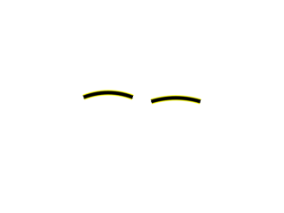
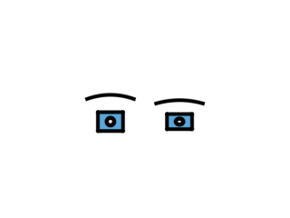
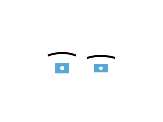
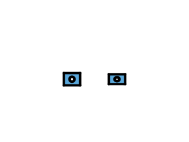
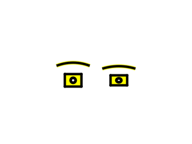

# 22.6.5 · Draw original CAD wire curves

**Chapter 22 · Surface lighting, contact and display quality · Section 22.6 · Original display controls and remaining integration boundaries** · [Contents](contents.md)

**Typing: 1509–3017 minutes.** [Estimate](typing-load.md).

**Splitting required:** this verified checkpoint exceeds the one-hour typing target. Smaller runnable lessons are still being prepared.

Keep coherent CAD face boundaries and their original edge addresses. When an edge has no face boundary, sample its original 3D curve into the existing joined path lane. The two kinds retain independent Edges and Lines controls.

## Type

Continue from [Apply semantic view controls](96zzzzzzzp-apply-semantic-view-controls.md). [Save or recover your work](recovery.md).

### 1. `src/cad_boundary.rs`

Validate a face-free original wire without inventing a face. Preserve the general BRep validator and all coherent face-boundary guards.

<details>
<summary>Locate the existing block</summary>

```rust
        if !source.is_valid() {return Err("BRep topology contains an invalid reference");}
```

</details>

Edit the existing block to match this code; keep unchanged lines:

```rust
        let b=&source;
        let index=|i:i32,n:usize|i>=0&&(i as usize)<n;
        let wire=b.m_faces.is_empty()&&b.m_shells.is_empty()&&b.m_solids.is_empty()&&!b.m_edges.is_empty()&&b.m_edges.iter().all(|e|index(e.start_vertex,b.m_vertices.len())&&index(e.end_vertex,b.m_vertices.len())&&(e.degenerated||index(e.curve_3d_index,b.m_curves_3d.len()))&&e.pcurves.iter().all(|p|index(p.surface_index,b.m_surfaces.len())&&index(p.curve_2d_index,b.m_curves_2d.len())&&(p.curve_2d_index_2<0||index(p.curve_2d_index_2,b.m_curves_2d.len()))))&&b.m_wires.iter().all(|w|!w.edges.is_empty()&&w.edges.iter().all(|r|index(r.index,b.m_edges.len())));
        if !b.is_valid()&&!wire {return Err("BRep topology contains an invalid reference");}
```

<details>
<summary>Optional patch references</summary>

Use these original edit fragments when comparing a saved checkpoint. Apply the complete blocks above.

```text
--8<-- "journey/code/96zzzzzzzq-draw-original-cad-wire-curves-01.rs"
```

</details>

### 2. `src/cad_display.rs`

Retain original fallback curve samples beside coherent boundaries. Use the existing joined path lane rather than introducing a family buffer or drawing overlapping capsules. Sample original face-free curves without inventing mesh faces or mapped boundary addresses; preserve sampled bounds. Retain the fallback curve source keys and samples. Use one existing joined-stroke helper for ordinary and selected original CAD wires, with precise placed points and no duplicate scene owner.

<details>
<summary>Locate the existing block</summary>

```rust
use std::rc::Rc;
use session_rust::Xform;

#[derive(Clone)]
pub struct Boundary {pub edge:usize,pub points:Vec<[f64;3]>}
#[derive(Clone)]
pub struct Prepared {pub source:Rc<session_rust::BRep>,pub edges:Vec<Boundary>,pub samples:Vec<crate::cad_face::Sample>,pub face_count:usize,pub edge_ids:Vec<usize>}

pub fn prepare(source:Rc<session_rust::BRep>)->Result<(Prepared,crate::prepared::PreparedMesh),&'static str> {
    let boundary=crate::cad_boundary::Prepared::new(source.clone())?;let data=crate::cad_face::prepare(&boundary)?;
    let mut proxy=session_rust::Mesh::from_vertices_and_faces(data.points,data.faces);proxy.set_guid(source.guid().to_owned());proxy.name=source.name.clone();proxy.is_visible=source.is_visible;proxy.is_locked=source.is_locked;proxy.set_objectcolor(source.surfacecolor.clone());
    let mut display=crate::mesh::Mesh::new(data.vertices,data.indices)?.with_normals(data.normals)?;display.parts.faces=(0..boundary.faces.len()).collect();display.parts.triangles=data.face_ids;
    let (mut edges,mut edge_ids)=(Vec::new(),Vec::new());
    for chain in boundary.chains.iter().flatten() {
        let points=boundary.points(chain.edge).ok_or("Missing CAD boundary sample")?;
        for pair in chain.keys.windows(2) {
            let mesh=&boundary.faces[chain.face];let ends=[pair[0],pair[1]].map(|key|{let v=&mesh.vertex[&key];[v.x,v.y,v.z]});display.parts.edges.push((data.keys[chain.face][&pair[0]] as usize,data.keys[chain.face][&pair[1]] as usize));display.parts.endpoints.push(ends);edge_ids.push(chain.edge);
        }
        edges.push(Boundary {edge:chain.edge,points});
    }
    let prepared=Prepared {source,edges,samples:data.samples,face_count:boundary.faces.len(),edge_ids};
    let mesh=crate::prepared::PreparedMesh {geometry:Rc::new(proxy),display,source:None,model:Xform::identity()};Ok((prepared,mesh))
}

pub fn example()->session_rust::BRep {
    let mut source=session_rust::BRep::create_block_with_hole(4.,3.,0.6,0.65);source.name="Original CAD bore".into();source.surfacecolor=session_rust::Color::new(0.35,0.65,0.85,1.);source
}
```

</details>

Edit the existing block to match this code; keep unchanged lines:

```rust
use std::rc::Rc;
use session_rust::Xform;

#[derive(Clone)]
pub struct Boundary {pub edge:usize,pub points:Vec<[f64;3]>}
#[derive(Clone)]
pub struct Prepared {pub source:Rc<session_rust::BRep>,pub edges:Vec<Boundary>,pub samples:Vec<crate::cad_face::Sample>,pub wires:Vec<Boundary>,pub face_count:usize,pub edge_ids:Vec<usize>}

pub fn prepare(source:Rc<session_rust::BRep>)->Result<(Prepared,crate::prepared::PreparedMesh),&'static str> {
    let boundary=crate::cad_boundary::Prepared::new(source.clone())?;let mut data=crate::cad_face::prepare(&boundary)?;
    let mut wires=Vec::new();let mut seen=std::collections::HashSet::new();for(edge,chain)in boundary.chains.iter().enumerate(){let e=&source.m_edges[edge];if chain.is_some()||e.degenerated||e.curve_3d_index<0||!seen.insert(e.curve_3d_index){continue;}
        let points=crate::curve::sample(&source.m_curves_3d[e.curve_3d_index as usize])?;if data.vertices.len()+points.len()>1<<20{return Err("CAD wire sample budget exceeded")}
        for p in &points{data.points.push(session_rust::Point::new(p[0],p[1],p[2]));data.vertices.push([p[0]as f32,p[1]as f32,p[2]as f32,0.,0.,0.]);data.normals.push([0.,0.,1.]);}wires.push(Boundary{edge,points});
    }
    let mut proxy=session_rust::Mesh::from_vertices_and_faces(data.points,data.faces);proxy.set_guid(source.guid().to_owned());proxy.name=source.name.clone();proxy.is_visible=source.is_visible;proxy.is_locked=source.is_locked;proxy.set_objectcolor(source.surfacecolor.clone());
    let mut display=crate::mesh::Mesh::new(data.vertices,data.indices)?.with_normals(data.normals)?;display.parts.faces=(0..boundary.faces.len()).collect();display.parts.triangles=data.face_ids;
    let (mut edges,mut edge_ids)=(Vec::new(),Vec::new());
    for chain in boundary.chains.iter().flatten() {
        let points=boundary.points(chain.edge).ok_or("Missing CAD boundary sample")?;
        for pair in chain.keys.windows(2) {
            let mesh=&boundary.faces[chain.face];let ends=[pair[0],pair[1]].map(|key|{let v=&mesh.vertex[&key];[v.x,v.y,v.z]});display.parts.edges.push((data.keys[chain.face][&pair[0]] as usize,data.keys[chain.face][&pair[1]] as usize));display.parts.endpoints.push(ends);edge_ids.push(chain.edge);
        }
        edges.push(Boundary {edge:chain.edge,points});
    }
    let prepared=Prepared {source,edges,samples:data.samples,face_count:boundary.faces.len(),edge_ids,wires};
    let mesh=crate::prepared::PreparedMesh {geometry:Rc::new(proxy),display,source:None,model:Xform::identity()};Ok((prepared,mesh))
}

pub fn wires(row:&crate::scene::Object,anchor:[f64;3],colour:Option<[f32;4]>,extra:f32)->Vec<crate::chain::Segment>{
    let Some(cad)=&row.cad else{return Vec::new()};let model=crate::render_space::placed(&row.model,anchor);
    cad.wires.iter().flat_map(|wire|{let mut points=Vec::new();for p in &wire.points{let p=model.transform_point(&session_rust::Point::new(p[0],p[1],p[2])).to_f32();if points.last()!=Some(&p){points.push(p);}}
        crate::chain::segments(&points,colour.unwrap_or([0.,0.,0.,1.]),crate::mesh_pens::width(cad.source.width)+extra,0)
    }).collect()
}

pub fn example()->session_rust::BRep {
    let mut source=session_rust::BRep::create_block_with_hole(4.,3.,0.6,0.65);source.name="Original CAD bore".into();source.surfacecolor=session_rust::Color::new(0.35,0.65,0.85,1.);source
}
```

<details>
<summary>Optional patch references</summary>

Use these original edit fragments when comparing a saved checkpoint. Apply the complete blocks above.

```text
--8<-- "journey/code/96zzzzzzzq-draw-original-cad-wire-curves-02.rs"
```

```text
--8<-- "journey/code/96zzzzzzzq-draw-original-cad-wire-curves-03.rs"
```

```text
--8<-- "journey/code/96zzzzzzzq-draw-original-cad-wire-curves-04.rs"
```

```text
--8<-- "journey/code/96zzzzzzzq-draw-original-cad-wire-curves-05.rs"
```

</details>

### 3. `src/chain.rs`

Share the existing joined-stroke helper, retaining its complete original join and closed-chain body. Use the shared source pen parameters. Retain start arrow semantics. Retain end arrow semantics. Close the shared helper after the unchanged segment iterator.

Edit these blocks from bottom to top. Keep the surrounding lines unchanged.

<details>
<summary>Locate this block</summary>

```rust
#[derive(Clone, Copy)]
pub struct Segment { pub stroke: Stroke, pub previous: [f32; 3], pub next: [f32; 3], pub heads: u32 }

impl PreparedChain {
    pub fn segments(&self) -> Vec<Segment> {
        let points = &self.points; let last = points.len().saturating_sub(1);
        let closed = last > 1 && points.first() == points.last();
        points.windows(2).enumerate().map(|(i, ends)| Segment {
            stroke: Stroke { start: ends[0], end: ends[1], colour: self.colour, width: self.width },
            previous: if i > 0 { points[i - 1] } else if closed { points[last - 1] } else { ends[0] },
            next: if i + 2 <= last { points[i + 2] } else if closed { points[1] } else { ends[1] },
            heads: if closed { 0 } else { (if i == 0 { self.heads & 2 } else { 0 }) | (if i + 1 == last { self.heads & 1 } else { 0 }) },
        }).collect()
    }
}

impl Segment {
```

</details>

Replace it with:

```rust
#[derive(Clone, Copy)]
pub struct Segment { pub stroke: Stroke, pub previous: [f32; 3], pub next: [f32; 3], pub heads: u32 }

impl PreparedChain {pub fn segments(&self)->Vec<Segment>{segments(&self.points,self.colour,self.width,self.heads)}}
pub fn segments(points:&[[f32;3]],colour:[f32;4],width:f32,heads:u32)->Vec<Segment>{
        let last = points.len().saturating_sub(1);
        let closed = last > 1 && points.first() == points.last();
        points.windows(2).enumerate().map(|(i, ends)| Segment {
            stroke: Stroke { start: ends[0], end: ends[1], colour, width },
            previous: if i > 0 { points[i - 1] } else if closed { points[last - 1] } else { ends[0] },
            next: if i + 2 <= last { points[i + 2] } else if closed { points[1] } else { ends[1] },
            heads: if closed { 0 } else { (if i == 0 { heads & 2 } else { 0 }) | (if i + 1 == last { heads & 1 } else { 0 }) },
        }).collect()
}

impl Segment {
```

<details>
<summary>Complete updated block reference</summary>

```rust
pub fn shader() -> String { crate::finite_project_source::expand(include_str!("chain.wgsl")) }
use std::rc::Rc;
use session_rust::{Arrowhead, Line, Polyline};
use crate::stroke::{PreparedLine};

#[derive(Clone)]
pub enum Source { Line(Rc<Line>), Polyline(Rc<Polyline>), Curve(Rc<session_rust::NurbsCurve>, Rc<Vec<[f64; 3]>>) }

#[derive(Clone)]
pub struct PreparedChain { pub source: Source, pub points: Rc<Vec<[f32; 3]>>, pub colour: [f32; 4], pub width: f32, pub heads: u32 }

impl Source {
    pub fn name(&self)->&str {match self {Self::Line(source)=>&source.name,Self::Polyline(source)=>&source.name,Self::Curve(source,_)=>&source.name}}
    pub fn locked(&self) -> bool {
        match self { Self::Line(r) => r.is_locked, Self::Polyline(r) => r.is_locked, Self::Curve(r, _) => r.is_locked }
    }

    pub fn visible(&self) -> bool {
        match self { Self::Line(line) => line.is_visible, Self::Polyline(line) => line.is_visible, Self::Curve(curve, _) => curve.is_visible }
    }

    pub fn guid(&self) -> &str { match self { Self::Line(line) => line.guid(), Self::Polyline(line) => line.guid(), Self::Curve(curve, _) => curve.guid() } }

    pub fn owner(&self) -> (u8, usize) {
        match self { Self::Line(line) => (0, Rc::as_ptr(line) as usize), Self::Polyline(line) => (1, Rc::as_ptr(line) as usize), Self::Curve(curve, _) => (2, Rc::as_ptr(curve) as usize) }
    }

    pub fn controls(&self) -> Vec<crate::controls::Control> {
        match self {
            Self::Curve(curve, _) => (0..curve.m_cv_count).map(|index|
                crate::controls::Control::new(Rc::clone(curve), index).expect("Validated original curve control")).collect(),
            _ => Vec::new(),
        }
    }

    pub fn bounds_coordinates(&self) -> Vec<[f64; 3]> {
        if matches!(self, Self::Curve(..)) { self.controls().iter().map(|c| c.position().unwrap()).collect() }
        else { self.coordinates() }
    }

    pub fn coordinates(&self) -> Vec<[f64; 3]> {
        match self {
            Self::Line(line) => [line.start(), line.end()].map(|p| [p[0], p[1], p[2]]).to_vec(),
            Self::Polyline(line) => line.coords.chunks_exact(3).map(|p| [p[0], p[1], p[2]]).collect(),
            Self::Curve(_, samples) => samples.as_ref().clone(),
        }
    }
}

impl PreparedChain {
    pub fn curve(source: Rc<session_rust::NurbsCurve>) -> Result<Self, &'static str> {
        let samples = Rc::new(crate::curve::sample(&source)?); let _ = source.guid();
        for index in 0..source.m_cv_count { crate::controls::Control::new(Rc::clone(&source), index)?.marker()?; }
        let mut line = Line::new(0.0, 0.0, 0.0, 1.0, 0.0, 0.0);
        line.width = source.width;
        line.linecolor = source.linecolors.first().cloned().unwrap_or_else(|| session_rust::Color::new(0.0, 0.0, 0.0, 1.0));
        let display = PreparedLine::new(Rc::new(line))?.display;
        Self::new(Source::Curve(source, samples), display.colour, display.width)
    }

    pub fn line(source: Rc<Line>) -> Result<Self, &'static str> {
        let display = PreparedLine::new(Rc::clone(&source))?.display;
        Self::new(Source::Line(source), display.colour, display.width)
    }

    pub fn polyline(source: Rc<Polyline>) -> Result<Self, &'static str> {
        if source.coords.len() % 3 != 0 || !(6..=30_000).contains(&source.coords.len()) {
            return Err("Polyline needs 2–10,000 complete points");
        }
        let _ = source.guid();
        let mut line = Line::new(0.0, 0.0, 0.0, 1.0, 0.0, 0.0);
        line.linecolor = source.linecolor.clone(); line.width = source.width;
        let display = PreparedLine::new(Rc::new(line))?.display;
        Self::new(Source::Polyline(source), display.colour, display.width)
    }

    fn new(source: Source, colour: [f32; 4], width: f32) -> Result<Self, &'static str> {
        let heads = match &source { Source::Line(line) => line.arrowhead, Source::Polyline(line) => line.arrowhead, Source::Curve(curve, _) => curve.arrowhead };
        let heads = match heads { Arrowhead::NONE => 0, Arrowhead::END => 1, Arrowhead::START => 2, Arrowhead::BOTH => 3 };
        let mut points = Vec::new();
        for p in source.coordinates() {
            let p = p.map(|v| v as f32);
            if p.iter().any(|v| !v.is_finite()) { return Err("Chain exceeds the display range"); }
            if points.last() != Some(&p) { points.push(p); }
        }
        Ok(Self { source, points: Rc::new(points), colour, width, heads })
    }

}
use crate::stroke::Stroke;
#[derive(Clone, Copy)]
pub struct Segment { pub stroke: Stroke, pub previous: [f32; 3], pub next: [f32; 3], pub heads: u32 }

impl PreparedChain {pub fn segments(&self)->Vec<Segment>{segments(&self.points,self.colour,self.width,self.heads)}}
pub fn segments(points:&[[f32;3]],colour:[f32;4],width:f32,heads:u32)->Vec<Segment>{
        let last = points.len().saturating_sub(1);
        let closed = last > 1 && points.first() == points.last();
        points.windows(2).enumerate().map(|(i, ends)| Segment {
            stroke: Stroke { start: ends[0], end: ends[1], colour, width },
            previous: if i > 0 { points[i - 1] } else if closed { points[last - 1] } else { ends[0] },
            next: if i + 2 <= last { points[i + 2] } else if closed { points[1] } else { ends[1] },
            heads: if closed { 0 } else { (if i == 0 { heads & 2 } else { 0 }) | (if i + 1 == last { heads & 1 } else { 0 }) },
        }).collect()
}

impl Segment {
    pub fn bytes(&self) -> Vec<u8> {
        let mut bytes = self.stroke.bytes();
        bytes.extend(self.previous.into_iter().chain(self.next).flat_map(f32::to_ne_bytes));
        bytes.extend(self.heads.to_ne_bytes()); bytes
    }
}
```

</details>

<details>
<summary>Optional patch references</summary>

Use these original edit fragments when comparing a saved checkpoint. Apply the complete blocks above.

```text
--8<-- "journey/code/96zzzzzzzq-draw-original-cad-wire-curves-06.rs"
```

```text
--8<-- "journey/code/96zzzzzzzq-draw-original-cad-wire-curves-07.rs"
```

```text
--8<-- "journey/code/96zzzzzzzq-draw-original-cad-wire-curves-08.rs"
```

```text
--8<-- "journey/code/96zzzzzzzq-draw-original-cad-wire-curves-09.rs"
```

```text
--8<-- "journey/code/96zzzzzzzq-draw-original-cad-wire-curves-10.rs"
```

</details>

### 4. `src/pick_sources.rs`

Prepare fallback path records once alongside their original Object-only query IDs. Append fallback IDs in the same order as their joined path records. They follow Lines and never create BRepEdge subparts.

Edit these blocks from bottom to top. Keep the surrounding lines unchanged.

<details>
<summary>Locate this block</summary>

```rust
                sources.path_ids.push(id(row.id, ids[1]));
            }
        }
        let vertex_end=sources.marker_ids.len()as u32;
        for row in scene.points().iter().filter(|row| scene.visible(row.id)) { sources.marker_ids.push(id(row.id, sub_id::OBJECT_INK)); }
        let point_end=sources.marker_ids.len()as u32;
```

</details>

Replace it with:

```rust
                sources.path_ids.push(id(row.id, ids[1]));
            }
        }
        for row in scene.objects().iter().filter(|r|scene.visible(r.id)){
            let colour=scene.view.edges.get(&row.id).map(|c|[c[0]as f32/255.,c[1]as f32/255.,c[2]as f32/255.,1.]);
            let wires=crate::cad_display::wires(row,anchor,colour,0.);sources.path_ids.extend(std::iter::repeat_n(id(row.id,sub_id::OBJECT_INK),wires.len()));sources.wire_segments.extend(wires);
        }
        let vertex_end=sources.marker_ids.len()as u32;
        for row in scene.points().iter().filter(|row| scene.visible(row.id)) { sources.marker_ids.push(id(row.id, sub_id::OBJECT_INK)); }
        let point_end=sources.marker_ids.len()as u32;
```

<details>
<summary>Locate this block</summary>

```rust
    pub mesh_ids: Vec<[u32; 2]>,
    pub mesh_metadata:Vec<u32>,
    pub line_ids: Vec<[u32; 2]>,
    pub path_ids: Vec<[u32; 2]>,
    pub mesh_markers:Vec<crate::marker::Marker>,
    pub marker_ids: Vec<[u32; 2]>,
```

</details>

Replace it with:

```rust
    pub mesh_ids: Vec<[u32; 2]>,
    pub mesh_metadata:Vec<u32>,
    pub line_ids: Vec<[u32; 2]>,
    pub wire_segments:Vec<crate::chain::Segment>,
    pub path_ids: Vec<[u32; 2]>,
    pub mesh_markers:Vec<crate::marker::Marker>,
    pub marker_ids: Vec<[u32; 2]>,
```

<details>
<summary>Complete updated block reference</summary>

```rust
use crate::{scene::{ObjectId, Scene}, sub_id::{self, Kind}};

#[derive(Clone, Copy, Debug, PartialEq, Eq)]
pub enum Part { Object, Face(usize), SurfaceEdge(usize), BRepEdge(usize), MeshEdge(usize, usize), PathEdge(usize), Curve, Control(usize), SourceControl(crate::source_controls::ControlId), CloudPoint(u32), SheetEntity(u32) }

#[derive(Clone, Copy, Debug, PartialEq, Eq)]
pub struct Target { pub owner: ObjectId, pub part: Part }

#[derive(Clone, Copy, Debug, Default, PartialEq, Eq)]
#[repr(u32)]
pub enum Mode { #[default] Object, Face, Edge, Control }

#[derive(Default)]
pub struct Sources {
    pub mesh_runs:crate::ink_ranges::Runs,
    pub marker_runs:crate::ink_ranges::Runs,
    pub sheet_bases:std::collections::HashMap<(ObjectId,usize),u32>,
    pub faces: Vec<Target>,
    pub edges: Vec<Target>,
    pub controls: Vec<Target>,
    pub mesh_bases: Vec<(ObjectId, u32)>,
    pub mesh_ink: Vec<crate::stroke::Stroke>,
    pub mesh_ids: Vec<[u32; 2]>,
    pub mesh_metadata:Vec<u32>,
    pub line_ids: Vec<[u32; 2]>,
    pub wire_segments:Vec<crate::chain::Segment>,
    pub path_ids: Vec<[u32; 2]>,
    pub mesh_markers:Vec<crate::marker::Marker>,
    pub marker_ids: Vec<[u32; 2]>,
}

fn append(rows: &mut Vec<Target>, kind: Kind, target: Target) -> Result<[u32; 2], &'static str> {
    let tag = sub_id::encode(kind, rows.len())?; rows.push(target); Ok([target.owner.value(), tag])
}

impl Sources {
    // A source table translates compact GPU addresses to original keys; addresses belong to this scene snapshot, not the document's saved identity.
    pub fn new(scene:&Scene)->Result<Self,&'static str> {Self::anchored(scene,[0.;3])}
    pub fn anchored(scene:&Scene,anchor:[f64;3])->Result<Self,&'static str> {
        let mut sources = Self::default();
        let id = |owner: ObjectId, tag| [crate::feature_owner::display_owner(scene, owner).map_or(0, ObjectId::value),
            if scene.forest.derived(owner) { 0 } else { tag }];
        let planes=crate::clipping_rows::owners(scene);
        for row in scene.objects().iter().filter(|row| scene.visible(row.id)) {
            let ink_start=sources.mesh_ink.len()as u32;
            let line_frame=matches!(&row.original,Some(session_rust::Geometry::Plane(_)|session_rust::Geometry::OBB(_)));
            let derived=scene.forest.derived(row.id);
            let owner=crate::feature_owner::display_owner(scene,row.id).map_or(0,ObjectId::value);
            let edge_colour=scene.view.edges.get(&row.id).map(|rgb|[rgb[0] as f32/255.,rgb[1] as f32/255.,rgb[2] as f32/255.,1.]);
            let model=crate::render_space::placed(&row.model,anchor);
            sources.mesh_bases.push((row.id, u32::try_from(sources.faces.len()).map_err(|_| "Too many source faces")?));
            if !derived {
                for &key in &row.mesh.parts.faces {
                    append(&mut sources.faces,Kind::Face,Target{owner:row.id,part:Part::Face(key)})?;
                }
            }
            let mut facing=crate::packed_vertex::NO_NORMAL;
            if row.mesh.alphas().first().is_some_and(|a|(*a-1./255.).abs()<0.5/255.) {
                let n=row.mesh.normals()[0];let m=crate::normals::matrix(&row.model)?;
                facing=crate::packed_vertex::oct32(std::array::from_fn(|i|(0..3).map(|j|m[j*4+i]*n[j]).sum()));
            }
            if row.cad.is_none()&&row.surface.is_none()&&!derived {
                for(i,&address)in row.mesh.parts.dots.iter().enumerate(){
                    let p=row.mesh.parts.endpoints[address as usize/2][address as usize%2];
                    sources.mesh_markers.push(crate::marker::Marker::mesh_dot(model.transform_point(&session_rust::Point::new(p[0],p[1],p[2])).to_f32(),edge_colour.unwrap_or_else(||row.mesh.parts.dot_colour(i)),row.mesh.spacing));
                    sources.marker_ids.push([owner,0]);
                }
            }
            let flag=if planes.contains(&row.id){4096}else{0};
            let boundary_width=row.cad.as_ref().map(|c|c.source.width).or_else(||row.surface.as_ref().map(|s|s.source.width)).map(crate::mesh_pens::width);
            let mut cad_edges=row.cad.as_ref().map(|cad|cad.edge_ids.iter());
            let mut surface_edges=row.surface.as_ref().map(|surface|surface.edge_ids());
            for (index,(&(a,b),ends)) in row.mesh.parts.edges.iter().zip(&row.mesh.parts.endpoints).enumerate() {
                let part=cad_edges.as_mut().and_then(|edges|edges.next()).map(|edge|Part::BRepEdge(*edge)).unwrap_or_else(||surface_edges.as_mut().and_then(|edges|edges.next()).map_or(Part::MeshEdge(a,b),Part::SurfaceEdge));
                let ids = if line_frame {[owner,sub_id::OBJECT_INK]}else{append(&mut sources.edges, Kind::Edge, Target { owner: row.id, part })?};
                let (width,colour)=row.mesh.parts.pen(index);
                let width=boundary_width.unwrap_or(width);
                if width==0. {continue;}
                let ends=ends.map(|p|model.transform_point(&session_rust::Point::new(p[0],p[1],p[2])).to_f32());
                sources.mesh_ink.push(crate::stroke::Stroke { start: ends[0], end: ends[1], colour: edge_colour.unwrap_or(colour), width });
                sources.mesh_ids.push([owner,if derived{0}else{ids[1]}]);
                sources.mesh_metadata.extend([flag,facing]);
            }
            let kind=if line_frame {crate::ink_ranges::LINES}else{crate::ink_ranges::EDGES};
            sources.mesh_runs.push(kind,ink_start,sources.mesh_ink.len()as u32);
        }
        for row in scene.lines().iter().filter(|row| scene.visible(row.id)) {
            let ids = append(&mut sources.edges, Kind::Edge, Target { owner: row.id, part: Part::Curve })?;
            sources.line_ids.push(id(row.id, ids[1]));
        }
        for row in scene.paths().iter().filter(|row| scene.visible(row.id)) {
            let points:Vec<_>=row.points_at(anchor).iter().map(session_rust::Point::to_f32).collect();
            for (index, _) in points.windows(2).enumerate().filter(|(_, pair)| pair[0] != pair[1]) {
                let part = if matches!(row.prepared.source, crate::chain::Source::Polyline(_)) { Part::PathEdge(index) } else { Part::Curve };
                let ids = append(&mut sources.edges, Kind::Edge, Target { owner: row.id, part })?;
                sources.path_ids.push(id(row.id, ids[1]));
            }
        }
        for row in scene.objects().iter().filter(|r|scene.visible(r.id)){
            let colour=scene.view.edges.get(&row.id).map(|c|[c[0]as f32/255.,c[1]as f32/255.,c[2]as f32/255.,1.]);
            let wires=crate::cad_display::wires(row,anchor,colour,0.);sources.path_ids.extend(std::iter::repeat_n(id(row.id,sub_id::OBJECT_INK),wires.len()));sources.wire_segments.extend(wires);
        }
        let vertex_end=sources.marker_ids.len()as u32;
        for row in scene.points().iter().filter(|row| scene.visible(row.id)) { sources.marker_ids.push(id(row.id, sub_id::OBJECT_INK)); }
        let point_end=sources.marker_ids.len()as u32;
        let control_start=sources.mesh_ink.len()as u32;
        for (owner, stroke) in scene.control_nets_at(anchor) {
            sources.mesh_ink.push(stroke);
            sources.mesh_ids.push([owner.value(), 0]);
            sources.mesh_metadata.extend([0,crate::packed_vertex::NO_NORMAL]);
        }
        sources.mesh_runs.push(crate::ink_ranges::CONTROLS,control_start,sources.mesh_ink.len()as u32);
        for row in scene.control_markers_at(anchor) {
            let ids = append(&mut sources.controls, Kind::Control, Target { owner: row.parent, part: row.part })?;
            sources.marker_ids.push(id(row.parent, ids[1]));
        }
        sources.marker_runs.push(crate::ink_ranges::VERTICES,0,vertex_end);
        sources.marker_runs.push(crate::ink_ranges::POINTS,vertex_end,point_end);
        sources.marker_runs.push(crate::ink_ranges::CONTROLS,point_end,sources.marker_ids.len()as u32);
        for row in scene.sheets().iter().filter(|row|scene.visible(row.id)) {for page in row.prepared.pages() {sources.sheet_bases.insert((row.id,page.key()),u32::try_from(sources.edges.len()).map_err(|_|"Too many sheet pick addresses")?);for entity in &page.entities {append(&mut sources.edges,Kind::Edge,Target {owner:row.id,part:if *entity==u32::MAX {Part::Object} else {Part::SheetEntity(*entity)}})?;}}}
        Ok(sources)
    }

    pub fn bytes(&self) -> usize {
        self.mesh_runs.bytes()+self.marker_runs.bytes()
            +(self.faces.capacity() + self.edges.capacity() + self.controls.capacity()) * std::mem::size_of::<Target>()
            + self.mesh_bases.capacity() * std::mem::size_of::<(ObjectId, u32)>()
            + self.mesh_markers.capacity()*std::mem::size_of::<crate::marker::Marker>()
            + self.mesh_metadata.capacity()*4
            + self.mesh_ink.capacity() * std::mem::size_of::<crate::stroke::Stroke>()
            + (self.mesh_ids.capacity() + self.line_ids.capacity() + self.path_ids.capacity() + self.marker_ids.capacity()) * 8
    }

    pub fn resolve(&self, scene: &Scene, pixel: [u32; 2], mode: Mode) -> Option<Target> {
        let owner = scene.pick_id(pixel[0])?;
        if mode == Mode::Object { return Some(Target { owner, part: Part::Object }); }
        let (kind, address) = sub_id::decode(pixel[1])?;
        if mode==Mode::Control && kind==Kind::Control && (scene.clouds().iter().any(|r|r.id==owner)||scene.streams().iter().any(|r|r.id==owner)) {
            return crate::cloud_pick::resolve(scene,owner,address);
        }
        let target = match (mode, kind) {
            (Mode::Face, Kind::Face) => self.faces.get(address),
            (Mode::Edge, Kind::Edge) => self.edges.get(address),
            (Mode::Control, Kind::Control) => self.controls.get(address), _ => None,
        }?;
        (target.owner == owner && target.valid(scene)).then_some(*target)
    }
}
```

</details>

<details>
<summary>Optional patch references</summary>

Use these original edit fragments when comparing a saved checkpoint. Apply the complete blocks above.

```text
--8<-- "journey/code/96zzzzzzzq-draw-original-cad-wire-curves-11.rs"
```

```text
--8<-- "journey/code/96zzzzzzzq-draw-original-cad-wire-curves-12.rs"
```

</details>

### 5. `src/renderer.rs`

Upload the prepared fallback spans through the existing path buffer and visibility/query policy.

<details>
<summary>Locate the existing block</summary>

```rust
        self.paths.set_chains(&self.device, scene.paths().iter().filter(|row| scene.visible(row.id)).flat_map(|row| {let mut segments=row.segments_at(anchor);if let Some(colour)=scene.face_rgba(row.id) {for segment in &mut segments {segment.stroke.colour=colour;}}segments}))
```

</details>

Edit the existing block to match this code; keep unchanged lines:

```rust
        self.paths.set_chains(&self.device, scene.paths().iter().filter(|row| scene.visible(row.id)).flat_map(|row| {let mut segments=row.segments_at(anchor);if let Some(colour)=scene.face_rgba(row.id) {for segment in &mut segments {segment.stroke.colour=colour;}}segments}).chain(std::mem::take(&mut self.sources.wire_segments)))
```

<details>
<summary>Optional patch references</summary>

Use these original edit fragments when comparing a saved checkpoint. Apply the complete blocks above.

```text
--8<-- "journey/code/96zzzzzzzq-draw-original-cad-wire-curves-13.rs"
```

</details>

### 6. `src/highlight.rs`

Selected mixed and face-free CAD wires use the same joined highlight lane and source pen width, keeping black centers and Lines masks.

<details>
<summary>Locate the existing block</summary>

```rust
            r.segments_at(anchor).into_iter().map(|mut s| { s.stroke.colour = yellow; s.stroke.width += 2.; s })))?;
```

</details>

Edit the existing block to match this code; keep unchanged lines:

```rust
            r.segments_at(anchor).into_iter().map(|mut s| { s.stroke.colour = yellow; s.stroke.width += 2.; s })).chain(scene.objects().iter().filter(|r|ids.contains(&r.id)&&scene.visible(r.id)).flat_map(|r|crate::cad_display::wires(r,anchor,Some(yellow),2.))))?;
```

<details>
<summary>Optional patch references</summary>

Use these original edit fragments when comparing a saved checkpoint. Apply the complete blocks above.

```text
--8<-- "journey/code/96zzzzzzzq-draw-original-cad-wire-curves-14.rs"
```

</details>

### 7. `src/cad_shape_cache.rs`

Rigid-source replay must transform fallback curve samples together with mapped edges; retain original source records and precise models.

<details>
<summary>Locate the existing block</summary>

```rust
        for edge in &mut prepared.edges {for p in &mut edge.points {*p=motion.point(*p);}}
```

</details>

Edit the existing block to match this code; keep unchanged lines:

```rust
        for edge in prepared.edges.iter_mut().chain(&mut prepared.wires) {for p in &mut edge.points {*p=motion.point(*p);}}
```

<details>
<summary>Optional patch references</summary>

Use these original edit fragments when comparing a saved checkpoint. Apply the complete blocks above.

```text
--8<-- "journey/code/96zzzzzzzq-draw-original-cad-wire-curves-15.rs"
```

</details>

<details>
<summary>Supplied validation fixture</summary>

Copy this supplied authoring fixture once. Continue with the browser build below; the course does not require running native tests.

### 8. `src/cap_gpu_tests.rs`

Supply a format-parameterized real GPU readback helper while keeping every existing Unorm fixture unchanged; matched maintained comparisons need actual sRGB targets, not edited pixels.

<details>
<summary>Locate the existing block</summary>

```text
use crate::{scene::Scene,renderer::Renderer,viewport::Viewport};
use std::rc::Rc;
pub(crate) fn source(open:bool)->session_rust::Mesh{
 let corners=(0..8).map(|i|session_rust::Point::new(if i%4==1||i%4==2{0.6}else{-0.6},if i%4>=2{0.6}else{-0.6},if i>=4{-0.2}else{-0.8})).collect();let mut faces=vec![vec![0,3,2,1],vec![0,1,5,4],vec![2,3,7,6],vec![0,4,7,3],vec![1,2,6,5]];if !open{faces.push(vec![4,5,6,7]);}let mut mesh=session_rust::Mesh::from_vertices_and_faces(corners,faces);mesh.set_objectcolor(session_rust::Color::new(1.,0.,0.,1.));mesh
}
pub(crate) fn scene(open:bool)->(Scene,crate::scene::ObjectId){let mut scene=Scene::empty();let owner=scene.insert(crate::prepared::PreparedMesh::new(source(open)).unwrap()).unwrap();let plane=crate::clipping_geometry::plane_from(crate::clipping_geometry::Mode::Xy,&[[0.,0.,-0.5]],0.9).unwrap();crate::plane_original::insert(&mut scene,Rc::new(plane)).unwrap();(scene,owner)}
pub(crate) fn matrix()->[f32;16]{session_rust::Xform::orthographic(-1.,1.,-1.,1.,1.,0.).m.map(|v|v as f32)}
pub(crate) fn renderer(scene:&Scene)->Renderer{let instance=wgpu::Instance::new(wgpu::InstanceDescriptor{backends:wgpu::Backends::VULKAN,flags:Default::default(),memory_budget_thresholds:Default::default(),backend_options:Default::default(),display:None});let adapter=pollster::block_on(instance.request_adapter(&Default::default())).unwrap();let(device,queue)=pollster::block_on(adapter.request_device(&Default::default())).unwrap();device.on_uncaptured_error(std::sync::Arc::new(|e|panic!("actual original cap: {e}")));let mut renderer=Renderer::new(device,queue,wgpu::TextureFormat::Rgba8Unorm,scene);renderer.resize(Viewport{width:320,height:240});renderer}
pub(crate) fn wait(r:&Renderer){r.device.poll(wgpu::PollType::Wait{submission_index:None,timeout:Some(std::time::Duration::from_secs(5))}).unwrap();}
pub(crate) fn pixels(r:&Renderer)->Vec<u8>{pixels_at(r,matrix())}
pub(crate) fn pixels_at(r:&Renderer,transform:[f32;16])->Vec<u8>{let texture=r.device.create_texture(&wgpu::TextureDescriptor{label:Some("original cap pixel fixture"),size:wgpu::Extent3d{width:320,height:240,depth_or_array_layers:1},mip_level_count:1,sample_count:1,dimension:wgpu::TextureDimension::D2,format:wgpu::TextureFormat::Rgba8Unorm,usage:wgpu::TextureUsages::RENDER_ATTACHMENT|wgpu::TextureUsages::COPY_SRC,view_formats:&[]});r.draw(&texture.create_view(&Default::default()),&Default::default(),&transform);let pitch=1280;let read=r.device.create_buffer(&wgpu::BufferDescriptor{label:None,size:pitch*240,usage:wgpu::BufferUsages::MAP_READ|wgpu::BufferUsages::COPY_DST,mapped_at_creation:false});let mut encoder=r.device.create_command_encoder(&Default::default());encoder.copy_texture_to_buffer(texture.as_image_copy(),wgpu::TexelCopyBufferInfo{buffer:&read,layout:wgpu::TexelCopyBufferLayout{offset:0,bytes_per_row:Some(pitch as u32),rows_per_image:Some(240)}},texture.size());r.queue.submit([encoder.finish()]);let(tx,rx)=std::sync::mpsc::channel();read.slice(..).map_async(wgpu::MapMode::Read,move|v|tx.send(v).unwrap());wait(r);rx.recv().unwrap().unwrap();let data=read.slice(..).get_mapped_range().to_vec();read.unmap();data}
pub(crate) fn at(data:&[u8],x:usize,y:usize)->&[u8]{&data[(y*320+x)*4..(y*320+x+1)*4]}
#[test]
fn actual_closed_original_sections_draw_grey_hatch_and_selected_color_then_release_large_images(){
 let(mut scene,owner)=scene(false);let mut r=renderer(&scene);let solid=pixels(&r);let center=at(&solid,208,96);assert!(center[..3].iter().all(|v|(150..=155).contains(v)),"solid section: {center:?}");assert_eq!(r.cap_usage()[1],1);assert_eq!(r.cap_usage()[2],1);assert_eq!(r.cap_usage()[0],16+16+320*240*2);let uploads=r.stats()[0];r.set_clipping(true,false);let hatch=pixels(&r);assert_ne!(hatch,solid);assert!(hatch.chunks_exact(4).filter(|p|p[..3].iter().all(|v|*v<20)).count()>400,"hatch has actual black ink");r.set_clipping(true,true);r.select_objects(&scene,&[owner]).unwrap();let selected=pixels(&r);let center=at(&selected,208,96);assert!(center[0]>240&&center[1]>240&&center[2]<20,"selected original section: {center:?}");assert_eq!(r.stats()[0],uploads);assert_eq!(r.cap_usage()[2],1,"selection retains original closedness cache");let stored=selected.clone();r.use_uniform_surface_records();assert_eq!(pixels(&r),stored,"Exact uniform and shared cap crossing pixels");r.set_scene(&scene,None);r.select_objects(&scene,&[owner]).unwrap();assert_eq!(pixels(&r),stored);assert_eq!(r.stats()[0],uploads);scene.clear();r.set_scene(&scene,None);pixels(&r);assert_eq!(r.cap_usage()[0],16);assert_eq!(r.cap_usage()[1],0);
}
#[test]
fn actual_open_originals_get_no_section_fill(){let(scene,_)=scene(true);let r=renderer(&scene);let image=pixels(&r);assert_eq!(r.cap_usage()[1],0);let center=at(&image,208,96);assert!(center[0]>center[1]+80&&center[0]>center[2]+80,"open back face remains red: {center:?}");}

pub(crate) fn reversed(mut matrix:[f32;16])->[f32;16]{for column in 0..4{matrix[column*4+2]=matrix[column*4+3]-matrix[column*4+2];}matrix}
```

</details>

Update the existing block with this supplied code; keep unchanged lines:

```text
--8<-- "journey/code/96zzzzzzzq-draw-original-cad-wire-curves-16.rs"
```

</details>

<details>
<summary>Supplied validation fixture</summary>

Copy this supplied authoring fixture once. Continue with the browser build below; the course does not require running native tests.

### 9. `src/cad_wire_tests.rs`

Supply independent original-wire topology validation and actual mixed/family/query/shared-source/selection/archive GPU witnesses.

Copy this supplied file:

```text
--8<-- "journey/code/96zzzzzzzq-draw-original-cad-wire-curves-17.rs"
```

</details>

<details>
<summary>Supplied validation fixture</summary>

Copy this supplied authoring fixture once. Continue with the browser build below; the course does not require running native tests.

### 10. `src/lib.rs`

Supply original CAD wire regressions without production code.

<details>
<summary>Locate the existing block</summary>

```text
mod view_command_tests;
```

</details>

After that block, append this supplied code:

```text
--8<-- "journey/code/96zzzzzzzq-draw-original-cad-wire-curves-18.rs" skip=23
```

</details>

### 11. `src/production_ribbon.wgsl`

Copy the exact compiled production ribbon source and shared visibility/prelude without substitute coverage math.

Create the file and type:

```wgsl
--8<-- "journey/code/96zzzzzzzq-draw-original-cad-wire-curves-ribbon-source.wgsl"
```

### 12. `src/production_ribbon_provenance.json`

Record production source hashes, composition and the copied storage ABI.

Create the file and type:

```json
--8<-- "journey/code/96zzzzzzzq-draw-original-cad-wire-curves-ribbon-provenance.json"
```

### 13. `src/production_ribbon.rs`

Pack original ordinary lines and production frame uniforms in the actual storage layout.

Create the file and type:

```rust
--8<-- "journey/code/96zzzzzzzq-draw-original-cad-wire-curves-ribbon-rows.rs"
```

### 14. `src/production_ribbon_gpu.rs`

Own production ordinary-line color and independent integer pipelines with the same four bind groups.

Create the file and type:

```rust
--8<-- "journey/code/96zzzzzzzq-draw-original-cad-wire-curves-ribbon-gpu.rs"
```

### 15. `src/lib.rs`

Register the copied production ordinary-line owner.

<details>
<summary>Locate the existing block</summary>

```rust
pub mod stroke_gpu;
```

</details>

After that block, type:

```rust
pub mod production_ribbon;
mod production_ribbon_gpu;
```

<details>
<summary>Optional patch references</summary>

Use these original edit fragments when comparing a saved checkpoint. Apply the complete blocks above.

```text
--8<-- "journey/code/96zzzzzzzq-draw-original-cad-wire-curves-ribbon-adapter-01.rs"
```

</details>

### 16. `src/renderer.rs`

Ordinary lines use the production ribbon owner. Construct the production storage ribbon pipelines once. Keep finite adapters on the ink families that remain staged. Select production color samples independently from its single-sample query pipeline. Retain the selected-object flag in production instance rows. Keep original local coordinates and separate model/translation placement instead of flattening endpoints. The production owner retains the original course ID translation beside its rows. Exclude ordinary lines from the staged integer ink pipelines. Pass the production ordinary-line owner to fresh integer rendering. Translate production segment addresses before nearest-hit selection. Keep Hide Lines synchronized across production ordinary lines and staged paths. Update production object flags and placement with selection state. Account for production object flags stored in instance records. Bind actual frame depths, primitive addresses and tile buffers to the production ribbon path. Draw exact production ribbon coverage and restore staged-family clipping bindings afterward.

Edit these blocks from bottom to top. Keep the surrounding lines unchanged.

<details>
<summary>Locate this block</summary>

```rust
            pass.set_bind_group(2,&clip_group,&[]);
            self.highlight.ink(&mut pass,&self.view_group,self.ink_visibility);
            self.mesh_ink.draw(&mut pass,&self.view_group);
            self.strokes.draw(&mut pass,&self.view_group);if self.ink_visibility.lines{self.sheets.draw(&mut pass);}
            self.paths.draw(&mut pass,&self.view_group);
            self.markers.draw(&mut pass,&self.view_group);
            self.highlight.points(&mut pass,&self.view_group,self.ink_visibility);
```

</details>

Replace it with:

```rust
            pass.set_bind_group(2,&clip_group,&[]);
            self.highlight.ink(&mut pass,&self.view_group,self.ink_visibility);
            self.mesh_ink.draw(&mut pass,&self.view_group);
            self.strokes.draw(&mut pass);pass.set_bind_group(2,&clip_group,&[]);if self.ink_visibility.lines{self.sheets.draw(&mut pass);}
            self.paths.draw(&mut pass,&self.view_group);
            self.markers.draw(&mut pass,&self.view_group);
            self.highlight.points(&mut pass,&self.view_group,self.ink_visibility);
```

<details>
<summary>Locate this block</summary>

```rust
        let [r, g, b] = if self.ambient_enabled.get() { [0.94; 3] } else { background.rgb() };
        let mut encoder = self.device.create_command_encoder(&Default::default());
        let mut tiles=self.tiles.borrow_mut();tiles.prepare(&self.device,&self.queue,self.size);tiles.encode(&self.device,&mut encoder,&self.view_group,*transform);
        let tables=crate::finite_ink::Tables{projected:tiles.projected.clone(),tiles:tiles.buffer.clone(),primitive:self.targets.primitive.view.clone()};for lane in [&self.mesh_ink,&self.strokes,&self.paths,&self.markers]{lane.finite_frame(&self.device,&tables,&self.targets.depth);}self.highlight.finite_frame(&self.device,&tables,&self.targets.depth);
        {
            // The pass borrows the encoder. This scope ends that borrow before finish takes it.
            let mut pass = encoder.begin_render_pass(&wgpu::RenderPassDescriptor {
```

</details>

Replace it with:

```rust
        let [r, g, b] = if self.ambient_enabled.get() { [0.94; 3] } else { background.rgb() };
        let mut encoder = self.device.create_command_encoder(&Default::default());
        let mut tiles=self.tiles.borrow_mut();tiles.prepare(&self.device,&self.queue,self.size);tiles.encode(&self.device,&mut encoder,&self.view_group,*transform);
        let tables=crate::finite_ink::Tables{projected:tiles.projected.clone(),tiles:tiles.buffer.clone(),primitive:self.targets.primitive.view.clone()};for lane in [&self.mesh_ink,&self.paths,&self.markers]{lane.finite_frame(&self.device,&tables,&self.targets.depth);}
        self.strokes.prepare(&self.device,&self.queue,*transform,self.size,self.density,self.opacity.get(),&self.clipping.borrow().buffer,&tables,&self.targets.depth);self.highlight.finite_frame(&self.device,&tables,&self.targets.depth);
        {
            // The pass borrows the encoder. This scope ends that borrow before finish takes it.
            let mut pass = encoder.begin_render_pass(&wgpu::RenderPassDescriptor {
```

<details>
<summary>Locate this block</summary>

```rust
    pub fn cap_error(&self)->Option<&'static str>{self.caps.borrow().pick_error}
    pub fn cap_usage(&self)->[u64;5]{self.caps.borrow().usage()}
    pub fn clipping_usage(&self)->[u64;5]{let clip=self.clipping.borrow();[clip.rows.len()as u64,u64::from(clip.enabled),u64::from(clip.solid),clip.writes,clip.buffer.size()]}
    pub fn clipping_ink_bytes(&self)->[u64;2]{[&self.mesh_ink,&self.strokes,&self.paths,&self.markers,&self.grid].into_iter().map(crate::stroke_gpu::Lane::clipping_bytes).fold(self.highlight.clipping_bytes(),|a,b|[a[0]+b[0],a[1]+b[1]])}
    pub fn clipping_error(&self)->Option<&'static str>{self.clipping.borrow().error}
    pub fn tile_usage(&self)->[u64;7]{self.tiles.borrow().usage()}
    pub fn sheet_usage(&self)->[u64;5] {self.sheets.usage()}
```

</details>

Replace it with:

```rust
    pub fn cap_error(&self)->Option<&'static str>{self.caps.borrow().pick_error}
    pub fn cap_usage(&self)->[u64;5]{self.caps.borrow().usage()}
    pub fn clipping_usage(&self)->[u64;5]{let clip=self.clipping.borrow();[clip.rows.len()as u64,u64::from(clip.enabled),u64::from(clip.solid),clip.writes,clip.buffer.size()]}
    pub fn clipping_ink_bytes(&self)->[u64;2]{[&self.mesh_ink,&self.paths,&self.markers,&self.grid].into_iter().map(crate::stroke_gpu::Lane::clipping_bytes).chain(std::iter::once(self.strokes.clipping_bytes())).fold(self.highlight.clipping_bytes(),|a,b|[a[0]+b[0],a[1]+b[1]])}
    pub fn clipping_error(&self)->Option<&'static str>{self.clipping.borrow().error}
    pub fn tile_usage(&self)->[u64;7]{self.tiles.borrow().usage()}
    pub fn sheet_usage(&self)->[u64;5] {self.sheets.usage()}
```

<details>
<summary>Locate this block</summary>

```rust
            self.settings_writes += calls; self.settings_bytes += bytes;
        } }
        self.instances.set(&self.device,&self.queue,&mut self.meshes,&self.instance_rows,false)?;
        self.tiles.borrow_mut().set_records(&self.device,&self.meshes,Some(&self.instances));
        if !self.meshes.iter().any(GpuMesh::selected) {self.outline.borrow_mut().take();}
        self.set_clouds(scene,ids)?;self.sheets.set_anchored(&self.device,&self.queue,scene,ids,&self.sources.sheet_bases,anchor)?;
```

</details>

Replace it with:

```rust
            self.settings_writes += calls; self.settings_bytes += bytes;
        } }
        self.instances.set(&self.device,&self.queue,&mut self.meshes,&self.instance_rows,false)?;
        self.strokes.set_scene(&self.device,scene,&self.sources.line_ids,anchor,ids)?;
        self.tiles.borrow_mut().set_records(&self.device,&self.meshes,Some(&self.instances));
        if !self.meshes.iter().any(GpuMesh::selected) {self.outline.borrow_mut().take();}
        self.set_clouds(scene,ids)?;self.sheets.set_anchored(&self.device,&self.queue,scene,ids,&self.sources.sheet_bases,anchor)?;
```

<details>
<summary>Locate this block</summary>

```rust

    fn apply_ink_visibility(&mut self){
        let mask=self.ink_visibility.mask();self.mesh_ink.ranges.mask=mask;self.markers.ranges.mask=mask;
        for lane in [&mut self.strokes,&mut self.paths]{lane.ranges.mask=if self.ink_visibility.lines{u8::MAX}else{0};}
    }
    pub fn set_ink_visibility(&mut self,value:crate::ink_ranges::Visibility){
        if self.ink_visibility==value{return;}self.ink_visibility=value;self.cancel_pick();self.apply_ink_visibility();
```

</details>

Replace it with:

```rust

    fn apply_ink_visibility(&mut self){
        let mask=self.ink_visibility.mask();self.mesh_ink.ranges.mask=mask;self.markers.ranges.mask=mask;
        self.strokes.visible=self.ink_visibility.lines;
        self.paths.ranges.mask=if self.ink_visibility.lines{u8::MAX}else{0};
    }
    pub fn set_ink_visibility(&mut self,value:crate::ink_ranges::Visibility){
        if self.ink_visibility==value{return;}self.ink_visibility=value;self.cancel_pick();self.apply_ink_visibility();
```

<details>
<summary>Locate this block</summary>

```rust
            let bytes=crate::surface_view::bytes(transform,[0.;4],self.size,self.density);self.queue.write_buffer(&self.uniform,0,&bytes);
            let tables={let mut tiles=self.tiles.borrow_mut();tiles.prepare(&self.device,&self.queue,self.size);let mut encoder=self.device.create_command_encoder(&Default::default());tiles.encode(&self.device,&mut encoder,&self.view_group,transform);self.queue.submit([encoder.finish()]);tiles.map_report();crate::finite_ink::Tables{projected:tiles.projected.clone(),tiles:tiles.buffer.clone(),primitive:self.targets.primitive.view.clone()}};
            self.picker.submit_finite(&self.device, &self.queue, request,
            &self.meshes, &[&self.mesh_ink, &self.strokes, &self.paths, &self.markers], &self.faces,self.text.borrow().as_ref(),self.clouds.borrow().as_ref(),self.ink_visibility.lines.then_some(&self.sheets),Some(&tables),&clipping.group,&clipping.buffer,Some(&mut self.caps.borrow_mut()),Some(&self.instances)); }
    }

    pub fn take_pick(&mut self, transform: [f32; 16]) -> Option<Result<Option<[u32; 2]>, &'static str>> {
        let view = match crate::pick_view::View::anchored(transform,self.size,self.density,self.anchor()) { Ok(view) => view, Err(error) => {
            self.cancel_pick(); return Some(Err(error));
        } };
        match self.picker.take(view) {
            Some(Ok(crate::pick_gpu::Reply::Hit(hit)))=>{self.pick_cursor=None;Some(Ok(hit))},
            Some(Ok(crate::pick_gpu::Reply::Stale))=>{
                if let Some((screen,_))=self.pick_cursor.filter(|(_,origin)|*origin!=self.anchor().map(f64::to_bits)) {
```

</details>

Replace it with:

```rust
            let bytes=crate::surface_view::bytes(transform,[0.;4],self.size,self.density);self.queue.write_buffer(&self.uniform,0,&bytes);
            let tables={let mut tiles=self.tiles.borrow_mut();tiles.prepare(&self.device,&self.queue,self.size);let mut encoder=self.device.create_command_encoder(&Default::default());tiles.encode(&self.device,&mut encoder,&self.view_group,transform);self.queue.submit([encoder.finish()]);tiles.map_report();crate::finite_ink::Tables{projected:tiles.projected.clone(),tiles:tiles.buffer.clone(),primitive:self.targets.primitive.view.clone()}};
            self.picker.submit_finite(&self.device, &self.queue, request,
            &self.meshes, &[&self.mesh_ink, &self.paths, &self.markers], &self.faces,self.text.borrow().as_ref(),self.clouds.borrow().as_ref(),self.ink_visibility.lines.then_some(&self.sheets),Some(&tables),&clipping.group,&clipping.buffer,Some(&mut self.caps.borrow_mut()),Some(&self.instances),Some(&self.strokes)); }
    }

    pub fn take_pick(&mut self, transform: [f32; 16]) -> Option<Result<Option<[u32; 2]>, &'static str>> {
        let view = match crate::pick_view::View::anchored(transform,self.size,self.density,self.anchor()) { Ok(view) => view, Err(error) => {
            self.cancel_pick(); return Some(Err(error));
        } };
        match self.picker.take_mapped(view,|pixel|self.strokes.translate(pixel)) {
            Some(Ok(crate::pick_gpu::Reply::Hit(hit)))=>{self.pick_cursor=None;Some(Ok(hit))},
            Some(Ok(crate::pick_gpu::Reply::Stale))=>{
                if let Some((screen,_))=self.pick_cursor.filter(|(_,origin)|*origin!=self.anchor().map(f64::to_bits)) {
```

<details>
<summary>Locate this block</summary>

```rust
            .expect("Prepared point placement fits the display range");
        self.paths.set_chains(&self.device, scene.paths().iter().filter(|row| scene.visible(row.id)).flat_map(|row| {let mut segments=row.segments_at(anchor);if let Some(colour)=scene.face_rgba(row.id) {for segment in &mut segments {segment.stroke.colour=colour;}}segments}).chain(std::mem::take(&mut self.sources.wire_segments)))
            .expect("Prepared path placement fits the display range");
        self.strokes.set(&self.device, scene.lines().iter().filter(|row| scene.visible(row.id)).map(|row| {let mut stroke=row.stroke_at(anchor);if let Some(colour)=scene.face_rgba(row.id) {stroke.colour=colour;}stroke}))
            .expect("Prepared line placement fits the display range");
        self.markers.set_ids(&self.device, self.sources.marker_ids.iter().copied()).expect("Marker owners match");
        self.paths.set_ids(&self.device, self.sources.path_ids.iter().copied()).expect("Path owners match");
        self.strokes.set_ids(&self.device, self.sources.line_ids.iter().copied()).expect("Line owners match");
        self.mesh_ink.ranges=std::mem::take(&mut self.sources.mesh_runs);
        self.markers.ranges=std::mem::take(&mut self.sources.marker_runs);
        self.apply_ink_visibility();
```

</details>

Replace it with:

```rust
            .expect("Prepared point placement fits the display range");
        self.paths.set_chains(&self.device, scene.paths().iter().filter(|row| scene.visible(row.id)).flat_map(|row| {let mut segments=row.segments_at(anchor);if let Some(colour)=scene.face_rgba(row.id) {for segment in &mut segments {segment.stroke.colour=colour;}}segments}).chain(std::mem::take(&mut self.sources.wire_segments)))
            .expect("Prepared path placement fits the display range");
        self.strokes.set_scene(&self.device,scene,&self.sources.line_ids,anchor,&[]).expect("Prepared production line rows");
        self.markers.set_ids(&self.device, self.sources.marker_ids.iter().copied()).expect("Marker owners match");
        self.paths.set_ids(&self.device, self.sources.path_ids.iter().copied()).expect("Path owners match");
        self.mesh_ink.ranges=std::mem::take(&mut self.sources.mesh_runs);
        self.markers.ranges=std::mem::take(&mut self.sources.marker_runs);
        self.apply_ink_visibility();
```

<details>
<summary>Locate this block</summary>

```rust
        self.preview.set(&self.device, None).expect("Empty tool preview");
        self.highlight.set(&self.device, &self.surfaces.active.0.get_bind_group_layout(1), scene, None).expect("Empty selection");
        self.set_source_ink(scene);
        let layout = self.surfaces.active.0.get_bind_group_layout(1);
        let mut old = std::mem::take(&mut self.meshes);
        for object in scene.objects().iter().filter(|row| scene.visible(row.id)) {
```

</details>

Replace it with:

```rust
        self.preview.set(&self.device, None).expect("Empty tool preview");
        self.highlight.set(&self.device, &self.surfaces.active.0.get_bind_group_layout(1), scene, None).expect("Empty selection");
        self.set_source_ink(scene);
        self.strokes.set_scene(&self.device,scene,&self.sources.line_ids,self.anchor(),selected.as_slice()).expect("Prepared production line rows");
        let layout = self.surfaces.active.0.get_bind_group_layout(1);
        let mut old = std::mem::take(&mut self.meshes);
        for object in scene.objects().iter().filter(|row| scene.visible(row.id)) {
```

<details>
<summary>Locate this block</summary>

```rust
        let ctx=crate::text_gpu_support::GpuCtx::new(device,&self.queue);
        self.surfaces.select(count,||crate::surface_pipelines::pipelines(device,self.format,&crate::surface_view::layout(device),&crate::gpu_layout::uniform(device,crate::object_record::BYTES as u64),count));
        self.instances.set_samples(device,self.format,count);
        for lane in [&mut self.mesh_ink,&mut self.strokes,&mut self.paths,&mut self.markers,&mut self.grid]{lane.set_samples(device,count);}
        self.highlight.set_samples(device,count);self.preview.set_samples(device,count);
        self.measurement.set_samples(device,count);self.guides.set_samples(device,count);
        self.sheets.set_samples(device,count);self.caps.borrow_mut().set_samples(count);
```

</details>

Replace it with:

```rust
        let ctx=crate::text_gpu_support::GpuCtx::new(device,&self.queue);
        self.surfaces.select(count,||crate::surface_pipelines::pipelines(device,self.format,&crate::surface_view::layout(device),&crate::gpu_layout::uniform(device,crate::object_record::BYTES as u64),count));
        self.instances.set_samples(device,self.format,count);
        for lane in [&mut self.mesh_ink,&mut self.paths,&mut self.markers,&mut self.grid]{lane.set_samples(device,count);}
        self.strokes.set_samples(device,count);
        self.highlight.set_samples(device,count);self.preview.set_samples(device,count);
        self.measurement.set_samples(device,count);self.guides.set_samples(device,count);
        self.sheets.set_samples(device,count);self.caps.borrow_mut().set_samples(count);
```

<details>
<summary>Locate this block</summary>

```rust
            geometry: Default::default(), settings_allocations: 0, settings_writes: 0,
            settings_bytes: 0, uniform, view_group, targets, strokes, paths, markers, grid, grid_settings: None,grid_plane:crate::cplane::CPlane::Xy,grid_anchor:[0.;3], size: [640, 480], density: 1.0, picker, faces, mesh_ink, sources: Default::default(), pick_mode:Default::default(),pick_cursor:None };
        renderer.mesh_ink.enable_finite(&renderer.device,format,true);
        for lane in [&mut renderer.strokes,&mut renderer.paths,&mut renderer.markers]{lane.enable_finite(&renderer.device,format,false);}
        renderer.highlight.enable_finite(&renderer.device,format);
        renderer.set_scene(scene, None);
        renderer
```

</details>

Replace it with:

```rust
            geometry: Default::default(), settings_allocations: 0, settings_writes: 0,
            settings_bytes: 0, uniform, view_group, targets, strokes, paths, markers, grid, grid_settings: None,grid_plane:crate::cplane::CPlane::Xy,grid_anchor:[0.;3], size: [640, 480], density: 1.0, picker, faces, mesh_ink, sources: Default::default(), pick_mode:Default::default(),pick_cursor:None };
        renderer.mesh_ink.enable_finite(&renderer.device,format,true);
        for lane in [&mut renderer.paths,&mut renderer.markers]{lane.enable_finite(&renderer.device,format,false);}
        renderer.highlight.enable_finite(&renderer.device,format);
        renderer.set_scene(scene, None);
        renderer
```

<details>
<summary>Locate this block</summary>

```rust
            }],
        });
        let targets = crate::frame_targets::Targets::with_formats(&device,[640,480],output_format,format,1);
        let strokes = crate::stroke_gpu::Lane::new(&device, format);
        let paths = crate::stroke_gpu::Lane::joined(&device, format);
        let markers = crate::stroke_gpu::Lane::markers(&device, format);
        let grid = crate::stroke_gpu::Lane::grid(&device, format);
```

</details>

Replace it with:

```rust
            }],
        });
        let targets = crate::frame_targets::Targets::with_formats(&device,[640,480],output_format,format,1);
        let strokes = crate::production_ribbon_gpu::Lane::new(&device, format);
        let paths = crate::stroke_gpu::Lane::joined(&device, format);
        let markers = crate::stroke_gpu::Lane::markers(&device, format);
        let grid = crate::stroke_gpu::Lane::grid(&device, format);
```

<details>
<summary>Locate this block</summary>

```rust
    uniform: wgpu::Buffer,
    view_group: wgpu::BindGroup,
    targets:crate::frame_targets::Targets,
    strokes: crate::stroke_gpu::Lane,
    paths: crate::stroke_gpu::Lane,
    markers: crate::stroke_gpu::Lane,
    grid: crate::stroke_gpu::Lane,
```

</details>

Replace it with:

```rust
    uniform: wgpu::Buffer,
    view_group: wgpu::BindGroup,
    targets:crate::frame_targets::Targets,
    strokes: crate::production_ribbon_gpu::Lane,
    paths: crate::stroke_gpu::Lane,
    markers: crate::stroke_gpu::Lane,
    grid: crate::stroke_gpu::Lane,
```

<details>
<summary>Complete updated block reference</summary>

```rust
use crate::{gpu_mesh::GpuMesh, scene::{ObjectId, Scene}};

#[cfg(all(test,not(target_arch="wasm32")))]
#[path="ink_range_gpu_tests.rs"]
mod range_tests;

#[cfg(all(test,not(target_arch="wasm32")))]
#[path="ink_visibility_gpu_tests.rs"]
mod visibility_tests;

pub struct Renderer {
    ink_visibility:crate::ink_ranges::Visibility,
    surface_options:std::cell::Cell<[bool;2]>,
    world_bounds:std::cell::RefCell<Option<crate::bounds::Bounds>>,
    space:crate::render_space::Origin,
    opacity:std::cell::Cell<f32>,
    ambient_enabled:std::cell::Cell<bool>,
    ambient:std::cell::RefCell<Option<crate::ambient_gpu::Ambient>>,
    ambient_rows:crate::ambient_rows::Rows,
    pyramid:std::cell::RefCell<Option<crate::pyramid_gpu::Pyramid>>,
    pyramid_revision:u64,
    caps:std::cell::RefCell<crate::caps_gpu::Caps>,
    clipping:std::cell::RefCell<crate::clipping_gpu::Clipping>,
    tiles:std::cell::RefCell<crate::tile_gpu::Tiles>,
    guides:crate::guide_gpu::Guide,
    measurement:crate::measure_gpu::Measurement,
    sheets:crate::sheet_gpu::Lane,
    clouds:std::cell::RefCell<Option<crate::cloud_gpu::Lane>>,
    cloud_view:std::cell::Cell<crate::cloud_gpu::View>,
    cloud_error:std::cell::RefCell<Option<String>>,
    outline:std::cell::RefCell<Option<crate::outline_gpu::Outline>>,
    global_outline:std::cell::RefCell<Option<crate::outline_gpu::Outline>>,
    outlines_enabled:std::cell::Cell<bool>,
    outline_composite:std::cell::RefCell<Option<crate::outline_composite::Composite>>,
    text:std::cell::RefCell<Option<crate::scene_text_gpu::Lane>>,
    text_error:std::cell::RefCell<Option<String>>,
    full_text_fonts:std::cell::RefCell<Option<Vec<Vec<u8>>>>,
    presentation_text:std::cell::RefCell<Vec<crate::text::TextLabel>>,
    scene_text:std::cell::RefCell<Vec<crate::text::TextLabel>>,
    format:wgpu::TextureFormat,
    output_format:wgpu::TextureFormat,
    pub device: wgpu::Device,
    pub queue: wgpu::Queue,
    instances:crate::instance_gpu::Lane,
    instance_rows:std::collections::HashSet<ObjectId>,
    surfaces:crate::sample_pipelines::Variants<(wgpu::RenderPipeline,wgpu::RenderPipeline)>,
    highlight: crate::highlight::Highlight,
    preview: crate::tool_preview::Preview,
    widget: crate::widget::Widget,
    meshes: Vec<GpuMesh>,
    geometry: crate::geometry_cache::GeometryCache,
    settings_allocations: usize,
    settings_writes: usize,
    settings_bytes: usize,
    uniform: wgpu::Buffer,
    view_group: wgpu::BindGroup,
    targets:crate::frame_targets::Targets,
    strokes: crate::production_ribbon_gpu::Lane,
    paths: crate::stroke_gpu::Lane,
    markers: crate::stroke_gpu::Lane,
    grid: crate::stroke_gpu::Lane,
    grid_settings: Option<crate::grid::Settings>,
    grid_plane:crate::cplane::CPlane,grid_anchor:[f64;3],
    size: [u32; 2],
    density: f32,
    picker: crate::pick_gpu::Picker,
    sources: crate::pick_sources::Sources,
    faces: crate::face_pick::Faces,
    mesh_ink: crate::stroke_gpu::Lane,
    pick_mode:crate::pick_sources::Mode,
    pick_cursor:Option<([f32;2],[u64;3])>,
}

impl Renderer {
    pub fn new(
        device: wgpu::Device,
        queue: wgpu::Queue,
        format: wgpu::TextureFormat,
        scene: &Scene,
    ) -> Self {
        Self::with_formats(device, queue, format, format, scene)
    }

    pub fn with_formats(
        device: wgpu::Device,
        queue: wgpu::Queue,
        output_format: wgpu::TextureFormat,
        format: wgpu::TextureFormat,
        scene: &Scene,
    ) -> Self {
        crate::shader_check::check(&device, crate::clipping_gpu::source(include_str!("cloud_points.wgsl"),2,0), "Cloud points");
        crate::shader_check::check(&device, include_str!("cloud_resolve.wgsl").into(), "Cloud resolve");
        crate::shader_check::check(&device, crate::finite_project_source::source(), "Finite projection");
        crate::shader_check::check(&device, crate::finite_project_source::tiles(), "Finite tiles");
        crate::shader_check::check(&device, crate::finite_project_source::scan(), "Finite scan");
        let view_layout = crate::surface_view::layout(&device);
        let model_layout = crate::gpu_layout::uniform(&device, crate::object_record::BYTES as u64);
        let surfaces=crate::sample_pipelines::Variants::new(crate::surface_pipelines::pipelines(&device,format,&view_layout,&model_layout,1),1);
        let tiles=std::cell::RefCell::new(crate::tile_gpu::Tiles::new(&device,&view_layout));
        let instances=crate::instance_gpu::Lane::new(&device,&queue,format,&view_layout);
        let highlight = crate::highlight::Highlight::new(&device, format);
        let preview = crate::tool_preview::Preview::new(&device, format);
        let widget = crate::widget::Widget::new(&device, format);
        let uniform = device.create_buffer(&wgpu::BufferDescriptor {
            label: Some("view transform and normal diagnostic"),
            size: crate::surface_view::BYTES,
            usage: wgpu::BufferUsages::UNIFORM | wgpu::BufferUsages::COPY_DST,
            mapped_at_creation: false,
        });
        let view_group = device.create_bind_group(&wgpu::BindGroupDescriptor {
            label: Some("view settings"),
            layout: &surfaces.active.0.get_bind_group_layout(0),
            entries: &[wgpu::BindGroupEntry {
                binding: 0,
                resource: uniform.as_entire_binding(),
            }],
        });
        let targets = crate::frame_targets::Targets::with_formats(&device,[640,480],output_format,format,1);
        let strokes = crate::production_ribbon_gpu::Lane::new(&device, format);
        let paths = crate::stroke_gpu::Lane::joined(&device, format);
        let markers = crate::stroke_gpu::Lane::markers(&device, format);
        let grid = crate::stroke_gpu::Lane::grid(&device, format);
        let picker = crate::pick_gpu::Picker::new(&device, &view_layout, &model_layout);
        let faces = crate::face_pick::Faces::new(&device);
        let mesh_ink = crate::stroke_gpu::Lane::new(&device, format);
        let sheets=crate::sheet_gpu::Lane::new(&device,format);
        let measurement=crate::measure_gpu::Measurement::new(&device,format);let guides=crate::guide_gpu::Guide::new(&device,format);
        let mut renderer = Self {ink_visibility:Default::default(),surface_options:Default::default(),world_bounds:Default::default(),space:Default::default(),opacity:std::cell::Cell::new(1.),ambient_enabled:Default::default(),ambient:Default::default(),ambient_rows:Default::default(),pyramid:Default::default(),pyramid_revision:0,caps:std::cell::RefCell::new(crate::caps_gpu::Caps::new(&device)),clipping:std::cell::RefCell::new(crate::clipping_gpu::Clipping::new(&device)),tiles,guides,measurement,sheets,instances,instance_rows:Default::default(),clouds:Default::default(),cloud_view:Default::default(),cloud_error:Default::default(),outline:Default::default(),global_outline:Default::default(),outlines_enabled:Default::default(),outline_composite:Default::default(),full_text_fonts:Default::default(),presentation_text:Default::default(),scene_text:Default::default(), text:std::cell::RefCell::new(None),text_error:std::cell::RefCell::new(None),format,output_format,device, queue, surfaces, highlight, preview, widget, meshes: Vec::new(),
            geometry: Default::default(), settings_allocations: 0, settings_writes: 0,
            settings_bytes: 0, uniform, view_group, targets, strokes, paths, markers, grid, grid_settings: None,grid_plane:crate::cplane::CPlane::Xy,grid_anchor:[0.;3], size: [640, 480], density: 1.0, picker, faces, mesh_ink, sources: Default::default(), pick_mode:Default::default(),pick_cursor:None };
        renderer.mesh_ink.enable_finite(&renderer.device,format,true);
        for lane in [&mut renderer.paths,&mut renderer.markers]{lane.enable_finite(&renderer.device,format,false);}
        renderer.highlight.enable_finite(&renderer.device,format);
        renderer.set_scene(scene, None);
        renderer
    }

    pub fn anchor(&self)->[f64;3] {self.space.anchor()}

    pub fn resize(&mut self, size: crate::viewport::Viewport) {
        if self.size == [size.width, size.height] { return; }
        self.cancel_pick();
        self.size = [size.width, size.height];
        self.targets=crate::frame_targets::Targets::with_formats(&self.device,self.size,self.output_format,self.format,self.targets.samples);
    }

    pub fn has_solids(&self)->bool {
        self.meshes.iter().any(|mesh|mesh.geometry.index_count>0)||self.text.borrow().as_ref().is_some_and(|lane|lane.document.runs.iter().any(|run|!matches!(run.label.placement,crate::text::TextPlacement::Screen{..})))
    }
    pub fn samples(&self)->u32{self.targets.samples}
    pub fn set_samples(&mut self,count:u32){
        assert!(matches!(count,1|4));
        if self.samples()==count{return;}
        let device=&self.device;
        let ctx=crate::text_gpu_support::GpuCtx::new(device,&self.queue);
        self.surfaces.select(count,||crate::surface_pipelines::pipelines(device,self.format,&crate::surface_view::layout(device),&crate::gpu_layout::uniform(device,crate::object_record::BYTES as u64),count));
        self.instances.set_samples(device,self.format,count);
        for lane in [&mut self.mesh_ink,&mut self.paths,&mut self.markers,&mut self.grid]{lane.set_samples(device,count);}
        self.strokes.set_samples(device,count);
        self.highlight.set_samples(device,count);self.preview.set_samples(device,count);
        self.measurement.set_samples(device,count);self.guides.set_samples(device,count);
        self.sheets.set_samples(device,count);self.caps.borrow_mut().set_samples(count);
        if let Some(lane)=self.clouds.borrow_mut().as_mut(){lane.set_samples(&ctx,count);}
        if let Some(lane)=self.text.borrow_mut().as_mut(){lane.retarget(&ctx,crate::text_gpu_support::Target{format:self.format,samples:count});}
        for outline in [&self.global_outline,&self.outline]{if let Some(outline)=outline.borrow_mut().as_mut(){outline.set_samples(&ctx,count);}}
        if let Some(owner)=self.outline_composite.borrow_mut().as_mut(){owner.set_samples(device,count);}
        if self.ambient_enabled.get(){if let Some(owner)=self.ambient.borrow_mut().as_mut(){owner.set_samples(device,count);}}
        if let Some(owner)=self.pyramid.borrow_mut().as_mut(){owner.set_samples(device,count);}
        self.targets=crate::frame_targets::Targets::with_formats(device,self.size,self.output_format,self.format,count);
    }

    pub fn set_density(&mut self, density: f32) {
        if density.is_finite() && density > 0.0 && density != self.density { self.cancel_pick(); self.density = density; }
    }

    pub fn stroke_usage(&self) -> [u64; 4] {
        let [count, bytes] = self.strokes.usage();
        [count, bytes, self.strokes.uploads, self.strokes.uploaded_bytes]
    }

    pub fn path_usage(&self) -> [u64; 4] {
        let [count, bytes] = self.paths.usage();
        [count, bytes, self.paths.uploads, self.paths.uploaded_bytes]
    }

    pub fn point_usage(&self) -> [u64; 4] {
        let [count, bytes] = self.markers.usage();
        [count, bytes, self.markers.uploads, self.markers.uploaded_bytes]
    }

    #[cfg(test)]
    pub(crate) fn use_uniform_surface_records(&mut self) {self.instances.ordinary.clear();}

    pub fn set_scene(&mut self, scene: &Scene, selected: Option<ObjectId>) {
        let anchor=self.anchor();
        self.ambient_rows.set(scene);
        self.pyramid_revision=self.pyramid_revision.wrapping_add(1);
        self.clipping.borrow_mut().set(scene);
        if let Some(outline)=self.outline.borrow_mut().as_mut() {outline.invalidate();}
        if let Some(outline)=self.global_outline.borrow_mut().as_mut() {outline.invalidate();}
        self.cancel_pick(); self.faces.clear();
        self.preview.set(&self.device, None).expect("Empty tool preview");
        self.highlight.set(&self.device, &self.surfaces.active.0.get_bind_group_layout(1), scene, None).expect("Empty selection");
        self.set_source_ink(scene);
        self.strokes.set_scene(&self.device,scene,&self.sources.line_ids,self.anchor(),selected.as_slice()).expect("Prepared production line rows");
        let layout = self.surfaces.active.0.get_bind_group_layout(1);
        let mut old = std::mem::take(&mut self.meshes);
        for object in scene.objects().iter().filter(|row| scene.visible(row.id)) {
            let matching = old.iter().position(|row| row.id == object.id
                && std::rc::Rc::ptr_eq(&row.geometry.source, &object.mesh));
            let row = if let Some(index) = matching {
                let mut row = old.swap_remove(index);
                let [calls, bytes] = row.update(&self.queue, object,style(scene,object.id,selected==Some(object.id)));
                self.settings_writes += calls;
                self.settings_bytes += bytes;
                row
            } else {
                let geometry = self.geometry.get(&crate::text_gpu_support::GpuCtx::new(&self.device,&self.queue), &object.mesh);
                self.settings_allocations += 1;
                GpuMesh::with_geometry_at(&self.device,&layout,object,
                    style(scene,object.id,selected==Some(object.id)),geometry,anchor)
            };
            self.meshes.push(row);
        }
        drop(old);
        self.caps.borrow_mut().set_scene(&self.queue,scene,&mut self.meshes,&self.clipping.borrow().rows);
        for mesh in &mut self.meshes{mesh.set_xray(&self.queue,self.opacity.get()==0.);}
        let radii=self.ambient_rows.specs.iter().copied().collect::<std::collections::HashMap<_,_>>();for mesh in &mut self.meshes {mesh.set_ambient_radius(&self.queue,radii.get(&mesh.id.value()).copied().unwrap_or(0.));}
        self.instance_rows=crate::instance_gpu::batch_rows(self.meshes.iter().map(|row|(row.id,std::rc::Rc::as_ptr(&row.geometry)as usize,scene.instances.contains_key(&row.id))),crate::object_rows::capacity(&self.device));
        self.instances.set(&self.device,&self.queue,&mut self.meshes,&self.instance_rows,true).expect("Validated instance records fit device limits");
        self.tiles.borrow_mut().set_records(&self.device,&self.meshes,Some(&self.instances));
        self.sheets.set_anchored(&self.device,&self.queue,scene,selected.as_slice(),&self.sources.sheet_bases,anchor).expect("Prepared original sheet batches fit device limits");
        self.geometry.prune();
        if !self.meshes.iter().any(GpuMesh::selected) {self.outline.borrow_mut().take();}
        if let Err(error)=self.set_clouds(scene,selected.as_slice()) {*self.cloud_error.borrow_mut()=Some(error.to_string());}
        if let Err(error)=self.set_scene_text(scene,selected.as_slice()) {*self.text_error.borrow_mut()=Some(error.to_string());}
        *self.world_bounds.borrow_mut()=scene.bounds();
    }

    pub fn grow_camera(&self,camera:&mut crate::camera::Camera) {
        if let Some(bounds)=self.world_bounds.borrow().as_ref() {camera.grow_extent(bounds);}
    }

    pub fn camera_matrix(&self,camera:&crate::camera::Camera)->[f32;16] {camera.view_projection_anchored(self.anchor()).to_f32()}
    pub fn rebase_delay(&self,now:f64)->Option<u32> {self.space.retry_after_ms(now)}
    pub fn prepare_origin(&mut self,camera:&crate::camera::Camera,scene:&Scene,target:Option<crate::pick_sources::Target>,ids:&[ObjectId],now:f64)->Result<crate::render_space::Rebase,&'static str> {
        let previous=self.anchor();let mut frame=self.space.update(camera.target,camera.distance,now).ok_or("Invalid camera origin")?;
        frame.moved&=previous.map(f64::to_bits)!=frame.anchor.map(f64::to_bits);
        if frame.moved {
            self.pyramid_revision=self.pyramid_revision.wrapping_add(1);
            for mesh in &mut self.meshes {let[calls,bytes]=mesh.rebase(&self.queue,frame.anchor);self.settings_writes+=calls;self.settings_bytes+=bytes;}
            self.set_source_ink(scene);
            if !self.highlight.rebase_face(&self.queue,frame.anchor,target){self.set_highlight(scene,target)?;}
            self.select_objects(scene,ids)?;
            self.set_grid_on(self.grid_settings,self.grid_plane)?;
        }
        self.cloud_camera(camera);Ok(frame)
    }

    fn set_source_ink(&mut self,scene:&Scene) {
        let anchor=self.anchor();
        self.sources = crate::pick_sources::Sources::anchored(scene,anchor).expect("Prepared source topology is bounded");
        self.mesh_ink.set(&self.device, self.sources.mesh_ink.iter().copied()).expect("Prepared source edges");
        self.mesh_ink.set_ids(&self.device, self.sources.mesh_ids.iter().copied()).expect("Source edge IDs match");
        self.mesh_ink.set_records(&self.device,std::mem::take(&mut self.sources.mesh_metadata)).expect("Original ink metadata");
        self.markers.set_points(&self.device, std::mem::take(&mut self.sources.mesh_markers).into_iter().chain(scene.points().iter().filter(|row| scene.visible(row.id)).map(|row| {let mut marker=row.marker_at(anchor);if let Some(colour)=scene.face_rgba(row.id) {marker.colour=colour;}marker})).chain(scene.control_markers_at(anchor).into_iter().map(|c| c.display)))
            .expect("Prepared point placement fits the display range");
        self.paths.set_chains(&self.device, scene.paths().iter().filter(|row| scene.visible(row.id)).flat_map(|row| {let mut segments=row.segments_at(anchor);if let Some(colour)=scene.face_rgba(row.id) {for segment in &mut segments {segment.stroke.colour=colour;}}segments}).chain(std::mem::take(&mut self.sources.wire_segments)))
            .expect("Prepared path placement fits the display range");
        self.strokes.set_scene(&self.device,scene,&self.sources.line_ids,anchor,&[]).expect("Prepared production line rows");
        self.markers.set_ids(&self.device, self.sources.marker_ids.iter().copied()).expect("Marker owners match");
        self.paths.set_ids(&self.device, self.sources.path_ids.iter().copied()).expect("Path owners match");
        self.mesh_ink.ranges=std::mem::take(&mut self.sources.mesh_runs);
        self.markers.ranges=std::mem::take(&mut self.sources.marker_runs);
        self.apply_ink_visibility();
    }

    pub fn request_pick(&mut self, screen: [f32; 2], transform: [f32; 16]) -> Result<(), &'static str> {
        let window = crate::pick_window::Window::new(screen, self.size, self.density).ok_or("Invalid pick cursor")?;
        let origin=self.anchor();self.picker.queue_anchored(crate::pick_gpu::Request{window,transform,density:self.density,mode:self.pick_mode},origin)?;
        self.pick_cursor=Some((screen,origin.map(f64::to_bits)));self.pump_pick(transform);Ok(())
    }

    fn pump_pick(&mut self, transform: [f32; 16]) {
        let Ok(view) = crate::pick_view::View::anchored(transform,self.size,self.density,self.anchor()) else { self.cancel_pick(); return; };
        if self.pick_mode == crate::pick_sources::Mode::Face && !self.faces.ready(self.meshes.len()) {
            self.faces.set(&self.device, &self.meshes, &self.sources.mesh_bases,&self.clipping.borrow().buffer);
        }
        if let Some(lane)=self.text.borrow_mut().as_mut() {if let Err(error)=lane.prepare(&self.text_context(),&self.text_frame(transform)) {*self.text_error.borrow_mut()=Some(error.to_string());return;}}
        self.clipping.borrow_mut().frame_anchored(&self.queue,transform,self.anchor(),self.size[1],self.density);
        self.prepare_clouds(transform);
        if let Some(request) = self.picker.next(view) {
            let mut clipping=self.clipping.borrow_mut();clipping.frame_anchored(&self.queue,transform,self.anchor(),self.size[1],self.density);
            let bytes=crate::surface_view::bytes(transform,[0.;4],self.size,self.density);self.queue.write_buffer(&self.uniform,0,&bytes);
            let tables={let mut tiles=self.tiles.borrow_mut();tiles.prepare(&self.device,&self.queue,self.size);let mut encoder=self.device.create_command_encoder(&Default::default());tiles.encode(&self.device,&mut encoder,&self.view_group,transform);self.queue.submit([encoder.finish()]);tiles.map_report();crate::finite_ink::Tables{projected:tiles.projected.clone(),tiles:tiles.buffer.clone(),primitive:self.targets.primitive.view.clone()}};
            self.picker.submit_finite(&self.device, &self.queue, request,
            &self.meshes, &[&self.mesh_ink, &self.paths, &self.markers], &self.faces,self.text.borrow().as_ref(),self.clouds.borrow().as_ref(),self.ink_visibility.lines.then_some(&self.sheets),Some(&tables),&clipping.group,&clipping.buffer,Some(&mut self.caps.borrow_mut()),Some(&self.instances),Some(&self.strokes)); }
    }

    pub fn take_pick(&mut self, transform: [f32; 16]) -> Option<Result<Option<[u32; 2]>, &'static str>> {
        let view = match crate::pick_view::View::anchored(transform,self.size,self.density,self.anchor()) { Ok(view) => view, Err(error) => {
            self.cancel_pick(); return Some(Err(error));
        } };
        match self.picker.take_mapped(view,|pixel|self.strokes.translate(pixel)) {
            Some(Ok(crate::pick_gpu::Reply::Hit(hit)))=>{self.pick_cursor=None;Some(Ok(hit))},
            Some(Ok(crate::pick_gpu::Reply::Stale))=>{
                if let Some((screen,_))=self.pick_cursor.filter(|(_,origin)|*origin!=self.anchor().map(f64::to_bits)) {
                    if let Err(error)=self.request_pick(screen,transform){self.cancel_pick();return Some(Err(error));}
                } else {
                    self.pump_pick(transform);
                    if self.picker.usage()[0]==0&&!self.picker.queued(){self.pick_cursor=None;}
                }
                None
            },
            Some(Err(error))=>{self.cancel_pick();Some(Err(error))},None=>None,
        }
    }

    fn apply_ink_visibility(&mut self){
        let mask=self.ink_visibility.mask();self.mesh_ink.ranges.mask=mask;self.markers.ranges.mask=mask;
        self.strokes.visible=self.ink_visibility.lines;
        self.paths.ranges.mask=if self.ink_visibility.lines{u8::MAX}else{0};
    }
    pub fn set_ink_visibility(&mut self,value:crate::ink_ranges::Visibility){
        if self.ink_visibility==value{return;}self.ink_visibility=value;self.cancel_pick();self.apply_ink_visibility();
    }

    pub fn set_pick_mode(&mut self, mode: crate::pick_sources::Mode) {
        if self.pick_mode != mode { self.cancel_pick(); self.pick_mode = mode; }
    }

    pub fn resolve_pick(&self, scene: &Scene, pixel: [u32; 2]) -> Option<crate::pick_sources::Target> {
        self.sources.resolve(scene, pixel, self.pick_mode)
    }

    pub fn part_usage(&self) -> [u64; 4] { let [count, bytes] = self.mesh_ink.usage(); [count, bytes, self.faces.bytes(), (self.sources.bytes()+self.mesh_ink.ranges.bytes()+self.markers.ranges.bytes()) as u64] }

    pub fn cancel_pick(&mut self) {self.pick_cursor=None;self.picker.cancel();}

    pub fn pick_usage(&self) -> [u64; 5] {
        let [active, pending, bytes] = self.picker.usage();
        [active, pending, bytes + self.strokes.pick_bytes() + self.paths.pick_bytes() + self.markers.pick_bytes() + self.mesh_ink.pick_bytes() + self.mesh_ink.usage()[1] + self.faces.bytes(),
            self.picker.submitted, self.picker.coalesced]
    }

    pub fn geometry_owners(&self) -> impl Iterator<Item = &std::rc::Rc<crate::gpu_geometry::GpuGeometry>> {
        self.meshes.iter().map(|row| &row.geometry)
    }

    pub fn usage(&self)->[u64;4]{let mut usage=crate::memory::gpu(&self.meshes);usage[1]+=self.geometry.allocated_bytes();usage}
    pub fn arena_cpu_bytes(&self)->usize{self.geometry.cpu_bytes()}

    pub fn uploaded_bytes(&self) -> u64 {
        self.instances.written_bytes + self.geometry.uploaded_bytes + self.settings_allocations as u64 * crate::object_record::BYTES as u64 + self.settings_bytes as u64
            + self.strokes.uploaded_bytes + self.paths.uploaded_bytes + self.markers.uploaded_bytes + self.grid.uploaded_bytes
    }

    pub fn set_grid(&mut self,settings:Option<crate::grid::Settings>)->Result<(),&'static str>{self.set_grid_on(settings,crate::cplane::CPlane::Xy)}
    pub fn set_grid_on(&mut self,settings:Option<crate::grid::Settings>,plane:crate::cplane::CPlane)->Result<(),&'static str>{
        let anchor=self.anchor();
        if settings==self.grid_settings&&plane==self.grid_plane&&anchor==self.grid_anchor{return Ok(())}
        let strokes=settings.map(|s|s.strokes_on_at(plane,anchor)).transpose()?.unwrap_or_default();
        self.grid.set(&self.device,strokes)?;self.grid_settings=settings;self.grid_plane=plane;self.grid_anchor=anchor;Ok(())
    }

    pub fn grid_usage(&self) -> [u64; 4] {
        let [count, bytes] = self.grid.usage(); [count, bytes, self.grid.uploads, self.grid.uploaded_bytes]
    }

    pub fn set_highlight(&mut self, scene: &Scene, target: Option<crate::pick_sources::Target>) -> Result<(), &'static str> {
        if let Some(outline)=self.outline.borrow_mut().as_mut() {outline.invalidate();}
        if let Some(outline)=self.global_outline.borrow_mut().as_mut() {outline.invalidate();}
        let anchor=self.anchor();self.highlight.set_at(&self.device,&self.surfaces.active.0.get_bind_group_layout(1),scene,target,anchor)
    }

    pub fn select_objects(&mut self, scene: &Scene, ids: &[ObjectId]) -> Result<(), &'static str> {
        let anchor=self.anchor();
        if let Some(outline)=self.outline.borrow_mut().as_mut() {outline.invalidate();}
        if let Some(outline)=self.global_outline.borrow_mut().as_mut() {outline.invalidate();}
        for mesh in &mut self.meshes { if let Some(row) = scene.objects().iter().find(|r| r.id == mesh.id) {
            let [calls, bytes] = mesh.update(&self.queue, row,style(scene,row.id,ids.contains(&row.id)));
            self.settings_writes += calls; self.settings_bytes += bytes;
        } }
        self.instances.set(&self.device,&self.queue,&mut self.meshes,&self.instance_rows,false)?;
        self.strokes.set_scene(&self.device,scene,&self.sources.line_ids,anchor,ids)?;
        self.tiles.borrow_mut().set_records(&self.device,&self.meshes,Some(&self.instances));
        if !self.meshes.iter().any(GpuMesh::selected) {self.outline.borrow_mut().take();}
        self.set_clouds(scene,ids)?;self.sheets.set_anchored(&self.device,&self.queue,scene,ids,&self.sources.sheet_bases,anchor)?;
        if !ids.is_empty() { self.highlight.objects_at(&self.device,scene,ids,anchor)?; }self.set_scene_text(scene,ids).map_err(|_|"Cannot prepare scene labels")?; Ok(())
    }

    pub fn set_guides(&mut self,overlay:&crate::guide_gpu::Overlay)->Result<(),&'static str>{if self.guides.set(&self.device,overlay)?{self.set_scene_measure_text().map_err(|_|"Cannot prepare editing guide label")?}Ok(())}
    pub fn guide_bytes(&self)->u64{self.guides.bytes()}
    pub fn set_measurement(&mut self,mark:Option<&crate::measure_mark::Mark>)->Result<(),&'static str>{let anchor=self.anchor();if self.measurement.set_at(&self.device,mark,anchor)?{self.set_scene_measure_text().map_err(|_|"Cannot prepare measurement annotation")?;}Ok(())}
    pub fn measurement_bytes(&self)->u64{self.measurement.bytes()}
    fn merge_measurement(&self,mut labels:Vec<crate::text::TextLabel>)->Vec<crate::text::TextLabel>{if let Some(mark)=&self.measurement.mark{labels.extend(mark.labels(&labels));}labels.extend(self.guides.overlay.labels(&labels));labels}
    fn set_scene_measure_text(&self)->anyhow::Result<()>{let mut labels=self.scene_text.borrow().clone();labels.extend(self.presentation_text.borrow().clone());self.adopt_text(self.merge_measurement(labels))}
    pub fn set_preview(&mut self,draft:Option<&crate::tool::Draft>)->Result<(),&'static str>{let anchor=self.anchor();self.preview.set_at(&self.device,draft,anchor)}
    pub fn preview_bytes(&self) -> u64 { self.preview.bytes() }

    pub fn set_gizmo(&mut self, camera:&crate::camera::Camera, origin:Option<[f64;3]>, active:f32) {
        let anchor=self.anchor();let matrix=camera.view_projection_anchored(anchor);
        let layout=origin.map(|p|std::array::from_fn(|i|p[i]-anchor[i])).and_then(|p|crate::widget_layout::world_per_pixel(&matrix,p,self.size[1] as f64/self.density as f64)
            .and_then(|scale|crate::widget_layout::layout(&matrix,p,scale,self.size,active)));
        self.widget.prepare(&self.device,&self.queue,layout);
    }
    pub fn gizmo_usage(&self) -> [u64;4] { self.widget.usage() }
    pub fn gizmo_extent(&self) -> Option<[u32;2]> {self.widget.extent()}

    fn text_context(&self)->crate::text_gpu_support::GpuCtx {crate::text_gpu_support::GpuCtx::new(&self.device,&self.queue)}
    fn text_frame(&self,transform:[f32;16])->crate::scene_text_gpu::TextFrame {crate::scene_text_gpu::TextFrame {mvp:transform,origin:self.anchor(),framebuffer:self.size,logical:[self.size[0] as f64/self.density as f64,self.size[1] as f64/self.density as f64],ortho_half_height:0.,clip:{let clip=self.clipping.borrow();let mut planes=[[0.;4];6];if clip.enabled {for (p,row) in planes.iter_mut().zip(&clip.rows){*p=[row.plane.normal[0],row.plane.normal[1],row.plane.normal[2],row.plane.offset];}}planes}}}
    fn adopt_text(&self,labels:Vec<crate::text::TextLabel>)->anyhow::Result<()> {
        if labels.is_empty() {self.text.borrow_mut().take();self.text_error.borrow_mut().take();return Ok(());}
        let mut lane=self.text.borrow_mut();if lane.is_none() {let mut new=crate::scene_text_gpu::Lane::new(&self.text_context(),crate::text_gpu_support::Target {format:self.format,samples:self.targets.samples});if let Some(fonts)=self.full_text_fonts.borrow().as_ref() {new.document.replace_fonts(fonts.clone())?;}*lane=Some(new);}lane.as_mut().unwrap().set_labels(labels)
    }
    pub fn set_text(&self,mut labels:Vec<crate::text::TextLabel>)->anyhow::Result<()> {
        for (i,label) in labels.iter_mut().enumerate() {label.id=u32::MAX-i as u32;label.object=None;}
        let mut merged=self.scene_text.borrow().clone();merged.extend(labels.clone());self.adopt_text(self.merge_measurement(merged))?;*self.presentation_text.borrow_mut()=labels;Ok(())
    }
    fn set_scene_text(&self,scene:&Scene,selected:&[ObjectId])->anyhow::Result<()> {
        let labels=scene.text_labels(selected).map_err(anyhow::Error::msg)?;let mut merged=labels.clone();merged.extend(self.presentation_text.borrow().clone());self.adopt_text(self.merge_measurement(merged))?;*self.scene_text.borrow_mut()=labels;Ok(())
    }
    pub fn refresh_text_bounds(&self,scene:&mut Scene)->bool {
        let mut changed=false;
        if let Some(lane)=self.text.borrow().as_ref() {for row in scene.texts_mut() {if let Some(run)=lane.document.runs.iter().find(|run|run.label.id==row.id.value()) {
            let extent=run.buffer.layout_runs().fold([0f64;2],|[w,h],line|[w.max(line.line_w as f64),h.max((line.line_top+line.line_height) as f64)]);
            if row.prepared.extent!=extent {row.prepared.extent=extent;changed=true;}
        }}}
        if changed {*self.world_bounds.borrow_mut()=scene.bounds();}
        changed
    }
    pub fn text_stats(&self)->Option<crate::scene_text_gpu::TextStats> {self.text.borrow().as_ref().map(|lane|lane.stats.clone())}
    pub fn text_scene_usage(&self)->[u64;4] {self.text.borrow().as_ref().map_or([0;4],|lane|[lane.allocated_bytes(),lane.texture_bytes(),lane.stats.world_plane_rasterizations,lane.document.runs.len() as u64])}
    pub fn replace_text_fonts(&self,fonts:Vec<Vec<u8>>)->anyhow::Result<()> {if let Some(lane)=self.text.borrow_mut().as_mut() {lane.document.replace_fonts(fonts.clone())?;} else {let mut document=crate::text::TextDocument::new();document.replace_fonts(fonts.clone())?;}*self.full_text_fonts.borrow_mut()=Some(fonts);Ok(())}
    pub fn clear_text_fonts(&self) {self.full_text_fonts.borrow_mut().take();}

    pub fn text_error(&self)->Option<String> {self.text_error.borrow().clone()}
    pub fn text_usage(&self)->[u64;6] {self.text.borrow().as_ref().map_or([0;6],|lane|{[lane.document.shape_count,lane.stats.preparations,lane.stats.skipped_preparations,lane.stats.raster_images as u64,lane.stats.raster_image_capacity_bytes as u64,lane.stats.atlas_resets]})}
    pub fn text_demo(&self)->anyhow::Result<()> {self.set_text(vec![crate::text_example::label()])}

    pub fn cloud_camera(&self,camera:&crate::camera::Camera) {self.cloud_view.set(crate::cloud_gpu::View::anchored(camera,self.anchor()));self.sheets.camera(camera);}
    pub fn cloud_usage(&self)->[u64;5] {self.clouds.borrow().as_ref().map_or([0;5],|lane|lane.usage())}
    pub fn cloud_error(&self)->Option<String> {self.cloud_error.borrow().clone()}
    fn set_clouds(&self,scene:&Scene,selected:&[ObjectId])->Result<(),&'static str> {
        if scene.clouds().is_empty()&&scene.streams().is_empty() {self.clouds.borrow_mut().take();self.cloud_error.borrow_mut().take();return Ok(());}
        let mut owner=self.clouds.borrow_mut();let lane=owner.get_or_insert_with(||crate::cloud_gpu::Lane::new(&self.text_context(),self.format,&self.clipping.borrow().group));
        lane.set_samples(&self.text_context(),self.targets.samples);
        lane.set_scene(&self.text_context(),scene,selected)
    }
    fn prepare_clouds(&self,transform:[f32;16]) {
        if let Some(lane)=self.clouds.borrow_mut().as_mut() {lane.set_clipping(self.clipping.borrow().writes);if let Err(error)=lane.prepare(&self.text_context(),transform,self.size,self.density,self.cloud_view.get()) {lane.failed();*self.cloud_error.borrow_mut()=Some(error.to_string());} else {self.cloud_error.borrow_mut().take();}}
    }
    pub fn set_opacity(&mut self,value:f32){if !value.is_finite(){return;}let value=value.clamp(0.,1.);if self.opacity.get()==value{return;}self.opacity.set(value);self.cancel_pick();self.pyramid_revision=self.pyramid_revision.wrapping_add(1);for mesh in &mut self.meshes{mesh.set_xray(&self.queue,value==0.);}if let Some(o)=self.outline.borrow_mut().as_mut(){o.invalidate();}if let Some(o)=self.global_outline.borrow_mut().as_mut(){o.invalidate();}}
    pub fn opacity(&self)->f32{self.opacity.get()}
    pub fn set_outlines(&self,on:bool){self.outlines_enabled.set(on);if !on{self.global_outline.borrow_mut().take();self.outline_composite.borrow_mut().take();}}
    pub fn global_outline_usage(&self)->[u64;4]{self.global_outline.borrow().as_ref().map_or([0;4],|o|o.usage())}
    pub fn outline_usage(&self)->[u64;4] {self.outline.borrow().as_ref().map_or([0;4],|outline|outline.usage())}

    pub fn highlight_bytes(&self) -> u64 { self.highlight.bytes() }

    pub fn sheet_camera(&self,camera:&crate::camera::Camera) {self.sheets.camera(camera);}
    #[cfg(test)]
    pub(crate) fn tile_buffers(&self)->[wgpu::Buffer;2]{let tiles=self.tiles.borrow();[tiles.projected.clone(),tiles.buffer.clone()]}
    pub fn set_clipping(&self,enabled:bool,solid:bool){let mut clip=self.clipping.borrow_mut();clip.enabled=enabled;clip.solid=solid;self.caps.borrow_mut().enabled=enabled;}
    pub fn set_lighting(&self,on:bool,backfaces:bool){self.surface_options.set([on,backfaces]);}
    pub fn set_ambient(&self,enabled:bool){if self.ambient_enabled.replace(enabled)==enabled{return;}let mut ambient=self.ambient.borrow_mut();if enabled{let owner=ambient.get_or_insert_with(||crate::ambient_gpu::Ambient::with_samples(&self.device,self.format,self.targets.samples));owner.set_samples(&self.device,self.targets.samples);}else if let Some(owner)=ambient.as_mut(){owner.clear();}}
    pub fn ambient_usage(&self)->[u64;5]{self.ambient.borrow().as_ref().map_or([0;5],crate::ambient_gpu::Ambient::usage)}
    pub fn ambient_error(&self)->Option<&'static str>{self.ambient.borrow().as_ref().and_then(|owner|owner.error)}
    pub fn set_depth_pyramid(&self,enabled:bool){let mut owner=self.pyramid.borrow_mut();if enabled {if owner.is_none(){*owner=Some(crate::pyramid_gpu::Pyramid::with_samples(&self.device,self.samples()));}}else{*owner=None;}}
    pub fn depth_pyramid_usage(&self)->[u64;4]{self.pyramid.borrow().as_ref().map_or([0;4],crate::pyramid_gpu::Pyramid::usage)}
    pub fn depth_pyramid_error(&self)->Option<&'static str>{self.pyramid.borrow().as_ref().and_then(|p|p.error)}
    pub fn cap_error(&self)->Option<&'static str>{self.caps.borrow().pick_error}
    pub fn cap_usage(&self)->[u64;5]{self.caps.borrow().usage()}
    pub fn clipping_usage(&self)->[u64;5]{let clip=self.clipping.borrow();[clip.rows.len()as u64,u64::from(clip.enabled),u64::from(clip.solid),clip.writes,clip.buffer.size()]}
    pub fn clipping_ink_bytes(&self)->[u64;2]{[&self.mesh_ink,&self.paths,&self.markers,&self.grid].into_iter().map(crate::stroke_gpu::Lane::clipping_bytes).chain(std::iter::once(self.strokes.clipping_bytes())).fold(self.highlight.clipping_bytes(),|a,b|[a[0]+b[0],a[1]+b[1]])}
    pub fn clipping_error(&self)->Option<&'static str>{self.clipping.borrow().error}
    pub fn tile_usage(&self)->[u64;7]{self.tiles.borrow().usage()}
    pub fn sheet_usage(&self)->[u64;5] {self.sheets.usage()}
    pub fn instance_usage(&self)->[u64;5] {self.instances.usage()}
    pub fn instance_allocations(&self)->[u64;3] {self.instances.allocation_parts()}
    pub fn stats(&self) -> [usize; 4] {
        [self.geometry.uploads, self.settings_allocations, self.settings_writes, self.settings_bytes]
    }

    pub fn draw(
        &self,
        view: &wgpu::TextureView,
        background: &crate::background::Background,
        transform: &[f32; 16],
    ) { self.draw_mode(view, background, transform, false); }

    pub fn draw_mode(&self, view: &wgpu::TextureView, background: &crate::background::Background,
        transform: &[f32; 16], normals: bool,
    ) {
        let output=view;let view=self.targets.color(output);
        let (clip_group,clip_revision)={let mut clip=self.clipping.borrow_mut();clip.frame_anchored(&self.queue,*transform,self.anchor(),self.size[1],self.density);(clip.group.clone(),clip.writes)};
        self.caps.borrow_mut().prepare(&self.device,&self.queue,self.format,self.size,{let clip=self.clipping.borrow();clip.enabled&&!clip.rows.is_empty()});
        self.prepare_clouds(*transform);
        let options=self.surface_options.get();
        let display=[f32::from(normals),self.opacity.get(),if self.ambient_enabled.get(){2.}else{f32::from(options[0])},f32::from(options[1])];
        let bytes=crate::surface_view::bytes(*transform,display,self.size,self.density);
        self.queue.write_buffer(&self.uniform, 0, &bytes);
        self.sheets.view(&self.queue,transform,self.size,self.density);
        let [r, g, b] = if self.ambient_enabled.get() { [0.94; 3] } else { background.rgb() };
        let mut encoder = self.device.create_command_encoder(&Default::default());
        let mut tiles=self.tiles.borrow_mut();tiles.prepare(&self.device,&self.queue,self.size);tiles.encode(&self.device,&mut encoder,&self.view_group,*transform);
        let tables=crate::finite_ink::Tables{projected:tiles.projected.clone(),tiles:tiles.buffer.clone(),primitive:self.targets.primitive.view.clone()};for lane in [&self.mesh_ink,&self.paths,&self.markers]{lane.finite_frame(&self.device,&tables,&self.targets.depth);}
        self.strokes.prepare(&self.device,&self.queue,*transform,self.size,self.density,self.opacity.get(),&self.clipping.borrow().buffer,&tables,&self.targets.depth);self.highlight.finite_frame(&self.device,&tables,&self.targets.depth);
        {
            // The pass borrows the encoder. This scope ends that borrow before finish takes it.
            let mut pass = encoder.begin_render_pass(&wgpu::RenderPassDescriptor {
                label: Some("canvas"),
                depth_stencil_attachment: Some(wgpu::RenderPassDepthStencilAttachment {
                    view: &self.targets.depth,
                    depth_ops: Some(wgpu::Operations {
                        load: wgpu::LoadOp::Clear(crate::depth::FAR as f32),
                        store: wgpu::StoreOp::Store,
                    }),
                    stencil_ops: None,
                }),
                color_attachments: &[Some(wgpu::RenderPassColorAttachment {
                    view,
                    depth_slice: None,
                    resolve_target: None,
                    ops: wgpu::Operations {
                        load: wgpu::LoadOp::Clear(wgpu::Color {
                            r, g, b, a: 1.0,
                        }),
                        store: wgpu::StoreOp::Store,
                    },
                }),Some(wgpu::RenderPassColorAttachment{
                    view:&self.targets.primitive.view,depth_slice:None,resolve_target:None,
                    ops:wgpu::Operations{load:wgpu::LoadOp::Clear(wgpu::Color::TRANSPARENT),store:wgpu::StoreOp::Store},
                })],
                ..Default::default()
            });
            self.grid.draw(&mut pass,&self.view_group);
            pass.set_bind_group(2,&clip_group,&[]);
            pass.set_pipeline(&self.surfaces.active.0);
            pass.set_bind_group(0, &self.view_group, &[]);
            self.instances.bind_own(&mut pass);
            for mesh in self.meshes.iter().filter(|row|self.opacity.get()<1.||!self.instance_rows.contains(&row.id)) {if !self.instances.draw_ordinary(&mut pass,mesh){pass.set_pipeline(&self.surfaces.active.0);self.instances.bind_own(&mut pass);mesh.draw_pulled(&mut pass);}}
            if self.opacity.get()>=1.{self.instances.draw(&mut pass);}
            pass.set_pipeline(&self.surfaces.active.1); pass.set_bind_group(0, &self.view_group, &[]);
            self.instances.bind_own(&mut pass);
            self.highlight.mesh(&mut pass);
        }
        self.caps.borrow_mut().draw(&self.device,&mut encoder,view,&self.targets.primitive.view,&self.targets.depth,&self.view_group,&clip_group,&self.meshes,if self.clipping.borrow().enabled{self.clipping.borrow().rows.len()as u32}else{0},Some(&self.instances));
        if let Some(clouds)=self.clouds.borrow().as_ref(){let mut pass=encoder.begin_render_pass(&wgpu::RenderPassDescriptor{label:Some("cloud depth composite"),color_attachments:&[Some(wgpu::RenderPassColorAttachment{view,depth_slice:None,resolve_target:None,ops:wgpu::Operations{load:wgpu::LoadOp::Load,store:wgpu::StoreOp::Store}}),Some(wgpu::RenderPassColorAttachment{view:&self.targets.primitive.view,depth_slice:None,resolve_target:None,ops:wgpu::Operations{load:wgpu::LoadOp::Load,store:wgpu::StoreOp::Store}})],depth_stencil_attachment:Some(wgpu::RenderPassDepthStencilAttachment{view:&self.targets.depth,depth_ops:Some(wgpu::Operations{load:wgpu::LoadOp::Load,store:wgpu::StoreOp::Store}),stencil_ops:None}),..Default::default()});clouds.draw(&mut pass);}
        if self.ambient_enabled.get(){let clip=self.clipping.borrow();if let Some(ambient)=self.ambient.borrow_mut().as_mut(){ambient.draw(&self.device,&self.queue,&mut encoder,view,&self.targets.depth,&self.view_group,&clip_group,&clip.buffer,&self.targets.primitive.view,&self.meshes,*transform,self.size,self.density,self.ambient_rows.ground_at(self.anchor()),[self.pyramid_revision,clip_revision],Some(&self.instances));}}
        {
            let mut pass=encoder.begin_render_pass(&wgpu::RenderPassDescriptor{label:Some("finite scene ink"),color_attachments:&[Some(wgpu::RenderPassColorAttachment{view,depth_slice:None,resolve_target:None,ops:wgpu::Operations{load:wgpu::LoadOp::Load,store:wgpu::StoreOp::Store}})],depth_stencil_attachment:Some(wgpu::RenderPassDepthStencilAttachment{view:&self.targets.depth,depth_ops:None,stencil_ops:None}),timestamp_writes:None,occlusion_query_set:None,multiview_mask:None});
            pass.set_bind_group(2,&clip_group,&[]);
            self.highlight.ink(&mut pass,&self.view_group,self.ink_visibility);
            self.mesh_ink.draw(&mut pass,&self.view_group);
            self.strokes.draw(&mut pass);pass.set_bind_group(2,&clip_group,&[]);if self.ink_visibility.lines{self.sheets.draw(&mut pass);}
            self.paths.draw(&mut pass,&self.view_group);
            self.markers.draw(&mut pass,&self.view_group);
            self.highlight.points(&mut pass,&self.view_group,self.ink_visibility);
            self.preview.draw(&mut pass,&self.view_group);
        }
        {let mut pass=encoder.begin_render_pass(&wgpu::RenderPassDescriptor{label:Some("measurement overlay"),color_attachments:&[Some(wgpu::RenderPassColorAttachment{view,depth_slice:None,resolve_target:None,ops:wgpu::Operations{load:wgpu::LoadOp::Load,store:wgpu::StoreOp::Store}})],depth_stencil_attachment:Some(wgpu::RenderPassDepthStencilAttachment{view:&self.targets.depth,depth_ops:Some(wgpu::Operations{load:wgpu::LoadOp::Load,store:wgpu::StoreOp::Store}),stencil_ops:None}),timestamp_writes:None,occlusion_query_set:None,multiview_mask:None});self.measurement.draw(&mut pass,&self.view_group);self.guides.draw(&mut pass,&self.view_group);}
        if self.outlines_enabled.get()&&!self.meshes.is_empty(){
            let ctx=self.text_context();
            let mut global=self.global_outline.borrow_mut();let global=global.get_or_insert_with(||crate::outline_gpu::Outline::with_samples(&ctx,self.format,self.targets.samples));
            global.encode_masks(&ctx,&mut encoder,&self.targets.depth,&self.view_group,&self.meshes,*transform,self.size,self.density,&clip_group,clip_revision,true,(self.clipping.borrow().enabled&&!self.clipping.borrow().rows.is_empty()).then_some(&self.targets.primitive.view));
            let mut selected=self.outline.borrow_mut();
            if self.meshes.iter().any(GpuMesh::selected){let selected=selected.get_or_insert_with(||crate::outline_gpu::Outline::with_samples(&ctx,self.format,self.targets.samples));selected.encode_masks(&ctx,&mut encoder,&self.targets.depth,&self.view_group,&self.meshes,*transform,self.size,self.density,&clip_group,clip_revision,false,(self.clipping.borrow().enabled&&!self.clipping.borrow().rows.is_empty()).then_some(&self.targets.primitive.view));}else{selected.take();}
            if let Some(alpha)=global.alpha_view(){self.outline_composite.borrow_mut().get_or_insert_with(||crate::outline_composite::Composite::with_samples(&self.device,self.format,self.targets.samples)).draw(&self.device,&mut encoder,view,alpha,selected.as_ref().and_then(|s|s.alpha_view()));}
        }else{
            self.global_outline.borrow_mut().take();self.outline_composite.borrow_mut().take();
            if self.meshes.iter().any(GpuMesh::selected){let mut outline=self.outline.borrow_mut();let outline=outline.get_or_insert_with(||crate::outline_gpu::Outline::with_samples(&self.text_context(),self.format,self.targets.samples));outline.encode(&self.text_context(),&mut encoder,view,&self.targets.depth,&self.view_group,&self.meshes,*transform,self.size,self.density,&clip_group,clip_revision);}else{self.outline.borrow_mut().take();}
        }
        self.text_error.borrow_mut().take();
        if let Some(lane)=self.text.borrow_mut().as_mut() {
            match lane.prepare(&self.text_context(),&self.text_frame(*transform)) {
            Ok(())=>{
                let mut pass=encoder.begin_render_pass(&wgpu::RenderPassDescriptor {label:Some("scene glyphs"),depth_stencil_attachment:Some(wgpu::RenderPassDepthStencilAttachment {view:&self.targets.depth,depth_ops:Some(wgpu::Operations {load:wgpu::LoadOp::Load,store:wgpu::StoreOp::Store}),stencil_ops:None}),color_attachments:&[Some(wgpu::RenderPassColorAttachment {view,depth_slice:None,resolve_target:None,ops:wgpu::Operations {load:wgpu::LoadOp::Load,store:wgpu::StoreOp::Store}})],..Default::default()});if let Err(error)=lane.draw(&mut pass) {*self.text_error.borrow_mut()=Some(error.to_string());}
            }
            Err(error)=>{*self.text_error.borrow_mut()=Some(error.to_string());}
            }
        }
        self.targets.resolve(&mut encoder,output);
        self.widget.draw(&mut encoder,output);
        if let Some(pyramid)=self.pyramid.borrow_mut().as_mut(){pyramid.encode(&self.device,&self.queue,&mut encoder,&self.targets.depth,*transform,self.size,self.density,[self.pyramid_revision,clip_revision]);}
        self.queue.submit([encoder.finish()]);tiles.map_report();
    }
}

fn style(scene:&Scene,id:ObjectId,selected:bool)->crate::gpu_mesh::Style {crate::gpu_mesh::Style {source_faces:!scene.forest.derived(id),selected,owner:crate::feature_owner::display_owner(scene,id).map_or(0,ObjectId::value),colour:scene.face_rgba(id)}}

fn rgba(rgb:[u8;3])->[f32;4] {[rgb[0] as f32/255.,rgb[1] as f32/255.,rgb[2] as f32/255.,1.]}

#[cfg(all(test,not(target_arch="wasm32")))]
impl Renderer {
 pub fn outline_alpha(&self)->Vec<u8>{self.read_outline_alpha(false)}
 pub fn global_outline_alpha(&self)->Vec<u8>{self.read_outline_alpha(true)}
 fn read_outline_alpha(&self,global:bool)->Vec<u8> {
  let owner=if global{self.global_outline.borrow()}else{self.outline.borrow()};let Some(outline)=owner.as_ref() else {return Vec::new();};let Some(texture)=outline.alpha_texture() else {return Vec::new();};let [width,height]=self.size;let pitch=width.div_ceil(256)*256;
  let buffer=self.device.create_buffer(&wgpu::BufferDescriptor {label:Some("actual outline alpha readback"),size:pitch as u64*height as u64,usage:wgpu::BufferUsages::COPY_DST|wgpu::BufferUsages::MAP_READ,mapped_at_creation:false});let mut encoder=self.device.create_command_encoder(&Default::default());encoder.copy_texture_to_buffer(texture.as_image_copy(),wgpu::TexelCopyBufferInfo {buffer:&buffer,layout:wgpu::TexelCopyBufferLayout {offset:0,bytes_per_row:Some(pitch),rows_per_image:Some(height)}},wgpu::Extent3d {width,height,depth_or_array_layers:1});self.queue.submit([encoder.finish()]);let (tx,rx)=std::sync::mpsc::channel();buffer.slice(..).map_async(wgpu::MapMode::Read,move|r|tx.send(r).unwrap());self.device.poll(wgpu::PollType::Wait {submission_index:None,timeout:Some(std::time::Duration::from_secs(5))}).unwrap();rx.recv().unwrap().unwrap();let bytes=buffer.slice(..).get_mapped_range();let pixels=bytes.chunks_exact(pitch as usize).flat_map(|row|row[..width as usize].iter().copied()).collect();drop(bytes);buffer.unmap();pixels
 }
}

#[cfg(all(test,not(target_arch="wasm32")))]
#[path="pyramid_gpu_tests.rs"]
mod pyramid_gpu_tests;

#[cfg(all(test,not(target_arch="wasm32")))]
#[path="ambient_gpu_tests.rs"]
mod ambient_gpu_tests;

#[cfg(all(test,not(target_arch="wasm32")))]
#[path="global_outline_tests.rs"]
mod global_outline_tests;

#[cfg(all(test,not(target_arch="wasm32")))]
#[path="opacity_gpu_tests.rs"]
mod opacity_gpu_tests;

#[cfg(all(test,not(target_arch="wasm32")))]
#[path="camera_extent_tests.rs"]
mod camera_extent_tests;

#[cfg(all(test,not(target_arch="wasm32")))]
#[path="surface_lighting_tests.rs"]
mod surface_lighting_tests;

#[cfg(all(test,not(target_arch="wasm32")))]
#[path="surface_controls_gpu_tests.rs"]
mod surface_controls_tests;

#[cfg(all(test,not(target_arch="wasm32")))]
#[path="shared_view_tests.rs"]
mod shared_view_tests;

#[cfg(all(test,not(target_arch="wasm32")))]
#[path="contact_feature_tests.rs"]
mod contact_feature_tests;

#[cfg(all(test,not(target_arch="wasm32")))]
#[path="ink_metadata_tests.rs"]
mod ink_metadata_tests;

#[cfg(all(test,not(target_arch="wasm32")))]
#[path="contact_boundary_tests.rs"]
mod contact_boundary_tests;

#[cfg(all(test,not(target_arch="wasm32")))]
#[path="source_face_policy_tests.rs"]
mod source_face_policy_tests;

#[cfg(all(test,not(target_arch="wasm32")))]
#[path="source_pen_tests.rs"]
mod source_pen_tests;

#[cfg(all(test,not(target_arch="wasm32")))]
#[path="round_caps_tests.rs"]
mod round_caps_tests;
#[cfg(test)]
#[path="mesh_marker_tests.rs"]
mod mesh_marker_tests;
#[cfg(test)]
#[path="mesh_density_tests.rs"]
mod mesh_density_tests;
#[cfg(test)]
#[path="ambient_input_tests.rs"]
mod ambient_input_tests;
#[cfg(test)]
#[path="ambient_order_tests.rs"]
mod ambient_order_tests;
#[cfg(test)]
#[path="ambient_contact_tests.rs"]
mod ambient_contact_tests;

#[cfg(all(test,not(target_arch="wasm32")))]
#[path="frame_target_tests.rs"]
mod frame_target_tests;

#[cfg(all(test,not(target_arch="wasm32")))]
#[path="sample_surface_tests.rs"]
mod sample_tests;

#[cfg(all(test,not(target_arch="wasm32")))]
#[path="sample_composition_tests.rs"]
mod composition_tests;

#[cfg(all(test,not(target_arch="wasm32")))]
#[path="cloud_address_tests.rs"]
mod cloud_address_tests;

#[cfg(all(test,not(target_arch="wasm32")))]
#[path="cloud_composite_tests.rs"]
mod cloud_composite_tests;
```

</details>

<details>
<summary>Optional patch references</summary>

Use these original edit fragments when comparing a saved checkpoint. Apply the complete blocks above.

```text
--8<-- "journey/code/96zzzzzzzq-draw-original-cad-wire-curves-ribbon-adapter-02.rs"
```

```text
--8<-- "journey/code/96zzzzzzzq-draw-original-cad-wire-curves-ribbon-adapter-03.rs"
```

```text
--8<-- "journey/code/96zzzzzzzq-draw-original-cad-wire-curves-ribbon-adapter-04.rs"
```

```text
--8<-- "journey/code/96zzzzzzzq-draw-original-cad-wire-curves-ribbon-adapter-05.rs"
```

```text
--8<-- "journey/code/96zzzzzzzq-draw-original-cad-wire-curves-ribbon-adapter-06.rs"
```

```text
--8<-- "journey/code/96zzzzzzzq-draw-original-cad-wire-curves-ribbon-adapter-07.rs"
```

```text
--8<-- "journey/code/96zzzzzzzq-draw-original-cad-wire-curves-ribbon-adapter-09.rs"
```

```text
--8<-- "journey/code/96zzzzzzzq-draw-original-cad-wire-curves-ribbon-adapter-10.rs"
```

```text
--8<-- "journey/code/96zzzzzzzq-draw-original-cad-wire-curves-ribbon-adapter-11.rs"
```

```text
--8<-- "journey/code/96zzzzzzzq-draw-original-cad-wire-curves-ribbon-adapter-12.rs"
```

```text
--8<-- "journey/code/96zzzzzzzq-draw-original-cad-wire-curves-ribbon-adapter-13.rs"
```

```text
--8<-- "journey/code/96zzzzzzzq-draw-original-cad-wire-curves-ribbon-adapter-14.rs"
```

```text
--8<-- "journey/code/96zzzzzzzq-draw-original-cad-wire-curves-ribbon-adapter-15.rs"
```

```text
--8<-- "journey/code/96zzzzzzzq-draw-original-cad-wire-curves-ribbon-adapter-16.rs"
```

</details>

### 17. `src/pick_gpu.rs`

Legacy picker construction has no production ordinary-line owner. Allow fresh queries to include the production ordinary-line owner. Carry the original matrix and density into production cropped query uniforms. Preserve the existing picker API and adapt production addresses before decoding. Apply original source IDs to every cursor-window pixel before existing tie-breaking and hit selection.

Edit these blocks from bottom to top. Keep the surrounding lines unchanged.

<details>
<summary>Locate this block</summary>

```rust
        let image = self.image.as_ref().unwrap();
        if status != 1 { return Some(if current { Err("Cannot read GPU pick image") } else { Ok(Reply::Stale) }); }
        let bytes = image.readback.slice(..).get_mapped_range();
        let result = if current { image.window.closest(&bytes).map(Reply::Hit) } else { Ok(Reply::Stale) };
        drop(bytes); image.readback.unmap(); Some(result)
    }
```

</details>

Replace it with:

```rust
        let image = self.image.as_ref().unwrap();
        if status != 1 { return Some(if current { Err("Cannot read GPU pick image") } else { Ok(Reply::Stale) }); }
        let bytes = image.readback.slice(..).get_mapped_range();
        let result = if current {
            let mut mapped=bytes.to_vec();
            for row in mapped.chunks_exact_mut(image.window.row_bytes()as usize) {
                for pixel in row[..image.window.copy[2]as usize*8].chunks_exact_mut(8) {
                    let raw=[u32::from_le_bytes(pixel[..4].try_into().unwrap()),u32::from_le_bytes(pixel[4..].try_into().unwrap())];
                    let ids=remap(raw);pixel[..4].copy_from_slice(&ids[0].to_le_bytes());pixel[4..].copy_from_slice(&ids[1].to_le_bytes());
                }
            }
            image.window.closest(&mapped).map(Reply::Hit)
        } else { Ok(Reply::Stale) };
        drop(bytes); image.readback.unmap(); Some(result)
    }
```

<details>
<summary>Locate this block</summary>

```rust
    }

    pub fn take(&mut self, view: crate::pick_view::View) -> Option<Result<Reply, &'static str>> {
        let status = self.active.as_ref()?.ready.load(Ordering::Acquire);
        if status == 0 { return None; }
        let flight = self.active.take().unwrap();
```

</details>

Replace it with:

```rust
    }

    pub fn take(&mut self, view: crate::pick_view::View) -> Option<Result<Reply, &'static str>> {
        self.take_mapped(view,|pixel|pixel)
    }

    pub fn take_mapped(&mut self, view: crate::pick_view::View, remap: impl Fn([u32;2])->[u32;2]) -> Option<Result<Reply, &'static str>> {
        let status = self.active.as_ref()?.ready.load(Ordering::Acquire);
        if status == 0 { return None; }
        let flight = self.active.take().unwrap();
```

<details>
<summary>Locate this block</summary>

```rust
        bytes.extend((request.mode as u32).to_ne_bytes());bytes.extend(window.draw[0].to_ne_bytes());bytes.extend(window.draw[1].to_ne_bytes());bytes.resize(80, 0); queue.write_buffer(&self.crop, 0, &bytes);
        if let Some(sheets)=sheets {sheets.view(queue,&request.transform,window.full,request.density);}
        queue.submit([crate::pick_encode::draw(device, image, window, &self.pipeline,
            &self.view_group, &self.crop_group, meshes, ink, faces, request.mode,text,clouds,sheets,&crate::text_gpu_support::GpuCtx {device:device.clone(),queue:queue.clone()},tables,clipping,caps,&self.crop,clipping_buffer,records.map(|rows|(rows,&self.record_pipeline)))]);
        let ready = Arc::new(AtomicU8::new(0)); self.active = Some(Flight { ready: Arc::clone(&ready), ticket: queued.ticket, view: queued.view }); let alive = Arc::clone(&self.alive);
        // Mapping finishes asynchronously; the callback publishes readiness, and the owner reads the bytes without blocking browser input.
        image.readback.slice(..).map_async(wgpu::MapMode::Read, move |result| {
```

</details>

Replace it with:

```rust
        bytes.extend((request.mode as u32).to_ne_bytes());bytes.extend(window.draw[0].to_ne_bytes());bytes.extend(window.draw[1].to_ne_bytes());bytes.resize(80, 0); queue.write_buffer(&self.crop, 0, &bytes);
        if let Some(sheets)=sheets {sheets.view(queue,&request.transform,window.full,request.density);}
        queue.submit([crate::pick_encode::draw(device, image, window, &self.pipeline,
            &self.view_group, &self.crop_group, meshes, ink, faces, request.mode,text,clouds,sheets,&crate::text_gpu_support::GpuCtx {device:device.clone(),queue:queue.clone()},tables,clipping,caps,&self.crop,clipping_buffer,records.map(|rows|(rows,&self.record_pipeline)),ordinary,request.transform,request.density)]);
        let ready = Arc::new(AtomicU8::new(0)); self.active = Some(Flight { ready: Arc::clone(&ready), ticket: queued.ticket, view: queued.view }); let alive = Arc::clone(&self.alive);
        // Mapping finishes asynchronously; the callback publishes readiness, and the owner reads the bytes without blocking browser input.
        image.readback.slice(..).map_async(wgpu::MapMode::Read, move |result| {
```

<details>
<summary>Locate this block</summary>

```rust
    }


    pub(crate) fn submit(&mut self, device: &wgpu::Device, queue: &wgpu::Queue, queued: Queued, meshes: &[GpuMesh], ink: &[&Lane], faces: &crate::face_pick::Faces,text:Option<&crate::scene_text_gpu::Lane>,clouds:Option<&crate::cloud_gpu::Lane>,sheets:Option<&crate::sheet_gpu::Lane>) {let clipping=self.legacy_clipping.get_or_insert_with(||crate::clipping_gpu::Clipping::new(device));let group=clipping.group.clone();let buffer=clipping.buffer.clone();self.submit_finite(device,queue,queued,meshes,ink,faces,text,clouds,sheets,None,&group,&buffer,None,None)}
    pub(crate) fn submit_finite(&mut self, device: &wgpu::Device, queue: &wgpu::Queue, queued: Queued, meshes: &[GpuMesh], ink: &[&Lane], faces: &crate::face_pick::Faces,text:Option<&crate::scene_text_gpu::Lane>,clouds:Option<&crate::cloud_gpu::Lane>,sheets:Option<&crate::sheet_gpu::Lane>,tables:Option<&crate::finite_ink::Tables>,clipping:&wgpu::BindGroup,clipping_buffer:&wgpu::Buffer,caps:Option<&mut crate::caps_gpu::Caps>,records:Option<&crate::instance_gpu::Lane>) {
        assert!(self.active.is_none(), "Only one pick may be in flight");
        let request = queued.request; let window = request.window;
        if self.image.as_ref().is_none_or(|image| image.window.draw[2..] != window.draw[2..] || image.readback.size() != window.bytes()) {
```

</details>

Replace it with:

```rust
    }


    pub(crate) fn submit(&mut self, device: &wgpu::Device, queue: &wgpu::Queue, queued: Queued, meshes: &[GpuMesh], ink: &[&Lane], faces: &crate::face_pick::Faces,text:Option<&crate::scene_text_gpu::Lane>,clouds:Option<&crate::cloud_gpu::Lane>,sheets:Option<&crate::sheet_gpu::Lane>) {let clipping=self.legacy_clipping.get_or_insert_with(||crate::clipping_gpu::Clipping::new(device));let group=clipping.group.clone();let buffer=clipping.buffer.clone();self.submit_finite(device,queue,queued,meshes,ink,faces,text,clouds,sheets,None,&group,&buffer,None,None,None)}
    pub(crate) fn submit_finite(&mut self, device: &wgpu::Device, queue: &wgpu::Queue, queued: Queued, meshes: &[GpuMesh], ink: &[&Lane], faces: &crate::face_pick::Faces,text:Option<&crate::scene_text_gpu::Lane>,clouds:Option<&crate::cloud_gpu::Lane>,sheets:Option<&crate::sheet_gpu::Lane>,tables:Option<&crate::finite_ink::Tables>,clipping:&wgpu::BindGroup,clipping_buffer:&wgpu::Buffer,caps:Option<&mut crate::caps_gpu::Caps>,records:Option<&crate::instance_gpu::Lane>,ordinary:Option<&crate::production_ribbon_gpu::Lane>) {
        assert!(self.active.is_none(), "Only one pick may be in flight");
        let request = queued.request; let window = request.window;
        if self.image.as_ref().is_none_or(|image| image.window.draw[2..] != window.draw[2..] || image.readback.size() != window.bytes()) {
```

<details>
<summary>Complete updated block reference</summary>

```rust
use crate::{gpu_mesh::GpuMesh, pick_window::Window, stroke_gpu::Lane};
use std::sync::{Arc, atomic::{AtomicBool, AtomicU8, Ordering}};

#[derive(Clone, Copy)]
pub struct Request { pub window: Window, pub transform: [f32; 16], pub density: f32, pub mode: crate::pick_sources::Mode }

pub(crate) struct Queued { request: Request, ticket: crate::pick_gate::Ticket, view: crate::pick_view::View }
struct Flight { ready: Arc<AtomicU8>, ticket: crate::pick_gate::Ticket, view: crate::pick_view::View }
pub enum Reply { Hit(Option<[u32; 2]>), Stale }


pub struct Picker {
    legacy_clipping:Option<crate::clipping_gpu::Clipping>,
    pipeline: wgpu::RenderPipeline,
    record_pipeline:wgpu::RenderPipeline,
    view: wgpu::Buffer,
    view_group: wgpu::BindGroup,
    crop: wgpu::Buffer,
    crop_group: wgpu::BindGroup,
    image: Option<crate::pick_image::Image>,
    active: Option<Flight>,
    pending: Option<Queued>,
    alive: Arc<AtomicBool>,
    gate: crate::pick_gate::Gate,
    pub submitted: u64,
    pub coalesced: u64,
}

impl Drop for Picker { fn drop(&mut self) { self.alive.store(false, Ordering::Release); self.gate.close(); } }

impl Picker {
    pub fn new(device: &wgpu::Device, view_layout: &wgpu::BindGroupLayout, model_layout: &wgpu::BindGroupLayout) -> Self {
        let crop_layout = crate::gpu_layout::uniform(device, 80);
        let pipeline = crate::pick_pipeline::mesh(device, view_layout, model_layout, &crop_layout);
        let record_pipeline=crate::pick_pipeline::mesh_with(device,view_layout,&crate::object_rows::layout(device),&crop_layout,true);
        let buffer = |size| device.create_buffer(&wgpu::BufferDescriptor { label: Some("pick view"), size,
            usage: wgpu::BufferUsages::UNIFORM | wgpu::BufferUsages::COPY_DST, mapped_at_creation: false });
        let view = buffer(crate::surface_view::BYTES); let crop = buffer(80);
        let view_group = crate::gpu_layout::group(device, view_layout, &view);
        let crop_group = crate::gpu_layout::group(device, &crop_layout, &crop);
        Self { legacy_clipping:None,pipeline,record_pipeline, view, view_group, crop, crop_group, image: None, active: None, pending: None,
            alive: Arc::new(AtomicBool::new(true)), gate: Default::default(), submitted: 0, coalesced: 0 }
    }

    pub fn queue(&mut self,request:Request)->Result<(),&'static str>{self.queue_anchored(request,[0.;3])}
    pub fn queue_anchored(&mut self,request:Request,origin:[f64;3])->Result<(),&'static str>{
        let view=crate::pick_view::View::anchored(request.transform,request.window.full,request.density,origin)?;
        let ticket = self.gate.issue()?;
        if self.pending.replace(Queued { request, ticket, view }).is_some() { self.coalesced += 1; }
        Ok(())
    }

    pub fn queued(&self) -> bool { self.pending.is_some() }

    pub fn cancel(&mut self) {
        self.gate.invalidate(); self.pending = None;
        let mapped = self.active.take().is_some_and(|flight| flight.ready.load(Ordering::Acquire) <= 1);
        if let Some(image) = self.image.take() { if mapped { image.readback.unmap(); } }
    }

    pub(crate) fn next(&mut self, view: crate::pick_view::View) -> Option<Queued> {
        if self.active.is_some() { return None; }
        let queued = self.pending.take()?;
        if queued.view == view { Some(queued) } else { self.gate.invalidate(); None }
    }


    pub(crate) fn submit(&mut self, device: &wgpu::Device, queue: &wgpu::Queue, queued: Queued, meshes: &[GpuMesh], ink: &[&Lane], faces: &crate::face_pick::Faces,text:Option<&crate::scene_text_gpu::Lane>,clouds:Option<&crate::cloud_gpu::Lane>,sheets:Option<&crate::sheet_gpu::Lane>) {let clipping=self.legacy_clipping.get_or_insert_with(||crate::clipping_gpu::Clipping::new(device));let group=clipping.group.clone();let buffer=clipping.buffer.clone();self.submit_finite(device,queue,queued,meshes,ink,faces,text,clouds,sheets,None,&group,&buffer,None,None,None)}
    pub(crate) fn submit_finite(&mut self, device: &wgpu::Device, queue: &wgpu::Queue, queued: Queued, meshes: &[GpuMesh], ink: &[&Lane], faces: &crate::face_pick::Faces,text:Option<&crate::scene_text_gpu::Lane>,clouds:Option<&crate::cloud_gpu::Lane>,sheets:Option<&crate::sheet_gpu::Lane>,tables:Option<&crate::finite_ink::Tables>,clipping:&wgpu::BindGroup,clipping_buffer:&wgpu::Buffer,caps:Option<&mut crate::caps_gpu::Caps>,records:Option<&crate::instance_gpu::Lane>,ordinary:Option<&crate::production_ribbon_gpu::Lane>) {
        assert!(self.active.is_none(), "Only one pick may be in flight");
        let request = queued.request; let window = request.window;
        if self.image.as_ref().is_none_or(|image| image.window.draw[2..] != window.draw[2..] || image.readback.size() != window.bytes()) {
            self.image = Some(crate::pick_image::Image::new(device, window));
        }
        let image = self.image.as_mut().unwrap(); image.window = window;
        let bytes=crate::surface_view::bytes(request.transform,[0.;4],window.full,request.density);
        queue.write_buffer(&self.view, 0, &bytes);
        let mut bytes: Vec<u8> = window.crop().iter().flat_map(|n| n.to_ne_bytes()).collect();
        bytes.extend((request.mode as u32).to_ne_bytes());bytes.extend(window.draw[0].to_ne_bytes());bytes.extend(window.draw[1].to_ne_bytes());bytes.resize(80, 0); queue.write_buffer(&self.crop, 0, &bytes);
        if let Some(sheets)=sheets {sheets.view(queue,&request.transform,window.full,request.density);}
        queue.submit([crate::pick_encode::draw(device, image, window, &self.pipeline,
            &self.view_group, &self.crop_group, meshes, ink, faces, request.mode,text,clouds,sheets,&crate::text_gpu_support::GpuCtx {device:device.clone(),queue:queue.clone()},tables,clipping,caps,&self.crop,clipping_buffer,records.map(|rows|(rows,&self.record_pipeline)),ordinary,request.transform,request.density)]);
        let ready = Arc::new(AtomicU8::new(0)); self.active = Some(Flight { ready: Arc::clone(&ready), ticket: queued.ticket, view: queued.view }); let alive = Arc::clone(&self.alive);
        // Mapping finishes asynchronously; the callback publishes readiness, and the owner reads the bytes without blocking browser input.
        image.readback.slice(..).map_async(wgpu::MapMode::Read, move |result| {
            ready.store(if result.is_ok() { 1 } else { 2 }, Ordering::Release);
            if alive.load(Ordering::Acquire) {
                #[cfg(target_arch = "wasm32")] crate::browser_pick::wake();
            }
        });
        self.submitted += 1;
    }

    pub fn take(&mut self, view: crate::pick_view::View) -> Option<Result<Reply, &'static str>> {
        self.take_mapped(view,|pixel|pixel)
    }

    pub fn take_mapped(&mut self, view: crate::pick_view::View, remap: impl Fn([u32;2])->[u32;2]) -> Option<Result<Reply, &'static str>> {
        let status = self.active.as_ref()?.ready.load(Ordering::Acquire);
        if status == 0 { return None; }
        let flight = self.active.take().unwrap();
        let current = self.gate.accept(flight.ticket) && flight.view == view;
        let image = self.image.as_ref().unwrap();
        if status != 1 { return Some(if current { Err("Cannot read GPU pick image") } else { Ok(Reply::Stale) }); }
        let bytes = image.readback.slice(..).get_mapped_range();
        let result = if current {
            let mut mapped=bytes.to_vec();
            for row in mapped.chunks_exact_mut(image.window.row_bytes()as usize) {
                for pixel in row[..image.window.copy[2]as usize*8].chunks_exact_mut(8) {
                    let raw=[u32::from_le_bytes(pixel[..4].try_into().unwrap()),u32::from_le_bytes(pixel[4..].try_into().unwrap())];
                    let ids=remap(raw);pixel[..4].copy_from_slice(&ids[0].to_le_bytes());pixel[4..].copy_from_slice(&ids[1].to_le_bytes());
                }
            }
            image.window.closest(&mapped).map(Reply::Hit)
        } else { Ok(Reply::Stale) };
        drop(bytes); image.readback.unmap(); Some(result)
    }

    #[cfg(all(test,not(target_arch="wasm32")))]
    pub(crate) fn primitive_for_tests(&self)->Option<(wgpu::Texture,Window)>{
        self.image.as_ref().map(|image|(image.primitive.texture.clone(),image.window))
    }

    pub fn usage(&self) -> [u64; 3] {
        [u64::from(self.active.is_some()), u64::from(self.pending.is_some()), self.image.as_ref().map_or(0, |image|
            image.readback.size() + u64::from(image.window.draw[2]) * u64::from(image.window.draw[3]) * 16) + 160+u64::from(self.legacy_clipping.is_some())*448]
    }
}
```

</details>

<details>
<summary>Optional patch references</summary>

Use these original edit fragments when comparing a saved checkpoint. Apply the complete blocks above.

```text
--8<-- "journey/code/96zzzzzzzq-draw-original-cad-wire-curves-ribbon-adapter-17.rs"
```

```text
--8<-- "journey/code/96zzzzzzzq-draw-original-cad-wire-curves-ribbon-adapter-18.rs"
```

```text
--8<-- "journey/code/96zzzzzzzq-draw-original-cad-wire-curves-ribbon-adapter-19.rs"
```

```text
--8<-- "journey/code/96zzzzzzzq-draw-original-cad-wire-curves-ribbon-adapter-20.rs"
```

```text
--8<-- "journey/code/96zzzzzzzq-draw-original-cad-wire-curves-ribbon-adapter-21.rs"
```

</details>

### 18. `src/pick_encode.rs`

Supply production ordinary-line resources to the existing bounded query pass. Use exact production coverage and visibility against fresh query depth and primitive addresses.

<details>
<summary>Locate the existing block</summary>

```rust
use crate::{gpu_mesh::GpuMesh, pick_image::Image, pick_window::Window, stroke_gpu::Lane};

pub(crate) fn draw(device: &wgpu::Device, image: &Image, window: Window, pipeline: &wgpu::RenderPipeline,
    view_group: &wgpu::BindGroup, crop_group: &wgpu::BindGroup, meshes: &[GpuMesh], ink: &[&Lane], faces: &crate::face_pick::Faces, mode: crate::pick_sources::Mode,text:Option<&crate::scene_text_gpu::Lane>,clouds:Option<&crate::cloud_gpu::Lane>,sheets:Option<&crate::sheet_gpu::Lane>,ctx:&crate::text_gpu_support::GpuCtx,tables:Option<&crate::finite_ink::Tables>,clipping:&wgpu::BindGroup,caps:Option<&mut crate::caps_gpu::Caps>,crop:&wgpu::Buffer,clipping_buffer:&wgpu::Buffer,records:Option<(&crate::instance_gpu::Lane,&wgpu::RenderPipeline)>) -> wgpu::CommandBuffer {
        let mut encoder = device.create_command_encoder(&Default::default());
        let mesh_crop=crate::pick_pipeline::crop_clipping_group(device,crop,clipping_buffer);
        {
            let mut pass = encoder.begin_render_pass(&wgpu::RenderPassDescriptor { label: Some("IDs"),
                color_attachments: &[Some(wgpu::RenderPassColorAttachment { view: &image.colour, depth_slice: None, resolve_target: None,
                    ops: wgpu::Operations { load: wgpu::LoadOp::Clear(wgpu::Color::TRANSPARENT), store: wgpu::StoreOp::Store } }),Some(wgpu::RenderPassColorAttachment{view:&image.primitive.view,depth_slice:None,resolve_target:None,ops:wgpu::Operations{load:wgpu::LoadOp::Clear(wgpu::Color::TRANSPARENT),store:wgpu::StoreOp::Store}})],
                depth_stencil_attachment: Some(wgpu::RenderPassDepthStencilAttachment { view: &image.depth,
                    depth_ops: Some(wgpu::Operations { load: wgpu::LoadOp::Clear(crate::depth::FAR as f32), store: wgpu::StoreOp::Store }), stencil_ops: None }), ..Default::default() });
            pass.set_pipeline(pipeline); pass.set_bind_group(0, view_group, &[]); pass.set_bind_group(2, &mesh_crop, &[]);
            for mesh in meshes {if mode==crate::pick_sources::Mode::Face&&!mesh.source_faces{continue;}if !records.is_some_and(|(rows,shared)|rows.draw_with(&mut pass,mesh,shared)){pass.set_pipeline(pipeline);mesh.draw_pulled(&mut pass);}}

        }
        if mode==crate::pick_sources::Mode::Face{
            let mut pass=encoder.begin_render_pass(&wgpu::RenderPassDescriptor{label:Some("original source-face IDs"),color_attachments:&[Some(wgpu::RenderPassColorAttachment{view:&image.colour,depth_slice:None,resolve_target:None,ops:wgpu::Operations{load:wgpu::LoadOp::Load,store:wgpu::StoreOp::Store}})],depth_stencil_attachment:Some(wgpu::RenderPassDepthStencilAttachment{view:&image.depth,depth_ops:None,stencil_ops:None}),..Default::default()});
            faces.draw(&mut pass,meshes,view_group,crop_group,records.map(|(rows,_)|rows));
        }
        if let Some(caps)=caps{caps.encode_pick(device,&ctx.queue,&mut encoder,image,window,view_group,crop,clipping,meshes,mode,records.map(|(rows,_)|rows));}
        if let Some(clouds)=clouds{let mut pass=overlay(&mut encoder,image,"original cloud query depth",true);clouds.pick(ctx,&mut pass,window,mode);}
        let tables=tables.map(|tables|crate::finite_ink::Tables{projected:tables.projected.clone(),tiles:tables.tiles.clone(),primitive:image.primitive.view.clone()});
        {
            let mut pass=overlay(&mut encoder,image,"finite integer ink",false);
            pass.set_bind_group(3,clipping,&[]);
            for lane in ink {lane.pick_finite(device,&mut pass,view_group,crop_group,tables.as_ref(),&image.depth);}
        }
        {
            let mut pass=overlay(&mut encoder,image,"other original integer owners",false);
            if let Some(sheets)=sheets {sheets.pick(&mut pass,crop_group,clipping);}
            if let Some(text)=text {text.draw_ids(&mut pass,crop_group);}
        }
        // The surrounding halo supports rasterization; only the smaller cursor window is copied back for hit testing.
        encoder.copy_texture_to_buffer(wgpu::TexelCopyTextureInfo { texture: &image.texture, mip_level: 0,
            origin: wgpu::Origin3d { x: window.copy[0] - window.draw[0], y: window.copy[1] - window.draw[1], z: 0 }, aspect: wgpu::TextureAspect::All },
            wgpu::TexelCopyBufferInfo { buffer: &image.readback, layout: wgpu::TexelCopyBufferLayout { offset: 0,
                bytes_per_row: Some(window.row_bytes()), rows_per_image: Some(window.copy[3]) } },
            wgpu::Extent3d { width: window.copy[2], height: window.copy[3], depth_or_array_layers: 1 });
        encoder.finish()
}

fn overlay<'a>(encoder:&'a mut wgpu::CommandEncoder,image:&'a Image,label:&'a str,physical:bool)->wgpu::RenderPass<'a>{
 let colours=[
  Some(wgpu::RenderPassColorAttachment{view:&image.colour,depth_slice:None,resolve_target:None,ops:wgpu::Operations{load:wgpu::LoadOp::Load,store:wgpu::StoreOp::Store}}),
  Some(wgpu::RenderPassColorAttachment{view:&image.primitive.view,depth_slice:None,resolve_target:None,ops:wgpu::Operations{load:wgpu::LoadOp::Load,store:wgpu::StoreOp::Store}}),
 ];
 encoder.begin_render_pass(&wgpu::RenderPassDescriptor{label:Some(label),color_attachments:&colours[..if physical{2}else{1}],depth_stencil_attachment:Some(wgpu::RenderPassDepthStencilAttachment{view:&image.depth,depth_ops:physical.then_some(wgpu::Operations{load:wgpu::LoadOp::Load,store:wgpu::StoreOp::Store}),stencil_ops:None}),..Default::default()})
}
```

</details>

Edit the existing block to match this code; keep unchanged lines:

```rust
use crate::{gpu_mesh::GpuMesh, pick_image::Image, pick_window::Window, stroke_gpu::Lane};

pub(crate) fn draw(device: &wgpu::Device, image: &Image, window: Window, pipeline: &wgpu::RenderPipeline,
    view_group: &wgpu::BindGroup, crop_group: &wgpu::BindGroup, meshes: &[GpuMesh], ink: &[&Lane], faces: &crate::face_pick::Faces, mode: crate::pick_sources::Mode,text:Option<&crate::scene_text_gpu::Lane>,clouds:Option<&crate::cloud_gpu::Lane>,sheets:Option<&crate::sheet_gpu::Lane>,ctx:&crate::text_gpu_support::GpuCtx,tables:Option<&crate::finite_ink::Tables>,clipping:&wgpu::BindGroup,caps:Option<&mut crate::caps_gpu::Caps>,crop:&wgpu::Buffer,clipping_buffer:&wgpu::Buffer,records:Option<(&crate::instance_gpu::Lane,&wgpu::RenderPipeline)>,ordinary:Option<&crate::production_ribbon_gpu::Lane>,transform:[f32;16],density:f32) -> wgpu::CommandBuffer {
        let mut encoder = device.create_command_encoder(&Default::default());
        let mesh_crop=crate::pick_pipeline::crop_clipping_group(device,crop,clipping_buffer);
        {
            let mut pass = encoder.begin_render_pass(&wgpu::RenderPassDescriptor { label: Some("IDs"),
                color_attachments: &[Some(wgpu::RenderPassColorAttachment { view: &image.colour, depth_slice: None, resolve_target: None,
                    ops: wgpu::Operations { load: wgpu::LoadOp::Clear(wgpu::Color::TRANSPARENT), store: wgpu::StoreOp::Store } }),Some(wgpu::RenderPassColorAttachment{view:&image.primitive.view,depth_slice:None,resolve_target:None,ops:wgpu::Operations{load:wgpu::LoadOp::Clear(wgpu::Color::TRANSPARENT),store:wgpu::StoreOp::Store}})],
                depth_stencil_attachment: Some(wgpu::RenderPassDepthStencilAttachment { view: &image.depth,
                    depth_ops: Some(wgpu::Operations { load: wgpu::LoadOp::Clear(crate::depth::FAR as f32), store: wgpu::StoreOp::Store }), stencil_ops: None }), ..Default::default() });
            pass.set_pipeline(pipeline); pass.set_bind_group(0, view_group, &[]); pass.set_bind_group(2, &mesh_crop, &[]);
            for mesh in meshes {if mode==crate::pick_sources::Mode::Face&&!mesh.source_faces{continue;}if !records.is_some_and(|(rows,shared)|rows.draw_with(&mut pass,mesh,shared)){pass.set_pipeline(pipeline);mesh.draw_pulled(&mut pass);}}

        }
        if mode==crate::pick_sources::Mode::Face{
            let mut pass=encoder.begin_render_pass(&wgpu::RenderPassDescriptor{label:Some("original source-face IDs"),color_attachments:&[Some(wgpu::RenderPassColorAttachment{view:&image.colour,depth_slice:None,resolve_target:None,ops:wgpu::Operations{load:wgpu::LoadOp::Load,store:wgpu::StoreOp::Store}})],depth_stencil_attachment:Some(wgpu::RenderPassDepthStencilAttachment{view:&image.depth,depth_ops:None,stencil_ops:None}),..Default::default()});
            faces.draw(&mut pass,meshes,view_group,crop_group,records.map(|(rows,_)|rows));
        }
        if let Some(caps)=caps{caps.encode_pick(device,&ctx.queue,&mut encoder,image,window,view_group,crop,clipping,meshes,mode,records.map(|(rows,_)|rows));}
        if let Some(clouds)=clouds{let mut pass=overlay(&mut encoder,image,"original cloud query depth",true);clouds.pick(ctx,&mut pass,window,mode);}
        let tables=tables.map(|tables|crate::finite_ink::Tables{projected:tables.projected.clone(),tiles:tables.tiles.clone(),primitive:image.primitive.view.clone()});
        {
            let mut pass=overlay(&mut encoder,image,"finite integer ink",false);
            pass.set_bind_group(3,clipping,&[]);
            for lane in ink {lane.pick_finite(device,&mut pass,view_group,crop_group,tables.as_ref(),&image.depth);}
        }
        if let (Some(ordinary),Some(tables))=(ordinary,tables.as_ref()) {
            let frame=ordinary.prepare_pick(device,&ctx.queue,transform,window,density,clipping_buffer,tables,&image.depth);
            let mut pass=overlay(&mut encoder,image,"production ordinary line IDs",false);
            ordinary.pick(&mut pass,&frame,mode);
        }
        {
            let mut pass=overlay(&mut encoder,image,"other original integer owners",false);
            if let Some(sheets)=sheets {sheets.pick(&mut pass,crop_group,clipping);}
            if let Some(text)=text {text.draw_ids(&mut pass,crop_group);}
        }
        // The surrounding halo supports rasterization; only the smaller cursor window is copied back for hit testing.
        encoder.copy_texture_to_buffer(wgpu::TexelCopyTextureInfo { texture: &image.texture, mip_level: 0,
            origin: wgpu::Origin3d { x: window.copy[0] - window.draw[0], y: window.copy[1] - window.draw[1], z: 0 }, aspect: wgpu::TextureAspect::All },
            wgpu::TexelCopyBufferInfo { buffer: &image.readback, layout: wgpu::TexelCopyBufferLayout { offset: 0,
                bytes_per_row: Some(window.row_bytes()), rows_per_image: Some(window.copy[3]) } },
            wgpu::Extent3d { width: window.copy[2], height: window.copy[3], depth_or_array_layers: 1 });
        encoder.finish()
}

fn overlay<'a>(encoder:&'a mut wgpu::CommandEncoder,image:&'a Image,label:&'a str,physical:bool)->wgpu::RenderPass<'a>{
 let colours=[
  Some(wgpu::RenderPassColorAttachment{view:&image.colour,depth_slice:None,resolve_target:None,ops:wgpu::Operations{load:wgpu::LoadOp::Load,store:wgpu::StoreOp::Store}}),
  Some(wgpu::RenderPassColorAttachment{view:&image.primitive.view,depth_slice:None,resolve_target:None,ops:wgpu::Operations{load:wgpu::LoadOp::Load,store:wgpu::StoreOp::Store}}),
 ];
 encoder.begin_render_pass(&wgpu::RenderPassDescriptor{label:Some(label),color_attachments:&colours[..if physical{2}else{1}],depth_stencil_attachment:Some(wgpu::RenderPassDepthStencilAttachment{view:&image.depth,depth_ops:physical.then_some(wgpu::Operations{load:wgpu::LoadOp::Load,store:wgpu::StoreOp::Store}),stencil_ops:None}),..Default::default()})
}
```

<details>
<summary>Optional patch references</summary>

Use these original edit fragments when comparing a saved checkpoint. Apply the complete blocks above.

```text
--8<-- "journey/code/96zzzzzzzq-draw-original-cad-wire-curves-ribbon-adapter-22.rs"
```

```text
--8<-- "journey/code/96zzzzzzzq-draw-original-cad-wire-curves-ribbon-adapter-23.rs"
```

</details>

### 19. `src/finite_ink.rs`

Compile retained finite color variants only when nonempty ink is bound, and integer variants only when a real query draws, preserving the shader recipes and independent single-sample ownership.

<details>
<summary>Locate the existing block</summary>

```rust
fn pipeline(device:&wgpu::Device,format:wgpu::TextureFormat,stride:u64,grid:bool,picking:bool,varying:bool,samples:u32,view:&wgpu::BindGroupLayout,crop:&wgpu::BindGroupLayout,layout:&wgpu::BindGroupLayout,attributes:&[wgpu::VertexAttribute])->wgpu::RenderPipeline{
   let source=crate::finite_sources::source_with_samples(stride,picking,grid,varying,samples);let shader=device.create_shader_module(wgpu::ShaderModuleDescriptor{label:Some("finite original ink"),source:wgpu::ShaderSource::Wgsl(source.into())});
   let clipping=crate::clipping_gpu::layout(device);let groups=if picking{vec![Some(view),Some(crop),Some(layout),Some(&clipping)]}else{vec![Some(view),Some(layout),Some(&clipping)]};let pipeline_layout=device.create_pipeline_layout(&wgpu::PipelineLayoutDescriptor{label:Some("finite original ink"),bind_group_layouts:&groups,immediate_size:0});
   let mut buffers=vec![wgpu::VertexBufferLayout{array_stride:stride,step_mode:wgpu::VertexStepMode::Instance,attributes}];let ids=wgpu::vertex_attr_array![7=>Uint32x2];if picking{buffers.push(wgpu::VertexBufferLayout{array_stride:8,step_mode:wgpu::VertexStepMode::Instance,attributes:&ids});}
   let flags=[wgpu::VertexAttribute{format:if varying{wgpu::VertexFormat::Uint32x2}else{wgpu::VertexFormat::Uint32},offset:0,shader_location:8}];buffers.push(wgpu::VertexBufferLayout{array_stride:if varying{8}else{0},step_mode:wgpu::VertexStepMode::Instance,attributes:&flags});
   let mut depth=crate::depth::ink();depth.depth_compare=Some(wgpu::CompareFunction::Always);
   device.create_render_pipeline(&wgpu::RenderPipelineDescriptor{label:Some("finite original ink"),layout:Some(&pipeline_layout),vertex:wgpu::VertexState{module:&shader,entry_point:Some(if picking{"pick_vertex"}else{"vertex"}),compilation_options:Default::default(),buffers:&buffers},fragment:Some(wgpu::FragmentState{module:&shader,entry_point:Some(if picking{"pick_fragment"}else{"fragment"}),compilation_options:Default::default(),targets:&[Some(wgpu::ColorTargetState{format:if picking{wgpu::TextureFormat::Rg32Uint}else{format},blend:if picking{None}else{Some(wgpu::BlendState::ALPHA_BLENDING)},write_mask:wgpu::ColorWrites::ALL})]}),primitive:Default::default(),depth_stencil:Some(depth),multisample:wgpu::MultisampleState{count:samples,..Default::default()},multiview_mask:None,cache:None})
  }
use std::cell::RefCell;
pub struct Ink{color:crate::sample_pipelines::Variants<(wgpu::RenderPipeline,wgpu::BindGroupLayout)>,pick:wgpu::RenderPipeline,query:wgpu::BindGroupLayout,spec:(wgpu::TextureFormat,u64,bool,bool),bindings:RefCell<Option<(wgpu::Buffer,wgpu::Buffer,wgpu::TextureView,wgpu::TextureView,wgpu::BindGroup)>>}
#[derive(Clone)]
pub struct Tables{pub projected:wgpu::Buffer,pub tiles:wgpu::Buffer,pub primitive:wgpu::TextureView}
use crate::stroke_gpu::attributes;
fn layout(device:&wgpu::Device,samples:u32)->wgpu::BindGroupLayout {
  let layout=device.create_bind_group_layout(&wgpu::BindGroupLayoutDescriptor{label:Some("finite ink coverage"),entries:&[crate::tile_pipelines::entry(0,wgpu::ShaderStages::FRAGMENT,wgpu::BufferBindingType::Storage{read_only:true}),crate::tile_pipelines::entry(1,wgpu::ShaderStages::FRAGMENT,wgpu::BufferBindingType::Storage{read_only:true}),wgpu::BindGroupLayoutEntry{binding:2,visibility:wgpu::ShaderStages::FRAGMENT,ty:wgpu::BindingType::Texture{sample_type:wgpu::TextureSampleType::Depth,view_dimension:wgpu::TextureViewDimension::D2,multisampled:samples==4},count:None},crate::text_gpu_support::texture_entry(4,wgpu::ShaderStages::FRAGMENT,wgpu::TextureSampleType::Uint,samples==4)]});
 layout
}
impl Ink{
 pub fn new(device:&wgpu::Device,format:wgpu::TextureFormat,stride:u64,grid:bool,varying:bool)->Self{Self::with_samples(device,format,stride,grid,varying,1)}
 pub fn with_samples(device:&wgpu::Device,format:wgpu::TextureFormat,stride:u64,grid:bool,varying:bool,samples:u32)->Self{
  assert!(matches!(samples,1|4));
  let attrs=attributes(stride);
  let view=crate::surface_view::layout(device);let crop=crate::gpu_layout::uniform(device,80);
let query=layout(device,1);let layout=if samples==1 {query.clone()}else{layout(device,samples)};
let color=pipeline(device,format,stride,grid,false,varying,samples,&view,&crop,&layout,attrs);let pick=pipeline(device,format,stride,grid,true,varying,1,&view,&crop,&query,attrs);Self{color:crate::sample_pipelines::Variants::new((color,layout),samples),pick,query,spec:(format,stride,grid,varying),bindings:RefCell::new(None)}
 }
 pub fn set_samples(&mut self,device:&wgpu::Device,samples:u32) {
  let (format,stride,grid,varying)=self.spec;
  if self.color.select(samples,|| {
   let layout=if samples==1 {self.query.clone()}else{layout(device,samples)};
   let view=crate::surface_view::layout(device);let crop=crate::gpu_layout::uniform(device,80);
   (pipeline(device,format,stride,grid,false,varying,samples,&view,&crop,&layout,attributes(stride)),layout)
  }) {self.bindings.get_mut().take();}
 }
 pub fn clear_bindings(&mut self){self.bindings.get_mut().take();}
 fn group(&self,device:&wgpu::Device,layout:&wgpu::BindGroupLayout,tables:&Tables,depth:&wgpu::TextureView)->wgpu::BindGroup{device.create_bind_group(&wgpu::BindGroupDescriptor{label:Some("finite original ink coverage"),layout,entries:&[wgpu::BindGroupEntry{binding:0,resource:tables.projected.as_entire_binding()},wgpu::BindGroupEntry{binding:1,resource:tables.tiles.as_entire_binding()},wgpu::BindGroupEntry{binding:2,resource:wgpu::BindingResource::TextureView(depth)},wgpu::BindGroupEntry{binding:4,resource:wgpu::BindingResource::TextureView(&tables.primitive)}]})}
 pub fn set(&self,device:&wgpu::Device,tables:&Tables,depth:&wgpu::TextureView){let mut bindings=self.bindings.borrow_mut();if bindings.as_ref().is_some_and(|(p,t,d,i,_)|p==&tables.projected&&t==&tables.tiles&&d==depth&&i==&tables.primitive){return}let group=self.group(device,&self.color.active.1,tables,depth);*bindings=Some((tables.projected.clone(),tables.tiles.clone(),depth.clone(),tables.primitive.clone(),group));}
 pub fn draw(&self,pass:&mut wgpu::RenderPass<'_>,view:&wgpu::BindGroup,vertices:&wgpu::Buffer,flags:&wgpu::Buffer,count:u32,verts:u32,ranges:&crate::ink_ranges::Runs)->bool{let bindings=self.bindings.borrow();let Some((_,_,_,_,group))=bindings.as_ref()else{return false};pass.set_pipeline(&self.color.active.0);pass.set_bind_group(0,view,&[]);pass.set_bind_group(1,group,&[]);pass.set_vertex_buffer(0,vertices.slice(..));pass.set_vertex_buffer(1,flags.slice(..));for instances in ranges.visible(count){pass.draw(0..verts,instances);}true}
 pub fn pick(&self,device:&wgpu::Device,pass:&mut wgpu::RenderPass<'_>,view:&wgpu::BindGroup,crop:&wgpu::BindGroup,vertices:&wgpu::Buffer,ids:&wgpu::Buffer,flags:&wgpu::Buffer,count:u32,verts:u32,tables:&Tables,depth:&wgpu::TextureView,ranges:&crate::ink_ranges::Runs){let group=self.group(device,&self.query,tables,depth);pass.set_pipeline(&self.pick);pass.set_bind_group(0,view,&[]);pass.set_bind_group(1,crop,&[]);pass.set_bind_group(2,&group,&[]);pass.set_vertex_buffer(0,vertices.slice(..));pass.set_vertex_buffer(1,ids.slice(..));pass.set_vertex_buffer(2,flags.slice(..));for instances in ranges.visible(count){pass.draw(0..verts,instances);}}
}

#[cfg(all(test,not(target_arch="wasm32")))]
#[path="finite_sample_tests.rs"]
mod sample_tests;

#[cfg(all(test,not(target_arch="wasm32")))]
#[path="ink_pixels_tests.rs"]
mod pixels_tests;
```

</details>

Edit the existing block to match this code; keep unchanged lines:

```rust
--8<-- "journey/code/96zzzzzzzq-draw-original-cad-wire-curves-finite-ink-lazy.rs"
```

<details>
<summary>Supplied validation fixture</summary>

Copy this supplied authoring fixture once. Continue with the browser build below; the course does not require running native tests.

### 20. `src/cap_gpu_tests.rs`

On Windows, require the verified CPU DX12 adapter and task-local DXC before opening the GPU test device; preserve all rendering and pixel assertions.

<details>
<summary>Locate the existing block</summary>

```text
pub(crate) fn renderer(scene:&Scene)->Renderer{let instance=wgpu::Instance::new(wgpu::InstanceDescriptor{backends:wgpu::Backends::VULKAN,flags:Default::default(),memory_budget_thresholds:Default::default(),backend_options:Default::default(),display:None});let adapter=pollster::block_on(instance.request_adapter(&Default::default())).unwrap();let(device,queue)=pollster::block_on(adapter.request_device(&Default::default())).unwrap();device.on_uncaptured_error(std::sync::Arc::new(|e|panic!("actual original cap: {e}")));let mut renderer=Renderer::new(device,queue,wgpu::TextureFormat::Rgba8Unorm,scene);renderer.resize(Viewport{width:320,height:240});renderer}
```

</details>

Update the existing block with this supplied code; keep unchanged lines:

```text
--8<-- "journey/code/96zzzzzzzq-draw-original-cad-wire-curves-cap-test-warp-renderer.rs"
```

</details>

### 21. `src/production_ribbon_gpu.rs`

Keep object selection and the ordinary Curve target separate while sharing production selected coverage. Start ordinary-line selection and subobject targeting empty. Use actual production FLAG_SELECTED for selected ordinary objects and their Curve target. Retain object selection when a Curve target is added or cleared. Ordinary Curve targets use the production selected row; clearing a target retains independently selected objects.

Edit these blocks from bottom to top. Keep the surrounding lines unchanged.

<details>
<summary>Locate this block</summary>

```rust
        }
        self.rows = rows;
        self.ids = ids.to_vec();
        self.anchor = anchor;
        self.frame.borrow_mut().take();
        Ok(())
    }

    fn bindings(
        &self,
        device: &wgpu::Device,
```

</details>

Replace it with:

```rust
        }
        self.rows = rows;
        self.ids = ids.to_vec();
        self.selected = selected.to_vec();
        self.anchor = anchor;
        self.frame.borrow_mut().take();
        Ok(())
    }

    pub fn clear_highlight(&mut self) {
        self.highlighted = None;
    }

    pub fn set_highlight(&mut self, device: &wgpu::Device, scene: &crate::scene::Scene, target: Option<crate::pick_sources::Target>) -> Result<(), &'static str> {
        let highlighted = target.filter(|target| target.valid(scene)
            && matches!(target.part, crate::pick_sources::Part::Curve)
            && scene.lines().iter().any(|row| row.id == target.owner)).map(|target| target.owner);
        if highlighted == self.highlighted { return Ok(()); }
        self.highlighted = highlighted;
        let ids = self.ids.clone();
        let selected = self.selected.clone();
        self.set_scene(device, scene, &ids, self.anchor, &selected)
    }

    fn bindings(
        &self,
        device: &wgpu::Device,
```

<details>
<summary>Locate this block</summary>

```rust
        selected: &[crate::scene::ObjectId],
    ) -> Result<(), &'static str> {
        let limit = u64::from(device.limits().max_storage_buffer_binding_size);
        let rows = ribbon::rows(scene, anchor, selected, limit)?;
        if ids.len() != rows.owners.len() {
            return Err("Production line owners must match original IDs");
        }
```

</details>

Replace it with:

```rust
        selected: &[crate::scene::ObjectId],
    ) -> Result<(), &'static str> {
        let limit = u64::from(device.limits().max_storage_buffer_binding_size);
        let mut flags = selected.to_vec();
        if let Some(owner) = self.highlighted { if !flags.contains(&owner) { flags.push(owner); } }
        let rows = ribbon::rows(scene, anchor, &flags, limit)?;
        if ids.len() != rows.owners.len() {
            return Err("Production line owners must match original IDs");
        }
```

<details>
<summary>Locate this block</summary>

```rust
                owners: Vec::new(),
            },
            ids: Vec::new(),
            visible: true,
            uploads: 0,
            uploaded_bytes: 0,
```

</details>

Replace it with:

```rust
                owners: Vec::new(),
            },
            ids: Vec::new(),
            selected: Vec::new(),
            highlighted: None,
            visible: true,
            uploads: 0,
            uploaded_bytes: 0,
```

<details>
<summary>Locate this block</summary>

```rust
    empty_primitive: [wgpu::TextureView; 2],
    rows: Rows,
    ids: Vec<[u32; 2]>,
    pub visible: bool,
    pub uploads: u64,
    pub uploaded_bytes: u64,
```

</details>

Replace it with:

```rust
    empty_primitive: [wgpu::TextureView; 2],
    rows: Rows,
    ids: Vec<[u32; 2]>,
    selected: Vec<crate::scene::ObjectId>,
    highlighted: Option<crate::scene::ObjectId>,
    pub visible: bool,
    pub uploads: u64,
    pub uploaded_bytes: u64,
```

<details>
<summary>Complete updated block reference</summary>

```rust
use crate::production_ribbon::{self as ribbon, Rows};
use std::cell::RefCell;
use wgpu::util::DeviceExt;
use wgpu::{BufferBindingType, ShaderStages};

fn storage(binding: u32, stages: ShaderStages) -> wgpu::BindGroupLayoutEntry {
    crate::tile_pipelines::entry(
        binding,
        stages,
        BufferBindingType::Storage { read_only: true },
    )
}

fn uniform(binding: u32, stages: ShaderStages) -> wgpu::BindGroupLayoutEntry {
    crate::tile_pipelines::entry(binding, stages, BufferBindingType::Uniform)
}

fn layouts(device: &wgpu::Device) -> [wgpu::BindGroupLayout; 4] {
    let vf = ShaderStages::VERTEX_FRAGMENT;
    let line = ShaderStages::VERTEX_FRAGMENT | ShaderStages::COMPUTE;
    let texture = |binding, stages, sample_type, multisampled| {
        crate::text_gpu_support::texture_entry(binding, stages, sample_type, multisampled)
    };
    let entries = [
        vec![uniform(0, ShaderStages::VERTEX)],
        vec![uniform(0, line), uniform(1, line)],
        vec![
            storage(0, vf),
            storage(1, vf),
            texture(
                2,
                ShaderStages::FRAGMENT,
                wgpu::TextureSampleType::Depth,
                false,
            ),
            texture(
                3,
                ShaderStages::FRAGMENT,
                wgpu::TextureSampleType::Depth,
                true,
            ),
            texture(4, vf, wgpu::TextureSampleType::Uint, false),
            texture(5, vf, wgpu::TextureSampleType::Uint, true),
            storage(6, vf),
            storage(7, ShaderStages::FRAGMENT),
        ],
        vec![
            storage(0, ShaderStages::VERTEX),
            storage(1, ShaderStages::VERTEX),
            uniform(2, ShaderStages::VERTEX),
        ],
    ];
    entries.map(|entries| {
        device.create_bind_group_layout(&wgpu::BindGroupLayoutDescriptor {
            label: Some("production ribbon layout"),
            entries: &entries,
        })
    })
}

fn buffer(
    device: &wgpu::Device,
    bytes: &[u8],
    minimum: usize,
    usage: wgpu::BufferUsages,
) -> wgpu::Buffer {
    let zero = vec![0; minimum];
    device.create_buffer_init(&wgpu::util::BufferInitDescriptor {
        label: Some("production ribbon data"),
        contents: if bytes.is_empty() { &zero } else { bytes },
        usage: usage | wgpu::BufferUsages::COPY_DST,
    })
}

fn group(
    device: &wgpu::Device,
    layout: &wgpu::BindGroupLayout,
    resources: Vec<(u32, wgpu::BindingResource<'_>)>,
) -> wgpu::BindGroup {
    device.create_bind_group(&wgpu::BindGroupDescriptor {
        label: Some("production ribbon bindings"),
        layout,
        entries: &resources
            .into_iter()
            .map(|(binding, resource)| wgpu::BindGroupEntry { binding, resource })
            .collect::<Vec<_>>(),
    })
}

fn pipeline(
    device: &wgpu::Device,
    shader: &wgpu::ShaderModule,
    layouts: &[wgpu::BindGroupLayout; 4],
    format: wgpu::TextureFormat,
    samples: u32,
    picking: bool,
) -> wgpu::RenderPipeline {
    let layout = device.create_pipeline_layout(&wgpu::PipelineLayoutDescriptor {
        label: Some("production ordinary ribbon"),
        bind_group_layouts: &layouts.iter().map(Some).collect::<Vec<_>>(),
        immediate_size: 0,
    });
    let constants = [("SCENE_MSAA", f64::from(samples > 1))];
    let attributes = wgpu::vertex_attr_array![0 => Uint32];
    device.create_render_pipeline(&wgpu::RenderPipelineDescriptor {
        label: Some("production ordinary ribbon"),
        layout: Some(&layout),
        vertex: wgpu::VertexState {
            module: shader,
            entry_point: Some(if picking { "vs_front" } else { "vs_main" }),
            buffers: &[wgpu::VertexBufferLayout {
                array_stride: 8,
                step_mode: wgpu::VertexStepMode::Instance,
                attributes: &attributes,
            }],
            compilation_options: wgpu::PipelineCompilationOptions {
                constants: &constants,
                ..Default::default()
            },
        },
        fragment: Some(wgpu::FragmentState {
            module: shader,
            entry_point: Some(if picking { "fs_id" } else { "fs_main" }),
            compilation_options: wgpu::PipelineCompilationOptions {
                constants: &constants,
                ..Default::default()
            },
            targets: &[Some(wgpu::ColorTargetState {
                format,
                blend: (!picking).then_some(wgpu::BlendState::ALPHA_BLENDING),
                write_mask: wgpu::ColorWrites::ALL,
            })],
        }),
        primitive: Default::default(),
        depth_stencil: Some(wgpu::DepthStencilState {
            format: wgpu::TextureFormat::Depth32Float,
            depth_write_enabled: Some(false),
            depth_compare: Some(wgpu::CompareFunction::Always),
            stencil: Default::default(),
            bias: Default::default(),
        }),
        multisample: wgpu::MultisampleState {
            count: samples,
            ..Default::default()
        },
        multiview_mask: None,
        cache: None,
    })
}

pub(crate) struct Frame {
    groups: [wgpu::BindGroup; 4],
}

pub(crate) struct Lane {
    layouts: [wgpu::BindGroupLayout; 4],
    shader: RefCell<Option<wgpu::ShaderModule>>,
    color: RefCell<Option<crate::sample_pipelines::Variants<wgpu::RenderPipeline>>>,
    pick: RefCell<Option<wgpu::RenderPipeline>>,
    samples: u32,
    format: wgpu::TextureFormat,
    matrix: wgpu::Buffer,
    line: wgpu::Buffer,
    pick_matrix: wgpu::Buffer,
    pick_line: wgpu::Buffer,
    objects: wgpu::Buffer,
    translations: wgpu::Buffer,
    segments: wgpu::Buffer,
    edges: wgpu::Buffer,
    selection: wgpu::Buffer,
    slot: wgpu::Buffer,
    empty_depth: [wgpu::TextureView; 2],
    empty_primitive: [wgpu::TextureView; 2],
    rows: Rows,
    ids: Vec<[u32; 2]>,
    selected: Vec<crate::scene::ObjectId>,
    highlighted: Option<crate::scene::ObjectId>,
    pub visible: bool,
    pub uploads: u64,
    pub uploaded_bytes: u64,
    pub anchor: [f64; 3],
    frame: RefCell<Option<Frame>>,
}

impl Lane {
    pub fn new(device: &wgpu::Device, format: wgpu::TextureFormat) -> Self {
        let layouts = layouts(device);
        let ub = |size| buffer(device, &[], size, wgpu::BufferUsages::UNIFORM);
        let sb = |size| buffer(device, &[], size, wgpu::BufferUsages::STORAGE);
        let image = |format, samples| {
            device
                .create_texture(&wgpu::TextureDescriptor {
                    label: Some("unused production ribbon attachment"),
                    size: wgpu::Extent3d {
                        width: 1,
                        height: 1,
                        depth_or_array_layers: 1,
                    },
                    mip_level_count: 1,
                    sample_count: samples,
                    dimension: wgpu::TextureDimension::D2,
                    format,
                    usage: wgpu::TextureUsages::TEXTURE_BINDING
                        | wgpu::TextureUsages::RENDER_ATTACHMENT,
                    view_formats: &[],
                })
                .create_view(&Default::default())
        };
        Self {
            layouts,
            shader: RefCell::new(None),
            color: RefCell::new(None),
            pick: RefCell::new(None),
            samples: 1,
            format,
            matrix: ub(64),
            line: ub(80),
            pick_matrix: ub(64),
            pick_line: ub(80),
            objects: sb(96),
            translations: sb(16),
            segments: sb(52),
            edges: sb(4),
            selection: buffer(device, &[255; 16], 16, wgpu::BufferUsages::UNIFORM),
            slot: buffer(
                device,
                &[255, 255, 255, 255, 0, 0, 0, 0],
                8,
                wgpu::BufferUsages::VERTEX,
            ),
            empty_depth: [
                image(wgpu::TextureFormat::Depth32Float, 1),
                image(wgpu::TextureFormat::Depth32Float, 4),
            ],
            empty_primitive: [
                image(wgpu::TextureFormat::Rg16Uint, 1),
                image(wgpu::TextureFormat::Rg16Uint, 4),
            ],
            rows: Rows {
                segments: Vec::new(),
                objects: Vec::new(),
                translations: Vec::new(),
                owners: Vec::new(),
            },
            ids: Vec::new(),
            selected: Vec::new(),
            highlighted: None,
            visible: true,
            uploads: 0,
            uploaded_bytes: 0,
            anchor: [0.0; 3],
            frame: RefCell::new(None),
        }
    }

    pub fn set_samples(&mut self, _device: &wgpu::Device, samples: u32) {
        assert!(matches!(samples, 1 | 4));
        self.samples = samples;
    }

    fn shader(&self, device: &wgpu::Device) -> wgpu::ShaderModule {
        self.shader
            .borrow_mut()
            .get_or_insert_with(|| {
                device.create_shader_module(wgpu::ShaderModuleDescriptor {
                    label: Some("exact production ribbon"),
                    source: wgpu::ShaderSource::Wgsl(ribbon::SOURCE.into()),
                })
            })
            .clone()
    }

    fn prepare_color(&self, device: &wgpu::Device) {
        let shader = self.shader(device);
        let mut color = self.color.borrow_mut();
        if let Some(color) = color.as_mut() {
            color.select(self.samples, || {
                pipeline(
                    device,
                    &shader,
                    &self.layouts,
                    self.format,
                    self.samples,
                    false,
                )
            });
        } else {
            *color = Some(crate::sample_pipelines::Variants::new(
                pipeline(
                    device,
                    &shader,
                    &self.layouts,
                    self.format,
                    self.samples,
                    false,
                ),
                self.samples,
            ));
        }
    }

    pub fn set_scene(
        &mut self,
        device: &wgpu::Device,
        scene: &crate::scene::Scene,
        ids: &[[u32; 2]],
        anchor: [f64; 3],
        selected: &[crate::scene::ObjectId],
    ) -> Result<(), &'static str> {
        let limit = u64::from(device.limits().max_storage_buffer_binding_size);
        let mut flags = selected.to_vec();
        if let Some(owner) = self.highlighted { if !flags.contains(&owner) { flags.push(owner); } }
        let rows = ribbon::rows(scene, anchor, &flags, limit)?;
        if ids.len() != rows.owners.len() {
            return Err("Production line owners must match original IDs");
        }
        if [&rows.segments, &rows.objects, &rows.translations]
            .iter()
            .any(|data| data.len() as u64 > limit)
        {
            return Err("Production line storage exceeds the device limit");
        }
        if rows.owners.len() > u32::MAX as usize / 6 {
            return Err("Too many production line vertices");
        }
        if rows.segments != self.rows.segments {
            self.segments = buffer(device, &rows.segments, 52, wgpu::BufferUsages::STORAGE);
            self.edges = buffer(
                device,
                &vec![255; rows.owners.len() * 4],
                4,
                wgpu::BufferUsages::STORAGE,
            );
            self.uploads += 1;
            self.uploaded_bytes += rows.segments.len() as u64;
        }
        if rows.objects != self.rows.objects {
            self.objects = buffer(device, &rows.objects, 96, wgpu::BufferUsages::STORAGE);
        }
        if rows.translations != self.rows.translations {
            self.translations = buffer(device, &rows.translations, 16, wgpu::BufferUsages::STORAGE);
        }
        self.rows = rows;
        self.ids = ids.to_vec();
        self.selected = selected.to_vec();
        self.anchor = anchor;
        self.frame.borrow_mut().take();
        Ok(())
    }

    pub fn clear_highlight(&mut self) {
        self.highlighted = None;
    }

    pub fn set_highlight(&mut self, device: &wgpu::Device, scene: &crate::scene::Scene, target: Option<crate::pick_sources::Target>) -> Result<(), &'static str> {
        let highlighted = target.filter(|target| target.valid(scene)
            && matches!(target.part, crate::pick_sources::Part::Curve)
            && scene.lines().iter().any(|row| row.id == target.owner)).map(|target| target.owner);
        if highlighted == self.highlighted { return Ok(()); }
        self.highlighted = highlighted;
        let ids = self.ids.clone();
        let selected = self.selected.clone();
        self.set_scene(device, scene, &ids, self.anchor, &selected)
    }

    fn bindings(
        &self,
        device: &wgpu::Device,
        matrix: &wgpu::Buffer,
        line: &wgpu::Buffer,
        clipping: &wgpu::Buffer,
        tables: &crate::finite_ink::Tables,
        depth: &wgpu::TextureView,
        samples: u32,
    ) -> Frame {
        let one = usize::from(samples == 1);
        let depths = if one == 1 {
            [depth, &self.empty_depth[1]]
        } else {
            [&self.empty_depth[0], depth]
        };
        let primitives = if one == 1 {
            [&tables.primitive, &self.empty_primitive[1]]
        } else {
            [&self.empty_primitive[0], &tables.primitive]
        };
        Frame {
            groups: [
                group(
                    device,
                    &self.layouts[0],
                    vec![(0, matrix.as_entire_binding())],
                ),
                group(
                    device,
                    &self.layouts[1],
                    vec![
                        (0, line.as_entire_binding()),
                        (1, clipping.as_entire_binding()),
                    ],
                ),
                group(
                    device,
                    &self.layouts[2],
                    vec![
                        (0, self.objects.as_entire_binding()),
                        (1, self.translations.as_entire_binding()),
                        (2, wgpu::BindingResource::TextureView(depths[0])),
                        (3, wgpu::BindingResource::TextureView(depths[1])),
                        (4, wgpu::BindingResource::TextureView(primitives[0])),
                        (5, wgpu::BindingResource::TextureView(primitives[1])),
                        (6, tables.projected.as_entire_binding()),
                        (7, tables.tiles.as_entire_binding()),
                    ],
                ),
                group(
                    device,
                    &self.layouts[3],
                    vec![
                        (0, self.segments.as_entire_binding()),
                        (1, self.edges.as_entire_binding()),
                        (2, self.selection.as_entire_binding()),
                    ],
                ),
            ],
        }
    }

    pub fn prepare(
        &self,
        device: &wgpu::Device,
        queue: &wgpu::Queue,
        matrix: [f32; 16],
        size: [u32; 2],
        density: f32,
        opacity: f32,
        clipping: &wgpu::Buffer,
        tables: &crate::finite_ink::Tables,
        depth: &wgpu::TextureView,
    ) {
        if self.rows.owners.is_empty() {
            return;
        }
        self.prepare_color(device);
        let bytes = matrix
            .into_iter()
            .flat_map(f32::to_ne_bytes)
            .collect::<Vec<_>>();
        queue.write_buffer(&self.matrix, 0, &bytes);
        queue.write_buffer(
            &self.line,
            0,
            &ribbon::line_uniform(matrix, size, density, opacity, self.anchor),
        );
        *self.frame.borrow_mut() = Some(self.bindings(
            device,
            &self.matrix,
            &self.line,
            clipping,
            tables,
            depth,
            self.samples,
        ));
    }

    pub fn prepare_pick(
        &self,
        device: &wgpu::Device,
        queue: &wgpu::Queue,
        matrix: [f32; 16],
        window: crate::pick_window::Window,
        density: f32,
        clipping: &wgpu::Buffer,
        tables: &crate::finite_ink::Tables,
        depth: &wgpu::TextureView,
    ) -> Frame {
        if self.visible && !self.rows.owners.is_empty() {
            self.pick.borrow_mut().get_or_insert_with(|| {
                pipeline(
                    device,
                    &self.shader(device),
                    &self.layouts,
                    wgpu::TextureFormat::Rg32Uint,
                    1,
                    true,
                )
            });
        }
        let line = ribbon::line_uniform(matrix, window.full, density, 1.0, self.anchor);
        let (matrix, line) = ribbon::pick_frame(matrix, line, window);
        queue.write_buffer(
            &self.pick_matrix,
            0,
            &matrix
                .into_iter()
                .flat_map(f32::to_ne_bytes)
                .collect::<Vec<_>>(),
        );
        queue.write_buffer(&self.pick_line, 0, &line);
        self.bindings(
            device,
            &self.pick_matrix,
            &self.pick_line,
            clipping,
            tables,
            depth,
            1,
        )
    }

    fn draw_with(
        &self,
        pass: &mut wgpu::RenderPass<'_>,
        frame: &Frame,
        pipeline: &wgpu::RenderPipeline,
    ) {
        if !self.visible || self.rows.owners.is_empty() {
            return;
        }
        pass.set_pipeline(pipeline);
        for (index, group) in frame.groups.iter().enumerate() {
            pass.set_bind_group(index as u32, group, &[]);
        }
        pass.set_vertex_buffer(0, self.slot.slice(..));
        pass.draw(0..6 * self.rows.owners.len() as u32, 0..1);
    }

    pub fn draw(&self, pass: &mut wgpu::RenderPass<'_>) {
        if let (Some(frame), Some(color)) =
            (self.frame.borrow().as_ref(), self.color.borrow().as_ref())
        {
            self.draw_with(pass, frame, &color.active);
        }
    }

    pub fn pick(
        &self,
        pass: &mut wgpu::RenderPass<'_>,
        frame: &Frame,
        mode: crate::pick_sources::Mode,
    ) {
        if matches!(
            mode,
            crate::pick_sources::Mode::Object | crate::pick_sources::Mode::Edge
        ) {
            if let Some(pipeline) = self.pick.borrow().as_ref() {
                self.draw_with(pass, frame, pipeline);
            }
        }
    }

    pub fn translate(&self, pixel: [u32; 2]) -> [u32; 2] {
        if pixel[1] & 0x8000_0000 != 0 {
            let row = (pixel[1] & 0x7fff_ffff).wrapping_sub(1) as usize;
            if self.rows.owners.get(row) == Some(&pixel[0]) {
                return self.ids[row];
            }
        }
        pixel
    }

    pub fn usage(&self) -> [u64; 2] {
        [self.rows.owners.len() as u64, self.segments.size()]
    }
    pub fn pick_bytes(&self) -> u64 {
        self.ids.capacity() as u64 * 8
    }
    pub fn clipping_bytes(&self) -> [u64; 2] {
        [self.objects.size(), self.rows.objects.capacity() as u64]
    }
}
```

</details>

<details>
<summary>Optional patch references</summary>

Use these original edit fragments when comparing a saved checkpoint. Apply the complete blocks above.

```text
--8<-- "journey/code/96zzzzzzzq-draw-original-cad-wire-curves-ribbon-selection-01.rs"
```

```text
--8<-- "journey/code/96zzzzzzzq-draw-original-cad-wire-curves-ribbon-selection-02.rs"
```

```text
--8<-- "journey/code/96zzzzzzzq-draw-original-cad-wire-curves-ribbon-selection-03.rs"
```

```text
--8<-- "journey/code/96zzzzzzzq-draw-original-cad-wire-curves-ribbon-selection-04.rs"
```

```text
--8<-- "journey/code/96zzzzzzzq-draw-original-cad-wire-curves-ribbon-selection-05.rs"
```

</details>

### 22. `src/renderer.rs`

Reset the ordinary Curve target when a new scene resets highlight presentation. Route an ordinary-line Curve target through production flags while keeping staged highlights for other families. Match object-selection presentation replacement while preserving a Curve target across the browser call to select_objects([]).

Edit these blocks from bottom to top. Keep the surrounding lines unchanged.

<details>
<summary>Locate this block</summary>

```rust
            self.settings_writes += calls; self.settings_bytes += bytes;
        } }
        self.instances.set(&self.device,&self.queue,&mut self.meshes,&self.instance_rows,false)?;
        self.strokes.set_scene(&self.device,scene,&self.sources.line_ids,anchor,ids)?;
        self.tiles.borrow_mut().set_records(&self.device,&self.meshes,Some(&self.instances));
        if !self.meshes.iter().any(GpuMesh::selected) {self.outline.borrow_mut().take();}
```

</details>

Replace it with:

```rust
            self.settings_writes += calls; self.settings_bytes += bytes;
        } }
        self.instances.set(&self.device,&self.queue,&mut self.meshes,&self.instance_rows,false)?;
        if !ids.is_empty() { self.strokes.clear_highlight(); }
        self.strokes.set_scene(&self.device,scene,&self.sources.line_ids,anchor,ids)?;
        self.tiles.borrow_mut().set_records(&self.device,&self.meshes,Some(&self.instances));
        if !self.meshes.iter().any(GpuMesh::selected) {self.outline.borrow_mut().take();}
```

<details>
<summary>Locate this block</summary>

```rust
    pub fn set_highlight(&mut self, scene: &Scene, target: Option<crate::pick_sources::Target>) -> Result<(), &'static str> {
        if let Some(outline)=self.outline.borrow_mut().as_mut() {outline.invalidate();}
        if let Some(outline)=self.global_outline.borrow_mut().as_mut() {outline.invalidate();}
        let anchor=self.anchor();self.highlight.set_at(&self.device,&self.surfaces.active.0.get_bind_group_layout(1),scene,target,anchor)
    }
```

</details>

Replace it with:

```rust
    pub fn set_highlight(&mut self, scene: &Scene, target: Option<crate::pick_sources::Target>) -> Result<(), &'static str> {
        if let Some(outline)=self.outline.borrow_mut().as_mut() {outline.invalidate();}
        if let Some(outline)=self.global_outline.borrow_mut().as_mut() {outline.invalidate();}
        self.strokes.set_highlight(&self.device,scene,target)?;
        let anchor=self.anchor();self.highlight.set_at(&self.device,&self.surfaces.active.0.get_bind_group_layout(1),scene,target,anchor)
    }
```

<details>
<summary>Locate this block</summary>

```rust
        self.cancel_pick(); self.faces.clear();
        self.preview.set(&self.device, None).expect("Empty tool preview");
        self.highlight.set(&self.device, &self.surfaces.active.0.get_bind_group_layout(1), scene, None).expect("Empty selection");
        self.set_source_ink(scene);
        self.strokes.set_scene(&self.device,scene,&self.sources.line_ids,self.anchor(),selected.as_slice()).expect("Prepared production line rows");
        let layout = self.surfaces.active.0.get_bind_group_layout(1);
```

</details>

Replace it with:

```rust
        self.cancel_pick(); self.faces.clear();
        self.preview.set(&self.device, None).expect("Empty tool preview");
        self.highlight.set(&self.device, &self.surfaces.active.0.get_bind_group_layout(1), scene, None).expect("Empty selection");
        self.strokes.clear_highlight();
        self.set_source_ink(scene);
        self.strokes.set_scene(&self.device,scene,&self.sources.line_ids,self.anchor(),selected.as_slice()).expect("Prepared production line rows");
        let layout = self.surfaces.active.0.get_bind_group_layout(1);
```

<details>
<summary>Complete updated block reference</summary>

```rust
use crate::{gpu_mesh::GpuMesh, scene::{ObjectId, Scene}};

#[cfg(all(test,not(target_arch="wasm32")))]
#[path="ink_range_gpu_tests.rs"]
mod range_tests;

#[cfg(all(test,not(target_arch="wasm32")))]
#[path="ink_visibility_gpu_tests.rs"]
mod visibility_tests;

pub struct Renderer {
    ink_visibility:crate::ink_ranges::Visibility,
    surface_options:std::cell::Cell<[bool;2]>,
    world_bounds:std::cell::RefCell<Option<crate::bounds::Bounds>>,
    space:crate::render_space::Origin,
    opacity:std::cell::Cell<f32>,
    ambient_enabled:std::cell::Cell<bool>,
    ambient:std::cell::RefCell<Option<crate::ambient_gpu::Ambient>>,
    ambient_rows:crate::ambient_rows::Rows,
    pyramid:std::cell::RefCell<Option<crate::pyramid_gpu::Pyramid>>,
    pyramid_revision:u64,
    caps:std::cell::RefCell<crate::caps_gpu::Caps>,
    clipping:std::cell::RefCell<crate::clipping_gpu::Clipping>,
    tiles:std::cell::RefCell<crate::tile_gpu::Tiles>,
    guides:crate::guide_gpu::Guide,
    measurement:crate::measure_gpu::Measurement,
    sheets:crate::sheet_gpu::Lane,
    clouds:std::cell::RefCell<Option<crate::cloud_gpu::Lane>>,
    cloud_view:std::cell::Cell<crate::cloud_gpu::View>,
    cloud_error:std::cell::RefCell<Option<String>>,
    outline:std::cell::RefCell<Option<crate::outline_gpu::Outline>>,
    global_outline:std::cell::RefCell<Option<crate::outline_gpu::Outline>>,
    outlines_enabled:std::cell::Cell<bool>,
    outline_composite:std::cell::RefCell<Option<crate::outline_composite::Composite>>,
    text:std::cell::RefCell<Option<crate::scene_text_gpu::Lane>>,
    text_error:std::cell::RefCell<Option<String>>,
    full_text_fonts:std::cell::RefCell<Option<Vec<Vec<u8>>>>,
    presentation_text:std::cell::RefCell<Vec<crate::text::TextLabel>>,
    scene_text:std::cell::RefCell<Vec<crate::text::TextLabel>>,
    format:wgpu::TextureFormat,
    output_format:wgpu::TextureFormat,
    pub device: wgpu::Device,
    pub queue: wgpu::Queue,
    instances:crate::instance_gpu::Lane,
    instance_rows:std::collections::HashSet<ObjectId>,
    surfaces:crate::sample_pipelines::Variants<(wgpu::RenderPipeline,wgpu::RenderPipeline)>,
    highlight: crate::highlight::Highlight,
    preview: crate::tool_preview::Preview,
    widget: crate::widget::Widget,
    meshes: Vec<GpuMesh>,
    geometry: crate::geometry_cache::GeometryCache,
    settings_allocations: usize,
    settings_writes: usize,
    settings_bytes: usize,
    uniform: wgpu::Buffer,
    view_group: wgpu::BindGroup,
    targets:crate::frame_targets::Targets,
    strokes: crate::production_ribbon_gpu::Lane,
    paths: crate::stroke_gpu::Lane,
    markers: crate::stroke_gpu::Lane,
    grid: crate::stroke_gpu::Lane,
    grid_settings: Option<crate::grid::Settings>,
    grid_plane:crate::cplane::CPlane,grid_anchor:[f64;3],
    size: [u32; 2],
    density: f32,
    picker: crate::pick_gpu::Picker,
    sources: crate::pick_sources::Sources,
    faces: crate::face_pick::Faces,
    mesh_ink: crate::stroke_gpu::Lane,
    pick_mode:crate::pick_sources::Mode,
    pick_cursor:Option<([f32;2],[u64;3])>,
}

impl Renderer {
    pub fn new(
        device: wgpu::Device,
        queue: wgpu::Queue,
        format: wgpu::TextureFormat,
        scene: &Scene,
    ) -> Self {
        Self::with_formats(device, queue, format, format, scene)
    }

    pub fn with_formats(
        device: wgpu::Device,
        queue: wgpu::Queue,
        output_format: wgpu::TextureFormat,
        format: wgpu::TextureFormat,
        scene: &Scene,
    ) -> Self {
        crate::shader_check::check(&device, crate::clipping_gpu::source(include_str!("cloud_points.wgsl"),2,0), "Cloud points");
        crate::shader_check::check(&device, include_str!("cloud_resolve.wgsl").into(), "Cloud resolve");
        crate::shader_check::check(&device, crate::finite_project_source::source(), "Finite projection");
        crate::shader_check::check(&device, crate::finite_project_source::tiles(), "Finite tiles");
        crate::shader_check::check(&device, crate::finite_project_source::scan(), "Finite scan");
        let view_layout = crate::surface_view::layout(&device);
        let model_layout = crate::gpu_layout::uniform(&device, crate::object_record::BYTES as u64);
        let surfaces=crate::sample_pipelines::Variants::new(crate::surface_pipelines::pipelines(&device,format,&view_layout,&model_layout,1),1);
        let tiles=std::cell::RefCell::new(crate::tile_gpu::Tiles::new(&device,&view_layout));
        let instances=crate::instance_gpu::Lane::new(&device,&queue,format,&view_layout);
        let highlight = crate::highlight::Highlight::new(&device, format);
        let preview = crate::tool_preview::Preview::new(&device, format);
        let widget = crate::widget::Widget::new(&device, format);
        let uniform = device.create_buffer(&wgpu::BufferDescriptor {
            label: Some("view transform and normal diagnostic"),
            size: crate::surface_view::BYTES,
            usage: wgpu::BufferUsages::UNIFORM | wgpu::BufferUsages::COPY_DST,
            mapped_at_creation: false,
        });
        let view_group = device.create_bind_group(&wgpu::BindGroupDescriptor {
            label: Some("view settings"),
            layout: &surfaces.active.0.get_bind_group_layout(0),
            entries: &[wgpu::BindGroupEntry {
                binding: 0,
                resource: uniform.as_entire_binding(),
            }],
        });
        let targets = crate::frame_targets::Targets::with_formats(&device,[640,480],output_format,format,1);
        let strokes = crate::production_ribbon_gpu::Lane::new(&device, format);
        let paths = crate::stroke_gpu::Lane::joined(&device, format);
        let markers = crate::stroke_gpu::Lane::markers(&device, format);
        let grid = crate::stroke_gpu::Lane::grid(&device, format);
        let picker = crate::pick_gpu::Picker::new(&device, &view_layout, &model_layout);
        let faces = crate::face_pick::Faces::new(&device);
        let mesh_ink = crate::stroke_gpu::Lane::new(&device, format);
        let sheets=crate::sheet_gpu::Lane::new(&device,format);
        let measurement=crate::measure_gpu::Measurement::new(&device,format);let guides=crate::guide_gpu::Guide::new(&device,format);
        let mut renderer = Self {ink_visibility:Default::default(),surface_options:Default::default(),world_bounds:Default::default(),space:Default::default(),opacity:std::cell::Cell::new(1.),ambient_enabled:Default::default(),ambient:Default::default(),ambient_rows:Default::default(),pyramid:Default::default(),pyramid_revision:0,caps:std::cell::RefCell::new(crate::caps_gpu::Caps::new(&device)),clipping:std::cell::RefCell::new(crate::clipping_gpu::Clipping::new(&device)),tiles,guides,measurement,sheets,instances,instance_rows:Default::default(),clouds:Default::default(),cloud_view:Default::default(),cloud_error:Default::default(),outline:Default::default(),global_outline:Default::default(),outlines_enabled:Default::default(),outline_composite:Default::default(),full_text_fonts:Default::default(),presentation_text:Default::default(),scene_text:Default::default(), text:std::cell::RefCell::new(None),text_error:std::cell::RefCell::new(None),format,output_format,device, queue, surfaces, highlight, preview, widget, meshes: Vec::new(),
            geometry: Default::default(), settings_allocations: 0, settings_writes: 0,
            settings_bytes: 0, uniform, view_group, targets, strokes, paths, markers, grid, grid_settings: None,grid_plane:crate::cplane::CPlane::Xy,grid_anchor:[0.;3], size: [640, 480], density: 1.0, picker, faces, mesh_ink, sources: Default::default(), pick_mode:Default::default(),pick_cursor:None };
        renderer.mesh_ink.enable_finite(&renderer.device,format,true);
        for lane in [&mut renderer.paths,&mut renderer.markers]{lane.enable_finite(&renderer.device,format,false);}
        renderer.highlight.enable_finite(&renderer.device,format);
        renderer.set_scene(scene, None);
        renderer
    }

    pub fn anchor(&self)->[f64;3] {self.space.anchor()}

    pub fn resize(&mut self, size: crate::viewport::Viewport) {
        if self.size == [size.width, size.height] { return; }
        self.cancel_pick();
        self.size = [size.width, size.height];
        self.targets=crate::frame_targets::Targets::with_formats(&self.device,self.size,self.output_format,self.format,self.targets.samples);
    }

    pub fn has_solids(&self)->bool {
        self.meshes.iter().any(|mesh|mesh.geometry.index_count>0)||self.text.borrow().as_ref().is_some_and(|lane|lane.document.runs.iter().any(|run|!matches!(run.label.placement,crate::text::TextPlacement::Screen{..})))
    }
    pub fn samples(&self)->u32{self.targets.samples}
    pub fn set_samples(&mut self,count:u32){
        assert!(matches!(count,1|4));
        if self.samples()==count{return;}
        let device=&self.device;
        let ctx=crate::text_gpu_support::GpuCtx::new(device,&self.queue);
        self.surfaces.select(count,||crate::surface_pipelines::pipelines(device,self.format,&crate::surface_view::layout(device),&crate::gpu_layout::uniform(device,crate::object_record::BYTES as u64),count));
        self.instances.set_samples(device,self.format,count);
        for lane in [&mut self.mesh_ink,&mut self.paths,&mut self.markers,&mut self.grid]{lane.set_samples(device,count);}
        self.strokes.set_samples(device,count);
        self.highlight.set_samples(device,count);self.preview.set_samples(device,count);
        self.measurement.set_samples(device,count);self.guides.set_samples(device,count);
        self.sheets.set_samples(device,count);self.caps.borrow_mut().set_samples(count);
        if let Some(lane)=self.clouds.borrow_mut().as_mut(){lane.set_samples(&ctx,count);}
        if let Some(lane)=self.text.borrow_mut().as_mut(){lane.retarget(&ctx,crate::text_gpu_support::Target{format:self.format,samples:count});}
        for outline in [&self.global_outline,&self.outline]{if let Some(outline)=outline.borrow_mut().as_mut(){outline.set_samples(&ctx,count);}}
        if let Some(owner)=self.outline_composite.borrow_mut().as_mut(){owner.set_samples(device,count);}
        if self.ambient_enabled.get(){if let Some(owner)=self.ambient.borrow_mut().as_mut(){owner.set_samples(device,count);}}
        if let Some(owner)=self.pyramid.borrow_mut().as_mut(){owner.set_samples(device,count);}
        self.targets=crate::frame_targets::Targets::with_formats(device,self.size,self.output_format,self.format,count);
    }

    pub fn set_density(&mut self, density: f32) {
        if density.is_finite() && density > 0.0 && density != self.density { self.cancel_pick(); self.density = density; }
    }

    pub fn stroke_usage(&self) -> [u64; 4] {
        let [count, bytes] = self.strokes.usage();
        [count, bytes, self.strokes.uploads, self.strokes.uploaded_bytes]
    }

    pub fn path_usage(&self) -> [u64; 4] {
        let [count, bytes] = self.paths.usage();
        [count, bytes, self.paths.uploads, self.paths.uploaded_bytes]
    }

    pub fn point_usage(&self) -> [u64; 4] {
        let [count, bytes] = self.markers.usage();
        [count, bytes, self.markers.uploads, self.markers.uploaded_bytes]
    }

    #[cfg(test)]
    pub(crate) fn use_uniform_surface_records(&mut self) {self.instances.ordinary.clear();}

    pub fn set_scene(&mut self, scene: &Scene, selected: Option<ObjectId>) {
        let anchor=self.anchor();
        self.ambient_rows.set(scene);
        self.pyramid_revision=self.pyramid_revision.wrapping_add(1);
        self.clipping.borrow_mut().set(scene);
        if let Some(outline)=self.outline.borrow_mut().as_mut() {outline.invalidate();}
        if let Some(outline)=self.global_outline.borrow_mut().as_mut() {outline.invalidate();}
        self.cancel_pick(); self.faces.clear();
        self.preview.set(&self.device, None).expect("Empty tool preview");
        self.highlight.set(&self.device, &self.surfaces.active.0.get_bind_group_layout(1), scene, None).expect("Empty selection");
        self.strokes.clear_highlight();
        self.set_source_ink(scene);
        self.strokes.set_scene(&self.device,scene,&self.sources.line_ids,self.anchor(),selected.as_slice()).expect("Prepared production line rows");
        let layout = self.surfaces.active.0.get_bind_group_layout(1);
        let mut old = std::mem::take(&mut self.meshes);
        for object in scene.objects().iter().filter(|row| scene.visible(row.id)) {
            let matching = old.iter().position(|row| row.id == object.id
                && std::rc::Rc::ptr_eq(&row.geometry.source, &object.mesh));
            let row = if let Some(index) = matching {
                let mut row = old.swap_remove(index);
                let [calls, bytes] = row.update(&self.queue, object,style(scene,object.id,selected==Some(object.id)));
                self.settings_writes += calls;
                self.settings_bytes += bytes;
                row
            } else {
                let geometry = self.geometry.get(&crate::text_gpu_support::GpuCtx::new(&self.device,&self.queue), &object.mesh);
                self.settings_allocations += 1;
                GpuMesh::with_geometry_at(&self.device,&layout,object,
                    style(scene,object.id,selected==Some(object.id)),geometry,anchor)
            };
            self.meshes.push(row);
        }
        drop(old);
        self.caps.borrow_mut().set_scene(&self.queue,scene,&mut self.meshes,&self.clipping.borrow().rows);
        for mesh in &mut self.meshes{mesh.set_xray(&self.queue,self.opacity.get()==0.);}
        let radii=self.ambient_rows.specs.iter().copied().collect::<std::collections::HashMap<_,_>>();for mesh in &mut self.meshes {mesh.set_ambient_radius(&self.queue,radii.get(&mesh.id.value()).copied().unwrap_or(0.));}
        self.instance_rows=crate::instance_gpu::batch_rows(self.meshes.iter().map(|row|(row.id,std::rc::Rc::as_ptr(&row.geometry)as usize,scene.instances.contains_key(&row.id))),crate::object_rows::capacity(&self.device));
        self.instances.set(&self.device,&self.queue,&mut self.meshes,&self.instance_rows,true).expect("Validated instance records fit device limits");
        self.tiles.borrow_mut().set_records(&self.device,&self.meshes,Some(&self.instances));
        self.sheets.set_anchored(&self.device,&self.queue,scene,selected.as_slice(),&self.sources.sheet_bases,anchor).expect("Prepared original sheet batches fit device limits");
        self.geometry.prune();
        if !self.meshes.iter().any(GpuMesh::selected) {self.outline.borrow_mut().take();}
        if let Err(error)=self.set_clouds(scene,selected.as_slice()) {*self.cloud_error.borrow_mut()=Some(error.to_string());}
        if let Err(error)=self.set_scene_text(scene,selected.as_slice()) {*self.text_error.borrow_mut()=Some(error.to_string());}
        *self.world_bounds.borrow_mut()=scene.bounds();
    }

    pub fn grow_camera(&self,camera:&mut crate::camera::Camera) {
        if let Some(bounds)=self.world_bounds.borrow().as_ref() {camera.grow_extent(bounds);}
    }

    pub fn camera_matrix(&self,camera:&crate::camera::Camera)->[f32;16] {camera.view_projection_anchored(self.anchor()).to_f32()}
    pub fn rebase_delay(&self,now:f64)->Option<u32> {self.space.retry_after_ms(now)}
    pub fn prepare_origin(&mut self,camera:&crate::camera::Camera,scene:&Scene,target:Option<crate::pick_sources::Target>,ids:&[ObjectId],now:f64)->Result<crate::render_space::Rebase,&'static str> {
        let previous=self.anchor();let mut frame=self.space.update(camera.target,camera.distance,now).ok_or("Invalid camera origin")?;
        frame.moved&=previous.map(f64::to_bits)!=frame.anchor.map(f64::to_bits);
        if frame.moved {
            self.pyramid_revision=self.pyramid_revision.wrapping_add(1);
            for mesh in &mut self.meshes {let[calls,bytes]=mesh.rebase(&self.queue,frame.anchor);self.settings_writes+=calls;self.settings_bytes+=bytes;}
            self.set_source_ink(scene);
            if !self.highlight.rebase_face(&self.queue,frame.anchor,target){self.set_highlight(scene,target)?;}
            self.select_objects(scene,ids)?;
            self.set_grid_on(self.grid_settings,self.grid_plane)?;
        }
        self.cloud_camera(camera);Ok(frame)
    }

    fn set_source_ink(&mut self,scene:&Scene) {
        let anchor=self.anchor();
        self.sources = crate::pick_sources::Sources::anchored(scene,anchor).expect("Prepared source topology is bounded");
        self.mesh_ink.set(&self.device, self.sources.mesh_ink.iter().copied()).expect("Prepared source edges");
        self.mesh_ink.set_ids(&self.device, self.sources.mesh_ids.iter().copied()).expect("Source edge IDs match");
        self.mesh_ink.set_records(&self.device,std::mem::take(&mut self.sources.mesh_metadata)).expect("Original ink metadata");
        self.markers.set_points(&self.device, std::mem::take(&mut self.sources.mesh_markers).into_iter().chain(scene.points().iter().filter(|row| scene.visible(row.id)).map(|row| {let mut marker=row.marker_at(anchor);if let Some(colour)=scene.face_rgba(row.id) {marker.colour=colour;}marker})).chain(scene.control_markers_at(anchor).into_iter().map(|c| c.display)))
            .expect("Prepared point placement fits the display range");
        self.paths.set_chains(&self.device, scene.paths().iter().filter(|row| scene.visible(row.id)).flat_map(|row| {let mut segments=row.segments_at(anchor);if let Some(colour)=scene.face_rgba(row.id) {for segment in &mut segments {segment.stroke.colour=colour;}}segments}).chain(std::mem::take(&mut self.sources.wire_segments)))
            .expect("Prepared path placement fits the display range");
        self.strokes.set_scene(&self.device,scene,&self.sources.line_ids,anchor,&[]).expect("Prepared production line rows");
        self.markers.set_ids(&self.device, self.sources.marker_ids.iter().copied()).expect("Marker owners match");
        self.paths.set_ids(&self.device, self.sources.path_ids.iter().copied()).expect("Path owners match");
        self.mesh_ink.ranges=std::mem::take(&mut self.sources.mesh_runs);
        self.markers.ranges=std::mem::take(&mut self.sources.marker_runs);
        self.apply_ink_visibility();
    }

    pub fn request_pick(&mut self, screen: [f32; 2], transform: [f32; 16]) -> Result<(), &'static str> {
        let window = crate::pick_window::Window::new(screen, self.size, self.density).ok_or("Invalid pick cursor")?;
        let origin=self.anchor();self.picker.queue_anchored(crate::pick_gpu::Request{window,transform,density:self.density,mode:self.pick_mode},origin)?;
        self.pick_cursor=Some((screen,origin.map(f64::to_bits)));self.pump_pick(transform);Ok(())
    }

    fn pump_pick(&mut self, transform: [f32; 16]) {
        let Ok(view) = crate::pick_view::View::anchored(transform,self.size,self.density,self.anchor()) else { self.cancel_pick(); return; };
        if self.pick_mode == crate::pick_sources::Mode::Face && !self.faces.ready(self.meshes.len()) {
            self.faces.set(&self.device, &self.meshes, &self.sources.mesh_bases,&self.clipping.borrow().buffer);
        }
        if let Some(lane)=self.text.borrow_mut().as_mut() {if let Err(error)=lane.prepare(&self.text_context(),&self.text_frame(transform)) {*self.text_error.borrow_mut()=Some(error.to_string());return;}}
        self.clipping.borrow_mut().frame_anchored(&self.queue,transform,self.anchor(),self.size[1],self.density);
        self.prepare_clouds(transform);
        if let Some(request) = self.picker.next(view) {
            let mut clipping=self.clipping.borrow_mut();clipping.frame_anchored(&self.queue,transform,self.anchor(),self.size[1],self.density);
            let bytes=crate::surface_view::bytes(transform,[0.;4],self.size,self.density);self.queue.write_buffer(&self.uniform,0,&bytes);
            let tables={let mut tiles=self.tiles.borrow_mut();tiles.prepare(&self.device,&self.queue,self.size);let mut encoder=self.device.create_command_encoder(&Default::default());tiles.encode(&self.device,&mut encoder,&self.view_group,transform);self.queue.submit([encoder.finish()]);tiles.map_report();crate::finite_ink::Tables{projected:tiles.projected.clone(),tiles:tiles.buffer.clone(),primitive:self.targets.primitive.view.clone()}};
            self.picker.submit_finite(&self.device, &self.queue, request,
            &self.meshes, &[&self.mesh_ink, &self.paths, &self.markers], &self.faces,self.text.borrow().as_ref(),self.clouds.borrow().as_ref(),self.ink_visibility.lines.then_some(&self.sheets),Some(&tables),&clipping.group,&clipping.buffer,Some(&mut self.caps.borrow_mut()),Some(&self.instances),Some(&self.strokes)); }
    }

    pub fn take_pick(&mut self, transform: [f32; 16]) -> Option<Result<Option<[u32; 2]>, &'static str>> {
        let view = match crate::pick_view::View::anchored(transform,self.size,self.density,self.anchor()) { Ok(view) => view, Err(error) => {
            self.cancel_pick(); return Some(Err(error));
        } };
        match self.picker.take_mapped(view,|pixel|self.strokes.translate(pixel)) {
            Some(Ok(crate::pick_gpu::Reply::Hit(hit)))=>{self.pick_cursor=None;Some(Ok(hit))},
            Some(Ok(crate::pick_gpu::Reply::Stale))=>{
                if let Some((screen,_))=self.pick_cursor.filter(|(_,origin)|*origin!=self.anchor().map(f64::to_bits)) {
                    if let Err(error)=self.request_pick(screen,transform){self.cancel_pick();return Some(Err(error));}
                } else {
                    self.pump_pick(transform);
                    if self.picker.usage()[0]==0&&!self.picker.queued(){self.pick_cursor=None;}
                }
                None
            },
            Some(Err(error))=>{self.cancel_pick();Some(Err(error))},None=>None,
        }
    }

    fn apply_ink_visibility(&mut self){
        let mask=self.ink_visibility.mask();self.mesh_ink.ranges.mask=mask;self.markers.ranges.mask=mask;
        self.strokes.visible=self.ink_visibility.lines;
        self.paths.ranges.mask=if self.ink_visibility.lines{u8::MAX}else{0};
    }
    pub fn set_ink_visibility(&mut self,value:crate::ink_ranges::Visibility){
        if self.ink_visibility==value{return;}self.ink_visibility=value;self.cancel_pick();self.apply_ink_visibility();
    }

    pub fn set_pick_mode(&mut self, mode: crate::pick_sources::Mode) {
        if self.pick_mode != mode { self.cancel_pick(); self.pick_mode = mode; }
    }

    pub fn resolve_pick(&self, scene: &Scene, pixel: [u32; 2]) -> Option<crate::pick_sources::Target> {
        self.sources.resolve(scene, pixel, self.pick_mode)
    }

    pub fn part_usage(&self) -> [u64; 4] { let [count, bytes] = self.mesh_ink.usage(); [count, bytes, self.faces.bytes(), (self.sources.bytes()+self.mesh_ink.ranges.bytes()+self.markers.ranges.bytes()) as u64] }

    pub fn cancel_pick(&mut self) {self.pick_cursor=None;self.picker.cancel();}

    pub fn pick_usage(&self) -> [u64; 5] {
        let [active, pending, bytes] = self.picker.usage();
        [active, pending, bytes + self.strokes.pick_bytes() + self.paths.pick_bytes() + self.markers.pick_bytes() + self.mesh_ink.pick_bytes() + self.mesh_ink.usage()[1] + self.faces.bytes(),
            self.picker.submitted, self.picker.coalesced]
    }

    pub fn geometry_owners(&self) -> impl Iterator<Item = &std::rc::Rc<crate::gpu_geometry::GpuGeometry>> {
        self.meshes.iter().map(|row| &row.geometry)
    }

    pub fn usage(&self)->[u64;4]{let mut usage=crate::memory::gpu(&self.meshes);usage[1]+=self.geometry.allocated_bytes();usage}
    pub fn arena_cpu_bytes(&self)->usize{self.geometry.cpu_bytes()}

    pub fn uploaded_bytes(&self) -> u64 {
        self.instances.written_bytes + self.geometry.uploaded_bytes + self.settings_allocations as u64 * crate::object_record::BYTES as u64 + self.settings_bytes as u64
            + self.strokes.uploaded_bytes + self.paths.uploaded_bytes + self.markers.uploaded_bytes + self.grid.uploaded_bytes
    }

    pub fn set_grid(&mut self,settings:Option<crate::grid::Settings>)->Result<(),&'static str>{self.set_grid_on(settings,crate::cplane::CPlane::Xy)}
    pub fn set_grid_on(&mut self,settings:Option<crate::grid::Settings>,plane:crate::cplane::CPlane)->Result<(),&'static str>{
        let anchor=self.anchor();
        if settings==self.grid_settings&&plane==self.grid_plane&&anchor==self.grid_anchor{return Ok(())}
        let strokes=settings.map(|s|s.strokes_on_at(plane,anchor)).transpose()?.unwrap_or_default();
        self.grid.set(&self.device,strokes)?;self.grid_settings=settings;self.grid_plane=plane;self.grid_anchor=anchor;Ok(())
    }

    pub fn grid_usage(&self) -> [u64; 4] {
        let [count, bytes] = self.grid.usage(); [count, bytes, self.grid.uploads, self.grid.uploaded_bytes]
    }

    pub fn set_highlight(&mut self, scene: &Scene, target: Option<crate::pick_sources::Target>) -> Result<(), &'static str> {
        if let Some(outline)=self.outline.borrow_mut().as_mut() {outline.invalidate();}
        if let Some(outline)=self.global_outline.borrow_mut().as_mut() {outline.invalidate();}
        self.strokes.set_highlight(&self.device,scene,target)?;
        let anchor=self.anchor();self.highlight.set_at(&self.device,&self.surfaces.active.0.get_bind_group_layout(1),scene,target,anchor)
    }

    pub fn select_objects(&mut self, scene: &Scene, ids: &[ObjectId]) -> Result<(), &'static str> {
        let anchor=self.anchor();
        if let Some(outline)=self.outline.borrow_mut().as_mut() {outline.invalidate();}
        if let Some(outline)=self.global_outline.borrow_mut().as_mut() {outline.invalidate();}
        for mesh in &mut self.meshes { if let Some(row) = scene.objects().iter().find(|r| r.id == mesh.id) {
            let [calls, bytes] = mesh.update(&self.queue, row,style(scene,row.id,ids.contains(&row.id)));
            self.settings_writes += calls; self.settings_bytes += bytes;
        } }
        self.instances.set(&self.device,&self.queue,&mut self.meshes,&self.instance_rows,false)?;
        if !ids.is_empty() { self.strokes.clear_highlight(); }
        self.strokes.set_scene(&self.device,scene,&self.sources.line_ids,anchor,ids)?;
        self.tiles.borrow_mut().set_records(&self.device,&self.meshes,Some(&self.instances));
        if !self.meshes.iter().any(GpuMesh::selected) {self.outline.borrow_mut().take();}
        self.set_clouds(scene,ids)?;self.sheets.set_anchored(&self.device,&self.queue,scene,ids,&self.sources.sheet_bases,anchor)?;
        if !ids.is_empty() { self.highlight.objects_at(&self.device,scene,ids,anchor)?; }self.set_scene_text(scene,ids).map_err(|_|"Cannot prepare scene labels")?; Ok(())
    }

    pub fn set_guides(&mut self,overlay:&crate::guide_gpu::Overlay)->Result<(),&'static str>{if self.guides.set(&self.device,overlay)?{self.set_scene_measure_text().map_err(|_|"Cannot prepare editing guide label")?}Ok(())}
    pub fn guide_bytes(&self)->u64{self.guides.bytes()}
    pub fn set_measurement(&mut self,mark:Option<&crate::measure_mark::Mark>)->Result<(),&'static str>{let anchor=self.anchor();if self.measurement.set_at(&self.device,mark,anchor)?{self.set_scene_measure_text().map_err(|_|"Cannot prepare measurement annotation")?;}Ok(())}
    pub fn measurement_bytes(&self)->u64{self.measurement.bytes()}
    fn merge_measurement(&self,mut labels:Vec<crate::text::TextLabel>)->Vec<crate::text::TextLabel>{if let Some(mark)=&self.measurement.mark{labels.extend(mark.labels(&labels));}labels.extend(self.guides.overlay.labels(&labels));labels}
    fn set_scene_measure_text(&self)->anyhow::Result<()>{let mut labels=self.scene_text.borrow().clone();labels.extend(self.presentation_text.borrow().clone());self.adopt_text(self.merge_measurement(labels))}
    pub fn set_preview(&mut self,draft:Option<&crate::tool::Draft>)->Result<(),&'static str>{let anchor=self.anchor();self.preview.set_at(&self.device,draft,anchor)}
    pub fn preview_bytes(&self) -> u64 { self.preview.bytes() }

    pub fn set_gizmo(&mut self, camera:&crate::camera::Camera, origin:Option<[f64;3]>, active:f32) {
        let anchor=self.anchor();let matrix=camera.view_projection_anchored(anchor);
        let layout=origin.map(|p|std::array::from_fn(|i|p[i]-anchor[i])).and_then(|p|crate::widget_layout::world_per_pixel(&matrix,p,self.size[1] as f64/self.density as f64)
            .and_then(|scale|crate::widget_layout::layout(&matrix,p,scale,self.size,active)));
        self.widget.prepare(&self.device,&self.queue,layout);
    }
    pub fn gizmo_usage(&self) -> [u64;4] { self.widget.usage() }
    pub fn gizmo_extent(&self) -> Option<[u32;2]> {self.widget.extent()}

    fn text_context(&self)->crate::text_gpu_support::GpuCtx {crate::text_gpu_support::GpuCtx::new(&self.device,&self.queue)}
    fn text_frame(&self,transform:[f32;16])->crate::scene_text_gpu::TextFrame {crate::scene_text_gpu::TextFrame {mvp:transform,origin:self.anchor(),framebuffer:self.size,logical:[self.size[0] as f64/self.density as f64,self.size[1] as f64/self.density as f64],ortho_half_height:0.,clip:{let clip=self.clipping.borrow();let mut planes=[[0.;4];6];if clip.enabled {for (p,row) in planes.iter_mut().zip(&clip.rows){*p=[row.plane.normal[0],row.plane.normal[1],row.plane.normal[2],row.plane.offset];}}planes}}}
    fn adopt_text(&self,labels:Vec<crate::text::TextLabel>)->anyhow::Result<()> {
        if labels.is_empty() {self.text.borrow_mut().take();self.text_error.borrow_mut().take();return Ok(());}
        let mut lane=self.text.borrow_mut();if lane.is_none() {let mut new=crate::scene_text_gpu::Lane::new(&self.text_context(),crate::text_gpu_support::Target {format:self.format,samples:self.targets.samples});if let Some(fonts)=self.full_text_fonts.borrow().as_ref() {new.document.replace_fonts(fonts.clone())?;}*lane=Some(new);}lane.as_mut().unwrap().set_labels(labels)
    }
    pub fn set_text(&self,mut labels:Vec<crate::text::TextLabel>)->anyhow::Result<()> {
        for (i,label) in labels.iter_mut().enumerate() {label.id=u32::MAX-i as u32;label.object=None;}
        let mut merged=self.scene_text.borrow().clone();merged.extend(labels.clone());self.adopt_text(self.merge_measurement(merged))?;*self.presentation_text.borrow_mut()=labels;Ok(())
    }
    fn set_scene_text(&self,scene:&Scene,selected:&[ObjectId])->anyhow::Result<()> {
        let labels=scene.text_labels(selected).map_err(anyhow::Error::msg)?;let mut merged=labels.clone();merged.extend(self.presentation_text.borrow().clone());self.adopt_text(self.merge_measurement(merged))?;*self.scene_text.borrow_mut()=labels;Ok(())
    }
    pub fn refresh_text_bounds(&self,scene:&mut Scene)->bool {
        let mut changed=false;
        if let Some(lane)=self.text.borrow().as_ref() {for row in scene.texts_mut() {if let Some(run)=lane.document.runs.iter().find(|run|run.label.id==row.id.value()) {
            let extent=run.buffer.layout_runs().fold([0f64;2],|[w,h],line|[w.max(line.line_w as f64),h.max((line.line_top+line.line_height) as f64)]);
            if row.prepared.extent!=extent {row.prepared.extent=extent;changed=true;}
        }}}
        if changed {*self.world_bounds.borrow_mut()=scene.bounds();}
        changed
    }
    pub fn text_stats(&self)->Option<crate::scene_text_gpu::TextStats> {self.text.borrow().as_ref().map(|lane|lane.stats.clone())}
    pub fn text_scene_usage(&self)->[u64;4] {self.text.borrow().as_ref().map_or([0;4],|lane|[lane.allocated_bytes(),lane.texture_bytes(),lane.stats.world_plane_rasterizations,lane.document.runs.len() as u64])}
    pub fn replace_text_fonts(&self,fonts:Vec<Vec<u8>>)->anyhow::Result<()> {if let Some(lane)=self.text.borrow_mut().as_mut() {lane.document.replace_fonts(fonts.clone())?;} else {let mut document=crate::text::TextDocument::new();document.replace_fonts(fonts.clone())?;}*self.full_text_fonts.borrow_mut()=Some(fonts);Ok(())}
    pub fn clear_text_fonts(&self) {self.full_text_fonts.borrow_mut().take();}

    pub fn text_error(&self)->Option<String> {self.text_error.borrow().clone()}
    pub fn text_usage(&self)->[u64;6] {self.text.borrow().as_ref().map_or([0;6],|lane|{[lane.document.shape_count,lane.stats.preparations,lane.stats.skipped_preparations,lane.stats.raster_images as u64,lane.stats.raster_image_capacity_bytes as u64,lane.stats.atlas_resets]})}
    pub fn text_demo(&self)->anyhow::Result<()> {self.set_text(vec![crate::text_example::label()])}

    pub fn cloud_camera(&self,camera:&crate::camera::Camera) {self.cloud_view.set(crate::cloud_gpu::View::anchored(camera,self.anchor()));self.sheets.camera(camera);}
    pub fn cloud_usage(&self)->[u64;5] {self.clouds.borrow().as_ref().map_or([0;5],|lane|lane.usage())}
    pub fn cloud_error(&self)->Option<String> {self.cloud_error.borrow().clone()}
    fn set_clouds(&self,scene:&Scene,selected:&[ObjectId])->Result<(),&'static str> {
        if scene.clouds().is_empty()&&scene.streams().is_empty() {self.clouds.borrow_mut().take();self.cloud_error.borrow_mut().take();return Ok(());}
        let mut owner=self.clouds.borrow_mut();let lane=owner.get_or_insert_with(||crate::cloud_gpu::Lane::new(&self.text_context(),self.format,&self.clipping.borrow().group));
        lane.set_samples(&self.text_context(),self.targets.samples);
        lane.set_scene(&self.text_context(),scene,selected)
    }
    fn prepare_clouds(&self,transform:[f32;16]) {
        if let Some(lane)=self.clouds.borrow_mut().as_mut() {lane.set_clipping(self.clipping.borrow().writes);if let Err(error)=lane.prepare(&self.text_context(),transform,self.size,self.density,self.cloud_view.get()) {lane.failed();*self.cloud_error.borrow_mut()=Some(error.to_string());} else {self.cloud_error.borrow_mut().take();}}
    }
    pub fn set_opacity(&mut self,value:f32){if !value.is_finite(){return;}let value=value.clamp(0.,1.);if self.opacity.get()==value{return;}self.opacity.set(value);self.cancel_pick();self.pyramid_revision=self.pyramid_revision.wrapping_add(1);for mesh in &mut self.meshes{mesh.set_xray(&self.queue,value==0.);}if let Some(o)=self.outline.borrow_mut().as_mut(){o.invalidate();}if let Some(o)=self.global_outline.borrow_mut().as_mut(){o.invalidate();}}
    pub fn opacity(&self)->f32{self.opacity.get()}
    pub fn set_outlines(&self,on:bool){self.outlines_enabled.set(on);if !on{self.global_outline.borrow_mut().take();self.outline_composite.borrow_mut().take();}}
    pub fn global_outline_usage(&self)->[u64;4]{self.global_outline.borrow().as_ref().map_or([0;4],|o|o.usage())}
    pub fn outline_usage(&self)->[u64;4] {self.outline.borrow().as_ref().map_or([0;4],|outline|outline.usage())}

    pub fn highlight_bytes(&self) -> u64 { self.highlight.bytes() }

    pub fn sheet_camera(&self,camera:&crate::camera::Camera) {self.sheets.camera(camera);}
    #[cfg(test)]
    pub(crate) fn tile_buffers(&self)->[wgpu::Buffer;2]{let tiles=self.tiles.borrow();[tiles.projected.clone(),tiles.buffer.clone()]}
    pub fn set_clipping(&self,enabled:bool,solid:bool){let mut clip=self.clipping.borrow_mut();clip.enabled=enabled;clip.solid=solid;self.caps.borrow_mut().enabled=enabled;}
    pub fn set_lighting(&self,on:bool,backfaces:bool){self.surface_options.set([on,backfaces]);}
    pub fn set_ambient(&self,enabled:bool){if self.ambient_enabled.replace(enabled)==enabled{return;}let mut ambient=self.ambient.borrow_mut();if enabled{let owner=ambient.get_or_insert_with(||crate::ambient_gpu::Ambient::with_samples(&self.device,self.format,self.targets.samples));owner.set_samples(&self.device,self.targets.samples);}else if let Some(owner)=ambient.as_mut(){owner.clear();}}
    pub fn ambient_usage(&self)->[u64;5]{self.ambient.borrow().as_ref().map_or([0;5],crate::ambient_gpu::Ambient::usage)}
    pub fn ambient_error(&self)->Option<&'static str>{self.ambient.borrow().as_ref().and_then(|owner|owner.error)}
    pub fn set_depth_pyramid(&self,enabled:bool){let mut owner=self.pyramid.borrow_mut();if enabled {if owner.is_none(){*owner=Some(crate::pyramid_gpu::Pyramid::with_samples(&self.device,self.samples()));}}else{*owner=None;}}
    pub fn depth_pyramid_usage(&self)->[u64;4]{self.pyramid.borrow().as_ref().map_or([0;4],crate::pyramid_gpu::Pyramid::usage)}
    pub fn depth_pyramid_error(&self)->Option<&'static str>{self.pyramid.borrow().as_ref().and_then(|p|p.error)}
    pub fn cap_error(&self)->Option<&'static str>{self.caps.borrow().pick_error}
    pub fn cap_usage(&self)->[u64;5]{self.caps.borrow().usage()}
    pub fn clipping_usage(&self)->[u64;5]{let clip=self.clipping.borrow();[clip.rows.len()as u64,u64::from(clip.enabled),u64::from(clip.solid),clip.writes,clip.buffer.size()]}
    pub fn clipping_ink_bytes(&self)->[u64;2]{[&self.mesh_ink,&self.paths,&self.markers,&self.grid].into_iter().map(crate::stroke_gpu::Lane::clipping_bytes).chain(std::iter::once(self.strokes.clipping_bytes())).fold(self.highlight.clipping_bytes(),|a,b|[a[0]+b[0],a[1]+b[1]])}
    pub fn clipping_error(&self)->Option<&'static str>{self.clipping.borrow().error}
    pub fn tile_usage(&self)->[u64;7]{self.tiles.borrow().usage()}
    pub fn sheet_usage(&self)->[u64;5] {self.sheets.usage()}
    pub fn instance_usage(&self)->[u64;5] {self.instances.usage()}
    pub fn instance_allocations(&self)->[u64;3] {self.instances.allocation_parts()}
    pub fn stats(&self) -> [usize; 4] {
        [self.geometry.uploads, self.settings_allocations, self.settings_writes, self.settings_bytes]
    }

    pub fn draw(
        &self,
        view: &wgpu::TextureView,
        background: &crate::background::Background,
        transform: &[f32; 16],
    ) { self.draw_mode(view, background, transform, false); }

    pub fn draw_mode(&self, view: &wgpu::TextureView, background: &crate::background::Background,
        transform: &[f32; 16], normals: bool,
    ) {
        let output=view;let view=self.targets.color(output);
        let (clip_group,clip_revision)={let mut clip=self.clipping.borrow_mut();clip.frame_anchored(&self.queue,*transform,self.anchor(),self.size[1],self.density);(clip.group.clone(),clip.writes)};
        self.caps.borrow_mut().prepare(&self.device,&self.queue,self.format,self.size,{let clip=self.clipping.borrow();clip.enabled&&!clip.rows.is_empty()});
        self.prepare_clouds(*transform);
        let options=self.surface_options.get();
        let display=[f32::from(normals),self.opacity.get(),if self.ambient_enabled.get(){2.}else{f32::from(options[0])},f32::from(options[1])];
        let bytes=crate::surface_view::bytes(*transform,display,self.size,self.density);
        self.queue.write_buffer(&self.uniform, 0, &bytes);
        self.sheets.view(&self.queue,transform,self.size,self.density);
        let [r, g, b] = if self.ambient_enabled.get() { [0.94; 3] } else { background.rgb() };
        let mut encoder = self.device.create_command_encoder(&Default::default());
        let mut tiles=self.tiles.borrow_mut();tiles.prepare(&self.device,&self.queue,self.size);tiles.encode(&self.device,&mut encoder,&self.view_group,*transform);
        let tables=crate::finite_ink::Tables{projected:tiles.projected.clone(),tiles:tiles.buffer.clone(),primitive:self.targets.primitive.view.clone()};for lane in [&self.mesh_ink,&self.paths,&self.markers]{lane.finite_frame(&self.device,&tables,&self.targets.depth);}
        self.strokes.prepare(&self.device,&self.queue,*transform,self.size,self.density,self.opacity.get(),&self.clipping.borrow().buffer,&tables,&self.targets.depth);self.highlight.finite_frame(&self.device,&tables,&self.targets.depth);
        {
            // The pass borrows the encoder. This scope ends that borrow before finish takes it.
            let mut pass = encoder.begin_render_pass(&wgpu::RenderPassDescriptor {
                label: Some("canvas"),
                depth_stencil_attachment: Some(wgpu::RenderPassDepthStencilAttachment {
                    view: &self.targets.depth,
                    depth_ops: Some(wgpu::Operations {
                        load: wgpu::LoadOp::Clear(crate::depth::FAR as f32),
                        store: wgpu::StoreOp::Store,
                    }),
                    stencil_ops: None,
                }),
                color_attachments: &[Some(wgpu::RenderPassColorAttachment {
                    view,
                    depth_slice: None,
                    resolve_target: None,
                    ops: wgpu::Operations {
                        load: wgpu::LoadOp::Clear(wgpu::Color {
                            r, g, b, a: 1.0,
                        }),
                        store: wgpu::StoreOp::Store,
                    },
                }),Some(wgpu::RenderPassColorAttachment{
                    view:&self.targets.primitive.view,depth_slice:None,resolve_target:None,
                    ops:wgpu::Operations{load:wgpu::LoadOp::Clear(wgpu::Color::TRANSPARENT),store:wgpu::StoreOp::Store},
                })],
                ..Default::default()
            });
            self.grid.draw(&mut pass,&self.view_group);
            pass.set_bind_group(2,&clip_group,&[]);
            pass.set_pipeline(&self.surfaces.active.0);
            pass.set_bind_group(0, &self.view_group, &[]);
            self.instances.bind_own(&mut pass);
            for mesh in self.meshes.iter().filter(|row|self.opacity.get()<1.||!self.instance_rows.contains(&row.id)) {if !self.instances.draw_ordinary(&mut pass,mesh){pass.set_pipeline(&self.surfaces.active.0);self.instances.bind_own(&mut pass);mesh.draw_pulled(&mut pass);}}
            if self.opacity.get()>=1.{self.instances.draw(&mut pass);}
            pass.set_pipeline(&self.surfaces.active.1); pass.set_bind_group(0, &self.view_group, &[]);
            self.instances.bind_own(&mut pass);
            self.highlight.mesh(&mut pass);
        }
        self.caps.borrow_mut().draw(&self.device,&mut encoder,view,&self.targets.primitive.view,&self.targets.depth,&self.view_group,&clip_group,&self.meshes,if self.clipping.borrow().enabled{self.clipping.borrow().rows.len()as u32}else{0},Some(&self.instances));
        if let Some(clouds)=self.clouds.borrow().as_ref(){let mut pass=encoder.begin_render_pass(&wgpu::RenderPassDescriptor{label:Some("cloud depth composite"),color_attachments:&[Some(wgpu::RenderPassColorAttachment{view,depth_slice:None,resolve_target:None,ops:wgpu::Operations{load:wgpu::LoadOp::Load,store:wgpu::StoreOp::Store}}),Some(wgpu::RenderPassColorAttachment{view:&self.targets.primitive.view,depth_slice:None,resolve_target:None,ops:wgpu::Operations{load:wgpu::LoadOp::Load,store:wgpu::StoreOp::Store}})],depth_stencil_attachment:Some(wgpu::RenderPassDepthStencilAttachment{view:&self.targets.depth,depth_ops:Some(wgpu::Operations{load:wgpu::LoadOp::Load,store:wgpu::StoreOp::Store}),stencil_ops:None}),..Default::default()});clouds.draw(&mut pass);}
        if self.ambient_enabled.get(){let clip=self.clipping.borrow();if let Some(ambient)=self.ambient.borrow_mut().as_mut(){ambient.draw(&self.device,&self.queue,&mut encoder,view,&self.targets.depth,&self.view_group,&clip_group,&clip.buffer,&self.targets.primitive.view,&self.meshes,*transform,self.size,self.density,self.ambient_rows.ground_at(self.anchor()),[self.pyramid_revision,clip_revision],Some(&self.instances));}}
        {
            let mut pass=encoder.begin_render_pass(&wgpu::RenderPassDescriptor{label:Some("finite scene ink"),color_attachments:&[Some(wgpu::RenderPassColorAttachment{view,depth_slice:None,resolve_target:None,ops:wgpu::Operations{load:wgpu::LoadOp::Load,store:wgpu::StoreOp::Store}})],depth_stencil_attachment:Some(wgpu::RenderPassDepthStencilAttachment{view:&self.targets.depth,depth_ops:None,stencil_ops:None}),timestamp_writes:None,occlusion_query_set:None,multiview_mask:None});
            pass.set_bind_group(2,&clip_group,&[]);
            self.highlight.ink(&mut pass,&self.view_group,self.ink_visibility);
            self.mesh_ink.draw(&mut pass,&self.view_group);
            self.strokes.draw(&mut pass);pass.set_bind_group(2,&clip_group,&[]);if self.ink_visibility.lines{self.sheets.draw(&mut pass);}
            self.paths.draw(&mut pass,&self.view_group);
            self.markers.draw(&mut pass,&self.view_group);
            self.highlight.points(&mut pass,&self.view_group,self.ink_visibility);
            self.preview.draw(&mut pass,&self.view_group);
        }
        {let mut pass=encoder.begin_render_pass(&wgpu::RenderPassDescriptor{label:Some("measurement overlay"),color_attachments:&[Some(wgpu::RenderPassColorAttachment{view,depth_slice:None,resolve_target:None,ops:wgpu::Operations{load:wgpu::LoadOp::Load,store:wgpu::StoreOp::Store}})],depth_stencil_attachment:Some(wgpu::RenderPassDepthStencilAttachment{view:&self.targets.depth,depth_ops:Some(wgpu::Operations{load:wgpu::LoadOp::Load,store:wgpu::StoreOp::Store}),stencil_ops:None}),timestamp_writes:None,occlusion_query_set:None,multiview_mask:None});self.measurement.draw(&mut pass,&self.view_group);self.guides.draw(&mut pass,&self.view_group);}
        if self.outlines_enabled.get()&&!self.meshes.is_empty(){
            let ctx=self.text_context();
            let mut global=self.global_outline.borrow_mut();let global=global.get_or_insert_with(||crate::outline_gpu::Outline::with_samples(&ctx,self.format,self.targets.samples));
            global.encode_masks(&ctx,&mut encoder,&self.targets.depth,&self.view_group,&self.meshes,*transform,self.size,self.density,&clip_group,clip_revision,true,(self.clipping.borrow().enabled&&!self.clipping.borrow().rows.is_empty()).then_some(&self.targets.primitive.view));
            let mut selected=self.outline.borrow_mut();
            if self.meshes.iter().any(GpuMesh::selected){let selected=selected.get_or_insert_with(||crate::outline_gpu::Outline::with_samples(&ctx,self.format,self.targets.samples));selected.encode_masks(&ctx,&mut encoder,&self.targets.depth,&self.view_group,&self.meshes,*transform,self.size,self.density,&clip_group,clip_revision,false,(self.clipping.borrow().enabled&&!self.clipping.borrow().rows.is_empty()).then_some(&self.targets.primitive.view));}else{selected.take();}
            if let Some(alpha)=global.alpha_view(){self.outline_composite.borrow_mut().get_or_insert_with(||crate::outline_composite::Composite::with_samples(&self.device,self.format,self.targets.samples)).draw(&self.device,&mut encoder,view,alpha,selected.as_ref().and_then(|s|s.alpha_view()));}
        }else{
            self.global_outline.borrow_mut().take();self.outline_composite.borrow_mut().take();
            if self.meshes.iter().any(GpuMesh::selected){let mut outline=self.outline.borrow_mut();let outline=outline.get_or_insert_with(||crate::outline_gpu::Outline::with_samples(&self.text_context(),self.format,self.targets.samples));outline.encode(&self.text_context(),&mut encoder,view,&self.targets.depth,&self.view_group,&self.meshes,*transform,self.size,self.density,&clip_group,clip_revision);}else{self.outline.borrow_mut().take();}
        }
        self.text_error.borrow_mut().take();
        if let Some(lane)=self.text.borrow_mut().as_mut() {
            match lane.prepare(&self.text_context(),&self.text_frame(*transform)) {
            Ok(())=>{
                let mut pass=encoder.begin_render_pass(&wgpu::RenderPassDescriptor {label:Some("scene glyphs"),depth_stencil_attachment:Some(wgpu::RenderPassDepthStencilAttachment {view:&self.targets.depth,depth_ops:Some(wgpu::Operations {load:wgpu::LoadOp::Load,store:wgpu::StoreOp::Store}),stencil_ops:None}),color_attachments:&[Some(wgpu::RenderPassColorAttachment {view,depth_slice:None,resolve_target:None,ops:wgpu::Operations {load:wgpu::LoadOp::Load,store:wgpu::StoreOp::Store}})],..Default::default()});if let Err(error)=lane.draw(&mut pass) {*self.text_error.borrow_mut()=Some(error.to_string());}
            }
            Err(error)=>{*self.text_error.borrow_mut()=Some(error.to_string());}
            }
        }
        self.targets.resolve(&mut encoder,output);
        self.widget.draw(&mut encoder,output);
        if let Some(pyramid)=self.pyramid.borrow_mut().as_mut(){pyramid.encode(&self.device,&self.queue,&mut encoder,&self.targets.depth,*transform,self.size,self.density,[self.pyramid_revision,clip_revision]);}
        self.queue.submit([encoder.finish()]);tiles.map_report();
    }
}

fn style(scene:&Scene,id:ObjectId,selected:bool)->crate::gpu_mesh::Style {crate::gpu_mesh::Style {source_faces:!scene.forest.derived(id),selected,owner:crate::feature_owner::display_owner(scene,id).map_or(0,ObjectId::value),colour:scene.face_rgba(id)}}

fn rgba(rgb:[u8;3])->[f32;4] {[rgb[0] as f32/255.,rgb[1] as f32/255.,rgb[2] as f32/255.,1.]}

#[cfg(all(test,not(target_arch="wasm32")))]
impl Renderer {
 pub fn outline_alpha(&self)->Vec<u8>{self.read_outline_alpha(false)}
 pub fn global_outline_alpha(&self)->Vec<u8>{self.read_outline_alpha(true)}
 fn read_outline_alpha(&self,global:bool)->Vec<u8> {
  let owner=if global{self.global_outline.borrow()}else{self.outline.borrow()};let Some(outline)=owner.as_ref() else {return Vec::new();};let Some(texture)=outline.alpha_texture() else {return Vec::new();};let [width,height]=self.size;let pitch=width.div_ceil(256)*256;
  let buffer=self.device.create_buffer(&wgpu::BufferDescriptor {label:Some("actual outline alpha readback"),size:pitch as u64*height as u64,usage:wgpu::BufferUsages::COPY_DST|wgpu::BufferUsages::MAP_READ,mapped_at_creation:false});let mut encoder=self.device.create_command_encoder(&Default::default());encoder.copy_texture_to_buffer(texture.as_image_copy(),wgpu::TexelCopyBufferInfo {buffer:&buffer,layout:wgpu::TexelCopyBufferLayout {offset:0,bytes_per_row:Some(pitch),rows_per_image:Some(height)}},wgpu::Extent3d {width,height,depth_or_array_layers:1});self.queue.submit([encoder.finish()]);let (tx,rx)=std::sync::mpsc::channel();buffer.slice(..).map_async(wgpu::MapMode::Read,move|r|tx.send(r).unwrap());self.device.poll(wgpu::PollType::Wait {submission_index:None,timeout:Some(std::time::Duration::from_secs(5))}).unwrap();rx.recv().unwrap().unwrap();let bytes=buffer.slice(..).get_mapped_range();let pixels=bytes.chunks_exact(pitch as usize).flat_map(|row|row[..width as usize].iter().copied()).collect();drop(bytes);buffer.unmap();pixels
 }
}

#[cfg(all(test,not(target_arch="wasm32")))]
#[path="pyramid_gpu_tests.rs"]
mod pyramid_gpu_tests;

#[cfg(all(test,not(target_arch="wasm32")))]
#[path="ambient_gpu_tests.rs"]
mod ambient_gpu_tests;

#[cfg(all(test,not(target_arch="wasm32")))]
#[path="global_outline_tests.rs"]
mod global_outline_tests;

#[cfg(all(test,not(target_arch="wasm32")))]
#[path="opacity_gpu_tests.rs"]
mod opacity_gpu_tests;

#[cfg(all(test,not(target_arch="wasm32")))]
#[path="camera_extent_tests.rs"]
mod camera_extent_tests;

#[cfg(all(test,not(target_arch="wasm32")))]
#[path="surface_lighting_tests.rs"]
mod surface_lighting_tests;

#[cfg(all(test,not(target_arch="wasm32")))]
#[path="surface_controls_gpu_tests.rs"]
mod surface_controls_tests;

#[cfg(all(test,not(target_arch="wasm32")))]
#[path="shared_view_tests.rs"]
mod shared_view_tests;

#[cfg(all(test,not(target_arch="wasm32")))]
#[path="contact_feature_tests.rs"]
mod contact_feature_tests;

#[cfg(all(test,not(target_arch="wasm32")))]
#[path="ink_metadata_tests.rs"]
mod ink_metadata_tests;

#[cfg(all(test,not(target_arch="wasm32")))]
#[path="contact_boundary_tests.rs"]
mod contact_boundary_tests;

#[cfg(all(test,not(target_arch="wasm32")))]
#[path="source_face_policy_tests.rs"]
mod source_face_policy_tests;

#[cfg(all(test,not(target_arch="wasm32")))]
#[path="source_pen_tests.rs"]
mod source_pen_tests;

#[cfg(all(test,not(target_arch="wasm32")))]
#[path="round_caps_tests.rs"]
mod round_caps_tests;
#[cfg(test)]
#[path="mesh_marker_tests.rs"]
mod mesh_marker_tests;
#[cfg(test)]
#[path="mesh_density_tests.rs"]
mod mesh_density_tests;
#[cfg(test)]
#[path="ambient_input_tests.rs"]
mod ambient_input_tests;
#[cfg(test)]
#[path="ambient_order_tests.rs"]
mod ambient_order_tests;
#[cfg(test)]
#[path="ambient_contact_tests.rs"]
mod ambient_contact_tests;

#[cfg(all(test,not(target_arch="wasm32")))]
#[path="frame_target_tests.rs"]
mod frame_target_tests;

#[cfg(all(test,not(target_arch="wasm32")))]
#[path="sample_surface_tests.rs"]
mod sample_tests;

#[cfg(all(test,not(target_arch="wasm32")))]
#[path="sample_composition_tests.rs"]
mod composition_tests;

#[cfg(all(test,not(target_arch="wasm32")))]
#[path="cloud_address_tests.rs"]
mod cloud_address_tests;

#[cfg(all(test,not(target_arch="wasm32")))]
#[path="cloud_composite_tests.rs"]
mod cloud_composite_tests;
```

</details>

<details>
<summary>Optional patch references</summary>

Use these original edit fragments when comparing a saved checkpoint. Apply the complete blocks above.

```text
--8<-- "journey/code/96zzzzzzzq-draw-original-cad-wire-curves-ribbon-selection-06.rs"
```

```text
--8<-- "journey/code/96zzzzzzzq-draw-original-cad-wire-curves-ribbon-selection-07.rs"
```

```text
--8<-- "journey/code/96zzzzzzzq-draw-original-cad-wire-curves-ribbon-selection-08.rs"
```

</details>

### 23. `src/highlight.rs`

Ordinary-line Curve highlighting is owned by the production ribbon; retain the existing joined-path Curve highlight. Remove the divergent yellow underlay for selected ordinary lines; keep frame and other non-face object highlights. Keep legacy highlight metadata aligned with the remaining non-ordinary-line rows.

Edit these blocks from bottom to top. Keep the surrounding lines unchanged.

<details>
<summary>Locate this block</summary>

```rust
    pub fn objects(&mut self, device: &wgpu::Device, scene: &Scene, ids: &[crate::scene::ObjectId]) -> Result<(), &'static str> {self.objects_at(device,scene,ids,[0.;3])}
    pub fn objects_at(&mut self,device:&wgpu::Device,scene:&Scene,ids:&[crate::scene::ObjectId],anchor:[f64;3])->Result<(),&'static str>{
        self.edge=false;self.target=None;self.mesh=None;let yellow = crate::colour::selection();
        self.strokes.set(device, scene.lines().iter().filter(|r| ids.contains(&r.id) && scene.visible(r.id)).map(|r|
            crate::stroke::Stroke { colour: yellow, width: r.prepared.display.width + 2., ..r.stroke_at(anchor) }).chain(scene.objects().iter().filter(|r|ids.contains(&r.id)&&scene.visible(r.id)&&r.mesh.indices().is_empty()).flat_map(|r|r.mesh.parts.endpoints.iter().map(move|pair|{let ends=pair.map(|p|crate::render_space::placed(&r.model,anchor).transform_point(&session_rust::Point::new(p[0],p[1],p[2])).to_f32());crate::stroke::Stroke{start:ends[0],end:ends[1],colour:yellow,width:3.}}))))?;
        let planes=crate::clipping_rows::owners(scene);let flags=scene.lines().iter().filter(|r|ids.contains(&r.id)&&scene.visible(r.id)).map(|_|0).chain(scene.objects().iter().filter(|r|ids.contains(&r.id)&&scene.visible(r.id)&&r.mesh.indices().is_empty()).flat_map(|r|std::iter::repeat_n(if planes.contains(&r.id){4096}else{0},r.mesh.parts.endpoints.len()))).collect();self.strokes.set_flags(device,flags)?;
        self.paths.set_chains(device, scene.paths().iter().filter(|r| ids.contains(&r.id) && scene.visible(r.id)).flat_map(|r|
            r.segments_at(anchor).into_iter().map(|mut s| { s.stroke.colour = yellow; s.stroke.width += 2.; s })).chain(scene.objects().iter().filter(|r|ids.contains(&r.id)&&scene.visible(r.id)).flat_map(|r|crate::cad_display::wires(r,anchor,Some(yellow),2.))))?;
        self.markers.set_points(device, scene.points().iter().filter(|r| ids.contains(&r.id) && scene.visible(r.id)).map(|r|
```

</details>

Replace it with:

```rust
    pub fn objects(&mut self, device: &wgpu::Device, scene: &Scene, ids: &[crate::scene::ObjectId]) -> Result<(), &'static str> {self.objects_at(device,scene,ids,[0.;3])}
    pub fn objects_at(&mut self,device:&wgpu::Device,scene:&Scene,ids:&[crate::scene::ObjectId],anchor:[f64;3])->Result<(),&'static str>{
        self.edge=false;self.target=None;self.mesh=None;let yellow = crate::colour::selection();
        self.strokes.set(device, scene.objects().iter().filter(|r|ids.contains(&r.id)&&scene.visible(r.id)&&r.mesh.indices().is_empty()).flat_map(|r|r.mesh.parts.endpoints.iter().map(move|pair|{let ends=pair.map(|p|crate::render_space::placed(&r.model,anchor).transform_point(&session_rust::Point::new(p[0],p[1],p[2])).to_f32());crate::stroke::Stroke{start:ends[0],end:ends[1],colour:yellow,width:3.}})))?;
        let planes=crate::clipping_rows::owners(scene);let flags=scene.objects().iter().filter(|r|ids.contains(&r.id)&&scene.visible(r.id)&&r.mesh.indices().is_empty()).flat_map(|r|std::iter::repeat_n(if planes.contains(&r.id){4096}else{0},r.mesh.parts.endpoints.len())).collect();self.strokes.set_flags(device,flags)?;
        self.paths.set_chains(device, scene.paths().iter().filter(|r| ids.contains(&r.id) && scene.visible(r.id)).flat_map(|r|
            r.segments_at(anchor).into_iter().map(|mut s| { s.stroke.colour = yellow; s.stroke.width += 2.; s })).chain(scene.objects().iter().filter(|r|ids.contains(&r.id)&&scene.visible(r.id)).flat_map(|r|crate::cad_display::wires(r,anchor,Some(yellow),2.))))?;
        self.markers.set_points(device, scene.points().iter().filter(|r| ids.contains(&r.id) && scene.visible(r.id)).map(|r|
```

<details>
<summary>Locate this block</summary>

```rust
                strokes.push(crate::stroke::Stroke { start: points[index].to_f32(), end: points[index + 1].to_f32(), colour: yellow, width: row.prepared.width + 2. });
            }
            Part::Curve => {
                if let Some(row) = scene.lines().iter().find(|r| r.id == target.owner) {
                    strokes.push(crate::stroke::Stroke { colour: yellow, width: row.prepared.display.width + 2., ..row.stroke_at(anchor) });
                } else if let Some(row) = scene.paths().iter().find(|r| r.id == target.owner) {
                    paths.extend(row.segments_at(anchor).into_iter().map(|mut segment| { segment.stroke.colour = yellow; segment.stroke.width += 2.; segment }));
                }
            }
```

</details>

Replace it with:

```rust
                strokes.push(crate::stroke::Stroke { start: points[index].to_f32(), end: points[index + 1].to_f32(), colour: yellow, width: row.prepared.width + 2. });
            }
            Part::Curve => {
                if let Some(row) = scene.paths().iter().find(|r| r.id == target.owner) {
                    paths.extend(row.segments_at(anchor).into_iter().map(|mut segment| { segment.stroke.colour = yellow; segment.stroke.width += 2.; segment }));
                }
            }
```

<details>
<summary>Complete updated block reference</summary>

```rust
use crate::{gpu_mesh::GpuMesh, pick_sources::{Part, Target}, scene::Scene, stroke_gpu::Lane};
use std::rc::Rc;

pub struct Highlight {edge:bool,target:Option<Target>,mesh:Option<GpuMesh>,strokes:Lane,paths:Lane,markers:Lane}

impl Highlight {
    #[cfg(test)]
    pub(crate) fn geometry_for_test(&self)->Option<&Rc<crate::gpu_geometry::GpuGeometry>> {self.mesh.as_ref().map(|m|&m.geometry)}
    pub fn set_samples(&mut self,gpu:&wgpu::Device,samples:u32){for lane in [&mut self.strokes,&mut self.paths,&mut self.markers]{lane.set_samples(gpu,samples);}}
    pub fn rebase_face(&mut self,queue:&wgpu::Queue,anchor:[f64;3],target:Option<Target>)->bool {
        if self.target!=target||!target.is_some_and(|t|matches!(t.part,Part::Face(_))){return false;}
        let Some(mesh)=self.mesh.as_mut() else{return false;};mesh.rebase(queue,anchor);true
    }


    pub fn new(device: &wgpu::Device, format: wgpu::TextureFormat) -> Self {
        Self {edge:false,target:None,mesh:None,strokes: Lane::new(device, format), paths: Lane::joined(device, format), markers: Lane::markers(device, format) }
    }

    pub fn enable_finite(&mut self,device:&wgpu::Device,format:wgpu::TextureFormat){self.strokes.enable_finite(device,format,true);for lane in [&mut self.paths,&mut self.markers]{lane.enable_finite(device,format,false)}}
    pub fn finite_frame(&self,device:&wgpu::Device,tables:&crate::finite_ink::Tables,depth:&wgpu::TextureView){for lane in [&self.strokes,&self.paths,&self.markers]{lane.finite_frame(device,tables,depth)}}
    pub fn set(&mut self, device: &wgpu::Device, layout: &wgpu::BindGroupLayout, scene: &Scene, target: Option<Target>) -> Result<(), &'static str> {self.set_at(device,layout,scene,target,[0.;3])}
    pub fn set_at(&mut self,device:&wgpu::Device,layout:&wgpu::BindGroupLayout,scene:&Scene,target:Option<Target>,anchor:[f64;3])->Result<(),&'static str>{
        self.target=target.filter(|t|t.valid(scene));
        self.edge=self.target.is_some_and(|t|matches!(t.part,Part::BRepEdge(_)|Part::SurfaceEdge(_))||matches!(t.part,Part::MeshEdge(_,_))&&!scene.objects().iter().find(|r|r.id==t.owner).is_some_and(|r|matches!(&r.original,Some(session_rust::Geometry::Plane(_)|session_rust::Geometry::OBB(_)))));
        self.mesh=None;let mut strokes = Vec::new(); let mut paths = Vec::new(); let mut markers = Vec::new();
        let yellow = crate::colour::selection();
        if let Some(target)=self.target {match target.part {
            Part::Face(key) => {
                let row = scene.objects().iter().find(|r| r.id == target.owner).unwrap();
                let face = row.mesh.parts.faces.iter().position(|&f| f == key).unwrap() as u32;
                // Highlights own derived display data; changing selection changes presentation without mutating source geometry or adding a document history transaction.
                let mut vertices = Vec::new(); let mut normals = Vec::new(); let mut indices = Vec::new();
                for (tri, &source) in row.mesh.indices().chunks_exact(3).zip(&row.mesh.parts.triangles) { if source == face {
                    for &index in tri { indices.push(vertices.len() as u32); vertices.push(row.mesh.vertices()[index as usize]); normals.push(row.mesh.normals()[index as usize]); }
                } }
                let display = crate::mesh::Mesh::new(vertices, indices)?.with_normals(normals)?;
                let mut object = row.clone(); object.mesh = Rc::new(display);
                self.mesh = Some(GpuMesh::upload_at(device,layout,&object,true,anchor));
            }
            Part::BRepEdge(edge)=>{
                let row=scene.objects().iter().find(|r|r.id==target.owner).unwrap();let points=&row.cad.as_ref().unwrap().edges.iter().find(|border|border.edge==edge).unwrap().points;
                for pair in points.windows(2) {let ends=[pair[0],pair[1]].map(|p|crate::render_space::placed(&row.model,anchor).transform_point(&session_rust::Point::new(p[0],p[1],p[2])).to_f32());strokes.push(crate::stroke::Stroke {start:ends[0],end:ends[1],colour:yellow,width:crate::mesh_pens::width(row.cad.as_ref().unwrap().source.width)+2.});}
            }
            Part::SurfaceEdge(edge)=>{
                let row=scene.objects().iter().find(|r|r.id==target.owner).unwrap();let surface=row.surface.as_ref().unwrap();let boundary=surface.grid.boundaries.iter().find(|b|b.edge==edge).unwrap();
                for ends in &boundary.segments {let ends=ends.map(|index|{let p=surface.grid.samples[index as usize].point;crate::render_space::placed(&row.model,anchor).transform_point(&session_rust::Point::new(p[0],p[1],p[2])).to_f32()});strokes.push(crate::stroke::Stroke {start:ends[0],end:ends[1],colour:yellow,width:crate::mesh_pens::width(surface.source.width)+2.});}
            }
            Part::MeshEdge(a, b) => {
                let row = scene.objects().iter().find(|r| r.id == target.owner).unwrap();
                let index = row.mesh.parts.edges.iter().position(|&edge| edge == (a, b)).unwrap();
                let ends = row.mesh.parts.endpoints[index].map(|p| crate::render_space::placed(&row.model,anchor).transform_point(&session_rust::Point::new(p[0], p[1], p[2])).to_f32());
                strokes.push(crate::stroke::Stroke { start: ends[0], end: ends[1], colour: yellow, width: row.mesh.parts.pen(index).0 + 2. });
            }
            Part::PathEdge(index) => {
                let row = scene.paths().iter().find(|r| r.id == target.owner).unwrap(); let points=row.points_at(anchor);
                strokes.push(crate::stroke::Stroke { start: points[index].to_f32(), end: points[index + 1].to_f32(), colour: yellow, width: row.prepared.width + 2. });
            }
            Part::Curve => {
                if let Some(row) = scene.paths().iter().find(|r| r.id == target.owner) {
                    paths.extend(row.segments_at(anchor).into_iter().map(|mut segment| { segment.stroke.colour = yellow; segment.stroke.width += 2.; segment }));
                }
            }
            Part::Control(_) | Part::SourceControl(_) => {
                let marker = scene.control_markers_at(anchor).into_iter().find(|m| m.parent == target.owner && m.part == target.part).unwrap();
                markers.push(crate::marker::Marker { colour: [1., 1., 0., 1.], ..marker.display });
            }
            Part::CloudPoint(id)=>{
                let p=crate::cloud_pick::position_at(scene,target.owner,id,anchor).ok_or("Cloud point is missing")?;
                markers.push(crate::marker::Marker {center:p.to_f32(),diameter:11.,colour:yellow});
            }
            Part::SheetEntity(_)|Part::Object => {}
        } }
        let flag=self.target.map_or(0,|t|if crate::clipping_rows::owners(scene).contains(&t.owner){4096}else{0});let count=strokes.len();self.strokes.set(device, strokes)?;self.strokes.set_flags(device,vec![flag;count])?; self.paths.set_chains(device, paths)?; self.markers.set_points(device, markers)?; Ok(())
    }

    pub fn objects(&mut self, device: &wgpu::Device, scene: &Scene, ids: &[crate::scene::ObjectId]) -> Result<(), &'static str> {self.objects_at(device,scene,ids,[0.;3])}
    pub fn objects_at(&mut self,device:&wgpu::Device,scene:&Scene,ids:&[crate::scene::ObjectId],anchor:[f64;3])->Result<(),&'static str>{
        self.edge=false;self.target=None;self.mesh=None;let yellow = crate::colour::selection();
        self.strokes.set(device, scene.objects().iter().filter(|r|ids.contains(&r.id)&&scene.visible(r.id)&&r.mesh.indices().is_empty()).flat_map(|r|r.mesh.parts.endpoints.iter().map(move|pair|{let ends=pair.map(|p|crate::render_space::placed(&r.model,anchor).transform_point(&session_rust::Point::new(p[0],p[1],p[2])).to_f32());crate::stroke::Stroke{start:ends[0],end:ends[1],colour:yellow,width:3.}})))?;
        let planes=crate::clipping_rows::owners(scene);let flags=scene.objects().iter().filter(|r|ids.contains(&r.id)&&scene.visible(r.id)&&r.mesh.indices().is_empty()).flat_map(|r|std::iter::repeat_n(if planes.contains(&r.id){4096}else{0},r.mesh.parts.endpoints.len())).collect();self.strokes.set_flags(device,flags)?;
        self.paths.set_chains(device, scene.paths().iter().filter(|r| ids.contains(&r.id) && scene.visible(r.id)).flat_map(|r|
            r.segments_at(anchor).into_iter().map(|mut s| { s.stroke.colour = yellow; s.stroke.width += 2.; s })).chain(scene.objects().iter().filter(|r|ids.contains(&r.id)&&scene.visible(r.id)).flat_map(|r|crate::cad_display::wires(r,anchor,Some(yellow),2.))))?;
        self.markers.set_points(device, scene.points().iter().filter(|r| ids.contains(&r.id) && scene.visible(r.id)).map(|r|
            crate::marker::Marker { colour: yellow, diameter: r.prepared.display.diameter + 4., ..r.marker_at(anchor) }))?;
        Ok(())
    }


    pub fn mesh(&self, pass: &mut wgpu::RenderPass<'_>) { if let Some(mesh) = &self.mesh { mesh.draw_pulled(pass); } }
    pub fn ink(&self, pass: &mut wgpu::RenderPass<'_>,view:&wgpu::BindGroup,visible:crate::ink_ranges::Visibility) {
        if self.edge&&visible.edges||!self.edge&&visible.lines {self.strokes.draw(pass,view);}if visible.lines{self.paths.draw(pass,view);}
    }
    pub fn points(&self, pass: &mut wgpu::RenderPass<'_>,view:&wgpu::BindGroup,visible:crate::ink_ranges::Visibility) {
        if visible.points||self.target.is_some_and(|t|matches!(t.part,Part::Control(_)|Part::SourceControl(_)|Part::CloudPoint(_))){self.markers.draw(pass,view);}
    }
    pub fn clipping_bytes(&self)->[u64;2]{[&self.strokes,&self.paths,&self.markers].into_iter().map(Lane::clipping_bytes).fold([0;2],|a,b|[a[0]+b[0],a[1]+b[1]])}
    pub fn bytes(&self) -> u64 { self.mesh.as_ref().map_or(0, |m| m.geometry.allocated_bytes() + m.settings_bytes())
        + self.strokes.usage()[1] + self.paths.usage()[1] + self.markers.usage()[1] }
}
```

</details>

<details>
<summary>Optional patch references</summary>

Use these original edit fragments when comparing a saved checkpoint. Apply the complete blocks above.

```text
--8<-- "journey/code/96zzzzzzzq-draw-original-cad-wire-curves-ribbon-selection-09.rs"
```

```text
--8<-- "journey/code/96zzzzzzzq-draw-original-cad-wire-curves-ribbon-selection-10.rs"
```

```text
--8<-- "journey/code/96zzzzzzzq-draw-original-cad-wire-curves-ribbon-selection-11.rs"
```

</details>

<details>
<summary>Supplied validation fixture</summary>

Copy this supplied authoring fixture once. Continue with the browser build below; the course does not require running native tests.

### 24. `src/cap_gpu_tests.rs`

Keep the pixel and query assertions unchanged while bounding software WARP readback to thirty seconds on Windows; retain the original five-second wait elsewhere.

<details>
<summary>Locate the existing block</summary>

```text
pub(crate) fn wait(r:&Renderer){r.device.poll(wgpu::PollType::Wait{submission_index:None,timeout:Some(std::time::Duration::from_secs(5))}).unwrap();}
```

</details>

Update the existing block with this supplied code; keep unchanged lines:

```text
--8<-- "journey/code/96zzzzzzzq-draw-original-cad-wire-curves-cap-test-warp-wait.rs"
```

</details>

<details>
<summary>Supplied validation fixture</summary>

Copy this supplied authoring fixture once. Continue with the browser build below; the course does not require running native tests.

### 25. `src/line_placement_gpu_tests.rs`

Fresh native GPU Object and Curve queries follow an original standalone Line through translation, mirrored nonuniform placement and a distant camera-origin rebase; actual color pixels and retained source/archive data are checked independently.

Copy this supplied file:

```text
--8<-- "journey/code/96zzzzzzzq-draw-original-cad-wire-curves-line-placement-gpu-tests.rs"
```

</details>

<details>
<summary>Supplied validation fixture</summary>

Copy this supplied authoring fixture once. Continue with the browser build below; the course does not require running native tests.

### 26. `src/lib.rs`

Register the native placed-line GPU regression using the existing guarded CPU renderer without adding a tutorial checkpoint or changing existing assertions.

<details>
<summary>Locate the existing block</summary>

```text
#[cfg(all(test,not(target_arch="wasm32")))]
mod sample_test_proof;
```

</details>

After that block, append this supplied code:

```text
--8<-- "journey/code/96zzzzzzzq-draw-original-cad-wire-curves-line-placement-gpu-register.rs" skip=66
```

</details>

### 27. `src/production_splat.wgsl`

Reuse the exact compiled production splat projection, world clipping, normals and disc coverage.

Create the file and type:

```wgsl
--8<-- "journey/code/96zzzzzzzq-draw-original-cad-wire-curves-cloud-source.wgsl"
```

### 28. `src/production_splat_resolve.wgsl`

Reuse the exact compiled production opaque depth and eye-dome resolve.

Create the file and type:

```wgsl
--8<-- "journey/code/96zzzzzzzq-draw-original-cad-wire-curves-cloud-resolve-source.wgsl"
```

### 29. `src/production_cloud_provenance.json`

Record the production composition hashes, GPU layouts and bounded ownership adapter.

Create the file and type:

```json
--8<-- "journey/code/96zzzzzzzq-draw-original-cad-wire-curves-cloud-provenance.json"
```

### 30. `src/production_cloud.rs`

Name the production 160-byte record and keep its optional selected point separate from pick ownership.

Create the file and type:

```rust
--8<-- "journey/code/96zzzzzzzq-draw-original-cad-wire-curves-cloud-record.rs"
```

### 31. `src/cloud_point_ids.wgsl`

Attach the course cached integer ownership output to production disc coverage through its own uniform.

Create the file and type:

```wgsl
--8<-- "journey/code/96zzzzzzzq-draw-original-cad-wire-curves-cloud-point-ids.wgsl"
```

### 32. `src/lib.rs`

Register the extracted production cloud source and record layout.

<details>
<summary>Locate the existing block</summary>

```rust
pub mod cloud_gpu;
```

</details>

After that block, type:

```rust
pub mod production_cloud;
```

<details>
<summary>Optional patch references</summary>

Use these original edit fragments when comparing a saved checkpoint. Apply the complete blocks above.

```text
--8<-- "journey/code/96zzzzzzzq-draw-original-cad-wire-curves-cloud-adapter-01.rs"
```

</details>

### 33. `src/cloud_gpu.rs`

Each draw owns a small page-address uniform independently of its production splat records. Bind production cloud and clipping uniforms together and retain a separate ownership layout. Use the existing anchored clipping buffer with the exact production group-zero binding layout. Share the existing 48-byte cloud settings and 448-byte clipping data with the production shader. Retain the production frame bind group and the independent page-address layout. Retarget the exact production resolve entry points at one or four samples. Retain source columns, record buffers and page ownership across scene refreshes; update addresses when the resident page snapshot changes. Run exact production clipping from the shared frame binding. Bind the current page ownership only for the cached integer output. Resolve color, eye-dome shading and physical depth through the original production bindings. Include retained per-page ownership uniforms in cloud memory accounting. Match production strict reverse-depth comparison so coincident source points preserve their first color and identity. Declare the production frame layout and independent page ownership alongside the retained query layouts. Match production group zero exactly; page addresses use their own 16-byte uniform. Return both production and adapter layouts to the cloud owner. Compile the verbatim production disc and resolve sources; the small output adapter preserves the course cached integer queries. Production applies framebuffer density before both the minimum disc radius and its spacing radius. Upload the production record ABI with physical point size and keep its optional point-selection word independent of streamed ownership.

Edit these blocks from bottom to top. Keep the surrounding lines unchanged.

<details>
<summary>Locate this block</summary>

```rust
      .checked_add(range.count)
      .filter(|n| *n <= u32::MAX / 6)
      .ok_or("Cloud vertex count exceeds the draw limit")?;
    let words = m
      .map(f32::to_bits)
      .into_iter()
      .chain([rgb[0].to_bits(), rgb[1].to_bits(), rgb[2].to_bits(), (px * density * 0.5).max(0.5).to_bits()])
      .chain([range.first-row.rows.start, range.count, cumulative, radius_factor(range, px, scale, view.ortho_h).to_bits()])
      .chain(rot.map(f32::to_bits))
      .chain([if draw.columns.has_normals { range.first-row.rows.start } else { u32::MAX }, instance, flags, row.address]);
    bytes.extend(words.flat_map(u32::to_ne_bytes));
  }
  bytes[..4].copy_from_slice(&(ranges.len() as u32).to_ne_bytes());
  bytes[4..8].copy_from_slice(&total.to_ne_bytes());
```

</details>

Replace it with:

```rust
      .checked_add(range.count)
      .filter(|n| *n <= u32::MAX / 6)
      .ok_or("Cloud vertex count exceeds the draw limit")?;
    crate::production_cloud::SplatRecord {
      mvp_model: m,
      tint: [rgb[0], rgb[1], rgb[2], (px * 0.5).max(0.5)],
      first: range.first - row.rows.start,
      count: range.count,
      cum: cumulative,
      k: radius_factor(range, px, scale, view.ortho_h),
      rot,
      nrm_first: if draw.columns.has_normals { range.first - row.rows.start } else { u32::MAX },
      instance,
      flags,
      selected_point: 0,
    }.append(&mut bytes);
  }
  bytes[..4].copy_from_slice(&(ranges.len() as u32).to_ne_bytes());
  bytes[4..8].copy_from_slice(&total.to_ne_bytes());
```

<details>
<summary>Locate this block</summary>

```rust
    model[14],
  ];
  let rgb = draw.color.map_or([1., 1., 1.], |c| [c[0],c[1],c[2]]);
  let px = row.point_px;
  let flags = u32::from(draw.selected) | if draw.color.is_some() { 256 } else { 0 };
  let instance = if draw.pickable { row.id.value() - 1 } else { u32::MAX };
  let mut bytes = vec![0; 16];
```

</details>

Replace it with:

```rust
    model[14],
  ];
  let rgb = draw.color.map_or([1., 1., 1.], |c| [c[0],c[1],c[2]]);
  let px = row.point_px * density;
  let flags = u32::from(draw.selected) | if draw.color.is_some() { 256 } else { 0 };
  let instance = if draw.pickable { row.id.value() - 1 } else { u32::MAX };
  let mut bytes = vec![0; 16];
```

<details>
<summary>Locate this block</summary>

```rust
      texture(2, wgpu::TextureSampleType::Uint),
    ],
  });
  Layouts { uniform, window: window_layout, columns: columns_layout, image: image_layout }
}
fn pipelines(ctx: &GpuCtx, format: wgpu::TextureFormat, layouts: &Layouts) -> ([wgpu::RenderPipeline; 3],wgpu::ShaderModule) {
  let shader = ctx.device.create_shader_module(wgpu::ShaderModuleDescriptor {
    label: Some("current production cloud discs"),
    source: wgpu::ShaderSource::Wgsl(crate::clipping_gpu::source(include_str!("cloud_points.wgsl"),2,0).into()),
  });
  let resolver = ctx.device.create_shader_module(wgpu::ShaderModuleDescriptor {
    label: Some("forward-depth cloud resolve"),
    source: wgpu::ShaderSource::Wgsl(include_str!("cloud_resolve.wgsl").into()),
  });
  let point = pipeline(
    &ctx.device,
    &shader,
    &[&layouts.uniform, &layouts.columns,&crate::clipping_gpu::layout(&ctx.device)],
    "vs_point",
    "fs_point",
    &[wgpu::TextureFormat::Rgba8Unorm, wgpu::TextureFormat::Rg32Uint],
    1,
  );
  let resolve = pipeline(&ctx.device, &resolver, &[&layouts.image, &layouts.window, &layouts.uniform], "vertex", "color", &[format,crate::primitive_image::FORMAT],1);
  let pick = pipeline(
    &ctx.device,
    &resolver,
    &[&layouts.image, &layouts.window],
    "vertex",
    "pick",
    &[wgpu::TextureFormat::Rg32Uint,crate::primitive_image::FORMAT],
    1,
  );
  ([point, resolve, pick],resolver)
}
```

</details>

Replace it with:

```rust
      texture(2, wgpu::TextureSampleType::Uint),
    ],
  });
  Layouts { frame, address, uniform, window: window_layout, columns: columns_layout, image: image_layout }
}
fn pipelines(ctx: &GpuCtx, format: wgpu::TextureFormat, layouts: &Layouts) -> ([wgpu::RenderPipeline; 3],wgpu::ShaderModule) {
  let shader = ctx.device.create_shader_module(wgpu::ShaderModuleDescriptor {
    label: Some("production cloud discs with cached ownership"),
    source: wgpu::ShaderSource::Wgsl(crate::production_cloud::point_source().into()),
  });
  let resolver = ctx.device.create_shader_module(wgpu::ShaderModuleDescriptor {
    label: Some("production cloud resolve"),
    source: wgpu::ShaderSource::Wgsl(crate::production_cloud::RESOLVE_SOURCE.into()),
  });
  let pick_shader = ctx.device.create_shader_module(wgpu::ShaderModuleDescriptor {
    label: Some("cached cloud integer query"),
    source: wgpu::ShaderSource::Wgsl(include_str!("cloud_resolve.wgsl").into()),
  });
  let point = pipeline(&ctx.device, &shader, &[&layouts.frame, &layouts.columns, &layouts.address],
    "vs_point", "fs_cached_point", &[wgpu::TextureFormat::Rgba8Unorm, wgpu::TextureFormat::Rg32Uint], 1);
  let resolve = pipeline(&ctx.device, &resolver, &[&layouts.frame, &layouts.image],
    "vs_main", "fs_main", &[format,crate::primitive_image::FORMAT], 1);
  let pick = pipeline(&ctx.device, &pick_shader, &[&layouts.image, &layouts.window],
    "vertex", "pick", &[wgpu::TextureFormat::Rg32Uint,crate::primitive_image::FORMAT], 1);
  ([point, resolve, pick],resolver)
}
```

<details>
<summary>Locate this block</summary>

```rust
}

struct Layouts {
  uniform: wgpu::BindGroupLayout,
  window: wgpu::BindGroupLayout,
  columns: wgpu::BindGroupLayout,
  image: wgpu::BindGroupLayout,
}
fn layouts(ctx: &GpuCtx) -> Layouts {
  let uniform = crate::gpu_layout::uniform(&ctx.device, 48);
  let window_layout = crate::gpu_layout::uniform(&ctx.device, 16);
  let storage = |binding| wgpu::BindGroupLayoutEntry {
```

</details>

Replace it with:

```rust
}

struct Layouts {
  frame: wgpu::BindGroupLayout,
  address: wgpu::BindGroupLayout,
  uniform: wgpu::BindGroupLayout,
  window: wgpu::BindGroupLayout,
  columns: wgpu::BindGroupLayout,
  image: wgpu::BindGroupLayout,
}
fn layouts(ctx: &GpuCtx) -> Layouts {
  let frame = ctx.device.create_bind_group_layout(&wgpu::BindGroupLayoutDescriptor {
    label: Some("production cloud and clipping frame"),
    entries: &[0,1].map(|binding| wgpu::BindGroupLayoutEntry {
      binding, visibility: wgpu::ShaderStages::VERTEX_FRAGMENT,
      ty: wgpu::BindingType::Buffer { ty: wgpu::BufferBindingType::Uniform, has_dynamic_offset: false, min_binding_size: None }, count: None,
    }),
  });
  let address = crate::gpu_layout::uniform(&ctx.device, 16);
  let uniform = crate::gpu_layout::uniform(&ctx.device, 48);
  let window_layout = crate::gpu_layout::uniform(&ctx.device, 16);
  let storage = |binding| wgpu::BindGroupLayoutEntry {
```

<details>
<summary>Locate this block</summary>

```rust
    depth_stencil: Some(wgpu::DepthStencilState {
      format: crate::depth::FORMAT,
      depth_write_enabled: Some(true),
      depth_compare: Some(crate::depth::CLOSER_EQUAL),
      stencil: Default::default(),
      bias: Default::default(),
    }),
```

</details>

Replace it with:

```rust
    depth_stencil: Some(wgpu::DepthStencilState {
      format: crate::depth::FORMAT,
      depth_write_enabled: Some(true),
      depth_compare: Some(crate::depth::CLOSER),
      stencil: Default::default(),
      bias: Default::default(),
    }),
```

<details>
<summary>Locate this block</summary>

```rust
    [
      self.total,
      columns
        + self.draws.iter().map(|d| d.records.size()).sum::<u64>()
        + targets
        + self.settings.size()
        + self.window.size(),
```

</details>

Replace it with:

```rust
    [
      self.total,
      columns
        + self.draws.iter().map(|d| d.records.size() + d.address.size()).sum::<u64>()
        + targets
        + self.settings.size()
        + self.window.size(),
```

<details>
<summary>Locate this block</summary>

```rust
      return;
    };
    pass.set_pipeline(&self.resolve.active);
    pass.set_bind_group(0, &t.group, &[]);
    pass.set_bind_group(1, &self.window_group, &[]);
    pass.set_bind_group(2,&self.settings_group,&[]);
    pass.draw(0..3, 0..1);
  }
  pub fn pick(
```

</details>

Replace it with:

```rust
      return;
    };
    pass.set_pipeline(&self.resolve.active);
    pass.set_bind_group(0, &self.frame_group, &[]);
    pass.set_bind_group(1, &t.group, &[]);
    pass.draw(0..3, 0..1);
  }
  pub fn pick(
```

<details>
<summary>Locate this block</summary>

```rust
        ..Default::default()
      });
      pass.set_pipeline(&self.point);
      pass.set_bind_group(2,&self.clipping,&[]);
      pass.set_bind_group(0, &self.settings_group, &[]);
      for draw in &self.draws {
        if draw.total > 0 {
          pass.set_bind_group(1, &draw.group, &[]);
          pass.draw(0..6 * draw.total, 0..1);
        }
      }
```

</details>

Replace it with:

```rust
        ..Default::default()
      });
      pass.set_pipeline(&self.point);
      pass.set_bind_group(0, &self.frame_group, &[]);
      for draw in &self.draws {
        if draw.total > 0 {
          pass.set_bind_group(1, &draw.group, &[]);
          pass.set_bind_group(2, &draw.address_group, &[]);
          pass.draw(0..6 * draw.total, 0..1);
        }
      }
```

<details>
<summary>Locate this block</summary>

```rust
    }}
    let mut old=std::mem::take(&mut self.draws);let mut draws=Vec::with_capacity(candidates.len());
    for (row,columns) in candidates {
      let (records,group)=if let Some(i)=old.iter().position(|draw|draw.row.id==row.id&&draw.row.rows==row.rows&&Rc::ptr_eq(&draw.columns,&columns)) {let draw=old.swap_remove(i);(draw.records,draw.group)} else {
        let records=ctx.device.create_buffer(&wgpu::BufferDescriptor {label:Some("bounded cloud draw records"),size:16,usage:wgpu::BufferUsages::STORAGE|wgpu::BufferUsages::COPY_DST,mapped_at_creation:false});
        let group=resource_group(ctx,&self.columns_layout,"cloud source and records",[(0,records.as_entire_binding()),(1,columns.positions.as_entire_binding()),(2,columns.colors.as_entire_binding()),(3,columns.normals.as_entire_binding())]);(records,group)
      };
      let id=row.id;draws.push(Draw {row,columns,records,group,visible:scene.visible(id),pickable:scene.pick_id(id.value()).is_some(),selected:selected.contains(&id),color:scene.face_rgba(id),total:0});
    }
    self.draws = draws;
    self.revision = self.revision.wrapping_add(1);
```

</details>

Replace it with:

```rust
    }}
    let mut old=std::mem::take(&mut self.draws);let mut draws=Vec::with_capacity(candidates.len());
    for (row,columns) in candidates {
      let (records,group,address,address_group)=if let Some(i)=old.iter().position(|draw|draw.row.id==row.id&&draw.row.rows==row.rows&&Rc::ptr_eq(&draw.columns,&columns)) {
        let draw=old.swap_remove(i);(draw.records,draw.group,draw.address,draw.address_group)
      } else {
        let records=ctx.device.create_buffer(&wgpu::BufferDescriptor {label:Some("bounded cloud draw records"),size:16,usage:wgpu::BufferUsages::STORAGE|wgpu::BufferUsages::COPY_DST,mapped_at_creation:false});
        let group=resource_group(ctx,&self.columns_layout,"cloud source and records",[(0,records.as_entire_binding()),(1,columns.positions.as_entire_binding()),(2,columns.colors.as_entire_binding()),(3,columns.normals.as_entire_binding())]);
        let address=ctx.device.create_buffer(&wgpu::BufferDescriptor {label:Some("cloud page pick address"),size:16,usage:wgpu::BufferUsages::UNIFORM|wgpu::BufferUsages::COPY_DST,mapped_at_creation:false});
        let address_group=resource_group(ctx,&self.address_layout,"cloud page ownership",[(0,address.as_entire_binding())]);
        (records,group,address,address_group)
      };
      ctx.queue.write_buffer(&address,0,&[row.address,0,0,0].into_iter().flat_map(u32::to_ne_bytes).collect::<Vec<_>>());
      let id=row.id;draws.push(Draw {row,columns,records,group,address,address_group,visible:scene.visible(id),pickable:scene.pick_id(id.value()).is_some(),selected:selected.contains(&id),color:scene.face_rgba(id),total:0});
    }
    self.draws = draws;
    self.revision = self.revision.wrapping_add(1);
```

<details>
<summary>Locate this block</summary>

```rust
  }
  pub fn set_samples(&mut self,ctx:&GpuCtx,samples:u32) {
    assert!(matches!(samples,1|4));self.samples=samples;if self.targets.is_none(){return;}
    self.resolve.select(samples,||pipeline(&ctx.device,&self.resolver,&[&self.image_layout,&self.pick.get_bind_group_layout(1),&self.point.get_bind_group_layout(0)],"vertex","color",&[self.format,crate::primitive_image::FORMAT],samples));
  }
  pub fn set_edl(&mut self,ctx:&GpuCtx,value:f32) {
    let value=if value.is_finite(){value.max(0.)}else{0.};if value==self.edl{return;}
```

</details>

Replace it with:

```rust
  }
  pub fn set_samples(&mut self,ctx:&GpuCtx,samples:u32) {
    assert!(matches!(samples,1|4));self.samples=samples;if self.targets.is_none(){return;}
    self.resolve.select(samples,||pipeline(&ctx.device,&self.resolver,&[&self.point.get_bind_group_layout(0),&self.image_layout],"vs_main","fs_main",&[self.format,crate::primitive_image::FORMAT],samples));
  }
  pub fn set_edl(&mut self,ctx:&GpuCtx,value:f32) {
    let value=if value.is_finite(){value.max(0.)}else{0.};if value==self.edl{return;}
```

<details>
<summary>Locate this block</summary>

```rust
    let settings = make_buffer("cloud frame settings", 48);
    let settings_group =
      resource_group(ctx, &layouts.uniform, "cloud frame settings", [(0, settings.as_entire_binding())]);
    let window = make_buffer("cloud pick origin", 16);
    let window_group = resource_group(ctx, &layouts.window, "cloud pick origin", [(0, window.as_entire_binding())]);
    let ([point, resolve, pick],resolver) = pipelines(ctx, format, &layouts);
    Self {clipping:clipping.clone(),clip_revision:0,
      point,
      resolve:Variants::new(resolve,1),resolver,format,samples:1,
      pick,
```

</details>

Replace it with:

```rust
    let settings = make_buffer("cloud frame settings", 48);
    let settings_group =
      resource_group(ctx, &layouts.uniform, "cloud frame settings", [(0, settings.as_entire_binding())]);
    let frame_group = resource_group(ctx, &layouts.frame, "production cloud frame", [(0, settings.as_entire_binding()), (1, clipping.as_entire_binding())]);
    let window = make_buffer("cloud pick origin", 16);
    let window_group = resource_group(ctx, &layouts.window, "cloud pick origin", [(0, window.as_entire_binding())]);
    let ([point, resolve, pick],resolver) = pipelines(ctx, format, &layouts);
    Self {frame_group,address_layout:layouts.address,clip_revision:0,
      point,
      resolve:Variants::new(resolve,1),resolver,format,samples:1,
      pick,
```

<details>
<summary>Locate this block</summary>

```rust
  pub total: u64,
}
impl Lane {
  pub fn new(ctx: &GpuCtx, format: wgpu::TextureFormat,clipping:&wgpu::BindGroup) -> Self {
    let layouts = layouts(ctx);
    let make_buffer = |label, size| {
      ctx.device.create_buffer(&wgpu::BufferDescriptor {
```

</details>

Replace it with:

```rust
  pub total: u64,
}
impl Lane {
  pub fn new(ctx: &GpuCtx, format: wgpu::TextureFormat,clipping:&wgpu::Buffer) -> Self {
    let layouts = layouts(ctx);
    let make_buffer = |label, size| {
      ctx.device.create_buffer(&wgpu::BufferDescriptor {
```

<details>
<summary>Locate this block</summary>

```rust
}

pub struct Lane {
  clipping:wgpu::BindGroup,clip_revision:u64,
  point: wgpu::RenderPipeline,
  resolve:Variants<wgpu::RenderPipeline>,
  resolver:wgpu::ShaderModule,format:wgpu::TextureFormat,samples:u32,
```

</details>

Replace it with:

```rust
}

pub struct Lane {
  frame_group:wgpu::BindGroup,address_layout:wgpu::BindGroupLayout,clip_revision:u64,
  point: wgpu::RenderPipeline,
  resolve:Variants<wgpu::RenderPipeline>,
  resolver:wgpu::ShaderModule,format:wgpu::TextureFormat,samples:u32,
```

<details>
<summary>Locate this block</summary>

```rust
  columns:Rc<Columns>,
  records:wgpu::Buffer,
  group:wgpu::BindGroup,
  visible:bool,
  pickable:bool,
  selected:bool,
```

</details>

Replace it with:

```rust
  columns:Rc<Columns>,
  records:wgpu::Buffer,
  group:wgpu::BindGroup,
  address:wgpu::Buffer,
  address_group:wgpu::BindGroup,
  visible:bool,
  pickable:bool,
  selected:bool,
```

<details>
<summary>Complete updated block reference</summary>

```rust
use crate::sample_pipelines::Variants;
use crate::{
  cloud::Row,
  cloud_lod::{LodWalk, Projection},
  text_gpu_support::{GpuCtx, resource_group},
};
use std::{collections::HashMap, rc::Rc};
use wgpu::util::DeviceExt;
const MAX_RECORDS: usize = 4096;

#[derive(Clone, Copy)]
pub struct View {
  pub anchor:[f64;3],
  pub eye: [f32; 3],
  pub ortho_h: f32,
  pub lod_px: f32,
}
impl Default for View {
  fn default() -> Self {
    Self { anchor:[0.;3],eye: [0., 0., 3.], ortho_h: 0., lod_px: 2. }
  }
}
impl View {
  pub fn camera(camera:&crate::camera::Camera)->Self {Self::anchored(camera,[0.;3])}
  pub fn anchored(camera:&crate::camera::Camera,anchor:[f64;3])->Self {
    let forward = camera.orientation.rotate_vector(session_rust::Vector::y_axis());
    Self {
      anchor,
      eye: std::array::from_fn(|i| (camera.target[i] - anchor[i] - forward[i] * camera.distance) as f32),
      ortho_h: if camera.projection == crate::camera::Projection::Orthographic {
        (camera.distance * std::f64::consts::FRAC_PI_6.tan()) as f32
      } else {
        0.
      },
      lod_px: 2.,
    }
  }
}
struct Columns {
  _page:Option<Rc<crate::page_cache::Held<crate::range_page::Page>>>,
  positions: wgpu::Buffer,
  colors: wgpu::Buffer,
  normals: wgpu::Buffer,
  has_normals: bool,
}
impl Columns {
  fn new(ctx: &GpuCtx, row: &Row) -> Result<Self, &'static str> {
    let source = &row.prepared.source;
    let count = source.len();
    let limit = ctx.device.limits().max_storage_buffer_binding_size as usize;
    if count.checked_mul(12).is_none_or(|n| n > limit) {
      return Err("Cloud positions exceed this device's storage binding limit");
    }
    let positions = source.coords().iter().flat_map(|v| (*v as f32).to_ne_bytes()).collect::<Vec<_>>();
    let colors = (0..count)
      .map(|i| {
        if source.colors().is_empty() {
          0xff00_0000
        } else {
          let c = &source.colors()[i * 4..i * 4 + 4];
          (c[0] as u32) | (c[1] as u32) << 8 | (c[2] as u32) << 16 | (c[3] as u32) << 24
        }
      })
      .flat_map(u32::to_ne_bytes)
      .collect::<Vec<_>>();
    let has_normals = !source.normals().is_empty();
    let normals = source
      .normals()
      .chunks_exact(3)
      .map(|n| crate::cloud_normals::oct16(&[n[0], n[1], n[2]]).unwrap_or(0))
      .flat_map(u32::to_ne_bytes)
      .collect::<Vec<_>>();
    Ok(Self {
      _page:None,
      positions: buffer(&ctx.device, "original cloud positions", &positions),
      colors: buffer(&ctx.device, "original cloud colors", &colors),
      normals: buffer(&ctx.device, "original cloud normals", &normals),
      has_normals,
    })
  }
  fn page(ctx:&GpuCtx,held:Rc<crate::page_cache::Held<crate::range_page::Page>>)->Result<Self,&'static str> {
    let page=&held.value;let count=page.rows.end-page.rows.start;
    if u64::from(count)*12>u64::from(ctx.device.limits().max_storage_buffer_binding_size) {return Err("Cloud page exceeds the device storage binding limit");}
    let positions=page.display.iter().flat_map(|value|value.to_ne_bytes()).collect::<Vec<_>>();let colors=(0..count as usize).flat_map(|i|page.colors.get(i).copied().unwrap_or(0xff00_0000).to_ne_bytes()).collect::<Vec<_>>();let normals=page.normals.iter().flat_map(|v|v.to_ne_bytes()).collect::<Vec<_>>();
    Ok(Self {positions:buffer(&ctx.device,"streamed source positions",&positions),colors:buffer(&ctx.device,"streamed source colours",&colors),normals:buffer(&ctx.device,"streamed source normals",&normals),has_normals:!page.normals.is_empty(),_page:Some(held)})
  }
  fn bytes(&self) -> u64 {
    self.positions.size() + self.colors.size() + self.normals.size()
  }
}
fn buffer(device: &wgpu::Device, label: &str, bytes: &[u8]) -> wgpu::Buffer {
  device.create_buffer_init(&wgpu::util::BufferInitDescriptor {
    label: Some(label),
    contents: if bytes.is_empty() { &[0; 4] } else { bytes },
    usage: wgpu::BufferUsages::STORAGE,
  })
}
enum Keep {Resident(Rc<session_rust::PointCloud>),Stream(Rc<crate::range_cloud::Prepared>)}
impl Keep {
  fn key(&self,first:u32)->(usize,u32) {match self {Self::Resident(source)=>(Rc::as_ptr(source) as usize,first),Self::Stream(source)=>(Rc::as_ptr(source) as usize,first)}}
}
struct RowView {
  keep:Keep,
  id:crate::scene::ObjectId,
  model:session_rust::Xform,
  nodes:Rc<Vec<crate::cloud::LodNode>>,
  descriptor:crate::cloud::Cloud,
  controls_visible:bool,
  point_px:f32,
  rows:std::ops::Range<u32>,
  address:u32,
}
impl RowView {
  fn resident(row:&Row)->Self {Self {keep:Keep::Resident(row.prepared.source.clone()),id:row.id,model:row.model.clone(),nodes:row.prepared.nodes.clone(),descriptor:row.prepared.descriptor(),controls_visible:row.controls_visible,point_px:if row.point_px>0. {row.point_px} else {row.prepared.source.point_size as f32},rows:0..row.prepared.source.len() as u32,address:0}}
  fn streamed(row:&crate::range_cloud::Row,rows:std::ops::Range<u32>,address:u32)->Self {Self {keep:Keep::Stream(row.prepared.clone()),id:row.id,model:row.model.clone(),nodes:row.prepared.nodes.clone(),descriptor:crate::cloud::Cloud {spacing:row.prepared.source.lod.spacing[0] as f32,node_first:0,node_count:row.prepared.nodes.len() as u32,resident:row.prepared.source.fields.count},controls_visible:row.controls_visible,point_px:if row.point_px>0. {row.point_px} else {row.prepared.source.properties.point_px},rows,address}}
  fn key(&self)->(usize,u32,u32) {let (source,first)=self.keep.key(self.rows.start);(source,first,self.rows.end)}
}
struct Draw {
  row:RowView,
  columns:Rc<Columns>,
  records:wgpu::Buffer,
  group:wgpu::BindGroup,
  address:wgpu::Buffer,
  address_group:wgpu::BindGroup,
  visible:bool,
  pickable:bool,
  selected:bool,
  color:Option<[f32;4]>,
  total:u32,
}
struct Image {
  texture: wgpu::Texture,
  view: wgpu::TextureView,
  bytes: u64,
}
impl Image {
  fn new(device: &wgpu::Device, size: [u32; 2], format: wgpu::TextureFormat, bytes: u64) -> Self {
    let texture = device.create_texture(&wgpu::TextureDescriptor {
      label: Some("cached cloud image"),
      size: wgpu::Extent3d { width: size[0], height: size[1], depth_or_array_layers: 1 },
      mip_level_count: 1,
      sample_count: 1,
      dimension: wgpu::TextureDimension::D2,
      format,
      usage: wgpu::TextureUsages::RENDER_ATTACHMENT | wgpu::TextureUsages::TEXTURE_BINDING,
      view_formats: &[],
    });
    let view = texture.create_view(&Default::default());
    Self { texture, view, bytes: bytes * size[0] as u64 * size[1] as u64 }
  }
}
impl Drop for Image {
  fn drop(&mut self) {
    self.texture.destroy();
  }
}
struct Targets {
  color: Image,
  depth: Image,
  ids: Image,
  size: [u32; 2],
  group: wgpu::BindGroup,
}
#[derive(PartialEq)]
struct Key {
  anchor:[u64;3],
  transform: [f32; 16],
  size: [u32; 2],
  density: u32,
  eye: [u32; 3],
  ortho: u32,
  lod: u32,
  revision: u64,
  clipping:u64,
}

pub struct Lane {
  frame_group:wgpu::BindGroup,address_layout:wgpu::BindGroupLayout,clip_revision:u64,
  point: wgpu::RenderPipeline,
  resolve:Variants<wgpu::RenderPipeline>,
  resolver:wgpu::ShaderModule,format:wgpu::TextureFormat,samples:u32,
  pick: wgpu::RenderPipeline,
  edl:f32,
  settings: wgpu::Buffer,
  settings_group: wgpu::BindGroup,
  columns_layout: wgpu::BindGroupLayout,
  image_layout: wgpu::BindGroupLayout,
  window: wgpu::Buffer,
  window_group: wgpu::BindGroup,
  draws: Vec<Draw>,
  targets: Option<Targets>,
  key: Option<Key>,
  revision: u64,
  pub uploads: u64,
  pub preparations: u64,
  pub skips: u64,
  pub total: u64,
}
impl Lane {
  pub fn new(ctx: &GpuCtx, format: wgpu::TextureFormat,clipping:&wgpu::Buffer) -> Self {
    let layouts = layouts(ctx);
    let make_buffer = |label, size| {
      ctx.device.create_buffer(&wgpu::BufferDescriptor {
        label: Some(label),
        size,
        usage: wgpu::BufferUsages::UNIFORM | wgpu::BufferUsages::COPY_DST,
        mapped_at_creation: false,
      })
    };
    let settings = make_buffer("cloud frame settings", 48);
    let settings_group =
      resource_group(ctx, &layouts.uniform, "cloud frame settings", [(0, settings.as_entire_binding())]);
    let frame_group = resource_group(ctx, &layouts.frame, "production cloud frame", [(0, settings.as_entire_binding()), (1, clipping.as_entire_binding())]);
    let window = make_buffer("cloud pick origin", 16);
    let window_group = resource_group(ctx, &layouts.window, "cloud pick origin", [(0, window.as_entire_binding())]);
    let ([point, resolve, pick],resolver) = pipelines(ctx, format, &layouts);
    Self {frame_group,address_layout:layouts.address,clip_revision:0,
      point,
      resolve:Variants::new(resolve,1),resolver,format,samples:1,
      pick,
      settings,
      settings_group,edl:0.25,
      columns_layout: layouts.columns,
      image_layout: layouts.image,
      window,
      window_group,
      draws: Vec::new(),
      targets: None,
      key: None,
      revision: 0,
      uploads: 0,
      preparations: 0,
      skips: 0,
      total: 0,
    }
  }
  pub fn set_samples(&mut self,ctx:&GpuCtx,samples:u32) {
    assert!(matches!(samples,1|4));self.samples=samples;if self.targets.is_none(){return;}
    self.resolve.select(samples,||pipeline(&ctx.device,&self.resolver,&[&self.point.get_bind_group_layout(0),&self.image_layout],"vs_main","fs_main",&[self.format,crate::primitive_image::FORMAT],samples));
  }
  pub fn set_edl(&mut self,ctx:&GpuCtx,value:f32) {
    let value=if value.is_finite(){value.max(0.)}else{0.};if value==self.edl{return;}
    self.edl=value;ctx.queue.write_buffer(&self.settings,12,&value.to_ne_bytes());
  }
  pub fn set_clipping(&mut self,revision:u64){self.clip_revision=revision;}
  pub fn set_scene(
    &mut self,
    ctx: &GpuCtx,
    scene: &crate::scene::Scene,
    selected: &[crate::scene::ObjectId],
  ) -> Result<(), &'static str> {
    let mut cache:HashMap<(usize,u32,u32),Rc<Columns>>=self.draws.iter().map(|draw|(draw.row.key(),draw.columns.clone())).collect();
    let mut candidates=Vec::new();
    for row in scene.clouds() {let view=RowView::resident(row);let key=view.key();let columns=if let Some(columns)=cache.get(&key) {columns.clone()} else {let columns=Rc::new(Columns::new(ctx,row)?);self.uploads+=1;cache.insert(key,columns.clone());columns};candidates.push((view,columns));}
    for row in scene.streams() {let mut address=0u32;for page in row.prepared.pages() {
      let view=RowView::streamed(row,page.value.rows.clone(),address);let key=view.key();let columns=if let Some(columns)=cache.get(&key) {columns.clone()} else {let columns=Rc::new(Columns::page(ctx,page.clone())?);self.uploads+=1;cache.insert(key,columns.clone());columns};address=address.checked_add(page.value.rows.end-page.value.rows.start).filter(|value|*value<=crate::sub_id::LIMIT).ok_or("Streamed pick addresses exceed their source table")?;candidates.push((view,columns));
    }}
    let mut old=std::mem::take(&mut self.draws);let mut draws=Vec::with_capacity(candidates.len());
    for (row,columns) in candidates {
      let (records,group,address,address_group)=if let Some(i)=old.iter().position(|draw|draw.row.id==row.id&&draw.row.rows==row.rows&&Rc::ptr_eq(&draw.columns,&columns)) {
        let draw=old.swap_remove(i);(draw.records,draw.group,draw.address,draw.address_group)
      } else {
        let records=ctx.device.create_buffer(&wgpu::BufferDescriptor {label:Some("bounded cloud draw records"),size:16,usage:wgpu::BufferUsages::STORAGE|wgpu::BufferUsages::COPY_DST,mapped_at_creation:false});
        let group=resource_group(ctx,&self.columns_layout,"cloud source and records",[(0,records.as_entire_binding()),(1,columns.positions.as_entire_binding()),(2,columns.colors.as_entire_binding()),(3,columns.normals.as_entire_binding())]);
        let address=ctx.device.create_buffer(&wgpu::BufferDescriptor {label:Some("cloud page pick address"),size:16,usage:wgpu::BufferUsages::UNIFORM|wgpu::BufferUsages::COPY_DST,mapped_at_creation:false});
        let address_group=resource_group(ctx,&self.address_layout,"cloud page ownership",[(0,address.as_entire_binding())]);
        (records,group,address,address_group)
      };
      ctx.queue.write_buffer(&address,0,&[row.address,0,0,0].into_iter().flat_map(u32::to_ne_bytes).collect::<Vec<_>>());
      let id=row.id;draws.push(Draw {row,columns,records,group,address,address_group,visible:scene.visible(id),pickable:scene.pick_id(id.value()).is_some(),selected:selected.contains(&id),color:scene.face_rgba(id),total:0});
    }
    self.draws = draws;
    self.revision = self.revision.wrapping_add(1);
    self.key = None;
    Ok(())
  }
  fn records(
    &mut self,
    ctx: &GpuCtx,
    transform: [f32; 16],
    size: [u32; 2],
    density: f32,
    view: View,
  ) -> Result<(), &'static str> {
    let mut total = 0u64;
    let mut records_used = 0usize;
    let mut walk = LodWalk::default();
    for draw in &mut self.draws {
      draw.total = 0;
      if !draw.visible {
        continue;
      }
      let row = &draw.row;
      let model=crate::render_space::placed(&row.model,view.anchor).to_f32();
      let projection = Projection {
        eye: view.eye,
        ortho_h: view.ortho_h,
        height_px: size[1],
        lod_px: if row.controls_visible {0.} else {view.lod_px},
        nodes: &row.nodes,
      };
      walk.select(&projection, &row.descriptor, &model);
      walk.ranges.retain_mut(|range| {let start=range.first.max(row.rows.start);let end=(range.first+range.count).min(row.rows.end);range.first=start;range.count=end.saturating_sub(start);range.count>0});
      records_used += walk.ranges.len();
      if records_used > MAX_RECORDS {
        return Err("Cloud view exceeds the 4096-record budget");
      }
      let (bytes, count) = record_bytes(draw, transform, density, view, &walk.ranges)?;
      draw.total = count;
      if bytes.len() as u64 > draw.records.size() {
        let capacity = walk.ranges.len().next_power_of_two().min(MAX_RECORDS);
        draw.records = ctx.device.create_buffer(&wgpu::BufferDescriptor {
          label: Some("bounded cloud draw records"),
          size: 16 + 160 * capacity as u64,
          usage: wgpu::BufferUsages::STORAGE | wgpu::BufferUsages::COPY_DST,
          mapped_at_creation: false,
        });
        draw.group = resource_group(
          ctx,
          &self.columns_layout,
          "cloud source and records",
          [
            (0, draw.records.as_entire_binding()),
            (1, draw.columns.positions.as_entire_binding()),
            (2, draw.columns.colors.as_entire_binding()),
            (3, draw.columns.normals.as_entire_binding()),
          ],
        );
      }
      ctx.queue.write_buffer(&draw.records, 0, &bytes);
      total += draw.total as u64;
    }
    self.total = total;
    Ok(())
  }
  fn render_points(&self, ctx: &GpuCtx, size: [u32; 2]) {
    let settings = [1., size[0] as f32, size[1] as f32, self.edl, 0., 0., 0., 0., size[0] as f32, size[1] as f32, 0., 0.];
    ctx.queue.write_buffer(&self.settings, 0, &settings.into_iter().flat_map(f32::to_ne_bytes).collect::<Vec<_>>());
    let t = self.targets.as_ref().unwrap();
    let mut encoder = ctx.device.create_command_encoder(&Default::default());
    {
      let color = |view| {
        Some(wgpu::RenderPassColorAttachment {
          view,
          depth_slice: None,
          resolve_target: None,
          ops: wgpu::Operations { load: wgpu::LoadOp::Clear(wgpu::Color::TRANSPARENT), store: wgpu::StoreOp::Store },
        })
      };
      let mut pass = encoder.begin_render_pass(&wgpu::RenderPassDescriptor {
        label: Some("cached original cloud discs"),
        color_attachments: &[color(&t.color.view), color(&t.ids.view)],
        depth_stencil_attachment: Some(wgpu::RenderPassDepthStencilAttachment {
          view: &t.depth.view,
          depth_ops: Some(wgpu::Operations { load: wgpu::LoadOp::Clear(crate::depth::FAR as f32), store: wgpu::StoreOp::Store }),
          stencil_ops: None,
        }),
        ..Default::default()
      });
      pass.set_pipeline(&self.point);
      pass.set_bind_group(0, &self.frame_group, &[]);
      for draw in &self.draws {
        if draw.total > 0 {
          pass.set_bind_group(1, &draw.group, &[]);
          pass.set_bind_group(2, &draw.address_group, &[]);
          pass.draw(0..6 * draw.total, 0..1);
        }
      }
    }
    ctx.queue.submit([encoder.finish()]);
  }
  pub fn prepare(
    &mut self,
    ctx: &GpuCtx,
    transform: [f32; 16],
    size: [u32; 2],
    density: f32,
    view: View,
  ) -> Result<(), &'static str> {
    let key = Key {
      anchor:view.anchor.map(f64::to_bits),
      transform,
      size,
      density: density.to_bits(),
      eye: view.eye.map(f32::to_bits),
      ortho: view.ortho_h.to_bits(),
      lod: view.lod_px.to_bits(),
      revision: self.revision,clipping:self.clip_revision,
    };
    if self.key.as_ref() == Some(&key) {
      self.skips += 1;
      return Ok(());
    }
    self.records(ctx, transform, size, density, view)?;
    if self.targets.as_ref().is_none_or(|t| t.size != size) {
      let color = Image::new(&ctx.device, size, wgpu::TextureFormat::Rgba8Unorm, 4);
      let depth = Image::new(&ctx.device, size, crate::depth::FORMAT, 4);
      let ids = Image::new(&ctx.device, size, wgpu::TextureFormat::Rg32Uint, 8);
      let group = resource_group(
        ctx,
        &self.image_layout,
        "cached cloud pixels",
        [
          (0, wgpu::BindingResource::TextureView(&depth.view)),
          (1, wgpu::BindingResource::TextureView(&color.view)),
          (2, wgpu::BindingResource::TextureView(&ids.view)),
        ],
      );
      self.targets = Some(Targets { color, depth, ids, size, group });
    }
    self.set_samples(ctx,self.samples);
    self.render_points(ctx, size);
    self.key = Some(key);
    self.preparations += 1;
    Ok(())
  }
  pub fn failed(&mut self) {
    self.targets = None;
    self.key = None;
    self.total = 0;
  }
  pub fn draw(&self, pass: &mut wgpu::RenderPass<'_>) {
    let Some(t) = &self.targets else {
      return;
    };
    pass.set_pipeline(&self.resolve.active);
    pass.set_bind_group(0, &self.frame_group, &[]);
    pass.set_bind_group(1, &t.group, &[]);
    pass.draw(0..3, 0..1);
  }
  pub fn pick(
    &self,
    ctx: &GpuCtx,
    pass: &mut wgpu::RenderPass<'_>,
    window: crate::pick_window::Window,
    mode: crate::pick_sources::Mode,
  ) {
    let Some(t) = &self.targets else {
      return;
    };
    let words = [window.draw[0], window.draw[1], mode as u32, 0];
    ctx.queue.write_buffer(&self.window, 0, &words.into_iter().flat_map(u32::to_ne_bytes).collect::<Vec<_>>());
    pass.set_pipeline(&self.pick);
    pass.set_bind_group(0, &t.group, &[]);
    pass.set_bind_group(1, &self.window_group, &[]);
    pass.draw(0..3, 0..1);
  }
  pub fn usage(&self) -> [u64; 5] {
    let mut seen = std::collections::HashSet::new();
    let columns =
      self.draws.iter().filter(|d| seen.insert(Rc::as_ptr(&d.columns))).map(|d| d.columns.bytes()).sum::<u64>();
    let targets = self.targets.as_ref().map_or(0, |t| t.color.bytes + t.depth.bytes + t.ids.bytes);
    [
      self.total,
      columns
        + self.draws.iter().map(|d| d.records.size() + d.address.size()).sum::<u64>()
        + targets
        + self.settings.size()
        + self.window.size(),
      self.uploads,
      self.preparations,
      self.skips,
    ]
  }
}
fn pipeline(
  device: &wgpu::Device,
  shader: &wgpu::ShaderModule,
  groups: &[&wgpu::BindGroupLayout],
  vertex: &str,
  fragment: &str,
  formats: &[wgpu::TextureFormat],
  samples:u32,
) -> wgpu::RenderPipeline {
  let layout = device.create_pipeline_layout(&wgpu::PipelineLayoutDescriptor {
    label: Some(fragment),
    bind_group_layouts: &groups.iter().map(|g| Some(*g)).collect::<Vec<_>>(),
    immediate_size: 0,
  });
  device.create_render_pipeline(&wgpu::RenderPipelineDescriptor {
    label: Some(fragment),
    layout: Some(&layout),
    vertex: wgpu::VertexState {
      module: shader,
      entry_point: Some(vertex),
      buffers: &[],
      compilation_options: Default::default(),
    },
    fragment: Some(wgpu::FragmentState {
      module: shader,
      entry_point: Some(fragment),
      targets: &formats.iter().copied().map(|format| Some(format.into())).collect::<Vec<_>>(),
      compilation_options: Default::default(),
    }),
    primitive: Default::default(),
    depth_stencil: Some(wgpu::DepthStencilState {
      format: crate::depth::FORMAT,
      depth_write_enabled: Some(true),
      depth_compare: Some(crate::depth::CLOSER),
      stencil: Default::default(),
      bias: Default::default(),
    }),
    multisample: wgpu::MultisampleState {count:samples,..Default::default()},
    multiview_mask: None,
    cache: None,
  })
}

struct Layouts {
  frame: wgpu::BindGroupLayout,
  address: wgpu::BindGroupLayout,
  uniform: wgpu::BindGroupLayout,
  window: wgpu::BindGroupLayout,
  columns: wgpu::BindGroupLayout,
  image: wgpu::BindGroupLayout,
}
fn layouts(ctx: &GpuCtx) -> Layouts {
  let frame = ctx.device.create_bind_group_layout(&wgpu::BindGroupLayoutDescriptor {
    label: Some("production cloud and clipping frame"),
    entries: &[0,1].map(|binding| wgpu::BindGroupLayoutEntry {
      binding, visibility: wgpu::ShaderStages::VERTEX_FRAGMENT,
      ty: wgpu::BindingType::Buffer { ty: wgpu::BufferBindingType::Uniform, has_dynamic_offset: false, min_binding_size: None }, count: None,
    }),
  });
  let address = crate::gpu_layout::uniform(&ctx.device, 16);
  let uniform = crate::gpu_layout::uniform(&ctx.device, 48);
  let window_layout = crate::gpu_layout::uniform(&ctx.device, 16);
  let storage = |binding| wgpu::BindGroupLayoutEntry {
    binding,
    visibility: wgpu::ShaderStages::VERTEX,
    ty: wgpu::BindingType::Buffer {
      ty: wgpu::BufferBindingType::Storage { read_only: true },
      has_dynamic_offset: false,
      min_binding_size: None,
    },
    count: None,
  };
  let columns_layout = ctx.device.create_bind_group_layout(&wgpu::BindGroupLayoutDescriptor {
    label: Some("cloud source columns and bounded records"),
    entries: &[storage(0), storage(1), storage(2), storage(3)],
  });
  let texture = |binding, sample_type| {
    crate::text_gpu_support::texture_entry(binding, wgpu::ShaderStages::FRAGMENT, sample_type, false)
  };
  let image_layout = ctx.device.create_bind_group_layout(&wgpu::BindGroupLayoutDescriptor {
    label: Some("cached cloud images"),
    entries: &[
      texture(0, wgpu::TextureSampleType::Depth),
      texture(1, wgpu::TextureSampleType::Float { filterable: false }),
      texture(2, wgpu::TextureSampleType::Uint),
    ],
  });
  Layouts { frame, address, uniform, window: window_layout, columns: columns_layout, image: image_layout }
}
fn pipelines(ctx: &GpuCtx, format: wgpu::TextureFormat, layouts: &Layouts) -> ([wgpu::RenderPipeline; 3],wgpu::ShaderModule) {
  let shader = ctx.device.create_shader_module(wgpu::ShaderModuleDescriptor {
    label: Some("production cloud discs with cached ownership"),
    source: wgpu::ShaderSource::Wgsl(crate::production_cloud::point_source().into()),
  });
  let resolver = ctx.device.create_shader_module(wgpu::ShaderModuleDescriptor {
    label: Some("production cloud resolve"),
    source: wgpu::ShaderSource::Wgsl(crate::production_cloud::RESOLVE_SOURCE.into()),
  });
  let pick_shader = ctx.device.create_shader_module(wgpu::ShaderModuleDescriptor {
    label: Some("cached cloud integer query"),
    source: wgpu::ShaderSource::Wgsl(include_str!("cloud_resolve.wgsl").into()),
  });
  let point = pipeline(&ctx.device, &shader, &[&layouts.frame, &layouts.columns, &layouts.address],
    "vs_point", "fs_cached_point", &[wgpu::TextureFormat::Rgba8Unorm, wgpu::TextureFormat::Rg32Uint], 1);
  let resolve = pipeline(&ctx.device, &resolver, &[&layouts.frame, &layouts.image],
    "vs_main", "fs_main", &[format,crate::primitive_image::FORMAT], 1);
  let pick = pipeline(&ctx.device, &pick_shader, &[&layouts.image, &layouts.window],
    "vertex", "pick", &[wgpu::TextureFormat::Rg32Uint,crate::primitive_image::FORMAT], 1);
  ([point, resolve, pick],resolver)
}

fn record_bytes(
  draw: &Draw,
  transform: [f32; 16],
  density: f32,
  view: View,
  ranges: &[crate::cloud_lod::Range],
) -> Result<(Vec<u8>, u32), &'static str> {
  let row = &draw.row;
  let local=crate::render_space::placed(&row.model,view.anchor);
  let model=local.to_f32();
  let scale = row.model.uniform_scale();
  let mut total = 0u32;
  let m=(&session_rust::Xform::from_matrix(transform.map(f64::from))*&local).to_f32();
  let rot = [
    model[0], model[1], model[2], model[12], model[4], model[5], model[6], model[13], model[8], model[9], model[10],
    model[14],
  ];
  let rgb = draw.color.map_or([1., 1., 1.], |c| [c[0],c[1],c[2]]);
  let px = row.point_px * density;
  let flags = u32::from(draw.selected) | if draw.color.is_some() { 256 } else { 0 };
  let instance = if draw.pickable { row.id.value() - 1 } else { u32::MAX };
  let mut bytes = vec![0; 16];
  for range in ranges {
    let cumulative = total;
    total = total
      .checked_add(range.count)
      .filter(|n| *n <= u32::MAX / 6)
      .ok_or("Cloud vertex count exceeds the draw limit")?;
    crate::production_cloud::SplatRecord {
      mvp_model: m,
      tint: [rgb[0], rgb[1], rgb[2], (px * 0.5).max(0.5)],
      first: range.first - row.rows.start,
      count: range.count,
      cum: cumulative,
      k: radius_factor(range, px, scale, view.ortho_h),
      rot,
      nrm_first: if draw.columns.has_normals { range.first - row.rows.start } else { u32::MAX },
      instance,
      flags,
      selected_point: 0,
    }.append(&mut bytes);
  }
  bytes[..4].copy_from_slice(&(ranges.len() as u32).to_ne_bytes());
  bytes[4..8].copy_from_slice(&total.to_ne_bytes());
  Ok((bytes, total))
}

pub fn radius_factor(range: &crate::cloud_lod::Range, px: f32, scale: f64, ortho_h: f32) -> f32 {
  crate::cloud_lod::radius_factor(range, px, scale, ortho_h) * if ortho_h > 0. { 1. } else { 1000. }
}

#[cfg(all(test,not(target_arch="wasm32")))]
#[path="cloud_composite_reference.rs"]
pub(crate) mod composite_reference;
```

</details>

<details>
<summary>Optional patch references</summary>

Use these original edit fragments when comparing a saved checkpoint. Apply the complete blocks above.

```text
--8<-- "journey/code/96zzzzzzzq-draw-original-cad-wire-curves-cloud-adapter-02.rs"
```

```text
--8<-- "journey/code/96zzzzzzzq-draw-original-cad-wire-curves-cloud-adapter-03.rs"
```

```text
--8<-- "journey/code/96zzzzzzzq-draw-original-cad-wire-curves-cloud-adapter-04.rs"
```

```text
--8<-- "journey/code/96zzzzzzzq-draw-original-cad-wire-curves-cloud-adapter-05.rs"
```

```text
--8<-- "journey/code/96zzzzzzzq-draw-original-cad-wire-curves-cloud-adapter-06.rs"
```

```text
--8<-- "journey/code/96zzzzzzzq-draw-original-cad-wire-curves-cloud-adapter-07.rs"
```

```text
--8<-- "journey/code/96zzzzzzzq-draw-original-cad-wire-curves-cloud-adapter-08.rs"
```

```text
--8<-- "journey/code/96zzzzzzzq-draw-original-cad-wire-curves-cloud-adapter-09.rs"
```

```text
--8<-- "journey/code/96zzzzzzzq-draw-original-cad-wire-curves-cloud-adapter-10.rs"
```

```text
--8<-- "journey/code/96zzzzzzzq-draw-original-cad-wire-curves-cloud-adapter-11.rs"
```

```text
--8<-- "journey/code/96zzzzzzzq-draw-original-cad-wire-curves-cloud-adapter-12.rs"
```

```text
--8<-- "journey/code/96zzzzzzzq-draw-original-cad-wire-curves-cloud-adapter-13.rs"
```

```text
--8<-- "journey/code/96zzzzzzzq-draw-original-cad-wire-curves-cloud-adapter-14.rs"
```

```text
--8<-- "journey/code/96zzzzzzzq-draw-original-cad-wire-curves-cloud-adapter-15.rs"
```

```text
--8<-- "journey/code/96zzzzzzzq-draw-original-cad-wire-curves-cloud-adapter-16.rs"
```

```text
--8<-- "journey/code/96zzzzzzzq-draw-original-cad-wire-curves-cloud-adapter-17.rs"
```

```text
--8<-- "journey/code/96zzzzzzzq-draw-original-cad-wire-curves-cloud-adapter-18.rs"
```

```text
--8<-- "journey/code/96zzzzzzzq-draw-original-cad-wire-curves-cloud-adapter-19.rs"
```

</details>

### 34. `src/renderer.rs`

Connect the actual anchored clipping buffer to production cloud projection. Validate the cloud modules actually used by the current renderer.

Edit these blocks from bottom to top. Keep the surrounding lines unchanged.

<details>
<summary>Locate this block</summary>

```rust
    pub fn cloud_error(&self)->Option<String> {self.cloud_error.borrow().clone()}
    fn set_clouds(&self,scene:&Scene,selected:&[ObjectId])->Result<(),&'static str> {
        if scene.clouds().is_empty()&&scene.streams().is_empty() {self.clouds.borrow_mut().take();self.cloud_error.borrow_mut().take();return Ok(());}
        let mut owner=self.clouds.borrow_mut();let lane=owner.get_or_insert_with(||crate::cloud_gpu::Lane::new(&self.text_context(),self.format,&self.clipping.borrow().group));
        lane.set_samples(&self.text_context(),self.targets.samples);
        lane.set_scene(&self.text_context(),scene,selected)
    }
```

</details>

Replace it with:

```rust
    pub fn cloud_error(&self)->Option<String> {self.cloud_error.borrow().clone()}
    fn set_clouds(&self,scene:&Scene,selected:&[ObjectId])->Result<(),&'static str> {
        if scene.clouds().is_empty()&&scene.streams().is_empty() {self.clouds.borrow_mut().take();self.cloud_error.borrow_mut().take();return Ok(());}
        let mut owner=self.clouds.borrow_mut();let lane=owner.get_or_insert_with(||crate::cloud_gpu::Lane::new(&self.text_context(),self.format,&self.clipping.borrow().buffer));
        lane.set_samples(&self.text_context(),self.targets.samples);
        lane.set_scene(&self.text_context(),scene,selected)
    }
```

<details>
<summary>Locate this block</summary>

```rust
        format: wgpu::TextureFormat,
        scene: &Scene,
    ) -> Self {
        crate::shader_check::check(&device, crate::clipping_gpu::source(include_str!("cloud_points.wgsl"),2,0), "Cloud points");
        crate::shader_check::check(&device, include_str!("cloud_resolve.wgsl").into(), "Cloud resolve");
        crate::shader_check::check(&device, crate::finite_project_source::source(), "Finite projection");
        crate::shader_check::check(&device, crate::finite_project_source::tiles(), "Finite tiles");
        crate::shader_check::check(&device, crate::finite_project_source::scan(), "Finite scan");
```

</details>

Replace it with:

```rust
        format: wgpu::TextureFormat,
        scene: &Scene,
    ) -> Self {
        crate::shader_check::check(&device, crate::production_cloud::point_source(), "Production cloud points");
        crate::shader_check::check(&device, crate::production_cloud::RESOLVE_SOURCE.into(), "Production cloud resolve");
        crate::shader_check::check(&device, crate::finite_project_source::source(), "Finite projection");
        crate::shader_check::check(&device, crate::finite_project_source::tiles(), "Finite tiles");
        crate::shader_check::check(&device, crate::finite_project_source::scan(), "Finite scan");
```

<details>
<summary>Complete updated block reference</summary>

```rust
use crate::{gpu_mesh::GpuMesh, scene::{ObjectId, Scene}};

#[cfg(all(test,not(target_arch="wasm32")))]
#[path="ink_range_gpu_tests.rs"]
mod range_tests;

#[cfg(all(test,not(target_arch="wasm32")))]
#[path="ink_visibility_gpu_tests.rs"]
mod visibility_tests;

pub struct Renderer {
    ink_visibility:crate::ink_ranges::Visibility,
    surface_options:std::cell::Cell<[bool;2]>,
    world_bounds:std::cell::RefCell<Option<crate::bounds::Bounds>>,
    space:crate::render_space::Origin,
    opacity:std::cell::Cell<f32>,
    ambient_enabled:std::cell::Cell<bool>,
    ambient:std::cell::RefCell<Option<crate::ambient_gpu::Ambient>>,
    ambient_rows:crate::ambient_rows::Rows,
    pyramid:std::cell::RefCell<Option<crate::pyramid_gpu::Pyramid>>,
    pyramid_revision:u64,
    caps:std::cell::RefCell<crate::caps_gpu::Caps>,
    clipping:std::cell::RefCell<crate::clipping_gpu::Clipping>,
    tiles:std::cell::RefCell<crate::tile_gpu::Tiles>,
    guides:crate::guide_gpu::Guide,
    measurement:crate::measure_gpu::Measurement,
    sheets:crate::sheet_gpu::Lane,
    clouds:std::cell::RefCell<Option<crate::cloud_gpu::Lane>>,
    cloud_view:std::cell::Cell<crate::cloud_gpu::View>,
    cloud_error:std::cell::RefCell<Option<String>>,
    outline:std::cell::RefCell<Option<crate::outline_gpu::Outline>>,
    global_outline:std::cell::RefCell<Option<crate::outline_gpu::Outline>>,
    outlines_enabled:std::cell::Cell<bool>,
    outline_composite:std::cell::RefCell<Option<crate::outline_composite::Composite>>,
    text:std::cell::RefCell<Option<crate::scene_text_gpu::Lane>>,
    text_error:std::cell::RefCell<Option<String>>,
    full_text_fonts:std::cell::RefCell<Option<Vec<Vec<u8>>>>,
    presentation_text:std::cell::RefCell<Vec<crate::text::TextLabel>>,
    scene_text:std::cell::RefCell<Vec<crate::text::TextLabel>>,
    format:wgpu::TextureFormat,
    output_format:wgpu::TextureFormat,
    pub device: wgpu::Device,
    pub queue: wgpu::Queue,
    instances:crate::instance_gpu::Lane,
    instance_rows:std::collections::HashSet<ObjectId>,
    surfaces:crate::sample_pipelines::Variants<(wgpu::RenderPipeline,wgpu::RenderPipeline)>,
    highlight: crate::highlight::Highlight,
    preview: crate::tool_preview::Preview,
    widget: crate::widget::Widget,
    meshes: Vec<GpuMesh>,
    geometry: crate::geometry_cache::GeometryCache,
    settings_allocations: usize,
    settings_writes: usize,
    settings_bytes: usize,
    uniform: wgpu::Buffer,
    view_group: wgpu::BindGroup,
    targets:crate::frame_targets::Targets,
    strokes: crate::production_ribbon_gpu::Lane,
    paths: crate::stroke_gpu::Lane,
    markers: crate::stroke_gpu::Lane,
    grid: crate::stroke_gpu::Lane,
    grid_settings: Option<crate::grid::Settings>,
    grid_plane:crate::cplane::CPlane,grid_anchor:[f64;3],
    size: [u32; 2],
    density: f32,
    picker: crate::pick_gpu::Picker,
    sources: crate::pick_sources::Sources,
    faces: crate::face_pick::Faces,
    mesh_ink: crate::stroke_gpu::Lane,
    pick_mode:crate::pick_sources::Mode,
    pick_cursor:Option<([f32;2],[u64;3])>,
}

impl Renderer {
    pub fn new(
        device: wgpu::Device,
        queue: wgpu::Queue,
        format: wgpu::TextureFormat,
        scene: &Scene,
    ) -> Self {
        Self::with_formats(device, queue, format, format, scene)
    }

    pub fn with_formats(
        device: wgpu::Device,
        queue: wgpu::Queue,
        output_format: wgpu::TextureFormat,
        format: wgpu::TextureFormat,
        scene: &Scene,
    ) -> Self {
        crate::shader_check::check(&device, crate::production_cloud::point_source(), "Production cloud points");
        crate::shader_check::check(&device, crate::production_cloud::RESOLVE_SOURCE.into(), "Production cloud resolve");
        crate::shader_check::check(&device, crate::finite_project_source::source(), "Finite projection");
        crate::shader_check::check(&device, crate::finite_project_source::tiles(), "Finite tiles");
        crate::shader_check::check(&device, crate::finite_project_source::scan(), "Finite scan");
        let view_layout = crate::surface_view::layout(&device);
        let model_layout = crate::gpu_layout::uniform(&device, crate::object_record::BYTES as u64);
        let surfaces=crate::sample_pipelines::Variants::new(crate::surface_pipelines::pipelines(&device,format,&view_layout,&model_layout,1),1);
        let tiles=std::cell::RefCell::new(crate::tile_gpu::Tiles::new(&device,&view_layout));
        let instances=crate::instance_gpu::Lane::new(&device,&queue,format,&view_layout);
        let highlight = crate::highlight::Highlight::new(&device, format);
        let preview = crate::tool_preview::Preview::new(&device, format);
        let widget = crate::widget::Widget::new(&device, format);
        let uniform = device.create_buffer(&wgpu::BufferDescriptor {
            label: Some("view transform and normal diagnostic"),
            size: crate::surface_view::BYTES,
            usage: wgpu::BufferUsages::UNIFORM | wgpu::BufferUsages::COPY_DST,
            mapped_at_creation: false,
        });
        let view_group = device.create_bind_group(&wgpu::BindGroupDescriptor {
            label: Some("view settings"),
            layout: &surfaces.active.0.get_bind_group_layout(0),
            entries: &[wgpu::BindGroupEntry {
                binding: 0,
                resource: uniform.as_entire_binding(),
            }],
        });
        let targets = crate::frame_targets::Targets::with_formats(&device,[640,480],output_format,format,1);
        let strokes = crate::production_ribbon_gpu::Lane::new(&device, format);
        let paths = crate::stroke_gpu::Lane::joined(&device, format);
        let markers = crate::stroke_gpu::Lane::markers(&device, format);
        let grid = crate::stroke_gpu::Lane::grid(&device, format);
        let picker = crate::pick_gpu::Picker::new(&device, &view_layout, &model_layout);
        let faces = crate::face_pick::Faces::new(&device);
        let mesh_ink = crate::stroke_gpu::Lane::new(&device, format);
        let sheets=crate::sheet_gpu::Lane::new(&device,format);
        let measurement=crate::measure_gpu::Measurement::new(&device,format);let guides=crate::guide_gpu::Guide::new(&device,format);
        let mut renderer = Self {ink_visibility:Default::default(),surface_options:Default::default(),world_bounds:Default::default(),space:Default::default(),opacity:std::cell::Cell::new(1.),ambient_enabled:Default::default(),ambient:Default::default(),ambient_rows:Default::default(),pyramid:Default::default(),pyramid_revision:0,caps:std::cell::RefCell::new(crate::caps_gpu::Caps::new(&device)),clipping:std::cell::RefCell::new(crate::clipping_gpu::Clipping::new(&device)),tiles,guides,measurement,sheets,instances,instance_rows:Default::default(),clouds:Default::default(),cloud_view:Default::default(),cloud_error:Default::default(),outline:Default::default(),global_outline:Default::default(),outlines_enabled:Default::default(),outline_composite:Default::default(),full_text_fonts:Default::default(),presentation_text:Default::default(),scene_text:Default::default(), text:std::cell::RefCell::new(None),text_error:std::cell::RefCell::new(None),format,output_format,device, queue, surfaces, highlight, preview, widget, meshes: Vec::new(),
            geometry: Default::default(), settings_allocations: 0, settings_writes: 0,
            settings_bytes: 0, uniform, view_group, targets, strokes, paths, markers, grid, grid_settings: None,grid_plane:crate::cplane::CPlane::Xy,grid_anchor:[0.;3], size: [640, 480], density: 1.0, picker, faces, mesh_ink, sources: Default::default(), pick_mode:Default::default(),pick_cursor:None };
        renderer.mesh_ink.enable_finite(&renderer.device,format,true);
        for lane in [&mut renderer.paths,&mut renderer.markers]{lane.enable_finite(&renderer.device,format,false);}
        renderer.highlight.enable_finite(&renderer.device,format);
        renderer.set_scene(scene, None);
        renderer
    }

    pub fn anchor(&self)->[f64;3] {self.space.anchor()}

    pub fn resize(&mut self, size: crate::viewport::Viewport) {
        if self.size == [size.width, size.height] { return; }
        self.cancel_pick();
        self.size = [size.width, size.height];
        self.targets=crate::frame_targets::Targets::with_formats(&self.device,self.size,self.output_format,self.format,self.targets.samples);
    }

    pub fn has_solids(&self)->bool {
        self.meshes.iter().any(|mesh|mesh.geometry.index_count>0)||self.text.borrow().as_ref().is_some_and(|lane|lane.document.runs.iter().any(|run|!matches!(run.label.placement,crate::text::TextPlacement::Screen{..})))
    }
    pub fn samples(&self)->u32{self.targets.samples}
    pub fn set_samples(&mut self,count:u32){
        assert!(matches!(count,1|4));
        if self.samples()==count{return;}
        let device=&self.device;
        let ctx=crate::text_gpu_support::GpuCtx::new(device,&self.queue);
        self.surfaces.select(count,||crate::surface_pipelines::pipelines(device,self.format,&crate::surface_view::layout(device),&crate::gpu_layout::uniform(device,crate::object_record::BYTES as u64),count));
        self.instances.set_samples(device,self.format,count);
        for lane in [&mut self.mesh_ink,&mut self.paths,&mut self.markers,&mut self.grid]{lane.set_samples(device,count);}
        self.strokes.set_samples(device,count);
        self.highlight.set_samples(device,count);self.preview.set_samples(device,count);
        self.measurement.set_samples(device,count);self.guides.set_samples(device,count);
        self.sheets.set_samples(device,count);self.caps.borrow_mut().set_samples(count);
        if let Some(lane)=self.clouds.borrow_mut().as_mut(){lane.set_samples(&ctx,count);}
        if let Some(lane)=self.text.borrow_mut().as_mut(){lane.retarget(&ctx,crate::text_gpu_support::Target{format:self.format,samples:count});}
        for outline in [&self.global_outline,&self.outline]{if let Some(outline)=outline.borrow_mut().as_mut(){outline.set_samples(&ctx,count);}}
        if let Some(owner)=self.outline_composite.borrow_mut().as_mut(){owner.set_samples(device,count);}
        if self.ambient_enabled.get(){if let Some(owner)=self.ambient.borrow_mut().as_mut(){owner.set_samples(device,count);}}
        if let Some(owner)=self.pyramid.borrow_mut().as_mut(){owner.set_samples(device,count);}
        self.targets=crate::frame_targets::Targets::with_formats(device,self.size,self.output_format,self.format,count);
    }

    pub fn set_density(&mut self, density: f32) {
        if density.is_finite() && density > 0.0 && density != self.density { self.cancel_pick(); self.density = density; }
    }

    pub fn stroke_usage(&self) -> [u64; 4] {
        let [count, bytes] = self.strokes.usage();
        [count, bytes, self.strokes.uploads, self.strokes.uploaded_bytes]
    }

    pub fn path_usage(&self) -> [u64; 4] {
        let [count, bytes] = self.paths.usage();
        [count, bytes, self.paths.uploads, self.paths.uploaded_bytes]
    }

    pub fn point_usage(&self) -> [u64; 4] {
        let [count, bytes] = self.markers.usage();
        [count, bytes, self.markers.uploads, self.markers.uploaded_bytes]
    }

    #[cfg(test)]
    pub(crate) fn use_uniform_surface_records(&mut self) {self.instances.ordinary.clear();}

    pub fn set_scene(&mut self, scene: &Scene, selected: Option<ObjectId>) {
        let anchor=self.anchor();
        self.ambient_rows.set(scene);
        self.pyramid_revision=self.pyramid_revision.wrapping_add(1);
        self.clipping.borrow_mut().set(scene);
        if let Some(outline)=self.outline.borrow_mut().as_mut() {outline.invalidate();}
        if let Some(outline)=self.global_outline.borrow_mut().as_mut() {outline.invalidate();}
        self.cancel_pick(); self.faces.clear();
        self.preview.set(&self.device, None).expect("Empty tool preview");
        self.highlight.set(&self.device, &self.surfaces.active.0.get_bind_group_layout(1), scene, None).expect("Empty selection");
        self.strokes.clear_highlight();
        self.set_source_ink(scene);
        self.strokes.set_scene(&self.device,scene,&self.sources.line_ids,self.anchor(),selected.as_slice()).expect("Prepared production line rows");
        let layout = self.surfaces.active.0.get_bind_group_layout(1);
        let mut old = std::mem::take(&mut self.meshes);
        for object in scene.objects().iter().filter(|row| scene.visible(row.id)) {
            let matching = old.iter().position(|row| row.id == object.id
                && std::rc::Rc::ptr_eq(&row.geometry.source, &object.mesh));
            let row = if let Some(index) = matching {
                let mut row = old.swap_remove(index);
                let [calls, bytes] = row.update(&self.queue, object,style(scene,object.id,selected==Some(object.id)));
                self.settings_writes += calls;
                self.settings_bytes += bytes;
                row
            } else {
                let geometry = self.geometry.get(&crate::text_gpu_support::GpuCtx::new(&self.device,&self.queue), &object.mesh);
                self.settings_allocations += 1;
                GpuMesh::with_geometry_at(&self.device,&layout,object,
                    style(scene,object.id,selected==Some(object.id)),geometry,anchor)
            };
            self.meshes.push(row);
        }
        drop(old);
        self.caps.borrow_mut().set_scene(&self.queue,scene,&mut self.meshes,&self.clipping.borrow().rows);
        for mesh in &mut self.meshes{mesh.set_xray(&self.queue,self.opacity.get()==0.);}
        let radii=self.ambient_rows.specs.iter().copied().collect::<std::collections::HashMap<_,_>>();for mesh in &mut self.meshes {mesh.set_ambient_radius(&self.queue,radii.get(&mesh.id.value()).copied().unwrap_or(0.));}
        self.instance_rows=crate::instance_gpu::batch_rows(self.meshes.iter().map(|row|(row.id,std::rc::Rc::as_ptr(&row.geometry)as usize,scene.instances.contains_key(&row.id))),crate::object_rows::capacity(&self.device));
        self.instances.set(&self.device,&self.queue,&mut self.meshes,&self.instance_rows,true).expect("Validated instance records fit device limits");
        self.tiles.borrow_mut().set_records(&self.device,&self.meshes,Some(&self.instances));
        self.sheets.set_anchored(&self.device,&self.queue,scene,selected.as_slice(),&self.sources.sheet_bases,anchor).expect("Prepared original sheet batches fit device limits");
        self.geometry.prune();
        if !self.meshes.iter().any(GpuMesh::selected) {self.outline.borrow_mut().take();}
        if let Err(error)=self.set_clouds(scene,selected.as_slice()) {*self.cloud_error.borrow_mut()=Some(error.to_string());}
        if let Err(error)=self.set_scene_text(scene,selected.as_slice()) {*self.text_error.borrow_mut()=Some(error.to_string());}
        *self.world_bounds.borrow_mut()=scene.bounds();
    }

    pub fn grow_camera(&self,camera:&mut crate::camera::Camera) {
        if let Some(bounds)=self.world_bounds.borrow().as_ref() {camera.grow_extent(bounds);}
    }

    pub fn camera_matrix(&self,camera:&crate::camera::Camera)->[f32;16] {camera.view_projection_anchored(self.anchor()).to_f32()}
    pub fn rebase_delay(&self,now:f64)->Option<u32> {self.space.retry_after_ms(now)}
    pub fn prepare_origin(&mut self,camera:&crate::camera::Camera,scene:&Scene,target:Option<crate::pick_sources::Target>,ids:&[ObjectId],now:f64)->Result<crate::render_space::Rebase,&'static str> {
        let previous=self.anchor();let mut frame=self.space.update(camera.target,camera.distance,now).ok_or("Invalid camera origin")?;
        frame.moved&=previous.map(f64::to_bits)!=frame.anchor.map(f64::to_bits);
        if frame.moved {
            self.pyramid_revision=self.pyramid_revision.wrapping_add(1);
            for mesh in &mut self.meshes {let[calls,bytes]=mesh.rebase(&self.queue,frame.anchor);self.settings_writes+=calls;self.settings_bytes+=bytes;}
            self.set_source_ink(scene);
            if !self.highlight.rebase_face(&self.queue,frame.anchor,target){self.set_highlight(scene,target)?;}
            self.select_objects(scene,ids)?;
            self.set_grid_on(self.grid_settings,self.grid_plane)?;
        }
        self.cloud_camera(camera);Ok(frame)
    }

    fn set_source_ink(&mut self,scene:&Scene) {
        let anchor=self.anchor();
        self.sources = crate::pick_sources::Sources::anchored(scene,anchor).expect("Prepared source topology is bounded");
        self.mesh_ink.set(&self.device, self.sources.mesh_ink.iter().copied()).expect("Prepared source edges");
        self.mesh_ink.set_ids(&self.device, self.sources.mesh_ids.iter().copied()).expect("Source edge IDs match");
        self.mesh_ink.set_records(&self.device,std::mem::take(&mut self.sources.mesh_metadata)).expect("Original ink metadata");
        self.markers.set_points(&self.device, std::mem::take(&mut self.sources.mesh_markers).into_iter().chain(scene.points().iter().filter(|row| scene.visible(row.id)).map(|row| {let mut marker=row.marker_at(anchor);if let Some(colour)=scene.face_rgba(row.id) {marker.colour=colour;}marker})).chain(scene.control_markers_at(anchor).into_iter().map(|c| c.display)))
            .expect("Prepared point placement fits the display range");
        self.paths.set_chains(&self.device, scene.paths().iter().filter(|row| scene.visible(row.id)).flat_map(|row| {let mut segments=row.segments_at(anchor);if let Some(colour)=scene.face_rgba(row.id) {for segment in &mut segments {segment.stroke.colour=colour;}}segments}).chain(std::mem::take(&mut self.sources.wire_segments)))
            .expect("Prepared path placement fits the display range");
        self.strokes.set_scene(&self.device,scene,&self.sources.line_ids,anchor,&[]).expect("Prepared production line rows");
        self.markers.set_ids(&self.device, self.sources.marker_ids.iter().copied()).expect("Marker owners match");
        self.paths.set_ids(&self.device, self.sources.path_ids.iter().copied()).expect("Path owners match");
        self.mesh_ink.ranges=std::mem::take(&mut self.sources.mesh_runs);
        self.markers.ranges=std::mem::take(&mut self.sources.marker_runs);
        self.apply_ink_visibility();
    }

    pub fn request_pick(&mut self, screen: [f32; 2], transform: [f32; 16]) -> Result<(), &'static str> {
        let window = crate::pick_window::Window::new(screen, self.size, self.density).ok_or("Invalid pick cursor")?;
        let origin=self.anchor();self.picker.queue_anchored(crate::pick_gpu::Request{window,transform,density:self.density,mode:self.pick_mode},origin)?;
        self.pick_cursor=Some((screen,origin.map(f64::to_bits)));self.pump_pick(transform);Ok(())
    }

    fn pump_pick(&mut self, transform: [f32; 16]) {
        let Ok(view) = crate::pick_view::View::anchored(transform,self.size,self.density,self.anchor()) else { self.cancel_pick(); return; };
        if self.pick_mode == crate::pick_sources::Mode::Face && !self.faces.ready(self.meshes.len()) {
            self.faces.set(&self.device, &self.meshes, &self.sources.mesh_bases,&self.clipping.borrow().buffer);
        }
        if let Some(lane)=self.text.borrow_mut().as_mut() {if let Err(error)=lane.prepare(&self.text_context(),&self.text_frame(transform)) {*self.text_error.borrow_mut()=Some(error.to_string());return;}}
        self.clipping.borrow_mut().frame_anchored(&self.queue,transform,self.anchor(),self.size[1],self.density);
        self.prepare_clouds(transform);
        if let Some(request) = self.picker.next(view) {
            let mut clipping=self.clipping.borrow_mut();clipping.frame_anchored(&self.queue,transform,self.anchor(),self.size[1],self.density);
            let bytes=crate::surface_view::bytes(transform,[0.;4],self.size,self.density);self.queue.write_buffer(&self.uniform,0,&bytes);
            let tables={let mut tiles=self.tiles.borrow_mut();tiles.prepare(&self.device,&self.queue,self.size);let mut encoder=self.device.create_command_encoder(&Default::default());tiles.encode(&self.device,&mut encoder,&self.view_group,transform);self.queue.submit([encoder.finish()]);tiles.map_report();crate::finite_ink::Tables{projected:tiles.projected.clone(),tiles:tiles.buffer.clone(),primitive:self.targets.primitive.view.clone()}};
            self.picker.submit_finite(&self.device, &self.queue, request,
            &self.meshes, &[&self.mesh_ink, &self.paths, &self.markers], &self.faces,self.text.borrow().as_ref(),self.clouds.borrow().as_ref(),self.ink_visibility.lines.then_some(&self.sheets),Some(&tables),&clipping.group,&clipping.buffer,Some(&mut self.caps.borrow_mut()),Some(&self.instances),Some(&self.strokes)); }
    }

    pub fn take_pick(&mut self, transform: [f32; 16]) -> Option<Result<Option<[u32; 2]>, &'static str>> {
        let view = match crate::pick_view::View::anchored(transform,self.size,self.density,self.anchor()) { Ok(view) => view, Err(error) => {
            self.cancel_pick(); return Some(Err(error));
        } };
        match self.picker.take_mapped(view,|pixel|self.strokes.translate(pixel)) {
            Some(Ok(crate::pick_gpu::Reply::Hit(hit)))=>{self.pick_cursor=None;Some(Ok(hit))},
            Some(Ok(crate::pick_gpu::Reply::Stale))=>{
                if let Some((screen,_))=self.pick_cursor.filter(|(_,origin)|*origin!=self.anchor().map(f64::to_bits)) {
                    if let Err(error)=self.request_pick(screen,transform){self.cancel_pick();return Some(Err(error));}
                } else {
                    self.pump_pick(transform);
                    if self.picker.usage()[0]==0&&!self.picker.queued(){self.pick_cursor=None;}
                }
                None
            },
            Some(Err(error))=>{self.cancel_pick();Some(Err(error))},None=>None,
        }
    }

    fn apply_ink_visibility(&mut self){
        let mask=self.ink_visibility.mask();self.mesh_ink.ranges.mask=mask;self.markers.ranges.mask=mask;
        self.strokes.visible=self.ink_visibility.lines;
        self.paths.ranges.mask=if self.ink_visibility.lines{u8::MAX}else{0};
    }
    pub fn set_ink_visibility(&mut self,value:crate::ink_ranges::Visibility){
        if self.ink_visibility==value{return;}self.ink_visibility=value;self.cancel_pick();self.apply_ink_visibility();
    }

    pub fn set_pick_mode(&mut self, mode: crate::pick_sources::Mode) {
        if self.pick_mode != mode { self.cancel_pick(); self.pick_mode = mode; }
    }

    pub fn resolve_pick(&self, scene: &Scene, pixel: [u32; 2]) -> Option<crate::pick_sources::Target> {
        self.sources.resolve(scene, pixel, self.pick_mode)
    }

    pub fn part_usage(&self) -> [u64; 4] { let [count, bytes] = self.mesh_ink.usage(); [count, bytes, self.faces.bytes(), (self.sources.bytes()+self.mesh_ink.ranges.bytes()+self.markers.ranges.bytes()) as u64] }

    pub fn cancel_pick(&mut self) {self.pick_cursor=None;self.picker.cancel();}

    pub fn pick_usage(&self) -> [u64; 5] {
        let [active, pending, bytes] = self.picker.usage();
        [active, pending, bytes + self.strokes.pick_bytes() + self.paths.pick_bytes() + self.markers.pick_bytes() + self.mesh_ink.pick_bytes() + self.mesh_ink.usage()[1] + self.faces.bytes(),
            self.picker.submitted, self.picker.coalesced]
    }

    pub fn geometry_owners(&self) -> impl Iterator<Item = &std::rc::Rc<crate::gpu_geometry::GpuGeometry>> {
        self.meshes.iter().map(|row| &row.geometry)
    }

    pub fn usage(&self)->[u64;4]{let mut usage=crate::memory::gpu(&self.meshes);usage[1]+=self.geometry.allocated_bytes();usage}
    pub fn arena_cpu_bytes(&self)->usize{self.geometry.cpu_bytes()}

    pub fn uploaded_bytes(&self) -> u64 {
        self.instances.written_bytes + self.geometry.uploaded_bytes + self.settings_allocations as u64 * crate::object_record::BYTES as u64 + self.settings_bytes as u64
            + self.strokes.uploaded_bytes + self.paths.uploaded_bytes + self.markers.uploaded_bytes + self.grid.uploaded_bytes
    }

    pub fn set_grid(&mut self,settings:Option<crate::grid::Settings>)->Result<(),&'static str>{self.set_grid_on(settings,crate::cplane::CPlane::Xy)}
    pub fn set_grid_on(&mut self,settings:Option<crate::grid::Settings>,plane:crate::cplane::CPlane)->Result<(),&'static str>{
        let anchor=self.anchor();
        if settings==self.grid_settings&&plane==self.grid_plane&&anchor==self.grid_anchor{return Ok(())}
        let strokes=settings.map(|s|s.strokes_on_at(plane,anchor)).transpose()?.unwrap_or_default();
        self.grid.set(&self.device,strokes)?;self.grid_settings=settings;self.grid_plane=plane;self.grid_anchor=anchor;Ok(())
    }

    pub fn grid_usage(&self) -> [u64; 4] {
        let [count, bytes] = self.grid.usage(); [count, bytes, self.grid.uploads, self.grid.uploaded_bytes]
    }

    pub fn set_highlight(&mut self, scene: &Scene, target: Option<crate::pick_sources::Target>) -> Result<(), &'static str> {
        if let Some(outline)=self.outline.borrow_mut().as_mut() {outline.invalidate();}
        if let Some(outline)=self.global_outline.borrow_mut().as_mut() {outline.invalidate();}
        self.strokes.set_highlight(&self.device,scene,target)?;
        let anchor=self.anchor();self.highlight.set_at(&self.device,&self.surfaces.active.0.get_bind_group_layout(1),scene,target,anchor)
    }

    pub fn select_objects(&mut self, scene: &Scene, ids: &[ObjectId]) -> Result<(), &'static str> {
        let anchor=self.anchor();
        if let Some(outline)=self.outline.borrow_mut().as_mut() {outline.invalidate();}
        if let Some(outline)=self.global_outline.borrow_mut().as_mut() {outline.invalidate();}
        for mesh in &mut self.meshes { if let Some(row) = scene.objects().iter().find(|r| r.id == mesh.id) {
            let [calls, bytes] = mesh.update(&self.queue, row,style(scene,row.id,ids.contains(&row.id)));
            self.settings_writes += calls; self.settings_bytes += bytes;
        } }
        self.instances.set(&self.device,&self.queue,&mut self.meshes,&self.instance_rows,false)?;
        if !ids.is_empty() { self.strokes.clear_highlight(); }
        self.strokes.set_scene(&self.device,scene,&self.sources.line_ids,anchor,ids)?;
        self.tiles.borrow_mut().set_records(&self.device,&self.meshes,Some(&self.instances));
        if !self.meshes.iter().any(GpuMesh::selected) {self.outline.borrow_mut().take();}
        self.set_clouds(scene,ids)?;self.sheets.set_anchored(&self.device,&self.queue,scene,ids,&self.sources.sheet_bases,anchor)?;
        if !ids.is_empty() { self.highlight.objects_at(&self.device,scene,ids,anchor)?; }self.set_scene_text(scene,ids).map_err(|_|"Cannot prepare scene labels")?; Ok(())
    }

    pub fn set_guides(&mut self,overlay:&crate::guide_gpu::Overlay)->Result<(),&'static str>{if self.guides.set(&self.device,overlay)?{self.set_scene_measure_text().map_err(|_|"Cannot prepare editing guide label")?}Ok(())}
    pub fn guide_bytes(&self)->u64{self.guides.bytes()}
    pub fn set_measurement(&mut self,mark:Option<&crate::measure_mark::Mark>)->Result<(),&'static str>{let anchor=self.anchor();if self.measurement.set_at(&self.device,mark,anchor)?{self.set_scene_measure_text().map_err(|_|"Cannot prepare measurement annotation")?;}Ok(())}
    pub fn measurement_bytes(&self)->u64{self.measurement.bytes()}
    fn merge_measurement(&self,mut labels:Vec<crate::text::TextLabel>)->Vec<crate::text::TextLabel>{if let Some(mark)=&self.measurement.mark{labels.extend(mark.labels(&labels));}labels.extend(self.guides.overlay.labels(&labels));labels}
    fn set_scene_measure_text(&self)->anyhow::Result<()>{let mut labels=self.scene_text.borrow().clone();labels.extend(self.presentation_text.borrow().clone());self.adopt_text(self.merge_measurement(labels))}
    pub fn set_preview(&mut self,draft:Option<&crate::tool::Draft>)->Result<(),&'static str>{let anchor=self.anchor();self.preview.set_at(&self.device,draft,anchor)}
    pub fn preview_bytes(&self) -> u64 { self.preview.bytes() }

    pub fn set_gizmo(&mut self, camera:&crate::camera::Camera, origin:Option<[f64;3]>, active:f32) {
        let anchor=self.anchor();let matrix=camera.view_projection_anchored(anchor);
        let layout=origin.map(|p|std::array::from_fn(|i|p[i]-anchor[i])).and_then(|p|crate::widget_layout::world_per_pixel(&matrix,p,self.size[1] as f64/self.density as f64)
            .and_then(|scale|crate::widget_layout::layout(&matrix,p,scale,self.size,active)));
        self.widget.prepare(&self.device,&self.queue,layout);
    }
    pub fn gizmo_usage(&self) -> [u64;4] { self.widget.usage() }
    pub fn gizmo_extent(&self) -> Option<[u32;2]> {self.widget.extent()}

    fn text_context(&self)->crate::text_gpu_support::GpuCtx {crate::text_gpu_support::GpuCtx::new(&self.device,&self.queue)}
    fn text_frame(&self,transform:[f32;16])->crate::scene_text_gpu::TextFrame {crate::scene_text_gpu::TextFrame {mvp:transform,origin:self.anchor(),framebuffer:self.size,logical:[self.size[0] as f64/self.density as f64,self.size[1] as f64/self.density as f64],ortho_half_height:0.,clip:{let clip=self.clipping.borrow();let mut planes=[[0.;4];6];if clip.enabled {for (p,row) in planes.iter_mut().zip(&clip.rows){*p=[row.plane.normal[0],row.plane.normal[1],row.plane.normal[2],row.plane.offset];}}planes}}}
    fn adopt_text(&self,labels:Vec<crate::text::TextLabel>)->anyhow::Result<()> {
        if labels.is_empty() {self.text.borrow_mut().take();self.text_error.borrow_mut().take();return Ok(());}
        let mut lane=self.text.borrow_mut();if lane.is_none() {let mut new=crate::scene_text_gpu::Lane::new(&self.text_context(),crate::text_gpu_support::Target {format:self.format,samples:self.targets.samples});if let Some(fonts)=self.full_text_fonts.borrow().as_ref() {new.document.replace_fonts(fonts.clone())?;}*lane=Some(new);}lane.as_mut().unwrap().set_labels(labels)
    }
    pub fn set_text(&self,mut labels:Vec<crate::text::TextLabel>)->anyhow::Result<()> {
        for (i,label) in labels.iter_mut().enumerate() {label.id=u32::MAX-i as u32;label.object=None;}
        let mut merged=self.scene_text.borrow().clone();merged.extend(labels.clone());self.adopt_text(self.merge_measurement(merged))?;*self.presentation_text.borrow_mut()=labels;Ok(())
    }
    fn set_scene_text(&self,scene:&Scene,selected:&[ObjectId])->anyhow::Result<()> {
        let labels=scene.text_labels(selected).map_err(anyhow::Error::msg)?;let mut merged=labels.clone();merged.extend(self.presentation_text.borrow().clone());self.adopt_text(self.merge_measurement(merged))?;*self.scene_text.borrow_mut()=labels;Ok(())
    }
    pub fn refresh_text_bounds(&self,scene:&mut Scene)->bool {
        let mut changed=false;
        if let Some(lane)=self.text.borrow().as_ref() {for row in scene.texts_mut() {if let Some(run)=lane.document.runs.iter().find(|run|run.label.id==row.id.value()) {
            let extent=run.buffer.layout_runs().fold([0f64;2],|[w,h],line|[w.max(line.line_w as f64),h.max((line.line_top+line.line_height) as f64)]);
            if row.prepared.extent!=extent {row.prepared.extent=extent;changed=true;}
        }}}
        if changed {*self.world_bounds.borrow_mut()=scene.bounds();}
        changed
    }
    pub fn text_stats(&self)->Option<crate::scene_text_gpu::TextStats> {self.text.borrow().as_ref().map(|lane|lane.stats.clone())}
    pub fn text_scene_usage(&self)->[u64;4] {self.text.borrow().as_ref().map_or([0;4],|lane|[lane.allocated_bytes(),lane.texture_bytes(),lane.stats.world_plane_rasterizations,lane.document.runs.len() as u64])}
    pub fn replace_text_fonts(&self,fonts:Vec<Vec<u8>>)->anyhow::Result<()> {if let Some(lane)=self.text.borrow_mut().as_mut() {lane.document.replace_fonts(fonts.clone())?;} else {let mut document=crate::text::TextDocument::new();document.replace_fonts(fonts.clone())?;}*self.full_text_fonts.borrow_mut()=Some(fonts);Ok(())}
    pub fn clear_text_fonts(&self) {self.full_text_fonts.borrow_mut().take();}

    pub fn text_error(&self)->Option<String> {self.text_error.borrow().clone()}
    pub fn text_usage(&self)->[u64;6] {self.text.borrow().as_ref().map_or([0;6],|lane|{[lane.document.shape_count,lane.stats.preparations,lane.stats.skipped_preparations,lane.stats.raster_images as u64,lane.stats.raster_image_capacity_bytes as u64,lane.stats.atlas_resets]})}
    pub fn text_demo(&self)->anyhow::Result<()> {self.set_text(vec![crate::text_example::label()])}

    pub fn cloud_camera(&self,camera:&crate::camera::Camera) {self.cloud_view.set(crate::cloud_gpu::View::anchored(camera,self.anchor()));self.sheets.camera(camera);}
    pub fn cloud_usage(&self)->[u64;5] {self.clouds.borrow().as_ref().map_or([0;5],|lane|lane.usage())}
    pub fn cloud_error(&self)->Option<String> {self.cloud_error.borrow().clone()}
    fn set_clouds(&self,scene:&Scene,selected:&[ObjectId])->Result<(),&'static str> {
        if scene.clouds().is_empty()&&scene.streams().is_empty() {self.clouds.borrow_mut().take();self.cloud_error.borrow_mut().take();return Ok(());}
        let mut owner=self.clouds.borrow_mut();let lane=owner.get_or_insert_with(||crate::cloud_gpu::Lane::new(&self.text_context(),self.format,&self.clipping.borrow().buffer));
        lane.set_samples(&self.text_context(),self.targets.samples);
        lane.set_scene(&self.text_context(),scene,selected)
    }
    fn prepare_clouds(&self,transform:[f32;16]) {
        if let Some(lane)=self.clouds.borrow_mut().as_mut() {lane.set_clipping(self.clipping.borrow().writes);if let Err(error)=lane.prepare(&self.text_context(),transform,self.size,self.density,self.cloud_view.get()) {lane.failed();*self.cloud_error.borrow_mut()=Some(error.to_string());} else {self.cloud_error.borrow_mut().take();}}
    }
    pub fn set_opacity(&mut self,value:f32){if !value.is_finite(){return;}let value=value.clamp(0.,1.);if self.opacity.get()==value{return;}self.opacity.set(value);self.cancel_pick();self.pyramid_revision=self.pyramid_revision.wrapping_add(1);for mesh in &mut self.meshes{mesh.set_xray(&self.queue,value==0.);}if let Some(o)=self.outline.borrow_mut().as_mut(){o.invalidate();}if let Some(o)=self.global_outline.borrow_mut().as_mut(){o.invalidate();}}
    pub fn opacity(&self)->f32{self.opacity.get()}
    pub fn set_outlines(&self,on:bool){self.outlines_enabled.set(on);if !on{self.global_outline.borrow_mut().take();self.outline_composite.borrow_mut().take();}}
    pub fn global_outline_usage(&self)->[u64;4]{self.global_outline.borrow().as_ref().map_or([0;4],|o|o.usage())}
    pub fn outline_usage(&self)->[u64;4] {self.outline.borrow().as_ref().map_or([0;4],|outline|outline.usage())}

    pub fn highlight_bytes(&self) -> u64 { self.highlight.bytes() }

    pub fn sheet_camera(&self,camera:&crate::camera::Camera) {self.sheets.camera(camera);}
    #[cfg(test)]
    pub(crate) fn tile_buffers(&self)->[wgpu::Buffer;2]{let tiles=self.tiles.borrow();[tiles.projected.clone(),tiles.buffer.clone()]}
    pub fn set_clipping(&self,enabled:bool,solid:bool){let mut clip=self.clipping.borrow_mut();clip.enabled=enabled;clip.solid=solid;self.caps.borrow_mut().enabled=enabled;}
    pub fn set_lighting(&self,on:bool,backfaces:bool){self.surface_options.set([on,backfaces]);}
    pub fn set_ambient(&self,enabled:bool){if self.ambient_enabled.replace(enabled)==enabled{return;}let mut ambient=self.ambient.borrow_mut();if enabled{let owner=ambient.get_or_insert_with(||crate::ambient_gpu::Ambient::with_samples(&self.device,self.format,self.targets.samples));owner.set_samples(&self.device,self.targets.samples);}else if let Some(owner)=ambient.as_mut(){owner.clear();}}
    pub fn ambient_usage(&self)->[u64;5]{self.ambient.borrow().as_ref().map_or([0;5],crate::ambient_gpu::Ambient::usage)}
    pub fn ambient_error(&self)->Option<&'static str>{self.ambient.borrow().as_ref().and_then(|owner|owner.error)}
    pub fn set_depth_pyramid(&self,enabled:bool){let mut owner=self.pyramid.borrow_mut();if enabled {if owner.is_none(){*owner=Some(crate::pyramid_gpu::Pyramid::with_samples(&self.device,self.samples()));}}else{*owner=None;}}
    pub fn depth_pyramid_usage(&self)->[u64;4]{self.pyramid.borrow().as_ref().map_or([0;4],crate::pyramid_gpu::Pyramid::usage)}
    pub fn depth_pyramid_error(&self)->Option<&'static str>{self.pyramid.borrow().as_ref().and_then(|p|p.error)}
    pub fn cap_error(&self)->Option<&'static str>{self.caps.borrow().pick_error}
    pub fn cap_usage(&self)->[u64;5]{self.caps.borrow().usage()}
    pub fn clipping_usage(&self)->[u64;5]{let clip=self.clipping.borrow();[clip.rows.len()as u64,u64::from(clip.enabled),u64::from(clip.solid),clip.writes,clip.buffer.size()]}
    pub fn clipping_ink_bytes(&self)->[u64;2]{[&self.mesh_ink,&self.paths,&self.markers,&self.grid].into_iter().map(crate::stroke_gpu::Lane::clipping_bytes).chain(std::iter::once(self.strokes.clipping_bytes())).fold(self.highlight.clipping_bytes(),|a,b|[a[0]+b[0],a[1]+b[1]])}
    pub fn clipping_error(&self)->Option<&'static str>{self.clipping.borrow().error}
    pub fn tile_usage(&self)->[u64;7]{self.tiles.borrow().usage()}
    pub fn sheet_usage(&self)->[u64;5] {self.sheets.usage()}
    pub fn instance_usage(&self)->[u64;5] {self.instances.usage()}
    pub fn instance_allocations(&self)->[u64;3] {self.instances.allocation_parts()}
    pub fn stats(&self) -> [usize; 4] {
        [self.geometry.uploads, self.settings_allocations, self.settings_writes, self.settings_bytes]
    }

    pub fn draw(
        &self,
        view: &wgpu::TextureView,
        background: &crate::background::Background,
        transform: &[f32; 16],
    ) { self.draw_mode(view, background, transform, false); }

    pub fn draw_mode(&self, view: &wgpu::TextureView, background: &crate::background::Background,
        transform: &[f32; 16], normals: bool,
    ) {
        let output=view;let view=self.targets.color(output);
        let (clip_group,clip_revision)={let mut clip=self.clipping.borrow_mut();clip.frame_anchored(&self.queue,*transform,self.anchor(),self.size[1],self.density);(clip.group.clone(),clip.writes)};
        self.caps.borrow_mut().prepare(&self.device,&self.queue,self.format,self.size,{let clip=self.clipping.borrow();clip.enabled&&!clip.rows.is_empty()});
        self.prepare_clouds(*transform);
        let options=self.surface_options.get();
        let display=[f32::from(normals),self.opacity.get(),if self.ambient_enabled.get(){2.}else{f32::from(options[0])},f32::from(options[1])];
        let bytes=crate::surface_view::bytes(*transform,display,self.size,self.density);
        self.queue.write_buffer(&self.uniform, 0, &bytes);
        self.sheets.view(&self.queue,transform,self.size,self.density);
        let [r, g, b] = if self.ambient_enabled.get() { [0.94; 3] } else { background.rgb() };
        let mut encoder = self.device.create_command_encoder(&Default::default());
        let mut tiles=self.tiles.borrow_mut();tiles.prepare(&self.device,&self.queue,self.size);tiles.encode(&self.device,&mut encoder,&self.view_group,*transform);
        let tables=crate::finite_ink::Tables{projected:tiles.projected.clone(),tiles:tiles.buffer.clone(),primitive:self.targets.primitive.view.clone()};for lane in [&self.mesh_ink,&self.paths,&self.markers]{lane.finite_frame(&self.device,&tables,&self.targets.depth);}
        self.strokes.prepare(&self.device,&self.queue,*transform,self.size,self.density,self.opacity.get(),&self.clipping.borrow().buffer,&tables,&self.targets.depth);self.highlight.finite_frame(&self.device,&tables,&self.targets.depth);
        {
            // The pass borrows the encoder. This scope ends that borrow before finish takes it.
            let mut pass = encoder.begin_render_pass(&wgpu::RenderPassDescriptor {
                label: Some("canvas"),
                depth_stencil_attachment: Some(wgpu::RenderPassDepthStencilAttachment {
                    view: &self.targets.depth,
                    depth_ops: Some(wgpu::Operations {
                        load: wgpu::LoadOp::Clear(crate::depth::FAR as f32),
                        store: wgpu::StoreOp::Store,
                    }),
                    stencil_ops: None,
                }),
                color_attachments: &[Some(wgpu::RenderPassColorAttachment {
                    view,
                    depth_slice: None,
                    resolve_target: None,
                    ops: wgpu::Operations {
                        load: wgpu::LoadOp::Clear(wgpu::Color {
                            r, g, b, a: 1.0,
                        }),
                        store: wgpu::StoreOp::Store,
                    },
                }),Some(wgpu::RenderPassColorAttachment{
                    view:&self.targets.primitive.view,depth_slice:None,resolve_target:None,
                    ops:wgpu::Operations{load:wgpu::LoadOp::Clear(wgpu::Color::TRANSPARENT),store:wgpu::StoreOp::Store},
                })],
                ..Default::default()
            });
            self.grid.draw(&mut pass,&self.view_group);
            pass.set_bind_group(2,&clip_group,&[]);
            pass.set_pipeline(&self.surfaces.active.0);
            pass.set_bind_group(0, &self.view_group, &[]);
            self.instances.bind_own(&mut pass);
            for mesh in self.meshes.iter().filter(|row|self.opacity.get()<1.||!self.instance_rows.contains(&row.id)) {if !self.instances.draw_ordinary(&mut pass,mesh){pass.set_pipeline(&self.surfaces.active.0);self.instances.bind_own(&mut pass);mesh.draw_pulled(&mut pass);}}
            if self.opacity.get()>=1.{self.instances.draw(&mut pass);}
            pass.set_pipeline(&self.surfaces.active.1); pass.set_bind_group(0, &self.view_group, &[]);
            self.instances.bind_own(&mut pass);
            self.highlight.mesh(&mut pass);
        }
        self.caps.borrow_mut().draw(&self.device,&mut encoder,view,&self.targets.primitive.view,&self.targets.depth,&self.view_group,&clip_group,&self.meshes,if self.clipping.borrow().enabled{self.clipping.borrow().rows.len()as u32}else{0},Some(&self.instances));
        if let Some(clouds)=self.clouds.borrow().as_ref(){let mut pass=encoder.begin_render_pass(&wgpu::RenderPassDescriptor{label:Some("cloud depth composite"),color_attachments:&[Some(wgpu::RenderPassColorAttachment{view,depth_slice:None,resolve_target:None,ops:wgpu::Operations{load:wgpu::LoadOp::Load,store:wgpu::StoreOp::Store}}),Some(wgpu::RenderPassColorAttachment{view:&self.targets.primitive.view,depth_slice:None,resolve_target:None,ops:wgpu::Operations{load:wgpu::LoadOp::Load,store:wgpu::StoreOp::Store}})],depth_stencil_attachment:Some(wgpu::RenderPassDepthStencilAttachment{view:&self.targets.depth,depth_ops:Some(wgpu::Operations{load:wgpu::LoadOp::Load,store:wgpu::StoreOp::Store}),stencil_ops:None}),..Default::default()});clouds.draw(&mut pass);}
        if self.ambient_enabled.get(){let clip=self.clipping.borrow();if let Some(ambient)=self.ambient.borrow_mut().as_mut(){ambient.draw(&self.device,&self.queue,&mut encoder,view,&self.targets.depth,&self.view_group,&clip_group,&clip.buffer,&self.targets.primitive.view,&self.meshes,*transform,self.size,self.density,self.ambient_rows.ground_at(self.anchor()),[self.pyramid_revision,clip_revision],Some(&self.instances));}}
        {
            let mut pass=encoder.begin_render_pass(&wgpu::RenderPassDescriptor{label:Some("finite scene ink"),color_attachments:&[Some(wgpu::RenderPassColorAttachment{view,depth_slice:None,resolve_target:None,ops:wgpu::Operations{load:wgpu::LoadOp::Load,store:wgpu::StoreOp::Store}})],depth_stencil_attachment:Some(wgpu::RenderPassDepthStencilAttachment{view:&self.targets.depth,depth_ops:None,stencil_ops:None}),timestamp_writes:None,occlusion_query_set:None,multiview_mask:None});
            pass.set_bind_group(2,&clip_group,&[]);
            self.highlight.ink(&mut pass,&self.view_group,self.ink_visibility);
            self.mesh_ink.draw(&mut pass,&self.view_group);
            self.strokes.draw(&mut pass);pass.set_bind_group(2,&clip_group,&[]);if self.ink_visibility.lines{self.sheets.draw(&mut pass);}
            self.paths.draw(&mut pass,&self.view_group);
            self.markers.draw(&mut pass,&self.view_group);
            self.highlight.points(&mut pass,&self.view_group,self.ink_visibility);
            self.preview.draw(&mut pass,&self.view_group);
        }
        {let mut pass=encoder.begin_render_pass(&wgpu::RenderPassDescriptor{label:Some("measurement overlay"),color_attachments:&[Some(wgpu::RenderPassColorAttachment{view,depth_slice:None,resolve_target:None,ops:wgpu::Operations{load:wgpu::LoadOp::Load,store:wgpu::StoreOp::Store}})],depth_stencil_attachment:Some(wgpu::RenderPassDepthStencilAttachment{view:&self.targets.depth,depth_ops:Some(wgpu::Operations{load:wgpu::LoadOp::Load,store:wgpu::StoreOp::Store}),stencil_ops:None}),timestamp_writes:None,occlusion_query_set:None,multiview_mask:None});self.measurement.draw(&mut pass,&self.view_group);self.guides.draw(&mut pass,&self.view_group);}
        if self.outlines_enabled.get()&&!self.meshes.is_empty(){
            let ctx=self.text_context();
            let mut global=self.global_outline.borrow_mut();let global=global.get_or_insert_with(||crate::outline_gpu::Outline::with_samples(&ctx,self.format,self.targets.samples));
            global.encode_masks(&ctx,&mut encoder,&self.targets.depth,&self.view_group,&self.meshes,*transform,self.size,self.density,&clip_group,clip_revision,true,(self.clipping.borrow().enabled&&!self.clipping.borrow().rows.is_empty()).then_some(&self.targets.primitive.view));
            let mut selected=self.outline.borrow_mut();
            if self.meshes.iter().any(GpuMesh::selected){let selected=selected.get_or_insert_with(||crate::outline_gpu::Outline::with_samples(&ctx,self.format,self.targets.samples));selected.encode_masks(&ctx,&mut encoder,&self.targets.depth,&self.view_group,&self.meshes,*transform,self.size,self.density,&clip_group,clip_revision,false,(self.clipping.borrow().enabled&&!self.clipping.borrow().rows.is_empty()).then_some(&self.targets.primitive.view));}else{selected.take();}
            if let Some(alpha)=global.alpha_view(){self.outline_composite.borrow_mut().get_or_insert_with(||crate::outline_composite::Composite::with_samples(&self.device,self.format,self.targets.samples)).draw(&self.device,&mut encoder,view,alpha,selected.as_ref().and_then(|s|s.alpha_view()));}
        }else{
            self.global_outline.borrow_mut().take();self.outline_composite.borrow_mut().take();
            if self.meshes.iter().any(GpuMesh::selected){let mut outline=self.outline.borrow_mut();let outline=outline.get_or_insert_with(||crate::outline_gpu::Outline::with_samples(&self.text_context(),self.format,self.targets.samples));outline.encode(&self.text_context(),&mut encoder,view,&self.targets.depth,&self.view_group,&self.meshes,*transform,self.size,self.density,&clip_group,clip_revision);}else{self.outline.borrow_mut().take();}
        }
        self.text_error.borrow_mut().take();
        if let Some(lane)=self.text.borrow_mut().as_mut() {
            match lane.prepare(&self.text_context(),&self.text_frame(*transform)) {
            Ok(())=>{
                let mut pass=encoder.begin_render_pass(&wgpu::RenderPassDescriptor {label:Some("scene glyphs"),depth_stencil_attachment:Some(wgpu::RenderPassDepthStencilAttachment {view:&self.targets.depth,depth_ops:Some(wgpu::Operations {load:wgpu::LoadOp::Load,store:wgpu::StoreOp::Store}),stencil_ops:None}),color_attachments:&[Some(wgpu::RenderPassColorAttachment {view,depth_slice:None,resolve_target:None,ops:wgpu::Operations {load:wgpu::LoadOp::Load,store:wgpu::StoreOp::Store}})],..Default::default()});if let Err(error)=lane.draw(&mut pass) {*self.text_error.borrow_mut()=Some(error.to_string());}
            }
            Err(error)=>{*self.text_error.borrow_mut()=Some(error.to_string());}
            }
        }
        self.targets.resolve(&mut encoder,output);
        self.widget.draw(&mut encoder,output);
        if let Some(pyramid)=self.pyramid.borrow_mut().as_mut(){pyramid.encode(&self.device,&self.queue,&mut encoder,&self.targets.depth,*transform,self.size,self.density,[self.pyramid_revision,clip_revision]);}
        self.queue.submit([encoder.finish()]);tiles.map_report();
    }
}

fn style(scene:&Scene,id:ObjectId,selected:bool)->crate::gpu_mesh::Style {crate::gpu_mesh::Style {source_faces:!scene.forest.derived(id),selected,owner:crate::feature_owner::display_owner(scene,id).map_or(0,ObjectId::value),colour:scene.face_rgba(id)}}

fn rgba(rgb:[u8;3])->[f32;4] {[rgb[0] as f32/255.,rgb[1] as f32/255.,rgb[2] as f32/255.,1.]}

#[cfg(all(test,not(target_arch="wasm32")))]
impl Renderer {
 pub fn outline_alpha(&self)->Vec<u8>{self.read_outline_alpha(false)}
 pub fn global_outline_alpha(&self)->Vec<u8>{self.read_outline_alpha(true)}
 fn read_outline_alpha(&self,global:bool)->Vec<u8> {
  let owner=if global{self.global_outline.borrow()}else{self.outline.borrow()};let Some(outline)=owner.as_ref() else {return Vec::new();};let Some(texture)=outline.alpha_texture() else {return Vec::new();};let [width,height]=self.size;let pitch=width.div_ceil(256)*256;
  let buffer=self.device.create_buffer(&wgpu::BufferDescriptor {label:Some("actual outline alpha readback"),size:pitch as u64*height as u64,usage:wgpu::BufferUsages::COPY_DST|wgpu::BufferUsages::MAP_READ,mapped_at_creation:false});let mut encoder=self.device.create_command_encoder(&Default::default());encoder.copy_texture_to_buffer(texture.as_image_copy(),wgpu::TexelCopyBufferInfo {buffer:&buffer,layout:wgpu::TexelCopyBufferLayout {offset:0,bytes_per_row:Some(pitch),rows_per_image:Some(height)}},wgpu::Extent3d {width,height,depth_or_array_layers:1});self.queue.submit([encoder.finish()]);let (tx,rx)=std::sync::mpsc::channel();buffer.slice(..).map_async(wgpu::MapMode::Read,move|r|tx.send(r).unwrap());self.device.poll(wgpu::PollType::Wait {submission_index:None,timeout:Some(std::time::Duration::from_secs(5))}).unwrap();rx.recv().unwrap().unwrap();let bytes=buffer.slice(..).get_mapped_range();let pixels=bytes.chunks_exact(pitch as usize).flat_map(|row|row[..width as usize].iter().copied()).collect();drop(bytes);buffer.unmap();pixels
 }
}

#[cfg(all(test,not(target_arch="wasm32")))]
#[path="pyramid_gpu_tests.rs"]
mod pyramid_gpu_tests;

#[cfg(all(test,not(target_arch="wasm32")))]
#[path="ambient_gpu_tests.rs"]
mod ambient_gpu_tests;

#[cfg(all(test,not(target_arch="wasm32")))]
#[path="global_outline_tests.rs"]
mod global_outline_tests;

#[cfg(all(test,not(target_arch="wasm32")))]
#[path="opacity_gpu_tests.rs"]
mod opacity_gpu_tests;

#[cfg(all(test,not(target_arch="wasm32")))]
#[path="camera_extent_tests.rs"]
mod camera_extent_tests;

#[cfg(all(test,not(target_arch="wasm32")))]
#[path="surface_lighting_tests.rs"]
mod surface_lighting_tests;

#[cfg(all(test,not(target_arch="wasm32")))]
#[path="surface_controls_gpu_tests.rs"]
mod surface_controls_tests;

#[cfg(all(test,not(target_arch="wasm32")))]
#[path="shared_view_tests.rs"]
mod shared_view_tests;

#[cfg(all(test,not(target_arch="wasm32")))]
#[path="contact_feature_tests.rs"]
mod contact_feature_tests;

#[cfg(all(test,not(target_arch="wasm32")))]
#[path="ink_metadata_tests.rs"]
mod ink_metadata_tests;

#[cfg(all(test,not(target_arch="wasm32")))]
#[path="contact_boundary_tests.rs"]
mod contact_boundary_tests;

#[cfg(all(test,not(target_arch="wasm32")))]
#[path="source_face_policy_tests.rs"]
mod source_face_policy_tests;

#[cfg(all(test,not(target_arch="wasm32")))]
#[path="source_pen_tests.rs"]
mod source_pen_tests;

#[cfg(all(test,not(target_arch="wasm32")))]
#[path="round_caps_tests.rs"]
mod round_caps_tests;
#[cfg(test)]
#[path="mesh_marker_tests.rs"]
mod mesh_marker_tests;
#[cfg(test)]
#[path="mesh_density_tests.rs"]
mod mesh_density_tests;
#[cfg(test)]
#[path="ambient_input_tests.rs"]
mod ambient_input_tests;
#[cfg(test)]
#[path="ambient_order_tests.rs"]
mod ambient_order_tests;
#[cfg(test)]
#[path="ambient_contact_tests.rs"]
mod ambient_contact_tests;

#[cfg(all(test,not(target_arch="wasm32")))]
#[path="frame_target_tests.rs"]
mod frame_target_tests;

#[cfg(all(test,not(target_arch="wasm32")))]
#[path="sample_surface_tests.rs"]
mod sample_tests;

#[cfg(all(test,not(target_arch="wasm32")))]
#[path="sample_composition_tests.rs"]
mod composition_tests;

#[cfg(all(test,not(target_arch="wasm32")))]
#[path="cloud_address_tests.rs"]
mod cloud_address_tests;

#[cfg(all(test,not(target_arch="wasm32")))]
#[path="cloud_composite_tests.rs"]
mod cloud_composite_tests;
```

</details>

<details>
<summary>Optional patch references</summary>

Use these original edit fragments when comparing a saved checkpoint. Apply the complete blocks above.

```text
--8<-- "journey/code/96zzzzzzzq-draw-original-cad-wire-curves-cloud-adapter-20.rs"
```

```text
--8<-- "journey/code/96zzzzzzzq-draw-original-cad-wire-curves-cloud-adapter-21.rs"
```

</details>

<details>
<summary>Supplied validation fixture</summary>

Copy this supplied authoring fixture once. Continue with the browser build below; the course does not require running native tests.

### 35. `src/cloud_production_gpu_tests.rs`

Supply real GPU regressions for unintended page-dependent highlighting and first-source ownership at equal depth.

Copy this supplied file:

```text
--8<-- "journey/code/96zzzzzzzq-draw-original-cad-wire-curves-cloud-production-tests.rs"
```

</details>

<details>
<summary>Supplied validation fixture</summary>

Copy this supplied authoring fixture once. Continue with the browser build below; the course does not require running native tests.

### 36. `src/lib.rs`

Register focused native ownership and depth regressions without changing existing assertions.

<details>
<summary>Locate the existing block</summary>

```text
pub mod production_cloud;
```

</details>

After that block, append this supplied code:

```text
--8<-- "journey/code/96zzzzzzzq-draw-original-cad-wire-curves-cloud-adapter-22.rs" skip=25
```

</details>

<details>
<summary>Supplied validation fixture</summary>

Copy this supplied authoring fixture once. Continue with the browser build below; the course does not require running native tests.

### 37. `src/gpu_test_adapter.rs`

Use the existing strict Microsoft CPU DX12 identity and adjacent task-local DXC guard for native Windows GPU tests; retain the original Vulkan/default-adapter path on other platforms. Device descriptors remain owned by each test.

Copy this supplied file:

```text
--8<-- "journey/code/96zzzzzzzq-draw-original-cad-wire-curves-software-adapter-helper.rs"
```

</details>

<details>
<summary>Supplied validation fixture</summary>

Copy this supplied authoring fixture once. Continue with the browser build below; the course does not require running native tests.

### 38. `src/lib.rs`

Register the shared test-only adapter selector without adding runtime or browser initialization.

<details>
<summary>Locate the existing block</summary>

```text
#[cfg(test)]
mod cap_gpu_tests;
```

</details>

After that block, append this supplied code:

```text
--8<-- "journey/code/96zzzzzzzq-draw-original-cad-wire-curves-software-adapter-register.rs" skip=31
```

</details>

<details>
<summary>Supplied validation fixture</summary>

Copy this supplied authoring fixture once. Continue with the browser build below; the course does not require running native tests.

### 39. `src/ambient_contact_tests.rs`

Select the guarded software adapter on Windows while preserving this test's exact device request, required limits, error handler, renderer settings, readback deadlines and assertions.

<details>
<summary>Locate the existing block</summary>

```text
let instance = wgpu::Instance::new(wgpu::InstanceDescriptor {
        backends: wgpu::Backends::VULKAN,
        flags: Default::default(),
        memory_budget_thresholds: Default::default(),
        backend_options: Default::default(),
        display: None,
    });
    let adapter = pollster::block_on(instance.request_adapter(&Default::default())).unwrap();
```

</details>

Update the existing block with this supplied code; keep unchanged lines:

```text
--8<-- "journey/code/96zzzzzzzq-draw-original-cad-wire-curves-software-adapter-ambient-contact-tests.rs"
```

</details>

<details>
<summary>Supplied validation fixture</summary>

Copy this supplied authoring fixture once. Continue with the browser build below; the course does not require running native tests.

### 40. `src/clipping_gpu_tests.rs`

Select the guarded software adapter on Windows while preserving this test's exact device request, required limits, error handler, renderer settings, readback deadlines and assertions.

<details>
<summary>Locate the existing block</summary>

```text
let instance=wgpu::Instance::new(wgpu::InstanceDescriptor{backends:wgpu::Backends::VULKAN,flags:Default::default(),memory_budget_thresholds:Default::default(),backend_options:Default::default(),display:None});let adapter=pollster::block_on(instance.request_adapter(&Default::default())).unwrap();
```

</details>

Update the existing block with this supplied code; keep unchanged lines:

```text
--8<-- "journey/code/96zzzzzzzq-draw-original-cad-wire-curves-software-adapter-clipping-gpu-tests.rs"
```

</details>

<details>
<summary>Supplied validation fixture</summary>

Copy this supplied authoring fixture once. Continue with the browser build below; the course does not require running native tests.

### 41. `src/command_inventory_tests.rs`

Select the guarded software adapter on Windows while preserving this test's exact device request, required limits, error handler, renderer settings, readback deadlines and assertions.

<details>
<summary>Locate the existing block</summary>

```text
let instance=wgpu::Instance::new(wgpu::InstanceDescriptor{backends:wgpu::Backends::VULKAN,flags:Default::default(),memory_budget_thresholds:Default::default(),backend_options:Default::default(),display:None});let adapter=pollster::block_on(instance.request_adapter(&Default::default())).unwrap();
```

</details>

Update the existing block with this supplied code; keep unchanged lines:

```text
--8<-- "journey/code/96zzzzzzzq-draw-original-cad-wire-curves-software-adapter-command-inventory-tests.rs"
```

</details>

<details>
<summary>Supplied validation fixture</summary>

Copy this supplied authoring fixture once. Continue with the browser build below; the course does not require running native tests.

### 42. `src/contact_boundary_tests.rs`

Select the guarded software adapter on Windows while preserving this test's exact device request, required limits, error handler, renderer settings, readback deadlines and assertions.

<details>
<summary>Locate the existing block</summary>

```text
let instance=wgpu::Instance::new(wgpu::InstanceDescriptor{backends:wgpu::Backends::VULKAN,flags:Default::default(),memory_budget_thresholds:Default::default(),backend_options:Default::default(),display:None});let adapter=pollster::block_on(instance.request_adapter(&Default::default())).unwrap();
```

</details>

Update the existing block with this supplied code; keep unchanged lines:

```text
--8<-- "journey/code/96zzzzzzzq-draw-original-cad-wire-curves-software-adapter-contact-boundary-tests.rs"
```

</details>

<details>
<summary>Supplied validation fixture</summary>

Copy this supplied authoring fixture once. Continue with the browser build below; the course does not require running native tests.

### 43. `src/finite_visibility_tests.rs`

Select the guarded software adapter on Windows while preserving this test's exact device request, required limits, error handler, renderer settings, readback deadlines and assertions.

<details>
<summary>Locate the existing block</summary>

```text
let instance=wgpu::Instance::new(wgpu::InstanceDescriptor{backends:wgpu::Backends::VULKAN,flags:Default::default(),memory_budget_thresholds:Default::default(),backend_options:Default::default(),display:None});let adapter=pollster::block_on(instance.request_adapter(&Default::default())).unwrap();
```

</details>

Update the existing block with this supplied code; keep unchanged lines:

```text
--8<-- "journey/code/96zzzzzzzq-draw-original-cad-wire-curves-software-adapter-finite-visibility-tests.rs"
```

</details>

<details>
<summary>Supplied validation fixture</summary>

Copy this supplied authoring fixture once. Continue with the browser build below; the course does not require running native tests.

### 44. `src/frame_target_tests.rs`

Select the guarded software adapter on Windows while preserving this test's exact device request, required limits, error handler, renderer settings, readback deadlines and assertions.

<details>
<summary>Locate the existing block</summary>

```text
let instance = wgpu::Instance::new(wgpu::InstanceDescriptor {
        backends: wgpu::Backends::VULKAN,
        flags: Default::default(),
        memory_budget_thresholds: Default::default(),
        backend_options: Default::default(),
        display: None,
    });
    let adapter = pollster::block_on(instance.request_adapter(&Default::default())).unwrap();
```

</details>

Update the existing block with this supplied code; keep unchanged lines:

```text
--8<-- "journey/code/96zzzzzzzq-draw-original-cad-wire-curves-software-adapter-frame-target-tests.rs"
```

</details>

<details>
<summary>Supplied validation fixture</summary>

Copy this supplied authoring fixture once. Continue with the browser build below; the course does not require running native tests.

### 45. `src/grid_hardware_tests.rs`

Select the guarded software adapter on Windows while preserving this test's exact device request, required limits, error handler, renderer settings, readback deadlines and assertions.

<details>
<summary>Locate the existing block</summary>

```text
let instance=wgpu::Instance::new(wgpu::InstanceDescriptor{backends:wgpu::Backends::VULKAN,flags:Default::default(),memory_budget_thresholds:Default::default(),backend_options:Default::default(),display:None});
 let adapter=pollster::block_on(instance.request_adapter(&Default::default())).unwrap();
```

</details>

Update the existing block with this supplied code; keep unchanged lines:

```text
--8<-- "journey/code/96zzzzzzzq-draw-original-cad-wire-curves-software-adapter-grid-hardware-tests.rs"
```

</details>

<details>
<summary>Supplied validation fixture</summary>

Copy this supplied authoring fixture once. Continue with the browser build below; the course does not require running native tests.

### 46. `src/pick_gpu_tests.rs`

Select the guarded software adapter on Windows while preserving this test's exact device request, required limits, error handler, renderer settings, readback deadlines and assertions.

<details>
<summary>Locate the existing block</summary>

```text
let instance = wgpu::Instance::new(wgpu::InstanceDescriptor { backends: wgpu::Backends::VULKAN, flags: Default::default(), memory_budget_thresholds: Default::default(), backend_options: Default::default(), display: None });
    let adapter = pollster::block_on(instance.request_adapter(&Default::default())).expect("Actual GPU adapter");
```

</details>

Update the existing block with this supplied code; keep unchanged lines:

```text
--8<-- "journey/code/96zzzzzzzq-draw-original-cad-wire-curves-software-adapter-pick-gpu-tests.rs"
```

</details>

<details>
<summary>Supplied validation fixture</summary>

Copy this supplied authoring fixture once. Continue with the browser build below; the course does not require running native tests.

### 47. `src/sample_composition_tests.rs`

Select the guarded software adapter on Windows while preserving this test's exact device request, required limits, error handler, renderer settings, readback deadlines and assertions.

<details>
<summary>Locate the existing block</summary>

```text
let instance = wgpu::Instance::new(wgpu::InstanceDescriptor {
        backends: wgpu::Backends::VULKAN,
        flags: Default::default(),
        memory_budget_thresholds: Default::default(),
        backend_options: Default::default(),
        display: None,
    });
    let adapter = pollster::block_on(instance.request_adapter(&Default::default())).unwrap();
```

</details>

Update the existing block with this supplied code; keep unchanged lines:

```text
--8<-- "journey/code/96zzzzzzzq-draw-original-cad-wire-curves-software-adapter-sample-composition-tests.rs"
```

</details>

<details>
<summary>Supplied validation fixture</summary>

Copy this supplied authoring fixture once. Continue with the browser build below; the course does not require running native tests.

### 48. `src/sample_positions_tests.rs`

Select the guarded software adapter on Windows while preserving this test's exact device request, required limits, error handler, renderer settings, readback deadlines and assertions.

<details>
<summary>Locate the existing block</summary>

```text
let instance=wgpu::Instance::new(wgpu::InstanceDescriptor {
        backends:wgpu::Backends::VULKAN,flags:Default::default(),
        memory_budget_thresholds:Default::default(),backend_options:Default::default(),display:None,
    });
    let adapter=pollster::block_on(instance.request_adapter(&Default::default())).unwrap();
```

</details>

Update the existing block with this supplied code; keep unchanged lines:

```text
--8<-- "journey/code/96zzzzzzzq-draw-original-cad-wire-curves-software-adapter-sample-positions-tests.rs"
```

</details>

<details>
<summary>Supplied validation fixture</summary>

Copy this supplied authoring fixture once. Continue with the browser build below; the course does not require running native tests.

### 49. `src/text_atlas_tests.rs`

Select the guarded software adapter on Windows while preserving this test's exact device request, required limits, error handler, renderer settings, readback deadlines and assertions.

<details>
<summary>Locate the existing block</summary>

```text
let instance=wgpu::Instance::new(wgpu::InstanceDescriptor {backends:wgpu::Backends::VULKAN,flags:Default::default(),memory_budget_thresholds:Default::default(),backend_options:Default::default(),display:None});
    let adapter=pollster::block_on(instance.request_adapter(&Default::default())).unwrap();
```

</details>

Update the existing block with this supplied code; keep unchanged lines:

```text
--8<-- "journey/code/96zzzzzzzq-draw-original-cad-wire-curves-software-adapter-text-atlas-tests.rs"
```

</details>

<details>
<summary>Supplied validation fixture</summary>

Copy this supplied authoring fixture once. Continue with the browser build below; the course does not require running native tests.

### 50. `src/tile_gpu_tests.rs`

Select the guarded software adapter on Windows while preserving this test's exact device request, required limits, error handler, renderer settings, readback deadlines and assertions.

<details>
<summary>Locate the existing block</summary>

```text
let instance=wgpu::Instance::new(wgpu::InstanceDescriptor{backends:wgpu::Backends::VULKAN,flags:Default::default(),memory_budget_thresholds:Default::default(),backend_options:Default::default(),display:None});let adapter=pollster::block_on(instance.request_adapter(&Default::default())).unwrap();
```

</details>

Update the existing block with this supplied code; keep unchanged lines:

```text
--8<-- "journey/code/96zzzzzzzq-draw-original-cad-wire-curves-software-adapter-tile-gpu-tests.rs"
```

</details>

<details>
<summary>Supplied validation fixture</summary>

Copy this supplied authoring fixture once. Continue with the browser build below; the course does not require running native tests.

### 51. `src/widget_tests.rs`

Select the guarded software adapter on Windows while preserving this test's exact device request, required limits, error handler, renderer settings, readback deadlines and assertions.

<details>
<summary>Locate the existing block</summary>

```text
let instance = wgpu::Instance::new(wgpu::InstanceDescriptor { backends: wgpu::Backends::VULKAN, flags: Default::default(), memory_budget_thresholds: Default::default(), backend_options: Default::default(), display: None });
    let adapter = pollster::block_on(instance.request_adapter(&Default::default())).expect("Actual GPU adapter");
```

</details>

Update the existing block with this supplied code; keep unchanged lines:

```text
--8<-- "journey/code/96zzzzzzzq-draw-original-cad-wire-curves-software-adapter-widget-tests.rs"
```

</details>

<details>
<summary>Supplied validation fixture</summary>

Copy this supplied authoring fixture once. Continue with the browser build below; the course does not require running native tests.

### 52. `src/cap_gpu_tests.rs`

Select the guarded software adapter on Windows while preserving this test's exact device request, required limits, error handler, renderer settings, readback deadlines and assertions.

<details>
<summary>Locate the existing block</summary>

```text
    let backends = if cfg!(windows) { wgpu::Backends::DX12 } else { wgpu::Backends::VULKAN };
    let mut backend_options = wgpu::BackendOptions::default();
    if cfg!(windows) {
        let executable = std::env::current_exe().expect("Locate the task-local WARP test executable");
        let directory = executable.parent().expect("WARP test executable directory");
        let compiler = directory.join("dxcompiler.dll");
        assert!(compiler.is_file() && directory.join("dxil.dll").is_file(),
            "Copy this test executable beside the task-local DXC 1.9 dxcompiler.dll and dxil.dll; no global DLL installation is used");
        backend_options.dx12.shader_compiler = wgpu::Dx12Compiler::DynamicDxc {
            dxc_path: compiler.to_string_lossy().into_owned(),
        };
        eprintln!("actual original cap test DXC: {}", compiler.display());
    }
    let instance = wgpu::Instance::new(wgpu::InstanceDescriptor {
        backends, flags: Default::default(), memory_budget_thresholds: Default::default(),
        backend_options, display: None,
    });
    let adapter = if cfg!(windows) {
        pollster::block_on(instance.enumerate_adapters(backends)).into_iter().find(|adapter| {
            let info = adapter.get_info();
            info.backend == wgpu::Backend::Dx12
                && info.device_type == wgpu::DeviceType::Cpu
                && info.vendor == 0x1414 && info.device == 0x8c
                && info.name.eq_ignore_ascii_case("Microsoft Basic Render Driver")
        }).expect("Native Windows GPU tests require the Microsoft Basic Render Driver DX12 CPU adapter (1414:008c)")
    } else {
        pollster::block_on(instance.request_adapter(&Default::default())).unwrap()
    };
    let info = adapter.get_info();
    if cfg!(windows) {
        assert_eq!(info.backend, wgpu::Backend::Dx12);
        assert_eq!(info.device_type, wgpu::DeviceType::Cpu);
        assert_eq!((info.vendor, info.device), (0x1414, 0x8c));
        assert!(info.name.eq_ignore_ascii_case("Microsoft Basic Render Driver"));
        eprintln!("actual original cap test software adapter: {info:?}");
    }
```

</details>

Update the existing block with this supplied code; keep unchanged lines:

```text
--8<-- "journey/code/96zzzzzzzq-draw-original-cad-wire-curves-software-adapter-cap-gpu-tests.rs"
```

</details>

### 53. `src/stroke_gpu.rs`

Keep the existing legacy stroke draw and integer-pick shader recipes in stable lazy handles. Compile only when a visible legacy draw or pick uses the pipeline; finite-enabled lanes no longer compile unused legacy pipelines during construction.

<details>
<summary>Locate the existing block</summary>

```text
pub(crate) fn sampled(source:&str,stride:u64)->String {
 let source=source.replace("@interpolate(linear)","@interpolate(linear,sample)");
 if stride!=32 {return source;}
 source.replace("@location(2) @interpolate(flat) radius: f32,","@location(2) @interpolate(flat) radius: f32,\n    @location(3) @interpolate(linear,sample) pixel:vec2f,")
 .replace("colour, vec2<f32>(0.0), 0.0)","colour, vec2<f32>(0.0), 0.0,vec2f(0.))")
 .replace("Output(position, colour, centre, radius)","Output(position, colour, centre, radius,(position.xy/position.w*vec2f(0.5,-0.5)+0.5)*view.size)")
 .replace("input.position.xy-input.centre","input.pixel-input.centre")
}
fn pipeline(device:&wgpu::Device,format:wgpu::TextureFormat,source:&str,stride:u64,attributes:&[wgpu::VertexAttribute],depth:wgpu::DepthStencilState,physical:bool,samples:u32)->wgpu::RenderPipeline {
 let sampled=if samples==4 {Some(sampled(source,stride))}else{None};
 let source=sampled.as_deref().unwrap_or(source);
 let view_layout=crate::surface_view::layout(device);
        let layout = device.create_pipeline_layout(&wgpu::PipelineLayoutDescriptor {
            label: Some("ink settings"), bind_group_layouts: &[Some(&view_layout)], immediate_size: 0 });
        let shader = device.create_shader_module(wgpu::ShaderModuleDescriptor {
            label: Some("stroke"), source: wgpu::ShaderSource::Wgsl(source.into()),
        });
        let mut targets=vec![Some(wgpu::ColorTargetState{format,blend:if physical{None}else{Some(wgpu::BlendState::ALPHA_BLENDING)},write_mask:wgpu::ColorWrites::ALL})];
        if physical{targets.push(Some(crate::primitive_image::target(true)));}
        let pipeline = device.create_render_pipeline(&wgpu::RenderPipelineDescriptor {
            label: Some("stroke"), layout: Some(&layout),
            vertex: wgpu::VertexState { module: &shader, entry_point: Some("vertex"),
                compilation_options: Default::default(),
                buffers: &[wgpu::VertexBufferLayout { array_stride: stride, step_mode: wgpu::VertexStepMode::Instance, attributes }],
            },
            fragment: Some(wgpu::FragmentState { module: &shader, entry_point: Some("fragment"),
                compilation_options: Default::default(),
                targets: &targets,
            }),
            primitive: wgpu::PrimitiveState{topology:if physical{wgpu::PrimitiveTopology::LineList}else{wgpu::PrimitiveTopology::TriangleList},..Default::default()},
            depth_stencil: Some(depth),
            multisample: wgpu::MultisampleState {count:samples,..Default::default()}, multiview_mask: None, cache: None,
        });
 pipeline
}
pub(crate) fn attributes(stride:u64)->&'static [wgpu::VertexAttribute] {
 const STROKE:[wgpu::VertexAttribute;4]=wgpu::vertex_attr_array![0=>Float32x3,1=>Float32x3,2=>Float32x4,3=>Float32];
 const CHAIN:[wgpu::VertexAttribute;7]=wgpu::vertex_attr_array![0=>Float32x3,1=>Float32x3,2=>Float32x4,3=>Float32,4=>Float32x3,5=>Float32x3,6=>Uint32];
 const MARKER:[wgpu::VertexAttribute;3]=wgpu::vertex_attr_array![0=>Float32x3,1=>Float32,2=>Float32x4];
 const GUIDE:[wgpu::VertexAttribute;5]=wgpu::vertex_attr_array![0=>Float32x3,1=>Float32x3,2=>Float32x4,3=>Float32,4=>Uint32];
 match stride {44=>&STROKE,72=>&CHAIN,32=>&MARKER,48=>&GUIDE,_=>unreachable!()}
}

pub struct Lane {
    pub ranges:crate::ink_ranges::Runs,
    flags:Option<wgpu::Buffer>,flag_data:Vec<u32>,varying:bool,
    finite:Option<crate::finite_ink::Ink>,
    strict_depth:bool,
    pipeline: crate::sample_pipelines::Variants<wgpu::RenderPipeline>,
    recipe:(wgpu::TextureFormat,wgpu::DepthStencilState,bool),samples:u32,
    pick_pipeline: Option<wgpu::RenderPipeline>,
    ids: Option<wgpu::Buffer>,
    id_data: Vec<u8>,
    vertices: Option<wgpu::Buffer>,
    data: Vec<u8>,
    stride: u64,
    vertices_per_instance: u32,
    pub uploads: u64,
    pub uploaded_bytes: u64,
}

#[cfg(test)]
impl Lane { pub(crate) fn use_legacy_fixture(&mut self){self.finite=None;} }

impl Lane {
    pub fn set(&mut self, device: &wgpu::Device, strokes: impl IntoIterator<Item = crate::stroke::Stroke>) -> Result<(), &'static str> {
        let mut data = Vec::new();
        for stroke in strokes {
            if stroke.width <= 0.0 || stroke.values().iter().any(|value| !value.is_finite()) {
                return Err("Invalid stroke display data");
            }
            data.extend(stroke.bytes());
        }
        if self.stride != 44 { return Err("Stroke data needs the stroke layout"); }
        self.set_bytes(device, data)
    }

    pub fn set_guides(&mut self,device:&wgpu::Device,segments:&[crate::guide_gpu::Segment])->Result<(),&'static str>{if self.stride!=48{return Err("Guide data needs the guide layout")}let mut bytes=Vec::with_capacity(segments.len()*48);for segment in segments{if segment.stroke.width<=0.||segment.stroke.values().iter().any(|v|!v.is_finite()){return Err("Invalid guide stroke")}bytes.extend(segment.stroke.bytes());bytes.extend(u32::from(segment.dashed).to_ne_bytes());}self.set_bytes(device,bytes)}
    pub fn set_chains(&mut self, device: &wgpu::Device, segments: impl IntoIterator<Item = crate::chain::Segment>) -> Result<(), &'static str> {
        if self.stride != 72 { return Err("Connected data needs the connected layout"); }
        let mut data = Vec::new();
        for segment in segments {
            if segment.stroke.width <= 0.0 || segment.heads > 3
                || segment.stroke.values().iter().chain(segment.previous.iter()).chain(segment.next.iter()).any(|v| !v.is_finite()) {
                return Err("Invalid connected display data");
            }
            data.extend(segment.bytes());
        }
        self.set_bytes(device, data)
    }

    pub fn set_points(&mut self, device: &wgpu::Device, markers: impl IntoIterator<Item = crate::marker::Marker>) -> Result<(), &'static str> {
        if self.stride != 32 { return Err("Marker data needs the marker layout"); }
        let mut data = Vec::new();
        for marker in markers {
            if marker.diameter == 0.0 || marker.values().iter().any(|v| !v.is_finite()) { return Err("Invalid marker display data"); }
            data.extend(marker.bytes());
        }
        self.set_bytes(device, data)
    }

    fn set_bytes(&mut self, device: &wgpu::Device, data: Vec<u8>) -> Result<(), &'static str> {
        use wgpu::util::DeviceExt;
        u32::try_from(data.len() as u64 / self.stride).map_err(|_| "Too many stroke instances")?;
        if data == self.data { return Ok(()); }
        self.vertices = if data.is_empty() { None } else {
            self.uploads += 1; self.uploaded_bytes += data.len() as u64;
            Some(device.create_buffer_init(&wgpu::util::BufferInitDescriptor {
                label: Some("stroke instances"), contents: &data, usage: wgpu::BufferUsages::VERTEX,
            }))
        };
        self.data = data; if self.finite.is_some(){self.reset_flags(device)?;}self.set_samples(device,self.samples); Ok(())
    }

    fn reset_flags(&mut self,device:&wgpu::Device)->Result<(),&'static str>{
        let count=self.data.len()/self.stride as usize;
        self.set_flags(device,vec![0;if self.varying{count}else{count.min(1)}])
    }
    pub fn set_flags(&mut self,device:&wgpu::Device,flags:Vec<u32>)->Result<(),&'static str>{
        self.set_records(device,if self.varying{flags.into_iter().flat_map(|f|[f,crate::packed_vertex::NO_NORMAL]).collect()}else{flags})
    }
    pub fn set_records(&mut self,device:&wgpu::Device,flags:Vec<u32>)->Result<(),&'static str>{
        let count=self.data.len()/self.stride as usize;
        if flags.len()!=if self.varying{count*2}else{count.min(1)}{return Err("Clipping flags must match original ink instances")}
        if flags==self.flag_data{return Ok(())}use wgpu::util::DeviceExt;self.flags=if flags.is_empty(){None}else{let bytes=flags.iter().copied().flat_map(u32::to_ne_bytes).collect::<Vec<_>>();Some(device.create_buffer_init(&wgpu::util::BufferInitDescriptor{label:Some("original ink clipping flags"),contents:&bytes,usage:wgpu::BufferUsages::VERTEX}))};self.flag_data=flags;Ok(())
    }
    pub fn clipping_bytes(&self)->[u64;2]{[self.flags.as_ref().map_or(0,wgpu::Buffer::size),self.flag_data.capacity()as u64*4]}
    pub fn enable_finite(&mut self,device:&wgpu::Device,format:wgpu::TextureFormat,varying:bool){self.varying=varying;self.finite=Some(crate::finite_ink::Ink::new(device,format,self.stride,self.strict_depth,varying));self.reset_flags(device).expect("Original ink clipping flags");self.set_samples(device,self.samples);}
    pub fn set_samples(&mut self,device:&wgpu::Device,samples:u32) {
        assert!(matches!(samples,1|4));self.samples=samples;if self.data.is_empty(){if let Some(ink)=&mut self.finite{ink.clear_bindings();}return;}
        if let Some(ink)=&mut self.finite {ink.set_samples(device,samples);return;}
        let (format,depth,physical)=&self.recipe;
        self.pipeline.select(samples,|| {
            let source=if *physical{include_str!("grid.wgsl").into()}else{match self.stride {
                44=>crate::stroke::shader(),72=>crate::chain::shader(),32=>crate::marker::shader(),
                48=>crate::finite_project_source::expand(include_str!("guide.wgsl")),_=>unreachable!(),
            }};
            pipeline(device,*format,&source,self.stride,attributes(self.stride),depth.clone(),*physical,samples)
        });
    }
    pub fn finite_frame(&self,device:&wgpu::Device,tables:&crate::finite_ink::Tables,depth:&wgpu::TextureView){if self.data.is_empty(){return;}if let Some(ink)=&self.finite{ink.set(device,tables,depth)}}
    pub fn draw(&self, pass: &mut wgpu::RenderPass<'_>,view:&wgpu::BindGroup) {
        let Some(vertices) = &self.vertices else { return; };
        if self.finite.as_ref().is_some_and(|ink|ink.draw(pass,view,vertices,self.flags.as_ref().expect("Finite original clipping flags"),(self.data.len()as u64/self.stride)as u32,self.vertices_per_instance,&self.ranges)){return}
        pass.set_pipeline(&self.pipeline.active); pass.set_bind_group(0, view, &[]);
        pass.set_vertex_buffer(0, vertices.slice(..));
        for instances in self.ranges.visible((self.data.len() as u64/self.stride)as u32){pass.draw(0..self.vertices_per_instance,instances);}
    }

    pub fn set_ids(&mut self, device: &wgpu::Device, ids: impl IntoIterator<Item = [u32; 2]>) -> Result<(), &'static str> {
        use wgpu::util::DeviceExt;
        let data: Vec<u8> = ids.into_iter().flatten().flat_map(u32::to_ne_bytes).collect();
        if data.len() as u64 / 8 != self.data.len() as u64 / self.stride { return Err("Pick IDs must match display instances"); }
        if data == self.id_data { return Ok(()); }
        self.ids = if data.is_empty() { None } else { Some(device.create_buffer_init(&wgpu::util::BufferInitDescriptor {
            label: Some("ink IDs"), contents: &data, usage: wgpu::BufferUsages::VERTEX })) };
        self.id_data = data; Ok(())
    }

    pub fn pick(&self, pass: &mut wgpu::RenderPass<'_>,view:&wgpu::BindGroup, crop: &wgpu::BindGroup) {
        let (Some(vertices), Some(ids), Some(pipeline)) = (&self.vertices, &self.ids, &self.pick_pipeline) else { return; };
        pass.set_pipeline(pipeline); pass.set_bind_group(0, view, &[]); pass.set_bind_group(1, crop, &[]);
        pass.set_vertex_buffer(0, vertices.slice(..)); pass.set_vertex_buffer(1, ids.slice(..));
        for instances in self.ranges.visible((self.data.len() as u64/self.stride)as u32){pass.draw(0..self.vertices_per_instance,instances);}
    }

    pub fn pick_finite(&self,device:&wgpu::Device,pass:&mut wgpu::RenderPass<'_>,view:&wgpu::BindGroup,crop:&wgpu::BindGroup,tables:Option<&crate::finite_ink::Tables>,depth:&wgpu::TextureView){
        if let(Some(ink),Some(tables),Some(vertices),Some(ids))=(&self.finite,tables,&self.vertices,&self.ids){ink.pick(device,pass,view,crop,vertices,ids,self.flags.as_ref().expect("Finite original clipping flags"),(self.data.len()as u64/self.stride)as u32,self.vertices_per_instance,tables,depth,&self.ranges)}else{self.pick(pass,view,crop)}
    }
    pub fn pick_bytes(&self) -> u64 { self.ids.as_ref().map_or(0, wgpu::Buffer::size) }

    pub fn usage(&self) -> [u64; 2] {
        [self.data.len() as u64 / self.stride, self.vertices.as_ref().map_or(0, wgpu::Buffer::size)]
    }

    pub fn new(device: &wgpu::Device, format: wgpu::TextureFormat) -> Self {
        Self::layout(device, format, &crate::stroke::shader(), 44, 6,
            attributes(44))
    }

    pub fn joined(device: &wgpu::Device, format: wgpu::TextureFormat) -> Self {
        Self::layout(device, format, &crate::chain::shader(), 72, 18,
            attributes(72))
    }

    pub fn markers(device: &wgpu::Device, format: wgpu::TextureFormat) -> Self {
        Self::layout(device, format, &crate::marker::shader(), 32, 6,
            attributes(32))
    }

    fn layout(device: &wgpu::Device, format: wgpu::TextureFormat, source: &str,
        stride: u64, vertices_per_instance: u32, attributes: &[wgpu::VertexAttribute]) -> Self {
        Self::layout_depth(device, format, source, stride, vertices_per_instance, attributes, crate::depth::ink(), true)
    }

    pub fn guides(device:&wgpu::Device,format:wgpu::TextureFormat)->Self{let mut depth=crate::depth::ink();depth.depth_compare=Some(wgpu::CompareFunction::Always);Self::layout_depth(device,format,&crate::finite_project_source::expand(include_str!("guide.wgsl")),48,6,attributes(48),depth,true)}
    pub fn overlay(device:&wgpu::Device,format:wgpu::TextureFormat)->Self{
        let mut depth=crate::depth::ink();depth.depth_compare=Some(wgpu::CompareFunction::Always);
        Self::layout_depth(device,format,&crate::stroke::shader(),44,6,attributes(44),depth,true)
    }
    pub fn grid(device: &wgpu::Device, format: wgpu::TextureFormat) -> Self {
        Self::layout_target(device, format, include_str!("grid.wgsl"), 44, 2,
            attributes(44), crate::depth::grid(), false, true)
    }

    fn layout_target(device: &wgpu::Device, format: wgpu::TextureFormat, source: &str,
        stride: u64, vertices_per_instance: u32, attributes: &[wgpu::VertexAttribute], depth: wgpu::DepthStencilState, pickable:bool, physical:bool,
    ) -> Self {
        let view_layout=crate::surface_view::layout(device);
        let crop_layout = crate::gpu_layout::uniform(device, 80);
        let pick_layout = device.create_pipeline_layout(&wgpu::PipelineLayoutDescriptor {
            label: Some("ink pick settings"), bind_group_layouts: &[Some(&view_layout), Some(&crop_layout)], immediate_size: 0 });
        let pick_source = match stride { 48=>include_str!("guide_pick.wgsl"),44 => include_str!("stroke_pick.wgsl"), 72 => include_str!("chain_pick.wgsl"), 32 => include_str!("marker_pick.wgsl"), _ => unreachable!() };
        let pick_shader = pickable.then(||device.create_shader_module(wgpu::ShaderModuleDescriptor { label: Some("ink IDs"),
            source: wgpu::ShaderSource::Wgsl(format!("{source}\n{}\n{pick_source}", include_str!("pick_crop.wgsl")).into()) }));
        let strict_depth=depth.depth_compare==Some(crate::depth::CLOSER);
        let pipeline=crate::sample_pipelines::Variants::new(pipeline(device,format,source,stride,attributes,depth.clone(),physical,1),1);
        let pick_pipeline = pick_shader.as_ref().map(|pick_shader|device.create_render_pipeline(&wgpu::RenderPipelineDescriptor {
            label: Some("ink IDs"), layout: Some(&pick_layout),
            vertex: wgpu::VertexState { module: &pick_shader, entry_point: Some("pick_vertex"), compilation_options: Default::default(),
                buffers: &[wgpu::VertexBufferLayout { array_stride: stride, step_mode: wgpu::VertexStepMode::Instance, attributes },
                    wgpu::VertexBufferLayout { array_stride: 8, step_mode: wgpu::VertexStepMode::Instance, attributes: &wgpu::vertex_attr_array![7 => Uint32x2] }] },
            fragment: Some(wgpu::FragmentState { module: &pick_shader, entry_point: Some("pick_fragment"), compilation_options: Default::default(),
                targets: &[Some(wgpu::TextureFormat::Rg32Uint.into())] }), primitive: Default::default(),
            depth_stencil: Some(crate::depth::ink()), multisample: Default::default(), multiview_mask: None, cache: None,
        }));
        Self {ranges:Default::default(),flags:None,flag_data:Vec::new(),varying:false,finite:None,strict_depth, pipeline, recipe:(format,depth,physical),samples:1, pick_pipeline, ids: None, id_data: Vec::new(),  vertices: None, data: Vec::new(), stride, vertices_per_instance, uploads: 0, uploaded_bytes: 0 }
    }

    fn layout_depth(device: &wgpu::Device, format: wgpu::TextureFormat, source: &str,
        stride: u64, vertices_per_instance: u32, attributes: &[wgpu::VertexAttribute], depth: wgpu::DepthStencilState, pickable:bool,
    ) -> Self {
        Self::layout_target(device,format,source,stride,vertices_per_instance,attributes,depth,pickable,false)
    }
}

#[cfg(test)]
#[path="grid_pick_pipeline_tests.rs"]
mod pick_pipeline_tests;

#[cfg(all(test,not(target_arch="wasm32")))]
#[path="stroke_sample_tests.rs"]
mod sample_tests;
```

</details>

Update the existing block with this supplied code; keep unchanged lines:

```text
--8<-- "journey/code/96zzzzzzzq-draw-original-cad-wire-curves-legacy-stroke-lazy.rs"
```

### 54. `src/lib.rs`

Connect original Matrix component rows and plate-less titles through the existing scene, archive and render owners.

<details>
<summary>Locate the existing block</summary>

```text
pub mod stroke_gpu;
pub mod production_ribbon;
mod production_ribbon_gpu;
pub mod stroke;
pub mod chain;
pub mod marker;
```

</details>

Update the existing block with this supplied code; keep unchanged lines:

```text
--8<-- "journey/code/96zzzzzzzq-draw-original-cad-wire-curves-matrix-adapter-01.rs"
```

### 55. `src/renderer.rs`

Connect original Matrix component rows and plate-less titles through the existing scene, archive and render owners.

<details>
<summary>Locate the existing block</summary>

```text
    view_group: wgpu::BindGroup,
    targets:crate::frame_targets::Targets,
    strokes: crate::production_ribbon_gpu::Lane,
    paths: crate::stroke_gpu::Lane,
    markers: crate::stroke_gpu::Lane,
    grid: crate::stroke_gpu::Lane,
```

</details>

Update the existing block with this supplied code; keep unchanged lines:

```text
--8<-- "journey/code/96zzzzzzzq-draw-original-cad-wire-curves-matrix-adapter-02.rs"
```

### 56. `src/renderer.rs`

Connect original Matrix component rows and plate-less titles through the existing scene, archive and render owners.

<details>
<summary>Locate the existing block</summary>

```text
        });
        let targets = crate::frame_targets::Targets::with_formats(&device,[640,480],output_format,format,1);
        let strokes = crate::production_ribbon_gpu::Lane::new(&device, format);
        let paths = crate::stroke_gpu::Lane::joined(&device, format);
        let markers = crate::stroke_gpu::Lane::markers(&device, format);
        let grid = crate::stroke_gpu::Lane::grid(&device, format);
```

</details>

Update the existing block with this supplied code; keep unchanged lines:

```text
--8<-- "journey/code/96zzzzzzzq-draw-original-cad-wire-curves-matrix-adapter-03.rs"
```

### 57. `src/renderer.rs`

Connect original Matrix component rows and plate-less titles through the existing scene, archive and render owners.

<details>
<summary>Locate the existing block</summary>

```text
        let measurement=crate::measure_gpu::Measurement::new(&device,format);let guides=crate::guide_gpu::Guide::new(&device,format);
        let mut renderer = Self {ink_visibility:Default::default(),surface_options:Default::default(),world_bounds:Default::default(),space:Default::default(),opacity:std::cell::Cell::new(1.),ambient_enabled:Default::default(),ambient:Default::default(),ambient_rows:Default::default(),pyramid:Default::default(),pyramid_revision:0,caps:std::cell::RefCell::new(crate::caps_gpu::Caps::new(&device)),clipping:std::cell::RefCell::new(crate::clipping_gpu::Clipping::new(&device)),tiles,guides,measurement,sheets,instances,instance_rows:Default::default(),clouds:Default::default(),cloud_view:Default::default(),cloud_error:Default::default(),outline:Default::default(),global_outline:Default::default(),outlines_enabled:Default::default(),outline_composite:Default::default(),full_text_fonts:Default::default(),presentation_text:Default::default(),scene_text:Default::default(), text:std::cell::RefCell::new(None),text_error:std::cell::RefCell::new(None),format,output_format,device, queue, surfaces, highlight, preview, widget, meshes: Vec::new(),
            geometry: Default::default(), settings_allocations: 0, settings_writes: 0,
            settings_bytes: 0, uniform, view_group, targets, strokes, paths, markers, grid, grid_settings: None,grid_plane:crate::cplane::CPlane::Xy,grid_anchor:[0.;3], size: [640, 480], density: 1.0, picker, faces, mesh_ink, sources: Default::default(), pick_mode:Default::default(),pick_cursor:None };
        renderer.mesh_ink.enable_finite(&renderer.device,format,true);
        for lane in [&mut renderer.paths,&mut renderer.markers]{lane.enable_finite(&renderer.device,format,false);}
        renderer.highlight.enable_finite(&renderer.device,format);
```

</details>

Update the existing block with this supplied code; keep unchanged lines:

```text
--8<-- "journey/code/96zzzzzzzq-draw-original-cad-wire-curves-matrix-adapter-04.rs"
```

### 58. `src/renderer.rs`

Connect original Matrix component rows and plate-less titles through the existing scene, archive and render owners.

<details>
<summary>Locate the existing block</summary>

```text
        self.surfaces.select(count,||crate::surface_pipelines::pipelines(device,self.format,&crate::surface_view::layout(device),&crate::gpu_layout::uniform(device,crate::object_record::BYTES as u64),count));
        self.instances.set_samples(device,self.format,count);
        for lane in [&mut self.mesh_ink,&mut self.paths,&mut self.markers,&mut self.grid]{lane.set_samples(device,count);}
        self.strokes.set_samples(device,count);
        self.highlight.set_samples(device,count);self.preview.set_samples(device,count);
        self.measurement.set_samples(device,count);self.guides.set_samples(device,count);
        self.sheets.set_samples(device,count);self.caps.borrow_mut().set_samples(count);
```

</details>

Update the existing block with this supplied code; keep unchanged lines:

```text
--8<-- "journey/code/96zzzzzzzq-draw-original-cad-wire-curves-matrix-adapter-05.rs"
```

### 59. `src/renderer.rs`

Connect original Matrix component rows and plate-less titles through the existing scene, archive and render owners.

<details>
<summary>Locate the existing block</summary>

```text
        self.strokes.clear_highlight();
        self.set_source_ink(scene);
        self.strokes.set_scene(&self.device,scene,&self.sources.line_ids,self.anchor(),selected.as_slice()).expect("Prepared production line rows");
        let layout = self.surfaces.active.0.get_bind_group_layout(1);
        let mut old = std::mem::take(&mut self.meshes);
        for object in scene.objects().iter().filter(|row| scene.visible(row.id)) {
```

</details>

Update the existing block with this supplied code; keep unchanged lines:

```text
--8<-- "journey/code/96zzzzzzzq-draw-original-cad-wire-curves-matrix-adapter-06.rs"
```

### 60. `src/renderer.rs`

Connect original Matrix component rows and plate-less titles through the existing scene, archive and render owners.

<details>
<summary>Locate the existing block</summary>

```text
        self.paths.set_chains(&self.device, scene.paths().iter().filter(|row| scene.visible(row.id)).flat_map(|row| {let mut segments=row.segments_at(anchor);if let Some(colour)=scene.face_rgba(row.id) {for segment in &mut segments {segment.stroke.colour=colour;}}segments}).chain(std::mem::take(&mut self.sources.wire_segments)))
            .expect("Prepared path placement fits the display range");
        self.strokes.set_scene(&self.device,scene,&self.sources.line_ids,anchor,&[]).expect("Prepared production line rows");
        self.markers.set_ids(&self.device, self.sources.marker_ids.iter().copied()).expect("Marker owners match");
        self.paths.set_ids(&self.device, self.sources.path_ids.iter().copied()).expect("Path owners match");
        self.mesh_ink.ranges=std::mem::take(&mut self.sources.mesh_runs);
```

</details>

Update the existing block with this supplied code; keep unchanged lines:

```text
--8<-- "journey/code/96zzzzzzzq-draw-original-cad-wire-curves-matrix-adapter-07.rs"
```

### 61. `src/renderer.rs`

Connect original Matrix component rows and plate-less titles through the existing scene, archive and render owners.

<details>
<summary>Locate the existing block</summary>

```text
            let bytes=crate::surface_view::bytes(transform,[0.;4],self.size,self.density);self.queue.write_buffer(&self.uniform,0,&bytes);
            let tables={let mut tiles=self.tiles.borrow_mut();tiles.prepare(&self.device,&self.queue,self.size);let mut encoder=self.device.create_command_encoder(&Default::default());tiles.encode(&self.device,&mut encoder,&self.view_group,transform);self.queue.submit([encoder.finish()]);tiles.map_report();crate::finite_ink::Tables{projected:tiles.projected.clone(),tiles:tiles.buffer.clone(),primitive:self.targets.primitive.view.clone()}};
            self.picker.submit_finite(&self.device, &self.queue, request,
            &self.meshes, &[&self.mesh_ink, &self.paths, &self.markers], &self.faces,self.text.borrow().as_ref(),self.clouds.borrow().as_ref(),self.ink_visibility.lines.then_some(&self.sheets),Some(&tables),&clipping.group,&clipping.buffer,Some(&mut self.caps.borrow_mut()),Some(&self.instances),Some(&self.strokes)); }
    }

    pub fn take_pick(&mut self, transform: [f32; 16]) -> Option<Result<Option<[u32; 2]>, &'static str>> {
```

</details>

Update the existing block with this supplied code; keep unchanged lines:

```text
--8<-- "journey/code/96zzzzzzzq-draw-original-cad-wire-curves-matrix-adapter-08.rs"
```

### 62. `src/renderer.rs`

Connect original Matrix component rows and plate-less titles through the existing scene, archive and render owners.

<details>
<summary>Locate the existing block</summary>

```text
        self.instances.set(&self.device,&self.queue,&mut self.meshes,&self.instance_rows,false)?;
        if !ids.is_empty() { self.strokes.clear_highlight(); }
        self.strokes.set_scene(&self.device,scene,&self.sources.line_ids,anchor,ids)?;
        self.tiles.borrow_mut().set_records(&self.device,&self.meshes,Some(&self.instances));
        if !self.meshes.iter().any(GpuMesh::selected) {self.outline.borrow_mut().take();}
        self.set_clouds(scene,ids)?;self.sheets.set_anchored(&self.device,&self.queue,scene,ids,&self.sources.sheet_bases,anchor)?;
```

</details>

Update the existing block with this supplied code; keep unchanged lines:

```text
--8<-- "journey/code/96zzzzzzzq-draw-original-cad-wire-curves-matrix-adapter-09.rs"
```

### 63. `src/renderer.rs`

Connect original Matrix component rows and plate-less titles through the existing scene, archive and render owners.

<details>
<summary>Locate the existing block</summary>

```text
        let mut encoder = self.device.create_command_encoder(&Default::default());
        let mut tiles=self.tiles.borrow_mut();tiles.prepare(&self.device,&self.queue,self.size);tiles.encode(&self.device,&mut encoder,&self.view_group,*transform);
        let tables=crate::finite_ink::Tables{projected:tiles.projected.clone(),tiles:tiles.buffer.clone(),primitive:self.targets.primitive.view.clone()};for lane in [&self.mesh_ink,&self.paths,&self.markers]{lane.finite_frame(&self.device,&tables,&self.targets.depth);}
        self.strokes.prepare(&self.device,&self.queue,*transform,self.size,self.density,self.opacity.get(),&self.clipping.borrow().buffer,&tables,&self.targets.depth);self.highlight.finite_frame(&self.device,&tables,&self.targets.depth);
        {
            // The pass borrows the encoder. This scope ends that borrow before finish takes it.
            let mut pass = encoder.begin_render_pass(&wgpu::RenderPassDescriptor {
```

</details>

Update the existing block with this supplied code; keep unchanged lines:

```text
--8<-- "journey/code/96zzzzzzzq-draw-original-cad-wire-curves-matrix-adapter-10.rs"
```

### 64. `src/renderer.rs`

Connect original Matrix component rows and plate-less titles through the existing scene, archive and render owners.

<details>
<summary>Locate the existing block</summary>

```text
            pass.set_bind_group(2,&clip_group,&[]);
            self.highlight.ink(&mut pass,&self.view_group,self.ink_visibility);
            self.mesh_ink.draw(&mut pass,&self.view_group);
            self.strokes.draw(&mut pass);pass.set_bind_group(2,&clip_group,&[]);if self.ink_visibility.lines{self.sheets.draw(&mut pass);}
            self.paths.draw(&mut pass,&self.view_group);
            self.markers.draw(&mut pass,&self.view_group);
            self.highlight.points(&mut pass,&self.view_group,self.ink_visibility);
```

</details>

Update the existing block with this supplied code; keep unchanged lines:

```text
--8<-- "journey/code/96zzzzzzzq-draw-original-cad-wire-curves-matrix-adapter-11.rs"
```

### 65. `src/scene.rs`

Connect original Matrix component rows and plate-less titles through the existing scene, archive and render owners.

<details>
<summary>Locate the existing block</summary>

```text
    ids:Rc<std::collections::HashSet<ObjectId>>,
    pub view:Rc<crate::view_flags::Flags>,
    pub forest:crate::hierarchy::Forest,
    sheets:Vec<crate::sheet_source::Row>,
    streamed:Vec<crate::range_cloud::Row>,
    clouds:Vec<crate::cloud::Row>,
```

</details>

Update the existing block with this supplied code; keep unchanged lines:

```text
--8<-- "journey/code/96zzzzzzzq-draw-original-cad-wire-curves-matrix-adapter-12.rs"
```

### 66. `src/scene.rs`

Connect original Matrix component rows and plate-less titles through the existing scene, archive and render owners.

<details>
<summary>Locate the existing block</summary>

```text
    }

    pub fn empty()->Self {
        Self {control_owners:Default::default(),groups:Default::default(),graphs:Default::default(),cad_walks:[0;2],instances:Default::default(),created:None,ids:Default::default(),view:Default::default(),forest:Default::default(),sheets:Vec::new(),streamed:Vec::new(),clouds:Vec::new(),texts:Vec::new(),objects:Vec::new(),points:Vec::new(),paths:Vec::new(),lines:Vec::new(),next_id:1,extra:None}
    }

    pub fn demo() -> Self {
```

</details>

Update the existing block with this supplied code; keep unchanged lines:

```text
--8<-- "journey/code/96zzzzzzzq-draw-original-cad-wire-curves-matrix-adapter-13.rs"
```

### 67. `src/scene.rs`

Connect original Matrix component rows and plate-less titles through the existing scene, archive and render owners.

<details>
<summary>Locate the existing block</summary>

```text
            match &mut bounds { Some(bounds) => bounds.include(p), None => bounds = Some(crate::bounds::Bounds::point(p)) }
        }
        for row in self.texts.iter().filter(|row|self.visible(row.id)) {if let Some(next)=row.bounds() {if let Some(bounds)=&mut bounds {bounds.include(next.min);bounds.include(next.max);} else {bounds=Some(next);}}}
        for row in self.sheets.iter().filter(|r|self.visible(r.id)) {if let Some(next)=row.bounds() {if let Some(bounds)=&mut bounds {bounds.include(next.min);bounds.include(next.max);} else {bounds=Some(next);}}}
        for row in self.streamed.iter().filter(|r|self.visible(r.id)) {let next=row.bounds();if let Some(bounds)=&mut bounds {bounds.include(next.min);bounds.include(next.max);} else {bounds=Some(next);}}
        for row in self.clouds.iter().filter(|r|self.visible(r.id)) {let next=row.bounds();if let Some(bounds)=&mut bounds {bounds.include(next.min);bounds.include(next.max);} else {bounds=Some(next);}}
```

</details>

Update the existing block with this supplied code; keep unchanged lines:

```text
--8<-- "journey/code/96zzzzzzzq-draw-original-cad-wire-curves-matrix-adapter-14.rs"
```

### 68. `src/scene.rs`

Connect original Matrix component rows and plate-less titles through the existing scene, archive and render owners.

<details>
<summary>Locate the existing block</summary>

```text
            .or_else(|| self.streamed.iter().find(|r|r.id==id).map(|r|r.model.clone()))
            .or_else(|| self.texts.iter().find(|r| r.id==id).map(|r| r.model.clone()))
            .or_else(|| self.sheets.iter().find(|r| r.id==id).map(|r| r.model.clone()))
    }

    pub fn with_descendants(&self,ids:&[ObjectId])->Vec<ObjectId> {self.forest.descendants(ids).into_iter().filter(|id|self.contains(*id)).collect()}
```

</details>

Update the existing block with this supplied code; keep unchanged lines:

```text
--8<-- "journey/code/96zzzzzzzq-draw-original-cad-wire-curves-matrix-adapter-15.rs"
```

### 69. `src/scene.rs`

Connect original Matrix component rows and plate-less titles through the existing scene, archive and render owners.

<details>
<summary>Locate the existing block</summary>

```text
        else if self.paths.iter().any(|r| r.id==id) { self.place_path(id,model) }
        else if self.clouds.iter().any(|r|r.id==id) {self.place_cloud(id,model)}
        else if self.streamed.iter().any(|r|r.id==id) {self.place_stream(id,model)}
        else if self.sheets.iter().any(|r|r.id==id) {self.place_sheet(id,model)}
        else if self.texts.iter().any(|r|r.id==id) {self.place_text(id,model)}
        else { self.place_point(id,model) }
```

</details>

Update the existing block with this supplied code; keep unchanged lines:

```text
--8<-- "journey/code/96zzzzzzzq-draw-original-cad-wire-curves-matrix-adapter-16.rs"
```

### 70. `src/scene.rs`

Connect original Matrix component rows and plate-less titles through the existing scene, archive and render owners.

<details>
<summary>Locate the existing block</summary>

```text
        if let Some(row) = self.points().iter().find(|r| r.id == id) { let model = &shift * &row.model; return self.place_point(id, model); }
        if let Some(row)=self.streamed.iter().find(|r|r.id==id) {let model=&shift*&row.model;return self.place_stream(id,model);}
        if let Some(row)=self.clouds.iter().find(|r|r.id==id) {let model=&shift*&row.model;return self.place_cloud(id,model);}
        if let Some(row)=self.sheets.iter().find(|r|r.id==id) {let model=&shift*&row.model;return self.place_sheet(id,model);}
        if let Some(row)=self.texts.iter().find(|r|r.id==id) {let model=&shift*&row.model;return self.place_text(id,model);}
        Err("Object not found")
```

</details>

Update the existing block with this supplied code; keep unchanged lines:

```text
--8<-- "journey/code/96zzzzzzzq-draw-original-cad-wire-curves-matrix-adapter-17.rs"
```

### 71. `src/scene.rs`

Connect original Matrix component rows and plate-less titles through the existing scene, archive and render owners.

<details>
<summary>Locate the existing block</summary>

```text
        if let Some(row)=self.clouds.iter().find(|row|row.id==id) {return Some(row.bounds());}
        if let Some(row)=self.streamed.iter().find(|row|row.id==id) {return Some(row.bounds());}
        if let Some(row)=self.texts.iter().find(|row|row.id==id) {return row.bounds();}
        if let Some(row)=self.sheets.iter().find(|row|row.id==id) {return row.bounds();}
        let points=if let Some(row)=self.lines.iter().find(|row|row.id==id){Some(row.endpoints().map(|p|[p[0],p[1],p[2]]).to_vec())}
            else if let Some(row)=self.points.iter().find(|row|row.id==id){let p=row.model.transform_point(&row.prepared.source);Some(vec![[p[0],p[1],p[2]]])}
```

</details>

Update the existing block with this supplied code; keep unchanged lines:

```text
--8<-- "journey/code/96zzzzzzzq-draw-original-cad-wire-curves-matrix-adapter-18.rs"
```

### 72. `src/scene.rs`

Connect original Matrix component rows and plate-less titles through the existing scene, archive and render owners.

<details>
<summary>Locate the existing block</summary>

```text
        let parent=parent.filter(|id|self.pick_id(id.value()).is_some());
        for row in &mut self.clouds {row.controls_visible=Some(row.id)==parent;}
        for row in &mut self.streamed {row.controls_visible=Some(row.id)==parent;}
    }
    pub fn sheets(&self)->&[crate::sheet_source::Row] {&self.sheets}
    pub fn insert_sheet(&mut self,prepared:Rc<crate::sheet_source::Prepared>)->Result<ObjectId,&'static str> {
```

</details>

Update the existing block with this supplied code; keep unchanged lines:

```text
--8<-- "journey/code/96zzzzzzzq-draw-original-cad-wire-curves-matrix-adapter-19.rs"
```

### 73. `src/scene.rs`

Connect original Matrix component rows and plate-less titles through the existing scene, archive and render owners.

<details>
<summary>Locate the existing block</summary>

```text
        else if let Some(row)=self.points.iter().find(|row|row.id==id) {let mut row=row.clone();row.id=copy;row.guid=guid;self.points.push(row);}
        else if let Some(row)=self.streamed.iter().find(|row|row.id==id) {let mut row=row.clone();row.id=copy;row.guid=guid;row.controls_visible=false;self.streamed.push(row);}
        else if let Some(row)=self.clouds.iter().find(|row|row.id==id) {let mut row=row.clone();row.id=copy;row.guid=guid;row.controls_visible=false;self.clouds.push(row);}
        else if let Some(row)=self.sheets.iter().find(|row|row.id==id) {let mut row=row.clone();row.id=copy;row.guid=guid;self.sheets.push(row);}
        else if let Some(row)=self.texts.iter().find(|row|row.id==id) {let mut row=row.clone();row.id=copy;row.guid=guid;self.texts.push(row);}
        if let Some(owner)=self.instances.get(&id).cloned() {self.instances.insert(copy,owner);}
```

</details>

Update the existing block with this supplied code; keep unchanged lines:

```text
--8<-- "journey/code/96zzzzzzzq-draw-original-cad-wire-curves-matrix-adapter-20.rs"
```

### 74. `src/scene.rs`

Connect original Matrix component rows and plate-less titles through the existing scene, archive and render owners.

<details>
<summary>Locate the existing block</summary>

```text
            .or_else(||self.streamed.iter().find(|row|row.id==id).map(|row|row.guid.as_str()))
            .or_else(||self.texts.iter().find(|row|row.id==id).map(|row|row.guid.as_str()))
            .or_else(||self.sheets.iter().find(|row|row.id==id).map(|row|row.guid.as_str()))
    }

    pub(crate) fn append_document(&mut self,source:&Scene,name:&str,place:&session_rust::Xform,point_px:f32)->Result<(),&'static str> {
```

</details>

Update the existing block with this supplied code; keep unchanged lines:

```text
--8<-- "journey/code/96zzzzzzzq-draw-original-cad-wire-curves-matrix-adapter-21.rs"
```

### 75. `src/scene.rs`

Connect original Matrix component rows and plate-less titles through the existing scene, archive and render owners.

<details>
<summary>Locate the existing block</summary>

```text
            let mut guid=source.row_guid(*old).ok_or("Original source owner is missing")?.to_owned();while !used.insert(guid.clone()) {guid=uuid::Uuid::new_v4().to_string();}names.insert(*old,guid);
        }
        macro_rules! rows {($field:ident)=>{for row in &source.$field {let mut row=row.clone();let old=row.id;row.id=remap[&old];row.guid=names[&old].clone();candidate.$field.push(row);}};}
        rows!(objects);rows!(lines);rows!(paths);rows!(points);rows!(clouds);rows!(streamed);rows!(texts);rows!(sheets);
        for old in &ids {
            let id=remap[old];if let Some(owner)=source.instances.get(old) {candidate.instances.insert(id,owner.clone());}candidate.place_following(id,place*&source.placement(*old).ok_or("Original placement is missing")?)?;
            let view=Rc::make_mut(&mut candidate.view);view.initial(id,source.visible(*old),source.view.locked.contains(old));
```

</details>

Update the existing block with this supplied code; keep unchanged lines:

```text
--8<-- "journey/code/96zzzzzzzq-draw-original-cad-wire-curves-matrix-adapter-22.rs"
```

### 76. `src/scene.rs`

Connect original Matrix component rows and plate-less titles through the existing scene, archive and render owners.

<details>
<summary>Locate the existing block</summary>

```text
    }

    pub(crate) fn used_guids(&self)->std::collections::HashSet<String> {
        self.objects.iter().map(|r|r.guid.clone()).chain(self.lines.iter().map(|r|r.guid.clone())).chain(self.paths.iter().map(|r|r.guid.clone())).chain(self.points.iter().map(|r|r.guid.clone())).chain(self.clouds.iter().map(|r|r.guid.clone())).chain(self.streamed.iter().map(|r|r.guid.clone())).chain(self.texts.iter().map(|r|r.guid.clone())).chain(self.sheets.iter().map(|r|r.guid.clone())).collect()
    }

    // Prepare a single placed row before appending it; repeated instances share geometry without cloning the growing destination scene.
```

</details>

Update the existing block with this supplied code; keep unchanged lines:

```text
--8<-- "journey/code/96zzzzzzzq-draw-original-cad-wire-curves-matrix-adapter-23.rs"
```

### 77. `src/scene.rs`

Connect original Matrix component rows and plate-less titles through the existing scene, archive and render owners.

<details>
<summary>Locate the existing block</summary>

```text
        self.ids=Default::default();
        self.view=Default::default();
        self.forest=Default::default();
        self.clouds=Vec::new();self.streamed=Vec::new();self.sheets=Vec::new();
        self.texts=Vec::new();
        self.points = Vec::new();
        self.paths = Vec::new();
```

</details>

Update the existing block with this supplied code; keep unchanged lines:

```text
--8<-- "journey/code/96zzzzzzzq-draw-original-cad-wire-curves-matrix-adapter-24.rs"
```

### 78. `src/scene.rs`

Connect original Matrix component rows and plate-less titles through the existing scene, archive and render owners.

<details>
<summary>Locate the existing block</summary>

```text
        self.instances.remove(&id);
        let existed = Rc::make_mut(&mut self.ids).remove(&id);
        self.objects.retain(|row| row.id != id); self.lines.retain(|row| row.id != id);
        self.paths.retain(|row| row.id != id); self.points.retain(|row| row.id != id);self.texts.retain(|row|row.id!=id);self.clouds.retain(|row|row.id!=id);self.streamed.retain(|row|row.id!=id);self.sheets.retain(|row|row.id!=id);
        if self.extra == Some(id) { self.extra = None; }
        existed
    }
```

</details>

Update the existing block with this supplied code; keep unchanged lines:

```text
--8<-- "journey/code/96zzzzzzzq-draw-original-cad-wire-curves-matrix-adapter-25.rs"
```

### 79. `src/scene.rs`

Connect original Matrix component rows and plate-less titles through the existing scene, archive and render owners.

<details>
<summary>Locate the existing block</summary>

```text
    pub fn contains(&self,id:ObjectId)->bool {self.ids.contains(&id)}

    pub fn next(&self,current:Option<ObjectId>)->Option<ObjectId> {
        let mut ids=self.objects.iter().map(|r|r.id).chain(self.lines.iter().map(|r|r.id)).chain(self.paths.iter().map(|r|r.id)).chain(self.points.iter().map(|r|r.id)).chain(self.texts.iter().map(|r|r.id)).chain(self.clouds.iter().map(|r|r.id)).chain(self.streamed.iter().map(|r|r.id)).chain(self.sheets.iter().map(|r|r.id)).filter(|id|self.pick_id(id.value()).is_some()).collect::<Vec<_>>();
        ids.sort_unstable_by_key(|id|id.value());if ids.is_empty() {return None;}
        let start=ids.iter().position(|id|Some(*id)==current).map_or(0,|i|i+1);Some(ids[start%ids.len()])
    }
```

</details>

Update the existing block with this supplied code; keep unchanged lines:

```text
--8<-- "journey/code/96zzzzzzzq-draw-original-cad-wire-curves-matrix-adapter-26.rs"
```

### 80. `src/pick_gpu.rs`

Connect original Matrix component rows and plate-less titles through the existing scene, archive and render owners.

<details>
<summary>Locate the existing block</summary>

```text
    }


    pub(crate) fn submit(&mut self, device: &wgpu::Device, queue: &wgpu::Queue, queued: Queued, meshes: &[GpuMesh], ink: &[&Lane], faces: &crate::face_pick::Faces,text:Option<&crate::scene_text_gpu::Lane>,clouds:Option<&crate::cloud_gpu::Lane>,sheets:Option<&crate::sheet_gpu::Lane>) {let clipping=self.legacy_clipping.get_or_insert_with(||crate::clipping_gpu::Clipping::new(device));let group=clipping.group.clone();let buffer=clipping.buffer.clone();self.submit_finite(device,queue,queued,meshes,ink,faces,text,clouds,sheets,None,&group,&buffer,None,None,None)}
    pub(crate) fn submit_finite(&mut self, device: &wgpu::Device, queue: &wgpu::Queue, queued: Queued, meshes: &[GpuMesh], ink: &[&Lane], faces: &crate::face_pick::Faces,text:Option<&crate::scene_text_gpu::Lane>,clouds:Option<&crate::cloud_gpu::Lane>,sheets:Option<&crate::sheet_gpu::Lane>,tables:Option<&crate::finite_ink::Tables>,clipping:&wgpu::BindGroup,clipping_buffer:&wgpu::Buffer,caps:Option<&mut crate::caps_gpu::Caps>,records:Option<&crate::instance_gpu::Lane>,ordinary:Option<&crate::production_ribbon_gpu::Lane>) {
        assert!(self.active.is_none(), "Only one pick may be in flight");
        let request = queued.request; let window = request.window;
        if self.image.as_ref().is_none_or(|image| image.window.draw[2..] != window.draw[2..] || image.readback.size() != window.bytes()) {
```

</details>

Update the existing block with this supplied code; keep unchanged lines:

```text
--8<-- "journey/code/96zzzzzzzq-draw-original-cad-wire-curves-matrix-adapter-27.rs"
```

### 81. `src/pick_gpu.rs`

Connect original Matrix component rows and plate-less titles through the existing scene, archive and render owners.

<details>
<summary>Locate the existing block</summary>

```text
        bytes.extend((request.mode as u32).to_ne_bytes());bytes.extend(window.draw[0].to_ne_bytes());bytes.extend(window.draw[1].to_ne_bytes());bytes.resize(80, 0); queue.write_buffer(&self.crop, 0, &bytes);
        if let Some(sheets)=sheets {sheets.view(queue,&request.transform,window.full,request.density);}
        queue.submit([crate::pick_encode::draw(device, image, window, &self.pipeline,
            &self.view_group, &self.crop_group, meshes, ink, faces, request.mode,text,clouds,sheets,&crate::text_gpu_support::GpuCtx {device:device.clone(),queue:queue.clone()},tables,clipping,caps,&self.crop,clipping_buffer,records.map(|rows|(rows,&self.record_pipeline)),ordinary,request.transform,request.density)]);
        let ready = Arc::new(AtomicU8::new(0)); self.active = Some(Flight { ready: Arc::clone(&ready), ticket: queued.ticket, view: queued.view }); let alive = Arc::clone(&self.alive);
        // Mapping finishes asynchronously; the callback publishes readiness, and the owner reads the bytes without blocking browser input.
        image.readback.slice(..).map_async(wgpu::MapMode::Read, move |result| {
```

</details>

Update the existing block with this supplied code; keep unchanged lines:

```text
--8<-- "journey/code/96zzzzzzzq-draw-original-cad-wire-curves-matrix-adapter-28.rs"
```

### 82. `src/pick_encode.rs`

Connect original Matrix component rows and plate-less titles through the existing scene, archive and render owners.

<details>
<summary>Locate the existing block</summary>

```text
use crate::{gpu_mesh::GpuMesh, pick_image::Image, pick_window::Window, stroke_gpu::Lane};

pub(crate) fn draw(device: &wgpu::Device, image: &Image, window: Window, pipeline: &wgpu::RenderPipeline,
    view_group: &wgpu::BindGroup, crop_group: &wgpu::BindGroup, meshes: &[GpuMesh], ink: &[&Lane], faces: &crate::face_pick::Faces, mode: crate::pick_sources::Mode,text:Option<&crate::scene_text_gpu::Lane>,clouds:Option<&crate::cloud_gpu::Lane>,sheets:Option<&crate::sheet_gpu::Lane>,ctx:&crate::text_gpu_support::GpuCtx,tables:Option<&crate::finite_ink::Tables>,clipping:&wgpu::BindGroup,caps:Option<&mut crate::caps_gpu::Caps>,crop:&wgpu::Buffer,clipping_buffer:&wgpu::Buffer,records:Option<(&crate::instance_gpu::Lane,&wgpu::RenderPipeline)>,ordinary:Option<&crate::production_ribbon_gpu::Lane>,transform:[f32;16],density:f32) -> wgpu::CommandBuffer {
        let mut encoder = device.create_command_encoder(&Default::default());
        let mesh_crop=crate::pick_pipeline::crop_clipping_group(device,crop,clipping_buffer);
        {
```

</details>

Update the existing block with this supplied code; keep unchanged lines:

```text
--8<-- "journey/code/96zzzzzzzq-draw-original-cad-wire-curves-matrix-adapter-29.rs"
```

### 83. `src/pick_encode.rs`

Connect original Matrix component rows and plate-less titles through the existing scene, archive and render owners.

<details>
<summary>Locate the existing block</summary>

```text
            let mut pass=overlay(&mut encoder,image,"finite integer ink",false);
            pass.set_bind_group(3,clipping,&[]);
            for lane in ink {lane.pick_finite(device,&mut pass,view_group,crop_group,tables.as_ref(),&image.depth);}
        }
        if let (Some(ordinary),Some(tables))=(ordinary,tables.as_ref()) {
            let frame=ordinary.prepare_pick(device,&ctx.queue,transform,window,density,clipping_buffer,tables,&image.depth);
```

</details>

Update the existing block with this supplied code; keep unchanged lines:

```text
--8<-- "journey/code/96zzzzzzzq-draw-original-cad-wire-curves-matrix-adapter-30.rs"
```

### 84. `src/text.rs`

Connect original Matrix component rows and plate-less titles through the existing scene, archive and render owners.

<details>
<summary>Locate the existing block</summary>

```text

#[derive(Clone, Debug, PartialEq, serde::Serialize, serde::Deserialize)]
pub struct TextLabel {
    pub id: u32,
    pub object: Option<TextObject>,
    pub text: String,
```

</details>

Update the existing block with this supplied code; keep unchanged lines:

```text
--8<-- "journey/code/96zzzzzzzq-draw-original-cad-wire-curves-matrix-adapter-31.rs"
```

### 85. `src/text.rs`

Connect original Matrix component rows and plate-less titles through the existing scene, archive and render owners.

<details>
<summary>Locate the existing block</summary>

```text

    pub(super) fn label(text: &str) -> TextLabel {
        TextLabel {
            object: None,
            id: 1,
            text: text.into(),
            font_size: 16.0,
```

</details>

Update the existing block with this supplied code; keep unchanged lines:

```text
--8<-- "journey/code/96zzzzzzzq-draw-original-cad-wire-curves-matrix-adapter-32.rs"
```

### 86. `src/text_example.rs`

Connect original Matrix component rows and plate-less titles through the existing scene, archive and render owners.

<details>
<summary>Locate the existing block</summary>

```text
pub fn label()->crate::text::TextLabel {
    crate::text::TextLabel {id:1,object:None,text:"Noto CAD · office ffi · Ė · 90° ± · ⌘".into(),font_size:18.,line_height:26.,color:[0,0,0,255],placement:crate::text::TextPlacement::Screen {left:16.25,top:12.5},clip:None}
}
```

</details>

Update the existing block with this supplied code; keep unchanged lines:

```text
--8<-- "journey/code/96zzzzzzzq-draw-original-cad-wire-curves-matrix-adapter-33.rs"
```

### 87. `src/text_plane.wgsl`

Connect original Matrix component rows and plate-less titles through the existing scene, archive and render owners.

<details>
<summary>Locate the existing block</summary>

```text
    @location(3) @interpolate(flat) object: u32,
    @location(4) @interpolate(flat) selected: f32,
    @location(5) original: vec4<f32>,
}

@group(0) @binding(0) var coverage_texture: texture_2d<f32>;
```

</details>

Update the existing block with this supplied code; keep unchanged lines:

```text
--8<-- "journey/code/96zzzzzzzq-draw-original-cad-wire-curves-matrix-adapter-34.wgsl"
```

### 88. `src/text_plane.wgsl`

Connect original Matrix component rows and plate-less titles through the existing scene, archive and render owners.

<details>
<summary>Locate the existing block</summary>

```text
@group(1) @binding(0) var<uniform> pick: mat4x4<f32>;

fn plane_vertex(position: vec4<f32>, uv: vec2<f32>, color: vec4<f32>, clip: vec4<f32>,
                object: u32, selected: f32) -> Vertex {
    var out: Vertex;
    out.original = position;
    out.position = position; out.uv = uv; out.color = color; out.clip = clip;
    out.object = object; out.selected = selected;
    return out;
}

@vertex
fn vs_main(@location(0) position: vec4<f32>, @location(1) uv: vec2<f32>,
           @location(2) color: vec4<f32>, @location(3) clip: vec4<f32>,
           @location(4) object: u32, @location(5) selected: f32) -> Vertex {
    return plane_vertex(position, uv, color, clip, object, selected);
}

@vertex
fn vs_id(@location(0) position: vec4<f32>, @location(1) uv: vec2<f32>,
         @location(2) color: vec4<f32>, @location(3) clip: vec4<f32>,
         @location(4) object: u32, @location(5) selected: f32) -> Vertex {
    var out = plane_vertex(position, uv, color, clip, object, selected);
    out.position = pick * position;
    return out;
}
```

</details>

Update the existing block with this supplied code; keep unchanged lines:

```text
--8<-- "journey/code/96zzzzzzzq-draw-original-cad-wire-curves-matrix-adapter-35.wgsl"
```

### 89. `src/text_plane.wgsl`

Connect original Matrix component rows and plate-less titles through the existing scene, archive and render owners.

<details>
<summary>Locate the existing block</summary>

```text
    let distance = plate_distance(in.uv);
    let plate_coverage = clamp(0.5 - distance / max(fwidth(distance), 0.001), 0.0, 1.0);
    let background = vec3<f32>(in.selected, in.selected, 0.0);
    return vec4<f32>(mix(background, in.color.rgb, coverage), in.color.a * plate_coverage);
}

@fragment
```

</details>

Update the existing block with this supplied code; keep unchanged lines:

```text
--8<-- "journey/code/96zzzzzzzq-draw-original-cad-wire-curves-matrix-adapter-36.wgsl"
```

### 90. `src/scene_text_gpu.rs`

Connect original Matrix component rows and plate-less titles through the existing scene, archive and render owners.

<details>
<summary>Locate the existing block</summary>

```text
            let frame = frame(scale);
            assert_eq!(frame.scale().unwrap(), scale as f32);
            let label = TextLabel {
                object: None,
                id: 1,
                text: "A".into(),
                font_size: 16.0,
```

</details>

Update the existing block with this supplied code; keep unchanged lines:

```text
--8<-- "journey/code/96zzzzzzzq-draw-original-cad-wire-curves-matrix-adapter-37.rs"
```

### 91. `src/scene_text_gpu.rs`

Connect original Matrix component rows and plate-less titles through the existing scene, archive and render owners.

<details>
<summary>Locate the existing block</summary>

```text
        let mut frame = frame(2.0);
        frame.origin = [1_000_000.0, 0.0, 0.0];
        let mut label = TextLabel {
            object: None,
            id: 1,
            text: "A".into(),
            font_size: 16.0,
```

</details>

Update the existing block with this supplied code; keep unchanged lines:

```text
--8<-- "journey/code/96zzzzzzzq-draw-original-cad-wire-curves-matrix-adapter-38.rs"
```

### 92. `src/scene_text_gpu.rs`

Connect original Matrix component rows and plate-less titles through the existing scene, archive and render owners.

<details>
<summary>Locate the existing block</summary>

```text
    fn nameplate_center_padding_clip_and_scale_share_one_coordinate_system() {
        let mut document = TextDocument::new();
        let mut label = TextLabel {
            object: None,
            id: 1,
            text: "Sphere Ø25".into(),
            font_size: 18.0,
```

</details>

Update the existing block with this supplied code; keep unchanged lines:

```text
--8<-- "journey/code/96zzzzzzzq-draw-original-cad-wire-curves-matrix-adapter-39.rs"
```

### 93. `src/text_plane.rs`

Connect original Matrix component rows and plate-less titles through the existing scene, archive and render owners.

<details>
<summary>Locate the existing block</summary>

```text


fn append_quad(
    vertices: &mut Vec<[f32; 16]>,
    label: &TextLabel,
    extent: [f32; 4],
    frame: &TextFrame,
```

</details>

Update the existing block with this supplied code; keep unchanged lines:

```text
--8<-- "journey/code/96zzzzzzzq-draw-original-cad-wire-curves-matrix-adapter-40.rs"
```

### 94. `src/text_plane.rs`

Connect original Matrix component rows and plate-less titles through the existing scene, archive and render owners.

<details>
<summary>Locate the existing block</summary>

```text
            } else {
                0.0
            },
        ]);
    }
}
```

</details>

Update the existing block with this supplied code; keep unchanged lines:

```text
--8<-- "journey/code/96zzzzzzzq-draw-original-cad-wire-curves-matrix-adapter-41.rs"
```

### 95. `src/text_plane.rs`

Connect original Matrix component rows and plate-less titles through the existing scene, archive and render owners.

<details>
<summary>Locate the existing block</summary>

```text
        });
        device.create_render_pipeline(&wgpu::RenderPipelineDescriptor {
            label: Some("world text"), layout: Some(&pipeline_layout),
            vertex: wgpu::VertexState { module: &shader, entry_point: Some(if ids { "vs_id" } else { "vs_main" }), buffers: &[wgpu::VertexBufferLayout { array_stride: 64, step_mode: wgpu::VertexStepMode::Vertex,
                attributes: &wgpu::vertex_attr_array![0 => Float32x4, 1 => Float32x2, 2 => Float32x4, 3 => Float32x4, 4 => Uint32, 5 => Float32] }], compilation_options: Default::default() },
            fragment: Some(wgpu::FragmentState { module: &shader, entry_point: Some(if ids { "fs_id" } else { "fs_main" }), targets: &[Some(wgpu::ColorTargetState { format: target.format, blend: if ids { None } else { Some(wgpu::BlendState::ALPHA_BLENDING) }, write_mask: wgpu::ColorWrites::ALL })], compilation_options: Default::default() }),
            primitive: Default::default(), depth_stencil: Some(wgpu::DepthStencilState { format: wgpu::TextureFormat::Depth32Float, depth_write_enabled: Some(false), depth_compare: Some(crate::depth::CLOSER_EQUAL), stencil: Default::default(), bias: Default::default() }),
            multisample: wgpu::MultisampleState { count: target.samples, ..Default::default() }, multiview_mask: None, cache: None,
```

</details>

Update the existing block with this supplied code; keep unchanged lines:

```text
--8<-- "journey/code/96zzzzzzzq-draw-original-cad-wire-curves-matrix-adapter-42.rs"
```

### 96. `src/text_plane.rs`

Connect original Matrix component rows and plate-less titles through the existing scene, archive and render owners.

<details>
<summary>Locate the existing block</summary>

```text
        Self {
            cached: Vec::new(),
            draws: Vec::new(),
            vertices: GrowBuf::new(ctx, "world text vertices", 64, VERTS),
            layout,
            sampler,
            pipeline:crate::sample_pipelines::Variants::new(pipeline,target.samples),
```

</details>

Update the existing block with this supplied code; keep unchanged lines:

```text
--8<-- "journey/code/96zzzzzzzq-draw-original-cad-wire-curves-matrix-adapter-43.rs"
```

### 97. `src/geometry_snapshot.rs`

Connect original Matrix component rows and plate-less titles through the existing scene, archive and render owners.

<details>
<summary>Locate the existing block</summary>

```text
    for (id,owner) in scene.instances.iter().filter(|(id,_)|ids.contains(id)) {
        let mut source=owner.instance.to_proto();source.guid=scene.row_guid(*id).ok_or("Original instance owner is missing")?.into();source.flags=(source.flags&!(session_rust::InstanceRef::FLAG_HIDDEN|session_rust::InstanceRef::FLAG_LOCKED))|if scene.visible(*id) {0} else {session_rust::InstanceRef::FLAG_HIDDEN}|if scene.view.locked.contains(id) {session_rust::InstanceRef::FLAG_LOCKED} else {0};out.instances.push(source);
    }
    out.instances.sort_by(|a,b|a.guid.cmp(&b.guid));Ok(out)
}
```

</details>

Update the existing block with this supplied code; keep unchanged lines:

```text
--8<-- "journey/code/96zzzzzzzq-draw-original-cad-wire-curves-matrix-adapter-44.rs"
```

### 98. `src/scene_archive.rs`

Connect original Matrix component rows and plate-less titles through the existing scene, archive and render owners.

<details>
<summary>Locate the existing block</summary>

```text
impl Namespace {pub fn ordered(&self)->Vec<ObjectId> {let mut ids=self.ids.iter().copied().collect::<Vec<_>>();ids.sort_unstable_by_key(|id|id.value());ids}}
fn inventory(scene:&Scene)->Vec<Namespace> {
    let mut out=scene.forest.documents.iter().map(|doc|Namespace {name:doc.label.clone(),doc:Some(doc.clone()),ids:doc.nodes.iter().filter(|node|!node.derived).filter_map(|node|node.object).filter(|id|scene.contains(*id)).collect()}).collect::<Vec<_>>();
    let all=scene.objects().iter().map(|row|row.id).chain(scene.lines().iter().map(|row|row.id)).chain(scene.paths().iter().map(|row|row.id)).chain(scene.points().iter().map(|row|row.id)).chain(scene.clouds().iter().map(|row|row.id)).chain(scene.texts().iter().map(|row|row.id)).chain(scene.sheets().iter().map(|row|row.id)).collect::<HashSet<_>>();
    let assigned=out.iter().flat_map(|namespace|namespace.ids.iter().copied()).collect::<HashSet<_>>();let ids=all.difference(&assigned).copied().filter(|id|!scene.forest.derived(*id)).collect::<HashSet<_>>();if !ids.is_empty() {out.push(Namespace {name:"Created".into(),doc:None,ids});}out
}
```

</details>

Update the existing block with this supplied code; keep unchanged lines:

```text
--8<-- "journey/code/96zzzzzzzq-draw-original-cad-wire-curves-matrix-adapter-45.rs"
```

### 99. `src/archive_identity.rs`

Connect original Matrix component rows and plate-less titles through the existing scene, archive and render owners.

<details>
<summary>Locate the existing block</summary>

```text
}
pub(crate) fn objects(objects:&mut proto::Objects,names:&HashMap<String,String>) {
    macro_rules! remap {($field:ident)=>{for object in &mut objects.$field {if let Some(guid)=names.get(&object.guid) {object.guid=guid.clone();}}};}
    remap!(elements);remap!(planes);remap!(bboxes);remap!(meshes);remap!(lines);remap!(points);remap!(polylines);remap!(nurbscurves);remap!(nurbssurfaces);remap!(breps);remap!(pointclouds);remap!(instances);remap!(sheets);
}
pub(crate) fn tree(node:&mut proto::TreeNode,names:&HashMap<String,String>) {
    if let Some(guid)=names.get(&node.name) {node.name=guid.clone();}for child in &mut node.children {tree(child,names);}
```

</details>

Update the existing block with this supplied code; keep unchanged lines:

```text
--8<-- "journey/code/96zzzzzzzq-draw-original-cad-wire-curves-matrix-adapter-46.rs"
```

### 100. `src/archive_document.rs`

Connect original Matrix component rows and plate-less titles through the existing scene, archive and render owners.

<details>
<summary>Locate the existing block</summary>

```text
    let mut source=namespace.doc.as_ref().and_then(|doc|doc.header.as_ref()).map_or_else(proto::Session::default,|header|header.header.clone());if source.name.is_empty() {source.name=namespace.name.clone();}
    if let Some(doc)=namespace.doc.as_ref(){source.graph=crate::graph_edit::saved(scene,doc,&names);}
    let root=if namespace.doc.is_some()&&roots.len()==1 {roots.pop().unwrap()} else {proto::TreeNode {name:source.name.clone(),children:roots,..Default::default()}};
    if let Some(metadata)=source.objects.as_ref(){objects.components=metadata.components.clone();}
    source.definitions=crate::definition_merge::merge(source.definitions.as_ref(),crate::instance_snapshot::definitions(scene,&namespace.ids)?)?;source.objects=Some(objects);source.tree=Some(proto::Tree {root:Some(root),..Default::default()});source.xforms=xforms;source.bvh_boxes.clear();
    let mut clouds=scene.clouds().iter().filter(|row|namespace.ids.contains(&row.id));let point_px=clouds.next().map_or(0.,|row|row.point_px);
    if clouds.any(|row|row.point_px!=point_px) {return Err("Cloud placements in one saved document need the same point size override".into());}Ok((source,names,point_px))
```

</details>

Update the existing block with this supplied code; keep unchanged lines:

```text
--8<-- "journey/code/96zzzzzzzq-draw-original-cad-wire-curves-matrix-adapter-47.rs"
```

### 101. `src/document_geometry.rs`

Connect original Matrix component rows and plate-less titles through the existing scene, archive and render owners.

<details>
<summary>Locate the existing block</summary>

```text
    for source in &loaded.document.objects.breps {add!(source,scene.insert_prepared_cad(shapes.prepare(source.clone()).map_err(str::to_owned)?));}
    for source in &loaded.document.objects.pointclouds {let id=add!(source,scene.insert_cloud(crate::cloud::Prepared::new(source.clone()).map_err(str::to_owned)?));scene.cloud_point_size(id,point_px).map_err(str::to_owned)?;}
    for source in &loaded.sheets {let original=&source.original;let model=crate::nested_placement::model(&loaded.world,place,&original.guid);let id=scene.insert_sheet(source.clone()).map_err(str::to_owned)?;scene.place_following(id,model).map_err(str::to_owned)?;owners.push((original.guid.clone(),id,original.name.clone()));}
    let templates=crate::instance_definition::templates(loaded.document.clone(),&mut shapes).map_err(str::to_owned)?;let mut used=scene.used_guids();
    for instance in &loaded.document.objects.instances {
        let template=&templates[&instance.definition_guid];let mut guid=instance.guid().to_owned();while !used.insert(guid.clone()) {guid=uuid::Uuid::new_v4().to_string();}
```

</details>

Update the existing block with this supplied code; keep unchanged lines:

```text
--8<-- "journey/code/96zzzzzzzq-draw-original-cad-wire-curves-matrix-adapter-48.rs"
```

### 102. `src/scene_document.rs`

Connect original Matrix component rows and plate-less titles through the existing scene, archive and render owners.

<details>
<summary>Locate the existing block</summary>

```text
    }
    let colours=candidate.forest.colours(key);Rc::make_mut(&mut candidate.view).faces.extend(colours);
    Ok(key)})?;
    scene.restore(candidate);Ok(key)
}
```

</details>

Update the existing block with this supplied code; keep unchanged lines:

```text
--8<-- "journey/code/96zzzzzzzq-draw-original-cad-wire-curves-matrix-adapter-49.rs"
```

### 103. `src/scene_document.rs`

Connect original Matrix component rows and plate-less titles through the existing scene, archive and render owners.

<details>
<summary>Locate the existing block</summary>

```text
    let bundle=crate::archive::Bundle::decode(bytes)?;
    let mut candidate=scene.clone();candidate.clear();let mut keys=Vec::new();
    for (source,meta) in bundle.documents.iter().zip(&bundle.metadata.documents) {keys.push(import(&mut candidate,source,&meta.name,&Xform::from_matrix(meta.place),meta.point_px)?);}
    crate::archive_restore_texts::restore(&mut candidate,&bundle.metadata)?;
    crate::archive_restore_flags::restore(&mut candidate,&bundle.metadata,&keys)?;
    scene.restore(candidate);Ok(())
```

</details>

Update the existing block with this supplied code; keep unchanged lines:

```text
--8<-- "journey/code/96zzzzzzzq-draw-original-cad-wire-curves-matrix-adapter-50.rs"
```

### 104. `src/measure_mark.rs`

Connect original Matrix component rows and plate-less titles through the existing scene, archive and render owners.

<details>
<summary>Locate the existing block</summary>

```text
            let id = next;
            used.insert(id);
            TextLabel {
                id,
                object: None,
                text,
                font_size,
```

</details>

Update the existing block with this supplied code; keep unchanged lines:

```text
--8<-- "journey/code/96zzzzzzzq-draw-original-cad-wire-curves-matrix-adapter-51.rs"
```

### 105. `src/text_geometry.rs`

Connect original Matrix component rows and plate-less titles through the existing scene, archive and render owners.

<details>
<summary>Locate the existing block</summary>

```text
pub fn label(text: &str, point: &Point, right: [f64; 3], up: [f64; 3], height: f64) -> TextLabel {
    let lift = height * f64::from(LINE_HEIGHT) / f64::from(FONT_SIZE); // the line box above the point
    TextLabel {
        id: 0,
        object: None,
        text: text.into(),
        font_size: FONT_SIZE,
```

</details>

Update the existing block with this supplied code; keep unchanged lines:

```text
--8<-- "journey/code/96zzzzzzzq-draw-original-cad-wire-curves-matrix-adapter-52.rs"
```

### 106. `src/production_matrix.wgsl`

Reuse the current Matrix shader, original component packing and explicit source/GPU ownership.

Copy this supplied file:

```text
--8<-- "journey/code/96zzzzzzzq-draw-original-cad-wire-curves-matrix-production_matrix.wgsl"
```

### 107. `src/production_matrix_walk.rs`

Reuse the current Matrix shader, original component packing and explicit source/GPU ownership.

Copy this supplied file:

```text
--8<-- "journey/code/96zzzzzzzq-draw-original-cad-wire-curves-matrix-production_matrix_walk.rs"
```

### 108. `src/production_matrix.rs`

Reuse the current Matrix shader, original component packing and explicit source/GPU ownership.

Copy this supplied file:

```text
--8<-- "journey/code/96zzzzzzzq-draw-original-cad-wire-curves-matrix-production_matrix.rs"
```

### 109. `src/production_matrix_gpu.rs`

Reuse the current Matrix shader, original component packing and explicit source/GPU ownership.

Copy this supplied file:

```text
--8<-- "journey/code/96zzzzzzzq-draw-original-cad-wire-curves-matrix-production_matrix_gpu.rs"
```

<details>
<summary>Supplied validation fixture</summary>

Copy this supplied authoring fixture once. Continue with the browser build below; the course does not require running native tests.

### 110. `src/matrix_tests.rs`

Check original Matrix round trips, packed decimals and actual GPU colors, whole-object picks and sample returns.

Copy this supplied file:

```text
--8<-- "journey/code/96zzzzzzzq-draw-original-cad-wire-curves-matrix-matrix_tests.rs"
```

</details>

<details>
<summary>Supplied data</summary>

Copy this supplied data once; it is excluded from the typing estimate.

### 111. `src/production_matrix_provenance.json`

Reuse the current Matrix shader, original component packing and explicit source/GPU ownership.

Copy this supplied file:

```text
--8<-- "journey/code/96zzzzzzzq-draw-original-cad-wire-curves-matrix-production_matrix_provenance.json"
```

</details>

### 112. `src/ink_plane.wgsl`

Share one unchanged axis-visibility fallback call across invalid-plane and invalid-triangle branches to reduce duplicated browser shader compilation. Rendering decisions and arithmetic remain unchanged; memory improvement requires measurement.

<details>
<summary>Locate the existing block</summary>

```wgsl
fn ink_visible_plane(pixel: vec2<f32>, axis: InkAxis, sample: u32) -> bool {
    let z = ink_depth(pixel, sample);
    if (z == 0.0) {
        return true;
    }
    let primitive = ink_primitive(pixel, sample);
    var gradient = vec2<f32>(0.0);
    if (clip_is_cap(primitive)) {
        let plane = clip_cap_plane(primitive);
        if (plane >= clipping.count) {
            return ink_axis_visible(pixel, axis, sample);
        }
        gradient = -clip_plane_slope(plane, view.size);
    } else if (primitive != 0u) {
        if (primitive > arrayLength(&finite_projected)) {
            return ink_axis_visible(pixel, axis, sample);
        }
        let triangle = primitive - 1u;
        if (finite_projected[triangle].edge3.w < 3.0) {
            return ink_axis_visible(pixel, axis, sample);
        }
        gradient = finite_projected[triangle].gradient.xy;
    }
    if (any(abs(gradient) >= vec2<f32>(SLOPE_INVALID))) {
        return ink_axis_visible(pixel, axis, sample);
    }
    let delta = axis.at - pixel;
    let predicted = z + dot(gradient, delta);
    let tolerance = ink_tolerance(axis.depth, abs(gradient.x)+abs(gradient.y), abs(delta.x)+abs(delta.y)) + ink_sag_slack(axis.sag, gradient);
    return ink_carry_visible(predicted, z, axis.depth, tolerance);
}
```

</details>

Edit the existing block to match this code; keep unchanged lines:

```wgsl
fn ink_visible_plane(pixel: vec2<f32>, axis: InkAxis, sample: u32) -> bool {
    let z = ink_depth(pixel, sample);
    if (z == 0.0) {
        return true;
    }
    let primitive = ink_primitive(pixel, sample);
    var gradient = vec2<f32>(0.0);
    var fallback = false;
    if (clip_is_cap(primitive)) {
        let plane = clip_cap_plane(primitive);
        if (plane >= clipping.count) {
            fallback = true;
        } else {
            gradient = -clip_plane_slope(plane, view.size);
        }
    } else if (primitive != 0u) {
        if (primitive > arrayLength(&finite_projected)) {
            fallback = true;
        } else {
            let triangle = primitive - 1u;
            if (finite_projected[triangle].edge3.w < 3.0) {
                fallback = true;
            } else {
                gradient = finite_projected[triangle].gradient.xy;
            }
        }
    }
    if (fallback || any(abs(gradient) >= vec2<f32>(SLOPE_INVALID))) {
        return ink_axis_visible(pixel, axis, sample);
    }
    let delta = axis.at - pixel;
    let predicted = z + dot(gradient, delta);
    let tolerance = ink_tolerance(axis.depth, abs(gradient.x)+abs(gradient.y), abs(delta.x)+abs(delta.y)) + ink_sag_slack(axis.sag, gradient);
    return ink_carry_visible(predicted, z, axis.depth, tolerance);
}
```

<details>
<summary>Optional patch references</summary>

Use these original edit fragments when comparing a saved checkpoint. Apply the complete blocks above.

```text
--8<-- "journey/code/96zzzzzzzq-draw-original-cad-wire-curves-ink-plane-fallback.wgsl"
```

</details>

<details>
<summary>Supplied validation fixture</summary>

Copy this supplied authoring fixture once. Continue with the browser build below; the course does not require running native tests.

### 113. `src/cloud_placement_gpu_tests.rs`

Exercise original cloud placement, mirror/nonuniform scale, exact far rebasing, cached source IDs, archives and real-source LOD resident boundaries.

Copy this supplied file:

```text
--8<-- "journey/code/96zzzzzzzq-draw-original-cad-wire-curves-cloud-placement-tests.rs"
```

</details>

<details>
<summary>Supplied validation fixture</summary>

Copy this supplied authoring fixture once. Continue with the browser build below; the course does not require running native tests.

### 114. `src/lib.rs`

Register focused production-cloud placement and boundary validation.

<details>
<summary>Locate the existing block</summary>

```text
mod cloud_production_gpu_tests;
```

</details>

After that block, append this supplied code:

```text
--8<-- "journey/code/96zzzzzzzq-draw-original-cad-wire-curves-cloud-placement-register.rs" skip=31
```

</details>

### 115. `src/highlight.rs`

Bind the actual production joined/vector/sheet algorithms to original source IDs, compact object rows and bounded resident pages.

<details>
<summary>Locate the existing block</summary>

```text
    pub fn set_at(&mut self,device:&wgpu::Device,layout:&wgpu::BindGroupLayout,scene:&Scene,target:Option<Target>,anchor:[f64;3])->Result<(),&'static str>{
        self.target=target.filter(|t|t.valid(scene));
        self.edge=self.target.is_some_and(|t|matches!(t.part,Part::BRepEdge(_)|Part::SurfaceEdge(_))||matches!(t.part,Part::MeshEdge(_,_))&&!scene.objects().iter().find(|r|r.id==t.owner).is_some_and(|r|matches!(&r.original,Some(session_rust::Geometry::Plane(_)|session_rust::Geometry::OBB(_)))));
        self.mesh=None;let mut strokes = Vec::new(); let mut paths = Vec::new(); let mut markers = Vec::new();
        let yellow = crate::colour::selection();
        if let Some(target)=self.target {match target.part {
            Part::Face(key) => {
```

</details>

Update the existing block with this supplied code; keep unchanged lines:

```text
--8<-- "journey/code/96zzzzzzzq-draw-original-cad-wire-curves-vector-highlight-01.rs"
```

### 116. `src/highlight.rs`

Bind the actual production joined/vector/sheet algorithms to original source IDs, compact object rows and bounded resident pages.

<details>
<summary>Locate the existing block</summary>

```text
                let ends = row.mesh.parts.endpoints[index].map(|p| crate::render_space::placed(&row.model,anchor).transform_point(&session_rust::Point::new(p[0], p[1], p[2])).to_f32());
                strokes.push(crate::stroke::Stroke { start: ends[0], end: ends[1], colour: yellow, width: row.mesh.parts.pen(index).0 + 2. });
            }
            Part::PathEdge(index) => {
                let row = scene.paths().iter().find(|r| r.id == target.owner).unwrap(); let points=row.points_at(anchor);
                strokes.push(crate::stroke::Stroke { start: points[index].to_f32(), end: points[index + 1].to_f32(), colour: yellow, width: row.prepared.width + 2. });
            }
            Part::Curve => {
                if let Some(row) = scene.paths().iter().find(|r| r.id == target.owner) {
                    paths.extend(row.segments_at(anchor).into_iter().map(|mut segment| { segment.stroke.colour = yellow; segment.stroke.width += 2.; segment }));
                }
            }
            Part::Control(_) | Part::SourceControl(_) => {
                let marker = scene.control_markers_at(anchor).into_iter().find(|m| m.parent == target.owner && m.part == target.part).unwrap();
                markers.push(crate::marker::Marker { colour: [1., 1., 0., 1.], ..marker.display });
```

</details>

Update the existing block with this supplied code; keep unchanged lines:

```text
--8<-- "journey/code/96zzzzzzzq-draw-original-cad-wire-curves-vector-highlight-02.rs"
```

### 117. `src/highlight.rs`

Bind the actual production joined/vector/sheet algorithms to original source IDs, compact object rows and bounded resident pages.

<details>
<summary>Locate the existing block</summary>

```text
        self.edge=false;self.target=None;self.mesh=None;let yellow = crate::colour::selection();
        self.strokes.set(device, scene.objects().iter().filter(|r|ids.contains(&r.id)&&scene.visible(r.id)&&r.mesh.indices().is_empty()).flat_map(|r|r.mesh.parts.endpoints.iter().map(move|pair|{let ends=pair.map(|p|crate::render_space::placed(&r.model,anchor).transform_point(&session_rust::Point::new(p[0],p[1],p[2])).to_f32());crate::stroke::Stroke{start:ends[0],end:ends[1],colour:yellow,width:3.}})))?;
        let planes=crate::clipping_rows::owners(scene);let flags=scene.objects().iter().filter(|r|ids.contains(&r.id)&&scene.visible(r.id)&&r.mesh.indices().is_empty()).flat_map(|r|std::iter::repeat_n(if planes.contains(&r.id){4096}else{0},r.mesh.parts.endpoints.len())).collect();self.strokes.set_flags(device,flags)?;
        self.paths.set_chains(device, scene.paths().iter().filter(|r| ids.contains(&r.id) && scene.visible(r.id)).flat_map(|r|
            r.segments_at(anchor).into_iter().map(|mut s| { s.stroke.colour = yellow; s.stroke.width += 2.; s })).chain(scene.objects().iter().filter(|r|ids.contains(&r.id)&&scene.visible(r.id)).flat_map(|r|crate::cad_display::wires(r,anchor,Some(yellow),2.))))?;
        self.markers.set_points(device, scene.points().iter().filter(|r| ids.contains(&r.id) && scene.visible(r.id)).map(|r|
            crate::marker::Marker { colour: yellow, diameter: r.prepared.display.diameter + 4., ..r.marker_at(anchor) }))?;
        Ok(())
```

</details>

Update the existing block with this supplied code; keep unchanged lines:

```text
--8<-- "journey/code/96zzzzzzzq-draw-original-cad-wire-curves-vector-highlight-03.rs"
```

### 118. `src/lib.rs`

Bind the actual production joined/vector/sheet algorithms to original source IDs, compact object rows and bounded resident pages.

<details>
<summary>Locate the existing block</summary>

```text
pub mod stroke_gpu;
pub mod production_ribbon;
mod production_ribbon_gpu;
pub mod production_matrix;
mod production_matrix_walk;
mod production_matrix_gpu;
```

</details>

Update the existing block with this supplied code; keep unchanged lines:

```text
--8<-- "journey/code/96zzzzzzzq-draw-original-cad-wire-curves-vector-lib-01.rs"
```

### 119. `src/pick_encode.rs`

Bind the actual production joined/vector/sheet algorithms to original source IDs, compact object rows and bounded resident pages.

<details>
<summary>Locate the existing block</summary>

```text
use crate::{gpu_mesh::GpuMesh, pick_image::Image, pick_window::Window, stroke_gpu::Lane};

pub(crate) fn draw(device: &wgpu::Device, image: &Image, window: Window, pipeline: &wgpu::RenderPipeline,
    view_group: &wgpu::BindGroup, crop_group: &wgpu::BindGroup, meshes: &[GpuMesh], ink: &[&Lane], faces: &crate::face_pick::Faces, mode: crate::pick_sources::Mode,text:Option<&crate::scene_text_gpu::Lane>,clouds:Option<&crate::cloud_gpu::Lane>,sheets:Option<&crate::sheet_gpu::Lane>,ctx:&crate::text_gpu_support::GpuCtx,tables:Option<&crate::finite_ink::Tables>,clipping:&wgpu::BindGroup,caps:Option<&mut crate::caps_gpu::Caps>,crop:&wgpu::Buffer,clipping_buffer:&wgpu::Buffer,records:Option<(&crate::instance_gpu::Lane,&wgpu::RenderPipeline)>,ordinary:Option<&crate::production_ribbon_gpu::Lane>,matrices:Option<&crate::production_matrix_gpu::Lane>,transform:[f32;16],density:f32) -> wgpu::CommandBuffer {
        let mut encoder = device.create_command_encoder(&Default::default());
        let mesh_crop=crate::pick_pipeline::crop_clipping_group(device,crop,clipping_buffer);
        {
```

</details>

Update the existing block with this supplied code; keep unchanged lines:

```text
--8<-- "journey/code/96zzzzzzzq-draw-original-cad-wire-curves-vector-pick_encode-01.rs"
```

### 120. `src/pick_encode.rs`

Bind the actual production joined/vector/sheet algorithms to original source IDs, compact object rows and bounded resident pages.

<details>
<summary>Locate the existing block</summary>

```text
        }
        {
            let mut pass=overlay(&mut encoder,image,"other original integer owners",false);
            if let Some(sheets)=sheets {sheets.pick(&mut pass,crop_group,clipping);}
            if let Some(text)=text {text.draw_ids(&mut pass,crop_group);}
        }
        // The surrounding halo supports rasterization; only the smaller cursor window is copied back for hit testing.
        encoder.copy_texture_to_buffer(wgpu::TexelCopyTextureInfo { texture: &image.texture, mip_level: 0,
```

</details>

Update the existing block with this supplied code; keep unchanged lines:

```text
--8<-- "journey/code/96zzzzzzzq-draw-original-cad-wire-curves-vector-pick_encode-02.rs"
```

### 121. `src/pick_gpu.rs`

Bind the actual production joined/vector/sheet algorithms to original source IDs, compact object rows and bounded resident pages.

<details>
<summary>Locate the existing block</summary>

```text
    }


    pub(crate) fn submit(&mut self, device: &wgpu::Device, queue: &wgpu::Queue, queued: Queued, meshes: &[GpuMesh], ink: &[&Lane], faces: &crate::face_pick::Faces,text:Option<&crate::scene_text_gpu::Lane>,clouds:Option<&crate::cloud_gpu::Lane>,sheets:Option<&crate::sheet_gpu::Lane>) {let clipping=self.legacy_clipping.get_or_insert_with(||crate::clipping_gpu::Clipping::new(device));let group=clipping.group.clone();let buffer=clipping.buffer.clone();self.submit_finite(device,queue,queued,meshes,ink,faces,text,clouds,sheets,None,&group,&buffer,None,None,None,None)}
    pub(crate) fn submit_finite(&mut self, device: &wgpu::Device, queue: &wgpu::Queue, queued: Queued, meshes: &[GpuMesh], ink: &[&Lane], faces: &crate::face_pick::Faces,text:Option<&crate::scene_text_gpu::Lane>,clouds:Option<&crate::cloud_gpu::Lane>,sheets:Option<&crate::sheet_gpu::Lane>,tables:Option<&crate::finite_ink::Tables>,clipping:&wgpu::BindGroup,clipping_buffer:&wgpu::Buffer,caps:Option<&mut crate::caps_gpu::Caps>,records:Option<&crate::instance_gpu::Lane>,ordinary:Option<&crate::production_ribbon_gpu::Lane>,matrices:Option<&crate::production_matrix_gpu::Lane>) {
        assert!(self.active.is_none(), "Only one pick may be in flight");
        let request = queued.request; let window = request.window;
        if self.image.as_ref().is_none_or(|image| image.window.draw[2..] != window.draw[2..] || image.readback.size() != window.bytes()) {
```

</details>

Update the existing block with this supplied code; keep unchanged lines:

```text
--8<-- "journey/code/96zzzzzzzq-draw-original-cad-wire-curves-vector-pick_gpu-01.rs"
```

### 122. `src/pick_sources.rs`

Bind the actual production joined/vector/sheet algorithms to original source IDs, compact object rows and bounded resident pages.

<details>
<summary>Locate the existing block</summary>

```text
            sources.line_ids.push(id(row.id, ids[1]));
        }
        for row in scene.paths().iter().filter(|row| scene.visible(row.id)) {
            let points:Vec<_>=row.points_at(anchor).iter().map(session_rust::Point::to_f32).collect();
            for (index, _) in points.windows(2).enumerate().filter(|(_, pair)| pair[0] != pair[1]) {
                let part = if matches!(row.prepared.source, crate::chain::Source::Polyline(_)) { Part::PathEdge(index) } else { Part::Curve };
                let ids = append(&mut sources.edges, Kind::Edge, Target { owner: row.id, part })?;
                sources.path_ids.push(id(row.id, ids[1]));
```

</details>

Update the existing block with this supplied code; keep unchanged lines:

```text
--8<-- "journey/code/96zzzzzzzq-draw-original-cad-wire-curves-vector-pick_sources-01.rs"
```

### 123. `src/production_curve_walk.rs`

Bind the actual production joined/vector/sheet algorithms to original source IDs, compact object rows and bounded resident pages.

Copy this supplied file:

```text
--8<-- "journey/code/96zzzzzzzq-draw-original-cad-wire-curves-vector-production_curve_walk.rs"
```

### 124. `src/production_joined.rs`

Bind the actual production joined/vector/sheet algorithms to original source IDs, compact object rows and bounded resident pages.

Copy this supplied file:

```text
--8<-- "journey/code/96zzzzzzzq-draw-original-cad-wire-curves-vector-production_joined.rs"
```

### 125. `src/production_joined.wgsl`

Bind the actual production joined/vector/sheet algorithms to original source IDs, compact object rows and bounded resident pages.

Copy this supplied file:

```text
--8<-- "journey/code/96zzzzzzzq-draw-original-cad-wire-curves-vector-production_joined.wgsl"
```

### 126. `src/production_ribbon_gpu.rs`

Bind the actual production joined/vector/sheet algorithms to original source IDs, compact object rows and bounded resident pages.

<details>
<summary>Locate the existing block</summary>

```text
use crate::production_ribbon::{self as ribbon, Rows};
use std::cell::RefCell;
use wgpu::util::DeviceExt;
use wgpu::{BufferBindingType, ShaderStages};

fn storage(binding: u32, stages: ShaderStages) -> wgpu::BindGroupLayoutEntry {
    crate::tile_pipelines::entry(
        binding,
        stages,
```

</details>

Update the existing block with this supplied code; keep unchanged lines:

```text
--8<-- "journey/code/96zzzzzzzq-draw-original-cad-wire-curves-vector-production_ribbon_gpu-01.rs"
```

### 127. `src/production_ribbon_gpu.rs`

Bind the actual production joined/vector/sheet algorithms to original source IDs, compact object rows and bounded resident pages.

<details>
<summary>Locate the existing block</summary>

```text
    )
}

fn uniform(binding: u32, stages: ShaderStages) -> wgpu::BindGroupLayoutEntry {
    crate::tile_pipelines::entry(binding, stages, BufferBindingType::Uniform)
}

fn layouts(device: &wgpu::Device) -> [wgpu::BindGroupLayout; 4] {
    let vf = ShaderStages::VERTEX_FRAGMENT;
    let line = ShaderStages::VERTEX_FRAGMENT | ShaderStages::COMPUTE;
    let texture = |binding, stages, sample_type, multisampled| {
```

</details>

Update the existing block with this supplied code; keep unchanged lines:

```text
--8<-- "journey/code/96zzzzzzzq-draw-original-cad-wire-curves-vector-production_ribbon_gpu-02.rs"
```

### 128. `src/production_ribbon_gpu.rs`

Bind the actual production joined/vector/sheet algorithms to original source IDs, compact object rows and bounded resident pages.

<details>
<summary>Locate the existing block</summary>

```text
            storage(0, ShaderStages::VERTEX),
            storage(1, ShaderStages::VERTEX),
            uniform(2, ShaderStages::VERTEX),
        ],
    ];
    entries.map(|entries| {
```

</details>

Update the existing block with this supplied code; keep unchanged lines:

```text
--8<-- "journey/code/96zzzzzzzq-draw-original-cad-wire-curves-vector-production_ribbon_gpu-03.rs"
```

### 129. `src/production_ribbon_gpu.rs`

Bind the actual production joined/vector/sheet algorithms to original source IDs, compact object rows and bounded resident pages.

<details>
<summary>Locate the existing block</summary>

```text
    })
}

fn buffer(
    device: &wgpu::Device,
    bytes: &[u8],
    minimum: usize,
```

</details>

Update the existing block with this supplied code; keep unchanged lines:

```text
--8<-- "journey/code/96zzzzzzzq-draw-original-cad-wire-curves-vector-production_ribbon_gpu-04.rs"
```

### 130. `src/production_ribbon_gpu.rs`

Bind the actual production joined/vector/sheet algorithms to original source IDs, compact object rows and bounded resident pages.

<details>
<summary>Locate the existing block</summary>

```text
    })
}

fn group(
    device: &wgpu::Device,
    layout: &wgpu::BindGroupLayout,
    resources: Vec<(u32, wgpu::BindingResource<'_>)>,
```

</details>

Update the existing block with this supplied code; keep unchanged lines:

```text
--8<-- "journey/code/96zzzzzzzq-draw-original-cad-wire-curves-vector-production_ribbon_gpu-05.rs"
```

### 131. `src/production_ribbon_gpu.rs`

Bind the actual production joined/vector/sheet algorithms to original source IDs, compact object rows and bounded resident pages.

<details>
<summary>Locate the existing block</summary>

```text
    })
}

fn pipeline(
    device: &wgpu::Device,
    shader: &wgpu::ShaderModule,
    layouts: &[wgpu::BindGroupLayout; 4],
```

</details>

Update the existing block with this supplied code; keep unchanged lines:

```text
--8<-- "journey/code/96zzzzzzzq-draw-original-cad-wire-curves-vector-production_ribbon_gpu-06.rs"
```

### 132. `src/production_ribbon_gpu.rs`

Bind the actual production joined/vector/sheet algorithms to original source IDs, compact object rows and bounded resident pages.

<details>
<summary>Locate the existing block</summary>

```text
    edges: wgpu::Buffer,
    selection: wgpu::Buffer,
    slot: wgpu::Buffer,
    empty_depth: [wgpu::TextureView; 2],
    empty_primitive: [wgpu::TextureView; 2],
    rows: Rows,
```

</details>

Update the existing block with this supplied code; keep unchanged lines:

```text
--8<-- "journey/code/96zzzzzzzq-draw-original-cad-wire-curves-vector-production_ribbon_gpu-07.rs"
```

### 133. `src/production_ribbon_gpu.rs`

Bind the actual production joined/vector/sheet algorithms to original source IDs, compact object rows and bounded resident pages.

<details>
<summary>Locate the existing block</summary>

```text
                })
                .create_view(&Default::default())
        };
        Self {
            layouts,
            shader: RefCell::new(None),
            color: RefCell::new(None),
```

</details>

Update the existing block with this supplied code; keep unchanged lines:

```text
--8<-- "journey/code/96zzzzzzzq-draw-original-cad-wire-curves-vector-production_ribbon_gpu-08.rs"
```

### 134. `src/production_ribbon_gpu.rs`

Bind the actual production joined/vector/sheet algorithms to original source IDs, compact object rows and bounded resident pages.

<details>
<summary>Locate the existing block</summary>

```text
                image(wgpu::TextureFormat::Rg16Uint, 1),
                image(wgpu::TextureFormat::Rg16Uint, 4),
            ],
            rows: Rows {
                segments: Vec::new(),
                objects: Vec::new(),
                translations: Vec::new(),
                owners: Vec::new(),
            },
            ids: Vec::new(),
            selected: Vec::new(),
            highlighted: None,
```

</details>

Update the existing block with this supplied code; keep unchanged lines:

```text
--8<-- "journey/code/96zzzzzzzq-draw-original-cad-wire-curves-vector-production_ribbon_gpu-09.rs"
```

### 135. `src/production_ribbon_gpu.rs`

Bind the actual production joined/vector/sheet algorithms to original source IDs, compact object rows and bounded resident pages.

<details>
<summary>Locate the existing block</summary>

```text
        &mut self,
        device: &wgpu::Device,
        scene: &crate::scene::Scene,
        ids: &[[u32; 2]],
        anchor: [f64; 3],
        selected: &[crate::scene::ObjectId],
    ) -> Result<(), &'static str> {
        let limit = u64::from(device.limits().max_storage_buffer_binding_size);
        let mut flags = selected.to_vec();
        if let Some(owner) = self.highlighted { if !flags.contains(&owner) { flags.push(owner); } }
        let rows = ribbon::rows(scene, anchor, &flags, limit)?;
        if ids.len() != rows.owners.len() {
            return Err("Production line owners must match original IDs");
        }
        if [&rows.segments, &rows.objects, &rows.translations]
            .iter()
            .any(|data| data.len() as u64 > limit)
```

</details>

Update the existing block with this supplied code; keep unchanged lines:

```text
--8<-- "journey/code/96zzzzzzzq-draw-original-cad-wire-curves-vector-production_ribbon_gpu-10.rs"
```

### 136. `src/production_ribbon_gpu.rs`

Bind the actual production joined/vector/sheet algorithms to original source IDs, compact object rows and bounded resident pages.

<details>
<summary>Locate the existing block</summary>

```text
        }
        if rows.segments != self.rows.segments {
            self.segments = buffer(device, &rows.segments, 52, wgpu::BufferUsages::STORAGE);
            self.edges = buffer(
                device,
                &vec![255; rows.owners.len() * 4],
                4,
                wgpu::BufferUsages::STORAGE,
            );
            self.uploads += 1;
            self.uploaded_bytes += rows.segments.len() as u64;
        }
        if rows.objects != self.rows.objects {
            self.objects = buffer(device, &rows.objects, 96, wgpu::BufferUsages::STORAGE);
```

</details>

Update the existing block with this supplied code; keep unchanged lines:

```text
--8<-- "journey/code/96zzzzzzzq-draw-original-cad-wire-curves-vector-production_ribbon_gpu-11.rs"
```

### 137. `src/production_ribbon_gpu.rs`

Bind the actual production joined/vector/sheet algorithms to original source IDs, compact object rows and bounded resident pages.

<details>
<summary>Locate the existing block</summary>

```text
        if rows.translations != self.rows.translations {
            self.translations = buffer(device, &rows.translations, 16, wgpu::BufferUsages::STORAGE);
        }
        self.rows = rows;
        self.ids = ids.to_vec();
        self.selected = selected.to_vec();
        self.anchor = anchor;
        self.frame.borrow_mut().take();
```

</details>

Update the existing block with this supplied code; keep unchanged lines:

```text
--8<-- "journey/code/96zzzzzzzq-draw-original-cad-wire-curves-vector-production_ribbon_gpu-12.rs"
```

### 138. `src/production_ribbon_gpu.rs`

Bind the actual production joined/vector/sheet algorithms to original source IDs, compact object rows and bounded resident pages.

<details>
<summary>Locate the existing block</summary>

```text
    }

    pub fn clear_highlight(&mut self) {
        self.highlighted = None;
    }

    pub fn set_highlight(&mut self, device: &wgpu::Device, scene: &crate::scene::Scene, target: Option<crate::pick_sources::Target>) -> Result<(), &'static str> {
        let highlighted = target.filter(|target| target.valid(scene)
            && matches!(target.part, crate::pick_sources::Part::Curve)
            && scene.lines().iter().any(|row| row.id == target.owner)).map(|target| target.owner);
        if highlighted == self.highlighted { return Ok(()); }
        self.highlighted = highlighted;
        let ids = self.ids.clone();
        let selected = self.selected.clone();
        self.set_scene(device, scene, &ids, self.anchor, &selected)
    }

    fn bindings(
```

</details>

Update the existing block with this supplied code; keep unchanged lines:

```text
--8<-- "journey/code/96zzzzzzzq-draw-original-cad-wire-curves-vector-production_ribbon_gpu-13.rs"
```

### 139. `src/production_ribbon_gpu.rs`

Bind the actual production joined/vector/sheet algorithms to original source IDs, compact object rows and bounded resident pages.

<details>
<summary>Locate the existing block</summary>

```text
                        (0, self.segments.as_entire_binding()),
                        (1, self.edges.as_entire_binding()),
                        (2, self.selection.as_entire_binding()),
                    ],
                ),
            ],
```

</details>

Update the existing block with this supplied code; keep unchanged lines:

```text
--8<-- "journey/code/96zzzzzzzq-draw-original-cad-wire-curves-vector-production_ribbon_gpu-14.rs"
```

### 140. `src/production_ribbon_gpu.rs`

Bind the actual production joined/vector/sheet algorithms to original source IDs, compact object rows and bounded resident pages.

<details>
<summary>Locate the existing block</summary>

```text
        if self.rows.owners.is_empty() {
            return;
        }
        self.prepare_color(device);
        let bytes = matrix
            .into_iter()
            .flat_map(f32::to_ne_bytes)
```

</details>

Update the existing block with this supplied code; keep unchanged lines:

```text
--8<-- "journey/code/96zzzzzzzq-draw-original-cad-wire-curves-vector-production_ribbon_gpu-15.rs"
```

### 141. `src/production_ribbon_gpu.rs`

Bind the actual production joined/vector/sheet algorithms to original source IDs, compact object rows and bounded resident pages.

<details>
<summary>Locate the existing block</summary>

```text
                )
            });
        }
        let line = ribbon::line_uniform(matrix, window.full, density, 1.0, self.anchor);
        let (matrix, line) = ribbon::pick_frame(matrix, line, window);
        queue.write_buffer(
```

</details>

Update the existing block with this supplied code; keep unchanged lines:

```text
--8<-- "journey/code/96zzzzzzzq-draw-original-cad-wire-curves-vector-production_ribbon_gpu-16.rs"
```

### 142. `src/production_ribbon_gpu.rs`

Bind the actual production joined/vector/sheet algorithms to original source IDs, compact object rows and bounded resident pages.

<details>
<summary>Locate the existing block</summary>

```text
            (self.frame.borrow().as_ref(), self.color.borrow().as_ref())
        {
            self.draw_with(pass, frame, &color.active);
        }
    }
```

</details>

Update the existing block with this supplied code; keep unchanged lines:

```text
--8<-- "journey/code/96zzzzzzzq-draw-original-cad-wire-curves-vector-production_ribbon_gpu-17.rs"
```

### 143. `src/production_ribbon_gpu.rs`

Bind the actual production joined/vector/sheet algorithms to original source IDs, compact object rows and bounded resident pages.

<details>
<summary>Locate the existing block</summary>

```text
        ) {
            if let Some(pipeline) = self.pick.borrow().as_ref() {
                self.draw_with(pass, frame, pipeline);
            }
        }
    }

    pub fn translate(&self, pixel: [u32; 2]) -> [u32; 2] {
        if pixel[1] & 0x8000_0000 != 0 {
            let row = (pixel[1] & 0x7fff_ffff).wrapping_sub(1) as usize;
            if self.rows.owners.get(row) == Some(&pixel[0]) {
                return self.ids[row];
            }
        }
        pixel
    }

    pub fn usage(&self) -> [u64; 2] {
        [self.rows.owners.len() as u64, self.segments.size()]
    }
    pub fn pick_bytes(&self) -> u64 {
        self.ids.capacity() as u64 * 8
```

</details>

Update the existing block with this supplied code; keep unchanged lines:

```text
--8<-- "journey/code/96zzzzzzzq-draw-original-cad-wire-curves-vector-production_ribbon_gpu-18.rs"
```

### 144. `src/production_sheet.wgsl`

Bind the actual production joined/vector/sheet algorithms to original source IDs, compact object rows and bounded resident pages.

Copy this supplied file:

```text
--8<-- "journey/code/96zzzzzzzq-draw-original-cad-wire-curves-vector-production_sheet.wgsl"
```

### 145. `src/production_sheet_gpu.rs`

Bind the actual production joined/vector/sheet algorithms to original source IDs, compact object rows and bounded resident pages.

Copy this supplied file:

```text
--8<-- "journey/code/96zzzzzzzq-draw-original-cad-wire-curves-vector-production_sheet_gpu.rs"
```

### 146. `src/production_vector.wgsl`

Bind the actual production joined/vector/sheet algorithms to original source IDs, compact object rows and bounded resident pages.

Copy this supplied file:

```text
--8<-- "journey/code/96zzzzzzzq-draw-original-cad-wire-curves-vector-production_vector.wgsl"
```

### 147. `src/production_vector_gpu.rs`

Bind the actual production joined/vector/sheet algorithms to original source IDs, compact object rows and bounded resident pages.

Copy this supplied file:

```text
--8<-- "journey/code/96zzzzzzzq-draw-original-cad-wire-curves-vector-production_vector_gpu.rs"
```

<details>
<summary>Supplied data</summary>

Copy this supplied data once; it is excluded from the typing estimate.

### 148. `src/production_vector_provenance.json`

Bind the actual production joined/vector/sheet algorithms to original source IDs, compact object rows and bounded resident pages.

Copy this supplied file:

```text
--8<-- "journey/code/96zzzzzzzq-draw-original-cad-wire-curves-vector-production_vector_provenance.json"
```

</details>

<details>
<summary>Supplied validation fixture</summary>

Copy this supplied authoring fixture once. Continue with the browser build below; the course does not require running native tests.

### 149. `src/production_vector_tests.rs`

Bind the actual production joined/vector/sheet algorithms to original source IDs, compact object rows and bounded resident pages.

Copy this supplied file:

```text
--8<-- "journey/code/96zzzzzzzq-draw-original-cad-wire-curves-vector-production_vector_tests.rs"
```

</details>

### 150. `src/renderer.rs`

Bind the actual production joined/vector/sheet algorithms to original source IDs, compact object rows and bounded resident pages.

<details>
<summary>Locate the existing block</summary>

```text
    tiles:std::cell::RefCell<crate::tile_gpu::Tiles>,
    guides:crate::guide_gpu::Guide,
    measurement:crate::measure_gpu::Measurement,
    sheets:crate::sheet_gpu::Lane,
    clouds:std::cell::RefCell<Option<crate::cloud_gpu::Lane>>,
    cloud_view:std::cell::Cell<crate::cloud_gpu::View>,
    cloud_error:std::cell::RefCell<Option<String>>,
```

</details>

Update the existing block with this supplied code; keep unchanged lines:

```text
--8<-- "journey/code/96zzzzzzzq-draw-original-cad-wire-curves-vector-renderer-01.rs"
```

### 151. `src/renderer.rs`

Bind the actual production joined/vector/sheet algorithms to original source IDs, compact object rows and bounded resident pages.

<details>
<summary>Locate the existing block</summary>

```text
        let picker = crate::pick_gpu::Picker::new(&device, &view_layout, &model_layout);
        let faces = crate::face_pick::Faces::new(&device);
        let mesh_ink = crate::stroke_gpu::Lane::new(&device, format);
        let sheets=crate::sheet_gpu::Lane::new(&device,format);
        let measurement=crate::measure_gpu::Measurement::new(&device,format);let guides=crate::guide_gpu::Guide::new(&device,format);
        let mut renderer = Self {ink_visibility:Default::default(),surface_options:Default::default(),world_bounds:Default::default(),space:Default::default(),opacity:std::cell::Cell::new(1.),ambient_enabled:Default::default(),ambient:Default::default(),ambient_rows:Default::default(),pyramid:Default::default(),pyramid_revision:0,caps:std::cell::RefCell::new(crate::caps_gpu::Caps::new(&device)),clipping:std::cell::RefCell::new(crate::clipping_gpu::Clipping::new(&device)),tiles,guides,measurement,sheets,instances,instance_rows:Default::default(),clouds:Default::default(),cloud_view:Default::default(),cloud_error:Default::default(),outline:Default::default(),global_outline:Default::default(),outlines_enabled:Default::default(),outline_composite:Default::default(),full_text_fonts:Default::default(),presentation_text:Default::default(),scene_text:Default::default(), text:std::cell::RefCell::new(None),text_error:std::cell::RefCell::new(None),format,output_format,device, queue, surfaces, highlight, preview, widget, meshes: Vec::new(),
            geometry: Default::default(), settings_allocations: 0, settings_writes: 0,
```

</details>

Update the existing block with this supplied code; keep unchanged lines:

```text
--8<-- "journey/code/96zzzzzzzq-draw-original-cad-wire-curves-vector-renderer-02.rs"
```

### 152. `src/renderer.rs`

Bind the actual production joined/vector/sheet algorithms to original source IDs, compact object rows and bounded resident pages.

<details>
<summary>Locate the existing block</summary>

```text
    }

    pub fn path_usage(&self) -> [u64; 4] {
        let [count, bytes] = self.paths.usage();
        [count, bytes, self.paths.uploads, self.paths.uploaded_bytes]
    }

    pub fn point_usage(&self) -> [u64; 4] {
```

</details>

Update the existing block with this supplied code; keep unchanged lines:

```text
--8<-- "journey/code/96zzzzzzzq-draw-original-cad-wire-curves-vector-renderer-03.rs"
```

### 153. `src/renderer.rs`

Bind the actual production joined/vector/sheet algorithms to original source IDs, compact object rows and bounded resident pages.

<details>
<summary>Locate the existing block</summary>

```text
        self.cancel_pick(); self.faces.clear();
        self.preview.set(&self.device, None).expect("Empty tool preview");
        self.highlight.set(&self.device, &self.surfaces.active.0.get_bind_group_layout(1), scene, None).expect("Empty selection");
        self.strokes.clear_highlight();
        self.set_source_ink(scene);
        self.strokes.set_scene(&self.device,scene,&self.sources.line_ids,self.anchor(),selected.as_slice()).expect("Prepared production line rows");
        self.matrices.set_scene(&self.device,scene,self.anchor(),selected.as_slice()).expect("Prepared matrix rows");
        let layout = self.surfaces.active.0.get_bind_group_layout(1);
        let mut old = std::mem::take(&mut self.meshes);
```

</details>

Update the existing block with this supplied code; keep unchanged lines:

```text
--8<-- "journey/code/96zzzzzzzq-draw-original-cad-wire-curves-vector-renderer-04.rs"
```

### 154. `src/renderer.rs`

Bind the actual production joined/vector/sheet algorithms to original source IDs, compact object rows and bounded resident pages.

<details>
<summary>Locate the existing block</summary>

```text
        self.mesh_ink.set_records(&self.device,std::mem::take(&mut self.sources.mesh_metadata)).expect("Original ink metadata");
        self.markers.set_points(&self.device, std::mem::take(&mut self.sources.mesh_markers).into_iter().chain(scene.points().iter().filter(|row| scene.visible(row.id)).map(|row| {let mut marker=row.marker_at(anchor);if let Some(colour)=scene.face_rgba(row.id) {marker.colour=colour;}marker})).chain(scene.control_markers_at(anchor).into_iter().map(|c| c.display)))
            .expect("Prepared point placement fits the display range");
        self.paths.set_chains(&self.device, scene.paths().iter().filter(|row| scene.visible(row.id)).flat_map(|row| {let mut segments=row.segments_at(anchor);if let Some(colour)=scene.face_rgba(row.id) {for segment in &mut segments {segment.stroke.colour=colour;}}segments}).chain(std::mem::take(&mut self.sources.wire_segments)))
            .expect("Prepared path placement fits the display range");
        self.strokes.set_scene(&self.device,scene,&self.sources.line_ids,anchor,&[]).expect("Prepared production line rows");
        self.matrices.set_scene(&self.device,scene,anchor,&[]).expect("Prepared matrix rows");
        self.markers.set_ids(&self.device, self.sources.marker_ids.iter().copied()).expect("Marker owners match");
        self.paths.set_ids(&self.device, self.sources.path_ids.iter().copied()).expect("Path owners match");
        self.mesh_ink.ranges=std::mem::take(&mut self.sources.mesh_runs);
        self.markers.ranges=std::mem::take(&mut self.sources.marker_runs);
        self.apply_ink_visibility();
```

</details>

Update the existing block with this supplied code; keep unchanged lines:

```text
--8<-- "journey/code/96zzzzzzzq-draw-original-cad-wire-curves-vector-renderer-05.rs"
```

### 155. `src/renderer.rs`

Bind the actual production joined/vector/sheet algorithms to original source IDs, compact object rows and bounded resident pages.

<details>
<summary>Locate the existing block</summary>

```text
    pub fn set_highlight(&mut self, scene: &Scene, target: Option<crate::pick_sources::Target>) -> Result<(), &'static str> {
        if let Some(outline)=self.outline.borrow_mut().as_mut() {outline.invalidate();}
        if let Some(outline)=self.global_outline.borrow_mut().as_mut() {outline.invalidate();}
        self.strokes.set_highlight(&self.device,scene,target)?;
        let anchor=self.anchor();self.highlight.set_at(&self.device,&self.surfaces.active.0.get_bind_group_layout(1),scene,target,anchor)
    }
```

</details>

Update the existing block with this supplied code; keep unchanged lines:

```text
--8<-- "journey/code/96zzzzzzzq-draw-original-cad-wire-curves-vector-renderer-06.rs"
```

### 156. `src/renderer.rs`

Bind the actual production joined/vector/sheet algorithms to original source IDs, compact object rows and bounded resident pages.

<details>
<summary>Locate the existing block</summary>

```text
            self.settings_writes += calls; self.settings_bytes += bytes;
        } }
        self.instances.set(&self.device,&self.queue,&mut self.meshes,&self.instance_rows,false)?;
        if !ids.is_empty() { self.strokes.clear_highlight(); }
        self.strokes.set_scene(&self.device,scene,&self.sources.line_ids,anchor,ids)?;
        self.matrices.set_scene(&self.device,scene,anchor,ids)?;
        self.tiles.borrow_mut().set_records(&self.device,&self.meshes,Some(&self.instances));
        if !self.meshes.iter().any(GpuMesh::selected) {self.outline.borrow_mut().take();}
```

</details>

Update the existing block with this supplied code; keep unchanged lines:

```text
--8<-- "journey/code/96zzzzzzzq-draw-original-cad-wire-curves-vector-renderer-07.rs"
```

### 157. `src/renderer.rs`

Bind the actual production joined/vector/sheet algorithms to original source IDs, compact object rows and bounded resident pages.

<details>
<summary>Locate the existing block</summary>

```text
        let mut tiles=self.tiles.borrow_mut();tiles.prepare(&self.device,&self.queue,self.size);tiles.encode(&self.device,&mut encoder,&self.view_group,*transform);
        let tables=crate::finite_ink::Tables{projected:tiles.projected.clone(),tiles:tiles.buffer.clone(),primitive:self.targets.primitive.view.clone()};for lane in [&self.mesh_ink,&self.paths,&self.markers]{lane.finite_frame(&self.device,&tables,&self.targets.depth);}
        self.strokes.prepare(&self.device,&self.queue,*transform,self.size,self.density,self.opacity.get(),&self.clipping.borrow().buffer,&tables,&self.targets.depth);
        self.matrices.prepare(&self.device,&self.queue,*transform,self.size,self.density,self.opacity.get(),&self.clipping.borrow().buffer,&tables,&self.targets.depth);self.highlight.finite_frame(&self.device,&tables,&self.targets.depth);
        {
            // The pass borrows the encoder. This scope ends that borrow before finish takes it.
```

</details>

Update the existing block with this supplied code; keep unchanged lines:

```text
--8<-- "journey/code/96zzzzzzzq-draw-original-cad-wire-curves-vector-renderer-08.rs"
```

### 158. `src/renderer.rs`

Bind the actual production joined/vector/sheet algorithms to original source IDs, compact object rows and bounded resident pages.

<details>
<summary>Locate the existing block</summary>

```text
            pass.set_bind_group(2,&clip_group,&[]);
            self.highlight.ink(&mut pass,&self.view_group,self.ink_visibility);
            self.mesh_ink.draw(&mut pass,&self.view_group);
            self.strokes.draw(&mut pass);self.matrices.draw(&mut pass);pass.set_bind_group(2,&clip_group,&[]);if self.ink_visibility.lines{self.sheets.draw(&mut pass);}
            self.paths.draw(&mut pass,&self.view_group);
            self.markers.draw(&mut pass,&self.view_group);
            self.highlight.points(&mut pass,&self.view_group,self.ink_visibility);
```

</details>

Update the existing block with this supplied code; keep unchanged lines:

```text
--8<-- "journey/code/96zzzzzzzq-draw-original-cad-wire-curves-vector-renderer-09.rs"
```

### 159. `src/editor.rs`

Keep the displayed world grid separate from the view-following working drawing plane. Resolve explicit View once for the held grid, while preserving view-following tool input.

Edit these blocks from bottom to top. Keep the surrounding lines unchanged.

<details>
<summary>Locate this block</summary>

```rust
                if let Some(primitive)=self.draft.as_mut().and_then(|draft|draft.primitive.as_mut()) {primitive.set_plane(frame).map_err(|message|{self.tool_status=message;"Shape input invalid"})?;}
                if let Some(transform)=self.draft.as_mut().and_then(|d|d.transform.as_mut()){transform.frame=frame;}
                if let Some(gather)=self.draft.as_mut().and_then(|d|d.gather.as_mut()){gather.frame=frame;}
                self.camera.grid_plane=plane;self.construction_plane=plane;crate::drawing_coords::set_plane(plane);self.plane_menu=false;
                let frame=plane.unwrap_or_else(||crate::cplane::CPlane::view(&self.camera.orientation.rotate_vector(session_rust::Vector::y_axis())));
                if let Some(draft)=self.draft.as_mut() {draft.frame=frame;draft.cursor=None;draft.snapped=None;}
                self.tool_status="Construction plane changed.".into();return Ok(Change::View);
```

</details>

Replace it with:

```rust
                if let Some(primitive)=self.draft.as_mut().and_then(|draft|draft.primitive.as_mut()) {primitive.set_plane(frame).map_err(|message|{self.tool_status=message;"Shape input invalid"})?;}
                if let Some(transform)=self.draft.as_mut().and_then(|d|d.transform.as_mut()){transform.frame=frame;}
                if let Some(gather)=self.draft.as_mut().and_then(|d|d.gather.as_mut()){gather.frame=frame;}
                if self.grid_plane().matrix64().m!=frame.matrix64().m {self.camera.grid_plane=(frame!=crate::cplane::CPlane::Xy).then_some(frame);}
                self.construction_plane=plane;crate::drawing_coords::set_plane(plane);self.plane_menu=false;
                let frame=plane.unwrap_or_else(||crate::cplane::CPlane::view(&self.camera.orientation.rotate_vector(session_rust::Vector::y_axis())));
                if let Some(draft)=self.draft.as_mut() {draft.frame=frame;draft.cursor=None;draft.snapped=None;}
                self.tool_status="Construction plane changed.".into();return Ok(Change::View);
```

<details>
<summary>Locate this block</summary>

```rust
    pub fn whole_selection(&self) -> Option<ObjectId> { self.selected.filter(|_| self.selected_part.is_none()) }

    pub fn drawing_plane(&self)->crate::cplane::CPlane{self.construction_plane.unwrap_or_else(||crate::cplane::CPlane::view(&self.camera.orientation.rotate_vector(session_rust::Vector::y_axis())))}
    pub fn tool_line(&self, text: &str) -> Option<Result<Action, &'static str>> {
        if self.element.is_some(){return Some(Ok(if text.trim().eq_ignore_ascii_case("Escape"){Action::CancelTool}else{Action::ElementText(text.into())}))}
        if self.draft.as_ref().is_some_and(|d|d.tool.name()=="Clipping Plane"){if let Some(mode)=crate::clipping_geometry::Mode::parse(text.trim()){return Some(Ok(Action::Clipping(crate::clipping_input::Request::Begin(mode))))}}
```

</details>

Replace it with:

```rust
    pub fn whole_selection(&self) -> Option<ObjectId> { self.selected.filter(|_| self.selected_part.is_none()) }

    pub fn drawing_plane(&self)->crate::cplane::CPlane{self.construction_plane.unwrap_or_else(||crate::cplane::CPlane::view(&self.camera.orientation.rotate_vector(session_rust::Vector::y_axis())))}
    pub fn grid_plane(&self)->crate::cplane::CPlane{self.camera.grid_plane.unwrap_or(crate::cplane::CPlane::Xy)}
    pub fn tool_line(&self, text: &str) -> Option<Result<Action, &'static str>> {
        if self.element.is_some(){return Some(Ok(if text.trim().eq_ignore_ascii_case("Escape"){Action::CancelTool}else{Action::ElementText(text.into())}))}
        if self.draft.as_ref().is_some_and(|d|d.tool.name()=="Clipping Plane"){if let Some(mode)=crate::clipping_geometry::Mode::parse(text.trim()){return Some(Ok(Action::Clipping(crate::clipping_input::Request::Begin(mode))))}}
```

<details>
<summary>Complete updated block reference</summary>

```rust
use crate::{background::Background, camera::Camera, history::History, scene::{ObjectId, Scene}};

pub enum Action {
    ElementBegin{kind:crate::element_input::Kind,text:String},ElementText(String),ElementPick(Option<ObjectId>),ElementAttributes(Option<bool>),ElementInteractions(Option<bool>),
    Opacity(f32),
    Arctic(Option<bool>),
    ViewOutline(Option<bool>),
    ViewInk(crate::ink_ranges::Family,bool),
    ViewXray(Option<bool>),
    Clipping(crate::clipping_input::Request),
    SelectLasso,LassoPress{at:[f64;2],size:[f64;2],density:f64,pointer:i32},LassoMove{at:[f64;2],pointer:i32},LassoRelease{at:[f64;2],pointer:i32,add:bool,remove:bool},LassoCancel,
    AddGroup(String),AddEdge,
    StreamRefresh,
    Trim,TrimPick(Option<ObjectId>),TrimScreen{screen:[f32;2],size:[f64;2],commit:bool},CancelTrim,
    TextBegin(String),
    Explode,
    Query(crate::selection_query::Query),Arrowhead(session_rust::Arrowhead),Escape,
    NamedView(crate::camera::View),
    Measure(crate::measure_mark::Kind),MeasureDistance(String),BoundingBox,
    Split,SplitPick(Option<ObjectId>),CancelSplit,
    Project(Vec<String>),ExtendBegin{distance:Option<f64>,asking:bool},ExtendPick(Option<ObjectId>),Interval(crate::interval_geometry::Interval),
    GatherBegin{recipe:&'static crate::gather_input::Recipe,text:String},GatherPick(Option<ObjectId>),
    BeginTransformation(crate::transform_draft::Kind),
    ScaleFactor(f64),RotateWorld{axis:crate::gizmo::Axis,degrees:f64},
    Transformation {kind:crate::transform_draft::Kind,delta:session_rust::Xform},
    PrimitiveBegin {shape:&'static crate::primitive_shape::Shape,option:usize,text:String},
    ToolSides(usize),
    ConstructionPlane(Option<crate::cplane::CPlane>), PlaneMenu, Plane3,
    Draw {shape:crate::tool::Shape,text:String}, ToolText(String), FinishTool, CloseTool,
    CanvasStart {from:[f32;2],to:[f32;2],size:[f64;2],modified:bool,pointer:i32},
    CanvasMove {screen:[f32;2],size:[f64;2]},
    CanvasRelease {screen:[f32;2],size:[f64;2],add:bool,remove:bool},
    CanvasHit(Option<ObjectId>),CanvasCancel,
    SelectRows {ids:Vec<ObjectId>,add:bool,remove:bool},
    PanScreen {delta:[f64;2],size:[f64;2]},ZoomAt {factor:f64,screen:[f32;2]},
    Touch(Vec<Action>),
    LayerEdit {key:String,edit:crate::layer_edit::Edit},
    LayerProperty {key:String,property:crate::layer_properties::Property},
    TreePick {ids:Vec<ObjectId>,additive:bool},
    GizmoPress {pointer:i32,screen:[f32;2],size:[f64;2],modified:bool},
    GizmoTouch {pointer:i32,screen:[f32;2],size:[f64;2]},
    GizmoMove {pointer:i32,screen:[f32;2],size:[f64;2],shift:bool},
    GizmoRelease {pointer:i32,screen:[f32;2],size:[f64;2],shift:bool},
    GizmoCancel,
    GizmoNumber(String),
    Snap(crate::snap::Setting),
    ToolScreen { screen: [f32; 2], size: [f64; 2], commit: bool },
    BeginTool(crate::tool::Shape),
    ToolPoint([f64; 3]),
    ToolHover(Option<[f64; 3]>),
    CancelTool,
    Pick([f32; 2]),
    Picked(Option<ObjectId>),
    PickedTarget(Option<crate::pick_sources::Target>),
    PickedMany { target: Option<crate::pick_sources::Target>, additive: bool },
    SelectAll,
    PickMode(crate::pick_sources::Mode),
    Live(Box<Scene>),
    Adopt {scene:Box<Scene>,replace:bool},
    Import(Vec<u8>),
    Replace(Vec<u8>),
    ImportAt(Vec<u8>, std::rc::Rc<crate::reload_url::ReloadUrl>),
    ReplaceAt(Vec<u8>, std::rc::Rc<crate::reload_url::ReloadUrl>),
    Close,
    UnloadSources,
    Hide,
    Show,
    AddBox,
    AddNested,
    AddCloudLod,
    AddCloud,
    AddCad,
    AddInstances,
    AddShapeReuse,
    AddNestedInstances,
    AddSheet,
    AddText(crate::text::TextPlacement),
    AddSurface,
    AddLine,
    AddPoint,
    AddCurve,
    AddColours(crate::colour::Mode),
    NormalView(bool),
    Lighting(Option<bool>),Backfaces(Option<bool>),
    Grid(Option<crate::grid::Settings>),
    AddNormals(crate::normal_example::Mode),
    EnableControls,
    Controls(bool),
    AddPolyline,
    AddArrow,
    Translate([f64; 3]),
    ToggleExtra,
    SelectNext,
    Delete,
    Undo,
    Redo,
    Background,
    Zoom(f64),
    Pan(f32, f32),
    Orbit(f64, f64),
    Isometric,
    ResetView,
    Fit,
    FitSelected,
    Projection(crate::camera::Projection),
}

#[derive(Debug, PartialEq, Eq)]
pub enum Change {
    View,
    Scene,
    Preview,
}

pub struct Editor {
    pub element:Option<crate::element_draft::Draft>,
    pub element_attributes:bool,
    pub element_interactions:bool,
    pub opacity:f32,
    pub arctic:bool,
    pub lit:bool,pub backfaces:bool,
    pub outlines:bool,
    pub ink_visibility:crate::ink_ranges::Visibility,
    pub clipping_enabled:bool,pub clipping_solid:bool,
    pub interaction_epoch:u64,
    pub lasso:Option<crate::lasso::Lasso>,
    pub trim:Option<crate::trim_draft::Draft>,
    pub last_text_height:f64,
    pub mark:Option<crate::measure_mark::Mark>,
    pub split:Option<crate::split_draft::Draft>,
    pub canvas_drag:Option<crate::canvas_drag::Drag>,
    pub gizmo_edit:Option<crate::gizmo_edit::Edit>,
    gizmo_hover:Option<crate::gizmo::Handle>,
    pub edit_preview: Option<crate::edit_preview::Preview>,
    pub transform_preview:Option<crate::gizmo_edit::Preview>,
    pub snapping: crate::snap::Settings,
    snap_index: Option<crate::snap_index::Index>,
    pub draft: Option<crate::tool::Draft>,
    pub construction_plane:Option<crate::cplane::CPlane>,
    pub plane_menu:bool,
    pub plane_only:bool,
    pub tool_status: String,
    pub scene: Scene,
    pub selected: Option<ObjectId>,
    pub selected_part: Option<crate::pick_sources::Part>,
    pub pick_mode: crate::pick_sources::Mode,
    objects: crate::object_selection::Objects,
    pub camera: Camera,
    pub background: Background,
    pub normal_view: bool,
    history: History,
    last_release: u64,
}

impl Default for Editor {
    fn default() -> Self {
        Self {
            ink_visibility:Default::default(),element:None,element_attributes:false,element_interactions:true,opacity:1.,arctic:false,lit:false,backfaces:false,outlines:false,clipping_enabled:true,clipping_solid:true,interaction_epoch:0,lasso:None,trim:None,last_text_height:0.,mark:None,split:None,canvas_drag:None, gizmo_edit:None, gizmo_hover:None, edit_preview: None, snapping: Default::default(), snap_index: None,
            transform_preview:None,draft: None, tool_status: String::new(), construction_plane:None, plane_menu:false, plane_only:false,
            scene: Scene::demo(),
            selected: None, selected_part: None, pick_mode: Default::default(), objects: Default::default(),
            camera: Camera::default(),
            background: Background::default(),
            normal_view: false,
            history: History::default(),
            last_release: 0,
        }
    }
}

impl Editor {
    pub fn display_scene(&self) -> &Scene {
        if let Some(scene)=self.trim.as_ref().and_then(|t|t.preview.as_ref()){return scene}
        self.canvas_drag.as_ref().and_then(|d|d.preview.as_ref()).map_or_else(||self.gizmo_edit.as_ref().map_or_else(||self.transform_preview.as_ref().map_or_else(||self.edit_preview.as_ref().map_or(&self.scene,|p| &p.scene),|p|p.scene()),|g|g.preview.scene()),|p|&p.scene)
    }

    pub fn display_scene_mut(&mut self)->&mut Scene {
        if let Some(scene)=self.trim.as_mut().and_then(|t|t.preview.as_mut()) {return scene;}
        if let Some(p)=self.canvas_drag.as_mut().and_then(|d|d.preview.as_mut()) {return &mut p.scene;}
        if let Some(g)=self.gizmo_edit.as_mut() {return g.preview.scene_mut();}
        if let Some(p)=self.transform_preview.as_mut() {return p.scene_mut();}
        if let Some(p)=self.edit_preview.as_mut() {return &mut p.scene;}
        &mut self.scene
    }

    pub fn gizmo_origin(&self)->Option<[f64;3]> {
        if self.trim.is_some()||self.split.is_some()||self.draft.is_some()||self.canvas_drag.is_some() {return None;}
        if self.scene.clouds().iter().any(|r|r.controls_visible)||self.scene.streams().iter().any(|r|r.controls_visible) {return None;}
        if self.pick_mode==crate::pick_sources::Mode::Control && self.selected_part.is_none() {return None;}
        if let Some(edit)=self.gizmo_edit.as_ref() {return Some(edit.origin());}
        if let Some(target)=self.selection().filter(|_|self.selected_part.is_some()) {return crate::part_preview::origin(&self.scene,target);}
        self.scene.bounds_of(&self.selected_objects()).map(|b|b.centre())
    }

    pub fn gizmo_hit(&self,screen:[f32;2],size:[f64;2])->Option<crate::gizmo::Handle> {self.gizmo_hit_radius(screen,size,8.)}

    pub fn gizmo_hit_radius(&self,screen:[f32;2],size:[f64;2],radius:f64)->Option<crate::gizmo::Handle> {
        if size.iter().any(|v| !v.is_finite() || *v<=0.) {return None;}
        let origin=self.gizmo_origin()?;
        let scale=crate::widget_layout::camera_scale(&self.camera,origin,size[1])?;
        let ray=self.camera.ray(screen)?;
        crate::gizmo::Gizmo::new(session_rust::Point::new(origin[0],origin[1],origin[2])).hit_with_radius(&ray.origin,&ray.direction,scale,radius)
    }

    pub fn number_prompt(&self,size:[f64;2])->Option<crate::number_box::NumberPrompt> {
        let edit=self.gizmo_edit.as_ref()?;let handle=edit.gizmo.typing?;
        let origin=edit.origin();let scale=crate::widget_layout::camera_scale(&self.camera,origin,size[1])?;
        let point=edit.gizmo.handle_point(handle,scale);
        let at=crate::snap_math::Screen::camera(&self.camera,size).point([point[0],point[1],point[2]])?;
        let unit=handle.labels().2;
        Some(crate::number_box::NumberPrompt {handle,title:handle.title(),unit,hint:if unit=="factor" {"1"} else {"0"},at:at.map(|v|v as f32)})
    }

    pub fn gizmo_active(&self)->f32 {crate::gizmo_edit::code(self.gizmo_edit.as_ref().and_then(|e|e.active()).or(self.gizmo_hover))}

    pub fn hover_gizmo(&mut self,screen:Option<([f32;2],[f64;2])>) {
        self.gizmo_hover=if self.gizmo_edit.is_some() {None} else {screen.and_then(|(point,size)|self.gizmo_hit(point,size))};
    }

    fn gizmo_press(&mut self,pointer:i32,screen:[f32;2],size:[f64;2],modified:bool)->Result<Change,&'static str> {
        self.gizmo_press_radius(pointer,screen,size,modified,8.)
    }

    fn gizmo_press_radius(&mut self,pointer:i32,screen:[f32;2],size:[f64;2],modified:bool,radius:f64)->Result<Change,&'static str> {
        if modified || self.draft.is_some() || self.gizmo_edit.as_ref().is_some_and(|g|g.pointer.is_some()) {return Ok(Change::View);}
        let Some(handle)=self.gizmo_hit_radius(screen,size,radius) else {return Ok(Change::View);};
        let origin=self.gizmo_origin().ok_or("No editable selection")?;
        let preview=crate::gizmo_edit::Preview::new(&self.scene,self.selected_objects(),self.selection().filter(|_|self.selected_part.is_some()))?;
        let ray=self.camera.ray(screen).ok_or("Invalid handle ray")?;
        let gizmo=crate::gizmo::Gizmo::new(session_rust::Point::new(origin[0],origin[1],origin[2]));
        self.gizmo_edit=crate::gizmo_edit::Edit::begin(gizmo,handle,&ray,preview,pointer,screen);Ok(Change::View)
    }

    fn gizmo_move(&mut self,pointer:i32,screen:[f32;2],size:[f64;2],shift:bool)->Result<Change,&'static str> {
        if size.iter().any(|v| !v.is_finite() || *v<=0.) {return Err("Invalid handle viewport");}
        let Some(ray)=self.camera.ray(screen) else {return Err("Invalid handle ray");};
        let Some(edit)=self.gizmo_edit.as_mut() else {return Ok(Change::View);};
        Ok(if edit.update(pointer,screen,size,&ray,shift)? {Change::Preview} else {Change::View})
    }

    fn gizmo_release(&mut self,pointer:i32,screen:[f32;2],size:[f64;2],shift:bool)->Result<Change,&'static str> {
        if self.gizmo_edit.as_ref().is_none_or(|g|g.pointer!=Some(pointer)) {return Ok(Change::View);}
        self.gizmo_move(pointer,screen,size,shift)?;
        let edit=self.gizmo_edit.as_mut().unwrap();
        if edit.click() {self.tool_status=format!("{}: type a value in {}, Enter applies, Esc closes",edit.active().unwrap().title(),edit.active().unwrap().labels().2);return Ok(Change::Preview);}
        let changed=edit.preview.commit(&mut self.scene,&mut self.history)?; self.gizmo_edit=None;
        self.tool_status="Handle edit completed.".into();Ok(if changed {Change::Scene} else {Change::Preview})
    }

    fn gizmo_number(&mut self,text:&str)->Result<Change,&'static str> {
        let edit=self.gizmo_edit.as_mut().ok_or("No handle number is being requested")?;
        let handle=edit.gizmo.typing.ok_or("No handle number is being requested")?;
        let value=crate::gizmo::typed_value(handle,text).map_err(|_|"Enter a finite number; scale needs a positive factor")?;
        let Some(value)=value else {self.gizmo_edit=None;return Ok(Change::Preview);};
        edit.preview.set(edit.gizmo.typed(handle,value))?;
        let changed=edit.preview.commit(&mut self.scene,&mut self.history)?;self.gizmo_edit=None;
        self.tool_status=format!("{} {value} {}",handle.title(),handle.labels().2);Ok(if changed {Change::Scene} else {Change::Preview})
    }

    fn update_edit_preview(&mut self) -> Result<Change, &'static str> {
        if let Some(transform)=self.draft.as_ref().and_then(|draft|draft.transform.as_ref()) {
            let matrix=transform.preview(self.draft.as_ref().and_then(|draft|draft.cursor)).unwrap_or_else(session_rust::Xform::identity);
            if let Some(preview)=self.transform_preview.as_mut(){preview.set(matrix)?;return Ok(Change::Preview);}return Ok(Change::View);
        }
        let Some(preview)=self.edit_preview.as_mut() else { return Ok(Change::View); };
        let offset=self.draft.as_ref().and_then(|d| d.points.first().zip(d.cursor)).map(|(a,b)| std::array::from_fn::<_,3,_>(|i| b[i]-a[i])).unwrap_or([0.;3]);
        preview.set(session_rust::Xform::translation(offset[0],offset[1],offset[2]))?; Ok(Change::Preview)
    }

    pub fn scenes(&self) -> impl Iterator<Item = &Scene> {
        std::iter::once(&self.scene).chain(self.history.scenes())
    }

    pub fn presentation_scenes(&self)->impl Iterator<Item=&Scene> {
        self.scenes().chain(self.transform_preview.iter().flat_map(|p|p.scenes())).chain(self.canvas_drag.iter().filter_map(|d|d.preview.as_ref()).flat_map(|p|p.scenes())).chain(self.edit_preview.iter().flat_map(|p|p.scenes())).chain(self.gizmo_edit.iter().flat_map(|g|g.preview.scenes()))
    }

    pub fn reload_keys(&self) -> Vec<crate::rehydrate::ReloadKey> {
        let mut seen = std::collections::HashSet::new();
        self.scene.objects().iter().filter_map(crate::rehydrate::ReloadKey::of)
            .filter(|key| seen.insert(key.origin.id)).collect()
    }

    fn scenes_mut(&mut self) -> impl Iterator<Item = &mut Scene> {
        std::iter::once(&mut self.scene).chain(self.history.scenes_mut())
    }

    pub fn hydrate(&mut self, values: Vec<(crate::rehydrate::ReloadKey, Vec<u8>)>) -> Result<bool, &'static str> {
        if values.is_empty() { return Ok(false); }
        let mut seen = std::collections::HashSet::new();
        for (key, _) in &values {
            if !seen.insert(key.origin.id) || !self.scene.objects().iter().any(|row| key.matches(row)) {
                return Ok(false);
            }
        }
        let prepared: Vec<_> = values.into_iter().map(|(key, bytes)|
            crate::rehydrate::PreparedReload::new(key, &bytes)).collect::<Result<_, _>>()?;
        for plan in &prepared {
            if self.scenes().flat_map(|scene| scene.objects()).filter(|row| plan.key.matches(row))
                .any(|row| !plan.validates(row)) { return Err("Reloaded source GUID or metadata does not match"); }
        }
        for scene in self.scenes_mut() {
            for plan in &prepared { scene.hydrate(plan); }
        }
        if self.edit_preview.take().is_some() { self.draft=None; } self.gizmo_edit=None; self.snap_index = None; Ok(true)
    }

    fn unload_sources(&mut self) -> Result<(), &'static str> {
        let mut origins: std::collections::HashSet<_> = self.scenes().flat_map(|scene| scene.objects())
            .filter(|row| row.can_unload()).filter_map(|row| row.origin().map(|origin| origin.id)).collect();
        for row in self.scenes().flat_map(|scene| scene.objects()) {
            if let Some(origin) = row.origin() {
                if !row.can_unload() { origins.remove(&origin.id); }
            }
        }
        if origins.is_empty() { return Err("No eligible imported sources to unload"); }
        let epoch = self.last_release.checked_add(1).ok_or("Release epochs exhausted")?;
        for scene in self.scenes_mut() { scene.unload(&origins, epoch); }
        self.last_release = epoch;
        Ok(())
    }

    pub fn move_object(&mut self, id: ObjectId, offset: [f64; 3]) -> Result<Change, &'static str> {
        if !offset.iter().all(|value| value.is_finite()) { return Err("Move needs finite coordinates"); }
        if !self.scene.contains(id) {return Err("Object not found");}
        let object=self.scene.objects().iter().find(|row|row.id==id);
        if self.scene.forest.readonly(id) {return Err("Object attributes follow their parent and are read only");}
        if object.is_some_and(|object|object.geometry().is_none()) {return Err("Reload editable sources before Move");}
        if offset.iter().all(|&value| value == 0.0) { return Ok(Change::View); }
        let ids=self.scene.with_descendants(&[id]);let delta=session_rust::Xform::translation(offset[0],offset[1],offset[2]);
        self.history.try_edit(&mut self.scene,|scene| {for id in ids {let matrix=&delta*&scene.placement(id).ok_or("Object not found")?;scene.place_following(id,matrix)?;}Ok(())})?;
        if self.edit_preview.take().is_some() { self.draft=None; }
        self.gizmo_edit=None; self.snap_index = None; Ok(Change::Scene)
    }

    pub fn delete_object(&mut self, id: ObjectId) -> Result<Change, &'static str> {
        if !self.scene.contains(id) {return Err("Object not found");}
        if self.scene.forest.readonly(id) {return Err("Object attributes follow their parent and are read only");}
        if self.scene.objects().iter().find(|row| row.id == id).is_some_and(|row| row.geometry().is_none()) {
            return Err("Reload editable sources before Delete");
        }
        let ids=self.scene.with_descendants(&[id]);
        self.history.edit(&mut self.scene, |scene| {for id in ids {scene.remove(id);}});
        if self.edit_preview.take().is_some() { self.draft=None; }
        self.objects.retain(&self.scene);
        if self.selected == Some(id) { self.selected = self.objects.primary(); self.selected_part = None; }
        self.gizmo_edit=None; self.snap_index = None; Ok(Change::Scene)
    }

    pub fn selected_objects(&self) -> Vec<ObjectId> {
        if self.selected_part.is_some() { return Vec::new(); }
        if self.objects.primary() == self.selected { self.objects.rows().to_vec() }
        else { self.selected.into_iter().filter(|id| self.scene.pick_id(id.value()).is_some()).collect() }
    }

    pub fn select_objects(&mut self, rows: impl IntoIterator<Item = ObjectId>, additive: bool) {
        if additive { let old = self.selected_objects(); self.objects.set(&self.scene, old, false); }
        let rows=crate::graph_edit::expand(&self.scene,rows);
        self.selected_part = None; self.objects.set(&self.scene, rows, additive); self.selected = self.objects.primary();
    }

    pub fn select_rows(&mut self,ids:Vec<ObjectId>,add:bool,remove:bool) {
        if remove {let old=self.selected_objects();self.objects.set(&self.scene,old,false);self.objects.remove(&self.scene,ids);self.selected=self.objects.primary();self.selected_part=None;}
        else {self.select_objects(ids,add);}
    }

    fn finish_canvas(&mut self)->Result<Change,&'static str> {
        let Some(mut drag)=self.canvas_drag.take() else {return Ok(Change::View);};
        let (add,remove)=drag.released.unwrap_or((false,false));
        if let Some(preview)=drag.preview.take() {let changed=preview.commit(&mut self.scene,&mut self.history)?;if changed {self.snap_index=None;}return Ok(if changed {Change::Scene} else {Change::Preview});}
        if drag.missed {if let Some(rectangle)=drag.rectangle() {let ids=crate::rect_select::found_in(&self.scene,&crate::snap_math::Screen::camera(&self.camera,drag.size),rectangle);self.select_rows(ids,add,remove);}}
        Ok(Change::View)
    }

    fn repair_selection(&mut self) {
        if self.objects.primary() == self.selected && self.selected_part.is_none() {
            self.objects.retain(&self.scene); self.selected = self.objects.primary();
        } else { self.objects.clear(); }
    }

    fn move_selection(&mut self, offset: [f64; 3]) -> Result<Change, &'static str> {
        if !offset.iter().all(|n| n.is_finite()) { return Err("Move needs finite coordinates"); }
        let ids = self.selected_objects(); if ids.is_empty() { return Err("Select an object before Move"); }
        if offset.iter().all(|&n| n == 0.) { return Ok(Change::View); }
        let mut preview=crate::edit_preview::Preview::new(&self.scene,ids)?;
        preview.set(session_rust::Xform::translation(offset[0],offset[1],offset[2]))?;
        preview.commit(&mut self.scene,&mut self.history)?;Ok(Change::Scene)
    }

    fn delete_selection(&mut self) -> Result<Change, &'static str> {
        if self.selected_part.is_some() { return Err("Use Select Object before Delete"); }
        let ids = self.selected_objects(); if ids.is_empty() { return Ok(Change::View); }
        if self.scene.objects().iter().any(|r| ids.contains(&r.id) && r.geometry().is_none()) {
            return Err("Reload editable sources before Delete");
        }
        let ids=self.scene.with_descendants(&ids);
        self.history.edit(&mut self.scene, |scene| { for id in ids { scene.remove(id); } });
        self.objects.clear(); self.selected = None; Ok(Change::Scene)
    }

    pub fn selection(&self) -> Option<crate::pick_sources::Target> {
        self.selected.map(|owner| crate::pick_sources::Target { owner, part: self.selected_part.unwrap_or(crate::pick_sources::Part::Object) })
    }

    pub fn whole_selection(&self) -> Option<ObjectId> { self.selected.filter(|_| self.selected_part.is_none()) }

    pub fn drawing_plane(&self)->crate::cplane::CPlane{self.construction_plane.unwrap_or_else(||crate::cplane::CPlane::view(&self.camera.orientation.rotate_vector(session_rust::Vector::y_axis())))}
    pub fn grid_plane(&self)->crate::cplane::CPlane{self.camera.grid_plane.unwrap_or(crate::cplane::CPlane::Xy)}
    pub fn tool_line(&self, text: &str) -> Option<Result<Action, &'static str>> {
        if self.element.is_some(){return Some(Ok(if text.trim().eq_ignore_ascii_case("Escape"){Action::CancelTool}else{Action::ElementText(text.into())}))}
        if self.draft.as_ref().is_some_and(|d|d.tool.name()=="Clipping Plane"){if let Some(mode)=crate::clipping_geometry::Mode::parse(text.trim()){return Some(Ok(Action::Clipping(crate::clipping_input::Request::Begin(mode))))}}
        if self.trim.is_some(){return match text.trim(){""=>Some(Ok(Action::Trim)),v if v.eq_ignore_ascii_case("Trim")=>Some(Ok(Action::Trim)),v if v.eq_ignore_ascii_case("Escape")||v.eq_ignore_ascii_case("Esc")=>Some(Ok(Action::CancelTrim)),_=>None}}
        if self.mark.is_some()&&text.trim().eq_ignore_ascii_case("Escape"){return Some(Ok(Action::CancelTool))}
        if self.split.is_some(){return match text.trim(){""=>Some(Ok(Action::Split)),v if v.eq_ignore_ascii_case("Split")=>Some(Ok(Action::Split)),v if v.eq_ignore_ascii_case("Escape")||v.eq_ignore_ascii_case("Esc")=>Some(Ok(Action::CancelSplit)),_=>None}}
        if self.gizmo_edit.as_ref().is_some_and(|e|e.gizmo.typing.is_some() || text.trim().eq_ignore_ascii_case("Escape")) {
            return Some(Ok(if text.trim().eq_ignore_ascii_case("Escape") {Action::GizmoCancel} else {Action::GizmoNumber(text.to_owned())}));
        }
        if self.plane_menu {return Some(crate::drawing_input::choice(text).ok_or("Choose XY, XZ, YZ, 3 Point, View or Cancel"));}
        let draft=self.draft.as_ref()?;
        if draft.plane_points.is_none(){if let Some(label)=&draft.text{if label.asking||text.split_whitespace().next().is_some_and(|w|w.eq_ignore_ascii_case("Height")){return Some(Ok(Action::ToolText(text.into())))}}}

        if let Some(choice)=crate::drawing_input::choice(text){return Some(Ok(choice));}
        if draft.extend.is_some()&&draft.plane_points.is_none(){let word=text.trim();if word.is_empty()||word.split_whitespace().next().is_some_and(|w|w.eq_ignore_ascii_case("Distance")||w.parse::<f64>().is_ok()){return Some(Ok(Action::ToolText(text.into())))}return None}
        if let Some(choice)=crate::drawing_input::choice(text) {return Some(Ok(choice));}
        if draft.plane_points.is_none(){if let Some(gather)=&draft.gather{let first=text.split_whitespace().next();if text.trim().is_empty()||first.is_some_and(|word|word.parse::<f64>().is_ok()||word.contains(',')||word.starts_with('w')||word.starts_with('W')||gather.recipe.option_in(&[word]).is_some()||gather.recipe.choices().any(|choice|crate::primitive_options::compact(choice).starts_with(&crate::primitive_options::compact(word)))||!gather.typed.is_empty()){return Some(Ok(Action::ToolText(text.into())))}return None}}
        if draft.plane_points.is_none() && draft.primitive.is_some() {
            let words:Vec<_>=text.split_whitespace().collect();let primitive=draft.primitive.as_ref().unwrap();
            if text.trim().is_empty() || primitive.shape.option_in(&words).is_some() || words.first().is_some_and(|word|word.parse::<f64>().is_ok() || crate::drawing_coords::parse_world(word).is_some() || word.contains(',') || word.contains('<') || word.starts_with('@')) {return Some(Ok(Action::ToolText(text.to_owned())));}
            return None;
        }
        if draft.plane_points.is_none() && draft.transform.is_some(){
            let first=text.split_whitespace().next();if text.trim().is_empty()||first.is_some_and(|word|word.parse::<f64>().is_ok()||word.contains(',')||word.contains('<')||word.starts_with('@')||word.starts_with('w')||word.starts_with('W')||["1D","2D","3D"].iter().any(|mode|word.eq_ignore_ascii_case(mode))){return Some(Ok(Action::ToolText(text.into())))}return None;
        }
        if text.trim().eq_ignore_ascii_case("Close") && draft.tool.count()==0 {return Some(Ok(Action::CloseTool));}
        if text.trim().is_empty() {return Some(Ok(if draft.tool.count()==0 && !self.plane_only {Action::FinishTool}else{Action::CancelTool}));}
        let word=text.trim();
        if word.split_whitespace().next().is_some_and(|s|s.eq_ignore_ascii_case("Sides")) && draft.tool.sides().is_some() {
            let parts:Vec<_>=word.split_whitespace().collect();
            return Some(match parts.as_slice() {[_name,value]=>value.parse::<usize>().ok().filter(|n|(3..crate::tool::MAX_POINTS).contains(n)).map(Action::ToolSides).ok_or("Polygon sides must be between 3 and 4095"),_=>Err("Use Sides 6")});
        }
        let coordinate=crate::drawing_coords::parse_world(word).is_some() || word.contains(',') || word.contains('<') || word.starts_with('@') || word.starts_with('w') || word.starts_with('W') || word.split_whitespace().next().is_some_and(|p|crate::drawing_coords::parse_world(p).is_some());
        coordinate.then(|| {
            let points=draft.plane_points.as_deref().unwrap_or(&draft.points);
            crate::drawing_input::points(word,self.construction_plane,draft.frame,points,draft.cursor).map(|_|Action::ToolText(word.to_owned()))
        })
    }

    fn place_tool_point(&mut self, point: [f64; 3]) -> Result<Change, &'static str> {
        if self.draft.as_ref().is_some_and(|d|d.project.is_some()&&d.plane_points.is_none()){return self.project_points(&[point])}
        if self.draft.as_ref().is_some_and(|d|d.extend.is_some()&&d.plane_points.is_none()){return Err("Extend uses curve-end clicks")}
        if self.draft.as_ref().is_some_and(|d|d.gather.is_some()&&d.plane_points.is_none()){return self.gather_point(point);}
        if self.draft.as_ref().is_some_and(|d|d.transform.is_some()&&d.plane_points.is_none()){return self.transform_point(point);}

        let draft=self.draft.as_mut().ok_or("No point tool is running")?;
        if let Some(points)=draft.plane_points.as_mut() {
            let point=crate::tool_coords::checked(point)?;let mut picked=points.clone();picked.push(point);
            if picked.len()==3 {
                let p:Vec<_>=picked.iter().map(|p|session_rust::Point::new(p[0],p[1],p[2])).collect();
                let plane=crate::cplane::CPlane::from_3_points(&p[0],&p[1],&p[2]).ok_or("The three points are in line; pick the third again")?;
                draft.plane_points=None;self.apply(Action::ConstructionPlane(Some(plane)))?;
                if self.plane_only {self.draft=None;self.plane_only=false;}return Ok(Change::View);
            }
            *points=picked;self.tool_status=draft.prompt();return Ok(Change::View);
        }
        if draft.primitive.is_some() {return self.primitive_answer(session_rust::Point::new(point[0],point[1],point[2]));}
        crate::drawing_coords::set_plane(self.construction_plane);
        let Some(built)=draft.submit(point)? else {self.tool_status=draft.prompt();self.snap_index=None;return self.update_edit_preview();};
        self.commit_tool(built)
    }

    fn commit_tool(&mut self,built:crate::tool::Built) -> Result<Change,&'static str> {
        if let crate::tool::Built::Text(point)=built{return self.commit_text(point)}
        if let crate::tool::Built::Measured(points)=built{return self.distance_mark(points)}
        let name=self.draft.as_ref().ok_or("No point tool is running")?.tool.name();
        if let crate::tool::Built::Move(offset)=built {
            let preview=self.edit_preview.as_mut().ok_or("No placement preview is running")?;
            preview.set(session_rust::Xform::translation(offset[0],offset[1],offset[2]))?;
            let changed=preview.commit(&mut self.scene,&mut self.history)?;
            self.edit_preview=None;self.draft=None;self.tool_status="Move completed.".into();return Ok(if changed {Change::Scene}else{Change::Preview});
        }
        self.history.try_edit(&mut self.scene,|scene|match built {
            crate::tool::Built::Point(point)=>scene.insert_point(point).map(|_|()),
            crate::tool::Built::Line(line)=>scene.insert_line(line).map(|_|()),
            crate::tool::Built::Polyline(line)=>scene.insert_path(line).map(|_|()),
            crate::tool::Built::Geometry(geometry)=>crate::primitive_geometry::insert(scene,geometry).map(|_|()),
            crate::tool::Built::Text(_)=>unreachable!("Text adopts its original label owner"),
            crate::tool::Built::Measured(_)=>unreachable!("Measurement changes no original geometry"),
            crate::tool::Built::Move(_)=>unreachable!("Move uses its placement preview"),
        })?;
        if name=="Clipping Plane"{if let Some(row)=self.scene.objects().last(){self.select_rows(vec![row.id],false,false);}}
        self.draft=None;self.tool_status=format!("{name} created.");Ok(Change::Scene)
    }

    fn primitive_failure(&mut self,message:String)->&'static str {self.tool_status=message;"Shape input invalid"}
    fn primitive_answer(&mut self,point:session_rust::Point)->Result<Change,&'static str> {
        let draft=self.draft.as_mut().ok_or("No shape tool is running")?;
        let result=draft.primitive.as_mut().ok_or("No shape tool is running")?.accept(crate::primitive_shape::Answer::Point(point.clone()));
        let geometry=result.map_err(|message|self.primitive_failure(message))?;
        let draft=self.draft.as_mut().unwrap();draft.points.push([point[0],point[1],point[2]]);draft.cursor=None;draft.snapped=None;
        if let Some(geometry)=geometry {return self.commit_tool(crate::tool::Built::Geometry(geometry));}
        self.tool_status=draft.prompt();Ok(Change::View)
    }
    fn primitive_text(&mut self,text:&str)->Result<Change,&'static str> {
        let draft=self.draft.as_mut().ok_or("No shape tool is running")?;
        let result=draft.primitive.as_mut().ok_or("No shape tool is running")?.text(text,draft.cursor,self.construction_plane);
        let geometry=result.map_err(|message|self.primitive_failure(message))?;
        let draft=self.draft.as_mut().unwrap();draft.points=draft.primitive.as_ref().unwrap().answers.iter().filter_map(|answer|match answer {crate::primitive_shape::Answer::Point(p)=>Some([p[0],p[1],p[2]]),_=>None}).collect();draft.cursor=None;draft.snapped=None;
        if let Some(geometry)=geometry {return self.commit_tool(crate::tool::Built::Geometry(geometry));}
        self.tool_status=draft.prompt();Ok(Change::View)
    }
    fn apply_transform(&mut self,kind:crate::transform_draft::Kind,delta:&session_rust::Xform,ids:&[ObjectId],target:Option<crate::pick_sources::Target>)->Result<Change,&'static str> {
        if !crate::placement::valid(&delta.m){return Err("Transform must be finite, affine and invertible");}
        if kind==crate::transform_draft::Kind::Copy {
            if target.is_some(){return Err("Copy works on whole objects");}
            self.history.try_edit(&mut self.scene,|scene|crate::layer_edit::copy_objects(scene,ids,delta).map(|_|()))?;return Ok(Change::Scene);
        }
        let mut preview=crate::gizmo_edit::Preview::new(&self.scene,ids.to_vec(),target)?;preview.set(delta.clone())?;let changed=preview.commit(&mut self.scene,&mut self.history)?;Ok(if changed{Change::Scene}else{Change::Preview})
    }
    fn begin_transform(&mut self,kind:crate::transform_draft::Kind)->Result<Change,&'static str> {
        let owners=self.selected_objects();let target=self.selection().filter(|_|self.selected_part.is_some());
        let preview=if kind==crate::transform_draft::Kind::Copy {if target.is_some(){return Err("Copy works on whole objects");}let mut candidate=self.scene.clone();crate::layer_edit::copy_objects(&mut candidate,&owners,&session_rust::Xform::identity())?;None}else{Some(crate::gizmo_edit::Preview::new(&self.scene,owners.clone(),target)?)};
        let frame=self.construction_plane.unwrap_or_else(||crate::cplane::CPlane::view(&self.camera.orientation.rotate_vector(session_rust::Vector::y_axis())));
        let mut draft=crate::tool::Draft::new(crate::tool::Shape::Transform(kind));draft.frame=frame;let transform=draft.transform.as_mut().unwrap();transform.frame=frame;transform.owners=owners;transform.target=target;
        self.edit_preview=None;self.transform_preview=preview;self.draft=Some(draft);self.snap_index=None;self.tool_status=self.draft.as_ref().unwrap().prompt();Ok(Change::Preview)
    }
    fn transform_outcome(&mut self,next:crate::transform_draft::Draft,outcome:crate::transform_draft::Outcome)->Result<Change,&'static str> {
        // Validate the entire typed batch against a temporary scene before recording its separate Copy target transactions.
        let mut candidate=self.scene.clone();
        for delta in &outcome.transforms {if next.kind==crate::transform_draft::Kind::Copy {crate::layer_edit::copy_objects(&mut candidate,&next.owners,delta)?;}else{let mut preview=crate::gizmo_edit::Preview::new(&candidate,next.owners.clone(),next.target)?;preview.set(delta.clone())?;let mut history=crate::history::History::default();preview.commit(&mut candidate,&mut history)?;}}
        for delta in &outcome.transforms {self.apply_transform(next.kind,delta,&next.owners,next.target)?;}
        let changed=!outcome.transforms.is_empty();
        if outcome.finished {self.draft=None;self.transform_preview=None;self.tool_status=format!("{} completed.",next.kind.name());return Ok(if changed{Change::Scene}else{Change::Preview});}
        let draft=self.draft.as_mut().ok_or("No transform tool is running")?;draft.points=next.points.clone();draft.transform=Some(next);draft.cursor=None;draft.snapped=None;self.tool_status=draft.prompt();
        if changed {self.snap_index=None;return Ok(Change::Scene);}self.update_edit_preview()
    }
    fn transform_point(&mut self,point:[f64;3])->Result<Change,&'static str> {
        let mut next=self.draft.as_ref().and_then(|draft|draft.transform.clone()).ok_or("No transform tool is running")?;
        let transform=next.accept(crate::primitive_shape::Answer::Point(session_rust::Point::new(point[0],point[1],point[2]))).map_err(|message|self.primitive_failure(message))?;
        let finished=transform.is_some()&&next.kind!=crate::transform_draft::Kind::Copy;self.transform_outcome(next,crate::transform_draft::Outcome{transforms:transform.into_iter().collect(),finished})
    }
    fn transform_text(&mut self,text:&str)->Result<Change,&'static str> {
        let draft=self.draft.as_ref().ok_or("No transform tool is running")?;let mut next=draft.transform.clone().ok_or("No transform tool is running")?;
        let outcome=next.text(text,draft.cursor,self.construction_plane).map_err(|message|self.primitive_failure(message))?;self.transform_outcome(next,outcome)
    }
    pub fn highlighted_objects(&self)->Vec<ObjectId>{if let Some(e)=&self.element{return e.ids()}if let Some(trim)=&self.trim{return if trim.phase==crate::trim_draft::Phase::Parts{Vec::new()}else if trim.phase==crate::trim_draft::Phase::Targets{trim.targets.iter().map(|o|o.id).collect()}else{trim.cutters.iter().map(|o|o.id).collect()}}if let Some(split)=&self.split{return std::iter::once(split.target.id).chain(split.cutters.iter().map(|o|o.id)).collect()}if let Some(extend)=self.draft.as_ref().and_then(|d|d.extend.as_ref()){return extend.boundaries.iter().map(|o|o.id).collect()}self.draft.as_ref().and_then(|d|d.gather.as_ref()).map_or_else(||crate::feature_owner::highlighted(&self.scene,&self.selected_objects()),|g|{g.progress.picked().iter().filter_map(|row|g.curves.iter().find(|(id,_)|id.value()==*row).map(|(id,_)|*id)).collect()})}
    pub fn gathering_curves(&self)->bool{self.draft.as_ref().is_some_and(|d|d.plane_points.is_none()&&d.gather.as_ref().is_some_and(|g|g.picks()))}
    fn gather_adopt(&mut self,next:crate::gather_draft::Draft,made:Option<crate::gather_input::Made>)->Result<Change,&'static str>{
        next.valid(&self.scene).map_err(|message|self.primitive_failure(message))?;
        if let Some(made)=made{let mut ids=Vec::new();self.history.try_edit(&mut self.scene,|scene|{ids=made.geometries.into_iter().map(|geometry|crate::primitive_geometry::insert(scene,geometry)).collect::<Result<Vec<_>,_>>()?;Ok(())})?;self.select_objects(ids,false);self.draft=None;self.tool_status=made.message;return Ok(Change::Scene)}
        let draft=self.draft.as_mut().ok_or("No gathering tool is running")?;draft.points=next.answers.iter().filter_map(|answer|if let crate::gather_input::Answer::Point(p)=answer{Some([p[0],p[1],p[2]])}else{None}).collect();draft.gather=Some(next);draft.cursor=None;draft.snapped=None;self.tool_status=draft.prompt();Ok(Change::View)
    }
    fn begin_gather(&mut self,recipe:&'static crate::gather_input::Recipe,text:&str)->Result<Change,&'static str>{
        crate::drawing_coords::set_plane(self.construction_plane);let frame=self.construction_plane.unwrap_or_else(||crate::cplane::CPlane::view(&self.camera.orientation.rotate_vector(session_rust::Vector::y_axis())));
        let next=crate::gather_draft::Draft::new(recipe,text,&self.scene,self.selected_objects(),frame).map_err(|message|self.primitive_failure(message))?;let made=next.build().map_err(|message|self.primitive_failure(message))?;
        if made.is_some(){return self.gather_adopt(next,made)}
        self.apply(Action::BeginTool(crate::tool::Shape::Gather(recipe)))?;self.select_objects([],false);self.gather_adopt(next,made)
    }
    fn gather_point(&mut self,point:[f64;3])->Result<Change,&'static str>{let mut next=self.draft.as_ref().and_then(|d|d.gather.clone()).ok_or("No gathering tool is running")?;next.valid(&self.scene).map_err(|message|self.primitive_failure(message))?;let made=next.point(point).map_err(|message|self.primitive_failure(message))?;self.gather_adopt(next,made)}
    fn gather_text(&mut self,text:&str)->Result<Change,&'static str>{let mut next=self.draft.as_ref().and_then(|d|d.gather.clone()).ok_or("No gathering tool is running")?;next.valid(&self.scene).map_err(|message|self.primitive_failure(message))?;let made=next.text(text,self.construction_plane).map_err(|message|self.primitive_failure(message))?;self.gather_adopt(next,made)}
    fn gather_pick(&mut self,id:Option<ObjectId>)->Result<Change,&'static str>{let mut next=self.draft.as_ref().and_then(|d|d.gather.clone()).ok_or("No gathering tool is running")?;next.valid(&self.scene).map_err(|message|self.primitive_failure(message))?;let made=next.pick(&self.scene,id).map_err(|message|self.primitive_failure(message))?;self.gather_adopt(next,made)}
    pub fn editing_boundaries(&self)->bool{self.draft.as_ref().is_some_and(|d|d.plane_points.is_none()&&d.extend.as_ref().is_some_and(|e|!e.curves))}
    fn commit_project(&mut self,project:crate::project_draft::Draft,plane:session_rust::Plane)->Result<Change,&'static str>{let(edits,message)=project.prepare(&self.scene,&plane).map_err(|message|self.primitive_failure(message))?;self.history.try_edit(&mut self.scene,|scene|{for(id,geometry)in edits{scene.replace_original(id,geometry)?}Ok(())})?;self.select_objects(project.before,false);self.draft=None;self.tool_status=message;Ok(Change::Scene)}
    fn begin_project(&mut self,words:&[String])->Result<Change,&'static str>{
        crate::drawing_coords::set_plane(self.construction_plane);let plan=crate::project_geometry::parse("Project To Plane",&words.iter().map(String::as_str).collect::<Vec<_>>()).map_err(|message|self.primitive_failure(message))?;let mut project=crate::project_draft::Draft::new(&self.scene,self.selected_objects())?;
        if plan.plane=="3Point"{let plane=project.accept(&plan.points).map_err(|message|self.primitive_failure(message))?;if let Some(plane)=plane{return self.commit_project(project,plane)}self.apply(Action::BeginTool(crate::tool::Shape::Project))?;self.draft.as_mut().unwrap().project=Some(project);self.tool_status=self.draft.as_ref().unwrap().prompt();return Ok(Change::View)}
        let frame=match plan.plane{"XY"=>crate::cplane::CPlane::Xy,"YZ"=>crate::cplane::CPlane::Yz,"ZX"=>crate::cplane::CPlane::Xz,_=>crate::cplane::CPlane::view(&self.camera.orientation.rotate_vector(session_rust::Vector::y_axis()))};let(x,y)=frame.axes();self.commit_project(project,session_rust::Plane::from_point_normal(session_rust::Point::new(0.,0.,0.),x.cross(&y),None))
    }
    fn project_points(&mut self,added:&[[f64;3]])->Result<Change,&'static str>{let mut next=self.draft.as_ref().and_then(|d|d.project.clone()).ok_or("No projection tool is running")?;let plane=next.accept(added).map_err(|message|self.primitive_failure(message))?;if let Some(plane)=plane{return self.commit_project(next,plane)}let draft=self.draft.as_mut().unwrap();draft.points=next.points.clone();draft.project=Some(next);draft.cursor=None;draft.snapped=None;self.tool_status=draft.prompt();Ok(Change::View)}
    fn begin_extend(&mut self,distance:Option<f64>,asking:bool)->Result<Change,&'static str>{let next=crate::extend_draft::Draft::new(&self.scene,self.selected_objects(),distance,asking).map_err(|message|self.primitive_failure(message))?;self.apply(Action::BeginTool(crate::tool::Shape::Extend))?;self.select_objects([],false);self.draft.as_mut().unwrap().extend=Some(next);self.tool_status=self.draft.as_ref().unwrap().prompt();Ok(Change::View)}
    fn extend_pick(&mut self,id:Option<ObjectId>)->Result<Change,&'static str>{let mut next=self.draft.as_ref().and_then(|d|d.extend.clone()).ok_or("No extension tool is running")?;next.pick(&self.scene,id).map_err(|message|self.primitive_failure(message))?;self.draft.as_mut().unwrap().extend=Some(next);self.tool_status=self.draft.as_ref().unwrap().prompt();Ok(Change::View)}
    fn extend_text(&mut self,text:&str)->Result<Change,&'static str>{let mut next=self.draft.as_ref().and_then(|d|d.extend.clone()).ok_or("No extension tool is running")?;let finished=next.text(&self.scene,text).map_err(|message|self.primitive_failure(message))?;if finished{self.select_objects(next.before,false);self.draft=None;self.tool_status="Extend done".into();return Ok(Change::View)}self.draft.as_mut().unwrap().extend=Some(next);self.tool_status=self.draft.as_ref().unwrap().prompt();Ok(Change::View)}
    fn extend_screen(&mut self,screen:[f32;2],size:[f64;2],commit:bool)->Result<Change,&'static str>{
        let mut next=self.draft.as_ref().and_then(|d|d.extend.clone()).ok_or("No extension tool is running")?;let view=crate::snap_math::Screen::camera(&self.camera,size);next.follow(&self.scene,&view,[(screen[0]as f64+1.)*size[0]/2.,(1.-screen[1]as f64)*size[1]/2.]).map_err(|message|self.primitive_failure(message))?;
        if commit{let hover=next.hover.clone().ok_or_else(||self.primitive_failure(if next.error.is_empty(){"Click near a curve end".into()}else{next.error.clone()}))?;hover.owner.valid(&self.scene)?;self.history.try_edit(&mut self.scene,|scene|scene.replace_original(hover.owner.id,hover.geometry))?;let added=hover.tail.windows(2).map(|p|(0..3).map(|i|(p[1][i]-p[0][i]).powi(2)).sum::<f64>().sqrt()).sum::<f64>();next.refreshed(&self.scene,hover.owner.id).map_err(|message|self.primitive_failure(message))?;self.tool_status=format!("Extended by {added:.3} · Undo reverts it");self.draft.as_mut().unwrap().extend=Some(next);return Ok(Change::Scene)}self.draft.as_mut().unwrap().extend=Some(next);self.tool_status=self.draft.as_ref().unwrap().prompt();Ok(Change::View)
    }
    fn edit_interval(&mut self,interval:crate::interval_geometry::Interval)->Result<Change,&'static str>{let ids=self.selected_objects();let[id]=ids.as_slice()else{return Err("Select one original curve")};let owner=crate::source_edit::Owner::capture(&self.scene,*id)?;let geometry=crate::interval_geometry::edited(&owner.source,interval).map_err(|message|self.primitive_failure(message))?;owner.valid(&self.scene)?;self.history.try_edit(&mut self.scene,|scene|scene.replace_original(*id,geometry))?;self.draft=None;self.tool_status="Geometry updated".into();Ok(Change::Scene)}
    fn split_command(&mut self)->Result<Change,&'static str>{
        if self.split.as_ref().is_some_and(|s|s.cutters.is_empty()){return Err("Select at least one cutter curve, then press Enter")}
        if let Some(next)=self.split.take(){let(pieces,regions)=next.prepare(&self.scene).map_err(|message|self.primitive_failure(message))?;if regions<2{self.tool_status="No division: cutters must cross the curve or lie on the selected face".into();return Ok(Change::View)}self.history.try_edit(&mut self.scene,|scene|crate::split_draft::adopt(scene,next.target.id,pieces))?;self.select_objects([next.target.id],false);self.tool_status=format!("Split into {regions} regions · cutters retained · Undo restores the original");return Ok(Change::Scene)}
        let id=self.selection().map(|t|t.owner).or(self.selected).ok_or("Select a curve or one surface face, then run Split")?;
        let face=match self.selected_part{Some(crate::pick_sources::Part::Face(face))=>Some(face as usize),_=>None};
        let next=crate::split_draft::Draft::new(&self.scene,id,face).map_err(|message|self.primitive_failure(message))?;
        self.draft=None;self.gizmo_edit=None;self.edit_preview=None;self.transform_preview=None;self.tool_status=next.prompt();self.split=Some(next);Ok(Change::View)
    }
    fn split_pick(&mut self,id:Option<ObjectId>)->Result<Change,&'static str>{let mut next=self.split.clone().ok_or("Start Split first")?;next.pick(&self.scene,id).map_err(|message|self.primitive_failure(message))?;self.tool_status=next.prompt();self.split=Some(next);Ok(Change::View)}
    fn measured_ids(&self)->Vec<ObjectId>{if self.selected_part.is_some(){self.selected.into_iter().filter(|id|self.scene.contains(*id)).collect()}else{self.selected_objects()}}
    fn measure_selection(&mut self,kind:crate::measure_mark::Kind)->Result<Change,&'static str>{let face=match(self.selected,self.selected_part){(Some(id),Some(crate::pick_sources::Part::Face(face)))=>Some((id,face)),_=>None};let(mark,message)=crate::measure_mark::selection(&self.scene,&self.measured_ids(),face,kind,self.camera.unit).map_err(|message|self.primitive_failure(message))?;self.mark=Some(mark);self.tool_status=message;Ok(Change::View)}
    fn distance_mark(&mut self,points:[[f64;3];2])->Result<Change,&'static str>{let(mark,message)=crate::measure_mark::distance(points[0],points[1],self.camera.unit);self.mark=Some(mark);self.tool_status=message;self.draft=None;Ok(Change::View)}
    fn begin_measure_distance(&mut self,text:&str)->Result<Change,&'static str>{crate::drawing_coords::set_plane(self.construction_plane);let frame=self.construction_plane.unwrap_or_else(||crate::cplane::CPlane::view(&self.camera.orientation.rotate_vector(session_rust::Vector::y_axis())));let points=if text.trim().is_empty(){Vec::new()}else{crate::drawing_input::points(text,self.construction_plane,frame,&[],None)?};if points.len()>2{return Err("Measure Distance takes two points")};self.apply(Action::BeginTool(crate::tool::Shape::Measure))?;self.snapping.objects=true;if !points.is_empty(){let built=self.draft.as_mut().unwrap().submit_many(&points)?;if let Some(crate::tool::Built::Measured(points))=built{return self.distance_mark(points)}}self.tool_status=self.draft.as_ref().unwrap().prompt();Ok(Change::View)}
    fn bounding_box(&mut self)->Result<Change,&'static str>{let ids=self.measured_ids();for id in &ids{if self.scene.objects().iter().any(|r|r.id==*id&&r.geometry().is_none()){return Err("Reload original sources before BoundingBox")}}let bounds=crate::measure_mark::selected_bounds(&self.scene,&ids).map_err(|message|self.primitive_failure(message))?;let mut original=crate::bounds_original::box_geometry(&bounds);original.name="bounding box".into();let mut id=None;self.history.try_edit(&mut self.scene,|scene|{id=Some(crate::bounds_original::insert(scene,std::rc::Rc::new(original))?);Ok(())})?;self.select_objects(id,false);self.tool_status="Created a world axis aligned bounding box".into();Ok(Change::Scene)}
    pub fn guide_overlay(&self)->crate::guide_gpu::Overlay {self.guide_overlay_at([0.;3])}
    pub fn guide_overlay_at(&self,anchor:[f64;3])->crate::guide_gpu::Overlay{
        if let Some(trim)=&self.trim{return trim.overlay_at(anchor)}
        let mut overlay=crate::guide_gpu::Overlay::at(anchor);let red=[210./255.,40./255.,40./255.,1.];
        let Some(extend)=self.draft.as_ref().and_then(|d|d.extend.as_ref())else{return overlay};
        let label=if let Some(hover)=&extend.hover{
            overlay.wire(&hover.tail,red,true);hover.tail.last().map(|point|{let added=hover.tail.windows(2).map(|p|(p[1][0]-p[0][0]).hypot(p[1][1]-p[0][1]).hypot(p[1][2]-p[0][2])).sum::<f64>();(*point,format!("+{added:.3}"))})
        }else if !extend.error.is_empty(){extend.last.and_then(|(id,end)|{
            let owner=&extend.candidates.iter().find(|c|c.0.id==id)?.0;let (tip,_)=crate::extend_reach::tip(&owner.source,end)?;let p=tip.transformed(&owner.model);Some(([p[0],p[1],p[2]],extend.error.clone()))
        })}else{None};
        if let Some((point,word))=label{overlay.mark(point,6.,red);overlay.label=Some((point,word));}overlay
    }

    pub fn trimming_picks(&self)->bool{self.trim.as_ref().is_some_and(|t|t.picks())}
    pub fn trimming_parts(&self)->bool{self.trim.as_ref().is_some_and(|t|!t.picks())}
    fn trim_command(&mut self)->Result<Change,&'static str>{
        if self.trim.is_none(){if self.selected_part.is_some(){return Err("Trim starts from whole original objects")}
            let next=crate::trim_draft::Draft::new(&self.scene,self.selected_objects()).map_err(|message|self.primitive_failure(message))?;self.apply(Action::CancelTool)?;self.select_objects([],false);self.tool_status=next.prompt();self.trim=Some(next);return Ok(Change::View)}
        if self.trimming_parts(){return self.commit_trim()}
        let mut trim=self.trim.take().unwrap();let result=trim.prepare(&self.scene,&self.camera);self.tool_status=trim.prompt();self.trim=Some(trim);result.map_err(|message|self.primitive_failure(message))?;Ok(Change::View)
    }
    fn commit_trim(&mut self)->Result<Change,&'static str>{
        let trim=self.trim.take().ok_or("Start Trim first")?;let before=trim.before.clone();if !trim.changed(){self.select_objects(before,false);self.tool_status="Trim cancelled · nothing changed".into();return Ok(Change::Preview)}
        let edits=trim.prepared_edits(&self.scene).map_err(|message|{self.select_objects(before.clone(),false);self.primitive_failure(message)})?;
        let result=self.history.try_edit(&mut self.scene,|scene|{for(id,pieces)in edits{crate::split_draft::adopt(scene,id,pieces)?}Ok(())});self.select_objects([],false);self.snap_index=None;result?;self.tool_status="Trimmed originals · one Undo restores them".into();Ok(Change::Scene)
    }
    fn trim_screen(&mut self,screen:[f32;2],size:[f64;2],commit:bool)->Result<Change,&'static str>{
        let mut trim=self.trim.take().ok_or("Start Trim first")?;let hit=trim.part_at(&self.camera,screen,size,commit);
        if !commit{trim.hover=hit;self.trim=Some(trim);return Ok(Change::View)}
        let result=hit.ok_or_else(||"Click a remaining trim part".to_owned()).and_then(|(cut,part)|trim.remove(cut,part));
        let finish=match result{Ok(finish)=>finish,Err(message)=>{self.trim=Some(trim);return Err(self.primitive_failure(message))}};
        if !finish{if let Err(message)=trim.refresh_preview(&self.scene){self.trim=Some(trim);return Err(self.primitive_failure(message))}}
        self.trim=Some(trim);if finish{self.commit_trim()}else{Ok(Change::Preview)}
    }
    fn explode_selected(&mut self)->Result<Change,&'static str>{if self.selected_part.is_some(){return Err("Explode works on whole objects")}
        let plan=crate::explode_edit::Plan::prepare(&self.scene,&self.selected_objects()).map_err(|message|self.primitive_failure(message))?;let mut made=None;self.history.try_edit(&mut self.scene,|scene|{made=Some(plan.adopt(scene)?);Ok(())})?;self.select_objects(made.unwrap(),false);self.snap_index=None;Ok(Change::Scene)
    }
    fn curve_heads(&mut self,head:session_rust::Arrowhead)->Result<Change,&'static str>{
        let mut edits=Vec::new();let mut curves=0;
        for id in self.measured_ids(){let owner=crate::source_edit::Owner::capture(&self.scene,id)?;if let Some((next,changed))=crate::curve_heads::headed(&owner.source,head){curves+=1;if changed{edits.push((id,next))}}}
        if curves==0{return Err("Arrowhead needs a selected line, polyline or curve")}if edits.is_empty(){return Ok(Change::View)}
        self.history.try_edit(&mut self.scene,|scene|{for(id,source)in edits{scene.replace_original(id,source)?;}Ok(())})?;self.snap_index=None;Ok(Change::Scene)
    }
    fn begin_text(&mut self,words:String)->Result<Change,&'static str>{let text=crate::text_draft::Draft::new(words,self.camera.distance,self.last_text_height)?;self.apply(Action::BeginTool(crate::tool::Shape::Text))?;self.draft.as_mut().unwrap().text=Some(text);self.tool_status=self.draft.as_ref().unwrap().prompt();Ok(Change::View)}
    fn commit_text(&mut self,point:[f64;3])->Result<Change,&'static str>{let draft=self.draft.as_ref().ok_or("Start Text first")?;let text=draft.text.as_ref().ok_or("Start Text first")?;let prepared=crate::scene_label::Prepared::new(std::rc::Rc::new(text.source(point,draft.frame,&self.camera)))?;let height=text.height;self.history.try_edit(&mut self.scene,|scene|scene.insert_text(prepared).map(|_|()))?;self.last_text_height=height;self.draft=None;self.tool_status="Created original scene text. Undo removes it.".into();Ok(Change::Scene)}
    fn clipping_begin(&mut self,mode:crate::clipping_geometry::Mode)->Result<Change,&'static str>{
        if crate::clipping_rows::owners(&self.scene).len()>=6{return Err("At most six clipping planes")}
        self.apply(Action::CancelTool)?;let mut draft=crate::tool::Draft::new(crate::tool::Shape::Line);draft.frame=self.drawing_plane();draft.tool=Box::new(crate::clipping_tool::Clipping{mode,half:crate::clipping_rows::half_size(&self.scene)});self.tool_status=draft.prompt();self.draft=Some(draft);self.snap_index=None;Ok(Change::View)
    }
    fn clipping_request(&mut self,request:crate::clipping_input::Request)->Result<Change,&'static str>{
        use crate::clipping_input::Request;
        match request{
            Request::Begin(mode)=>self.clipping_begin(mode),
            Request::Create(mode,points)=>{let tool=crate::clipping_tool::Clipping{mode,half:crate::clipping_rows::half_size(&self.scene)};let built=crate::tool::Tool::build(&tool,&points)?;self.clipping_begin(mode)?;self.commit_tool(built)},
            Request::Switch(on)=>{self.clipping_enabled=on;self.tool_status=format!("Clipping Plane {}",if on{"On"}else{"Off"});Ok(Change::View)},
            Request::Fill(solid)=>{self.clipping_solid=solid.unwrap_or(!self.clipping_solid);self.tool_status=format!("Clipping Plane Fill {}",if self.clipping_solid{"Solid"}else{"Hatch"});Ok(Change::View)},
            Request::Flip=>{let ids=self.selected_objects();let owners=crate::clipping_rows::owners(&self.scene);let ids=ids.into_iter().filter(|id|owners.contains(id)).collect::<Vec<_>>();if ids.is_empty(){return Err("Select a clipping plane to flip")}
                self.history.try_edit(&mut self.scene,|scene|{for id in &ids{let plane=scene.objects().iter().find(|r|r.id==*id).and_then(|r|r.original.as_ref());let Some(session_rust::Geometry::Plane(plane))=plane else{return Err("Missing original clipping plane")};let flipped=crate::clipping_geometry::flipped(plane);scene.replace_original(*id,session_rust::Geometry::Plane(std::rc::Rc::new(flipped)))?;}Ok(())})?;self.tool_status="Flipped clipping planes. Undo restores their original sides.".into();Ok(Change::Scene)}
        }
    }
    fn tool_text(&mut self,text:&str) -> Result<Change,&'static str> {
        if let Some(label)=self.draft.as_mut().filter(|d|d.plane_points.is_none()).and_then(|d|d.text.as_mut()){if label.asking||text.split_whitespace().next().is_some_and(|w|w.eq_ignore_ascii_case("Height")){label.height(text)?;self.tool_status=label.prompt();return Ok(Change::View)}}
        if self.draft.as_ref().is_some_and(|d|d.extend.is_some()&&d.plane_points.is_none()){return self.extend_text(text)}
        if self.draft.as_ref().is_some_and(|d|d.gather.is_some()&&d.plane_points.is_none()){return self.gather_text(text);}
        if self.draft.as_ref().is_some_and(|d|d.transform.is_some()&&d.plane_points.is_none()){return self.transform_text(text);}

        if self.draft.as_ref().is_some_and(|d|d.primitive.is_some() && d.plane_points.is_none()) {return self.primitive_text(text);}
        let draft=self.draft.as_ref().ok_or("No point tool is running")?;
        let points=draft.plane_points.as_deref().unwrap_or(&draft.points);
        let added=crate::drawing_input::points(text,self.construction_plane,draft.frame,points,draft.cursor)?;
        if draft.plane_points.is_some() {
            if added.len()!=1 {return Err("Supply one construction-plane point at a time");}return self.place_tool_point(added[0]);
        }
        if self.draft.as_ref().is_some_and(|d|d.project.is_some()){return self.project_points(&added)}
        let draft=self.draft.as_mut().unwrap();
        let Some(built)=draft.submit_many(&added)? else {self.tool_status=draft.prompt();self.snap_index=None;return self.update_edit_preview();};
        self.commit_tool(built)
    }

    pub fn snap_point(&mut self, screen: [f32; 2], size: [f64; 2]) -> Option<crate::snap::Hit> {
        if let Some(primitive)=self.draft.as_ref()?.primitive.as_ref() {if primitive.next().is_some_and(|ask|ask.kind==crate::primitive_shape::Kind::Height) {return primitive.on_axis(&self.camera,screen).map(|point|crate::snap::Hit {point,kind:crate::snap::Kind::Near,owner:None});}}
        if let Some(gather)=self.draft.as_ref()?.gather.as_ref(){if self.draft.as_ref()?.plane_points.is_none(){match gather.current(){Some(crate::gather_input::Step::Curves{..}|crate::gather_input::Step::Number{..})=>return None,Some(crate::gather_input::Step::Distance(_))=>return gather.on_axis(&self.camera,screen).map(|point|crate::snap::Hit{point,kind:crate::snap::Kind::Near,owner:None}),_=>{}}}}
        let ray = self.camera.ray(screen)?;
        let from = self.draft.as_ref()?.points.last().copied();
        let hit = if self.snapping.objects {
            let exclude=self.edit_preview.as_ref().filter(|_| from.is_some()).map_or_else(Vec::new,|p| p.ids().to_vec());
            let index = self.snap_index.get_or_insert_with(|| crate::snap_index::Index::new(&self.scene).excluding(&exclude));
            let viewport = crate::snap_math::Screen::camera(&self.camera,size);
            index.query(viewport, &ray, [(screen[0] as f64+1.)*size[0]/2., (1.-screen[1] as f64)*size[1]/2.], self.snapping.modes, from)
        } else { None };
        let own=self.draft.as_ref().filter(|d|d.primitive.is_none() && d.transform.is_none() && d.gather.is_none() && d.project.is_none() && d.extend.is_none() && d.tool.count()==0 && d.points.len()>=2 && self.snapping.objects && self.snapping.modes&crate::snap::END!=0).and_then(|d|{
            let point=*d.points.first()?;let viewport=crate::snap_math::Screen::camera(&self.camera,size);let p=viewport.point(point)?;
            let cursor=[(screen[0] as f64+1.)*size[0]/2.,(1.-screen[1] as f64)*size[1]/2.];
            ((p[0]-cursor[0]).hypot(p[1]-cursor[1])<=12.).then_some(crate::snap::Hit {point,kind:crate::snap::Kind::End,owner:None})
        });
        own.or(hit).or_else(|| {
            let draft=self.draft.as_ref()?;
            let frame=self.construction_plane.unwrap_or(draft.frame);
            let through=if self.construction_plane.is_none() {draft.points.last().copied()}else{None};
            let point=crate::drawing_input::on_at(&self.camera,screen,frame,through)?;
            let (x,y)=frame.axes();let o=frame.origin();
            let point=if self.snapping.grid {crate::snap_math::grid(point,[o[0],o[1],o[2]],[[x[0],x[1],x[2]],[y[0],y[1],y[2]]],self.snapping.step)?}else{point};
            Some(crate::snap::Hit {point,kind:if self.snapping.grid {crate::snap::Kind::Grid}else{crate::snap::Kind::Near},owner:None})
        })
    }

    pub fn snap_usage(&self) -> [u64; 2] { self.snap_index.as_ref().map_or([0,0], |index| [index.builds,index.visits as u64]) }

    fn element_commit(&mut self,next:crate::element_draft::Draft)->Result<Change,&'static str>{
        let made=next.build(&self.scene).map_err(|m|self.primitive_failure(m))?;let consumed=next.ids();let mut ids=Vec::new();let show=self.element_attributes;let interactions=self.element_interactions;self.history.try_edit(&mut self.scene,|scene|{ids=crate::element_adopt::adopt(scene,made,&consumed)?;let features=crate::element_adopt::attribute_ids(scene);std::rc::Rc::make_mut(&mut scene.view).hide(&features,!show);let ids=crate::element_adopt::interaction_ids(scene);std::rc::Rc::make_mut(&mut scene.view).hide(&ids,!interactions);Ok(())})?;self.element=None;self.select_objects(ids,false);self.snap_index=None;self.tool_status=format!("Created {} from its sources · Undo restores them",next.kind.name());Ok(Change::Scene)
    }
    fn element_begin(&mut self,kind:crate::element_input::Kind,text:&str)->Result<Change,&'static str>{
        let(next,typed)=crate::element_draft::Draft::new(kind,text,&self.scene,self.selected_objects()).map_err(|m|self.primitive_failure(m))?;
        self.apply(Action::CancelTool)?;if typed&&!next.picked.is_empty(){return self.element_commit(next)}self.select_objects([],false);self.tool_status=next.prompt();self.element=Some(next);Ok(Change::View)
    }
    fn element_text(&mut self,text:&str)->Result<Change,&'static str>{
        let mut next=self.element.clone().ok_or("Start an Element tool first")?;next.valid(&self.scene).map_err(|m|self.primitive_failure(m))?;let finish=next.text(text).map_err(|m|self.primitive_failure(m))?;if finish{return self.element_commit(next)}self.tool_status=next.prompt();self.element=Some(next);Ok(Change::View)
    }
    fn element_pick(&mut self,id:Option<ObjectId>)->Result<Change,&'static str>{
        let mut next=self.element.clone().ok_or("Start an Element tool first")?;next.valid(&self.scene).map_err(|m|self.primitive_failure(m))?;next.pick(&self.scene,id).map_err(|m|self.primitive_failure(m))?;self.tool_status=next.prompt();self.element=Some(next);Ok(Change::View)
    }
    pub fn apply(&mut self, action: Action) -> Result<Change, &'static str> {
        let action=match action{Action::Touch(actions)=>{let mut change=Change::View;for action in actions{let next=self.apply(action)?;if next!=Change::View{change=next;}}return Ok(change)},action=>action};
        if let Action::Opacity(value)=&action{if !value.is_finite()||!(0.0..=1.0).contains(value){return Err("Opacity takes a value from0 to1")}self.opacity=*value;self.tool_status=format!("Opacity {value}");return Ok(Change::View)}
        if let Action::ViewInk(kind,on)=&action {
            let(flag,name)=match kind{crate::ink_ranges::Family::Edges=>(&mut self.ink_visibility.edges,"Edges"),crate::ink_ranges::Family::Lines=>(&mut self.ink_visibility.lines,"Lines"),crate::ink_ranges::Family::Points=>(&mut self.ink_visibility.points,"Points")};
            *flag=*on;self.tool_status=format!("View {name} {}",if *on{"On"}else{"Off"});return Ok(Change::View);
        }
        if let Action::ViewXray(on)=&action {
            let enabled=on.unwrap_or(self.opacity!=0.);if enabled!=(self.opacity==0.){self.opacity=if enabled{0.}else{1.};}
            self.tool_status=format!("View Xray {}",if enabled{"On"}else{"Off"});return Ok(Change::View);
        }
        if let Action::ViewOutline(on)=&action{self.outlines=on.unwrap_or(!self.outlines);self.tool_status=format!("View Outline {}",if self.outlines{"On"}else{"Off"});return Ok(Change::View)}
        let setting=match &action {Action::Lighting(on)=>Some((&mut self.lit,*on,"Lighting")),Action::Backfaces(on)=>Some((&mut self.backfaces,*on,"Backfaces")),_=>None};
        if let Some((value,on,label))=setting {*value=on.unwrap_or(!*value);self.tool_status=format!("{label} {}",if *value{"On"}else{"Off"});return Ok(Change::View)}
        if let Action::Arctic(on)=&action{self.arctic=on.unwrap_or(!self.arctic);if self.arctic{self.outlines=true;}self.tool_status=format!("Arctic {}",if self.arctic{"On"}else{"Off"});return Ok(Change::View)}
        if !matches!(&action,Action::Zoom(_)|Action::ZoomAt{..}|Action::PanScreen{..}|Action::Pan(_,_)|Action::Orbit(_,_)|Action::Fit|Action::FitSelected|Action::Projection(_)|Action::NamedView(_)|Action::Isometric|Action::ResetView|Action::Background|Action::NormalView(_)|Action::Grid(_)|Action::CanvasCancel|Action::ToolScreen{commit:false,..}|Action::TrimScreen{commit:false,..}|Action::ToolHover(_)){self.interaction_epoch=self.interaction_epoch.wrapping_add(1);}
        if matches!(&action,Action::Escape){return if self.lasso.is_some(){self.apply(Action::LassoCancel)}else if self.trim.is_some(){self.apply(Action::CancelTrim)}else if self.split.is_some(){self.apply(Action::CancelSplit)}else if self.gizmo_edit.is_some(){self.apply(Action::GizmoCancel)}else if self.draft.is_some()||self.plane_menu{self.apply(Action::CancelTool)}else if self.pick_mode==crate::pick_sources::Mode::Control{self.apply(Action::Controls(false))}else{self.apply(Action::Picked(None))}}
        if !matches!(&action,Action::Zoom(_)|Action::ZoomAt{..}|Action::PanScreen{..}|Action::Pan(_,_)|Action::Orbit(_,_)|Action::Fit|Action::FitSelected|Action::Projection(_)|Action::NamedView(_)|Action::Isometric|Action::ResetView|Action::Background|Action::NormalView(_)|Action::Grid(_)|Action::CanvasCancel){self.mark=None;}
        match action {
            Action::LassoPress{at,size,density,pointer}=>{if size.iter().any(|v|!v.is_finite()||*v<=0.)||!density.is_finite()||density<=0.||size.iter().any(|v|v*density>32768.)||at.iter().any(|v|!v.is_finite()){return Err("Invalid lasso viewport")}let lasso=self.lasso.as_mut().ok_or("Start Select Lasso first")?;lasso.abandoned();lasso.size=size;lasso.density=density;lasso.pointer=Some(pointer);lasso.spacing=2.;lasso.points.push((at[0]*density,at[1]*density));return Ok(Change::View)},
            Action::LassoMove{at,pointer}=>{if let Some(lasso)=self.lasso.as_mut().filter(|l|l.pointer==Some(pointer)){if at.iter().all(|v|v.is_finite()){let at=[at[0].clamp(0.,lasso.size[0]),at[1].clamp(0.,lasso.size[1])];lasso.follow((at[0]*lasso.density,at[1]*lasso.density));}}return Ok(Change::View)},
            Action::LassoRelease{at,pointer,add,remove}=>{self.apply(Action::LassoMove{at,pointer})?;let Some(lasso)=self.lasso.as_mut().filter(|l|l.pointer==Some(pointer))else{return Ok(Change::View)};lasso.pointer=None;if lasso.points.len()<3{lasso.points.clear();return Ok(Change::View)}let ids=lasso.found(&self.scene,&self.camera);lasso.points.clear();let ids=ids?;self.select_rows(ids,add&&!remove,remove);self.lasso=None;self.tool_status=format!("{} selected inside the lasso",self.selected_objects().len());return Ok(Change::View)},
            Action::StreamRefresh=>{self.snap_index=None;return Ok(Change::Scene);},
            Action::CanvasStart {from,to,size,modified,pointer}=>{self.canvas_drag=crate::canvas_drag::Drag::new(from,to,size,modified);if let Some(drag)=self.canvas_drag.as_mut() {drag.pointer=pointer;}return Ok(Change::View);},
            Action::CanvasMove {screen,size}=>{if let Some(drag)=self.canvas_drag.as_mut() {if drag.released.is_none()&&drag.size==size&&screen.iter().all(|v|v.is_finite()) {drag.to=screen;drag.update(&self.camera)?;}if drag.preview.is_some() {return Ok(Change::Preview);}}return Ok(Change::View);},
            Action::CanvasRelease {screen,size,add,remove}=>{if let Some(drag)=self.canvas_drag.as_mut() {if drag.size!=size {self.canvas_drag=None;return Ok(Change::Preview);}drag.to=screen;drag.released=Some((add,remove));drag.update(&self.camera)?;if drag.preview.is_some()||drag.missed {return self.finish_canvas();}}return Ok(Change::View);},
            Action::CanvasHit(hit)=>{
                let Some(drag)=self.canvas_drag.as_ref() else {return Ok(Change::View);};let ids=hit.filter(|id|!drag.modified&&self.scene.pick_id(id.value()).is_some());
                if let Some(id)=ids {let mut rows=self.selected_objects();if !rows.contains(&id) {self.select_objects([id],false);rows=vec![id];}if let Err(error)=self.canvas_drag.as_mut().unwrap().grab(&self.scene,rows,&self.camera) {self.canvas_drag=None;return Err(error);}}
                else {self.canvas_drag.as_mut().unwrap().missed=true;}
                if self.canvas_drag.as_ref().unwrap().released.is_some() {return self.finish_canvas();}return Ok(Change::Preview);
            },
            Action::CanvasCancel=>{let preview=self.canvas_drag.take().is_some_and(|d|d.preview.is_some());return Ok(if preview {Change::Preview} else {Change::View});},
            Action::SelectRows {ids,add,remove}=>{if self.trimming_picks(){for id in ids{self.apply_action(Action::TrimPick(Some(id)))?;}return Ok(Change::View)}if self.trimming_parts(){return Err("Trim now needs a part click")}if self.split.is_some(){for id in ids{self.split_pick(Some(id))?;}return Ok(Change::View)}self.select_rows(ids,add,remove);return Ok(Change::View);},
            _=>{}
        }
        self.canvas_drag=None;
        let keep_gizmo=matches!(&action,Action::GizmoPress {..}|Action::GizmoTouch {..}|Action::GizmoMove {..}|Action::GizmoRelease {..}|Action::GizmoCancel|Action::GizmoNumber(_)|Action::Zoom(_)|Action::ZoomAt {..}|Action::PanScreen {..}|Action::Pan(_,_)|Action::Orbit(_,_)|Action::Fit|Action::FitSelected|Action::Projection(_)|Action::NamedView(_)|Action::Isometric|Action::ResetView|Action::Background|Action::NormalView(_)|Action::Grid(_)|Action::Snap(_));
        let keep_edit=matches!(&action, Action::GizmoPress {..} | Action::GizmoTouch {..} | Action::GizmoMove {..} | Action::GizmoRelease {..} | Action::GizmoCancel | Action::GizmoNumber(_) | Action::BeginTool(_) | Action::Draw {..} | Action::ToolText(_) | Action::FinishTool | Action::CloseTool | Action::ConstructionPlane(_) | Action::PlaneMenu | Action::Plane3 | Action::ToolSides(_) | Action::BeginTransformation(_) | Action::Transformation {..} | Action::PrimitiveBegin {..} | Action::GatherBegin{..} | Action::GatherPick(_) | Action::Project(_) | Action::ExtendBegin{..} | Action::ExtendPick(_) | Action::Interval(_) | Action::ToolPoint(_) | Action::ToolScreen {..} | Action::ToolHover(_) | Action::CancelTool | Action::Snap(_) | Action::Zoom(_) | Action::ZoomAt {..} | Action::PanScreen {..} | Action::Pan(_,_) | Action::Orbit(_,_) | Action::Fit | Action::FitSelected | Action::Projection(_) | Action::NamedView(_) | Action::Isometric | Action::ResetView | Action::Background | Action::NormalView(_) | Action::Grid(_));
        let mut change=self.apply_action(action)?;
        self.gizmo_hover=None;
        if !keep_gizmo && self.gizmo_edit.take().is_some() && change==Change::View {change=Change::Preview;}
        if !keep_edit && self.draft.as_ref().is_some_and(|d|d.project.is_some()||d.extend.is_some()){self.apply_action(Action::CancelTool)?;}
        if !keep_edit && self.draft.as_ref().is_some_and(|d|d.gather.is_some()){self.apply_action(Action::CancelTool)?;}
        if !keep_edit && self.draft.as_ref().is_some_and(|d|d.transform.is_some()){self.transform_preview=None;self.draft=None;if change==Change::View{change=Change::Preview;}}
        if !keep_edit && self.edit_preview.take().is_some() { self.draft=None; if change==Change::View { change=Change::Preview; } }
        if change==Change::Scene { self.snap_index=None; }
        Ok(change)
    }

    fn apply_action(&mut self, action: Action) -> Result<Change, &'static str> {
        if self.lasso.is_some()&&!matches!(&action,Action::SelectLasso|Action::LassoCancel|Action::Zoom(_)|Action::ZoomAt{..}|Action::PanScreen{..}|Action::Pan(_,_)|Action::Orbit(_,_)|Action::NamedView(_)|Action::Isometric|Action::Projection(_)|Action::Fit|Action::FitSelected|Action::ResetView|Action::Grid(_)|Action::ConstructionPlane(_)){self.lasso=None;}
        if self.trim.is_some()&&!matches!(&action,Action::Trim|Action::TrimPick(_)|Action::TrimScreen{..}|Action::CancelTrim|Action::TreePick{..}|Action::ResetView|Action::Zoom(_)|Action::ZoomAt{..}|Action::PanScreen{..}|Action::Pan(_,_)|Action::Orbit(_,_)|Action::NamedView(_)|Action::Isometric|Action::Projection(_)|Action::Fit|Action::FitSelected|Action::Grid(_)|Action::NormalView(_)|Action::Background|Action::ConstructionPlane(_)|Action::PlaneMenu|Action::Plane3){let trim=self.trim.take().unwrap();self.select_objects(trim.before,false);}

        if matches!(&action, Action::Close | Action::Undo | Action::Redo | Action::Adopt {..} | Action::Live(_) | Action::Import(_) | Action::Replace(_) | Action::ImportAt(_, _) | Action::ReplaceAt(_, _)) { self.draft = None;self.plane_menu=false;self.plane_only=false; }
        if self.split.is_some()&&!matches!(&action,Action::Split|Action::SplitPick(_)|Action::CancelSplit|Action::TreePick{..}|Action::Zoom(_)|Action::ZoomAt{..}|Action::PanScreen{..}|Action::Pan(_,_)|Action::Orbit(_,_)|Action::Fit|Action::FitSelected|Action::Projection(_)|Action::NamedView(_)|Action::Isometric|Action::ResetView|Action::Background|Action::NormalView(_)|Action::Grid(_)|Action::ConstructionPlane(_)|Action::PlaneMenu|Action::Plane3){self.split=None;}
        match action {
            Action::ElementBegin{kind,text}=>return self.element_begin(kind,&text),
            Action::ElementText(text)=>return self.element_text(&text),
            Action::ElementPick(id)=>return self.element_pick(id),
            Action::ElementAttributes(on)|Action::ElementInteractions(on)=>{
                let (shown,ids,label)=if matches!(action,Action::ElementInteractions(_)) {
                    (&mut self.element_interactions,crate::element_adopt::interaction_ids(&self.scene),"Interactions")
                }else{(&mut self.element_attributes,crate::element_adopt::attribute_ids(&self.scene),"Attributes")};
                *shown=on.unwrap_or(!*shown);
                std::rc::Rc::make_mut(&mut self.scene.view).hide(&ids,!*shown);
                self.tool_status=format!("Element {label} {}",if *shown{"On"}else{"Off"});
                return Ok(Change::Scene)
            },
            Action::Opacity(_)=>unreachable!("Opacity presentation returned before document mutation"),
            Action::ViewInk(..)|Action::ViewXray(_)=>unreachable!("View presentation returned before document mutation"),
            Action::ViewOutline(_)=>unreachable!("Outline presentation returned before editor mutation"),
            Action::Arctic(_)|Action::Lighting(_)|Action::Backfaces(_)=>unreachable!("Presentation returned before editor mutation"),
            Action::Clipping(request)=>{return self.clipping_request(request)},
            Action::SelectLasso=>{self.lasso=Some(Default::default());self.tool_status="Select Lasso · drag a loop · Shift adds · Ctrl removes · Esc cancels".into();return Ok(Change::View)},
            Action::LassoCancel=>{self.lasso=None;self.tool_status="Select Lasso cancelled; selection unchanged".into();return Ok(Change::View)},
            Action::LassoPress{..}|Action::LassoMove{..}|Action::LassoRelease{..}=>unreachable!(),
            Action::AddGroup(name)=>{let ids=self.selected_objects();let mut label=String::new();self.history.try_edit(&mut self.scene,|scene|{label=crate::layer_edit::group(scene,&ids,&name)?;Ok(())})?;self.tool_status=format!("Grouped {} objects as {label}; a click selects all; Undo removes the group",ids.len());return Ok(Change::Scene)},
            Action::AddEdge=>{let ids=self.selected_objects();let mut message=String::new();self.history.try_edit(&mut self.scene,|scene|{message=crate::graph_edit::connect(scene,&ids)?;Ok(())})?;self.tool_status=message;return Ok(Change::Scene)},
            Action::Explode=>return self.explode_selected(),
            Action::TextBegin(words)=>return self.begin_text(words),
            Action::Trim=>return self.trim_command(),
            Action::TrimPick(id)=>{let mut trim=self.trim.take().ok_or("Start Trim first")?;let result=trim.pick(&self.scene,id);self.tool_status=trim.prompt();self.trim=Some(trim);result.map_err(|message|self.primitive_failure(message))?;return Ok(Change::View)},
            Action::TrimScreen{screen,size,commit}=>return self.trim_screen(screen,size,commit),
            Action::CancelTrim=>{if let Some(trim)=self.trim.take(){self.select_objects(trim.before,false)}self.tool_status="Trim cancelled · nothing changed".into();return Ok(Change::Preview)},
            Action::Query(query)=>{let ids=query.found(&self.scene).map_err(|message|self.primitive_failure(message))?;self.select_objects(ids,false);return Ok(Change::View)},
            Action::Arrowhead(head)=>return self.curve_heads(head),
            Action::Escape=>{if self.element.is_some()||self.draft.is_some()||self.split.is_some()||self.gizmo_edit.is_some(){self.apply_action(Action::GizmoCancel)?;return self.apply_action(Action::CancelTool)}self.select_objects([],false);return Ok(Change::View)},
            Action::Measure(kind)=>return self.measure_selection(kind),
            Action::MeasureDistance(text)=>return self.begin_measure_distance(&text),
            Action::BoundingBox=>return self.bounding_box(),
            Action::Split=>return self.split_command(),
            Action::SplitPick(id)=>return self.split_pick(id),
            Action::CancelSplit=>{self.split=None;self.tool_status="Split cancelled".into();return Ok(Change::View)},
            Action::Project(words)=>return self.begin_project(&words),
            Action::ExtendBegin{distance,asking}=>return self.begin_extend(distance,asking),
            Action::ExtendPick(id)=>return self.extend_pick(id),
            Action::Interval(interval)=>return self.edit_interval(interval),
            Action::GatherBegin{recipe,text}=>return self.begin_gather(recipe,&text),
            Action::GatherPick(id)=>return self.gather_pick(id),
            Action::ScaleFactor(factor)=>{
                if !factor.is_finite()||factor<=0.{return Err("Scale wants a finite factor above zero");}
                let origin=self.gizmo_origin().unwrap_or([0.;3]);let delta=session_rust::Xform::scale_uniform(&session_rust::Point::new(origin[0],origin[1],origin[2]),factor);let ids=self.selected_objects();let target=self.selection().filter(|_|self.selected_part.is_some());return self.apply_transform(crate::transform_draft::Kind::Scale,&delta,&ids,target);
            },
            Action::RotateWorld{axis,degrees}=>{
                if !degrees.is_finite(){return Err("Rotate needs finite degrees");}let origin=self.gizmo_origin().unwrap_or([0.;3]);let(o,p)=(session_rust::Xform::translation(origin[0],origin[1],origin[2]),session_rust::Xform::translation(-origin[0],-origin[1],-origin[2]));let turn=match axis{crate::gizmo::Axis::X=>session_rust::Xform::rotation_x(degrees,true),crate::gizmo::Axis::Y=>session_rust::Xform::rotation_y(degrees,true),crate::gizmo::Axis::Z=>session_rust::Xform::rotation_z(degrees,true)};let delta=&(&o*&turn)*&p;let ids=self.selected_objects();let target=self.selection().filter(|_|self.selected_part.is_some());return self.apply_transform(crate::transform_draft::Kind::Rotate,&delta,&ids,target);
            },
            Action::BeginTransformation(kind)=>return self.begin_transform(kind),
            Action::Transformation {kind,delta}=>{let ids=self.selected_objects();let target=self.selection().filter(|_|self.selected_part.is_some());return self.apply_transform(kind,&delta,&ids,target);},
            Action::PrimitiveBegin {shape,option,text}=>{
                let frame=self.construction_plane.unwrap_or_else(||crate::cplane::CPlane::view(&self.camera.orientation.rotate_vector(session_rust::Vector::y_axis())));
                let mut primitive=crate::primitive_draft::Draft::new(shape,frame,option).map_err(|message|self.primitive_failure(message))?;
                let geometry=if text.trim().is_empty() {None}else{primitive.text(&text,None,self.construction_plane).map_err(|message|self.primitive_failure(message))?};
                self.apply(Action::BeginTool(crate::tool::Shape::Primitive(shape)))?;
                let draft=self.draft.as_mut().unwrap();draft.primitive=Some(primitive);draft.points=draft.primitive.as_ref().unwrap().answers.iter().filter_map(|answer|match answer {crate::primitive_shape::Answer::Point(p)=>Some([p[0],p[1],p[2]]),_=>None}).collect();
                if let Some(geometry)=geometry {return self.commit_tool(crate::tool::Built::Geometry(geometry));}
                self.tool_status=draft.prompt();return Ok(Change::View);
            },
            Action::ToolSides(sides)=>{
                let draft=self.draft.as_mut().ok_or("Sides works while drawing a polygon")?;draft.tool.set_sides(sides)?;self.tool_status=draft.prompt();return Ok(Change::View);
            },
            Action::ConstructionPlane(plane)=>{
                let frame=plane.unwrap_or_else(||crate::cplane::CPlane::view(&self.camera.orientation.rotate_vector(session_rust::Vector::y_axis())));
                if let Some(primitive)=self.draft.as_mut().and_then(|draft|draft.primitive.as_mut()) {primitive.set_plane(frame).map_err(|message|{self.tool_status=message;"Shape input invalid"})?;}
                if let Some(transform)=self.draft.as_mut().and_then(|d|d.transform.as_mut()){transform.frame=frame;}
                if let Some(gather)=self.draft.as_mut().and_then(|d|d.gather.as_mut()){gather.frame=frame;}
                if self.grid_plane().matrix64().m!=frame.matrix64().m {self.camera.grid_plane=(frame!=crate::cplane::CPlane::Xy).then_some(frame);}
                self.construction_plane=plane;crate::drawing_coords::set_plane(plane);self.plane_menu=false;
                let frame=plane.unwrap_or_else(||crate::cplane::CPlane::view(&self.camera.orientation.rotate_vector(session_rust::Vector::y_axis())));
                if let Some(draft)=self.draft.as_mut() {draft.frame=frame;draft.cursor=None;draft.snapped=None;}
                self.tool_status="Construction plane changed.".into();return Ok(Change::View);
            },
            Action::PlaneMenu=>{self.plane_menu=true;self.tool_status="CPlane · XY XZ YZ 3 Point View Cancel".into();return Ok(Change::View);},
            Action::Plane3=>{
                self.plane_menu=false;self.plane_only=self.draft.is_none();
                if self.plane_only {self.apply(Action::BeginTool(crate::tool::Shape::Point))?;}
                let draft=self.draft.as_mut().unwrap();draft.plane_points=Some(Vec::new());draft.frame=crate::cplane::CPlane::Xy;
                self.tool_status=draft.prompt();return Ok(Change::View);
            },
            Action::Draw {shape,text}=>{
                let frame=self.construction_plane.unwrap_or_else(||crate::cplane::CPlane::view(&self.camera.orientation.rotate_vector(session_rust::Vector::y_axis())));
                let added=crate::drawing_input::points(&text,self.construction_plane,frame,&[],None)?;
                let mut draft=crate::tool::Draft::new(shape);draft.frame=frame;
                let built=draft.submit_many(&added)?;
                let built=if built.is_none() && draft.tool.count()==0 && added.len()>=2 {Some(draft.finish()?)}else{built};
                self.apply(Action::BeginTool(shape))?;self.draft=Some(draft);
                if let Some(built)=built {return self.commit_tool(built);}self.tool_status=self.draft.as_ref().unwrap().prompt();return Ok(Change::View);
            },
            Action::ToolText(text)=>return self.tool_text(&text),
            Action::CloseTool=>{
                let draft=self.draft.as_ref().ok_or("No point tool is running")?;
                if self.plane_only || draft.plane_points.is_some() || !matches!(draft.tool.name(),"Polyline"|"Curve"){return Err("Close works on a polyline or curve")}
                if draft.tool.count()!=0 || draft.points.len()<3 {return Err("Close needs at least three polyline points");}
                if draft.points.len()>=crate::tool::MAX_POINTS {return Err("Drawing commands accept at most 4096 points");}
                let mut points=draft.points.clone();points.push(points[0]);
                crate::drawing_coords::set_plane(self.construction_plane);
                let built=draft.build_world(&points)?;return self.commit_tool(built);
            },
            Action::FinishTool=>{if self.draft.as_ref().is_some_and(|d|d.extend.is_some()){return self.extend_text("")}if self.draft.as_ref().is_some_and(|d|d.project.is_some()){return Err("Project 3Point needs three plane points")}if self.draft.as_ref().is_some_and(|d|d.gather.is_some()){return self.gather_text("")}crate::drawing_coords::set_plane(self.construction_plane);let built=self.draft.as_ref().ok_or("No point tool is running")?.finish()?;return self.commit_tool(built);},
            Action::LayerEdit {key,edit}=>{
                if matches!(edit,crate::layer_edit::Edit::Current) {crate::layer_edit::apply(&mut self.scene,&key,edit)?;return Ok(Change::View);}
                self.history.try_edit(&mut self.scene,|scene|crate::layer_edit::apply(scene,&key,edit))?;self.repair_selection();
            },
            Action::LayerProperty {key,property}=>{crate::layer_properties::apply(&mut self.scene,&key,property)?;self.repair_selection();if self.selected.is_some_and(|id|self.scene.pick_id(id.value()).is_none()) {self.selected=None;self.selected_part=None;}self.snap_index=None;return Ok(Change::Preview);},
            Action::Hide=>{let ids=self.scene.with_descendants(&self.selected_objects());std::rc::Rc::make_mut(&mut self.scene.view).hide(&ids,true);self.select_objects([],false);self.snap_index=None;return Ok(Change::Preview);},
            Action::Show=>{std::rc::Rc::make_mut(&mut self.scene.view).show_all();self.snap_index=None;return Ok(Change::Preview);},
            Action::TreePick {ids,additive}=>{if self.trimming_picks(){for id in ids{self.apply_action(Action::TrimPick(Some(id)))?;}return Ok(Change::View)}if self.trimming_parts(){return Err("Trim now needs a part click")}if self.split.is_some(){for id in ids{self.split_pick(Some(id))?;}return Ok(Change::View)}let eligible=ids.into_iter().filter(|id|self.scene.pick_id(id.value())==Some(*id)).collect::<Vec<_>>();if eligible.is_empty() {return Err("This tree row has no visible editable objects");}self.select_objects(eligible,additive);self.apply(Action::FitSelected)?;return Ok(Change::Preview);},
            Action::GizmoTouch {pointer,screen,size}=>return self.gizmo_press_radius(pointer,screen,size,false,18.),
            Action::GizmoPress {pointer,screen,size,modified}=>return self.gizmo_press(pointer,screen,size,modified),
            Action::GizmoMove {pointer,screen,size,shift}=>return self.gizmo_move(pointer,screen,size,shift),
            Action::GizmoRelease {pointer,screen,size,shift}=>return self.gizmo_release(pointer,screen,size,shift),
            Action::GizmoCancel=>{self.gizmo_edit=None;self.tool_status="Handle edit cancelled.".into();return Ok(Change::Preview);},
            Action::GizmoNumber(text)=>return self.gizmo_number(&text),
            Action::Snap(setting) => {
                self.tool_status = self.snapping.apply(setting)?;
                if let Some(draft) = self.draft.as_mut() { draft.cursor = None; draft.snapped = None; }
                return self.update_edit_preview();
            }
            Action::ToolScreen { screen, size, commit } => {
                if self.draft.as_ref().is_some_and(|d|d.extend.is_some()&&d.plane_points.is_none()){return self.extend_screen(screen,size,commit)}
                let hit = self.snap_point(screen,size);
                if let Some(draft) = self.draft.as_mut() { draft.snapped = hit.filter(|h| h.owner.is_some() || h.kind == crate::snap::Kind::Grid).map(|h| h.kind); }
                if commit {
                    if hit.is_some_and(|h|self.draft.as_ref().is_some_and(|d|d.primitive.is_none() && d.transform.is_none() && d.gather.is_none() && d.project.is_none() && d.extend.is_none() && d.tool.count()==0 && d.points.len()>=2 && d.points.first().is_some_and(|p|(0..3).all(|i|(p[i]-h.point[i]).abs()<=1e-12)))) {return self.apply(Action::CloseTool);}
                    return hit.map_or(Ok(Change::View), |hit| self.place_tool_point(hit.point));
                }
                if let Some(draft) = self.draft.as_mut() { draft.hover(hit.map(|h| h.point))?; }
                return self.update_edit_preview();
            }
            Action::BeginTool(shape) => {
                if matches!(shape,crate::tool::Shape::Move)&&self.selected_part.is_some(){return self.begin_transform(crate::transform_draft::Kind::Move);}
                self.transform_preview=None;
                let preview=if matches!(shape,crate::tool::Shape::Move) {
                    if self.selected_part.is_some() { return Err("Use Select Object before Move"); }
                    Some(crate::edit_preview::Preview::new(&self.scene,self.selected_objects())?)
                } else { None };
                let changed=preview.is_some() || self.edit_preview.is_some(); self.edit_preview=preview;
                self.snap_index=None;let mut draft=crate::tool::Draft::new(shape);
                draft.frame=self.construction_plane.unwrap_or_else(||crate::cplane::CPlane::view(&self.camera.orientation.rotate_vector(session_rust::Vector::y_axis())));
                if let Some(primitive)=draft.primitive.as_mut() {primitive.set_plane(draft.frame).map_err(|message|{self.tool_status=message;"Shape input invalid"})?;}
                self.draft=Some(draft);self.tool_status=self.draft.as_ref().unwrap().prompt();
                return Ok(if changed { Change::Preview } else { Change::View });
            }
            Action::ToolPoint(point) => return self.place_tool_point(point),
            Action::ToolHover(point) => { if let Some(draft) = self.draft.as_mut() { draft.snapped=None; draft.hover(point)?; } return self.update_edit_preview(); }
            Action::CancelTool => {self.element=None;if let Some(before)=self.draft.as_ref().and_then(|d|d.project.as_ref()).map(|p|p.before.clone()).or_else(||self.draft.as_ref().and_then(|d|d.extend.as_ref()).map(|e|e.before.clone())){self.select_objects(before,false);}if let Some(before)=self.draft.as_ref().and_then(|d|d.gather.as_ref()).map(|g|g.before.clone()){self.select_objects(before,false);}let changed=self.edit_preview.take().is_some()|self.transform_preview.take().is_some(); self.draft=None;self.plane_menu=false;self.plane_only=false; self.tool_status="Tool cancelled.".into(); return Ok(if changed { Change::Preview } else { Change::View }); }
            Action::Picked(id) => self.select_objects(id, false),
            Action::PickedMany { target, additive } => {
                if self.pick_mode != crate::pick_sources::Mode::Object { return self.apply(Action::PickedTarget(target)); }
                self.select_objects(target.filter(|t| t.part == crate::pick_sources::Part::Object && t.valid(&self.scene)).map(|t| t.owner), additive);
            }
            Action::SelectAll => {
                let ids: Vec<_> = self.scene.objects().iter().map(|r| r.id).chain(self.scene.lines().iter().map(|r| r.id))
                    .chain(self.scene.paths().iter().map(|r| r.id)).chain(self.scene.points().iter().map(|r| r.id)).chain(self.scene.texts().iter().map(|r|r.id)).chain(self.scene.clouds().iter().map(|r|r.id)).chain(self.scene.streams().iter().map(|r|r.id)).chain(self.scene.sheets().iter().map(|r|r.id)).collect();
                self.select_objects(ids, false);return Ok(Change::View);
            }
            Action::PickedTarget(target) => {
                let target = target.filter(|target| target.valid(&self.scene));
                self.objects.clear();
                self.selected = target.map(|target| target.owner);
                if let Some(target) = target.filter(|t| t.part == crate::pick_sources::Part::Object) { self.objects.set(&self.scene, [target.owner], false); }
                self.selected_part = target.map(|target| target.part).filter(|part| *part != crate::pick_sources::Part::Object);
            }
            Action::PickMode(mode) => { if mode!=crate::pick_sources::Mode::Control {self.scene.cloud_controls(None);} self.pick_mode = mode; self.selected = None; self.selected_part = None; self.objects.clear(); }
            Action::Pick(screen) => {
                let id = self.camera.ray(screen).and_then(|ray| crate::picking::pick(&self.scene, &ray));
                self.select_objects(id, false);
            }
            Action::UnloadSources => self.unload_sources()?,
            Action::Close => {
                self.scene.clear();
                self.history.clear();
                self.objects.clear(); self.selected = None;
            }
            Action::AddText(placement)=>{let source=std::rc::Rc::new(crate::scene_label::example(placement));let prepared=crate::scene_label::Prepared::new(source)?;self.history.try_edit(&mut self.scene,|scene|scene.insert_text(prepared).map(|_|()))?;},
            Action::AddCloudLod=>{let source=std::rc::Rc::new(crate::cloud::large_example());let prepared=crate::cloud::Prepared::new(source)?;self.history.try_edit(&mut self.scene,|scene|scene.insert_cloud(prepared).map(|_|()))?;},
            Action::AddCloud=>{let source=std::rc::Rc::new(crate::cloud::example());let prepared=crate::cloud::Prepared::new(source)?;self.history.try_edit(&mut self.scene,|scene|scene.insert_cloud(prepared).map(|_|()))?;},
            Action::AddSheet=>{self.history.try_edit(&mut self.scene,|scene|crate::scene_document::import(scene,&crate::sheet_example::bytes(),"",&session_rust::Xform::identity(),0.).map(|_|()).map_err(|_|"Cannot prepare original drawing sheet"))?;},
            Action::AddNestedInstances=>{self.history.try_edit(&mut self.scene,|scene|crate::scene_document::import(scene,&crate::nested_example::bytes(),"",&session_rust::Xform::identity(),0.).map(|_|()).map_err(|_|"Cannot prepare nested original placements"))?;},
            Action::AddShapeReuse=>{self.history.try_edit(&mut self.scene,|scene|crate::scene_document::import(scene,&crate::cad_shape_example::bytes(),"",&session_rust::Xform::identity(),0.).map(|_|()).map_err(|_|"Cannot prepare congruent original CAD"))?;},
            Action::AddInstances=>{self.history.try_edit(&mut self.scene,|scene|crate::scene_document::import(scene,&crate::instance_specimen::display_bytes(),"",&session_rust::Xform::identity(),0.).map(|_|()).map_err(|_|"Cannot prepare original definition instances"))?;},
            Action::AddCad=>{let source=std::rc::Rc::new(crate::cad_display::example());self.history.try_edit(&mut self.scene,|scene|scene.insert_cad(source).map(|_|()))?;},
            Action::AddSurface=>{let source=std::rc::Rc::new(crate::surface::example());self.history.try_edit(&mut self.scene,|scene|scene.insert_surface(source).map(|_|()))?;},
            Action::AddNested=>{let ready=crate::publication::prepare(&self.scene,&crate::tree_specimen::nested(true),false,None).map_err(|_|"Cannot prepare nested originals")?;self.history.edit(&mut self.scene,|scene|scene.restore(ready));},
            Action::Live(ready)=>{self.history.clear();self.scene.restore(*ready);},
            Action::Adopt {scene:ready,..}=>{self.history.edit(&mut self.scene,|scene|scene.restore(*ready));},
            file @ (Action::Replace(_) | Action::Import(_) | Action::ImportAt(_,_) | Action::ReplaceAt(_,_)) => {
                let (bytes,replace,location)=match file {
                    Action::Replace(bytes)=>(bytes,true,None),
                    Action::Import(bytes)=>(bytes,false,None),
                    Action::ImportAt(bytes,location)=>(bytes,false,Some(location)),
                    Action::ReplaceAt(bytes,location)=>(bytes,true,Some(location)),
                    _=>unreachable!(),
                };
                let ready=crate::publication::prepare(&self.scene,&bytes,replace,location).map_err(|_|"Cannot prepare original document")?;
                self.history.edit(&mut self.scene,|scene|scene.restore(ready));
            }
            Action::AddPolyline | Action::AddArrow => {
                let prepared = if matches!(action, Action::AddPolyline) {
                    let mut line = session_rust::Polyline::new(vec![session_rust::Point::new(-0.6, -0.4, 0.0),
                        session_rust::Point::new(0.0, 0.0, 0.0), session_rust::Point::new(0.6, -0.4, 0.0)]);
                    line.width = 6.0; line.linecolor = session_rust::Color::new(0.0, 0.0, 0.0, 0.5);
                    crate::chain::PreparedChain::polyline(std::rc::Rc::new(line))?
                } else {
                    let mut line = session_rust::Line::new(-0.6, 0.3, 0.0, 0.6, 0.3, 0.0);
                    line.width = 5.0; line.linecolor = session_rust::Color::new(0.0, 0.0, 0.0, 1.0);
                    line.arrowhead = session_rust::Arrowhead::BOTH;
                    crate::chain::PreparedChain::line(std::rc::Rc::new(line))?
                };
                self.history.try_edit(&mut self.scene, |scene| scene.insert_path(prepared).map(|_| ()))?;
            }
            Action::EnableControls => {
                let parent=self.selected.ok_or("Select one object before Controls")?;
                if self.pick_mode==crate::pick_sources::Mode::Control && (self.scene.control_markers().iter().any(|m|m.parent==parent) || self.scene.clouds().iter().any(|r|r.id==parent&&r.controls_visible) || self.scene.streams().iter().any(|r|r.id==parent&&r.controls_visible)) {return Ok(Change::View);}
                if self.selected_objects().len()!=1 {return Err("Select one object before Controls");}
                self.scene.owner_controls(parent)?;
                self.pick_mode=crate::pick_sources::Mode::Control;
                self.objects.clear();self.selected_part=None;
            },
            Action::Controls(visible) => {
                let parent=if visible {self.selected.filter(|id|self.scene.clouds().iter().any(|r|r.id==*id)||self.scene.streams().iter().any(|r|r.id==*id))} else {None};
                if parent.is_some() && self.pick_mode==crate::pick_sources::Mode::Control && (self.scene.clouds().iter().any(|r|Some(r.id)==parent && r.controls_visible)||self.scene.streams().iter().any(|r|Some(r.id)==parent&&r.controls_visible)) {return Ok(Change::View);}
                self.scene.cloud_controls(parent);
                self.scene.show_controls(visible);
                if parent.is_some() {self.pick_mode=crate::pick_sources::Mode::Control;self.objects.clear();self.selected_part=None;}
                else if !visible && self.pick_mode==crate::pick_sources::Mode::Control {self.pick_mode=crate::pick_sources::Mode::Object;self.selected_part=None;self.select_objects(self.selected,false);}
            },
            Action::AddNormals(mode) => {
                let prepared = crate::prepared::PreparedMesh::new(crate::normal_example::specimen(mode))?;
                self.history.try_edit(&mut self.scene, |scene| scene.insert(prepared).map(|_| ()))?;
            }
            Action::AddColours(mode) => {
                let prepared = crate::prepared::PreparedMesh::new(crate::colour::specimen(mode))?;
                self.history.try_edit(&mut self.scene, |scene| scene.insert(prepared).map(|_| ()))?;
            }
            Action::AddCurve => {
                let mut curve = session_rust::NurbsCurve::create(false, 2, &[session_rust::Point::new(-0.6, -0.4, 0.0),
                    session_rust::Point::new(0.0, 0.6, 0.0), session_rust::Point::new(0.6, -0.4, 0.0)]);
                curve.width = 5.0; curve.linecolors = vec![session_rust::Color::new(0.0, 0.0, 0.0, 0.5)];
                let prepared = crate::chain::PreparedChain::curve(std::rc::Rc::new(curve))?;
                self.history.try_edit(&mut self.scene, |scene| scene.insert_path(prepared).map(|_| ()))?;
            }
            Action::AddPoint => {
                let mut point = session_rust::Point::new(0.0, 0.0, 0.0);
                point.width = 12.0; point.pointcolor = session_rust::Color::new(0.0, 0.0, 0.0, 0.5);
                let prepared = crate::marker::PreparedPoint::new(std::rc::Rc::new(point))?;
                self.history.try_edit(&mut self.scene, |scene| scene.insert_point(prepared).map(|_| ()))?;
            }
            Action::AddLine => {
                let mut line = session_rust::Line::new(-0.6, 0.0, 0.0, 0.6, 0.0, 0.0);
                line.width = 5.0; line.linecolor = session_rust::Color::new(0.0, 0.0, 0.0, 1.0);
                let prepared = crate::stroke::PreparedLine::new(std::rc::Rc::new(line))?;
                self.history.try_edit(&mut self.scene, |scene| scene.insert_line(prepared).map(|_| ()))?;
            }
            Action::AddBox => {
                self.history.try_edit(&mut self.scene, |scene| scene.add_box().map(|_| ()))?;
            }
            Action::Translate(offset) => {
                if self.selected_part.is_some(){let target=self.selection();return self.apply_transform(crate::transform_draft::Kind::Move,&session_rust::Xform::translation(offset[0],offset[1],offset[2]),&[],target);}
                return self.move_selection(offset);
            },
            Action::ToggleExtra => self.history.edit(&mut self.scene, Scene::toggle_extra),
            Action::SelectNext => { let id = self.scene.next(self.selected); self.select_objects(id, false); }
            Action::Delete => return self.delete_selection(),
            Action::Undo => { self.history.undo(&mut self.scene); }
            Action::Redo => { self.history.redo(&mut self.scene); }
            view => {
                match view {
                    Action::Background => self.background.toggle(),
                    Action::NormalView(visible) => self.normal_view = visible,
                    Action::Grid(settings) => {
                        if let Some(grid) = settings { grid.half()?; grid.reach(self.camera.target)?; }
                        self.camera.grid = settings;
                    }
                    Action::Zoom(factor) => self.camera.zoom(factor),
                    Action::ZoomAt {factor,screen}=>self.camera.zoom_at(factor,screen),
                    Action::PanScreen {delta,size}=>self.camera.pan_screen(delta,size),
                    Action::Pan(dx, dy) => self.camera.pan(dx, dy),
                    Action::Orbit(yaw, pitch) => self.camera.orbit(yaw, pitch),
                    Action::Isometric => self.camera.set_view(crate::camera::View::Iso),
                    Action::NamedView(view)=>self.camera.set_view(view),
                    Action::Projection(mode) => {
                        if self.camera.projection!=mode {
                            let bounds=(mode==crate::camera::Projection::Perspective).then(||self.display_scene().bounds()).flatten();
                            self.camera.set_projection_framed(mode,bounds.as_ref());
                        }
                    },
                    Action::Fit => {
                        if let Some(bounds) = self.display_scene().bounds_of(&self.selected_objects()).or_else(||self.display_scene().bounds()) {
                            self.camera.fit(&bounds);
                        }
                    }
                    Action::FitSelected => {
                        if let Some(bounds) = self.display_scene().bounds_of(&self.selected_objects()).or_else(|| self.selected_part.and(self.selected).and_then(|id| self.scene.selected_bounds(id)))
                        {
                            self.camera.fit(&bounds);
                        }
                    }
                    Action::ResetView => {
                        let aspect = self.camera.aspect;
                        self.camera = Camera { aspect, grid: self.camera.grid,grid_plane:self.camera.grid_plane,frame:self.camera.frame, ..Camera::default() };
                    }
                    _ => unreachable!("Document actions were handled above"),
                }
                return Ok(Change::View);
            }
        }
        // Deletion and history travel can invalidate selection; repair it in one place.
        self.repair_selection();
        self.selected = self.selected.filter(|id| self.scene.contains(*id));
        if let (Some(owner), Some(part)) = (self.selected, self.selected_part) {
            if !(crate::pick_sources::Target { owner, part }).valid(&self.scene) { self.selected = None; }
        }
        if self.selected.is_none() { self.selected_part = None; }
        Ok(Change::Scene)
    }
}

#[cfg(test)]
mod tests {
    use super::*;

    #[test]
    fn a_modified_history_row_protects_only_its_own_import_origin() {
        use std::rc::Rc;
        let mut editor = Editor::default(); let bytes = crate::specimen::bytes();
        let first = Rc::new(crate::reload_url::ReloadUrl::new("test:first".into()));
        editor.apply(Action::ReplaceAt(bytes.clone(), first)).unwrap();
        let origin = editor.scene.objects()[0].origin().unwrap().id;
        let original = Rc::downgrade(editor.scene.objects()[0].geometry().unwrap());
        let second = Rc::new(crate::reload_url::ReloadUrl::new("test:second".into()));
        editor.apply(Action::ImportAt(bytes, second)).unwrap();
        let copy = Rc::downgrade(editor.scene.objects()[3].geometry().unwrap());
        editor.apply(Action::SelectNext).unwrap(); editor.apply(Action::Translate([0.25, 0.0, 0.0])).unwrap();
        editor.apply(Action::Undo).unwrap();
        let saved = editor.history.scenes_mut().last().unwrap();
        assert_eq!(saved.objects()[0].origin().unwrap().id, origin);
        Rc::make_mut(&mut saved.objects_mut()[0].metadata).is_locked = true;
        assert!(editor.scene.objects()[0].can_unload());
        editor.apply(Action::UnloadSources).unwrap();
        assert!(original.upgrade().is_some()); assert!(copy.upgrade().is_none());
        assert!(editor.scene.objects()[0].geometry().is_some());
        assert!(editor.scene.objects()[3].geometry().is_none());
        assert_eq!(editor.last_release, 1);
        assert!(editor.apply(Action::UnloadSources).is_err()); assert_eq!(editor.last_release, 1);
    }

    #[test]
    fn release_epochs_do_not_wrap_or_reset_on_close() {
        use std::rc::Rc;
        let mut editor = Editor::default(); let bytes = crate::specimen::bytes();
        let url = Rc::new(crate::reload_url::ReloadUrl::new("test:epoch".into()));
        editor.apply(Action::ReplaceAt(bytes.clone(), Rc::clone(&url))).unwrap();
        editor.last_release = u64::MAX;
        assert_eq!(editor.apply(Action::UnloadSources), Err("Release epochs exhausted"));
        assert!(editor.scene.objects()[0].geometry().is_some());
        editor.last_release = 0; editor.apply(Action::UnloadSources).unwrap();
        assert_eq!(editor.scene.objects()[0].release_epoch(), Some(1));
        editor.apply(Action::Close).unwrap();
        editor.apply(Action::ImportAt(bytes, url)).unwrap();
        editor.apply(Action::UnloadSources).unwrap();
        assert_eq!(editor.scene.objects()[0].release_epoch(), Some(2));
    }

    #[test]
    fn close_ends_history_and_keeps_issued_ids_and_view_settings() {
        let mut editor = Editor::default();
        editor.apply(Action::Import(crate::specimen::bytes())).unwrap();
        editor.apply(Action::AddBox).unwrap(); editor.apply(Action::Undo).unwrap();
        let old: Vec<_> = editor.scenes().flat_map(|scene| scene.objects().iter().map(|row| row.id)).collect();
        editor.apply(Action::SelectNext).unwrap();
        editor.apply(Action::Pan(0.2, 0.1)).unwrap(); editor.apply(Action::Background).unwrap();
        let view = editor.camera.uniform(); let background = editor.background.rgb();
        editor.apply(Action::Close).unwrap();
        assert!(editor.scene.objects().is_empty() && editor.selected.is_none());
        assert_eq!(editor.scenes().count(), 1);
        editor.apply(Action::Undo).unwrap(); editor.apply(Action::Redo).unwrap();
        assert!(editor.scene.objects().is_empty());
        assert_eq!(editor.camera.uniform(), view); assert_eq!(editor.background.rgb(), background);
        editor.apply(Action::AddBox).unwrap();
        assert!(!old.contains(&editor.scene.objects()[0].id));
    }

    #[test]
    fn repeated_close_is_empty_and_drops_sources_without_gpu_owners() {
        let mut editor = Editor::default();
        let display = std::rc::Rc::downgrade(&editor.scene.objects()[0].mesh);
        let source = std::rc::Rc::downgrade(editor.scene.objects()[0].geometry().unwrap());
        editor.apply(Action::Close).unwrap(); editor.apply(Action::Close).unwrap();
        assert!(display.upgrade().is_none() && source.upgrade().is_none());
        assert_eq!(crate::memory::cpu(editor.scenes(), std::iter::empty()), [0, 0, 0, 0, 0, 1]);
    }

    #[test]
    fn close_releases_imported_history_documents_and_reopening_uses_fresh_ids() {
        use std::rc::Rc;
        let mut editor = Editor::default();
        let bytes = crate::specimen::bytes();
        editor.apply(Action::Import(bytes.clone())).unwrap();
        editor.apply(Action::Replace(bytes.clone())).unwrap();
        let displays: Vec<_> = editor.scenes().flat_map(|scene| scene.objects().iter()
            .map(|row| Rc::downgrade(&row.mesh))).collect();
        let sources: Vec<_> = editor.scenes().flat_map(|scene| scene.objects().iter()
            .map(|row| Rc::downgrade(row.geometry().unwrap()))).collect();
        let documents: Vec<_> = editor.scenes().flat_map(|scene| scene.objects().iter()
            .filter_map(|row| row.source().map(|source| Rc::downgrade(&source.document)))).collect();
        let old: Vec<_> = editor.scenes().flat_map(|scene| scene.objects().iter().map(|row| row.id)).collect();
        assert!(!documents.is_empty());
        editor.apply(Action::Close).unwrap();
        assert!(displays.iter().all(|owner| owner.upgrade().is_none()));
        assert!(sources.iter().all(|owner| owner.upgrade().is_none()));
        assert!(documents.iter().all(|owner| owner.upgrade().is_none()));
        editor.apply(Action::Import(bytes)).unwrap();
        assert!(editor.scene.objects().iter().all(|row| !old.contains(&row.id)));
    }

    #[test]
    fn resetting_the_view_preserves_its_current_aspect() {
        let mut editor = Editor::default();
        editor.camera.aspect = 2.0;
        editor.apply(Action::Zoom(2.0)).unwrap();
        editor.apply(Action::ResetView).unwrap();
        assert_eq!(editor.camera.aspect, 2.0);
        assert_eq!(editor.camera.distance*editor.camera.unit.to_meters(), 3.0);
    }

    #[test]
    fn undo_changes_the_document_without_rewinding_the_view() {
        let mut editor = Editor::default();
        editor.apply(Action::AddBox).unwrap();
        editor.apply(Action::Zoom(2.0)).unwrap();
        editor.apply(Action::Background).unwrap();
        editor.apply(Action::Undo).unwrap();
        assert_eq!(editor.scene.objects().len(), 2);
        assert_eq!(editor.camera.distance*editor.camera.unit.to_meters(), 1.5);
        assert_eq!(editor.background.rgb(), [0.9, 0.9, 0.9]);
    }

    #[test]
    fn undo_repairs_selection_and_empty_delete_preserves_redo() {
        let mut editor = Editor::default();
        editor.apply(Action::AddBox).unwrap();
        for _ in 0..3 {
            editor.apply(Action::SelectNext).unwrap();
        }
        let box_id = editor.selected.unwrap();
        editor.apply(Action::Undo).unwrap();
        assert!(editor.selected.is_none());
        editor.apply(Action::Delete).unwrap();
        editor.apply(Action::Redo).unwrap();
        assert!(editor.scene.contains(box_id));
    }

    #[test]
    fn picking_a_moved_view_uses_the_editors_current_camera() {
        let mut editor = Editor::default();
        editor.apply(Action::Pan(0.2, 0.1)).unwrap();
        let point = session_rust::Point::new(0.2, 0.3, 0.75);
        let screen = editor.camera.view_projection().transform_point(&point);
        assert_eq!(editor.apply(Action::Pick([screen[0] as f32, screen[1] as f32])).unwrap(), Change::Scene);
        assert_eq!(editor.selected, Some(editor.scene.objects()[1].id));
        assert_eq!(editor.apply(Action::Zoom(2.0)).unwrap(), Change::View);
    }
}
```

</details>

<details>
<summary>Optional patch references</summary>

Use these original edit fragments when comparing a saved checkpoint. Apply the complete blocks above.

```text
--8<-- "journey/code/96zzzzzzzq-draw-original-cad-wire-curves-reload-grid-01.rs"
```

```text
--8<-- "journey/code/96zzzzzzzq-draw-original-cad-wire-curves-reload-grid-02.rs"
```

</details>

### 160. `src/browser.rs`

Camera navigation and Session replacement retain the displayed grid. Inspect the held world frame without truncating its far-world origin to f32.

Edit these blocks from bottom to top. Keep the surrounding lines unchanged.

<details>
<summary>Locate this block</summary>

```rust
    renderer.set_clipping(editor.clipping_enabled,editor.clipping_solid);
    renderer.set_opacity(editor.opacity);renderer.set_lighting(editor.lit,editor.backfaces);
    renderer.set_ambient(editor.arctic);renderer.set_outlines(editor.outlines);renderer.set_ink_visibility(editor.ink_visibility);
    renderer.set_grid_on(editor.camera.grid,editor.drawing_plane())
}

fn resize(
```

</details>

Replace it with:

```rust
    renderer.set_clipping(editor.clipping_enabled,editor.clipping_solid);
    renderer.set_opacity(editor.opacity);renderer.set_lighting(editor.lit,editor.backfaces);
    renderer.set_ambient(editor.arctic);renderer.set_outlines(editor.outlines);renderer.set_ink_visibility(editor.ink_visibility);
    renderer.set_grid_on(editor.camera.grid,editor.grid_plane())
}

fn resize(
```

<details>
<summary>Locate this block</summary>

```rust
    canvas.set_attribute("data-part-usage", &serde_json::to_string(&renderer.part_usage()).unwrap())?;
    canvas.set_attribute("data-selected-ids", &serde_json::to_string(&editor.selected_objects().iter().map(|id| id.value()).collect::<Vec<_>>()).unwrap())?;
    canvas.set_attribute("data-selected-id", &editor.selected.map(|id| format!("{id:?}")).unwrap_or_default())?;
    canvas.set_attribute("data-grid-plane",&serde_json::json!({"origin":(0..3).map(|i|editor.drawing_plane().origin()[i]).collect::<Vec<_>>(),"matrix":editor.drawing_plane().matrix()}).to_string())?;
    canvas.set_attribute("data-grid-enabled", if editor.camera.grid.is_some() { "true" } else { "false" })?;
    canvas.set_attribute("data-grid-gpu", &serde_json::to_string(&renderer.grid_usage()).unwrap())?;
    canvas.set_attribute("data-normal-view", if editor.normal_view { "true" } else { "false" })?;
```

</details>

Replace it with:

```rust
    canvas.set_attribute("data-part-usage", &serde_json::to_string(&renderer.part_usage()).unwrap())?;
    canvas.set_attribute("data-selected-ids", &serde_json::to_string(&editor.selected_objects().iter().map(|id| id.value()).collect::<Vec<_>>()).unwrap())?;
    canvas.set_attribute("data-selected-id", &editor.selected.map(|id| format!("{id:?}")).unwrap_or_default())?;
    canvas.set_attribute("data-grid-plane",&serde_json::json!({"origin":(0..3).map(|i|editor.grid_plane().origin()[i]).collect::<Vec<_>>(),"matrix":editor.grid_plane().matrix64().m}).to_string())?;
    canvas.set_attribute("data-grid-enabled", if editor.camera.grid.is_some() { "true" } else { "false" })?;
    canvas.set_attribute("data-grid-gpu", &serde_json::to_string(&renderer.grid_usage()).unwrap())?;
    canvas.set_attribute("data-normal-view", if editor.normal_view { "true" } else { "false" })?;
```

<details>
<summary>Complete updated block reference</summary>

```rust
use crate::background::Background;
use crate::editor::{Action, Change, Editor};
use crate::gesture::Gesture;
use crate::renderer::Renderer;
use crate::viewport::Viewport;
use wasm_bindgen::{JsCast, JsValue, closure::Closure};

pub fn report(message: &str) {
    if let Some(document) = web_sys::window().and_then(|window| window.document()) {
        if let Some(status) = document.get_element_by_id("status") {
            status.set_text_content(Some(message));
            if message.starts_with("Cannot draw:") { let _ = status.remove_attribute("hidden"); }
        }
    }
}

fn failed(fault: crate::gpu_fault::Fault, message: String) {
    if !fault.remember(message.clone()) { return; }
    wasm_bindgen_futures::spawn_local(async move {
        if crate::browser_runtime::stop_if(&fault) {
            crate::browser_report::fatal(&message);
            if crate::browser_recovery::request(&message) { return; }
            report(&format!("Cannot draw: {message}"));
        }
    });
}

fn save_result(bytes: &[u8]) -> Result<String, String> {
    crate::file_output::download(bytes)
        .map(|()| format!("Saved editable document ({} bytes)", bytes.len()))
        .map_err(|error| format!("Save failed: {error:?}"))
}

pub async fn run() -> Result<(), JsValue> {
    let shared=crate::drawing_document::new();
    crate::browser_defaults::initialize(&mut shared.borrow_mut());
    run_with(shared).await
}

pub async fn run_with(shared: crate::drawing_document::Shared) -> Result<(), JsValue> {
    let window = web_sys::window().ok_or("No browser window")?;
    let document = window.document().ok_or("No document")?;
    let canvas: web_sys::HtmlCanvasElement = document
        .get_element_by_id("canvas")
        .ok_or("Missing canvas")?
        .dyn_into()?;
    let recovery = crate::browser_recovery::adopt()?;
    crate::browser_report::start()?;
    let startup = crate::browser_startup::Guard::new()?;
    let instance = wgpu::Instance::new(wgpu::InstanceDescriptor {
        backends: wgpu::Backends::BROWSER_WEBGPU,
        flags: Default::default(),
        memory_budget_thresholds: Default::default(),
        backend_options: Default::default(),
        display: None,
    });
    let surface = instance
        .create_surface(wgpu::SurfaceTarget::Canvas(canvas.clone()))
        .map_err(|error| JsValue::from_str(&error.to_string()))?;
    let adapter_started = crate::browser_phase::now();
    let probe = crate::browser_adapter::Probe::new().ok();
    let adapter = instance
        .request_adapter(&wgpu::RequestAdapterOptions {
            compatible_surface: Some(&surface),
            ..Default::default()
        })
        .await;
    if !startup.permits() { return Ok(()); }
    crate::browser_phase::finish("adapter request", adapter_started, 0, "GPU");
    let adapter = adapter.map_err(|error| JsValue::from_str(&error.to_string()))?;
    if let Some(info) = probe.as_ref().and_then(|probe| probe.info()) { let _ = crate::browser_report::adapter(info); }
    else { let _ = crate::browser_report::observe("diagnostic", "Adapter identity unavailable"); }
    drop(probe);
    let sample_budget=crate::sample_quality::budget(adapter.get_info().device_type);
    let mut sample_forced=window.location().search().ok().and_then(|s|web_sys::UrlSearchParams::new_with_str(&s).ok()).and_then(|q|q.get("msaa")).and_then(|v|v.parse::<u32>().ok());
    let device_started = crate::browser_phase::now();
    let device = adapter
        .request_device(&wgpu::DeviceDescriptor::default())
        .await;
    if !startup.permits() {
        if let Ok((device, _)) = device { device.destroy(); }
        return Ok(());
    }
    crate::browser_phase::finish("device request", device_started, 0, "GPU");
    let (device, queue) = device.map_err(|error| JsValue::from_str(&error.to_string()))?;
    let fault = crate::gpu_fault::Fault::default();
    let errors = fault.clone();
    device.on_uncaptured_error(std::sync::Arc::new(move |error| failed(errors.clone(), format!("WebGPU error: {error}"))));
    let lost = fault.clone();
    device.set_device_lost_callback(move |reason, message| failed(lost.clone(), format!("WebGPU device lost ({reason:?}): {message}")));
    let limit = device.limits().max_texture_dimension_2d;
    let width = (window.inner_width()?.as_f64().ok_or("No window width")? as u32).clamp(1, limit);
    let height = (window.inner_height()?.as_f64().ok_or("No window height")? as u32).clamp(1, limit);
    canvas.set_width(width);
    canvas.set_height(height);
    let mut config = surface
        .get_default_config(&adapter, width, height)
        .ok_or("No compatible surface format")?;
    config.view_formats = vec![config.format.add_srgb_suffix()];
    surface.configure(&device, &config);
    let mut editor = shared.borrow_mut();
    let pipeline_started = crate::browser_phase::now();
    let text_fonts=std::rc::Rc::new(crate::text_fonts::Inbox::default());
    let mut renderer = Renderer::with_formats(
        device,
        queue,
        config.format,
        config.format.add_srgb_suffix(),
        &editor.scene,
    );
    display(&mut renderer,&editor).map_err(JsValue::from_str)?;
    crate::browser_phase::finish("renderer setup", pipeline_started, 0, "GPU");
    renderer.resize(Viewport { width, height });
    inspect(&editor, &renderer)?;
    let mut panel = crate::panel::Panel::new(
        &renderer,
        config.format.add_srgb_suffix(),
        crate::commands::names(),
    );
    if let Some(message) = crate::browser_report::previous_notice() { panel.result(message); }
    if let Some(message) = &recovery { panel.result(message); }
    panel.update(None, &canvas)?;
    if resize(
        &window,
        &canvas,
        &surface,
        &mut config,
        &mut renderer,
        &mut editor,
        sample_budget,sample_forced,
    ) {
        panel.update(None,&canvas)?;
        crate::browser_rebase::prepare(&mut renderer,&mut editor)?;
        canvas.set_attribute("data-origin-pending","false")?;
        inspect(&editor,&renderer)?;
        let frame_started = crate::browser_phase::now();
        present(
            &surface,
            &renderer,
            &editor.background,
            &renderer.camera_matrix(&editor.camera),
            editor.normal_view,
            &mut panel,
        )?;
        let completing = fault.clone();
        // Queue completion runs after submitted GPU work; checking the current device prevents a late result from reviving an exited runtime.
        renderer.queue.on_submitted_work_done(move || {
            if crate::browser_runtime::owns(&completing) && completing.message().is_none() {
                crate::browser_phase::finish("first frame complete", frame_started, 0, "GPU");
                let _ = crate::browser_report::observe("milestone", "geometry on screen");
            }
        });
    }
    let input_canvas = canvas.clone();
    let browser_window = window.clone();
    let pointer_canvas = canvas.clone();
    let mut gesture = Gesture::default();
    let mut touch=crate::touch::Touch::default();
    let pick_remove=std::cell::Cell::new(false);
    let pick_additive = std::rc::Rc::new(std::cell::Cell::new(false));
    let request = std::rc::Rc::new(std::cell::RefCell::new(crate::read_gate::ReadGate::default()));
    let read_mode = std::cell::Cell::new(crate::file_input::Mode::Append);
    let delivery: crate::file_input::Delivery = std::rc::Rc::new(std::cell::RefCell::new(None));
    let reload: crate::browser_reload::Shared = std::rc::Rc::new(std::cell::RefCell::new(Default::default()));
    let reload_delivery: crate::browser_reload::Delivery = std::rc::Rc::new(std::cell::RefCell::new(None));
    let publication=crate::browser_publication::Publication::new(std::rc::Rc::clone(&shared),fault.clone())?;
    let publication_control=publication.control();let start_publication=publication_control.clone();
    let owned_request = std::rc::Rc::clone(&request);
    let owned_reload = std::rc::Rc::clone(&reload);
    let active_fault = fault.clone();
    drop(editor);
    let sheet_query=crate::browser_sheet::Control::default();
    let owned_editor = std::rc::Rc::clone(&shared);
    let mut origin_wake=crate::browser_rebase::Wake::new(fault.clone());
    let update = Closure::<dyn FnMut(web_sys::Event)>::new(move |event: web_sys::Event| {
        if active_fault.message().is_some() { return; }
        let mut editor = shared.borrow_mut();
        if matches!(event.type_().as_str(), "blur" | "pagehide" | "viewer-reload") { renderer.cancel_pick(); }
        if event.type_() == "pagehide" {
            gesture.cancel();touch.cancel();let _=editor.apply(Action::CanvasCancel); let _=editor.apply(Action::GizmoCancel);
            crate::browser_upload::prepare(&mut renderer,editor.display_scene(),editor.whole_selection(),active_fault.clone());renderer.set_gizmo(&editor.camera,None,-1.);
            if event.dyn_ref::<web_sys::PageTransitionEvent>().is_some_and(|event| event.persisted()) { return; }
            wasm_bindgen_futures::spawn_local(async { crate::browser_runtime::stop(); });
            return;
        }
        if matches!(event.type_().as_str(),"blur"|"resize"|"pointercancel")||event.dyn_ref::<web_sys::KeyboardEvent>().is_some_and(|key|key.key()=="Escape"&&!key.is_composing()) {
            gesture.cancel();touch.cancel();renderer.cancel_pick();if editor.apply(Action::CanvasCancel)==Ok(Change::Preview) {crate::browser_upload::prepare(&mut renderer,&editor.scene,editor.whole_selection(),active_fault.clone());}
        }
        if event.type_()=="lostpointercapture"&&event.dyn_ref::<web_sys::PointerEvent>().is_some_and(|p|editor.canvas_drag.as_ref().is_some_and(|d|d.pointer==p.pointer_id()&&d.released.is_none())) {
            gesture.cancel();renderer.cancel_pick();if editor.apply(Action::CanvasCancel)==Ok(Change::Preview) {crate::browser_upload::prepare(&mut renderer,&editor.scene,editor.whole_selection(),active_fault.clone());}
        }
        if event.type_()=="pointerdown"&&event.dyn_ref::<web_sys::PointerEvent>().is_some_and(|p|p.is_primary())&&editor.canvas_drag.as_ref().is_none_or(|d|d.released.is_some()) {renderer.cancel_pick();let _=editor.apply(Action::CanvasCancel);}
        let shortcut = event.dyn_ref::<web_sys::KeyboardEvent>().and_then(|key| panel.shortcut(key));
        let line = if let Some(shortcut) = shortcut {
            event.prevent_default();
            panel.answer(shortcut.command(), "");
            Some(shortcut.command().to_ascii_lowercase())
        } else { match panel.update(Some(&event), &input_canvas) {
            Ok(line) => line,
            Err(error) => {
                report(&format!("Cannot read command: {error:?}"));
                return;
            }
        } };

        let navigation=if line.is_none()&&!panel.consumed {navigation_action(&event,&pointer_canvas,&mut gesture,&mut touch)} else {None};
        let line=if gesture.take_repeat() {event.prevent_default();if editor.draft.is_some()||editor.gizmo_edit.is_some() {Some(String::new())} else {panel.repeat_line()}} else {line};
        let line = if (editor.lasso.is_some() || editor.trim.is_some() || editor.mark.is_some() || editor.split.is_some() || editor.draft.is_some() || editor.gizmo_edit.is_some()) && event.dyn_ref::<web_sys::KeyboardEvent>()
            .is_some_and(|key| event.type_() == "keydown" && key.key() == "Escape" && !key.is_composing()) {
            event.prevent_default(); gesture.cancel(); Some("Escape".into())
        } else { line };

        if let Err(error)=crate::browser_rebase::prepare(&mut renderer,&mut editor){report(&format!("Cannot prepare view: {error:?}"));return;}
        let mut highlight_changed=false;
        let action = if event.type_()=="viewer-samples"{
            if let Some(event)=event.dyn_ref::<web_sys::CustomEvent>(){
                let value=event.detail();
                if value.is_null(){sample_forced=None;}
                else if let Some(count)=value.as_f64().filter(|v| *v >= 0. && *v <= u32::MAX as f64 && v.fract() == 0.){sample_forced=Some(count as u32);}
            }
            None
        }else if event.type_() == "cancel" && event.target()
            .and_then(|target| target.dyn_into::<web_sys::HtmlInputElement>().ok())
            .is_some_and(|input| input.id() == "open")
        {
            request.borrow_mut().cancel();
            report("Open cancelled.");
            panel.answer("Open", "Open cancelled.");
            None
        } else if event.type_() == "change" {
            crate::file_input::choose(&event, std::rc::Rc::clone(&request), read_mode.get(), std::rc::Rc::clone(&delivery));
            None
        } else if event.type_() == "viewer-file-error" {
            if let Some(message) = event.dyn_ref::<web_sys::CustomEvent>().and_then(|event| event.detail().as_string()) {
                report(&message);
                panel.answer("Open", &message);
            }
            None
        } else if event.type_() == "viewer-reload" {
            if let Some(reply) = reload_delivery.borrow_mut().take() {
                let command = reply.intent.as_ref().map_or("Reload Sources", |intent| intent.command());
                match reply.complete(&mut editor) {
                    Ok(Some(crate::edit_replay::Reply::Changed(_))) => {
                        highlight_changed = true;
                        crate::browser_upload::prepare(&mut renderer, editor.display_scene(), editor.whole_selection(), active_fault.clone());
                        crate::browser_phase::revision(&editor.scene);
                        let message = if command == "Reload Sources" {
                            "Editable sources restored; display retained.".to_owned()
                        } else { format!("{command} completed after source reload.") };
                        report(&message); panel.answer(command, &message);
                    }
                    Ok(Some(crate::edit_replay::Reply::Saved(bytes))) => {
                        let message = save_result(&bytes).unwrap_or_else(|error| error);
                        report(&message); panel.answer(command, &message);
                    }
                    Ok(None) => {}
                    Err(error) => { report(&error); panel.answer(command, &error); }
                }
            }
            None
        } else if event.type_() == "viewer-stream-page" {
            renderer.cancel_pick();Some(Action::StreamRefresh)
        } else if event.type_() == "viewer-publication" {
            match publication_control.take() {Ok(action)=>action,Err(error)=>{let message=format!("Cannot load scene: {error}");report(&message);panel.result(&message);None}}
        } else if event.type_() == "viewer-file" {
            match crate::file_input::action(&event, &delivery, &editor.scene) {
                Ok(action) => action,
                Err(error) => { let message = format!("Cannot open file: {error:?}");
                    report(&message); panel.answer("Open", &message); None }
            }
        } else if let Some(line) = line {
            let command = editor.tool_line(&line).map(|result| result.map(crate::commands::Command::Editor).map_err(str::to_owned))
                .unwrap_or_else(|| crate::commands::parse(&line));
            editor.mark=None;
            match command {
            Err(error) => { panel.result(&error); None }
            Ok(crate::commands::Command::Editor(mut action)) => {
                if matches!(action, Action::Close) { crate::stream::reset_range_gate();publication_control.cancel();request.borrow_mut().cancel();let _={text_fonts.clear();renderer.clear_text_fonts();renderer.set_text(Vec::new())}; }
                if shortcut.is_some() && editor.selected.is_some() && matches!(action, Action::Fit) { action = Action::FitSelected; }
                Some(action)
            }
            Ok(crate::commands::Command::Host(host)) => {
            use crate::commands::Host;
            match host {
            Host::TextDemo=>{if let Err(error)=renderer.text_demo() {panel.result(&error.to_string());}None},
            Host::Help => { panel.result(&crate::commands::names().join(" · ")); None }
            Host::Selection => {
                let rows = editor.selected_objects();
                panel.result(&if rows.len() > 1 { format!("Objects {:?}", rows.iter().map(|id| id.value()).collect::<Vec<_>>()) }
                    else { editor.selection().map_or_else(|| "Nothing selected".to_owned(), |target| target.describe()) });
                None
            }
            Host::Reload => {
                let result = crate::browser_reload::start(std::rc::Rc::clone(&reload), editor.reload_keys(), std::rc::Rc::clone(&reload_delivery));
                match result {
                    Ok(()) => panel.result("Reloading editable sources…"),
                    Err(error) => { report(&error); panel.result(&error); }
                }
                None
            }
            Host::CancelReload => {
                reload.borrow_mut().cancel();
                report("Reload cancelled."); panel.result("Reload cancelled.");
                None
            }
            Host::CancelOpen => {
                request.borrow_mut().cancel();
                report("Open cancelled.");
                panel.result("Open cancelled.");
                None
            }
            Host::Open | Host::Replace => {
                publication_control.cancel();
                let ticket = request.borrow_mut().begin();
                if let Err(error) = ticket { report(error); panel.result(error); return; }
                if host == Host::Replace { reload.borrow_mut().cancel(); }
                read_mode.set(if host == Host::Replace { crate::file_input::Mode::Replace }
                    else { crate::file_input::Mode::Append });
                if let Some(input) = web_sys::window()
                    .and_then(|window| window.document())
                    .and_then(|document| document.get_element_by_id("open"))
                    .and_then(|element| element.dyn_into::<web_sys::HtmlInputElement>().ok())
                {
                    input.click();
                }
                None
            }
            Host::Report | Host::PreviousReport => {
                let output = if host == Host::PreviousReport { crate::browser_report::download_previous() }
                    else { crate::browser_report::download() };
                let result = output.map(|()| "Diagnostic report downloaded.".to_owned())
                    .unwrap_or_else(|error| format!("Diagnostic report failed: {error:?}"));
                panel.result(&result);
                None
            }
            Host::LayersOn=>{panel.tree.open=true;None},
            Host::LayersOff=>{panel.tree.open=false;None},
            Host::LayersAll=>{panel.tree.all();None},
            Host::Save => {
                let result = crate::browser_reload::restore_for(crate::edit_intent::Intent::Save,
                    &editor, std::rc::Rc::clone(&reload), std::rc::Rc::clone(&reload_delivery))
                    .and_then(|waiting| {
                        if waiting { Ok("Reloading editable sources…".to_owned()) }
                        else { crate::scene_archive::save(&editor.scene)
                            .and_then(|bytes| save_result(&bytes)) }
                    });
                panel.result(&result.unwrap_or_else(|error| error));
                None
            }
            }
            }
            }
        } else if !panel.consumed {
            navigation
        } else {
            None
        };
        let handle_action=lasso_action(&event,&pointer_canvas,&editor,panel.consumed).or_else(||gizmo_action(&event,&pointer_canvas,&editor,panel.consumed));
        let action = if let Some((key,edit))=panel.tree.edit.take() {
            renderer.cancel_pick();gesture.cancel();Some(Action::LayerEdit {key,edit})
        } else if let Some((key,property))=panel.tree.property.take() {
            renderer.cancel_pick();gesture.cancel();Some(Action::LayerProperty {key,property})
        } else if let Some((ids,additive))=panel.tree.action.take() {
            renderer.cancel_pick();gesture.cancel();Some(Action::TreePick {ids,additive})
        } else if let Some(handle_action)=handle_action {
            renderer.cancel_pick();gesture.cancel();Some(handle_action)
        } else if event.type_() == "viewer-pick" {
            match renderer.take_pick(renderer.camera_matrix(&editor.camera)) {
                Some(Ok(hit)) => {
                    let target=hit.and_then(|hit|renderer.resolve_pick(&editor.scene,hit));
                    if editor.element.is_some(){Some(Action::ElementPick(target.map(|t|t.owner)))}else if editor.trimming_picks(){Some(Action::TrimPick(target.map(|t|t.owner)))}else if editor.split.is_some(){Some(Action::SplitPick(target.map(|t|t.owner)))}else if editor.editing_boundaries(){Some(Action::ExtendPick(target.map(|t|t.owner)))}else if editor.gathering_curves(){Some(Action::GatherPick(target.map(|t|t.owner)))}
                    else if editor.canvas_drag.is_some() {Some(Action::CanvasHit(target.map(|t|t.owner)))}
                    else if pick_remove.get() {Some(Action::SelectRows {ids:target.filter(|t|t.part==crate::pick_sources::Part::Object).map(|t|t.owner).into_iter().collect(),add:false,remove:true})}
                    else {Some(Action::PickedMany {target,additive:pick_additive.get()})}
                },
                Some(Err(error)) => { report(error); None },
                None => None,
            }
        } else { match action {
            Some(Action::Pick(screen)) if editor.trimming_parts()=>{let r=pointer_canvas.get_bounding_client_rect();Some(Action::TrimScreen{screen,size:[r.width(),r.height()],commit:true})},
            Some(Action::Pick(screen)) if editor.element.is_some()||editor.trimming_picks()||editor.split.is_some()||editor.editing_boundaries()||editor.gathering_curves()=>{pick_additive.set(false);pick_remove.set(false);if let Err(error)=renderer.request_pick(screen,renderer.camera_matrix(&editor.camera)){report(error)}None},
            Some(Action::Pick(screen)) if editor.draft.is_some() => {
                Some(Action::ToolScreen { screen,size:[pointer_canvas.get_bounding_client_rect().width(),pointer_canvas.get_bounding_client_rect().height()],commit:true })
            }
            None if editor.trimming_parts()&&event.type_()=="pointermove"=>{let r=pointer_canvas.get_bounding_client_rect();event.dyn_ref::<web_sys::PointerEvent>().and_then(|e|(r.width()>0.&&r.height()>0.).then(||[(2.*(e.client_x()as f64-r.left())/r.width()-1.)as f32,(1.-2.*(e.client_y()as f64-r.top())/r.height())as f32])).map(|screen|Action::TrimScreen{screen,size:[r.width(),r.height()],commit:false})},
            None if editor.draft.is_some() && matches!(event.type_().as_str(), "blur" | "resize" | "pointercancel" | "lostpointercapture") => Some(Action::ToolHover(None)),
            None if editor.draft.is_some() && !panel.consumed && event.type_() == "pointermove" => {
                event.dyn_ref::<web_sys::PointerEvent>().filter(|p| p.buttons() == 0).map(|p| {
                    let r = pointer_canvas.get_bounding_client_rect();
                    let screen = [(2. * (p.client_x() as f64-r.left())/r.width()-1.) as f32, (1.-2.*(p.client_y() as f64-r.top())/r.height()) as f32];
                    Action::ToolScreen { screen,size:[r.width(),r.height()],commit:false }
                })
            }
            Some(Action::Touch(actions))=> {
                let mut applied=Vec::new();
                for action in actions {match action {
                    Action::Pick(screen)=>{if editor.trimming_parts(){let r=pointer_canvas.get_bounding_client_rect();applied.push(Action::TrimScreen{screen,size:[r.width(),r.height()],commit:true});}else if editor.element.is_some()||editor.trimming_picks()||editor.split.is_some()||editor.editing_boundaries()||editor.gathering_curves(){pick_additive.set(false);pick_remove.set(false);if let Err(error)=renderer.request_pick(screen,renderer.camera_matrix(&editor.camera)){report(error)}}else if editor.draft.is_some() {let r=pointer_canvas.get_bounding_client_rect();applied.push(Action::ToolScreen {screen,size:[r.width(),r.height()],commit:true});} else {pick_additive.set(false);pick_remove.set(false);if let Err(error)=renderer.request_pick(screen,renderer.camera_matrix(&editor.camera)) {report(error);}}},
                    action=>{renderer.cancel_pick();applied.push(action);}
                }}Some(Action::Touch(applied))
            },
            Some(Action::CanvasStart {from,to,size,modified,pointer}) if editor.draft.is_none()=> {
                renderer.cancel_pick();
                let modified=modified||editor.pick_mode!=crate::pick_sources::Mode::Object;
                let start=Action::CanvasStart {from,to,size,modified,pointer};
                let release=event.dyn_ref::<web_sys::PointerEvent>().filter(|_|event.type_()=="pointerup").map(|pointer|Action::CanvasRelease {screen:to,size,add:pointer.shift_key(),remove:pointer.ctrl_key()||pointer.meta_key()});
                if !modified {if let Err(error)=renderer.request_pick(from,renderer.camera_matrix(&editor.camera)) {report(error);return;}}
                Some(Action::Touch(std::iter::once(start).chain(release).collect()))
            },
            Some(Action::CanvasStart {..}|Action::CanvasMove {..}|Action::CanvasRelease {..}) if editor.draft.is_some()=>None,
            Some(action @ (Action::CanvasMove {..}|Action::CanvasRelease {..}))=>Some(action),
            Some(Action::Pick(screen)) => {
                pick_remove.set(event.dyn_ref::<web_sys::PointerEvent>().is_some_and(|p|p.ctrl_key()||p.meta_key()));
                pick_additive.set(event.dyn_ref::<web_sys::PointerEvent>().is_some_and(|p| p.shift_key() && !p.ctrl_key() && !p.meta_key()));
                if let Err(error) = renderer.request_pick(screen, renderer.camera_matrix(&editor.camera)) { report(error); }
                None
            }
            Some(action) => { renderer.cancel_pick(); Some(action) },
            None => None,
        } };
        if let Some(action) = action {
            highlight_changed |= matches!(&action, Action::SelectAll);
            let group_action=matches!(&action,Action::AddGroup(_));let graph_action=matches!(&action,Action::AddEdge);
            let rename_action=matches!(&action,Action::LayerEdit {edit:crate::layer_edit::Edit::Rename(_),..});
            let tool_action = matches!(&action, Action::ElementBegin{..}|Action::ElementText(_)|Action::ElementPick(_)|Action::ElementAttributes(_)| Action::AddGroup(_) | Action::AddEdge | Action::SelectLasso | Action::LassoRelease{..} | Action::LassoCancel | Action::TextBegin(_) | Action::Trim | Action::TrimPick(_) | Action::TrimScreen{commit:true,..} | Action::CancelTrim | Action::Arrowhead(_) | Action::Explode | Action::Query(_) | Action::Measure(_) | Action::MeasureDistance(_) | Action::BoundingBox | Action::Split | Action::SplitPick(_) | Action::CancelSplit | Action::BeginTool(_) | Action::GatherBegin{..} | Action::GatherPick(_) | Action::Project(_) | Action::ExtendBegin{..} | Action::ExtendPick(_) | Action::Interval(_) | Action::ToolPoint(_) | Action::CancelTool | Action::Snap(_) | Action::GizmoRelease {..} | Action::GizmoCancel | Action::GizmoNumber(_) | Action::ToolScreen { commit:true,.. });
            if matches!(&action, Action::CancelTool | Action::CancelSplit | Action::CancelTrim) { panel.cancel_input(); }
            if matches!(&action, Action::Close | Action::UnloadSources | Action::Live(_) | Action::Undo | Action::Redo
                | Action::Adopt {..} | Action::Replace(_) | Action::ReplaceAt(_, _)) { reload.borrow_mut().cancel(); }
            if closing_action(&action) {publication_control.cancel();}
            let replacement = matches!(&action, Action::Adopt {replace:true,..} | Action::Replace(_) | Action::ReplaceAt(_, _));
            let closing = matches!(&action, Action::Close);
            let unloading = matches!(&action, Action::UnloadSources);
            let waiting = crate::edit_intent::Intent::capture_for(&action,&editor)
                .map_err(str::to_owned).and_then(|intent| match intent {
                    Some(intent) => crate::browser_reload::restore_for(intent, &editor,
                        std::rc::Rc::clone(&reload), std::rc::Rc::clone(&reload_delivery)),
                    None => Ok(false),
                });
            let change = waiting.and_then(|waiting| {
                if waiting { panel.result("Reloading editable sources…"); Ok(None) }
                else { editor.apply(action).map(Some).map_err(str::to_owned) }
            });
            if change.is_ok()&&(group_action||graph_action){panel.tree.open=true;if graph_action{panel.tree.graph_open=true;}}
            if rename_action {panel.tree.rename_result(change.as_ref().err().map(String::as_str));}
            if tool_action && change.is_ok() {highlight_changed=true;panel.result(&editor.tool_status); }
            match change {
                Ok(Some(Change::Scene)) => {
                    highlight_changed = true;
                    crate::browser_upload::prepare(&mut renderer, &editor.scene, editor.whole_selection(), active_fault.clone());
                    if unloading {
                        report("Editable sources unloaded; display retained.");
                        panel.result("Editable sources unloaded; display retained.");
                    } else if closing {
                        report("Document closed.");
                        panel.result("Document closed.");
                    } else if event.type_() == "viewer-publication" {
                        crate::browser_phase::revision(&editor.scene);let _=crate::browser_report::observe("live-reload","source bytes changed");report("URL scene replaced.");panel.result("URL scene replaced.");
                    } else if event.type_() == "viewer-file" {
                        crate::browser_phase::revision(&editor.scene);
                        let message = if replacement { "Document replaced. Undo restores the previous document." }
                            else { "File imported. Undo removes the entire import." };
                        report(message);
                        panel.answer(if replacement { "Open Replace" } else { "Open" }, message);
                    }
                }
                Ok(Some(Change::Preview)) => {
                    highlight_changed=true;
                    crate::browser_upload::prepare(&mut renderer,editor.display_scene(),editor.whole_selection(),active_fault.clone());
                }
                Ok(Some(Change::View)) | Ok(None) => {}
                Err(error) => {
                    let error=if error=="Shape input invalid" {editor.tool_status.as_str()}else{error.as_str()};
                    report(error);
                    if event.type_() == "viewer-file" { panel.answer("Open", &error); }
                    else { panel.result(&error); }
                }
            }
        }
        if let Some(element)=&editor.element{panel.tool(element.prompt(),element.buttons());}
        else if editor.plane_menu {panel.tool(editor.tool_status.clone(),crate::drawing_input::buttons());}
        else if let Some(trim)=&editor.trim{panel.tool(trim.prompt(),vec![("Enter".into(),"Trim".into()),("Cancel".into(),"Escape".into())]);}
        else if let Some(split)=&editor.split{panel.tool(split.prompt(),vec![("Split".into(),"Split".into()),("Cancel".into(),"Escape".into())]);}
        else if let Some(draft) = editor.draft.as_ref() {let mut buttons=draft.tool.buttons();if draft.text.is_some(){buttons.push(("Height".into(),"Height".into()));}buttons.extend(crate::drawing_input::buttons());panel.tool(draft.prompt(),buttons);}
        else { panel.tool(String::new(), Vec::new()); }
        if let Some(reply)=text_fonts.reply.borrow_mut().take() {match reply {Ok(fonts)=>{if let Err(error)=renderer.replace_text_fonts(fonts) {text_fonts.failed();panel.result(&format!("Text: {error}"));}},Err(error)=>panel.result(&format!("Text: {error}"))}}
        sheet_query.observe(&editor.scene,editor.selection(),&active_fault);
        if let Some(reply)=sheet_query.take() {match reply {Ok(entity)=>panel.result(&format!("{} · {} · {}",entity.name,entity.kind,entity.guid)),Err(error)=>panel.result(&error)}}
        renderer.refresh_text_bounds(editor.display_scene_mut());
        let origin_frame=match crate::browser_rebase::prepare(&mut renderer,&mut editor){Ok(frame)=>frame,Err(error)=>{report(&format!("Cannot prepare view: {error:?}"));return;}};
        if origin_frame.moved{highlight_changed=false;}
        if let Err(error)=origin_wake.sync(origin_frame.pending,renderer.rebase_delay(crate::browser_phase::now()).unwrap_or(1)){report(&format!("Cannot schedule view: {error:?}"));return;}
        let _=pointer_canvas.set_attribute("data-origin-pending",if origin_wake.pending(){"true"}else{"false"});
        let guides=editor.guide_overlay_at(renderer.anchor());
        if let Err(error)=renderer.set_guides(&guides){panel.result(error);}
        if let Err(error)=renderer.set_measurement(editor.mark.as_ref()){panel.result(error);}
        text_fonts.need(editor.scene.texts().iter().filter(|row|editor.scene.visible(row.id)).map(|row|row.prepared.source.label.text.as_str()));
        let rect=pointer_canvas.get_bounding_client_rect();
        let number=editor.number_prompt([rect.width(),rect.height()]);
        if editor.gizmo_edit.as_ref().is_some_and(|e|e.gizmo.typing.is_some()) && number.is_none() {
            if editor.apply(Action::GizmoCancel).is_ok() {highlight_changed=true;crate::browser_upload::prepare(&mut renderer,editor.display_scene(),editor.whole_selection(),active_fault.clone());}
        }
        panel.rectangle=editor.canvas_drag.as_ref().filter(|d|d.missed).and_then(|d|d.rectangle());
        panel.number(number);
        panel.lasso=editor.lasso.as_ref().map_or_else(Vec::new,|l|l.points.iter().map(|p|[(p.0/l.density) as f32,(p.1/l.density) as f32]).collect());
        panel.tree.refresh_cached(&editor.scene,editor.selected_objects(),editor.interaction_epoch);
        if let Err(error) = renderer.set_preview(editor.draft.as_ref()) { panel.result(error); }
        renderer.set_pick_mode(if editor.element.is_some()||editor.trimming_picks()||editor.split.is_some()||editor.editing_boundaries()||editor.gathering_curves(){crate::pick_sources::Mode::Object}else{editor.pick_mode});
        if highlight_changed {
            if let Err(error) = renderer.set_highlight(editor.display_scene(), editor.selection())
                .and_then(|()| renderer.select_objects(editor.display_scene(), &editor.highlighted_objects())) { report(error); return; }
        }
        if let Err(error)=display(&mut renderer,&editor){report(error);return;}
        if resize(
            &browser_window,
            &pointer_canvas,
            &surface,
            &mut config,
            &mut renderer,
            &mut editor,
            sample_budget,sample_forced,
        ) {
            if let Err(error) = panel.update(None, &input_canvas) {
                report(&format!("Cannot lay out commands: {error:?}"));
                return;
            }
            if let Some(frame)=panel.free_frame([rect.width(),rect.height()]) {if editor.camera.frame(frame) {renderer.cancel_pick();let _=editor.apply(Action::CanvasCancel);}}
            let hover=event.dyn_ref::<web_sys::PointerEvent>().filter(|p|event.type_()=="pointermove" && p.buttons()==0 && !panel.consumed).map(|p| {
                let r=pointer_canvas.get_bounding_client_rect();
                ([(2.*(p.client_x() as f64-r.left())/r.width()-1.) as f32,(1.-2.*(p.client_y() as f64-r.top())/r.height()) as f32],[r.width(),r.height()])
            });
            editor.hover_gizmo(hover);
            renderer.set_gizmo(&editor.camera,editor.gizmo_origin(),editor.gizmo_active());
            renderer.cloud_camera(&editor.camera);
            if let Err(error) = inspect(&editor, &renderer) {
            report(&format!("Cannot report projection: {error:?}"));
            return;
        }
            if let Err(error) = present(
                &surface,
                &renderer,
                &editor.background,
                &renderer.camera_matrix(&editor.camera),
                editor.normal_view,
                &mut panel,
            ) {
                report(&format!("Cannot redraw: {error:?}"));
            }
        }
    });
    let mut listeners = crate::listeners::Listeners::new(update);
    for name in [
        "pointerdown",
        "pointermove",
        "pointerup",
        "pointercancel",
        "lostpointercapture",
        "contextmenu",
        "keydown",
        "keyup",
        "blur",
    ] {
        listeners.listen(canvas.as_ref(), name)?;
    }
    listeners.listen(canvas.as_ref(), "wheel")?;
    listeners.listen(window.as_ref(), "resize")?;
    listeners.listen(window.as_ref(), "blur")?;
    listeners.listen(document.as_ref(), "change")?;
    listeners.listen(document.as_ref(), "cancel")?;
    listeners.listen(window.as_ref(), "viewer-pick")?;
    listeners.listen(window.as_ref(),"viewer-samples")?;
    listeners.listen(window.as_ref(),"viewer-origin")?;
    listeners.listen(window.as_ref(), "viewer-tiles")?;
    listeners.listen(window.as_ref(), "viewer-publication")?;
    listeners.listen(window.as_ref(), "viewer-sheet-entity")?;
    listeners.listen(window.as_ref(), "viewer-stream-page")?;
    listeners.listen(window.as_ref(), "viewer-file")?;
    listeners.listen(window.as_ref(), "viewer-file-error")?;
    listeners.listen(window.as_ref(), "viewer-reload")?;
    listeners.listen(window.as_ref(), "pagehide")?;
    crate::browser_runtime::install(listeners, owned_request, owned_reload, fault, owned_editor, publication);
    report(&recovery.unwrap_or_else(|| "Wheel zooms; type commands anywhere in the drawing. Escape cancels a drag.".into()));
    start_publication.begin();
    Ok(())
}

fn closing_action(action:&Action)->bool {matches!(action,Action::Close|Action::Adopt {..}|Action::Replace(_)|Action::ReplaceAt(_, _))}

fn inspect(editor: &Editor, renderer: &Renderer) -> Result<(), JsValue> {
    let document = web_sys::window()
        .and_then(|window| window.document())
        .ok_or("No document")?;
    let canvas = document
        .get_element_by_id("canvas")
        .ok_or("Missing canvas")?;
    let placements: Vec<_> = editor.scene.objects().iter().map(|row| (format!("{:?}", row.id), row.model.m)).collect();
    let view_ids=editor.scene.objects().iter().map(|row|row.id).chain(editor.scene.lines().iter().map(|row|row.id)).chain(editor.scene.paths().iter().map(|row|row.id)).chain(editor.scene.points().iter().map(|row|row.id)).chain(editor.scene.texts().iter().map(|row|row.id)).chain(editor.scene.clouds().iter().map(|row|row.id));
    let view_rows=view_ids.map(|id|serde_json::json!({"id":id.value(),"visible":editor.scene.visible(id),"locked":editor.scene.view.locked.contains(&id),"faces":editor.scene.view.faces.get(&id),"edges":editor.scene.view.edges.get(&id)})).collect::<Vec<_>>();
    canvas.set_attribute("data-canvas-drag",&editor.canvas_drag.as_ref().map_or_else(||"null".into(),|d|serde_json::json!({"from":d.from,"to":d.to,"released":d.released,"missed":d.missed,"preview":d.preview.as_ref().map(|p|p.matrix())}).to_string()))?;
    let local=editor.scene.forest.documents.iter().flat_map(|doc|doc.nodes.iter().map(move |node|serde_json::json!({"document":doc.key,"name":node.source.name,"object":node.object.map(|id|id.value()),"local":node.placement.local.m,"original_world":node.placement.world.m}))).collect::<Vec<_>>();
    canvas.set_attribute("data-original-tree-placements",&serde_json::to_string(&local).unwrap())?;
    canvas.set_attribute("data-camera-frame",&serde_json::to_string(&editor.camera.frame).unwrap())?;
    canvas.set_attribute("data-view-flags",&serde_json::json!({"current":crate::layer_edit::current_key(&editor.scene),"rows":view_rows}).to_string())?;
    canvas.set_attribute("data-source-metadata",&serde_json::to_string(&crate::source_metadata::usage(editor.presentation_scenes())).unwrap())?;
    canvas.set_attribute("data-groups",&serde_json::json!(editor.scene.groups.iter().collect::<Vec<_>>()).to_string())?;
    canvas.set_attribute("data-graph",&serde_json::json!(crate::graph_edit::rows(&editor.scene)).to_string())?;
    canvas.set_attribute("data-lasso",&editor.lasso.as_ref().map_or_else(||"null".into(),|l|serde_json::json!({"points":l.points.len(),"spacing":l.spacing,"density":l.density}).to_string()))?;
    canvas.set_attribute("data-tree",&serde_json::json!(crate::hierarchy::rows(&editor.scene).iter().map(|r|serde_json::json!({"key":r.key,"label":r.label,"depth":r.depth,"end":r.end,"readonly":r.readonly,"ids":r.ids.iter().map(|id|id.value()).collect::<Vec<_>>()})).collect::<Vec<_>>()).to_string())?;
    canvas.set_attribute("data-gizmo",&serde_json::json!({"origin":editor.gizmo_origin(),"active":editor.gizmo_active(),"pointer":editor.gizmo_edit.as_ref().and_then(|e|e.pointer),"typing":editor.gizmo_edit.as_ref().and_then(|e|e.gizmo.typing).map(|h|h.title()),"matrix":editor.gizmo_edit.as_ref().map(|e|e.preview.matrix()),"gpu":renderer.gizmo_usage()}).to_string())?;
    canvas.set_attribute("data-row-placements", &serde_json::to_string(&placements).map_err(|error| JsValue::from_str(&error.to_string()))?)?;
    canvas.set_attribute("data-clipping",&serde_json::json!({"usage":renderer.clipping_usage(),"caps":renderer.cap_usage(),"ambient":renderer.ambient_usage(),"ambient_error":renderer.ambient_error(),"arctic":editor.arctic,"lighting":editor.lit,"backfaces":editor.backfaces,"opacity":editor.opacity,"outlines":editor.outlines,"global_outline":renderer.global_outline_usage(),"pyramid":renderer.depth_pyramid_usage(),"pyramid_error":renderer.depth_pyramid_error(),"cap_error":renderer.cap_error(),"ink_flags":renderer.clipping_ink_bytes(),"error":renderer.clipping_error(),"rows":crate::clipping_rows::current(&editor.scene).ok().map(|rows|rows.iter().map(|r|serde_json::json!({"id":r.id.value(),"normal":r.plane.normal,"offset":r.plane.offset})).collect::<Vec<_>>())}).to_string())?;
    canvas.set_attribute("data-samples",&renderer.samples().to_string())?;
    canvas.set_attribute("data-triangle-tiles",&serde_json::to_string(&renderer.tile_usage()).unwrap())?;
    canvas.set_attribute("data-pick-gpu", &serde_json::to_string(&renderer.pick_usage()).unwrap())?;
    canvas.set_attribute("data-point-gpu", &serde_json::to_string(&renderer.point_usage()).unwrap())?;
    canvas.set_attribute("data-cloud-cpu",&serde_json::to_string(&crate::memory::clouds(editor.presentation_scenes())).unwrap())?;
    canvas.set_attribute("data-cloud-gpu",&serde_json::to_string(&renderer.cloud_usage()).unwrap())?;
    canvas.set_attribute("data-cloud-error",&renderer.cloud_error().unwrap_or_default())?;
    canvas.set_attribute("data-cloud-sources",&serde_json::json!(editor.scene.clouds().iter().map(|row|serde_json::json!({"id":row.id.value(),"guid":row.guid,"source_guid":row.prepared.source.guid(),"point_size":row.prepared.source.point_size,"point_px":row.point_px,"points":row.prepared.source.len(),"nodes":row.prepared.nodes.len(),"model":row.model.m})).collect::<Vec<_>>()).to_string())?;
    canvas.set_attribute("data-surface-outline",&serde_json::to_string(&renderer.outline_usage()).unwrap())?;
    canvas.set_attribute("data-scene-text-stats",&serde_json::to_string(&renderer.text_stats()).unwrap())?;
    canvas.set_attribute("data-scene-text-cpu",&serde_json::to_string(&crate::memory::texts(editor.presentation_scenes())).unwrap())?;
    canvas.set_attribute("data-scene-text-gpu",&serde_json::to_string(&renderer.text_scene_usage()).unwrap())?;
    canvas.set_attribute("data-scene-texts",&serde_json::json!(editor.scene.texts().iter().map(|row|serde_json::json!({"id":row.id.value(),"guid":row.guid,"source":row.prepared.source,"model":row.model.m})).collect::<Vec<_>>()).to_string())?;
    canvas.set_attribute("data-text-error",&renderer.text_error().unwrap_or_default())?;
    canvas.set_attribute("data-text-atlas",&serde_json::to_string(&renderer.text_usage()).unwrap())?;
    canvas.set_attribute("data-cad-walks",&serde_json::json!({"scope":"last imported original document","walks":editor.scene.cad_walks[0],"replays":editor.scene.cad_walks[1]}).to_string())?;
    canvas.set_attribute("data-cad-cache",&serde_json::to_string(&crate::memory::cads(editor.presentation_scenes())).unwrap())?;
    let cads=editor.scene.objects().iter().filter_map(|row|row.cad.as_ref().map(|cad|serde_json::json!({"id":row.id.value(),"source":cad.source.guid(),"faces":row.mesh.parts.faces,"edges":cad.edges.iter().map(|border|border.edge).collect::<Vec<_>>(),"vertices":cad.samples.len()}))).collect::<Vec<_>>();
    canvas.set_attribute("data-cads",&serde_json::to_string(&cads).unwrap())?;
    canvas.set_attribute("data-surface-cpu",&serde_json::to_string(&crate::memory::surfaces(editor.presentation_scenes())).unwrap())?;
    let surfaces=editor.scene.objects().iter().filter_map(|row|row.surface.as_ref().map(|s|serde_json::json!({"id":row.id.value(),"source":s.source.guid(),"controls":s.source.m_cv_count,"steps":s.grid.steps,"samples":s.grid.samples.len(),"faces":row.mesh.parts.faces,"edges":s.grid.boundaries.iter().map(|b|b.edge).collect::<Vec<_>>()}))).collect::<Vec<_>>();
    canvas.set_attribute("data-surfaces",&serde_json::to_string(&surfaces).unwrap())?;
    canvas.set_attribute("data-curve-cpu", &serde_json::to_string(&crate::memory::curves(editor.presentation_scenes())).unwrap())?;
    canvas.set_attribute("data-control-count", &editor.scene.control_markers().len().to_string())?;
    canvas.set_attribute("data-point-cpu", &serde_json::to_string(&crate::memory::points(editor.presentation_scenes())).unwrap())?;
    canvas.set_attribute("data-path-gpu", &serde_json::to_string(&renderer.path_usage()).unwrap())?;
    canvas.set_attribute("data-path-cpu", &serde_json::to_string(&crate::memory::paths(editor.presentation_scenes())).unwrap())?;
    canvas.set_attribute("data-stroke-usage", &serde_json::to_string(&renderer.stroke_usage()).unwrap())?;
    canvas.set_attribute("data-line-usage", &serde_json::to_string(&crate::memory::lines(editor.presentation_scenes())).unwrap())?;
    canvas.set_attribute("data-edit-preview", &editor.edit_preview.as_ref().map_or_else(|| "null".into(),|p| serde_json::json!({"ids":p.ids().iter().map(|id| id.value()).collect::<Vec<_>>(),"matrix":p.matrix()}).to_string()))?;
    let originals=serde_json::json!({"points":editor.scene.points().iter().map(|row|(0..3).map(|i|row.prepared.source[i]).collect::<Vec<_>>()).collect::<Vec<_>>(),"lines":editor.scene.lines().iter().map(|row|{let s=&row.prepared.source;[s.start(),s.end()].map(|p|[p[0],p[1],p[2]])}).collect::<Vec<_>>(),"polylines":editor.scene.paths().iter().filter(|row|matches!(row.prepared.source,crate::chain::Source::Polyline(_))).map(|row|row.prepared.source.coordinates()).collect::<Vec<_>>()});
    canvas.set_attribute("data-curve-originals",&serde_json::to_string(&editor.scene.paths().iter().filter_map(|row|match &row.prepared.source {crate::chain::Source::Curve(source,_)=>Some(serde_json::json!({"guid":source.guid(),"controls":source.m_cv,"knots":source.m_nurbsknot,"rational":source.m_is_rat,"count":source.cv_count()})),_=>None}).collect::<Vec<_>>()).unwrap())?;
    canvas.set_attribute("data-drawing-originals",&originals.to_string())?;
    canvas.set_attribute("data-cplane",&serde_json::json!({"fixed":editor.construction_plane.is_some(),"mode":format!("{:?}",editor.construction_plane),"chooser":editor.plane_menu}).to_string())?;
    canvas.set_attribute("data-measurement",&editor.mark.as_ref().map_or_else(||"null".into(),|m|serde_json::json!({"points":m.points,"label":m.label}).to_string()))?;
    canvas.set_attribute("data-measurement-gpu-bytes",&renderer.measurement_bytes().to_string())?;
    canvas.set_attribute("data-guide-gpu-bytes",&renderer.guide_bytes().to_string())?;
    canvas.set_attribute("data-trim",&editor.trim.as_ref().map_or_else(||"null".into(),|t|serde_json::json!({"phase":format!("{:?}",t.phase),"targets":t.targets.iter().map(|o|o.id.value()).collect::<Vec<_>>(),"cutters":t.cutters.iter().map(|o|o.id.value()).collect::<Vec<_>>(),"parts":t.cuts.iter().map(|c|c.parts.count()).collect::<Vec<_>>(),"removed":t.cuts.iter().map(|c|&c.removed).collect::<Vec<_>>(),"hover":t.hover}).to_string()))?;
    canvas.set_attribute("data-split", &editor.split.as_ref().map_or_else(||"null".into(),|s|serde_json::json!({"target":s.target.id.value(),"face":s.face,"cutters":s.cutters.iter().map(|o|o.id.value()).collect::<Vec<_>>()}).to_string()))?;
    canvas.set_attribute("data-project", &editor.draft.as_ref().and_then(|d|d.project.as_ref()).map_or_else(||"null".into(), |p|serde_json::json!({"targets":p.targets.iter().map(|o|o.id.value()).collect::<Vec<_>>(),"points":p.points,"unsupported":p.unsupported}).to_string()))?;
    canvas.set_attribute("data-extend", &editor.draft.as_ref().and_then(|d|d.extend.as_ref()).map_or_else(||"null".into(), |e|serde_json::json!({"boundaries":e.boundaries.iter().map(|o|o.id.value()).collect::<Vec<_>>(),"curves":e.curves,"distance":e.distance,"asking":e.asking,"candidates":e.candidates.len(),"hover":e.hover.as_ref().map(|h|serde_json::json!({"owner":h.owner.id.value(),"end":format!("{:?}",h.end),"tail":h.tail})),"error":e.error}).to_string()))?;
    canvas.set_attribute("data-gather",&editor.draft.as_ref().and_then(|d|d.gather.as_ref()).map_or_else(||"null".into(),|g|serde_json::json!({"name":g.recipe.name,"step":g.progress.step,"rows":g.progress.rows,"answered":g.progress.answered,"choice":g.choice}).to_string()))?;
    canvas.set_attribute("data-tool", &editor.draft.as_ref().map_or_else(|| "null".into(), |d| serde_json::json!({"name":d.tool.name(),"points":d.points,"cursor":d.cursor,"snap":d.snapped.map(|kind| format!("{kind:?}"))}).to_string()))?;
    canvas.set_attribute("data-snap-settings", &serde_json::json!({"objects":editor.snapping.objects,"modes":editor.snapping.modes,"grid":editor.snapping.grid,"step":editor.snapping.step}).to_string())?;
    canvas.set_attribute("data-snap-usage", &serde_json::to_string(&editor.snap_usage()).unwrap())?;
    canvas.set_attribute("data-preview-bytes", &renderer.preview_bytes().to_string())?;
    canvas.set_attribute("data-highlight-bytes", &renderer.highlight_bytes().to_string())?;
    canvas.set_attribute("data-selection-part", &editor.selection().map_or_else(String::new, |target| target.describe()))?;
    let sheets=editor.scene.sheets().iter().map(|row|serde_json::json!({"row":row.id.value(),"guid":row.guid,"source":row.prepared.original.guid,"model":row.model.m,"segments":row.prepared.original.segment_count,"entities":row.prepared.original.entity_count,"meta":row.prepared.original.meta,"streamed":row.prepared.streamed.is_some(),"resident":row.prepared.pages().iter().map(|page|page.rows.end-page.rows.start).sum::<u32>()})).collect::<Vec<_>>();canvas.set_attribute("data-sheets",&serde_json::to_string(&sheets).unwrap())?;canvas.set_attribute("data-sheet-cpu",&serde_json::to_string(&crate::memory::sheets(editor.scenes())).unwrap())?;canvas.set_attribute("data-sheet-gpu",&serde_json::to_string(&renderer.sheet_usage()).unwrap())?;
    canvas.set_attribute("data-instance-cpu",&serde_json::to_string(&crate::memory::instances(editor.scenes())).unwrap())?;
    canvas.set_attribute("data-instance-gpu",&serde_json::to_string(&renderer.instance_usage()).unwrap())?;
    canvas.set_attribute("data-instance-allocations",&serde_json::to_string(&renderer.instance_allocations()).unwrap())?;
    let instances=editor.scene.instances.iter().map(|(id,owner)|serde_json::json!({"id":id.value(),"guid":editor.scene.row_guid(*id),"source_guid":owner.instance.guid(),"definition_guid":owner.definition.guid(),"document_guid":owner.document.guid(),"model":editor.scene.placement(*id).map(|m|m.m),"flags":owner.instance.flags,"colour":editor.scene.face_rgba(*id)})).collect::<Vec<_>>();
    canvas.set_attribute("data-instances",&serde_json::to_string(&instances).unwrap())?;
    let stream_usage=crate::memory::streams(editor.scenes());
    canvas.set_attribute("data-range-sources",&serde_json::to_string(&stream_usage).unwrap())?;
    let streamed=editor.scene.streams().iter().map(|row|serde_json::json!({"id":row.id.value(),"guid":row.guid,"source_guid":row.prepared.source.guid,"name":row.prepared.source.name,"url":row.prepared.source.url,"revision":row.prepared.source.fields.revision,"total":row.prepared.source.fields.count,"model":row.model.m,"point_px":row.point_px,"controls":row.controls_visible})).collect::<Vec<_>>();
    canvas.set_attribute("data-range-documents",&serde_json::to_string(&streamed).unwrap())?;

    canvas.set_attribute("data-pick-mode", &format!("{:?}", editor.pick_mode))?;
    canvas.set_attribute("data-part-usage", &serde_json::to_string(&renderer.part_usage()).unwrap())?;
    canvas.set_attribute("data-selected-ids", &serde_json::to_string(&editor.selected_objects().iter().map(|id| id.value()).collect::<Vec<_>>()).unwrap())?;
    canvas.set_attribute("data-selected-id", &editor.selected.map(|id| format!("{id:?}")).unwrap_or_default())?;
    canvas.set_attribute("data-grid-plane",&serde_json::json!({"origin":(0..3).map(|i|editor.grid_plane().origin()[i]).collect::<Vec<_>>(),"matrix":editor.grid_plane().matrix64().m}).to_string())?;
    canvas.set_attribute("data-grid-enabled", if editor.camera.grid.is_some() { "true" } else { "false" })?;
    canvas.set_attribute("data-grid-gpu", &serde_json::to_string(&renderer.grid_usage()).unwrap())?;
    canvas.set_attribute("data-normal-view", if editor.normal_view { "true" } else { "false" })?;
    canvas.set_attribute("data-camera-matrix", &serde_json::to_string(&editor.camera.view_projection().m).map_err(|error| JsValue::from_str(&error.to_string()))?)?;
    canvas.set_attribute("data-render-origin",&serde_json::to_string(&renderer.anchor()).unwrap())?;
    canvas.set_attribute("data-camera-target",&serde_json::to_string(&editor.camera.target).unwrap())?;
    canvas.set_attribute("data-render-matrix",&serde_json::to_string(&renderer.camera_matrix(&editor.camera)).unwrap())?;
    canvas.set_attribute("data-object-count", &editor.scene.objects().len().to_string())?;
    let metadata: Vec<_> = editor.scene.objects().iter().map(|row| {
        let m = &row.metadata;
        (&row.guid, &m.source_guid, &m.name, m.is_visible, m.is_locked)
    }).collect();
    let origins: Vec<_> = editor.scene.objects().iter().filter_map(|row| row.origin().map(|origin|
        (&row.guid, origin.id.to_string(), origin.version.hex(),
            origin.location.as_ref().map(|location| location.value())))).collect();
    let residency: Vec<_> = editor.scene.objects().iter().map(|row|
        (&row.guid, row.geometry().is_some(), row.release_epoch())).collect();
    canvas.set_attribute("data-source-residency", &serde_json::to_string(&residency)
        .map_err(|error| JsValue::from_str(&error.to_string()))?)?;
    canvas.set_attribute("data-source-origins", &serde_json::to_string(&origins)
        .map_err(|error| JsValue::from_str(&error.to_string()))?)?;
    canvas.set_attribute("data-row-metadata", &serde_json::to_string(&metadata)
        .map_err(|error| JsValue::from_str(&error.to_string()))?)?;
    canvas.set_attribute("data-gpu-stats", &format!("{:?}", renderer.stats()))?;
    let mut cpu = crate::memory::cpu(editor.presentation_scenes(), renderer.geometry_owners().map(|owner| &owner.source));
    cpu[4]+=renderer.arena_cpu_bytes();
    canvas.set_attribute("data-cpu-usage", &format!("{cpu:?}"))?;
    canvas.set_attribute("data-gpu-usage", &format!("{:?}", renderer.usage()))?;
    canvas.set_attribute("data-projection", &format!("{:?}", editor.camera.projection))
}

fn navigation_action(
    event: &web_sys::Event,
    canvas: &web_sys::HtmlCanvasElement,
    gesture: &mut Gesture,
    touch:&mut crate::touch::Touch,
) -> Option<Action> {
    let action = match event.type_().as_str() {
        "wheel" => {
            let wheel = event.dyn_ref::<web_sys::WheelEvent>()?;
            let mode = wheel.delta_mode();
            let rect=canvas.get_bounding_client_rect();
            let Action::Zoom(factor)=crate::navigation::wheel(wheel.delta_y(),mode,web_sys::window()?.device_pixel_ratio())? else {return None;};
            let screen=[(2.*(wheel.client_x() as f64-rect.left())/rect.width()-1.) as f32,(1.-2.*(wheel.client_y() as f64-rect.top())/rect.height()) as f32];
            Some(Action::ZoomAt {factor,screen})
        }
        "keydown" => {
            let key = event.dyn_ref::<web_sys::KeyboardEvent>()?;
            if key.is_composing() || key.alt_key() {
                return None;
            }
            if key.key() == "Escape" {
                gesture.cancel();
                event.prevent_default();
                return Some(Action::Escape);
            }
            return None;
        }
        _=>{
            if let Some(pointer)=event.dyn_ref::<web_sys::PointerEvent>().filter(|p|p.pointer_type()=="touch") {
                event.prevent_default();let r=canvas.get_bounding_client_rect();let rect=[r.left(),r.top(),r.width(),r.height()];let at=[pointer.client_x() as f64,pointer.client_y() as f64];let id=pointer.pointer_id();
                let actions=match event.type_().as_str() {
                    "pointerdown"=>{gesture.cancel();let multiple=touch.count()>0;if touch.press(id,at,event.time_stamp()) {if canvas.set_pointer_capture(id).is_err() {touch.cancel();}}if multiple {vec![Action::GizmoCancel,Action::CanvasCancel]} else {Vec::new()}},
                    "pointermove"=>touch.move_to(id,at,rect),
                    "pointerup"=>{let actions=touch.release(id,at,event.time_stamp(),rect);let _=canvas.release_pointer_capture(id);actions},
                    "pointercancel"=>{touch.cancel();Vec::new()},"lostpointercapture"=>{if touch.contains(id) {touch.cancel();}Vec::new()},_=>Vec::new(),
                };return (!actions.is_empty()).then_some(Action::Touch(actions));
            }
            return pointer_action(event,canvas,gesture);
        },
    }?;
    event.prevent_default();
    Some(action)
}

fn pointer_action(
    event: &web_sys::Event,
    canvas: &web_sys::HtmlCanvasElement,
    gesture: &mut Gesture,
) -> Option<Action> {
    match event.type_().as_str() {
        "contextmenu" => {
            event.prevent_default();
            return None;
        }
        "blur" | "resize" => {
            gesture.cancel();
            return None;
        }
        _ => {}
    }
    let pointer = event.dyn_ref::<web_sys::PointerEvent>()?;
    let id = pointer.pointer_id();
    let position = [pointer.client_x() as f64, pointer.client_y() as f64];
    let motion = match event.type_().as_str() {
        "pointerdown" => {
            if pointer.is_primary() && gesture.press_at(id, pointer.button(), position,pointer.ctrl_key()||pointer.meta_key(),pointer.time_stamp()) {
                event.prevent_default();
                let options = web_sys::FocusOptions::new();
                options.set_prevent_scroll(true);
                if canvas.focus_with_options(&options).is_err()
                    || canvas.set_pointer_capture(id).is_err()
                {
                    gesture.cancel();
                }
            }
            None
        }
        "pointermove" => gesture.move_at(id, position,pointer.time_stamp()),
        "pointerup" => {
            let motion = gesture.release_at(id, position,pointer.time_stamp());
            let _ = canvas.release_pointer_capture(id);
            motion
        }
        "pointercancel" | "lostpointercapture" => {
            gesture.cancel_pointer(id);
            None
        }
        _ => None,
    }?;
    let rect = canvas.get_bounding_client_rect();
    let mut action=motion.action([rect.left(),rect.top(),rect.width(),rect.height()])?;
    match &mut action {
        Action::CanvasStart {modified,pointer:id,..}=>{*id=pointer.pointer_id();*modified=pointer.shift_key()||pointer.ctrl_key()||pointer.meta_key();},
        Action::CanvasRelease {add,remove,..}=>{*add=pointer.shift_key();*remove=pointer.ctrl_key()||pointer.meta_key();},_=>{}
    }Some(action)
}

fn display(renderer:&mut Renderer,editor:&Editor)->Result<(),&'static str>{
    renderer.set_clipping(editor.clipping_enabled,editor.clipping_solid);
    renderer.set_opacity(editor.opacity);renderer.set_lighting(editor.lit,editor.backfaces);
    renderer.set_ambient(editor.arctic);renderer.set_outlines(editor.outlines);renderer.set_ink_visibility(editor.ink_visibility);
    renderer.set_grid_on(editor.camera.grid,editor.grid_plane())
}

fn resize(
    window: &web_sys::Window,
    canvas: &web_sys::HtmlCanvasElement,
    surface: &wgpu::Surface<'_>,
    config: &mut wgpu::SurfaceConfiguration,
    renderer: &mut Renderer,
    editor: &mut Editor,
    sample_budget:Option<u32>,sample_forced:Option<u32>,
) -> bool {
    let rect = canvas.get_bounding_client_rect();
    let limit = renderer.device.limits().max_texture_dimension_2d;
    let density = crate::browser_recovery::density(crate::browser_defaults::scale(window.device_pixel_ratio()));
    renderer.set_density(density as f32);
    let Some(size) = Viewport::from_css(
        rect.width(),
        rect.height(),
        density,
        limit,
    ) else {
        return false;
    };
    if size.width != config.width || size.height != config.height {
        canvas.set_width(size.width);
        canvas.set_height(size.height);
        config.width = size.width;
        config.height = size.height;
        surface.configure(&renderer.device, config);
        renderer.resize(size);
    }
    let samples=crate::sample_quality::samples(renderer.has_solids(),[size.width,size.height],sample_forced,sample_budget,size.width as f32/rect.width().max(1.)as f32,crate::browser_recovery::reduced());
    renderer.set_samples(samples);
    editor.camera.aspect = size.aspect();
    true
}

fn present(
    surface: &wgpu::Surface<'_>,
    renderer: &Renderer,
    background: &Background,
    transform: &[f32; 16],
    normals: bool,
    panel: &mut crate::panel::Panel,
) -> Result<(), JsValue> {
    let frame = match surface.get_current_texture() {
        wgpu::CurrentSurfaceTexture::Success(frame)
        | wgpu::CurrentSurfaceTexture::Suboptimal(frame) => frame,
        other => {
            return Err(JsValue::from_str(&format!(
                "Surface unavailable: {other:?}"
            )));
        }
    };
    let view = frame.texture.create_view(&wgpu::TextureViewDescriptor {
        format: Some(frame.texture.format().add_srgb_suffix()),
        ..Default::default()
    });
    renderer.draw_mode(&view, background, transform, normals);
    if let Some(error)=renderer.cloud_error() {panel.result(&format!("Cloud: {error}"));}
    if let Some(error)=renderer.text_error() {panel.result(&format!("Text: {error}"));}
    panel.draw(renderer, &view);
    frame.present();
    Ok(())
}

fn gizmo_action(event:&web_sys::Event,canvas:&web_sys::HtmlCanvasElement,editor:&Editor,consumed:bool)->Option<Action> {
    if matches!(event.type_().as_str(),"blur"|"resize") && editor.gizmo_edit.is_some() {return Some(Action::GizmoCancel);}
    let pointer=event.dyn_ref::<web_sys::PointerEvent>()?;
    if matches!(event.type_().as_str(),"pointercancel"|"lostpointercapture") {
        return editor.gizmo_edit.as_ref().filter(|e|e.pointer==Some(pointer.pointer_id())).map(|_|Action::GizmoCancel);
    }
    let rect=canvas.get_bounding_client_rect();let size=[rect.width(),rect.height()];
    if size.iter().any(|v| !v.is_finite() || *v<=0.) {return None;}
    let screen=[(2.*(pointer.client_x() as f64-rect.left())/size[0]-1.) as f32,(1.-2.*(pointer.client_y() as f64-rect.top())/size[1]) as f32];
    let id=pointer.pointer_id();
    if editor.gizmo_edit.as_ref().is_some_and(|e|e.pointer==Some(id)) {
        event.prevent_default();
        return match event.type_().as_str() {
            "pointermove"=>Some(Action::GizmoMove {pointer:id,screen,size,shift:pointer.shift_key()}),
            "pointerup"=>{let _=canvas.release_pointer_capture(id);Some(Action::GizmoRelease {pointer:id,screen,size,shift:pointer.shift_key()})},
            _=>None,
        };
    }
    if consumed || event.type_()!="pointerdown" || !pointer.is_primary() || pointer.button()!=0 {return None;}
    if pointer.shift_key() || pointer.ctrl_key() || pointer.meta_key() {return None;}
    let finger=pointer.pointer_type()=="touch";
    if editor.gizmo_hit_radius(screen,size,if finger {18.} else {8.}).is_some() {
        event.prevent_default();
        if canvas.set_pointer_capture(id).is_err() {return Some(Action::GizmoCancel);}
        Some(if finger {Action::GizmoTouch {pointer:id,screen,size}} else {Action::GizmoPress {pointer:id,screen,size,modified:false}})
    } else if editor.gizmo_edit.is_some() {Some(Action::GizmoCancel)} else {None}
}

fn lasso_action(event:&web_sys::Event,canvas:&web_sys::HtmlCanvasElement,editor:&Editor,consumed:bool)->Option<Action>{
    let lasso=editor.lasso.as_ref()?;if matches!(event.type_().as_str(),"resize"|"blur"){return Some(Action::LassoCancel)}
    let pointer=event.dyn_ref::<web_sys::PointerEvent>()?;let id=pointer.pointer_id();let r=canvas.get_bounding_client_rect();let at=[pointer.client_x() as f64-r.left(),pointer.client_y() as f64-r.top()];
    if lasso.pointer==Some(id){event.prevent_default();return match event.type_().as_str(){"pointermove"=>Some(Action::LassoMove{at,pointer:id}),"pointerup"=>{let _=canvas.release_pointer_capture(id);Some(Action::LassoRelease{at,pointer:id,add:pointer.shift_key(),remove:pointer.ctrl_key()||pointer.meta_key()})},"pointercancel"|"lostpointercapture"=>Some(Action::LassoCancel),_=>None}}
    if consumed||event.type_()!="pointerdown"||pointer.button()!=0||!pointer.is_primary(){return None}event.prevent_default();if canvas.set_pointer_capture(id).is_err(){return Some(Action::LassoCancel)}Some(Action::LassoPress{at,size:[r.width(),r.height()],density:canvas.width() as f64/r.width(),pointer:id})
}
```

</details>

<details>
<summary>Optional patch references</summary>

Use these original edit fragments when comparing a saved checkpoint. Apply the complete blocks above.

```text
--8<-- "journey/code/96zzzzzzzq-draw-original-cad-wire-curves-reload-grid-03.rs"
```

```text
--8<-- "journey/code/96zzzzzzzq-draw-original-cad-wire-curves-reload-grid-04.rs"
```

</details>

### 161. `src/camera.rs`

Keep the display-plane depth reach tied to its explicit world snapshot.

<details>
<summary>Locate the existing block</summary>

```rust
    pub grid_plane:Option<crate::cplane::CPlane>,
```

</details>

Edit the existing block to match this code; keep unchanged lines:

```rust
    pub grid_plane:Option<crate::cplane::CPlane>, // held world grid; None is the initial XY frame
```

<details>
<summary>Optional patch references</summary>

Use these original edit fragments when comparing a saved checkpoint. Apply the complete blocks above.

```text
--8<-- "journey/code/96zzzzzzzq-draw-original-cad-wire-curves-reload-grid-05.rs"
```

</details>

<details>
<summary>Supplied validation fixture</summary>

Copy this supplied authoring fixture once. Continue with the browser build below; the course does not require running native tests.

### 162. `src/reload_grid_tests.rs`

Check shared pending-publication camera adoption and explicit held-grid commands, cancellation, GPU row reuse and exact far rebasing.

Copy this supplied file:

```text
--8<-- "journey/code/96zzzzzzzq-draw-original-cad-wire-curves-reload-grid-tests.rs"
```

</details>

<details>
<summary>Supplied validation fixture</summary>

Copy this supplied authoring fixture once. Continue with the browser build below; the course does not require running native tests.

### 163. `src/lib.rs`

Register focused Session reload and displayed-grid regressions.

<details>
<summary>Locate the existing block</summary>

```text
mod grid_input_tests;
```

</details>

After that block, append this supplied code:

```text
--8<-- "journey/code/96zzzzzzzq-draw-original-cad-wire-curves-reload-grid-07.rs" skip=21
```

</details>

<details>
<summary>Supplied validation fixture</summary>

Copy this supplied authoring fixture once. Continue with the browser build below; the course does not require running native tests.

### 164. `src/scene.rs`

Run sparse-ID production ink tests beside the existing scene-owned pick fixtures so they can set the private allocator without exposing a runtime API.

<details>
<summary>Locate the existing block</summary>

```text
#[cfg(test)]
#[path="cap_pick_tests.rs"]
mod cap_pick_tests;
```

</details>

After that block, append this supplied code:

```text
--8<-- "journey/code/96zzzzzzzq-draw-original-cad-wire-curves-vector-scene-tests-register.rs" skip=60
```

</details>

### 165. `Cargo.toml`

Keep the maintained viewer available to native tests and examples without compiling it into the normal learner library.

<details>
<summary>Locate the existing block</summary>

```toml
[target.'cfg(not(target_arch = "wasm32"))'.dependencies]
```

</details>

Edit the existing block to match this code; keep unchanged lines:

```toml
--8<-- "journey/code/96zzzzzzzq-draw-original-cad-wire-curves-dependency-cargo.toml"
```

### 166. `src/lib.rs`

Compile the maintained frame helper only inside native unit tests; the explicit reference example owns its helper directly. Compile the maintained registry helper only inside native unit tests; the inventory example owns its helper directly.

Edit these blocks from bottom to top. Keep the surrounding lines unchanged.

<details>
<summary>Locate this block</summary>

```rust

pub mod definition_merge;

pub mod registry_audit;

pub mod source_audit;
```

</details>

Replace it with:

```rust

pub mod definition_merge;

#[cfg(all(test,not(target_arch="wasm32")))]
pub mod registry_audit;

pub mod source_audit;
```

<details>
<summary>Locate this block</summary>

```rust

pub mod comparison;

#[cfg(not(target_arch="wasm32"))]
pub mod reference_frame;

#[cfg(test)]
```

</details>

Replace it with:

```rust

pub mod comparison;

#[cfg(all(test,not(target_arch="wasm32")))]
pub mod reference_frame;

#[cfg(test)]
```

<details>
<summary>Complete updated block reference</summary>

```rust
#[cfg(test)]
mod diagnostic_shape_tests;
pub mod load_measure;
#[cfg(test)]
mod load_measure_tests;
pub mod report_recency;
#[cfg(test)]
mod report_recency_tests;
pub mod report_store;
#[cfg(test)]
mod report_store_tests;
pub mod diagnostic;
pub mod adapter_info;
pub mod load_phase;
#[cfg(test)]
mod load_phase_tests;
#[cfg(test)]
mod adapter_info_tests;
pub mod suspension;
pub mod startup;
pub mod error_message;
#[cfg(test)]
mod error_message_tests;
#[cfg(test)]
mod startup_tests;
#[cfg(test)]
mod suspension_tests;
#[cfg(test)]
mod close_report_tests;
#[cfg(test)]
mod heartbeat_tests;
#[cfg(test)]
mod diagnostic_tests;
pub mod gpu_fault;
#[cfg(test)]
mod gpu_fault_tests;
pub mod background;
pub mod camera;
mod render_space;
#[cfg(test)] mod scene_origin_tests;
#[cfg(test)] mod camera_space_tests;
pub mod bounds;
pub mod memory;
pub mod stroke_gpu;
pub mod production_ribbon;
mod production_ribbon_gpu;
mod production_joined;
mod production_curve_walk;
mod production_vector_gpu;
mod production_sheet_gpu;
pub mod production_matrix;
mod production_matrix_walk;
mod production_matrix_gpu;
#[cfg(test)]
mod matrix_tests;
pub mod stroke;
pub mod chain;
pub mod marker;
pub mod controls;
#[cfg(test)]
mod control_parent_tests;
pub mod curve;
#[cfg(test)]
mod curve_input_tests;
#[cfg(test)]
mod curve_source_tests;
#[cfg(test)]
mod curve_sample_tests;
#[cfg(test)]
mod curve_layout_tests;
#[cfg(test)]
mod control_tests;
#[cfg(test)]
mod point_input_tests;
#[cfg(test)]
mod point_document_tests;
#[cfg(test)]
mod marker_tests;
#[cfg(test)]
mod path_input_tests;
#[cfg(test)]
mod path_placement_tests;
#[cfg(test)]
mod path_document_tests;
#[cfg(test)]
mod chain_link_tests;
#[cfg(test)]
mod chain_tests;
#[cfg(test)]
mod stroke_input_tests;
#[cfg(test)]
mod stroke_tests;
pub mod mesh;
pub mod normals;
pub mod normal_example;
pub mod grid;
#[cfg(test)]
mod grid_input_tests;
#[cfg(all(test, not(target_arch = "wasm32")))]
mod reload_grid_tests;
#[cfg(test)]
mod grid_source_tests;
#[cfg(test)]
mod normal_input_tests;

#[cfg(test)]
mod normal_view_tests;

#[cfg(test)]
mod normal_gpu_tests;
#[cfg(test)]
mod normal_matrix_tests;
#[cfg(test)]
mod normal_source_tests;
#[cfg(test)]
mod index_width_tests;
pub mod colour;
#[cfg(test)]
mod colour_input_tests;
#[cfg(test)]
mod colour_tests;
pub mod prepared;
pub mod row_metadata;
pub mod origin;
pub mod reload_url;
pub mod rehydrate;
pub mod reload_job;
pub mod edit_intent;
pub mod edit_replay;
pub mod reload_reply;
#[cfg(test)]
mod reload_reply_tests;
#[cfg(test)]
mod reload_complete_tests;
#[cfg(test)]
mod reload_precision_tests;
#[cfg(test)]
mod reload_failure_tests;
#[cfg(test)]
mod edit_owner_tests;
#[cfg(test)]
mod edit_scope_tests;
#[cfg(test)]
mod edit_move_tests;
#[cfg(test)]
mod edit_delete_tests;
mod edit_source;
#[cfg(test)]
mod origin_tests;
#[cfg(test)]
mod unload_tests;
#[cfg(test)]
mod rehydrate_tests;
pub mod placement;
#[cfg(test)]
mod line_scene_tests;
pub mod scene;
#[cfg(test)]
mod source_visibility_tests;
pub mod picking;
pub mod history;
pub mod recovery;
#[cfg(test)]
mod recovery_tests;
pub mod drawing_document;
pub mod editor;
pub mod offset;
pub mod viewport;
pub mod gesture;
pub mod shortcuts;
#[cfg(test)]
mod shortcuts_tests;

pub mod navigation;

#[cfg(test)]
mod document_phase_tests;
pub mod revision;
pub mod document;
pub mod read_gate;
pub mod specimen;
#[cfg(test)]
mod document_tests;
#[cfg(test)]
mod fit_tests;
#[cfg(test)]
mod move_tests;
#[cfg(test)]
mod prepared_tests;
#[cfg(test)]
mod source_tests;
#[cfg(test)]
mod file_identity_tests;
#[cfg(test)]
mod snapshot_tests;
#[cfg(test)]
mod placement_load_tests;
#[cfg(test)]
mod save_roundtrip_tests;
#[cfg(test)]
mod replace_tests;
#[cfg(test)]
mod imported_source_tests;
#[cfg(test)]
mod placement_tests;
#[cfg(test)]
mod selected_fit_tests;
#[cfg(test)]
mod projection_tests;
#[cfg(test)]
mod navigation_tests;
#[cfg(test)]
mod gesture_tests;
pub mod geometry_cache;
pub mod gpu_geometry;
pub mod packed_vertex;
pub mod arena_spans;
mod arena_rows;
pub mod mesh_arena;
pub mod object_record;
#[cfg(test)]
mod geometry_storage_tests;
#[cfg(test)]
mod object_record_tests;
#[cfg(test)]
mod mesh_arena_tests;
#[cfg(test)]
mod arena_rows_tests;
pub mod browser_defaults;
#[cfg(test)]
mod browser_defaults_tests;
#[cfg(test)]
mod display_rgba_tests;
#[cfg(test)]
mod packed_vertex_tests;
mod primitive_image;
mod frame_targets;
pub mod gpu_mesh;
pub mod sample_quality;
#[cfg(all(test,not(target_arch="wasm32")))]
#[path="sample_positions_tests.rs"]
mod sample_positions_tests;
pub mod renderer;
pub mod depth;
#[cfg(target_arch = "wasm32")]
mod browser_reload;
#[cfg(target_arch = "wasm32")]
mod browser_network;
#[cfg(target_arch = "wasm32")]
mod source_fetch;
#[cfg(target_arch = "wasm32")]
mod browser_recovery;
#[cfg(target_arch = "wasm32")]
mod browser;
#[cfg(target_arch = "wasm32")]
mod file_input;
#[cfg(target_arch = "wasm32")]
mod file_output;

use wasm_bindgen::prelude::*;

#[wasm_bindgen(start)]
pub fn start() {
    console_error_panic_hook::set_once();
    #[cfg(target_arch = "wasm32")]
    wasm_bindgen_futures::spawn_local(async {
        if let Err(error) = browser::run().await {
            browser_report::fatal(&format!("Cannot draw: {error:?}"));
            browser::report(&format!("Cannot draw: {error:?}"));
        }
    });
}

#[cfg(any(test, target_arch = "wasm32"))]
mod command_dock;

#[cfg(test)]
#[path = "command_dock/tool_buttons_tests.rs"]
mod tool_buttons_tests;
#[cfg(any(test, target_arch = "wasm32"))]
mod command_vocabulary;
pub mod feature_owner;
#[cfg(test)]
mod feature_owner_tests;
#[cfg(test)]
mod projected_fit_tests;
#[cfg(test)]
mod instance_feature_tests;
#[cfg(test)]
mod copy_feature_tests;
#[cfg(test)]
mod feature_pick_tests;
#[cfg(test)]
mod feature_style_tests;

#[cfg(target_arch = "wasm32")]
mod panel;
#[cfg(target_arch = "wasm32")]
mod listeners;
#[cfg(target_arch = "wasm32")]
mod browser_runtime;
#[cfg(target_arch = "wasm32")]
mod browser_report;
#[cfg(target_arch = "wasm32")]
pub mod report_storage;
#[cfg(target_arch = "wasm32")]
mod timer;
#[cfg(target_arch = "wasm32")]
mod browser_rebase;
#[cfg(target_arch = "wasm32")]
mod report_lifecycle;
#[cfg(target_arch = "wasm32")]
mod browser_startup;
#[cfg(target_arch = "wasm32")]
mod browser_errors;
#[cfg(target_arch = "wasm32")]
mod browser_adapter;
#[cfg(target_arch = "wasm32")]
mod browser_upload;
#[cfg(target_arch = "wasm32")]
mod browser_phase;

pub mod pick_window;

#[cfg(test)]
mod pick_window_tests;

pub mod gpu_layout;

pub mod pick_pipeline;

mod pick_image;

pub mod pick_gpu;

mod pick_encode;

#[cfg(target_arch = "wasm32")]
pub mod browser_pick;

#[cfg(test)]
mod pick_input_tests;

pub mod pick_gate;
pub mod pick_view;
#[cfg(test)]
mod pick_view_tests;

pub mod mesh_parts;
pub mod mesh_pens;

#[cfg(test)]
mod mesh_parts_tests;

pub mod sub_id;
pub mod pick_sources;

pub mod selection;

#[cfg(test)]
mod pick_sources_tests;

pub mod face_pick;

pub mod highlight;

#[cfg(test)]
mod selection_tests;

pub mod object_selection;

#[cfg(test)]
mod object_selection_tests;

#[cfg(test)]
mod multi_selection_tests;

pub mod commands;

#[cfg(test)]
mod commands_tests;

pub mod tool_coords;
#[cfg(test)]
mod tool_coords_tests;

pub mod tool;

pub mod tool_preview;

#[cfg(test)]
mod tool_tests;

#[cfg(test)]
mod selection_cycle_tests;

pub mod snap;

pub mod snap_math;

pub mod snap_sources;

pub mod snap_bins;

pub mod snap_index;

#[cfg(test)]
mod snap_tests;

pub mod edit_preview;

#[cfg(test)]
mod edit_preview_tests;

pub mod gizmo;

#[cfg(test)]
mod gizmo_tests;

pub mod widget_mesh;

pub mod widget_layout;

pub mod widget_pipelines;

pub mod widget;

#[cfg(test)]
mod widget_tests;

pub mod part_preview;

pub mod gizmo_edit;

pub mod number_box;

#[cfg(test)]
mod gizmo_edit_tests;
#[cfg(test)]
mod number_box_tests;

pub mod hierarchy;

pub mod tree_panel;

pub mod tree_specimen;

#[cfg(test)]
mod hierarchy_tests;

pub mod view_flags;

pub mod layer_properties;

pub mod layer_edit;

pub mod layer_palette;

#[cfg(test)]
mod view_flags_tests;

#[cfg(test)]
mod layer_edit_tests;

#[cfg(test)]
mod layer_ui_tests;

pub mod rect_select;

#[cfg(test)]
mod rect_select_tests;

pub mod canvas_drag;

pub mod touch;

#[cfg(test)]
mod navigation_complete_tests;

#[cfg(test)]
mod shortcut_focus_tests;

pub mod surface;

#[cfg(test)]
mod surface_tests;

pub mod cad_edges;

pub mod cad_boundary;

#[cfg(test)]
mod cad_boundary_tests;

pub mod cad_samples;

#[cfg(test)]
mod cad_trim_tests;

pub mod cad_seams;

#[cfg(test)]
mod cad_seam_tests;

pub mod cad_orient;

pub mod cad_face;

pub mod cad_display;

#[cfg(test)]
mod cad_display_tests;

pub mod text;

pub mod text_atlas;

pub mod text_example;

#[cfg(test)]
mod text_atlas_tests;

pub mod scene_label;

pub mod scene_label_screen;

pub mod text_gpu_support;
#[cfg(test)]
mod growing_buffer_tests;

pub mod scene_text_gpu;

pub mod text_fonts;

#[cfg(test)]
mod scene_label_tests;

pub mod outline_math;

pub mod outline_gpu;

#[cfg(test)]
mod outline_math_tests;

pub mod cloud;

pub mod cloud_lod;

#[cfg(test)]
mod cloud_tests;

pub mod cloud_normals;

pub mod cloud_gpu;
pub mod production_cloud;
#[cfg(all(test,not(target_arch="wasm32")))]
mod cloud_production_gpu_tests;
#[cfg(all(test,not(target_arch="wasm32")))]
mod cloud_placement_gpu_tests;

pub mod cloud_pick;

#[cfg(test)]
mod cloud_pick_tests;

pub mod manifest;

pub mod live_revision;

pub mod source_validate;

pub mod archive;

pub mod geometry_snapshot;

pub mod scene_archive;

pub mod archive_identity;

pub mod archive_document;

pub mod archive_presentation;

pub mod document_source;

pub mod document_geometry;

pub mod scene_document;

pub mod archive_restore_texts;

pub mod archive_restore_flags;

pub mod publication;

pub mod scene_manifest;

pub mod publication_route;

pub mod publication_index;

#[cfg(target_arch = "wasm32")]
pub mod publication_fetch;

#[cfg(target_arch = "wasm32")]
pub mod browser_publication;

pub mod stream;

pub mod range_gate;

pub mod range_rules;

pub mod range_page;

#[cfg(target_arch = "wasm32")]
pub mod range_fetch;

pub mod range_source;

pub mod page_cache;

pub mod stream_generation;

pub mod stream_budget;

pub mod stream_properties;

pub mod range_cloud;

pub mod range_example;

#[cfg(test)]
mod stream_row_tests;

pub mod source_encoding;

#[cfg(target_arch = "wasm32")]
pub mod source_unpack;

#[cfg(target_arch = "wasm32")]
pub mod stream_load;

pub mod range_shape;

pub mod instance_plan;
mod instance_features;

pub mod instance_definition;

pub mod instance_snapshot;

pub mod instance_specimen;

#[cfg(test)]
mod instance_scene_tests;

pub mod instance_members;
mod instance_gpu;

pub mod cad_shape_key;

pub mod cad_shape_cache;

pub mod cad_shape_example;

pub mod nested_placement;

pub mod nested_example;

#[cfg(test)]
mod nested_placement_tests;

pub mod sheet_entity;

pub mod sheet_example;

#[cfg(target_arch="wasm32")]
pub mod sheet_entity_fetch;

pub mod sheet_page;

pub mod sheet_stream;

pub mod sheet_source;

pub mod sheet_range;

pub mod sheet_lookup;

pub mod sheet_pipeline;

pub mod sheet_gpu;

#[cfg(target_arch="wasm32")]
pub mod browser_sheet;

#[cfg(test)]
mod sheet_scene_tests;

pub mod cplane;

pub mod drawing_coords;

pub mod drawing_input;

#[cfg(test)]
mod drawing_tests;

pub mod planar;

#[cfg(test)]
mod planar_tests;

pub mod primitive_options;

pub mod primitive_shape;

pub mod primitive_box;

pub mod primitive_pyramid;

pub mod primitive_block_with_hole;

pub mod primitive_tetrahedron;

pub mod primitive_octahedron;

pub mod primitive_icosahedron;

pub mod primitive_dodecahedron;

pub mod primitive_draft;

pub mod primitive_geometry;

pub mod primitive_registry;

#[cfg(test)]
mod primitive_tests;

pub mod round_cylinder;

pub mod round_cone;

pub mod round_sphere;

pub mod round_torus;

pub mod round_capsule;

pub mod round_quad_sphere;

#[cfg(test)]
mod round_tests;

pub mod freeform_circle;

pub mod freeform_ellipse;

pub mod freeform_arc;

pub mod freeform_parabola;

pub mod freeform_curve;

#[cfg(test)]
mod freeform_tests;

pub mod transform_scale;

pub mod transform_rotate;

pub mod source_controls;
#[cfg(test)]
mod original_control_tests;

pub mod source_deform;

pub mod source_topology_colour;

pub mod transform_draft;

pub mod source_part;

pub mod transform_commands;

#[cfg(test)]
mod transform_tests;

pub mod gather_input;

pub mod surfacing;

pub mod extrude_geometry;

pub mod revolve_geometry;

pub mod gather_draft;

pub mod gather_registry;

#[cfg(test)]
mod gather_tests;

pub mod loft_geometry;

pub mod nurbs_loft_geometry;

pub mod sweep1_geometry;

pub mod sweep2_geometry;

#[cfg(test)]
mod loft_tests;

pub mod network_geometry;

pub mod patch_geometry;

#[cfg(test)]
mod network_tests;

pub mod project_geometry;

pub mod source_cut;

pub mod extend_reach;

pub mod interval_geometry;

pub mod source_edit;

pub mod project_draft;

pub mod extend_draft;

pub mod editing_commands;

#[cfg(test)]
mod editing_tests;

pub mod split_geometry;

pub mod split_draft;

#[cfg(test)]
mod split_tests;

#[cfg(test)]
mod split_face_tests;

pub mod measure_math;

pub mod measure_length;

pub mod measure_area;

pub mod measure_volume;

pub mod bounds_original;

pub mod measure_mark;

pub mod measure_gpu;

#[cfg(test)]
mod measure_tests;

pub mod trim_parts;

pub mod explode_geometry;

pub mod text_geometry;

pub mod curve_heads;

pub mod selection_region;

pub mod source_shape;

pub mod plane_original;

pub mod selection_query;

pub mod explode_edit;

pub mod text_draft;

pub mod guide_gpu;

pub mod trim_draft;

pub mod lasso;

pub mod graph_edit;

pub mod group_plan;

pub mod command_request;

#[cfg(test)]
mod command_inventory_tests;

#[cfg(test)]
mod command_owner_tests;

#[cfg(test)]
mod command_fetch_tests;

#[cfg(test)]
mod lasso_geometry_tests;

pub mod tile_math;

pub mod browser_tiles;

pub mod tile_report;

pub mod tile_pipelines;

pub mod tile_gpu;

pub mod finite_sources;

pub mod finite_ink;
pub mod ink_ranges;
#[cfg(test)]
mod view_command_tests;
#[cfg(test)]
mod cad_wire_tests;

#[cfg(test)]
mod tile_shader_tests;

#[cfg(test)]
mod tile_gpu_tests;

#[cfg(test)]
mod finite_visibility_tests;

pub mod clipping_geometry;

pub mod clipping_rows;

pub mod clipping_uniform;

pub mod clipping_input;

pub mod clipping_tool;

pub mod clipping_gpu;

#[cfg(test)]
mod clipping_source_tests;

#[cfg(test)]
mod clipping_gpu_tests;

#[cfg(test)]
mod clipping_uniform_tests;

pub mod solid_orientation;

pub mod solid_cache;

pub mod cap_bounds;

pub mod cap_source_bounds;

pub mod cap_image;

pub mod cap_geometry;
mod cap_pipeline;

pub mod cap_pick_pipeline;

pub mod cap_pick_gpu;

pub mod caps_gpu;

#[cfg(test)]
mod cap_gpu_tests;

#[cfg(test)]
mod gpu_test_adapter;

pub mod pyramid_size;

pub mod pyramid_image;

pub mod pyramid_pipeline;

pub mod pyramid_gpu;

pub mod ambient_radius;

pub mod ambient_camera;

pub mod ambient_rows;

pub mod ambient_source_pipeline;

pub mod ambient_source_gpu;

pub mod ambient_image;

pub mod ambient_images;

pub mod ambient_pipeline;

pub mod ambient_groups;

pub mod ambient_pass;

pub mod ambient_gpu;

#[cfg(test)]
mod arctic_tests;
#[cfg(test)]
mod surface_controls_tests;

pub mod outline_caps;

pub mod outline_composite;

#[cfg(test)]
mod global_outline_command_tests;

pub mod element_values;

pub mod element_beam;

pub mod element_column;

pub mod element_plate;

pub mod element_support;

pub mod element_beam_variable;

pub mod element_block;

pub mod element_original;

pub mod element_input;

pub mod element_draft;

pub mod element_adopt;

#[cfg(test)]
mod element_tests;

#[cfg(test)]
mod opacity_command_tests;

pub mod comparison;

#[cfg(all(test,not(target_arch="wasm32")))]
pub mod reference_frame;

#[cfg(test)]
mod comparison_tests;

pub mod bench_config;

pub mod bench_samples;

pub mod bench_compare;

pub mod tree_witness;

#[cfg(test)]
mod bench_tests;

pub mod source_metadata;

pub mod definition_merge;

#[cfg(all(test,not(target_arch="wasm32")))]
pub mod registry_audit;

pub mod source_audit;

#[cfg(test)]
mod metadata_tests;

pub mod feature_plan;

pub mod feature_display;

pub mod interaction_example;

#[cfg(test)]
mod interaction_bridge_tests;

#[cfg(test)]
mod inventory_tests;
#[cfg(test)]
mod ambient_shader_contract;
pub mod projection_lookup;
mod finite_project_source;
#[cfg(test)]
mod finite_scan_contract;
#[cfg(test)]
mod finite_tiles_contract;
pub mod source_mesh_topology;

#[cfg(target_arch="wasm32")]
#[wasm_bindgen]
pub fn validate_source_json(text: &str) -> Result<(), JsValue> {
    source_validate::json(text).map_err(|error| JsValue::from_str(&error))
}

mod shader_check;
mod surface_view;
#[cfg(test)]
mod cloud_shader_contract;

mod draw_slots;
mod object_rows;
mod primitive_slot_table;
mod slot_space;
#[cfg(test)] mod draw_slots_tests;
#[cfg(test)] mod primitive_slot_table_tests;

#[cfg(test)] mod source_phase_tests;

#[cfg(test)]
mod current_command_tests;

#[cfg(test)]
mod full_source_action_tests;

#[cfg(test)]
mod camera_reverse_tests;

#[cfg(test)]
mod camera_reference_tests;
#[cfg(test)]
mod camera_defaults_tests;

#[cfg(test)]
mod grid_hardware_tests;

#[cfg(test)]
mod camera_analytic_ray_tests;

#[cfg(test)]
mod camera_depth_reach_tests;

#[cfg(test)]
mod camera_navigation_tests;

mod sample_pipelines;
mod surface_pipelines;

#[cfg(all(test,not(target_arch="wasm32")))]
mod sample_test_proof;

#[cfg(all(test, not(target_arch = "wasm32")))]
mod line_placement_gpu_tests;
```

</details>

<details>
<summary>Optional patch references</summary>

Use these original edit fragments when comparing a saved checkpoint. Apply the complete blocks above.

```text
--8<-- "journey/code/96zzzzzzzq-draw-original-cad-wire-curves-dependency-reference-module.rs"
```

```text
--8<-- "journey/code/96zzzzzzzq-draw-original-cad-wire-curves-dependency-registry-module.rs"
```

</details>

### 167. `src/reference_example.rs`

Keep the existing reference example command and image assertions available with the native development dependency.

<details>
<summary>Locate the existing block</summary>

```rust
#[cfg(not(target_arch="wasm32"))]
struct Logger;
#[cfg(not(target_arch="wasm32"))]
impl log::Log for Logger{
    fn enabled(&self,_:&log::Metadata)->bool{true}
    fn log(&self,message:&log::Record){eprintln!("[{}] {}",message.level(),message.args());}
    fn flush(&self){}
}
#[cfg(not(target_arch="wasm32"))]
fn main(){
    let _=log::set_logger(&Logger);log::set_max_level(log::LevelFilter::Info);
    let output=std::env::args().nth(1).unwrap_or_else(||"current.ppm".into());
    let source=std::env::args().nth(2).unwrap_or_else(||"comparison.pb".into());
    if !std::path::Path::new(&source).exists(){std::fs::write(&source,viewer_journey::comparison::specimen()).unwrap();}
    print!("{}",viewer_journey::reference_frame::render(std::path::Path::new(&source),std::path::Path::new(&output),[640,480]));
}
#[cfg(target_arch="wasm32")]
fn main(){}
```

</details>

Edit the existing block to match this code; keep unchanged lines:

```rust
--8<-- "journey/code/96zzzzzzzq-draw-original-cad-wire-curves-dependency-reference-example.rs"
```

### 168. `src/inventory_example.rs`

Keep the existing inventory example command available with the native development dependency.

<details>
<summary>Locate the existing block</summary>

```rust
#[cfg(not(target_arch="wasm32"))]
fn main(){println!("{}",serde_json::to_string_pretty(&viewer_journey::registry_audit::snapshot()).unwrap());}
#[cfg(target_arch="wasm32")]
fn main(){}
```

</details>

Edit the existing block to match this code; keep unchanged lines:

```rust
--8<-- "journey/code/96zzzzzzzq-draw-original-cad-wire-curves-dependency-inventory-example.rs"
```

### 169. `src/frame_schedule.rs`

Coalesce presentation behind one owned animation frame and GPU completion fence without delaying ordered input mutations.

Create the file and type:

```rust
--8<-- "journey/code/96zzzzzzzq-draw-original-cad-wire-curves-performance-frame-schedule.rs"
```

### 170. `src/frame_schedule_tests.rs`

Coalesce presentation behind one owned animation frame and GPU completion fence without delaying ordered input mutations.

Create the file and type:

```rust
--8<-- "journey/code/96zzzzzzzq-draw-original-cad-wire-curves-performance-frame-schedule-tests.rs"
```

### 171. `src/browser_frame.rs`

Coalesce presentation behind one owned animation frame and GPU completion fence without delaying ordered input mutations.

Create the file and type:

```rust
--8<-- "journey/code/96zzzzzzzq-draw-original-cad-wire-curves-performance-browser-frame.rs"
```

### 172. `src/lib.rs`

Register the native-testable presentation scheduler and its browser owner.

<details>
<summary>Locate the existing block</summary>

```rust
pub mod suspension;
```

</details>

After that block, type:

```rust
--8<-- "journey/code/96zzzzzzzq-draw-original-cad-wire-curves-performance-modules.rs" skip=20
```

### 173. `src/browser_runtime.rs`

Cancel pending presentation on runtime replacement or disposal and forward existing lifecycle permission changes.

Edit these blocks from bottom to top. Keep the surrounding lines unchanged.

<details>
<summary>Locate this block</summary>

```rust
    })?;
    if let Some(control)=control{control.begin();}Ok(())
}
```

</details>

Replace it with:

```rust
    })?;
    if let Some(control)=control{control.begin();}Ok(())
}

pub fn refresh_frame(allowed: bool) {
    let frame = ACTIVE.with(|slot| slot.borrow().as_ref().map(|runtime| runtime.frame.clone()));
    if let Some(frame) = frame { frame.refresh(allowed); }
}
```

<details>
<summary>Locate this block</summary>

```rust
    ACTIVE.with(|slot| slot.borrow().as_ref().is_some_and(|runtime| runtime.fault.same_device(fault)))
}

pub fn stop_if(fault: &crate::gpu_fault::Fault) -> bool {
    let owner = ACTIVE.with(|slot| {
        let mut current = slot.borrow_mut();
```

</details>

Replace it with:

```rust
    ACTIVE.with(|slot| slot.borrow().as_ref().is_some_and(|runtime| runtime.fault.same_device(fault)))
}

pub fn complete_frame(fault: &crate::gpu_fault::Fault, ticket: u64) {
    let frame = ACTIVE.with(|slot| slot.borrow().as_ref()
        .filter(|runtime| runtime.fault.same_device(fault)).map(|runtime| runtime.frame.clone()));
    if let Some(frame) = frame { frame.complete(ticket); }
}

pub fn stop_if(fault: &crate::gpu_fault::Fault) -> bool {
    let owner = ACTIVE.with(|slot| {
        let mut current = slot.borrow_mut();
```

<details>
<summary>Locate this block</summary>

```rust
thread_local! { static ACTIVE: RefCell<Option<Runtime>> = const { RefCell::new(None) }; }

pub fn install(listeners: Listeners, request: Rc<RefCell<ReadGate>>, reload: Shared, fault: crate::gpu_fault::Fault,
    document: crate::drawing_document::Shared, publication: crate::browser_publication::Publication,
) {
    ACTIVE.with(|slot| slot.replace(Some(Runtime { _publication: publication, _listeners: listeners, request, reload, fault, document })));
}

pub fn document(fault: &crate::gpu_fault::Fault) -> Option<crate::drawing_document::Shared> {
```

</details>

Replace it with:

```rust
thread_local! { static ACTIVE: RefCell<Option<Runtime>> = const { RefCell::new(None) }; }

pub fn install(listeners: Listeners, request: Rc<RefCell<ReadGate>>, reload: Shared, fault: crate::gpu_fault::Fault,
    document: crate::drawing_document::Shared, publication: crate::browser_publication::Publication, frame: crate::browser_frame::Frame,
) {
    ACTIVE.with(|slot| slot.replace(Some(Runtime { frame, _publication: publication, _listeners: listeners, request, reload, fault, document })));
}

pub fn document(fault: &crate::gpu_fault::Fault) -> Option<crate::drawing_document::Shared> {
```

<details>
<summary>Locate this block</summary>

```rust

impl Drop for Runtime {
    fn drop(&mut self) {
        crate::stream::reset_range_gate();
        self.request.borrow_mut().cancel();
        self.reload.borrow_mut().cancel();
```

</details>

Replace it with:

```rust

impl Drop for Runtime {
    fn drop(&mut self) {
        self.frame.close();
        crate::stream::reset_range_gate();
        self.request.borrow_mut().cancel();
        self.reload.borrow_mut().cancel();
```

<details>
<summary>Locate this block</summary>

```rust

struct Runtime {
    _listeners: Listeners,
    _publication: crate::browser_publication::Publication,
    request: Rc<RefCell<ReadGate>>,
    reload: Shared,
```

</details>

Replace it with:

```rust

struct Runtime {
    _listeners: Listeners,
    frame: crate::browser_frame::Frame,
    _publication: crate::browser_publication::Publication,
    request: Rc<RefCell<ReadGate>>,
    reload: Shared,
```

<details>
<summary>Complete updated block reference</summary>

```rust
--8<-- "journey/code/96zzzzzzzq-draw-original-cad-wire-curves-performance-runtime.rs"
```

</details>

### 174. `src/report_lifecycle.rs`

Notify presentation after existing hidden, frozen and cached-state transitions, preserving the listener inventory. Cancel queued presentation when lifecycle ownership ends. Resynchronize presentation permission when lifecycle observation is installed again.

Edit these blocks from bottom to top. Keep the surrounding lines unchanged.

<details>
<summary>Locate this block</summary>

```rust
    listeners.listen(window.as_ref(), "pagehide")?; listeners.listen(window.as_ref(), "pageshow")?;
    for name in ["visibilitychange", "freeze", "resume"] { listeners.listen(document.as_ref(), name)?; }
    for name in ["error", "unhandledrejection"] { listeners.listen(window.as_ref(), name)?; }
    ACTIVE.with(|slot| slot.replace(Some((token, listeners, Suspension::new(hidden))))); Ok(())
}

#[wasm_bindgen::prelude::wasm_bindgen]
```

</details>

Replace it with:

```rust
    listeners.listen(window.as_ref(), "pagehide")?; listeners.listen(window.as_ref(), "pageshow")?;
    for name in ["visibilitychange", "freeze", "resume"] { listeners.listen(document.as_ref(), name)?; }
    for name in ["error", "unhandledrejection"] { listeners.listen(window.as_ref(), name)?; }
    ACTIVE.with(|slot| slot.replace(Some((token, listeners, Suspension::new(hidden)))));
    crate::browser_runtime::refresh_frame(permits()); Ok(())
}

#[wasm_bindgen::prelude::wasm_bindgen]
```

<details>
<summary>Locate this block</summary>

```rust

fn change(reason: Reason, paused: bool) {
    ACTIVE.with(|slot| { if let Some((_, _, state)) = slot.borrow_mut().as_mut() { state.change(reason, paused); } });
}

#[wasm_bindgen::prelude::wasm_bindgen(js_name = stop_report_lifecycle)]

pub fn stop() -> bool {
    let owner = ACTIVE.with(|slot| slot.borrow_mut().take());
    let active = owner.is_some(); report::stop_periodic(); drop(owner); active
}
```

</details>

Replace it with:

```rust

fn change(reason: Reason, paused: bool) {
    ACTIVE.with(|slot| { if let Some((_, _, state)) = slot.borrow_mut().as_mut() { state.change(reason, paused); } });
    crate::browser_runtime::refresh_frame(permits());
}

#[wasm_bindgen::prelude::wasm_bindgen(js_name = stop_report_lifecycle)]

pub fn stop() -> bool {
    let owner = ACTIVE.with(|slot| slot.borrow_mut().take());
    crate::browser_runtime::refresh_frame(false);
    let active = owner.is_some(); report::stop_periodic(); drop(owner); active
}
```

<details>
<summary>Complete updated block reference</summary>

```rust
use std::{cell::RefCell, rc::Rc};
use wasm_bindgen::{closure::Closure, JsCast, JsValue};
use crate::{browser_report as report, listeners::Listeners, suspension::{Reason, Suspension}};

thread_local! { static ACTIVE: RefCell<Option<(Rc<()>, Listeners, Suspension)>> = const { RefCell::new(None) }; }

fn current(token: &Rc<()>) -> bool {
    ACTIVE.with(|slot| slot.borrow().as_ref().is_some_and(|(id, _, _)| Rc::ptr_eq(id, token)))
}

pub fn permits() -> bool {
    ACTIVE.with(|slot| slot.borrow().as_ref().is_some_and(|(_, _, state)| state.permits()))
}

fn change(reason: Reason, paused: bool) {
    ACTIVE.with(|slot| { if let Some((_, _, state)) = slot.borrow_mut().as_mut() { state.change(reason, paused); } });
    crate::browser_runtime::refresh_frame(permits());
}

#[wasm_bindgen::prelude::wasm_bindgen(js_name = stop_report_lifecycle)]

pub fn stop() -> bool {
    let owner = ACTIVE.with(|slot| slot.borrow_mut().take());
    crate::browser_runtime::refresh_frame(false);
    let active = owner.is_some(); report::stop_periodic(); drop(owner); active
}

#[wasm_bindgen::prelude::wasm_bindgen(js_name = install_report_lifecycle)]
pub fn install() -> Result<(), JsValue> {
    stop(); let window = web_sys::window().ok_or("No browser window")?;
    let document = window.document().ok_or("No document")?;
    let hidden = document.hidden(); let observed = document.clone();
    let token = Rc::new(()); let guarded = Rc::clone(&token);
    let callback = Closure::<dyn FnMut(web_sys::Event)>::new(move |event: web_sys::Event| {
        if !current(&guarded) { return; }
        match event.type_().as_str() {
            "pagehide" => {
                let cached = event.dyn_ref::<web_sys::PageTransitionEvent>().is_some_and(|event| event.persisted());
                let _ = report::observe("lifecycle", if cached { "pagehide cached" } else { "pagehide final" });
                change(Reason::Cached, true);
                report::stop_periodic();
                if !cached {
                    ACTIVE.with(|slot| { if let Some((_, _, state)) = slot.borrow_mut().as_mut() { state.close(); } });
                    let _ = report::close_report(); let token = Rc::clone(&guarded);
                    wasm_bindgen_futures::spawn_local(async move { if current(&token) { stop(); } });
                }
            }
            "pageshow" => {
                let _ = report::observe("lifecycle", "pageshow");
                change(Reason::Cached, false); change(Reason::Hidden, observed.hidden());
            }
            "visibilitychange" => {
                change(Reason::Hidden, observed.hidden());
                let _ = report::observe("lifecycle", if observed.hidden() { "hidden" } else { "visible" });
            }
            "freeze" | "resume" => {
                change(Reason::Frozen, event.type_() == "freeze");
                change(Reason::Hidden, observed.hidden());
                let _ = report::observe("lifecycle", &event.type_());
            }
            "error" | "unhandledrejection" => {
                if let Some(message) = crate::browser_errors::message(&event) { report::fatal(&message); }
                return;
            }
            _ => return,
        }
        if let Err(error) = report::start_periodic() {
            let _ = report::observe("diagnostic", &format!("Heartbeat unavailable: {error:?}"));
        }
    });
    let mut listeners = Listeners::new(callback);
    listeners.listen(window.as_ref(), "pagehide")?; listeners.listen(window.as_ref(), "pageshow")?;
    for name in ["visibilitychange", "freeze", "resume"] { listeners.listen(document.as_ref(), name)?; }
    for name in ["error", "unhandledrejection"] { listeners.listen(window.as_ref(), name)?; }
    ACTIVE.with(|slot| slot.replace(Some((token, listeners, Suspension::new(hidden)))));
    crate::browser_runtime::refresh_frame(permits()); Ok(())
}

#[wasm_bindgen::prelude::wasm_bindgen]
pub fn report_lifecycle_running() -> bool { ACTIVE.with(|slot| slot.borrow().is_some()) }
```

</details>

<details>
<summary>Optional patch references</summary>

Use these original edit fragments when comparing a saved checkpoint. Apply the complete blocks above.

```text
--8<-- "journey/code/96zzzzzzzq-draw-original-cad-wire-curves-performance-lifecycle-change.rs"
```

```text
--8<-- "journey/code/96zzzzzzzq-draw-original-cad-wire-curves-performance-lifecycle-stop.rs"
```

```text
--8<-- "journey/code/96zzzzzzzq-draw-original-cad-wire-curves-performance-lifecycle-install.rs"
```

</details>

### 175. `src/browser.rs`

Handle the private frame event before input processing, using the latest editor and viewport state. Cancel queued presentation on pagehide; final disposal stops before preview uploads, while cached pages retain cancellation state for resume. Keep ordered input work synchronous while requesting at most one presentation after the previous GPU work completes. Give runtime disposal ownership of pending presentation. Resolve viewport and camera state at presentation without replaying the input event.

Edit these blocks from bottom to top. Keep the surrounding lines unchanged.

<details>
<summary>Locate this block</summary>

```rust
    true
}

fn present(
    surface: &wgpu::Surface<'_>,
    renderer: &Renderer,
```

</details>

Replace it with:

```rust
    true
}

fn present_latest(
    window: &web_sys::Window, canvas: &web_sys::HtmlCanvasElement,
    surface: &wgpu::Surface<'_>, config: &mut wgpu::SurfaceConfiguration,
    renderer: &mut Renderer, editor: &mut Editor, panel: &mut crate::panel::Panel,
    budget: Option<u32>, forced: Option<u32>,
) -> Result<(), JsValue> {
    if !resize(window, canvas, surface, config, renderer, editor, budget, forced) { return Ok(()); }
    panel.update(None, canvas)?;
    let rect = canvas.get_bounding_client_rect();
    if let Some(frame) = panel.free_frame([rect.width(), rect.height()]) {
        if editor.camera.frame(frame) { renderer.cancel_pick(); let _ = editor.apply(Action::CanvasCancel); }
    }
    crate::browser_rebase::prepare(renderer, editor)?;
    renderer.cloud_camera(&editor.camera);
    inspect(editor, renderer)?;
    present(surface, renderer, &editor.background, &renderer.camera_matrix(&editor.camera), editor.normal_view, panel)
}

fn present(
    surface: &wgpu::Surface<'_>,
    renderer: &Renderer,
```

<details>
<summary>Locate this block</summary>

```rust
    listeners.listen(window.as_ref(), "viewer-file-error")?;
    listeners.listen(window.as_ref(), "viewer-reload")?;
    listeners.listen(window.as_ref(), "pagehide")?;
    crate::browser_runtime::install(listeners, owned_request, owned_reload, fault, owned_editor, publication);
    report(&recovery.unwrap_or_else(|| "Wheel zooms; type commands anywhere in the drawing. Escape cancels a drag.".into()));
    start_publication.begin();
    Ok(())
```

</details>

Replace it with:

```rust
    listeners.listen(window.as_ref(), "viewer-file-error")?;
    listeners.listen(window.as_ref(), "viewer-reload")?;
    listeners.listen(window.as_ref(), "pagehide")?;
    crate::browser_runtime::install(listeners, owned_request, owned_reload, fault, owned_editor, publication, owned_frames);
    report(&recovery.unwrap_or_else(|| "Wheel zooms; type commands anywhere in the drawing. Escape cancels a drag.".into()));
    start_publication.begin();
    Ok(())
```

<details>
<summary>Locate this block</summary>

```rust
            report(&format!("Cannot report projection: {error:?}"));
            return;
        }
            if let Err(error) = present(
                &surface,
                &renderer,
                &editor.background,
                &renderer.camera_matrix(&editor.camera),
                editor.normal_view,
                &mut panel,
            ) {
                report(&format!("Cannot redraw: {error:?}"));
            }
        }
    });
    let mut listeners = crate::listeners::Listeners::new(update);
```

</details>

Replace it with:

```rust
            report(&format!("Cannot report projection: {error:?}"));
            return;
        }
            frames.request();
        }
    });
    let mut listeners = crate::listeners::Listeners::new(update);
```

<details>
<summary>Locate this block</summary>

```rust
    let sheet_query=crate::browser_sheet::Control::default();
    let owned_editor = std::rc::Rc::clone(&shared);
    let mut origin_wake=crate::browser_rebase::Wake::new(fault.clone());
    let update = Closure::<dyn FnMut(web_sys::Event)>::new(move |event: web_sys::Event| {
        if active_fault.message().is_some() { return; }
        let mut editor = shared.borrow_mut();
        if matches!(event.type_().as_str(), "blur" | "pagehide" | "viewer-reload") { renderer.cancel_pick(); }
        if event.type_() == "pagehide" {
            gesture.cancel();touch.cancel();let _=editor.apply(Action::CanvasCancel); let _=editor.apply(Action::GizmoCancel);
            crate::browser_upload::prepare(&mut renderer,editor.display_scene(),editor.whole_selection(),active_fault.clone());renderer.set_gizmo(&editor.camera,None,-1.);
            if event.dyn_ref::<web_sys::PageTransitionEvent>().is_some_and(|event| event.persisted()) { return; }
            wasm_bindgen_futures::spawn_local(async { crate::browser_runtime::stop(); });
            return;
        }
        if matches!(event.type_().as_str(),"blur"|"resize"|"pointercancel")||event.dyn_ref::<web_sys::KeyboardEvent>().is_some_and(|key|key.key()=="Escape"&&!key.is_composing()) {
```

</details>

Replace it with:

```rust
    let sheet_query=crate::browser_sheet::Control::default();
    let owned_editor = std::rc::Rc::clone(&shared);
    let mut origin_wake=crate::browser_rebase::Wake::new(fault.clone());
    let frames = crate::browser_frame::Frame::new(fault.clone(), &renderer.queue);
    let owned_frames = frames.clone();
    let update = Closure::<dyn FnMut(web_sys::Event)>::new(move |event: web_sys::Event| {
        if active_fault.message().is_some() { frames.close(); return; }
        if frames.take(&event) {
            let result = present_latest(&browser_window, &pointer_canvas, &surface, &mut config,
                &mut renderer, &mut shared.borrow_mut(), &mut panel, sample_budget, sample_forced);
            frames.submitted(&renderer.queue);
            if let Err(error) = result { report(&format!("Cannot redraw: {error:?}")); }
            return;
        }
        let mut editor = shared.borrow_mut();
        if matches!(event.type_().as_str(), "blur" | "pagehide" | "viewer-reload") { renderer.cancel_pick(); }
        if event.type_() == "pagehide" {
            frames.refresh(false);
            if !event.dyn_ref::<web_sys::PageTransitionEvent>().is_some_and(|event| event.persisted()) {
                frames.close();
                let owner = active_fault.clone();
                wasm_bindgen_futures::spawn_local(async move { crate::browser_runtime::stop_if(&owner); });
                return;
            }
            gesture.cancel();touch.cancel();let _=editor.apply(Action::CanvasCancel); let _=editor.apply(Action::GizmoCancel);
            crate::browser_upload::prepare(&mut renderer,editor.display_scene(),editor.whole_selection(),active_fault.clone());renderer.set_gizmo(&editor.camera,None,-1.);
            return;
        }
        if matches!(event.type_().as_str(),"blur"|"resize"|"pointercancel")||event.dyn_ref::<web_sys::KeyboardEvent>().is_some_and(|key|key.key()=="Escape"&&!key.is_composing()) {
```

<details>
<summary>Complete updated block reference</summary>

```rust
use crate::background::Background;
use crate::editor::{Action, Change, Editor};
use crate::gesture::Gesture;
use crate::renderer::Renderer;
use crate::viewport::Viewport;
use wasm_bindgen::{JsCast, JsValue, closure::Closure};

pub fn report(message: &str) {
    if let Some(document) = web_sys::window().and_then(|window| window.document()) {
        if let Some(status) = document.get_element_by_id("status") {
            status.set_text_content(Some(message));
            if message.starts_with("Cannot draw:") { let _ = status.remove_attribute("hidden"); }
        }
    }
}

fn failed(fault: crate::gpu_fault::Fault, message: String) {
    if !fault.remember(message.clone()) { return; }
    wasm_bindgen_futures::spawn_local(async move {
        if crate::browser_runtime::stop_if(&fault) {
            crate::browser_report::fatal(&message);
            if crate::browser_recovery::request(&message) { return; }
            report(&format!("Cannot draw: {message}"));
        }
    });
}

fn save_result(bytes: &[u8]) -> Result<String, String> {
    crate::file_output::download(bytes)
        .map(|()| format!("Saved editable document ({} bytes)", bytes.len()))
        .map_err(|error| format!("Save failed: {error:?}"))
}

pub async fn run() -> Result<(), JsValue> {
    let shared=crate::drawing_document::new();
    crate::browser_defaults::initialize(&mut shared.borrow_mut());
    run_with(shared).await
}

pub async fn run_with(shared: crate::drawing_document::Shared) -> Result<(), JsValue> {
    let window = web_sys::window().ok_or("No browser window")?;
    let document = window.document().ok_or("No document")?;
    let canvas: web_sys::HtmlCanvasElement = document
        .get_element_by_id("canvas")
        .ok_or("Missing canvas")?
        .dyn_into()?;
    let recovery = crate::browser_recovery::adopt()?;
    crate::browser_report::start()?;
    let startup = crate::browser_startup::Guard::new()?;
    let instance = wgpu::Instance::new(wgpu::InstanceDescriptor {
        backends: wgpu::Backends::BROWSER_WEBGPU,
        flags: Default::default(),
        memory_budget_thresholds: Default::default(),
        backend_options: Default::default(),
        display: None,
    });
    let surface = instance
        .create_surface(wgpu::SurfaceTarget::Canvas(canvas.clone()))
        .map_err(|error| JsValue::from_str(&error.to_string()))?;
    let adapter_started = crate::browser_phase::now();
    let probe = crate::browser_adapter::Probe::new().ok();
    let adapter = instance
        .request_adapter(&wgpu::RequestAdapterOptions {
            compatible_surface: Some(&surface),
            ..Default::default()
        })
        .await;
    if !startup.permits() { return Ok(()); }
    crate::browser_phase::finish("adapter request", adapter_started, 0, "GPU");
    let adapter = adapter.map_err(|error| JsValue::from_str(&error.to_string()))?;
    if let Some(info) = probe.as_ref().and_then(|probe| probe.info()) { let _ = crate::browser_report::adapter(info); }
    else { let _ = crate::browser_report::observe("diagnostic", "Adapter identity unavailable"); }
    drop(probe);
    let sample_budget=crate::sample_quality::budget(adapter.get_info().device_type);
    let mut sample_forced=window.location().search().ok().and_then(|s|web_sys::UrlSearchParams::new_with_str(&s).ok()).and_then(|q|q.get("msaa")).and_then(|v|v.parse::<u32>().ok());
    let device_started = crate::browser_phase::now();
    let device = adapter
        .request_device(&wgpu::DeviceDescriptor::default())
        .await;
    if !startup.permits() {
        if let Ok((device, _)) = device { device.destroy(); }
        return Ok(());
    }
    crate::browser_phase::finish("device request", device_started, 0, "GPU");
    let (device, queue) = device.map_err(|error| JsValue::from_str(&error.to_string()))?;
    let fault = crate::gpu_fault::Fault::default();
    let errors = fault.clone();
    device.on_uncaptured_error(std::sync::Arc::new(move |error| failed(errors.clone(), format!("WebGPU error: {error}"))));
    let lost = fault.clone();
    device.set_device_lost_callback(move |reason, message| failed(lost.clone(), format!("WebGPU device lost ({reason:?}): {message}")));
    let limit = device.limits().max_texture_dimension_2d;
    let width = (window.inner_width()?.as_f64().ok_or("No window width")? as u32).clamp(1, limit);
    let height = (window.inner_height()?.as_f64().ok_or("No window height")? as u32).clamp(1, limit);
    canvas.set_width(width);
    canvas.set_height(height);
    let mut config = surface
        .get_default_config(&adapter, width, height)
        .ok_or("No compatible surface format")?;
    config.view_formats = vec![config.format.add_srgb_suffix()];
    surface.configure(&device, &config);
    let mut editor = shared.borrow_mut();
    let pipeline_started = crate::browser_phase::now();
    let text_fonts=std::rc::Rc::new(crate::text_fonts::Inbox::default());
    let mut renderer = Renderer::with_formats(
        device,
        queue,
        config.format,
        config.format.add_srgb_suffix(),
        &editor.scene,
    );
    display(&mut renderer,&editor).map_err(JsValue::from_str)?;
    crate::browser_phase::finish("renderer setup", pipeline_started, 0, "GPU");
    renderer.resize(Viewport { width, height });
    inspect(&editor, &renderer)?;
    let mut panel = crate::panel::Panel::new(
        &renderer,
        config.format.add_srgb_suffix(),
        crate::commands::names(),
    );
    if let Some(message) = crate::browser_report::previous_notice() { panel.result(message); }
    if let Some(message) = &recovery { panel.result(message); }
    panel.update(None, &canvas)?;
    if resize(
        &window,
        &canvas,
        &surface,
        &mut config,
        &mut renderer,
        &mut editor,
        sample_budget,sample_forced,
    ) {
        panel.update(None,&canvas)?;
        crate::browser_rebase::prepare(&mut renderer,&mut editor)?;
        canvas.set_attribute("data-origin-pending","false")?;
        inspect(&editor,&renderer)?;
        let frame_started = crate::browser_phase::now();
        present(
            &surface,
            &renderer,
            &editor.background,
            &renderer.camera_matrix(&editor.camera),
            editor.normal_view,
            &mut panel,
        )?;
        let completing = fault.clone();
        // Queue completion runs after submitted GPU work; checking the current device prevents a late result from reviving an exited runtime.
        renderer.queue.on_submitted_work_done(move || {
            if crate::browser_runtime::owns(&completing) && completing.message().is_none() {
                crate::browser_phase::finish("first frame complete", frame_started, 0, "GPU");
                let _ = crate::browser_report::observe("milestone", "geometry on screen");
            }
        });
    }
    let input_canvas = canvas.clone();
    let browser_window = window.clone();
    let pointer_canvas = canvas.clone();
    let mut gesture = Gesture::default();
    let mut touch=crate::touch::Touch::default();
    let pick_remove=std::cell::Cell::new(false);
    let pick_additive = std::rc::Rc::new(std::cell::Cell::new(false));
    let request = std::rc::Rc::new(std::cell::RefCell::new(crate::read_gate::ReadGate::default()));
    let read_mode = std::cell::Cell::new(crate::file_input::Mode::Append);
    let delivery: crate::file_input::Delivery = std::rc::Rc::new(std::cell::RefCell::new(None));
    let reload: crate::browser_reload::Shared = std::rc::Rc::new(std::cell::RefCell::new(Default::default()));
    let reload_delivery: crate::browser_reload::Delivery = std::rc::Rc::new(std::cell::RefCell::new(None));
    let publication=crate::browser_publication::Publication::new(std::rc::Rc::clone(&shared),fault.clone())?;
    let publication_control=publication.control();let start_publication=publication_control.clone();
    let owned_request = std::rc::Rc::clone(&request);
    let owned_reload = std::rc::Rc::clone(&reload);
    let active_fault = fault.clone();
    drop(editor);
    let sheet_query=crate::browser_sheet::Control::default();
    let owned_editor = std::rc::Rc::clone(&shared);
    let mut origin_wake=crate::browser_rebase::Wake::new(fault.clone());
    let frames = crate::browser_frame::Frame::new(fault.clone(), &renderer.queue);
    let owned_frames = frames.clone();
    let update = Closure::<dyn FnMut(web_sys::Event)>::new(move |event: web_sys::Event| {
        if active_fault.message().is_some() { frames.close(); return; }
        if frames.take(&event) {
            let result = present_latest(&browser_window, &pointer_canvas, &surface, &mut config,
                &mut renderer, &mut shared.borrow_mut(), &mut panel, sample_budget, sample_forced);
            frames.submitted(&renderer.queue);
            if let Err(error) = result { report(&format!("Cannot redraw: {error:?}")); }
            return;
        }
        let mut editor = shared.borrow_mut();
        if matches!(event.type_().as_str(), "blur" | "pagehide" | "viewer-reload") { renderer.cancel_pick(); }
        if event.type_() == "pagehide" {
            frames.refresh(false);
            if !event.dyn_ref::<web_sys::PageTransitionEvent>().is_some_and(|event| event.persisted()) {
                frames.close();
                let owner = active_fault.clone();
                wasm_bindgen_futures::spawn_local(async move { crate::browser_runtime::stop_if(&owner); });
                return;
            }
            gesture.cancel();touch.cancel();let _=editor.apply(Action::CanvasCancel); let _=editor.apply(Action::GizmoCancel);
            crate::browser_upload::prepare(&mut renderer,editor.display_scene(),editor.whole_selection(),active_fault.clone());renderer.set_gizmo(&editor.camera,None,-1.);
            return;
        }
        if matches!(event.type_().as_str(),"blur"|"resize"|"pointercancel")||event.dyn_ref::<web_sys::KeyboardEvent>().is_some_and(|key|key.key()=="Escape"&&!key.is_composing()) {
            gesture.cancel();touch.cancel();renderer.cancel_pick();if editor.apply(Action::CanvasCancel)==Ok(Change::Preview) {crate::browser_upload::prepare(&mut renderer,&editor.scene,editor.whole_selection(),active_fault.clone());}
        }
        if event.type_()=="lostpointercapture"&&event.dyn_ref::<web_sys::PointerEvent>().is_some_and(|p|editor.canvas_drag.as_ref().is_some_and(|d|d.pointer==p.pointer_id()&&d.released.is_none())) {
            gesture.cancel();renderer.cancel_pick();if editor.apply(Action::CanvasCancel)==Ok(Change::Preview) {crate::browser_upload::prepare(&mut renderer,&editor.scene,editor.whole_selection(),active_fault.clone());}
        }
        if event.type_()=="pointerdown"&&event.dyn_ref::<web_sys::PointerEvent>().is_some_and(|p|p.is_primary())&&editor.canvas_drag.as_ref().is_none_or(|d|d.released.is_some()) {renderer.cancel_pick();let _=editor.apply(Action::CanvasCancel);}
        let shortcut = event.dyn_ref::<web_sys::KeyboardEvent>().and_then(|key| panel.shortcut(key));
        let line = if let Some(shortcut) = shortcut {
            event.prevent_default();
            panel.answer(shortcut.command(), "");
            Some(shortcut.command().to_ascii_lowercase())
        } else { match panel.update(Some(&event), &input_canvas) {
            Ok(line) => line,
            Err(error) => {
                report(&format!("Cannot read command: {error:?}"));
                return;
            }
        } };

        let navigation=if line.is_none()&&!panel.consumed {navigation_action(&event,&pointer_canvas,&mut gesture,&mut touch)} else {None};
        let line=if gesture.take_repeat() {event.prevent_default();if editor.draft.is_some()||editor.gizmo_edit.is_some() {Some(String::new())} else {panel.repeat_line()}} else {line};
        let line = if (editor.lasso.is_some() || editor.trim.is_some() || editor.mark.is_some() || editor.split.is_some() || editor.draft.is_some() || editor.gizmo_edit.is_some()) && event.dyn_ref::<web_sys::KeyboardEvent>()
            .is_some_and(|key| event.type_() == "keydown" && key.key() == "Escape" && !key.is_composing()) {
            event.prevent_default(); gesture.cancel(); Some("Escape".into())
        } else { line };

        if let Err(error)=crate::browser_rebase::prepare(&mut renderer,&mut editor){report(&format!("Cannot prepare view: {error:?}"));return;}
        let mut highlight_changed=false;
        let action = if event.type_()=="viewer-samples"{
            if let Some(event)=event.dyn_ref::<web_sys::CustomEvent>(){
                let value=event.detail();
                if value.is_null(){sample_forced=None;}
                else if let Some(count)=value.as_f64().filter(|v| *v >= 0. && *v <= u32::MAX as f64 && v.fract() == 0.){sample_forced=Some(count as u32);}
            }
            None
        }else if event.type_() == "cancel" && event.target()
            .and_then(|target| target.dyn_into::<web_sys::HtmlInputElement>().ok())
            .is_some_and(|input| input.id() == "open")
        {
            request.borrow_mut().cancel();
            report("Open cancelled.");
            panel.answer("Open", "Open cancelled.");
            None
        } else if event.type_() == "change" {
            crate::file_input::choose(&event, std::rc::Rc::clone(&request), read_mode.get(), std::rc::Rc::clone(&delivery));
            None
        } else if event.type_() == "viewer-file-error" {
            if let Some(message) = event.dyn_ref::<web_sys::CustomEvent>().and_then(|event| event.detail().as_string()) {
                report(&message);
                panel.answer("Open", &message);
            }
            None
        } else if event.type_() == "viewer-reload" {
            if let Some(reply) = reload_delivery.borrow_mut().take() {
                let command = reply.intent.as_ref().map_or("Reload Sources", |intent| intent.command());
                match reply.complete(&mut editor) {
                    Ok(Some(crate::edit_replay::Reply::Changed(_))) => {
                        highlight_changed = true;
                        crate::browser_upload::prepare(&mut renderer, editor.display_scene(), editor.whole_selection(), active_fault.clone());
                        crate::browser_phase::revision(&editor.scene);
                        let message = if command == "Reload Sources" {
                            "Editable sources restored; display retained.".to_owned()
                        } else { format!("{command} completed after source reload.") };
                        report(&message); panel.answer(command, &message);
                    }
                    Ok(Some(crate::edit_replay::Reply::Saved(bytes))) => {
                        let message = save_result(&bytes).unwrap_or_else(|error| error);
                        report(&message); panel.answer(command, &message);
                    }
                    Ok(None) => {}
                    Err(error) => { report(&error); panel.answer(command, &error); }
                }
            }
            None
        } else if event.type_() == "viewer-stream-page" {
            renderer.cancel_pick();Some(Action::StreamRefresh)
        } else if event.type_() == "viewer-publication" {
            match publication_control.take() {Ok(action)=>action,Err(error)=>{let message=format!("Cannot load scene: {error}");report(&message);panel.result(&message);None}}
        } else if event.type_() == "viewer-file" {
            match crate::file_input::action(&event, &delivery, &editor.scene) {
                Ok(action) => action,
                Err(error) => { let message = format!("Cannot open file: {error:?}");
                    report(&message); panel.answer("Open", &message); None }
            }
        } else if let Some(line) = line {
            let command = editor.tool_line(&line).map(|result| result.map(crate::commands::Command::Editor).map_err(str::to_owned))
                .unwrap_or_else(|| crate::commands::parse(&line));
            editor.mark=None;
            match command {
            Err(error) => { panel.result(&error); None }
            Ok(crate::commands::Command::Editor(mut action)) => {
                if matches!(action, Action::Close) { crate::stream::reset_range_gate();publication_control.cancel();request.borrow_mut().cancel();let _={text_fonts.clear();renderer.clear_text_fonts();renderer.set_text(Vec::new())}; }
                if shortcut.is_some() && editor.selected.is_some() && matches!(action, Action::Fit) { action = Action::FitSelected; }
                Some(action)
            }
            Ok(crate::commands::Command::Host(host)) => {
            use crate::commands::Host;
            match host {
            Host::TextDemo=>{if let Err(error)=renderer.text_demo() {panel.result(&error.to_string());}None},
            Host::Help => { panel.result(&crate::commands::names().join(" · ")); None }
            Host::Selection => {
                let rows = editor.selected_objects();
                panel.result(&if rows.len() > 1 { format!("Objects {:?}", rows.iter().map(|id| id.value()).collect::<Vec<_>>()) }
                    else { editor.selection().map_or_else(|| "Nothing selected".to_owned(), |target| target.describe()) });
                None
            }
            Host::Reload => {
                let result = crate::browser_reload::start(std::rc::Rc::clone(&reload), editor.reload_keys(), std::rc::Rc::clone(&reload_delivery));
                match result {
                    Ok(()) => panel.result("Reloading editable sources…"),
                    Err(error) => { report(&error); panel.result(&error); }
                }
                None
            }
            Host::CancelReload => {
                reload.borrow_mut().cancel();
                report("Reload cancelled."); panel.result("Reload cancelled.");
                None
            }
            Host::CancelOpen => {
                request.borrow_mut().cancel();
                report("Open cancelled.");
                panel.result("Open cancelled.");
                None
            }
            Host::Open | Host::Replace => {
                publication_control.cancel();
                let ticket = request.borrow_mut().begin();
                if let Err(error) = ticket { report(error); panel.result(error); return; }
                if host == Host::Replace { reload.borrow_mut().cancel(); }
                read_mode.set(if host == Host::Replace { crate::file_input::Mode::Replace }
                    else { crate::file_input::Mode::Append });
                if let Some(input) = web_sys::window()
                    .and_then(|window| window.document())
                    .and_then(|document| document.get_element_by_id("open"))
                    .and_then(|element| element.dyn_into::<web_sys::HtmlInputElement>().ok())
                {
                    input.click();
                }
                None
            }
            Host::Report | Host::PreviousReport => {
                let output = if host == Host::PreviousReport { crate::browser_report::download_previous() }
                    else { crate::browser_report::download() };
                let result = output.map(|()| "Diagnostic report downloaded.".to_owned())
                    .unwrap_or_else(|error| format!("Diagnostic report failed: {error:?}"));
                panel.result(&result);
                None
            }
            Host::LayersOn=>{panel.tree.open=true;None},
            Host::LayersOff=>{panel.tree.open=false;None},
            Host::LayersAll=>{panel.tree.all();None},
            Host::Save => {
                let result = crate::browser_reload::restore_for(crate::edit_intent::Intent::Save,
                    &editor, std::rc::Rc::clone(&reload), std::rc::Rc::clone(&reload_delivery))
                    .and_then(|waiting| {
                        if waiting { Ok("Reloading editable sources…".to_owned()) }
                        else { crate::scene_archive::save(&editor.scene)
                            .and_then(|bytes| save_result(&bytes)) }
                    });
                panel.result(&result.unwrap_or_else(|error| error));
                None
            }
            }
            }
            }
        } else if !panel.consumed {
            navigation
        } else {
            None
        };
        let handle_action=lasso_action(&event,&pointer_canvas,&editor,panel.consumed).or_else(||gizmo_action(&event,&pointer_canvas,&editor,panel.consumed));
        let action = if let Some((key,edit))=panel.tree.edit.take() {
            renderer.cancel_pick();gesture.cancel();Some(Action::LayerEdit {key,edit})
        } else if let Some((key,property))=panel.tree.property.take() {
            renderer.cancel_pick();gesture.cancel();Some(Action::LayerProperty {key,property})
        } else if let Some((ids,additive))=panel.tree.action.take() {
            renderer.cancel_pick();gesture.cancel();Some(Action::TreePick {ids,additive})
        } else if let Some(handle_action)=handle_action {
            renderer.cancel_pick();gesture.cancel();Some(handle_action)
        } else if event.type_() == "viewer-pick" {
            match renderer.take_pick(renderer.camera_matrix(&editor.camera)) {
                Some(Ok(hit)) => {
                    let target=hit.and_then(|hit|renderer.resolve_pick(&editor.scene,hit));
                    if editor.element.is_some(){Some(Action::ElementPick(target.map(|t|t.owner)))}else if editor.trimming_picks(){Some(Action::TrimPick(target.map(|t|t.owner)))}else if editor.split.is_some(){Some(Action::SplitPick(target.map(|t|t.owner)))}else if editor.editing_boundaries(){Some(Action::ExtendPick(target.map(|t|t.owner)))}else if editor.gathering_curves(){Some(Action::GatherPick(target.map(|t|t.owner)))}
                    else if editor.canvas_drag.is_some() {Some(Action::CanvasHit(target.map(|t|t.owner)))}
                    else if pick_remove.get() {Some(Action::SelectRows {ids:target.filter(|t|t.part==crate::pick_sources::Part::Object).map(|t|t.owner).into_iter().collect(),add:false,remove:true})}
                    else {Some(Action::PickedMany {target,additive:pick_additive.get()})}
                },
                Some(Err(error)) => { report(error); None },
                None => None,
            }
        } else { match action {
            Some(Action::Pick(screen)) if editor.trimming_parts()=>{let r=pointer_canvas.get_bounding_client_rect();Some(Action::TrimScreen{screen,size:[r.width(),r.height()],commit:true})},
            Some(Action::Pick(screen)) if editor.element.is_some()||editor.trimming_picks()||editor.split.is_some()||editor.editing_boundaries()||editor.gathering_curves()=>{pick_additive.set(false);pick_remove.set(false);if let Err(error)=renderer.request_pick(screen,renderer.camera_matrix(&editor.camera)){report(error)}None},
            Some(Action::Pick(screen)) if editor.draft.is_some() => {
                Some(Action::ToolScreen { screen,size:[pointer_canvas.get_bounding_client_rect().width(),pointer_canvas.get_bounding_client_rect().height()],commit:true })
            }
            None if editor.trimming_parts()&&event.type_()=="pointermove"=>{let r=pointer_canvas.get_bounding_client_rect();event.dyn_ref::<web_sys::PointerEvent>().and_then(|e|(r.width()>0.&&r.height()>0.).then(||[(2.*(e.client_x()as f64-r.left())/r.width()-1.)as f32,(1.-2.*(e.client_y()as f64-r.top())/r.height())as f32])).map(|screen|Action::TrimScreen{screen,size:[r.width(),r.height()],commit:false})},
            None if editor.draft.is_some() && matches!(event.type_().as_str(), "blur" | "resize" | "pointercancel" | "lostpointercapture") => Some(Action::ToolHover(None)),
            None if editor.draft.is_some() && !panel.consumed && event.type_() == "pointermove" => {
                event.dyn_ref::<web_sys::PointerEvent>().filter(|p| p.buttons() == 0).map(|p| {
                    let r = pointer_canvas.get_bounding_client_rect();
                    let screen = [(2. * (p.client_x() as f64-r.left())/r.width()-1.) as f32, (1.-2.*(p.client_y() as f64-r.top())/r.height()) as f32];
                    Action::ToolScreen { screen,size:[r.width(),r.height()],commit:false }
                })
            }
            Some(Action::Touch(actions))=> {
                let mut applied=Vec::new();
                for action in actions {match action {
                    Action::Pick(screen)=>{if editor.trimming_parts(){let r=pointer_canvas.get_bounding_client_rect();applied.push(Action::TrimScreen{screen,size:[r.width(),r.height()],commit:true});}else if editor.element.is_some()||editor.trimming_picks()||editor.split.is_some()||editor.editing_boundaries()||editor.gathering_curves(){pick_additive.set(false);pick_remove.set(false);if let Err(error)=renderer.request_pick(screen,renderer.camera_matrix(&editor.camera)){report(error)}}else if editor.draft.is_some() {let r=pointer_canvas.get_bounding_client_rect();applied.push(Action::ToolScreen {screen,size:[r.width(),r.height()],commit:true});} else {pick_additive.set(false);pick_remove.set(false);if let Err(error)=renderer.request_pick(screen,renderer.camera_matrix(&editor.camera)) {report(error);}}},
                    action=>{renderer.cancel_pick();applied.push(action);}
                }}Some(Action::Touch(applied))
            },
            Some(Action::CanvasStart {from,to,size,modified,pointer}) if editor.draft.is_none()=> {
                renderer.cancel_pick();
                let modified=modified||editor.pick_mode!=crate::pick_sources::Mode::Object;
                let start=Action::CanvasStart {from,to,size,modified,pointer};
                let release=event.dyn_ref::<web_sys::PointerEvent>().filter(|_|event.type_()=="pointerup").map(|pointer|Action::CanvasRelease {screen:to,size,add:pointer.shift_key(),remove:pointer.ctrl_key()||pointer.meta_key()});
                if !modified {if let Err(error)=renderer.request_pick(from,renderer.camera_matrix(&editor.camera)) {report(error);return;}}
                Some(Action::Touch(std::iter::once(start).chain(release).collect()))
            },
            Some(Action::CanvasStart {..}|Action::CanvasMove {..}|Action::CanvasRelease {..}) if editor.draft.is_some()=>None,
            Some(action @ (Action::CanvasMove {..}|Action::CanvasRelease {..}))=>Some(action),
            Some(Action::Pick(screen)) => {
                pick_remove.set(event.dyn_ref::<web_sys::PointerEvent>().is_some_and(|p|p.ctrl_key()||p.meta_key()));
                pick_additive.set(event.dyn_ref::<web_sys::PointerEvent>().is_some_and(|p| p.shift_key() && !p.ctrl_key() && !p.meta_key()));
                if let Err(error) = renderer.request_pick(screen, renderer.camera_matrix(&editor.camera)) { report(error); }
                None
            }
            Some(action) => { renderer.cancel_pick(); Some(action) },
            None => None,
        } };
        if let Some(action) = action {
            highlight_changed |= matches!(&action, Action::SelectAll);
            let group_action=matches!(&action,Action::AddGroup(_));let graph_action=matches!(&action,Action::AddEdge);
            let rename_action=matches!(&action,Action::LayerEdit {edit:crate::layer_edit::Edit::Rename(_),..});
            let tool_action = matches!(&action, Action::ElementBegin{..}|Action::ElementText(_)|Action::ElementPick(_)|Action::ElementAttributes(_)| Action::AddGroup(_) | Action::AddEdge | Action::SelectLasso | Action::LassoRelease{..} | Action::LassoCancel | Action::TextBegin(_) | Action::Trim | Action::TrimPick(_) | Action::TrimScreen{commit:true,..} | Action::CancelTrim | Action::Arrowhead(_) | Action::Explode | Action::Query(_) | Action::Measure(_) | Action::MeasureDistance(_) | Action::BoundingBox | Action::Split | Action::SplitPick(_) | Action::CancelSplit | Action::BeginTool(_) | Action::GatherBegin{..} | Action::GatherPick(_) | Action::Project(_) | Action::ExtendBegin{..} | Action::ExtendPick(_) | Action::Interval(_) | Action::ToolPoint(_) | Action::CancelTool | Action::Snap(_) | Action::GizmoRelease {..} | Action::GizmoCancel | Action::GizmoNumber(_) | Action::ToolScreen { commit:true,.. });
            if matches!(&action, Action::CancelTool | Action::CancelSplit | Action::CancelTrim) { panel.cancel_input(); }
            if matches!(&action, Action::Close | Action::UnloadSources | Action::Live(_) | Action::Undo | Action::Redo
                | Action::Adopt {..} | Action::Replace(_) | Action::ReplaceAt(_, _)) { reload.borrow_mut().cancel(); }
            if closing_action(&action) {publication_control.cancel();}
            let replacement = matches!(&action, Action::Adopt {replace:true,..} | Action::Replace(_) | Action::ReplaceAt(_, _));
            let closing = matches!(&action, Action::Close);
            let unloading = matches!(&action, Action::UnloadSources);
            let waiting = crate::edit_intent::Intent::capture_for(&action,&editor)
                .map_err(str::to_owned).and_then(|intent| match intent {
                    Some(intent) => crate::browser_reload::restore_for(intent, &editor,
                        std::rc::Rc::clone(&reload), std::rc::Rc::clone(&reload_delivery)),
                    None => Ok(false),
                });
            let change = waiting.and_then(|waiting| {
                if waiting { panel.result("Reloading editable sources…"); Ok(None) }
                else { editor.apply(action).map(Some).map_err(str::to_owned) }
            });
            if change.is_ok()&&(group_action||graph_action){panel.tree.open=true;if graph_action{panel.tree.graph_open=true;}}
            if rename_action {panel.tree.rename_result(change.as_ref().err().map(String::as_str));}
            if tool_action && change.is_ok() {highlight_changed=true;panel.result(&editor.tool_status); }
            match change {
                Ok(Some(Change::Scene)) => {
                    highlight_changed = true;
                    crate::browser_upload::prepare(&mut renderer, &editor.scene, editor.whole_selection(), active_fault.clone());
                    if unloading {
                        report("Editable sources unloaded; display retained.");
                        panel.result("Editable sources unloaded; display retained.");
                    } else if closing {
                        report("Document closed.");
                        panel.result("Document closed.");
                    } else if event.type_() == "viewer-publication" {
                        crate::browser_phase::revision(&editor.scene);let _=crate::browser_report::observe("live-reload","source bytes changed");report("URL scene replaced.");panel.result("URL scene replaced.");
                    } else if event.type_() == "viewer-file" {
                        crate::browser_phase::revision(&editor.scene);
                        let message = if replacement { "Document replaced. Undo restores the previous document." }
                            else { "File imported. Undo removes the entire import." };
                        report(message);
                        panel.answer(if replacement { "Open Replace" } else { "Open" }, message);
                    }
                }
                Ok(Some(Change::Preview)) => {
                    highlight_changed=true;
                    crate::browser_upload::prepare(&mut renderer,editor.display_scene(),editor.whole_selection(),active_fault.clone());
                }
                Ok(Some(Change::View)) | Ok(None) => {}
                Err(error) => {
                    let error=if error=="Shape input invalid" {editor.tool_status.as_str()}else{error.as_str()};
                    report(error);
                    if event.type_() == "viewer-file" { panel.answer("Open", &error); }
                    else { panel.result(&error); }
                }
            }
        }
        if let Some(element)=&editor.element{panel.tool(element.prompt(),element.buttons());}
        else if editor.plane_menu {panel.tool(editor.tool_status.clone(),crate::drawing_input::buttons());}
        else if let Some(trim)=&editor.trim{panel.tool(trim.prompt(),vec![("Enter".into(),"Trim".into()),("Cancel".into(),"Escape".into())]);}
        else if let Some(split)=&editor.split{panel.tool(split.prompt(),vec![("Split".into(),"Split".into()),("Cancel".into(),"Escape".into())]);}
        else if let Some(draft) = editor.draft.as_ref() {let mut buttons=draft.tool.buttons();if draft.text.is_some(){buttons.push(("Height".into(),"Height".into()));}buttons.extend(crate::drawing_input::buttons());panel.tool(draft.prompt(),buttons);}
        else { panel.tool(String::new(), Vec::new()); }
        if let Some(reply)=text_fonts.reply.borrow_mut().take() {match reply {Ok(fonts)=>{if let Err(error)=renderer.replace_text_fonts(fonts) {text_fonts.failed();panel.result(&format!("Text: {error}"));}},Err(error)=>panel.result(&format!("Text: {error}"))}}
        sheet_query.observe(&editor.scene,editor.selection(),&active_fault);
        if let Some(reply)=sheet_query.take() {match reply {Ok(entity)=>panel.result(&format!("{} · {} · {}",entity.name,entity.kind,entity.guid)),Err(error)=>panel.result(&error)}}
        renderer.refresh_text_bounds(editor.display_scene_mut());
        let origin_frame=match crate::browser_rebase::prepare(&mut renderer,&mut editor){Ok(frame)=>frame,Err(error)=>{report(&format!("Cannot prepare view: {error:?}"));return;}};
        if origin_frame.moved{highlight_changed=false;}
        if let Err(error)=origin_wake.sync(origin_frame.pending,renderer.rebase_delay(crate::browser_phase::now()).unwrap_or(1)){report(&format!("Cannot schedule view: {error:?}"));return;}
        let _=pointer_canvas.set_attribute("data-origin-pending",if origin_wake.pending(){"true"}else{"false"});
        let guides=editor.guide_overlay_at(renderer.anchor());
        if let Err(error)=renderer.set_guides(&guides){panel.result(error);}
        if let Err(error)=renderer.set_measurement(editor.mark.as_ref()){panel.result(error);}
        text_fonts.need(editor.scene.texts().iter().filter(|row|editor.scene.visible(row.id)).map(|row|row.prepared.source.label.text.as_str()));
        let rect=pointer_canvas.get_bounding_client_rect();
        let number=editor.number_prompt([rect.width(),rect.height()]);
        if editor.gizmo_edit.as_ref().is_some_and(|e|e.gizmo.typing.is_some()) && number.is_none() {
            if editor.apply(Action::GizmoCancel).is_ok() {highlight_changed=true;crate::browser_upload::prepare(&mut renderer,editor.display_scene(),editor.whole_selection(),active_fault.clone());}
        }
        panel.rectangle=editor.canvas_drag.as_ref().filter(|d|d.missed).and_then(|d|d.rectangle());
        panel.number(number);
        panel.lasso=editor.lasso.as_ref().map_or_else(Vec::new,|l|l.points.iter().map(|p|[(p.0/l.density) as f32,(p.1/l.density) as f32]).collect());
        panel.tree.refresh_cached(&editor.scene,editor.selected_objects(),editor.interaction_epoch);
        if let Err(error) = renderer.set_preview(editor.draft.as_ref()) { panel.result(error); }
        renderer.set_pick_mode(if editor.element.is_some()||editor.trimming_picks()||editor.split.is_some()||editor.editing_boundaries()||editor.gathering_curves(){crate::pick_sources::Mode::Object}else{editor.pick_mode});
        if highlight_changed {
            if let Err(error) = renderer.set_highlight(editor.display_scene(), editor.selection())
                .and_then(|()| renderer.select_objects(editor.display_scene(), &editor.highlighted_objects())) { report(error); return; }
        }
        if let Err(error)=display(&mut renderer,&editor){report(error);return;}
        if resize(
            &browser_window,
            &pointer_canvas,
            &surface,
            &mut config,
            &mut renderer,
            &mut editor,
            sample_budget,sample_forced,
        ) {
            if let Err(error) = panel.update(None, &input_canvas) {
                report(&format!("Cannot lay out commands: {error:?}"));
                return;
            }
            if let Some(frame)=panel.free_frame([rect.width(),rect.height()]) {if editor.camera.frame(frame) {renderer.cancel_pick();let _=editor.apply(Action::CanvasCancel);}}
            let hover=event.dyn_ref::<web_sys::PointerEvent>().filter(|p|event.type_()=="pointermove" && p.buttons()==0 && !panel.consumed).map(|p| {
                let r=pointer_canvas.get_bounding_client_rect();
                ([(2.*(p.client_x() as f64-r.left())/r.width()-1.) as f32,(1.-2.*(p.client_y() as f64-r.top())/r.height()) as f32],[r.width(),r.height()])
            });
            editor.hover_gizmo(hover);
            renderer.set_gizmo(&editor.camera,editor.gizmo_origin(),editor.gizmo_active());
            renderer.cloud_camera(&editor.camera);
            if let Err(error) = inspect(&editor, &renderer) {
            report(&format!("Cannot report projection: {error:?}"));
            return;
        }
            frames.request();
        }
    });
    let mut listeners = crate::listeners::Listeners::new(update);
    for name in [
        "pointerdown",
        "pointermove",
        "pointerup",
        "pointercancel",
        "lostpointercapture",
        "contextmenu",
        "keydown",
        "keyup",
        "blur",
    ] {
        listeners.listen(canvas.as_ref(), name)?;
    }
    listeners.listen(canvas.as_ref(), "wheel")?;
    listeners.listen(window.as_ref(), "resize")?;
    listeners.listen(window.as_ref(), "blur")?;
    listeners.listen(document.as_ref(), "change")?;
    listeners.listen(document.as_ref(), "cancel")?;
    listeners.listen(window.as_ref(), "viewer-pick")?;
    listeners.listen(window.as_ref(),"viewer-samples")?;
    listeners.listen(window.as_ref(),"viewer-origin")?;
    listeners.listen(window.as_ref(), "viewer-tiles")?;
    listeners.listen(window.as_ref(), "viewer-publication")?;
    listeners.listen(window.as_ref(), "viewer-sheet-entity")?;
    listeners.listen(window.as_ref(), "viewer-stream-page")?;
    listeners.listen(window.as_ref(), "viewer-file")?;
    listeners.listen(window.as_ref(), "viewer-file-error")?;
    listeners.listen(window.as_ref(), "viewer-reload")?;
    listeners.listen(window.as_ref(), "pagehide")?;
    crate::browser_runtime::install(listeners, owned_request, owned_reload, fault, owned_editor, publication, owned_frames);
    report(&recovery.unwrap_or_else(|| "Wheel zooms; type commands anywhere in the drawing. Escape cancels a drag.".into()));
    start_publication.begin();
    Ok(())
}

fn closing_action(action:&Action)->bool {matches!(action,Action::Close|Action::Adopt {..}|Action::Replace(_)|Action::ReplaceAt(_, _))}

fn inspect(editor: &Editor, renderer: &Renderer) -> Result<(), JsValue> {
    let document = web_sys::window()
        .and_then(|window| window.document())
        .ok_or("No document")?;
    let canvas = document
        .get_element_by_id("canvas")
        .ok_or("Missing canvas")?;
    let placements: Vec<_> = editor.scene.objects().iter().map(|row| (format!("{:?}", row.id), row.model.m)).collect();
    let view_ids=editor.scene.objects().iter().map(|row|row.id).chain(editor.scene.lines().iter().map(|row|row.id)).chain(editor.scene.paths().iter().map(|row|row.id)).chain(editor.scene.points().iter().map(|row|row.id)).chain(editor.scene.texts().iter().map(|row|row.id)).chain(editor.scene.clouds().iter().map(|row|row.id));
    let view_rows=view_ids.map(|id|serde_json::json!({"id":id.value(),"visible":editor.scene.visible(id),"locked":editor.scene.view.locked.contains(&id),"faces":editor.scene.view.faces.get(&id),"edges":editor.scene.view.edges.get(&id)})).collect::<Vec<_>>();
    canvas.set_attribute("data-canvas-drag",&editor.canvas_drag.as_ref().map_or_else(||"null".into(),|d|serde_json::json!({"from":d.from,"to":d.to,"released":d.released,"missed":d.missed,"preview":d.preview.as_ref().map(|p|p.matrix())}).to_string()))?;
    let local=editor.scene.forest.documents.iter().flat_map(|doc|doc.nodes.iter().map(move |node|serde_json::json!({"document":doc.key,"name":node.source.name,"object":node.object.map(|id|id.value()),"local":node.placement.local.m,"original_world":node.placement.world.m}))).collect::<Vec<_>>();
    canvas.set_attribute("data-original-tree-placements",&serde_json::to_string(&local).unwrap())?;
    canvas.set_attribute("data-camera-frame",&serde_json::to_string(&editor.camera.frame).unwrap())?;
    canvas.set_attribute("data-view-flags",&serde_json::json!({"current":crate::layer_edit::current_key(&editor.scene),"rows":view_rows}).to_string())?;
    canvas.set_attribute("data-source-metadata",&serde_json::to_string(&crate::source_metadata::usage(editor.presentation_scenes())).unwrap())?;
    canvas.set_attribute("data-groups",&serde_json::json!(editor.scene.groups.iter().collect::<Vec<_>>()).to_string())?;
    canvas.set_attribute("data-graph",&serde_json::json!(crate::graph_edit::rows(&editor.scene)).to_string())?;
    canvas.set_attribute("data-lasso",&editor.lasso.as_ref().map_or_else(||"null".into(),|l|serde_json::json!({"points":l.points.len(),"spacing":l.spacing,"density":l.density}).to_string()))?;
    canvas.set_attribute("data-tree",&serde_json::json!(crate::hierarchy::rows(&editor.scene).iter().map(|r|serde_json::json!({"key":r.key,"label":r.label,"depth":r.depth,"end":r.end,"readonly":r.readonly,"ids":r.ids.iter().map(|id|id.value()).collect::<Vec<_>>()})).collect::<Vec<_>>()).to_string())?;
    canvas.set_attribute("data-gizmo",&serde_json::json!({"origin":editor.gizmo_origin(),"active":editor.gizmo_active(),"pointer":editor.gizmo_edit.as_ref().and_then(|e|e.pointer),"typing":editor.gizmo_edit.as_ref().and_then(|e|e.gizmo.typing).map(|h|h.title()),"matrix":editor.gizmo_edit.as_ref().map(|e|e.preview.matrix()),"gpu":renderer.gizmo_usage()}).to_string())?;
    canvas.set_attribute("data-row-placements", &serde_json::to_string(&placements).map_err(|error| JsValue::from_str(&error.to_string()))?)?;
    canvas.set_attribute("data-clipping",&serde_json::json!({"usage":renderer.clipping_usage(),"caps":renderer.cap_usage(),"ambient":renderer.ambient_usage(),"ambient_error":renderer.ambient_error(),"arctic":editor.arctic,"lighting":editor.lit,"backfaces":editor.backfaces,"opacity":editor.opacity,"outlines":editor.outlines,"global_outline":renderer.global_outline_usage(),"pyramid":renderer.depth_pyramid_usage(),"pyramid_error":renderer.depth_pyramid_error(),"cap_error":renderer.cap_error(),"ink_flags":renderer.clipping_ink_bytes(),"error":renderer.clipping_error(),"rows":crate::clipping_rows::current(&editor.scene).ok().map(|rows|rows.iter().map(|r|serde_json::json!({"id":r.id.value(),"normal":r.plane.normal,"offset":r.plane.offset})).collect::<Vec<_>>())}).to_string())?;
    canvas.set_attribute("data-samples",&renderer.samples().to_string())?;
    canvas.set_attribute("data-triangle-tiles",&serde_json::to_string(&renderer.tile_usage()).unwrap())?;
    canvas.set_attribute("data-pick-gpu", &serde_json::to_string(&renderer.pick_usage()).unwrap())?;
    canvas.set_attribute("data-point-gpu", &serde_json::to_string(&renderer.point_usage()).unwrap())?;
    canvas.set_attribute("data-cloud-cpu",&serde_json::to_string(&crate::memory::clouds(editor.presentation_scenes())).unwrap())?;
    canvas.set_attribute("data-cloud-gpu",&serde_json::to_string(&renderer.cloud_usage()).unwrap())?;
    canvas.set_attribute("data-cloud-error",&renderer.cloud_error().unwrap_or_default())?;
    canvas.set_attribute("data-cloud-sources",&serde_json::json!(editor.scene.clouds().iter().map(|row|serde_json::json!({"id":row.id.value(),"guid":row.guid,"source_guid":row.prepared.source.guid(),"point_size":row.prepared.source.point_size,"point_px":row.point_px,"points":row.prepared.source.len(),"nodes":row.prepared.nodes.len(),"model":row.model.m})).collect::<Vec<_>>()).to_string())?;
    canvas.set_attribute("data-surface-outline",&serde_json::to_string(&renderer.outline_usage()).unwrap())?;
    canvas.set_attribute("data-scene-text-stats",&serde_json::to_string(&renderer.text_stats()).unwrap())?;
    canvas.set_attribute("data-scene-text-cpu",&serde_json::to_string(&crate::memory::texts(editor.presentation_scenes())).unwrap())?;
    canvas.set_attribute("data-scene-text-gpu",&serde_json::to_string(&renderer.text_scene_usage()).unwrap())?;
    canvas.set_attribute("data-scene-texts",&serde_json::json!(editor.scene.texts().iter().map(|row|serde_json::json!({"id":row.id.value(),"guid":row.guid,"source":row.prepared.source,"model":row.model.m})).collect::<Vec<_>>()).to_string())?;
    canvas.set_attribute("data-text-error",&renderer.text_error().unwrap_or_default())?;
    canvas.set_attribute("data-text-atlas",&serde_json::to_string(&renderer.text_usage()).unwrap())?;
    canvas.set_attribute("data-cad-walks",&serde_json::json!({"scope":"last imported original document","walks":editor.scene.cad_walks[0],"replays":editor.scene.cad_walks[1]}).to_string())?;
    canvas.set_attribute("data-cad-cache",&serde_json::to_string(&crate::memory::cads(editor.presentation_scenes())).unwrap())?;
    let cads=editor.scene.objects().iter().filter_map(|row|row.cad.as_ref().map(|cad|serde_json::json!({"id":row.id.value(),"source":cad.source.guid(),"faces":row.mesh.parts.faces,"edges":cad.edges.iter().map(|border|border.edge).collect::<Vec<_>>(),"vertices":cad.samples.len()}))).collect::<Vec<_>>();
    canvas.set_attribute("data-cads",&serde_json::to_string(&cads).unwrap())?;
    canvas.set_attribute("data-surface-cpu",&serde_json::to_string(&crate::memory::surfaces(editor.presentation_scenes())).unwrap())?;
    let surfaces=editor.scene.objects().iter().filter_map(|row|row.surface.as_ref().map(|s|serde_json::json!({"id":row.id.value(),"source":s.source.guid(),"controls":s.source.m_cv_count,"steps":s.grid.steps,"samples":s.grid.samples.len(),"faces":row.mesh.parts.faces,"edges":s.grid.boundaries.iter().map(|b|b.edge).collect::<Vec<_>>()}))).collect::<Vec<_>>();
    canvas.set_attribute("data-surfaces",&serde_json::to_string(&surfaces).unwrap())?;
    canvas.set_attribute("data-curve-cpu", &serde_json::to_string(&crate::memory::curves(editor.presentation_scenes())).unwrap())?;
    canvas.set_attribute("data-control-count", &editor.scene.control_markers().len().to_string())?;
    canvas.set_attribute("data-point-cpu", &serde_json::to_string(&crate::memory::points(editor.presentation_scenes())).unwrap())?;
    canvas.set_attribute("data-path-gpu", &serde_json::to_string(&renderer.path_usage()).unwrap())?;
    canvas.set_attribute("data-path-cpu", &serde_json::to_string(&crate::memory::paths(editor.presentation_scenes())).unwrap())?;
    canvas.set_attribute("data-stroke-usage", &serde_json::to_string(&renderer.stroke_usage()).unwrap())?;
    canvas.set_attribute("data-line-usage", &serde_json::to_string(&crate::memory::lines(editor.presentation_scenes())).unwrap())?;
    canvas.set_attribute("data-edit-preview", &editor.edit_preview.as_ref().map_or_else(|| "null".into(),|p| serde_json::json!({"ids":p.ids().iter().map(|id| id.value()).collect::<Vec<_>>(),"matrix":p.matrix()}).to_string()))?;
    let originals=serde_json::json!({"points":editor.scene.points().iter().map(|row|(0..3).map(|i|row.prepared.source[i]).collect::<Vec<_>>()).collect::<Vec<_>>(),"lines":editor.scene.lines().iter().map(|row|{let s=&row.prepared.source;[s.start(),s.end()].map(|p|[p[0],p[1],p[2]])}).collect::<Vec<_>>(),"polylines":editor.scene.paths().iter().filter(|row|matches!(row.prepared.source,crate::chain::Source::Polyline(_))).map(|row|row.prepared.source.coordinates()).collect::<Vec<_>>()});
    canvas.set_attribute("data-curve-originals",&serde_json::to_string(&editor.scene.paths().iter().filter_map(|row|match &row.prepared.source {crate::chain::Source::Curve(source,_)=>Some(serde_json::json!({"guid":source.guid(),"controls":source.m_cv,"knots":source.m_nurbsknot,"rational":source.m_is_rat,"count":source.cv_count()})),_=>None}).collect::<Vec<_>>()).unwrap())?;
    canvas.set_attribute("data-drawing-originals",&originals.to_string())?;
    canvas.set_attribute("data-cplane",&serde_json::json!({"fixed":editor.construction_plane.is_some(),"mode":format!("{:?}",editor.construction_plane),"chooser":editor.plane_menu}).to_string())?;
    canvas.set_attribute("data-measurement",&editor.mark.as_ref().map_or_else(||"null".into(),|m|serde_json::json!({"points":m.points,"label":m.label}).to_string()))?;
    canvas.set_attribute("data-measurement-gpu-bytes",&renderer.measurement_bytes().to_string())?;
    canvas.set_attribute("data-guide-gpu-bytes",&renderer.guide_bytes().to_string())?;
    canvas.set_attribute("data-trim",&editor.trim.as_ref().map_or_else(||"null".into(),|t|serde_json::json!({"phase":format!("{:?}",t.phase),"targets":t.targets.iter().map(|o|o.id.value()).collect::<Vec<_>>(),"cutters":t.cutters.iter().map(|o|o.id.value()).collect::<Vec<_>>(),"parts":t.cuts.iter().map(|c|c.parts.count()).collect::<Vec<_>>(),"removed":t.cuts.iter().map(|c|&c.removed).collect::<Vec<_>>(),"hover":t.hover}).to_string()))?;
    canvas.set_attribute("data-split", &editor.split.as_ref().map_or_else(||"null".into(),|s|serde_json::json!({"target":s.target.id.value(),"face":s.face,"cutters":s.cutters.iter().map(|o|o.id.value()).collect::<Vec<_>>()}).to_string()))?;
    canvas.set_attribute("data-project", &editor.draft.as_ref().and_then(|d|d.project.as_ref()).map_or_else(||"null".into(), |p|serde_json::json!({"targets":p.targets.iter().map(|o|o.id.value()).collect::<Vec<_>>(),"points":p.points,"unsupported":p.unsupported}).to_string()))?;
    canvas.set_attribute("data-extend", &editor.draft.as_ref().and_then(|d|d.extend.as_ref()).map_or_else(||"null".into(), |e|serde_json::json!({"boundaries":e.boundaries.iter().map(|o|o.id.value()).collect::<Vec<_>>(),"curves":e.curves,"distance":e.distance,"asking":e.asking,"candidates":e.candidates.len(),"hover":e.hover.as_ref().map(|h|serde_json::json!({"owner":h.owner.id.value(),"end":format!("{:?}",h.end),"tail":h.tail})),"error":e.error}).to_string()))?;
    canvas.set_attribute("data-gather",&editor.draft.as_ref().and_then(|d|d.gather.as_ref()).map_or_else(||"null".into(),|g|serde_json::json!({"name":g.recipe.name,"step":g.progress.step,"rows":g.progress.rows,"answered":g.progress.answered,"choice":g.choice}).to_string()))?;
    canvas.set_attribute("data-tool", &editor.draft.as_ref().map_or_else(|| "null".into(), |d| serde_json::json!({"name":d.tool.name(),"points":d.points,"cursor":d.cursor,"snap":d.snapped.map(|kind| format!("{kind:?}"))}).to_string()))?;
    canvas.set_attribute("data-snap-settings", &serde_json::json!({"objects":editor.snapping.objects,"modes":editor.snapping.modes,"grid":editor.snapping.grid,"step":editor.snapping.step}).to_string())?;
    canvas.set_attribute("data-snap-usage", &serde_json::to_string(&editor.snap_usage()).unwrap())?;
    canvas.set_attribute("data-preview-bytes", &renderer.preview_bytes().to_string())?;
    canvas.set_attribute("data-highlight-bytes", &renderer.highlight_bytes().to_string())?;
    canvas.set_attribute("data-selection-part", &editor.selection().map_or_else(String::new, |target| target.describe()))?;
    let sheets=editor.scene.sheets().iter().map(|row|serde_json::json!({"row":row.id.value(),"guid":row.guid,"source":row.prepared.original.guid,"model":row.model.m,"segments":row.prepared.original.segment_count,"entities":row.prepared.original.entity_count,"meta":row.prepared.original.meta,"streamed":row.prepared.streamed.is_some(),"resident":row.prepared.pages().iter().map(|page|page.rows.end-page.rows.start).sum::<u32>()})).collect::<Vec<_>>();canvas.set_attribute("data-sheets",&serde_json::to_string(&sheets).unwrap())?;canvas.set_attribute("data-sheet-cpu",&serde_json::to_string(&crate::memory::sheets(editor.scenes())).unwrap())?;canvas.set_attribute("data-sheet-gpu",&serde_json::to_string(&renderer.sheet_usage()).unwrap())?;
    canvas.set_attribute("data-instance-cpu",&serde_json::to_string(&crate::memory::instances(editor.scenes())).unwrap())?;
    canvas.set_attribute("data-instance-gpu",&serde_json::to_string(&renderer.instance_usage()).unwrap())?;
    canvas.set_attribute("data-instance-allocations",&serde_json::to_string(&renderer.instance_allocations()).unwrap())?;
    let instances=editor.scene.instances.iter().map(|(id,owner)|serde_json::json!({"id":id.value(),"guid":editor.scene.row_guid(*id),"source_guid":owner.instance.guid(),"definition_guid":owner.definition.guid(),"document_guid":owner.document.guid(),"model":editor.scene.placement(*id).map(|m|m.m),"flags":owner.instance.flags,"colour":editor.scene.face_rgba(*id)})).collect::<Vec<_>>();
    canvas.set_attribute("data-instances",&serde_json::to_string(&instances).unwrap())?;
    let stream_usage=crate::memory::streams(editor.scenes());
    canvas.set_attribute("data-range-sources",&serde_json::to_string(&stream_usage).unwrap())?;
    let streamed=editor.scene.streams().iter().map(|row|serde_json::json!({"id":row.id.value(),"guid":row.guid,"source_guid":row.prepared.source.guid,"name":row.prepared.source.name,"url":row.prepared.source.url,"revision":row.prepared.source.fields.revision,"total":row.prepared.source.fields.count,"model":row.model.m,"point_px":row.point_px,"controls":row.controls_visible})).collect::<Vec<_>>();
    canvas.set_attribute("data-range-documents",&serde_json::to_string(&streamed).unwrap())?;

    canvas.set_attribute("data-pick-mode", &format!("{:?}", editor.pick_mode))?;
    canvas.set_attribute("data-part-usage", &serde_json::to_string(&renderer.part_usage()).unwrap())?;
    canvas.set_attribute("data-selected-ids", &serde_json::to_string(&editor.selected_objects().iter().map(|id| id.value()).collect::<Vec<_>>()).unwrap())?;
    canvas.set_attribute("data-selected-id", &editor.selected.map(|id| format!("{id:?}")).unwrap_or_default())?;
    canvas.set_attribute("data-grid-plane",&serde_json::json!({"origin":(0..3).map(|i|editor.grid_plane().origin()[i]).collect::<Vec<_>>(),"matrix":editor.grid_plane().matrix64().m}).to_string())?;
    canvas.set_attribute("data-grid-enabled", if editor.camera.grid.is_some() { "true" } else { "false" })?;
    canvas.set_attribute("data-grid-gpu", &serde_json::to_string(&renderer.grid_usage()).unwrap())?;
    canvas.set_attribute("data-normal-view", if editor.normal_view { "true" } else { "false" })?;
    canvas.set_attribute("data-camera-matrix", &serde_json::to_string(&editor.camera.view_projection().m).map_err(|error| JsValue::from_str(&error.to_string()))?)?;
    canvas.set_attribute("data-render-origin",&serde_json::to_string(&renderer.anchor()).unwrap())?;
    canvas.set_attribute("data-camera-target",&serde_json::to_string(&editor.camera.target).unwrap())?;
    canvas.set_attribute("data-render-matrix",&serde_json::to_string(&renderer.camera_matrix(&editor.camera)).unwrap())?;
    canvas.set_attribute("data-object-count", &editor.scene.objects().len().to_string())?;
    let metadata: Vec<_> = editor.scene.objects().iter().map(|row| {
        let m = &row.metadata;
        (&row.guid, &m.source_guid, &m.name, m.is_visible, m.is_locked)
    }).collect();
    let origins: Vec<_> = editor.scene.objects().iter().filter_map(|row| row.origin().map(|origin|
        (&row.guid, origin.id.to_string(), origin.version.hex(),
            origin.location.as_ref().map(|location| location.value())))).collect();
    let residency: Vec<_> = editor.scene.objects().iter().map(|row|
        (&row.guid, row.geometry().is_some(), row.release_epoch())).collect();
    canvas.set_attribute("data-source-residency", &serde_json::to_string(&residency)
        .map_err(|error| JsValue::from_str(&error.to_string()))?)?;
    canvas.set_attribute("data-source-origins", &serde_json::to_string(&origins)
        .map_err(|error| JsValue::from_str(&error.to_string()))?)?;
    canvas.set_attribute("data-row-metadata", &serde_json::to_string(&metadata)
        .map_err(|error| JsValue::from_str(&error.to_string()))?)?;
    canvas.set_attribute("data-gpu-stats", &format!("{:?}", renderer.stats()))?;
    let mut cpu = crate::memory::cpu(editor.presentation_scenes(), renderer.geometry_owners().map(|owner| &owner.source));
    cpu[4]+=renderer.arena_cpu_bytes();
    canvas.set_attribute("data-cpu-usage", &format!("{cpu:?}"))?;
    canvas.set_attribute("data-gpu-usage", &format!("{:?}", renderer.usage()))?;
    canvas.set_attribute("data-projection", &format!("{:?}", editor.camera.projection))
}

fn navigation_action(
    event: &web_sys::Event,
    canvas: &web_sys::HtmlCanvasElement,
    gesture: &mut Gesture,
    touch:&mut crate::touch::Touch,
) -> Option<Action> {
    let action = match event.type_().as_str() {
        "wheel" => {
            let wheel = event.dyn_ref::<web_sys::WheelEvent>()?;
            let mode = wheel.delta_mode();
            let rect=canvas.get_bounding_client_rect();
            let Action::Zoom(factor)=crate::navigation::wheel(wheel.delta_y(),mode,web_sys::window()?.device_pixel_ratio())? else {return None;};
            let screen=[(2.*(wheel.client_x() as f64-rect.left())/rect.width()-1.) as f32,(1.-2.*(wheel.client_y() as f64-rect.top())/rect.height()) as f32];
            Some(Action::ZoomAt {factor,screen})
        }
        "keydown" => {
            let key = event.dyn_ref::<web_sys::KeyboardEvent>()?;
            if key.is_composing() || key.alt_key() {
                return None;
            }
            if key.key() == "Escape" {
                gesture.cancel();
                event.prevent_default();
                return Some(Action::Escape);
            }
            return None;
        }
        _=>{
            if let Some(pointer)=event.dyn_ref::<web_sys::PointerEvent>().filter(|p|p.pointer_type()=="touch") {
                event.prevent_default();let r=canvas.get_bounding_client_rect();let rect=[r.left(),r.top(),r.width(),r.height()];let at=[pointer.client_x() as f64,pointer.client_y() as f64];let id=pointer.pointer_id();
                let actions=match event.type_().as_str() {
                    "pointerdown"=>{gesture.cancel();let multiple=touch.count()>0;if touch.press(id,at,event.time_stamp()) {if canvas.set_pointer_capture(id).is_err() {touch.cancel();}}if multiple {vec![Action::GizmoCancel,Action::CanvasCancel]} else {Vec::new()}},
                    "pointermove"=>touch.move_to(id,at,rect),
                    "pointerup"=>{let actions=touch.release(id,at,event.time_stamp(),rect);let _=canvas.release_pointer_capture(id);actions},
                    "pointercancel"=>{touch.cancel();Vec::new()},"lostpointercapture"=>{if touch.contains(id) {touch.cancel();}Vec::new()},_=>Vec::new(),
                };return (!actions.is_empty()).then_some(Action::Touch(actions));
            }
            return pointer_action(event,canvas,gesture);
        },
    }?;
    event.prevent_default();
    Some(action)
}

fn pointer_action(
    event: &web_sys::Event,
    canvas: &web_sys::HtmlCanvasElement,
    gesture: &mut Gesture,
) -> Option<Action> {
    match event.type_().as_str() {
        "contextmenu" => {
            event.prevent_default();
            return None;
        }
        "blur" | "resize" => {
            gesture.cancel();
            return None;
        }
        _ => {}
    }
    let pointer = event.dyn_ref::<web_sys::PointerEvent>()?;
    let id = pointer.pointer_id();
    let position = [pointer.client_x() as f64, pointer.client_y() as f64];
    let motion = match event.type_().as_str() {
        "pointerdown" => {
            if pointer.is_primary() && gesture.press_at(id, pointer.button(), position,pointer.ctrl_key()||pointer.meta_key(),pointer.time_stamp()) {
                event.prevent_default();
                let options = web_sys::FocusOptions::new();
                options.set_prevent_scroll(true);
                if canvas.focus_with_options(&options).is_err()
                    || canvas.set_pointer_capture(id).is_err()
                {
                    gesture.cancel();
                }
            }
            None
        }
        "pointermove" => gesture.move_at(id, position,pointer.time_stamp()),
        "pointerup" => {
            let motion = gesture.release_at(id, position,pointer.time_stamp());
            let _ = canvas.release_pointer_capture(id);
            motion
        }
        "pointercancel" | "lostpointercapture" => {
            gesture.cancel_pointer(id);
            None
        }
        _ => None,
    }?;
    let rect = canvas.get_bounding_client_rect();
    let mut action=motion.action([rect.left(),rect.top(),rect.width(),rect.height()])?;
    match &mut action {
        Action::CanvasStart {modified,pointer:id,..}=>{*id=pointer.pointer_id();*modified=pointer.shift_key()||pointer.ctrl_key()||pointer.meta_key();},
        Action::CanvasRelease {add,remove,..}=>{*add=pointer.shift_key();*remove=pointer.ctrl_key()||pointer.meta_key();},_=>{}
    }Some(action)
}

fn display(renderer:&mut Renderer,editor:&Editor)->Result<(),&'static str>{
    renderer.set_clipping(editor.clipping_enabled,editor.clipping_solid);
    renderer.set_opacity(editor.opacity);renderer.set_lighting(editor.lit,editor.backfaces);
    renderer.set_ambient(editor.arctic);renderer.set_outlines(editor.outlines);renderer.set_ink_visibility(editor.ink_visibility);
    renderer.set_grid_on(editor.camera.grid,editor.grid_plane())
}

fn resize(
    window: &web_sys::Window,
    canvas: &web_sys::HtmlCanvasElement,
    surface: &wgpu::Surface<'_>,
    config: &mut wgpu::SurfaceConfiguration,
    renderer: &mut Renderer,
    editor: &mut Editor,
    sample_budget:Option<u32>,sample_forced:Option<u32>,
) -> bool {
    let rect = canvas.get_bounding_client_rect();
    let limit = renderer.device.limits().max_texture_dimension_2d;
    let density = crate::browser_recovery::density(crate::browser_defaults::scale(window.device_pixel_ratio()));
    renderer.set_density(density as f32);
    let Some(size) = Viewport::from_css(
        rect.width(),
        rect.height(),
        density,
        limit,
    ) else {
        return false;
    };
    if size.width != config.width || size.height != config.height {
        canvas.set_width(size.width);
        canvas.set_height(size.height);
        config.width = size.width;
        config.height = size.height;
        surface.configure(&renderer.device, config);
        renderer.resize(size);
    }
    let samples=crate::sample_quality::samples(renderer.has_solids(),[size.width,size.height],sample_forced,sample_budget,size.width as f32/rect.width().max(1.)as f32,crate::browser_recovery::reduced());
    renderer.set_samples(samples);
    editor.camera.aspect = size.aspect();
    true
}

fn present_latest(
    window: &web_sys::Window, canvas: &web_sys::HtmlCanvasElement,
    surface: &wgpu::Surface<'_>, config: &mut wgpu::SurfaceConfiguration,
    renderer: &mut Renderer, editor: &mut Editor, panel: &mut crate::panel::Panel,
    budget: Option<u32>, forced: Option<u32>,
) -> Result<(), JsValue> {
    if !resize(window, canvas, surface, config, renderer, editor, budget, forced) { return Ok(()); }
    panel.update(None, canvas)?;
    let rect = canvas.get_bounding_client_rect();
    if let Some(frame) = panel.free_frame([rect.width(), rect.height()]) {
        if editor.camera.frame(frame) { renderer.cancel_pick(); let _ = editor.apply(Action::CanvasCancel); }
    }
    crate::browser_rebase::prepare(renderer, editor)?;
    renderer.cloud_camera(&editor.camera);
    inspect(editor, renderer)?;
    present(surface, renderer, &editor.background, &renderer.camera_matrix(&editor.camera), editor.normal_view, panel)
}

fn present(
    surface: &wgpu::Surface<'_>,
    renderer: &Renderer,
    background: &Background,
    transform: &[f32; 16],
    normals: bool,
    panel: &mut crate::panel::Panel,
) -> Result<(), JsValue> {
    let frame = match surface.get_current_texture() {
        wgpu::CurrentSurfaceTexture::Success(frame)
        | wgpu::CurrentSurfaceTexture::Suboptimal(frame) => frame,
        other => {
            return Err(JsValue::from_str(&format!(
                "Surface unavailable: {other:?}"
            )));
        }
    };
    let view = frame.texture.create_view(&wgpu::TextureViewDescriptor {
        format: Some(frame.texture.format().add_srgb_suffix()),
        ..Default::default()
    });
    renderer.draw_mode(&view, background, transform, normals);
    if let Some(error)=renderer.cloud_error() {panel.result(&format!("Cloud: {error}"));}
    if let Some(error)=renderer.text_error() {panel.result(&format!("Text: {error}"));}
    panel.draw(renderer, &view);
    frame.present();
    Ok(())
}

fn gizmo_action(event:&web_sys::Event,canvas:&web_sys::HtmlCanvasElement,editor:&Editor,consumed:bool)->Option<Action> {
    if matches!(event.type_().as_str(),"blur"|"resize") && editor.gizmo_edit.is_some() {return Some(Action::GizmoCancel);}
    let pointer=event.dyn_ref::<web_sys::PointerEvent>()?;
    if matches!(event.type_().as_str(),"pointercancel"|"lostpointercapture") {
        return editor.gizmo_edit.as_ref().filter(|e|e.pointer==Some(pointer.pointer_id())).map(|_|Action::GizmoCancel);
    }
    let rect=canvas.get_bounding_client_rect();let size=[rect.width(),rect.height()];
    if size.iter().any(|v| !v.is_finite() || *v<=0.) {return None;}
    let screen=[(2.*(pointer.client_x() as f64-rect.left())/size[0]-1.) as f32,(1.-2.*(pointer.client_y() as f64-rect.top())/size[1]) as f32];
    let id=pointer.pointer_id();
    if editor.gizmo_edit.as_ref().is_some_and(|e|e.pointer==Some(id)) {
        event.prevent_default();
        return match event.type_().as_str() {
            "pointermove"=>Some(Action::GizmoMove {pointer:id,screen,size,shift:pointer.shift_key()}),
            "pointerup"=>{let _=canvas.release_pointer_capture(id);Some(Action::GizmoRelease {pointer:id,screen,size,shift:pointer.shift_key()})},
            _=>None,
        };
    }
    if consumed || event.type_()!="pointerdown" || !pointer.is_primary() || pointer.button()!=0 {return None;}
    if pointer.shift_key() || pointer.ctrl_key() || pointer.meta_key() {return None;}
    let finger=pointer.pointer_type()=="touch";
    if editor.gizmo_hit_radius(screen,size,if finger {18.} else {8.}).is_some() {
        event.prevent_default();
        if canvas.set_pointer_capture(id).is_err() {return Some(Action::GizmoCancel);}
        Some(if finger {Action::GizmoTouch {pointer:id,screen,size}} else {Action::GizmoPress {pointer:id,screen,size,modified:false}})
    } else if editor.gizmo_edit.is_some() {Some(Action::GizmoCancel)} else {None}
}

fn lasso_action(event:&web_sys::Event,canvas:&web_sys::HtmlCanvasElement,editor:&Editor,consumed:bool)->Option<Action>{
    let lasso=editor.lasso.as_ref()?;if matches!(event.type_().as_str(),"resize"|"blur"){return Some(Action::LassoCancel)}
    let pointer=event.dyn_ref::<web_sys::PointerEvent>()?;let id=pointer.pointer_id();let r=canvas.get_bounding_client_rect();let at=[pointer.client_x() as f64-r.left(),pointer.client_y() as f64-r.top()];
    if lasso.pointer==Some(id){event.prevent_default();return match event.type_().as_str(){"pointermove"=>Some(Action::LassoMove{at,pointer:id}),"pointerup"=>{let _=canvas.release_pointer_capture(id);Some(Action::LassoRelease{at,pointer:id,add:pointer.shift_key(),remove:pointer.ctrl_key()||pointer.meta_key()})},"pointercancel"|"lostpointercapture"=>Some(Action::LassoCancel),_=>None}}
    if consumed||event.type_()!="pointerdown"||pointer.button()!=0||!pointer.is_primary(){return None}event.prevent_default();if canvas.set_pointer_capture(id).is_err(){return Some(Action::LassoCancel)}Some(Action::LassoPress{at,size:[r.width(),r.height()],density:canvas.width() as f64/r.width(),pointer:id})
}
```

</details>

<details>
<summary>Optional patch references</summary>

Use these original edit fragments when comparing a saved checkpoint. Apply the complete blocks above.

```text
--8<-- "journey/code/96zzzzzzzq-draw-original-cad-wire-curves-performance-browser-owner.rs"
```

```text
--8<-- "journey/code/96zzzzzzzq-draw-original-cad-wire-curves-performance-browser-pagehide.rs"
```

```text
--8<-- "journey/code/96zzzzzzzq-draw-original-cad-wire-curves-performance-browser-request.rs"
```

```text
--8<-- "journey/code/96zzzzzzzq-draw-original-cad-wire-curves-performance-browser-install.rs"
```

```text
--8<-- "journey/code/96zzzzzzzq-draw-original-cad-wire-curves-performance-browser-present.rs"
```

</details>

### 176. `src/document_source.rs`

Preserve the original prost decode diagnostic through measured file preparation and the browser error status.

<details>
<summary>Locate the existing block</summary>

```rust
    let message=run_result("decode",size,clock,observe,||proto::Session::decode(bytes).map_err(|_|"Invalid session protobuf".to_owned()))?;
```

</details>

Edit the existing block to match this code; keep unchanged lines:

```rust
--8<-- "journey/code/96zzzzzzzq-draw-original-cad-wire-curves-protobuf-decode.rs"
```

### 177. `src/source_phase_tests.rs`

Require the canonical invalid-varint diagnostic while preserving the failed-decode-only measurement assertion.

<details>
<summary>Locate the existing block</summary>

```rust
 assert_eq!(result.err().unwrap(),"Invalid session protobuf");assert_eq!(phases,vec![("decode".into(),1,false)]);
```

</details>

Edit the existing block to match this code; keep unchanged lines:

```rust
--8<-- "journey/code/96zzzzzzzq-draw-original-cad-wire-curves-protobuf-phase-test.rs"
```

### 178. `src/publication.rs`

Require the original decode diagnostic while preserving atomic failed publication and all existing source assertions.

<details>
<summary>Locate the existing block</summary>

```rust
 assert_eq!(scene.all_ids(),before);assert_eq!(prepare(&scene,&[255],true,None).err().unwrap(),"Invalid session protobuf");assert_eq!(scene.all_ids(),before);
```

</details>

Edit the existing block to match this code; keep unchanged lines:

```rust
--8<-- "journey/code/96zzzzzzzq-draw-original-cad-wire-curves-protobuf-publication-test.rs"
```

### 179. `src/production_matrix.rs`

Use exact production display algorithms with compact GPU ownership while retaining original source identity.

<details>
<summary>Locate the existing block</summary>

```text
    pub objects: Vec<u8>,
    pub translations: Vec<u8>,
    pub starts: Vec<u32>,
}
pub fn rows(scene:&crate::scene::Scene,anchor:[f64;3],selected:&[crate::scene::ObjectId],limit:u64)->Result<Rows,&'static str> {
    use crate::production_ribbon::floats;
    let visible:Vec<_>=scene.matrices().iter().filter(|r|scene.visible(r.id)).collect();
    let count=visible.iter().map(|r|r.id.value()).max().unwrap_or(1) as usize;
    if count as u64>limit/96 {return Err("Matrix object rows exceed device storage");}
    let mut out=Rows {words:Vec::new(),objects:Vec::with_capacity(count*96),translations:vec![0;count*16],starts:Vec::new()};
    for _ in 0..count {floats(&mut out.objects,session_rust::Xform::identity().to_f32());floats(&mut out.objects,[1.0;4]);out.objects.extend(2u32.to_ne_bytes());out.objects.extend([0;12]);}
    let mut packed=MatrixRows::default();
    for row in visible {
        let index=row.id.value()-1;
        let size=HEADER_WORDS as u64+row.source.extra["rows"].as_u64().unwrap()*row.source.extra["cols"].as_u64().unwrap()*VALUE_WORDS as u64;
        if packed.words.len() as u64+size>limit/4 {return Err("Matrix cells exceed device storage");}
        out.starts.push(packed.words.len() as u32);
```

</details>

Update the existing block with this supplied code; keep unchanged lines:

```text
--8<-- "journey/code/96zzzzzzzq-draw-original-cad-wire-curves-matrix-compact-production_matrix-01.rs"
```

### 180. `src/production_matrix_gpu.rs`

Use exact production display algorithms with compact GPU ownership while retaining original source identity.

<details>
<summary>Locate the existing block</summary>

```text
            storage(6, vf),
            storage(7, ShaderStages::FRAGMENT),
        ],
        vec![storage(0, vf)],
    ];
    entries.map(|entries| {
        device.create_bind_group_layout(&wgpu::BindGroupLayoutDescriptor {
```

</details>

Update the existing block with this supplied code; keep unchanged lines:

```text
--8<-- "journey/code/96zzzzzzzq-draw-original-cad-wire-curves-matrix-compact-production_matrix_gpu-01.rs"
```

### 181. `src/production_matrix_gpu.rs`

Use exact production display algorithms with compact GPU ownership while retaining original source identity.

<details>
<summary>Locate the existing block</summary>

```text
    objects: wgpu::Buffer,
    translations: wgpu::Buffer,
    segments: wgpu::Buffer,
    empty_depth: [wgpu::TextureView; 2],
    empty_primitive: [wgpu::TextureView; 2],
    rows: Rows,
```

</details>

Update the existing block with this supplied code; keep unchanged lines:

```text
--8<-- "journey/code/96zzzzzzzq-draw-original-cad-wire-curves-matrix-compact-production_matrix_gpu-02.rs"
```

### 182. `src/production_matrix_gpu.rs`

Use exact production display algorithms with compact GPU ownership while retaining original source identity.

<details>
<summary>Locate the existing block</summary>

```text
            objects: sb(96),
            translations: sb(16),
            segments: sb(64),

            empty_depth: [
                image(wgpu::TextureFormat::Depth32Float, 1),
```

</details>

Update the existing block with this supplied code; keep unchanged lines:

```text
--8<-- "journey/code/96zzzzzzzq-draw-original-cad-wire-curves-matrix-compact-production_matrix_gpu-03.rs"
```

### 183. `src/production_matrix_gpu.rs`

Use exact production display algorithms with compact GPU ownership while retaining original source identity.

<details>
<summary>Locate the existing block</summary>

```text
                objects: Vec::new(),
                translations: Vec::new(),
                starts: Vec::new(),
            },
            visible: true,
            uploads: 0,
```

</details>

Update the existing block with this supplied code; keep unchanged lines:

```text
--8<-- "journey/code/96zzzzzzzq-draw-original-cad-wire-curves-matrix-compact-production_matrix_gpu-04.rs"
```

### 184. `src/production_matrix_gpu.rs`

Use exact production display algorithms with compact GPU ownership while retaining original source identity.

<details>
<summary>Locate the existing block</summary>

```text
        if rows.words!=self.rows.words {self.segments=buffer(device,&rows.words,64,wgpu::BufferUsages::STORAGE);self.uploads+=1;self.uploaded_bytes+=rows.words.len() as u64;}
        if rows.objects!=self.rows.objects {self.objects=buffer(device,&rows.objects,96,wgpu::BufferUsages::STORAGE);}
        if rows.translations!=self.rows.translations {self.translations=buffer(device,&rows.translations,16,wgpu::BufferUsages::STORAGE);}
        self.rows=rows;self.anchor=anchor;self.frame.borrow_mut().take();Ok(())
    }
```

</details>

Update the existing block with this supplied code; keep unchanged lines:

```text
--8<-- "journey/code/96zzzzzzzq-draw-original-cad-wire-curves-matrix-compact-production_matrix_gpu-05.rs"
```

### 185. `src/production_matrix_gpu.rs`

Use exact production display algorithms with compact GPU ownership while retaining original source identity.

<details>
<summary>Locate the existing block</summary>

```text
                    &self.layouts[3],
                    vec![
                        (0, self.segments.as_entire_binding()),
                    ],
                ),
            ],
```

</details>

Update the existing block with this supplied code; keep unchanged lines:

```text
--8<-- "journey/code/96zzzzzzzq-draw-original-cad-wire-curves-matrix-compact-production_matrix_gpu-06.rs"
```

### 186. `src/production_matrix.wgsl`

Use exact production display algorithms with compact GPU ownership while retaining original source identity.

<details>
<summary>Locate the existing block</summary>

```text
if (matrix_hidden(in.pos, 0u)) {
discard;
}
return vec2<u32>(words[in.block + INSTANCE] + 1u, 0u);
}

@group(2) @binding(2) var scene_depth_single: texture_depth_2d;
```

</details>

Update the existing block with this supplied code; keep unchanged lines:

```text
--8<-- "journey/code/96zzzzzzzq-draw-original-cad-wire-curves-matrix-compact-production_matrix-01.wgsl"
```

### 187. `src/production_matrix.wgsl`

Use exact production display algorithms with compact GPU ownership while retaining original source identity.

<details>
<summary>Locate the existing block</summary>

```text
let at = min(vec2<u32>(px), size - 1u);
return ((plane * size.y + at.y) * size.x + at.x) * 4u;
}
```

</details>

After that block, append this supplied code:

```text
--8<-- "journey/code/96zzzzzzzq-draw-original-cad-wire-curves-matrix-compact-production_matrix-02.wgsl" skip=97
```

<details>
<summary>Supplied data</summary>

Copy this supplied data once; it is excluded from the typing estimate.

### 188. `src/production_matrix_provenance.json`

Use exact production display algorithms with compact GPU ownership while retaining original source identity.

<details>
<summary>Locate the existing block</summary>

```text
  "include_dependencies": [
    "projected_triangle.wgsl"
  ],
  "compiled_sha256": "7e52df4e188e6ef7e1ff6ad7468c6c74f05fc3f7aeaded4fc113dae5dbdf0e65",
  "sources": {
    "src/app/walk/matrix.rs": "5bc9c6feea9922f5d7920bc0acc3c4d6314751c05d1daebca57f57f86e378c61",
    "src/engine/gpu/matrices.rs": "2569511c8fb95e77b30b19b9914e43ec1c0a2a148700520ebcc241871bdb6c9e",
```

</details>

Update the existing block with this supplied code; keep unchanged lines:

```text
--8<-- "journey/code/96zzzzzzzq-draw-original-cad-wire-curves-matrix-compact-production_matrix_provenance-01.json"
```

</details>

<details>
<summary>Supplied data</summary>

Copy this supplied data once; it is excluded from the typing estimate.

### 189. `src/production_matrix_provenance.json`

Use exact production display algorithms with compact GPU ownership while retaining original source identity.

<details>
<summary>Locate the existing block</summary>

```text
  "adapters": [
    "Original matrix WGSL and numeric packing bodies retained. Only packing imports and bounds return owner change.",
    "Production 96-byte object, 16-byte translation, 80-byte line uniform and four bind groups use the existing course resource owners.",
    "Scene IDs are one-based; header INSTANCE is id-1. Original component data remains in source/archive ownership.",
    "TextLabel.bare carries the production WorldPlane plate switch without changing earlier enum constructors. The world-text shader retains its existing crop convention and uses the production bare/plated expression."
  ],
  "limits": [
```

</details>

Update the existing block with this supplied code; keep unchanged lines:

```text
--8<-- "journey/code/96zzzzzzzq-draw-original-cad-wire-curves-matrix-compact-production_matrix_provenance-02.json"
```

</details>

<details>
<summary>Supplied data</summary>

Copy this supplied data once; it is excluded from the typing estimate.

### 190. `src/production_matrix_provenance.json`

Use exact production display algorithms with compact GPU ownership while retaining original source identity.

<details>
<summary>Locate the existing block</summary>

```text
    "Matrix RGB output is opaque. Only whole-object picking and selected borders are supported.",
    "Clipping tests quad vertices. Titles have independent text IDs and lifetime."
  ],
  "shared_visibility_fix": "Current working-tree production ink_visibility.wgsl rejects an opaque nearer depth with primitive ID zero before coplanar triangle fallback. Matrix code and numeric packing are unchanged."
}
```

</details>

Update the existing block with this supplied code; keep unchanged lines:

```text
--8<-- "journey/code/96zzzzzzzq-draw-original-cad-wire-curves-matrix-compact-production_matrix_provenance-03.json"
```

</details>

<details>
<summary>Supplied validation fixture</summary>

Copy this supplied authoring fixture once. Continue with the browser build below; the course does not require running native tests.

### 191. `src/matrix_compact_tests.rs`

Use exact production display algorithms with compact GPU ownership while retaining original source identity.

Copy this supplied file:

```text
--8<-- "journey/code/96zzzzzzzq-draw-original-cad-wire-curves-matrix-compact-matrix_compact_tests.rs"
```

</details>

<details>
<summary>Supplied validation fixture</summary>

Copy this supplied authoring fixture once. Continue with the browser build below; the course does not require running native tests.

### 192. `src/scene.rs`

Use exact production display algorithms with compact GPU ownership while retaining original source identity.

<details>
<summary>Locate the existing block</summary>

```text
#[cfg(test)]
#[path="production_vector_tests.rs"]
mod production_vector_tests;
```

</details>

After that block, append this supplied code:

```text
--8<-- "journey/code/96zzzzzzzq-draw-original-cad-wire-curves-matrix-compact-scene-01.rs" skip=79
```

</details>

### 193. `src/stroke_gpu.rs`

Prepare finite colour only when a nonempty visible range will be drawn; keep data, IDs and query preparation unchanged.

<details>
<summary>Locate the existing block</summary>

```rust
    pub fn finite_frame(&self,device:&wgpu::Device,tables:&crate::finite_ink::Tables,depth:&wgpu::TextureView){if self.data.is_empty(){return;}if let Some(ink)=&self.finite{ink.set(device,tables,depth)}}
```

</details>

Edit the existing block to match this code; keep unchanged lines:

```rust
--8<-- "journey/code/96zzzzzzzq-draw-original-cad-wire-curves-hidden-ink-frame.rs"
```

### 194. `src/finite_ink.rs`

Expose actual deferred colour pipeline initialization only to tests.

<details>
<summary>Locate the existing block</summary>

```rust
    pub fn clear_bindings(&mut self) { self.bindings.get_mut().take(); }
```

</details>

Edit the existing block to match this code; keep unchanged lines:

```rust
--8<-- "journey/code/96zzzzzzzq-draw-original-cad-wire-curves-hidden-ink-state.rs"
```

### 195. `src/stroke_gpu.rs`

Let tests inspect actual finite colour pipeline initialization without a production counter or API.

<details>
<summary>Locate the existing block</summary>

```rust
#[cfg(test)]
impl Lane { pub(crate) fn use_legacy_fixture(&mut self){self.finite=None;} }
```

</details>

Edit the existing block to match this code; keep unchanged lines:

```rust
--8<-- "journey/code/96zzzzzzzq-draw-original-cad-wire-curves-hidden-ink-lane-state.rs"
```

### 196. `src/ink_range_gpu_tests.rs`

Prove hidden ranges do not initialize colour, then re-enable exact pixels and fresh owner queries without uploads or source/ID changes at both sample counts.

<details>
<summary>Locate the existing block</summary>

```rust
#[test]
fn actual_filtered_instances_keep_absolute_colour_and_original_query_addresses(){
```

</details>

Edit the existing block to match this code; keep unchanged lines:

```rust
--8<-- "journey/code/96zzzzzzzq-draw-original-cad-wire-curves-hidden-ink-test.rs"
```

### 197. `src/production_plane.rs`

Use exact production display algorithms with compact GPU ownership while retaining original source identity.

Copy this supplied file:

```text
--8<-- "journey/code/96zzzzzzzq-draw-original-cad-wire-curves-plane-production_plane.rs"
```

### 198. `src/production_plane.wgsl`

Use exact production display algorithms with compact GPU ownership while retaining original source identity.

Copy this supplied file:

```text
--8<-- "journey/code/96zzzzzzzq-draw-original-cad-wire-curves-plane-production_plane.wgsl"
```

<details>
<summary>Supplied data</summary>

Copy this supplied data once; it is excluded from the typing estimate.

### 199. `src/production_plane_provenance.json`

Use exact production display algorithms with compact GPU ownership while retaining original source identity.

Copy this supplied file:

```text
--8<-- "journey/code/96zzzzzzzq-draw-original-cad-wire-curves-plane-production_plane_provenance.json"
```

</details>

<details>
<summary>Supplied validation fixture</summary>

Copy this supplied authoring fixture once. Continue with the browser build below; the course does not require running native tests.

### 200. `src/production_plane_tests.rs`

Use exact production display algorithms with compact GPU ownership while retaining original source identity.

Copy this supplied file:

```text
--8<-- "journey/code/96zzzzzzzq-draw-original-cad-wire-curves-plane-production_plane_tests.rs"
```

</details>

### 201. `src/production_joined.rs`

Use exact production display algorithms with compact GPU ownership while retaining original source identity.

<details>
<summary>Locate the existing block</summary>

```text
    pub ids: Vec<[u32; 2]>,
    pub edges: Vec<u32>,
    pub heads: Vec<u8>,
    pub object_ids: Vec<ObjectId>,
    pub pick_owners: Vec<u32>,
    pub line_count: usize,
```

</details>

Update the existing block with this supplied code; keep unchanged lines:

```text
--8<-- "journey/code/96zzzzzzzq-draw-original-cad-wire-curves-plane-production_joined-01.rs"
```

### 202. `src/production_joined.rs`

Use exact production display algorithms with compact GPU ownership while retaining original source identity.

<details>
<summary>Locate the existing block</summary>

```text
            }
        }
    }
    for row in walk::joined_rows(
        &segments.ribbons,
        &segments.ribbon_chains,
```

</details>

Update the existing block with this supplied code; keep unchanged lines:

```text
--8<-- "journey/code/96zzzzzzzq-draw-original-cad-wire-curves-plane-production_joined-02.rs"
```

### 203. `src/production_joined.rs`

Use exact production display algorithms with compact GPU ownership while retaining original source identity.

<details>
<summary>Locate the existing block</summary>

```text
    if out.ids.len() != out.owners.len() {
        return Err("Joined source IDs do not match production rows");
    }
    if [&out.segments, &out.objects, &out.translations, &out.heads]
        .iter()
        .any(|b| b.len() as u64 > limit)
        || out.ids.len() as u64 * 8 > limit
```

</details>

Update the existing block with this supplied code; keep unchanged lines:

```text
--8<-- "journey/code/96zzzzzzzq-draw-original-cad-wire-curves-plane-production_joined-03.rs"
```

### 204. `src/production_vector_gpu.rs`

Use exact production display algorithms with compact GPU ownership while retaining original source identity.

<details>
<summary>Locate the existing block</summary>

```text
use crate::production_ribbon_gpu::{buffer,group,storage};
pub const SOURCE:&str=include_str!("production_vector.wgsl");
pub(crate) struct Heads {
    layouts:[wgpu::BindGroupLayout;4],shader:RefCell<Option<wgpu::ShaderModule>>,
    color:RefCell<Option<crate::sample_pipelines::Variants<wgpu::RenderPipeline>>>,pick:RefCell<Option<wgpu::RenderPipeline>>,
    group:wgpu::BindGroup,bytes:Vec<u8>,owners:Vec<u32>,count:u32,format:wgpu::TextureFormat,
}
impl Heads {
    pub fn new(device:&wgpu::Device,shared:&[wgpu::BindGroupLayout;4],format:wgpu::TextureFormat)->Self {
        let layout=device.create_bind_group_layout(&wgpu::BindGroupLayoutDescriptor{label:Some("production vector rows and owner ABI"),entries:&[storage(0,wgpu::ShaderStages::VERTEX_FRAGMENT),storage(1,wgpu::ShaderStages::FRAGMENT)]});
        let layouts=[shared[0].clone(),shared[1].clone(),shared[2].clone(),layout];
        let rows=buffer(device,&[],48,wgpu::BufferUsages::STORAGE);let owners=buffer(device,&[],4,wgpu::BufferUsages::STORAGE);
        let group=group(device,&layouts[3],vec![(0,rows.as_entire_binding()),(1,owners.as_entire_binding())]);
        Self{layouts,shader:Default::default(),color:Default::default(),pick:Default::default(),group,bytes:Vec::new(),owners:Vec::new(),count:0,format}
    }
    pub fn set(&mut self,device:&wgpu::Device,bytes:&[u8],owners:&[u32]) {
        if self.bytes==bytes&&self.owners==owners{return;}
```

</details>

Update the existing block with this supplied code; keep unchanged lines:

```text
--8<-- "journey/code/96zzzzzzzq-draw-original-cad-wire-curves-plane-production_vector_gpu-01.rs"
```

### 205. `src/production_vector_gpu.rs`

Use exact production display algorithms with compact GPU ownership while retaining original source identity.

<details>
<summary>Locate the existing block</summary>

```text
        self.group=group(device,&self.layouts[3],vec![(0,rows.as_entire_binding()),(1,owner.as_entire_binding())]);self.bytes=bytes.to_vec();self.owners=owners.to_vec();self.count=(bytes.len()/48)as u32;
    }
    fn shader(&self,device:&wgpu::Device)->wgpu::ShaderModule {
        self.shader.borrow_mut().get_or_insert_with(||device.create_shader_module(wgpu::ShaderModuleDescriptor{label:Some("actual production vector"),source:wgpu::ShaderSource::Wgsl(SOURCE.into())})).clone()
    }
    pub fn prepare(&self,device:&wgpu::Device,samples:u32,picking:bool) {
        if self.count==0{return;}let shader=self.shader(device);
        if picking {self.pick.borrow_mut().get_or_insert_with(||pipeline(device,&shader,&self.layouts,wgpu::TextureFormat::Rg32Uint,1,true));}
        else {let mut color=self.color.borrow_mut();if let Some(color)=color.as_mut(){color.select(samples,||pipeline(device,&shader,&self.layouts,self.format,samples,false));}else{*color=Some(crate::sample_pipelines::Variants::new(pipeline(device,&shader,&self.layouts,self.format,samples,false),samples));}}
    }
    pub fn draw(&self,pass:&mut wgpu::RenderPass<'_>,shared:&[wgpu::BindGroup;4],picking:bool) {
        if self.count==0{return;}
        let color=self.color.borrow();let pick=self.pick.borrow();let pipeline=if picking{pick.as_ref()}else{color.as_ref().map(|p|&p.active)};
        if let Some(pipeline)=pipeline {pass.set_pipeline(pipeline);for(i,group)in shared[..3].iter().enumerate(){pass.set_bind_group(i as u32,group,&[]);}pass.set_bind_group(3,&self.group,&[]);pass.draw(0..18,0..self.count);}
    }
}
fn pipeline(
    device: &wgpu::Device,
    shader: &wgpu::ShaderModule,
    layouts: &[wgpu::BindGroupLayout; 4],
    format: wgpu::TextureFormat,
    samples: u32,
    picking: bool,
```

</details>

Update the existing block with this supplied code; keep unchanged lines:

```text
--8<-- "journey/code/96zzzzzzzq-draw-original-cad-wire-curves-plane-production_vector_gpu-02.rs"
```

### 206. `src/production_vector_gpu.rs`

Use exact production display algorithms with compact GPU ownership while retaining original source identity.

<details>
<summary>Locate the existing block</summary>

```text
        layout: Some(&layout),
        vertex: wgpu::VertexState {
            module: shader,
            entry_point: Some("vs_main"),
            buffers: &[],
            compilation_options: wgpu::PipelineCompilationOptions {
                constants: &constants,
```

</details>

Update the existing block with this supplied code; keep unchanged lines:

```text
--8<-- "journey/code/96zzzzzzzq-draw-original-cad-wire-curves-plane-production_vector_gpu-03.rs"
```

### 207. `src/production_ribbon_gpu.rs`

Use exact production display algorithms with compact GPU ownership while retaining original source identity.

<details>
<summary>Locate the existing block</summary>

```text
    slot: wgpu::Buffer,
    picks: wgpu::Buffer,
    heads:crate::production_vector_gpu::Heads,
    edge_highlight:Option<crate::pick_sources::Target>,
    empty_depth: [wgpu::TextureView; 2],
    empty_primitive: [wgpu::TextureView; 2],
```

</details>

Update the existing block with this supplied code; keep unchanged lines:

```text
--8<-- "journey/code/96zzzzzzzq-draw-original-cad-wire-curves-plane-production_ribbon_gpu-01.rs"
```

### 208. `src/production_ribbon_gpu.rs`

Use exact production display algorithms with compact GPU ownership while retaining original source identity.

<details>
<summary>Locate the existing block</summary>

```text
                .create_view(&Default::default())
        };
        let heads=crate::production_vector_gpu::Heads::new(device,&layouts,format);
        Self {
            heads,edge_highlight:None,picks:sb(8),
            layouts,
            shader: RefCell::new(None),
            color: RefCell::new(None),
```

</details>

Update the existing block with this supplied code; keep unchanged lines:

```text
--8<-- "journey/code/96zzzzzzzq-draw-original-cad-wire-curves-plane-production_ribbon_gpu-02.rs"
```

### 209. `src/production_ribbon_gpu.rs`

Use exact production display algorithms with compact GPU ownership while retaining original source identity.

<details>
<summary>Locate the existing block</summary>

```text
            self.translations = buffer(device, &rows.translations, 16, wgpu::BufferUsages::STORAGE);
        }
        self.heads.set(device,&rows.heads,&rows.pick_owners);
        if self.ids!=rows.ids {self.picks=buffer(device,&rows.ids.iter().flatten().flat_map(|id|id.to_ne_bytes()).collect::<Vec<_>>(),8,wgpu::BufferUsages::STORAGE);}
        let edge=self.edge_highlight.and_then(|target|rows.object_ids.iter().position(|id|*id==target.owner).and_then(|index|if let crate::pick_sources::Part::PathEdge(edge)=target.part{Some([index as u32,edge as u32,u32::MAX,u32::MAX])}else{None})).unwrap_or([u32::MAX;4]);
        self.selection=buffer(device,&edge.into_iter().flat_map(u32::to_ne_bytes).collect::<Vec<_>>(),16,wgpu::BufferUsages::UNIFORM);
```

</details>

Update the existing block with this supplied code; keep unchanged lines:

```text
--8<-- "journey/code/96zzzzzzzq-draw-original-cad-wire-curves-plane-production_ribbon_gpu-03.rs"
```

### 210. `src/production_ribbon_gpu.rs`

Use exact production display algorithms with compact GPU ownership while retaining original source identity.

<details>
<summary>Locate the existing block</summary>

```text
        tables: &crate::finite_ink::Tables,
        depth: &wgpu::TextureView,
    ) {
        if self.rows.owners.is_empty() {
            return;
        }
        self.prepare_color(device);self.heads.prepare(device,self.samples,false);
        let bytes = matrix
            .into_iter()
            .flat_map(f32::to_ne_bytes)
```

</details>

Update the existing block with this supplied code; keep unchanged lines:

```text
--8<-- "journey/code/96zzzzzzzq-draw-original-cad-wire-curves-plane-production_ribbon_gpu-04.rs"
```

### 211. `src/production_ribbon_gpu.rs`

Use exact production display algorithms with compact GPU ownership while retaining original source identity.

<details>
<summary>Locate the existing block</summary>

```text
        queue.write_buffer(
            &self.line,
            0,
            &ribbon::line_uniform(matrix, size, density, opacity, self.anchor),
        );
        *self.frame.borrow_mut() = Some(self.bindings(
            device,
```

</details>

Update the existing block with this supplied code; keep unchanged lines:

```text
--8<-- "journey/code/96zzzzzzzq-draw-original-cad-wire-curves-plane-production_ribbon_gpu-05.rs"
```

### 212. `src/production_ribbon_gpu.rs`

Use exact production display algorithms with compact GPU ownership while retaining original source identity.

<details>
<summary>Locate the existing block</summary>

```text
                )
            });
        }
        self.heads.prepare(device,1,true);
        let line = ribbon::line_uniform(matrix, window.full, density, 1.0, self.anchor);
        let (matrix, line) = ribbon::pick_frame(matrix, line, window);
        queue.write_buffer(
            &self.pick_matrix,
```

</details>

Update the existing block with this supplied code; keep unchanged lines:

```text
--8<-- "journey/code/96zzzzzzzq-draw-original-cad-wire-curves-plane-production_ribbon_gpu-06.rs"
```

### 213. `src/production_ribbon_gpu.rs`

Use exact production display algorithms with compact GPU ownership while retaining original source identity.

<details>
<summary>Locate the existing block</summary>

```text
    }

    pub fn draw(&self, pass: &mut wgpu::RenderPass<'_>) {
        if let (Some(frame), Some(color)) =
            (self.frame.borrow().as_ref(), self.color.borrow().as_ref())
        {
            self.draw_with(pass, frame, &color.active);
            if self.visible {self.heads.draw(pass,&frame.groups,false);}
        }
    }

    pub fn pick(
        &self,
        pass: &mut wgpu::RenderPass<'_>,
        frame: &Frame,
        mode: crate::pick_sources::Mode,
    ) {
        if matches!(
            mode,
            crate::pick_sources::Mode::Object | crate::pick_sources::Mode::Edge
        ) {
            if let Some(pipeline) = self.pick.borrow().as_ref() {
                self.draw_with(pass, frame, pipeline);
                if self.visible&&mode==crate::pick_sources::Mode::Object {self.heads.draw(pass,&frame.groups,true);}
            }
        }
    }

    pub fn translate(&self,pixel:[u32;2])->[u32;2]{pixel}
    pub fn path_usage(&self)->[u64;4]{[(self.rows.owners.len()-self.rows.line_count)as u64,self.rows.segments.len()as u64,self.uploads,self.uploaded_bytes]}
```

</details>

Update the existing block with this supplied code; keep unchanged lines:

```text
--8<-- "journey/code/96zzzzzzzq-draw-original-cad-wire-curves-plane-production_ribbon_gpu-07.rs"
```

### 214. `src/plane_original.rs`

Use exact production display algorithms with compact GPU ownership while retaining original source identity.

<details>
<summary>Locate the existing block</summary>

```text
pub fn points(plane:&Plane)->Result<Vec<Point>,&'static str>{
    if !valid(plane){return Err("Invalid original plane frame")}
    let o=plane.origin();let x=plane.x_axis();let y=plane.y_axis();let z=x.cross(&y).normalized();
    let arrow=0.2*x.magnitude().min(y.magnitude());let tip=&o+&z*arrow;let back=&o+&z*(arrow*0.7);let wing=x.normalized()*(arrow*0.25);
    Ok(vec![&o+&x+y.clone(),&o-&x+y.clone(),&o-&x-y.clone(),&o+&x-y,o.clone(),tip,&back+&wing,&back-&wing,&o-&z*arrow])
}
pub fn prepared(plane:&Plane)->Result<crate::prepared::PreparedMesh,&'static str>{
    let points=points(plane)?;let edges=vec![(0,1),(1,2),(2,3),(3,0),(4,5),(5,6),(5,7)];
    let mut source=Mesh::from_vertices_and_faces(points.clone(),Vec::new());source.set_guid(plane.guid().into());source.name=plane.name.clone();source.set_objectcolor(plane.linecolor.clone());source.is_visible=plane.is_visible;source.is_locked=plane.is_locked;
    let mut display=crate::mesh::Mesh::new(points.iter().map(|p|[p[0] as f32,p[1] as f32,p[2] as f32,0.,0.,0.]).collect(),Vec::new())?;
    let endpoints=edges.iter().map(|&(a,b)|[&points[a],&points[b]].map(|p|[p[0],p[1],p[2]])).collect();display.parts=crate::mesh_parts::Parts{dots:Vec::new(),dot_colours:Vec::new(),pens:Vec::new(),faces:Vec::new(),triangles:Vec::new(),edges,endpoints};
```

</details>

Update the existing block with this supplied code; keep unchanged lines:

```text
--8<-- "journey/code/96zzzzzzzq-draw-original-cad-wire-curves-plane-plane_original-01.rs"
```

### 215. `src/renderer.rs`

Use exact production display algorithms with compact GPU ownership while retaining original source identity.

<details>
<summary>Locate the existing block</summary>

```text
        self.strokes.visible=self.ink_visibility.lines;
        self.paths.ranges.mask=if self.ink_visibility.lines{u8::MAX}else{0};
    }
    pub fn set_ink_visibility(&mut self,value:crate::ink_ranges::Visibility){
        if self.ink_visibility==value{return;}self.ink_visibility=value;self.cancel_pick();self.apply_ink_visibility();
    }
```

</details>

Update the existing block with this supplied code; keep unchanged lines:

```text
--8<-- "journey/code/96zzzzzzzq-draw-original-cad-wire-curves-plane-renderer-01.rs"
```

### 216. `src/editor.rs`

Use exact production display algorithms with compact GPU ownership while retaining original source identity.

<details>
<summary>Locate the existing block</summary>

```text
    Opacity(f32),
    Arctic(Option<bool>),
    ViewOutline(Option<bool>),
    ViewInk(crate::ink_ranges::Family,bool),
    ViewXray(Option<bool>),
    Clipping(crate::clipping_input::Request),
```

</details>

Update the existing block with this supplied code; keep unchanged lines:

```text
--8<-- "journey/code/96zzzzzzzq-draw-original-cad-wire-curves-plane-editor-01.rs"
```

### 217. `src/editor.rs`

Use exact production display algorithms with compact GPU ownership while retaining original source identity.

<details>
<summary>Locate the existing block</summary>

```text
    pub arctic:bool,
    pub lit:bool,pub backfaces:bool,
    pub outlines:bool,
    pub ink_visibility:crate::ink_ranges::Visibility,
    pub clipping_enabled:bool,pub clipping_solid:bool,
    pub interaction_epoch:u64,
```

</details>

Update the existing block with this supplied code; keep unchanged lines:

```text
--8<-- "journey/code/96zzzzzzzq-draw-original-cad-wire-curves-plane-editor-02.rs"
```

### 218. `src/editor.rs`

Use exact production display algorithms with compact GPU ownership while retaining original source identity.

<details>
<summary>Locate the existing block</summary>

```text
impl Default for Editor {
    fn default() -> Self {
        Self {
            ink_visibility:Default::default(),element:None,element_attributes:false,element_interactions:true,opacity:1.,arctic:false,lit:false,backfaces:false,outlines:false,clipping_enabled:true,clipping_solid:true,interaction_epoch:0,lasso:None,trim:None,last_text_height:0.,mark:None,split:None,canvas_drag:None, gizmo_edit:None, gizmo_hover:None, edit_preview: None, snapping: Default::default(), snap_index: None,
            transform_preview:None,draft: None, tool_status: String::new(), construction_plane:None, plane_menu:false, plane_only:false,
            scene: Scene::demo(),
            selected: None, selected_part: None, pick_mode: Default::default(), objects: Default::default(),
```

</details>

Update the existing block with this supplied code; keep unchanged lines:

```text
--8<-- "journey/code/96zzzzzzzq-draw-original-cad-wire-curves-plane-editor-03.rs"
```

### 219. `src/editor.rs`

Use exact production display algorithms with compact GPU ownership while retaining original source identity.

<details>
<summary>Locate the existing block</summary>

```text
            let enabled=on.unwrap_or(self.opacity!=0.);if enabled!=(self.opacity==0.){self.opacity=if enabled{0.}else{1.};}
            self.tool_status=format!("View Xray {}",if enabled{"On"}else{"Off"});return Ok(Change::View);
        }
        if let Action::ViewOutline(on)=&action{self.outlines=on.unwrap_or(!self.outlines);self.tool_status=format!("View Outline {}",if self.outlines{"On"}else{"Off"});return Ok(Change::View)}
        let setting=match &action {Action::Lighting(on)=>Some((&mut self.lit,*on,"Lighting")),Action::Backfaces(on)=>Some((&mut self.backfaces,*on,"Backfaces")),_=>None};
        if let Some((value,on,label))=setting {*value=on.unwrap_or(!*value);self.tool_status=format!("{label} {}",if *value{"On"}else{"Off"});return Ok(Change::View)}
```

</details>

Update the existing block with this supplied code; keep unchanged lines:

```text
--8<-- "journey/code/96zzzzzzzq-draw-original-cad-wire-curves-plane-editor-04.rs"
```

### 220. `src/editor.rs`

Use exact production display algorithms with compact GPU ownership while retaining original source identity.

<details>
<summary>Locate the existing block</summary>

```text
            },
            Action::Opacity(_)=>unreachable!("Opacity presentation returned before document mutation"),
            Action::ViewInk(..)|Action::ViewXray(_)=>unreachable!("View presentation returned before document mutation"),
            Action::ViewOutline(_)=>unreachable!("Outline presentation returned before editor mutation"),
            Action::Arctic(_)|Action::Lighting(_)|Action::Backfaces(_)=>unreachable!("Presentation returned before editor mutation"),
            Action::Clipping(request)=>{return self.clipping_request(request)},
            Action::SelectLasso=>{self.lasso=Some(Default::default());self.tool_status="Select Lasso · drag a loop · Shift adds · Ctrl removes · Esc cancels".into();return Ok(Change::View)},
```

</details>

Update the existing block with this supplied code; keep unchanged lines:

```text
--8<-- "journey/code/96zzzzzzzq-draw-original-cad-wire-curves-plane-editor-05.rs"
```

### 221. `src/commands.rs`

Use exact production display algorithms with compact GPU ownership while retaining original source identity.

<details>
<summary>Locate the existing block</summary>

```text
    ("View Hide Selected",||Action::Hide),
    ("View Show All",||Action::Show),
    ("View Outline",||Action::ViewOutline(None)),
    ("Arctic",||Action::Arctic(None)),
    ("View Lighting",||Action::Lighting(None)),
    ("View Backfaces",||Action::Backfaces(None)),
```

</details>

Update the existing block with this supplied code; keep unchanged lines:

```text
--8<-- "journey/code/96zzzzzzzq-draw-original-cad-wire-curves-plane-commands-01.rs"
```

### 222. `src/commands.rs`

Use exact production display algorithms with compact GPU ownership while retaining original source identity.

<details>
<summary>Locate the existing block</summary>

```text
        return Ok(Command::Editor(if name=="Element Attributes"{Action::ElementAttributes(on)}else{Action::ElementInteractions(on)}));
    }
    if name=="Opacity"{let word=words.get(count).ok_or("Opacity 0..1 · Example: Opacity 0.5")?;let value=word.parse::<f64>().ok().filter(|v|v.is_finite()&&(0.0..=1.0).contains(v)).ok_or("Opacity takes a value from 0 to 1")?;return Ok(Command::Editor(Action::Opacity(value as f32)));}
    if name=="View Outline"{let on=match &words[count..]{[]=>None,[word]if word.eq_ignore_ascii_case("On")=>Some(true),[word]if word.eq_ignore_ascii_case("Off")=>Some(false),_=>return Err("View Outline (On Off)".into())};return Ok(Command::Editor(Action::ViewOutline(on)));}
    if name=="View Xray"{let on=crate::element_input::visibility(&words[count..])?;return Ok(Command::Editor(Action::ViewXray(on)));}
    if name=="View Lighting"||name=="View Backfaces" {let on=crate::element_input::visibility(&words[count..])?;return Ok(Command::Editor(if name=="View Lighting"{Action::Lighting(on)}else{Action::Backfaces(on)}));}
```

</details>

Update the existing block with this supplied code; keep unchanged lines:

```text
--8<-- "journey/code/96zzzzzzzq-draw-original-cad-wire-curves-plane-commands-02.rs"
```

### 223. `src/browser.rs`

Use exact production display algorithms with compact GPU ownership while retaining original source identity.

<details>
<summary>Locate the existing block</summary>

```text
fn display(renderer:&mut Renderer,editor:&Editor)->Result<(),&'static str>{
    renderer.set_clipping(editor.clipping_enabled,editor.clipping_solid);
    renderer.set_opacity(editor.opacity);renderer.set_lighting(editor.lit,editor.backfaces);
    renderer.set_ambient(editor.arctic);renderer.set_outlines(editor.outlines);renderer.set_ink_visibility(editor.ink_visibility);
    renderer.set_grid_on(editor.camera.grid,editor.grid_plane())
}
```

</details>

Update the existing block with this supplied code; keep unchanged lines:

```text
--8<-- "journey/code/96zzzzzzzq-draw-original-cad-wire-curves-plane-browser-01.rs"
```

### 224. `src/lib.rs`

Use exact production display algorithms with compact GPU ownership while retaining original source identity.

<details>
<summary>Locate the existing block</summary>

```text

#[cfg(all(test, not(target_arch = "wasm32")))]
mod line_placement_gpu_tests;
```

</details>

After that block, append this supplied code:

```text
--8<-- "journey/code/96zzzzzzzq-draw-original-cad-wire-curves-plane-lib-01.rs" skip=78
```

<details>
<summary>Supplied validation fixture</summary>

Copy this supplied authoring fixture once. Continue with the browser build below; the course does not require running native tests.

### 225. `src/scene.rs`

Use exact production display algorithms with compact GPU ownership while retaining original source identity.

<details>
<summary>Locate the existing block</summary>

```text
#[cfg(test)]
#[path="matrix_compact_tests.rs"]
mod matrix_compact_tests;
```

</details>

After that block, append this supplied code:

```text
--8<-- "journey/code/96zzzzzzzq-draw-original-cad-wire-curves-plane-scene-01.rs" skip=73
```

</details>

<details>
<summary>Supplied validation fixture</summary>

Copy this supplied authoring fixture once. Continue with the browser build below; the course does not require running native tests.

### 226. `src/cap_gpu_tests.rs`

Allow an explicit bounded per-job software GPU readback budget after measuring 38 seconds of deferred first-use work; preserve default deadlines and all semantic assertions.

<details>
<summary>Locate the existing block</summary>

```text
    let seconds = if cfg!(windows) { 30 } else { 5 };
```

</details>

Update the existing block with this supplied code; keep unchanged lines:

```text
--8<-- "journey/code/96zzzzzzzq-draw-original-cad-wire-curves-software-wait-budget.rs"
```

</details>

### 227. `src/bounds_original.rs`

Use exact production display algorithms with compact GPU ownership while retaining original source identity.

<details>
<summary>Locate the existing block</summary>

```text
        triangles: Vec::new(),
        edges,
        endpoints,
        dots:Vec::new(),dot_colours:Vec::new(),pens:Vec::new(),
    };
    Ok(crate::prepared::PreparedMesh {
        geometry: Rc::new(mesh),
```

</details>

Update the existing block with this supplied code; keep unchanged lines:

```text
--8<-- "journey/code/96zzzzzzzq-draw-original-cad-wire-curves-glyph-bounds_original-01.rs"
```

### 228. `src/browser.rs`

Use exact production display algorithms with compact GPU ownership while retaining original source identity.

<details>
<summary>Locate the existing block</summary>

```text
fn display(renderer:&mut Renderer,editor:&Editor)->Result<(),&'static str>{
    renderer.set_clipping(editor.clipping_enabled,editor.clipping_solid);
    renderer.set_opacity(editor.opacity);renderer.set_lighting(editor.lit,editor.backfaces);
    renderer.set_ambient(editor.arctic);renderer.set_outlines(editor.outlines);renderer.set_plane_size(editor.plane_size).expect("Validated plane size");renderer.set_ink_visibility(editor.ink_visibility);
    renderer.set_grid_on(editor.camera.grid,editor.grid_plane())
}
```

</details>

Update the existing block with this supplied code; keep unchanged lines:

```text
--8<-- "journey/code/96zzzzzzzq-draw-original-cad-wire-curves-glyph-browser-01.rs"
```

### 229. `src/browser_defaults.rs`

Use exact production display algorithms with compact GPU ownership while retaining original source identity.

<details>
<summary>Locate the existing block</summary>

```text
    let coarse=window.match_media("(pointer: coarse)").ok().flatten()
        .is_some_and(|media|media.matches());
    let query=query();
    editor.ink_visibility.vertices=!query.as_ref().is_some_and(|q|q.has("nomarkers"));
    editor.outlines=query.as_ref().is_some_and(|q|q.has("outlines"));
    editor.lit=query.as_ref().is_some_and(|q|q.has("lit"));editor.backfaces=query.as_ref().is_some_and(|q|q.has("backface"));
```

</details>

Update the existing block with this supplied code; keep unchanged lines:

```text
--8<-- "journey/code/96zzzzzzzq-draw-original-cad-wire-curves-glyph-browser_defaults-01.rs"
```

### 230. `src/cloud_gpu.rs`

Use exact production display algorithms with compact GPU ownership while retaining original source identity.

<details>
<summary>Locate the existing block</summary>

```text
  pub eye: [f32; 3],
  pub ortho_h: f32,
  pub lod_px: f32,
}
impl Default for View {
  fn default() -> Self {
    Self { anchor:[0.;3],eye: [0., 0., 3.], ortho_h: 0., lod_px: 2. }
  }
}
impl View {
```

</details>

Update the existing block with this supplied code; keep unchanged lines:

```text
--8<-- "journey/code/96zzzzzzzq-draw-original-cad-wire-curves-glyph-cloud_gpu-01.rs"
```

### 231. `src/cloud_gpu.rs`

Use exact production display algorithms with compact GPU ownership while retaining original source identity.

<details>
<summary>Locate the existing block</summary>

```text
      } else {
        0.
      },
      lod_px: 2.,
    }
  }
}
```

</details>

Update the existing block with this supplied code; keep unchanged lines:

```text
--8<-- "journey/code/96zzzzzzzq-draw-original-cad-wire-curves-glyph-cloud_gpu-02.rs"
```

### 232. `src/cloud_gpu.rs`

Use exact production display algorithms with compact GPU ownership while retaining original source identity.

<details>
<summary>Locate the existing block</summary>

```text
  eye: [u32; 3],
  ortho: u32,
  lod: u32,
  revision: u64,
  clipping:u64,
}
```

</details>

Update the existing block with this supplied code; keep unchanged lines:

```text
--8<-- "journey/code/96zzzzzzzq-draw-original-cad-wire-curves-glyph-cloud_gpu-03.rs"
```

### 233. `src/cloud_gpu.rs`

Use exact production display algorithms with compact GPU ownership while retaining original source identity.

<details>
<summary>Locate the existing block</summary>

```text
    self.resolve.select(samples,||pipeline(&ctx.device,&self.resolver,&[&self.point.get_bind_group_layout(0),&self.image_layout],"vs_main","fs_main",&[self.format,crate::primitive_image::FORMAT],samples));
  }
  pub fn set_edl(&mut self,ctx:&GpuCtx,value:f32) {
    let value=if value.is_finite(){value.max(0.)}else{0.};if value==self.edl{return;}
    self.edl=value;ctx.queue.write_buffer(&self.settings,12,&value.to_ne_bytes());
  }
  pub fn set_clipping(&mut self,revision:u64){self.clip_revision=revision;}
```

</details>

Update the existing block with this supplied code; keep unchanged lines:

```text
--8<-- "journey/code/96zzzzzzzq-draw-original-cad-wire-curves-glyph-cloud_gpu-04.rs"
```

### 234. `src/cloud_gpu.rs`

Use exact production display algorithms with compact GPU ownership while retaining original source identity.

<details>
<summary>Locate the existing block</summary>

```text
      eye: view.eye.map(f32::to_bits),
      ortho: view.ortho_h.to_bits(),
      lod: view.lod_px.to_bits(),
      revision: self.revision,clipping:self.clip_revision,
    };
    if self.key.as_ref() == Some(&key) {
```

</details>

Update the existing block with this supplied code; keep unchanged lines:

```text
--8<-- "journey/code/96zzzzzzzq-draw-original-cad-wire-curves-glyph-cloud_gpu-05.rs"
```

### 235. `src/cloud_gpu.rs`

Use exact production display algorithms with compact GPU ownership while retaining original source identity.

<details>
<summary>Locate the existing block</summary>

```text
    model[14],
  ];
  let rgb = draw.color.map_or([1., 1., 1.], |c| [c[0],c[1],c[2]]);
  let px = row.point_px * density;
  let flags = u32::from(draw.selected) | if draw.color.is_some() { 256 } else { 0 };
  let instance = if draw.pickable { row.id.value() - 1 } else { u32::MAX };
  let mut bytes = vec![0; 16];
```

</details>

Update the existing block with this supplied code; keep unchanged lines:

```text
--8<-- "journey/code/96zzzzzzzq-draw-original-cad-wire-curves-glyph-cloud_gpu-06.rs"
```

### 236. `src/commands.rs`

Use exact production display algorithms with compact GPU ownership while retaining original source identity.

<details>
<summary>Locate the existing block</summary>

```text
    ("View Show All",||Action::Show),
    ("View Outline",||Action::ViewOutline(None)),
    ("View Plane Size",||Action::PlaneSize(crate::production_plane::DEFAULT_SIZE)),
    ("Arctic",||Action::Arctic(None)),
    ("View Lighting",||Action::Lighting(None)),
    ("View Backfaces",||Action::Backfaces(None)),
```

</details>

Update the existing block with this supplied code; keep unchanged lines:

```text
--8<-- "journey/code/96zzzzzzzq-draw-original-cad-wire-curves-glyph-commands-01.rs"
```

### 237. `src/commands.rs`

Use exact production display algorithms with compact GPU ownership while retaining original source identity.

<details>
<summary>Locate the existing block</summary>

```text
        return Ok(Command::Editor(if name=="Element Attributes"{Action::ElementAttributes(on)}else{Action::ElementInteractions(on)}));
    }
    if name=="Opacity"{let word=words.get(count).ok_or("Opacity 0..1 · Example: Opacity 0.5")?;let value=word.parse::<f64>().ok().filter(|v|v.is_finite()&&(0.0..=1.0).contains(v)).ok_or("Opacity takes a value from 0 to 1")?;return Ok(Command::Editor(Action::Opacity(value as f32)));}
    if name=="View Plane Size"{if words.len()!=count+1{return Err("View Plane Size needs a positive number of mm".into())}let size=words[count].parse::<f64>().ok().filter(|v|v.is_finite()&&*v>0.0&&(*v as f32).is_finite()).ok_or("View Plane Size needs a positive number of mm")?;return Ok(Command::Editor(Action::PlaneSize(size)));}
    if name=="View Outline"{let on=match &words[count..]{[]=>None,[word]if word.eq_ignore_ascii_case("On")=>Some(true),[word]if word.eq_ignore_ascii_case("Off")=>Some(false),_=>return Err("View Outline (On Off)".into())};return Ok(Command::Editor(Action::ViewOutline(on)));}
    if name=="View Xray"{let on=crate::element_input::visibility(&words[count..])?;return Ok(Command::Editor(Action::ViewXray(on)));}
```

</details>

Update the existing block with this supplied code; keep unchanged lines:

```text
--8<-- "journey/code/96zzzzzzzq-draw-original-cad-wire-curves-glyph-commands-02.rs"
```

### 238. `src/display_settings.rs`

Use exact production display algorithms with compact GPU ownership while retaining original source identity.

Copy this supplied file:

```text
--8<-- "journey/code/96zzzzzzzq-draw-original-cad-wire-curves-glyph-display_settings.rs"
```

### 239. `src/editor.rs`

Use exact production display algorithms with compact GPU ownership while retaining original source identity.

<details>
<summary>Locate the existing block</summary>

```text
    Arctic(Option<bool>),
    ViewOutline(Option<bool>),
    PlaneSize(f64),
    ViewInk(crate::ink_ranges::Family,bool),
    ViewXray(Option<bool>),
    Clipping(crate::clipping_input::Request),
```

</details>

Update the existing block with this supplied code; keep unchanged lines:

```text
--8<-- "journey/code/96zzzzzzzq-draw-original-cad-wire-curves-glyph-editor-01.rs"
```

### 240. `src/editor.rs`

Use exact production display algorithms with compact GPU ownership while retaining original source identity.

<details>
<summary>Locate the existing block</summary>

```text
    pub lit:bool,pub backfaces:bool,
    pub outlines:bool,
    pub plane_size:f64,
    pub ink_visibility:crate::ink_ranges::Visibility,
    pub clipping_enabled:bool,pub clipping_solid:bool,
    pub interaction_epoch:u64,
```

</details>

Update the existing block with this supplied code; keep unchanged lines:

```text
--8<-- "journey/code/96zzzzzzzq-draw-original-cad-wire-curves-glyph-editor-02.rs"
```

### 241. `src/editor.rs`

Use exact production display algorithms with compact GPU ownership while retaining original source identity.

<details>
<summary>Locate the existing block</summary>

```text
impl Default for Editor {
    fn default() -> Self {
        Self {
            ink_visibility:Default::default(),element:None,element_attributes:false,element_interactions:true,opacity:1.,arctic:false,lit:false,backfaces:false,outlines:false,plane_size:crate::production_plane::DEFAULT_SIZE,clipping_enabled:true,clipping_solid:true,interaction_epoch:0,lasso:None,trim:None,last_text_height:0.,mark:None,split:None,canvas_drag:None, gizmo_edit:None, gizmo_hover:None, edit_preview: None, snapping: Default::default(), snap_index: None,
            transform_preview:None,draft: None, tool_status: String::new(), construction_plane:None, plane_menu:false, plane_only:false,
            scene: Scene::demo(),
            selected: None, selected_part: None, pick_mode: Default::default(), objects: Default::default(),
```

</details>

Update the existing block with this supplied code; keep unchanged lines:

```text
--8<-- "journey/code/96zzzzzzzq-draw-original-cad-wire-curves-glyph-editor-03.rs"
```

### 242. `src/editor.rs`

Use exact production display algorithms with compact GPU ownership while retaining original source identity.

<details>
<summary>Locate the existing block</summary>

```text
            let enabled=on.unwrap_or(self.opacity!=0.);if enabled!=(self.opacity==0.){self.opacity=if enabled{0.}else{1.};}
            self.tool_status=format!("View Xray {}",if enabled{"On"}else{"Off"});return Ok(Change::View);
        }
        if let Action::PlaneSize(size)=&action{if !size.is_finite()||*size<=0.0||!(*size as f32).is_finite(){return Err("View Plane Size needs a positive number of mm")}self.plane_size=*size;self.tool_status=format!("View Plane Size {size}");return Ok(Change::View)}
        if let Action::ViewOutline(on)=&action{self.outlines=on.unwrap_or(!self.outlines);self.tool_status=format!("View Outline {}",if self.outlines{"On"}else{"Off"});return Ok(Change::View)}
        let setting=match &action {Action::Lighting(on)=>Some((&mut self.lit,*on,"Lighting")),Action::Backfaces(on)=>Some((&mut self.backfaces,*on,"Backfaces")),_=>None};
```

</details>

Update the existing block with this supplied code; keep unchanged lines:

```text
--8<-- "journey/code/96zzzzzzzq-draw-original-cad-wire-curves-glyph-editor-04.rs"
```

### 243. `src/editor.rs`

Use exact production display algorithms with compact GPU ownership while retaining original source identity.

<details>
<summary>Locate the existing block</summary>

```text
            },
            Action::Opacity(_)=>unreachable!("Opacity presentation returned before document mutation"),
            Action::ViewInk(..)|Action::ViewXray(_)=>unreachable!("View presentation returned before document mutation"),
            Action::ViewOutline(_)|Action::PlaneSize(_)=>unreachable!("Outline presentation returned before editor mutation"),
            Action::Arctic(_)|Action::Lighting(_)|Action::Backfaces(_)=>unreachable!("Presentation returned before editor mutation"),
            Action::Clipping(request)=>{return self.clipping_request(request)},
            Action::SelectLasso=>{self.lasso=Some(Default::default());self.tool_status="Select Lasso · drag a loop · Shift adds · Ctrl removes · Esc cancels".into();return Ok(Change::View)},
```

</details>

Update the existing block with this supplied code; keep unchanged lines:

```text
--8<-- "journey/code/96zzzzzzzq-draw-original-cad-wire-curves-glyph-editor-05.rs"
```

### 244. `src/highlight.rs`

Use exact production display algorithms with compact GPU ownership while retaining original source identity.

<details>
<summary>Locate the existing block</summary>

```text
        self.strokes.set(device, scene.objects().iter().filter(|r|ids.contains(&r.id)&&scene.visible(r.id)&&r.mesh.indices().is_empty()).flat_map(|r|r.mesh.parts.endpoints.iter().map(move|pair|{let ends=pair.map(|p|crate::render_space::placed(&r.model,anchor).transform_point(&session_rust::Point::new(p[0],p[1],p[2])).to_f32());crate::stroke::Stroke{start:ends[0],end:ends[1],colour:yellow,width:3.}})))?;
        let planes=crate::clipping_rows::owners(scene);let flags=scene.objects().iter().filter(|r|ids.contains(&r.id)&&scene.visible(r.id)&&r.mesh.indices().is_empty()).flat_map(|r|std::iter::repeat_n(if planes.contains(&r.id){4096}else{0},r.mesh.parts.endpoints.len())).collect();self.strokes.set_flags(device,flags)?;
        self.paths.set_chains(device,std::iter::empty())?;
        self.markers.set_points(device, scene.points().iter().filter(|r| ids.contains(&r.id) && scene.visible(r.id)).map(|r|
            crate::marker::Marker { colour: yellow, diameter: r.prepared.display.diameter + 4., ..r.marker_at(anchor) }))?;
        Ok(())
    }
```

</details>

Update the existing block with this supplied code; keep unchanged lines:

```text
--8<-- "journey/code/96zzzzzzzq-draw-original-cad-wire-curves-glyph-highlight-01.rs"
```

### 245. `src/lib.rs`

Use exact production display algorithms with compact GPU ownership while retaining original source identity.

<details>
<summary>Locate the existing block</summary>

```text
mod line_placement_gpu_tests;

pub mod production_plane;
```

</details>

After that block, append this supplied code:

```text
--8<-- "journey/code/96zzzzzzzq-draw-original-cad-wire-curves-glyph-lib-01.rs" skip=57
```

### 246. `src/mesh_parts.rs`

Use exact production display algorithms with compact GPU ownership while retaining original source identity.

<details>
<summary>Locate the existing block</summary>

```text
#[derive(Clone,Default)]
pub struct Parts {
    pub dots:Vec<u32>,
    pub dot_colours:Vec<[f32;4]>,
    pub pens: Vec<crate::mesh_pens::Pen>,
    pub faces: Vec<usize>,
```

</details>

Update the existing block with this supplied code; keep unchanged lines:

```text
--8<-- "journey/code/96zzzzzzzq-draw-original-cad-wire-curves-glyph-mesh_parts-01.rs"
```

### 247. `src/mesh_parts.rs`

Use exact production display algorithms with compact GPU ownership while retaining original source identity.

<details>
<summary>Locate the existing block</summary>

```text
            let b = source.vertex_point(b).ok_or("Missing edge endpoint")?;
            endpoints.push([[a[0], a[1], a[2]], [b[0], b[1], b[2]]]);
        }
        Ok(Self { dots,dot_colours,pens,faces, triangles, edges, endpoints })
    }

    pub fn pen(&self,index:usize)->(f32,[f32;4]) {
```

</details>

Update the existing block with this supplied code; keep unchanged lines:

```text
--8<-- "journey/code/96zzzzzzzq-draw-original-cad-wire-curves-glyph-mesh_parts-02.rs"
```

### 248. `src/mesh_parts.rs`

Use exact production display algorithms with compact GPU ownership while retaining original source identity.

<details>
<summary>Locate the existing block</summary>

```text
    }

    pub fn bytes(&self) -> usize {
        self.dots.capacity()*4+self.dot_colours.capacity()*16+self.pens.capacity()*std::mem::size_of::<crate::mesh_pens::Pen>()+self.faces.capacity() * std::mem::size_of::<usize>() + self.triangles.capacity() * 4
            + self.edges.capacity() * std::mem::size_of::<(usize, usize)>() + self.endpoints.capacity() * 48
    }
}
```

</details>

Update the existing block with this supplied code; keep unchanged lines:

```text
--8<-- "journey/code/96zzzzzzzq-draw-original-cad-wire-curves-glyph-mesh_parts-03.rs"
```

### 249. `src/plane_original.rs`

Use exact production display algorithms with compact GPU ownership while retaining original source identity.

<details>
<summary>Locate the existing block</summary>

```text
    let points=points(plane)?;let edges=if crate::clipping_geometry::is_clipping(plane){vec![(0,1),(1,2),(2,3),(3,0),(4,5),(5,6),(5,7)]}else{Vec::new()};
    let mut source=Mesh::from_vertices_and_faces(points.clone(),Vec::new());source.set_guid(plane.guid().into());source.name=plane.name.clone();source.set_objectcolor(plane.linecolor.clone());source.is_visible=plane.is_visible;source.is_locked=plane.is_locked;
    let mut display=crate::mesh::Mesh::new(points.iter().map(|p|[p[0] as f32,p[1] as f32,p[2] as f32,0.,0.,0.]).collect(),Vec::new())?;
    let endpoints=edges.iter().map(|&(a,b)|[&points[a],&points[b]].map(|p|[p[0],p[1],p[2]])).collect();display.parts=crate::mesh_parts::Parts{dots:Vec::new(),dot_colours:Vec::new(),pens:Vec::new(),faces:Vec::new(),triangles:Vec::new(),edges,endpoints};
    Ok(crate::prepared::PreparedMesh{geometry:Rc::new(source),display,source:None,model:Xform::identity()})
}
pub fn placed(plane:&Plane,model:&Xform)->Option<crate::bounds::Bounds>{let points=points(plane).ok()?;let p=points.first()?.transformed(model);let mut bounds=crate::bounds::Bounds::point([p[0],p[1],p[2]]);for p in points{let p=p.transformed(model);bounds.include([p[0],p[1],p[2]])}Some(bounds)}
```

</details>

Update the existing block with this supplied code; keep unchanged lines:

```text
--8<-- "journey/code/96zzzzzzzq-draw-original-cad-wire-curves-glyph-plane_original-01.rs"
```

### 250. `src/production_glyph.rs`

Use exact production display algorithms with compact GPU ownership while retaining original source identity.

Copy this supplied file:

```text
--8<-- "journey/code/96zzzzzzzq-draw-original-cad-wire-curves-glyph-production_glyph.rs"
```

### 251. `src/production_glyph.wgsl`

Use exact production display algorithms with compact GPU ownership while retaining original source identity.

Copy this supplied file:

```text
--8<-- "journey/code/96zzzzzzzq-draw-original-cad-wire-curves-glyph-production_glyph.wgsl"
```

### 252. `src/production_glyph_gpu.rs`

Use exact production display algorithms with compact GPU ownership while retaining original source identity.

Copy this supplied file:

```text
--8<-- "journey/code/96zzzzzzzq-draw-original-cad-wire-curves-glyph-production_glyph_gpu.rs"
```

<details>
<summary>Supplied data</summary>

Copy this supplied data once; it is excluded from the typing estimate.

### 253. `src/production_glyph_provenance.json`

Use exact production display algorithms with compact GPU ownership while retaining original source identity.

Copy this supplied file:

```text
--8<-- "journey/code/96zzzzzzzq-draw-original-cad-wire-curves-glyph-production_glyph_provenance.json"
```

</details>

<details>
<summary>Supplied validation fixture</summary>

Copy this supplied authoring fixture once. Continue with the browser build below; the course does not require running native tests.

### 254. `src/production_glyph_tests.rs`

Use exact production display algorithms with compact GPU ownership while retaining original source identity.

Copy this supplied file:

```text
--8<-- "journey/code/96zzzzzzzq-draw-original-cad-wire-curves-glyph-production_glyph_tests.rs"
```

</details>

### 255. `src/production_joined.rs`

Use exact production display algorithms with compact GPU ownership while retaining original source identity.

<details>
<summary>Locate the existing block</summary>

```text
    pub edges: Vec<u32>,
    pub heads: Vec<u8>,
    pub planes: Vec<u8>,
    pub object_ids: Vec<ObjectId>,
    pub pick_owners: Vec<u32>,
    pub line_count: usize,
```

</details>

Update the existing block with this supplied code; keep unchanged lines:

```text
--8<-- "journey/code/96zzzzzzzq-draw-original-cad-wire-curves-glyph-production_joined-01.rs"
```

### 256. `src/production_joined.rs`

Use exact production display algorithms with compact GPU ownership while retaining original source identity.

<details>
<summary>Locate the existing block</summary>

```text
        add(&mut out,row.id,&row.model,result.flags);
        for plane in &rows.rows {crate::production_plane::bytes(plane,&mut out.planes);}
    }
    for row in walk::joined_rows(
        &segments.ribbons,
        &segments.ribbon_chains,
```

</details>

Update the existing block with this supplied code; keep unchanged lines:

```text
--8<-- "journey/code/96zzzzzzzq-draw-original-cad-wire-curves-glyph-production_joined-02.rs"
```

### 257. `src/production_joined.rs`

Use exact production display algorithms with compact GPU ownership while retaining original source identity.

<details>
<summary>Locate the existing block</summary>

```text
    if out.ids.len() != out.owners.len() {
        return Err("Joined source IDs do not match production rows");
    }
    if [&out.segments, &out.objects, &out.translations, &out.heads, &out.planes]
        .iter()
        .any(|b| b.len() as u64 > limit)
        || out.ids.len() as u64 * 8 > limit
```

</details>

Update the existing block with this supplied code; keep unchanged lines:

```text
--8<-- "journey/code/96zzzzzzzq-draw-original-cad-wire-curves-glyph-production_joined-03.rs"
```

### 258. `src/production_matrix_gpu.rs`

Use exact production display algorithms with compact GPU ownership while retaining original source identity.

<details>
<summary>Locate the existing block</summary>

```text
}

pub(crate) struct Lane {
    layouts: [wgpu::BindGroupLayout; 4],
    shader: RefCell<Option<wgpu::ShaderModule>>,
    color: RefCell<Option<crate::sample_pipelines::Variants<wgpu::RenderPipeline>>>,
```

</details>

Update the existing block with this supplied code; keep unchanged lines:

```text
--8<-- "journey/code/96zzzzzzzq-draw-original-cad-wire-curves-glyph-production_matrix_gpu-01.rs"
```

### 259. `src/production_matrix_gpu.rs`

Use exact production display algorithms with compact GPU ownership while retaining original source identity.

<details>
<summary>Locate the existing block</summary>

```text
                .create_view(&Default::default())
        };
        Self {
            layouts,
            shader: RefCell::new(None),
            color: RefCell::new(None),
            pick: RefCell::new(None),
```

</details>

Update the existing block with this supplied code; keep unchanged lines:

```text
--8<-- "journey/code/96zzzzzzzq-draw-original-cad-wire-curves-glyph-production_matrix_gpu-02.rs"
```

### 260. `src/production_matrix_gpu.rs`

Use exact production display algorithms with compact GPU ownership while retaining original source identity.

<details>
<summary>Locate the existing block</summary>

```text
        queue.write_buffer(
            &self.line,
            0,
            &ribbon::line_uniform(matrix, size, density, opacity, self.anchor),
        );
        *self.frame.borrow_mut() = Some(self.bindings(
            device,
```

</details>

Update the existing block with this supplied code; keep unchanged lines:

```text
--8<-- "journey/code/96zzzzzzzq-draw-original-cad-wire-curves-glyph-production_matrix_gpu-03.rs"
```

### 261. `src/production_matrix_gpu.rs`

Use exact production display algorithms with compact GPU ownership while retaining original source identity.

<details>
<summary>Locate the existing block</summary>

```text
                )
            });
        }
        let line = ribbon::line_uniform(matrix, window.full, density, 1.0, self.anchor);
        let (matrix, line) = ribbon::pick_frame(matrix, line, window);
        queue.write_buffer(
            &self.pick_matrix,
```

</details>

Update the existing block with this supplied code; keep unchanged lines:

```text
--8<-- "journey/code/96zzzzzzzq-draw-original-cad-wire-curves-glyph-production_matrix_gpu-04.rs"
```

### 262. `src/production_ribbon_gpu.rs`

Use exact production display algorithms with compact GPU ownership while retaining original source identity.

<details>
<summary>Locate the existing block</summary>

```text
}

pub(crate) struct Lane {
    layouts: [wgpu::BindGroupLayout; 4],
    shader: RefCell<Option<wgpu::ShaderModule>>,
    color: RefCell<Option<crate::sample_pipelines::Variants<wgpu::RenderPipeline>>>,
```

</details>

Update the existing block with this supplied code; keep unchanged lines:

```text
--8<-- "journey/code/96zzzzzzzq-draw-original-cad-wire-curves-glyph-production_ribbon_gpu-01.rs"
```

### 263. `src/production_ribbon_gpu.rs`

Use exact production display algorithms with compact GPU ownership while retaining original source identity.

<details>
<summary>Locate the existing block</summary>

```text
    picks: wgpu::Buffer,
    heads:crate::production_vector_gpu::Heads,
    planes:crate::production_vector_gpu::Heads,
    pub plane_size:f32,
    edge_highlight:Option<crate::pick_sources::Target>,
    empty_depth: [wgpu::TextureView; 2],
```

</details>

Update the existing block with this supplied code; keep unchanged lines:

```text
--8<-- "journey/code/96zzzzzzzq-draw-original-cad-wire-curves-glyph-production_ribbon_gpu-02.rs"
```

### 264. `src/production_ribbon_gpu.rs`

Use exact production display algorithms with compact GPU ownership while retaining original source identity.

<details>
<summary>Locate the existing block</summary>

```text
        let heads=crate::production_vector_gpu::Heads::new(device,&layouts,format);
        let planes=crate::production_vector_gpu::Heads::planes(device,&layouts,format);
        Self {
            heads,planes,plane_size:crate::production_plane::DEFAULT_SIZE as f32,edge_highlight:None,picks:sb(8),
            layouts,
            shader: RefCell::new(None),
            color: RefCell::new(None),
```

</details>

Update the existing block with this supplied code; keep unchanged lines:

```text
--8<-- "journey/code/96zzzzzzzq-draw-original-cad-wire-curves-glyph-production_ribbon_gpu-03.rs"
```

### 265. `src/production_ribbon_gpu.rs`

Use exact production display algorithms with compact GPU ownership while retaining original source identity.

<details>
<summary>Locate the existing block</summary>

```text
                wgpu::BufferUsages::STORAGE,
            );
        }
        if rows.objects != self.rows.objects {
            self.objects = buffer(device, &rows.objects, 96, wgpu::BufferUsages::STORAGE);
        }
        if rows.translations != self.rows.translations {
```

</details>

Update the existing block with this supplied code; keep unchanged lines:

```text
--8<-- "journey/code/96zzzzzzzq-draw-original-cad-wire-curves-glyph-production_ribbon_gpu-04.rs"
```

### 266. `src/production_ribbon_gpu.rs`

Use exact production display algorithms with compact GPU ownership while retaining original source identity.

<details>
<summary>Locate the existing block</summary>

```text
        }
        self.heads.set(device,&rows.heads,&rows.pick_owners);
        self.planes.set(device,&rows.planes,&rows.pick_owners);
        if self.ids!=rows.ids {self.picks=buffer(device,&rows.ids.iter().flatten().flat_map(|id|id.to_ne_bytes()).collect::<Vec<_>>(),8,wgpu::BufferUsages::STORAGE);}
        let edge=self.edge_highlight.and_then(|target|rows.object_ids.iter().position(|id|*id==target.owner).and_then(|index|if let crate::pick_sources::Part::PathEdge(edge)=target.part{Some([index as u32,edge as u32,u32::MAX,u32::MAX])}else{None})).unwrap_or([u32::MAX;4]);
        self.selection=buffer(device,&edge.into_iter().flat_map(u32::to_ne_bytes).collect::<Vec<_>>(),16,wgpu::BufferUsages::UNIFORM);
```

</details>

Update the existing block with this supplied code; keep unchanged lines:

```text
--8<-- "journey/code/96zzzzzzzq-draw-original-cad-wire-curves-glyph-production_ribbon_gpu-05.rs"
```

### 267. `src/production_ribbon_gpu.rs`

Use exact production display algorithms with compact GPU ownership while retaining original source identity.

<details>
<summary>Locate the existing block</summary>

```text
        }
        if !self.rows.owners.is_empty(){self.prepare_color(device);}
        self.heads.prepare(device,self.samples,false);self.planes.prepare(device,self.samples,false);
        let bytes = matrix
            .into_iter()
            .flat_map(f32::to_ne_bytes)
```

</details>

Update the existing block with this supplied code; keep unchanged lines:

```text
--8<-- "journey/code/96zzzzzzzq-draw-original-cad-wire-curves-glyph-production_ribbon_gpu-06.rs"
```

### 268. `src/production_ribbon_gpu.rs`

Use exact production display algorithms with compact GPU ownership while retaining original source identity.

<details>
<summary>Locate the existing block</summary>

```text
            });
        }
        self.heads.prepare(device,1,true);self.planes.prepare(device,1,true);
        let line = self.line_uniform(matrix,window.full,density,1.0);
        let (matrix, line) = ribbon::pick_frame(matrix, line, window);
        queue.write_buffer(
```

</details>

Update the existing block with this supplied code; keep unchanged lines:

```text
--8<-- "journey/code/96zzzzzzzq-draw-original-cad-wire-curves-glyph-production_ribbon_gpu-07.rs"
```

### 269. `src/production_ribbon_gpu.rs`

Use exact production display algorithms with compact GPU ownership while retaining original source identity.

<details>
<summary>Locate the existing block</summary>

```text
    }

    pub fn draw(&self, pass: &mut wgpu::RenderPass<'_>) {
        if !self.visible {return;}
        if let Some(frame)=self.frame.borrow().as_ref() {
            if let Some(color)=self.color.borrow().as_ref(){self.draw_with(pass,frame,&color.active);}
            self.heads.draw(pass,&frame.groups,false);
            self.planes.draw(pass,&frame.groups,false);
        }
    }

    pub fn pick(&self,pass:&mut wgpu::RenderPass<'_>,frame:&Frame,mode:crate::pick_sources::Mode) {
        if !self.visible {return;}
        if matches!(mode,crate::pick_sources::Mode::Object|crate::pick_sources::Mode::Edge) {
            if let Some(pipeline)=self.pick.borrow().as_ref(){self.draw_with(pass,frame,pipeline);}
```

</details>

Update the existing block with this supplied code; keep unchanged lines:

```text
--8<-- "journey/code/96zzzzzzzq-draw-original-cad-wire-curves-glyph-production_ribbon_gpu-08.rs"
```

### 270. `src/production_ribbon_gpu.rs`

Use exact production display algorithms with compact GPU ownership while retaining original source identity.

<details>
<summary>Locate the existing block</summary>

```text
            }
        }
    }
    fn line_uniform(&self,matrix:[f32;16],size:[u32;2],density:f32,opacity:f32)->Vec<u8> {
        let mut bytes=ribbon::line_uniform(matrix,size,density,opacity,self.anchor);
        bytes[76..80].copy_from_slice(&self.plane_size.to_ne_bytes());bytes
    }
    pub fn plane_usage(&self)->[u64;2]{[(self.rows.planes.len()/48)as u64,self.rows.planes.len()as u64]}
```

</details>

Update the existing block with this supplied code; keep unchanged lines:

```text
--8<-- "journey/code/96zzzzzzzq-draw-original-cad-wire-curves-glyph-production_ribbon_gpu-09.rs"
```

### 271. `src/production_sheet_gpu.rs`

Use exact production display algorithms with compact GPU ownership while retaining original source identity.

<details>
<summary>Locate the existing block</summary>

```text
    groups: Vec<[wgpu::BindGroup; 4]>,
}
pub struct Lane {
    layouts: [wgpu::BindGroupLayout; 4],
    shader: RefCell<Option<wgpu::ShaderModule>>,
    color: RefCell<Option<crate::sample_pipelines::Variants<wgpu::RenderPipeline>>>,
```

</details>

Update the existing block with this supplied code; keep unchanged lines:

```text
--8<-- "journey/code/96zzzzzzzq-draw-original-cad-wire-curves-glyph-production_sheet_gpu-01.rs"
```

### 272. `src/production_sheet_gpu.rs`

Use exact production display algorithms with compact GPU ownership while retaining original source identity.

<details>
<summary>Locate the existing block</summary>

```text
                .create_view(&Default::default())
        };
        Self {
            layouts,
            shader: Default::default(),
            color: Default::default(),
            pick: Default::default(),
```

</details>

Update the existing block with this supplied code; keep unchanged lines:

```text
--8<-- "journey/code/96zzzzzzzq-draw-original-cad-wire-curves-glyph-production_sheet_gpu-02.rs"
```

### 273. `src/production_sheet_gpu.rs`

Use exact production display algorithms with compact GPU ownership while retaining original source identity.

<details>
<summary>Locate the existing block</summary>

```text
        queue.write_buffer(
            &self.line,
            0,
            &rows::line_uniform(matrix, size, density, opacity, self.anchor),
        );
        *self.frame.borrow_mut() = Some(self.bindings(
            device,
```

</details>

Update the existing block with this supplied code; keep unchanged lines:

```text
--8<-- "journey/code/96zzzzzzzq-draw-original-cad-wire-curves-glyph-production_sheet_gpu-03.rs"
```

### 274. `src/production_sheet_gpu.rs`

Use exact production display algorithms with compact GPU ownership while retaining original source identity.

<details>
<summary>Locate the existing block</summary>

```text
        depth: &wgpu::TextureView,
    ) -> Frame {
        self.pipeline(device, true);
        let line = rows::line_uniform(matrix, window.full, density, 1.0, self.anchor);
        let (matrix, line) = rows::pick_frame(matrix, line, window);
        queue.write_buffer(
            &self.pick_matrix,
```

</details>

Update the existing block with this supplied code; keep unchanged lines:

```text
--8<-- "journey/code/96zzzzzzzq-draw-original-cad-wire-curves-glyph-production_sheet_gpu-04.rs"
```

### 275. `src/production_sphere.wgsl`

Use exact production display algorithms with compact GPU ownership while retaining original source identity.

Copy this supplied file:

```text
--8<-- "journey/code/96zzzzzzzq-draw-original-cad-wire-curves-glyph-production_sphere.wgsl"
```

### 276. `src/renderer.rs`

Use exact production display algorithms with compact GPU ownership while retaining original source identity.

<details>
<summary>Locate the existing block</summary>

```text

    pub fn point_usage(&self) -> [u64; 4] {
        let [count, bytes] = self.markers.usage();
        [count, bytes, self.markers.uploads, self.markers.uploaded_bytes]
    }

    #[cfg(test)]
```

</details>

Update the existing block with this supplied code; keep unchanged lines:

```text
--8<-- "journey/code/96zzzzzzzq-draw-original-cad-wire-curves-glyph-renderer-01.rs"
```

### 277. `src/renderer.rs`

Use exact production display algorithms with compact GPU ownership while retaining original source identity.

<details>
<summary>Locate the existing block</summary>

```text
        self.mesh_ink.set(&self.device, self.sources.mesh_ink.iter().copied()).expect("Prepared source edges");
        self.mesh_ink.set_ids(&self.device, self.sources.mesh_ids.iter().copied()).expect("Source edge IDs match");
        self.mesh_ink.set_records(&self.device,std::mem::take(&mut self.sources.mesh_metadata)).expect("Original ink metadata");
        self.markers.set_points(&self.device, std::mem::take(&mut self.sources.mesh_markers).into_iter().chain(scene.points().iter().filter(|row| scene.visible(row.id)).map(|row| {let mut marker=row.marker_at(anchor);if let Some(colour)=scene.face_rgba(row.id) {marker.colour=colour;}marker})).chain(scene.control_markers_at(anchor).into_iter().map(|c| c.display)))
            .expect("Prepared point placement fits the display range");
        self.paths.set_chains(&self.device,std::iter::empty()).expect("Empty historical path lane");
        self.sources.wire_segments.clear();
        self.strokes.set_scene(&self.device,scene,&self.sources,anchor,&[]).expect("Prepared production line rows");
        self.matrices.set_scene(&self.device,scene,anchor,&[]).expect("Prepared matrix rows");
        self.markers.set_ids(&self.device, self.sources.marker_ids.iter().copied()).expect("Marker owners match");
        self.paths.set_ids(&self.device, std::iter::empty()).expect("Path owners match");
        self.mesh_ink.ranges=std::mem::take(&mut self.sources.mesh_runs);
        self.markers.ranges=std::mem::take(&mut self.sources.marker_runs);
        self.apply_ink_visibility();
    }
```

</details>

Update the existing block with this supplied code; keep unchanged lines:

```text
--8<-- "journey/code/96zzzzzzzq-draw-original-cad-wire-curves-glyph-renderer-02.rs"
```

### 278. `src/renderer.rs`

Use exact production display algorithms with compact GPU ownership while retaining original source identity.

<details>
<summary>Locate the existing block</summary>

```text

    fn apply_ink_visibility(&mut self){
        let mask=self.ink_visibility.mask();self.mesh_ink.ranges.mask=mask;self.markers.ranges.mask=mask;
        self.strokes.visible=self.ink_visibility.lines;
        self.paths.ranges.mask=if self.ink_visibility.lines{u8::MAX}else{0};
    }
    pub fn set_plane_size(&mut self,size:f64)->Result<(),&'static str>{
        if !size.is_finite()||size<=0.0||!(size as f32).is_finite(){return Err("View Plane Size needs a positive number of mm");}
```

</details>

Update the existing block with this supplied code; keep unchanged lines:

```text
--8<-- "journey/code/96zzzzzzzq-draw-original-cad-wire-curves-glyph-renderer-03.rs"
```

### 279. `src/renderer.rs`

Use exact production display algorithms with compact GPU ownership while retaining original source identity.

<details>
<summary>Locate the existing block</summary>

```text
    pub fn text_usage(&self)->[u64;6] {self.text.borrow().as_ref().map_or([0;6],|lane|{[lane.document.shape_count,lane.stats.preparations,lane.stats.skipped_preparations,lane.stats.raster_images as u64,lane.stats.raster_image_capacity_bytes as u64,lane.stats.atlas_resets]})}
    pub fn text_demo(&self)->anyhow::Result<()> {self.set_text(vec![crate::text_example::label()])}

    pub fn cloud_camera(&self,camera:&crate::camera::Camera) {self.cloud_view.set(crate::cloud_gpu::View::anchored(camera,self.anchor()));self.sheets.camera(camera);}
    pub fn cloud_usage(&self)->[u64;5] {self.clouds.borrow().as_ref().map_or([0;5],|lane|lane.usage())}
    pub fn cloud_error(&self)->Option<String> {self.cloud_error.borrow().clone()}
    fn set_clouds(&self,scene:&Scene,selected:&[ObjectId])->Result<(),&'static str> {
```

</details>

Update the existing block with this supplied code; keep unchanged lines:

```text
--8<-- "journey/code/96zzzzzzzq-draw-original-cad-wire-curves-glyph-renderer-04.rs"
```

### 280. `src/renderer.rs`

Use exact production display algorithms with compact GPU ownership while retaining original source identity.

<details>
<summary>Locate the existing block</summary>

```text
        lane.set_scene(&self.text_context(),scene,selected)
    }
    fn prepare_clouds(&self,transform:[f32;16]) {
        if let Some(lane)=self.clouds.borrow_mut().as_mut() {lane.set_clipping(self.clipping.borrow().writes);if let Err(error)=lane.prepare(&self.text_context(),transform,self.size,self.density,self.cloud_view.get()) {lane.failed();*self.cloud_error.borrow_mut()=Some(error.to_string());} else {self.cloud_error.borrow_mut().take();}}
    }
    pub fn set_opacity(&mut self,value:f32){if !value.is_finite(){return;}let value=value.clamp(0.,1.);if self.opacity.get()==value{return;}self.opacity.set(value);self.cancel_pick();self.pyramid_revision=self.pyramid_revision.wrapping_add(1);for mesh in &mut self.meshes{mesh.set_xray(&self.queue,value==0.);}if let Some(o)=self.outline.borrow_mut().as_mut(){o.invalidate();}if let Some(o)=self.global_outline.borrow_mut().as_mut(){o.invalidate();}}
    pub fn opacity(&self)->f32{self.opacity.get()}
```

</details>

Update the existing block with this supplied code; keep unchanged lines:

```text
--8<-- "journey/code/96zzzzzzzq-draw-original-cad-wire-curves-glyph-renderer-05.rs"
```

### 281. `src/renderer.rs`

Use exact production display algorithms with compact GPU ownership while retaining original source identity.

<details>
<summary>Locate the existing block</summary>

```text
            self.mesh_ink.draw(&mut pass,&self.view_group);
            self.strokes.draw(&mut pass);self.matrices.draw(&mut pass);pass.set_bind_group(2,&clip_group,&[]);if self.ink_visibility.lines{self.sheets.draw(&mut pass);}pass.set_bind_group(2,&clip_group,&[]);
            self.paths.draw(&mut pass,&self.view_group);
            self.markers.draw(&mut pass,&self.view_group);
            self.highlight.points(&mut pass,&self.view_group,self.ink_visibility);
            self.preview.draw(&mut pass,&self.view_group);
```

</details>

Update the existing block with this supplied code; keep unchanged lines:

```text
--8<-- "journey/code/96zzzzzzzq-draw-original-cad-wire-curves-glyph-renderer-06.rs"
```

<details>
<summary>Supplied validation fixture</summary>

Copy this supplied authoring fixture once. Continue with the browser build below; the course does not require running native tests.

### 282. `src/scene.rs`

Use exact production display algorithms with compact GPU ownership while retaining original source identity.

<details>
<summary>Locate the existing block</summary>

```text
#[cfg(test)]
#[path="production_plane_tests.rs"]
mod production_plane_tests;
```

</details>

After that block, append this supplied code:

```text
--8<-- "journey/code/96zzzzzzzq-draw-original-cad-wire-curves-glyph-scene-01.rs" skip=77
```

</details>

<details>
<summary>Supplied validation fixture</summary>

Copy this supplied authoring fixture once. Continue with the browser build below; the course does not require running native tests.

### 283. `src/pick_gpu_tests.rs`

Explicit production display policy at the final checkpoint; retain source, selection, upload, pick, and tolerance assertions.

<details>
<summary>Locate the existing block</summary>

```text
fn actual_large_cloud_changes_detail_with_the_view_and_reuses_its_original_upload() {
    let source=Rc::new(crate::cloud::large_example());assert_eq!(source.len(),2_000_064);let mut scene=Scene::demo();scene.clear();scene.insert_cloud(crate::cloud::Prepared::new(source.clone()).unwrap()).unwrap();let mut renderer=renderer(&scene);
    let mut camera=crate::camera_defaults_tests::top_fixture();camera.aspect=320./240.;camera.projection=crate::camera::Projection::Orthographic;camera.distance=100./std::f64::consts::FRAC_PI_6.tan();
```

</details>

Update the existing block with this supplied code; keep unchanged lines:

```text
--8<-- "journey/code/96zzzzzzzq-draw-original-cad-wire-curves-glyph-lod-policy-1.rs"
```

</details>

<details>
<summary>Supplied validation fixture</summary>

Copy this supplied authoring fixture once. Continue with the browser build below; the course does not require running native tests.

### 284. `src/pick_gpu_tests.rs`

Explicit production display policy at the final checkpoint; retain source, selection, upload, pick, and tolerance assertions.

<details>
<summary>Locate the existing block</summary>

```text
    let mut proto=crate::cloud::large_example().to_proto();for xyz in proto.coords[..64*3].chunks_exact_mut(3) {xyz[2]=0.;}
    let source=Rc::new(session_rust::PointCloud::from_proto(proto));let mut scene=Scene::demo();scene.clear();let owner=scene.insert_cloud(crate::cloud::Prepared::new(source.clone()).unwrap()).unwrap();let mut renderer=renderer(&scene);
    let mut camera=crate::camera_defaults_tests::top_fixture();camera.aspect=320./240.;camera.projection=crate::camera::Projection::Orthographic;camera.distance=100./std::f64::consts::FRAC_PI_6.tan();
```

</details>

Update the existing block with this supplied code; keep unchanged lines:

```text
--8<-- "journey/code/96zzzzzzzq-draw-original-cad-wire-curves-glyph-lod-policy-2.rs"
```

</details>

### 285. `src/print_fill.rs`

Draw retained print fills with production flat-colour and read-only depth semantics.

Create the file and type:

```rust
--8<-- "journey/code/96zzzzzzzq-draw-original-cad-wire-curves-print-lane.rs"
```

### 286. `src/print_fill.wgsl`

Adapt production text_outline placement, flat alpha colour, clipping and owner-only picking to existing course buffers.

Create the file and type:

```wgsl
--8<-- "journey/code/96zzzzzzzq-draw-original-cad-wire-curves-print-shader.wgsl"
```

### 287. `src/print_fill_tests.rs`

Prove exact print classification and visible ink/fresh owner queries without physical print triangles.

Create the file and type:

```rust
--8<-- "journey/code/96zzzzzzzq-draw-original-cad-wire-curves-print-tests.rs"
```

### 288. `src/lib.rs`

Publish the printed fill lane.

<details>
<summary>Locate the existing block</summary>

```rust
pub mod gpu_mesh;
```

</details>

After that block, type:

```rust
--8<-- "journey/code/96zzzzzzzq-draw-original-cad-wire-curves-print-04.rs" skip=18
```

### 289. `src/mesh.rs`

Retain authored print classification with prepared geometry across source unloading. Derived sampled geometry starts in the physical lane. Match app/walk/mesh.rs is_print_fill and index_run exactly. Expose retained print lane classification without requiring editable source ownership.

Edit these blocks from bottom to top. Keep the surrounding lines unchanged.

<details>
<summary>Locate this block</summary>

```rust
        }
        self.alphas=alphas;Ok(self)
    }
    pub fn alphas(&self)->&[f32]{&self.alphas}
    pub fn normals(&self) -> &[[f32; 3]] { &self.normals }
```

</details>

Replace it with:

```rust
        }
        self.alphas=alphas;Ok(self)
    }
    pub fn print_fill(&self)->bool{self.print_fill}
    pub fn print_text(&self)->bool{self.print_text}
    pub fn alphas(&self)->&[f32]{&self.alphas}
    pub fn normals(&self) -> &[[f32; 3]] { &self.normals }
```

<details>
<summary>Locate this block</summary>

```rust
        }
        let normals = vec![[0.0; 3]; vertices.len()];
        let alphas = vec![1.; vertices.len()];
        Ok(Self { vertices, normals, alphas, indices, spacing:0.,parts: Default::default() })
    }

    pub fn from_kernel(mesh: &session_rust::Mesh) -> Result<Self, &'static str> {
        let render = mesh.to_render();
        let parts = crate::mesh_parts::Parts::new(mesh, render.indices.len() / 3)?;
        let mut display = Self::from_render(render)?;
        if !parts.dots.is_empty(){
            let mut b=session_rust::AABB::empty();for p in display.vertices(){b.union_with_point(p[0]as f64,p[1]as f64,p[2]as f64);}
            display.spacing=(b.diagonal().min(f32::MAX as f64)as f32)/(mesh.number_of_vertices()as f32).sqrt();
```

</details>

Replace it with:

```rust
        }
        let normals = vec![[0.0; 3]; vertices.len()];
        let alphas = vec![1.; vertices.len()];
        Ok(Self { vertices, normals, alphas, indices, spacing:0.,print_fill:false,print_text:false,parts: Default::default() })
    }

    pub fn from_kernel(mesh: &session_rust::Mesh) -> Result<Self, &'static str> {
        let render = mesh.to_render();
        let parts = crate::mesh_parts::Parts::new(mesh, render.indices.len() / 3)?;
        let mut display = Self::from_render(render)?;
        display.print_fill=mesh.widths().len()==1&&mesh.widths()[0]==0.;
        display.print_text=display.print_fill&&mesh.name=="text";
        if !parts.dots.is_empty(){
            let mut b=session_rust::AABB::empty();for p in display.vertices(){b.union_with_point(p[0]as f64,p[1]as f64,p[2]as f64);}
            display.spacing=(b.diagonal().min(f32::MAX as f64)as f32)/(mesh.number_of_vertices()as f32).sqrt();
```

<details>
<summary>Locate this block</summary>

```rust
    alphas: Vec<f32>,
    indices: Vec<u32>,
    pub spacing:f32,
    pub parts: crate::mesh_parts::Parts,
}
```

</details>

Replace it with:

```rust
    alphas: Vec<f32>,
    indices: Vec<u32>,
    pub spacing:f32,
    print_fill:bool,print_text:bool,
    pub parts: crate::mesh_parts::Parts,
}
```

<details>
<summary>Complete updated block reference</summary>

```rust
#[derive(Clone)]
pub struct Mesh {
    vertices: Vec<[f32; 6]>,
    normals: Vec<[f32; 3]>,
    alphas: Vec<f32>,
    indices: Vec<u32>,
    pub spacing:f32,
    print_fill:bool,print_text:bool,
    pub parts: crate::mesh_parts::Parts,
}

impl Mesh {
    pub fn new(vertices: Vec<[f32; 6]>, indices: Vec<u32>) -> Result<Self, &'static str> {
        if indices.len() % 3 != 0 || indices.len() > u32::MAX as usize {
            return Err("Indices must describe complete triangles within the draw limit");
        }
        if indices.iter().any(|&index| index as usize >= vertices.len()) {
            return Err("A triangle refers to a missing vertex");
        }
        if vertices.iter().flatten().any(|value| !value.is_finite()) {
            return Err("Vertex values must be finite");
        }
        let normals = vec![[0.0; 3]; vertices.len()];
        let alphas = vec![1.; vertices.len()];
        Ok(Self { vertices, normals, alphas, indices, spacing:0.,print_fill:false,print_text:false,parts: Default::default() })
    }

    pub fn from_kernel(mesh: &session_rust::Mesh) -> Result<Self, &'static str> {
        let render = mesh.to_render();
        let parts = crate::mesh_parts::Parts::new(mesh, render.indices.len() / 3)?;
        let mut display = Self::from_render(render)?;
        display.print_fill=mesh.widths().len()==1&&mesh.widths()[0]==0.;
        display.print_text=display.print_fill&&mesh.name=="text";
        if !parts.dots.is_empty(){
            let mut b=session_rust::AABB::empty();for p in display.vertices(){b.union_with_point(p[0]as f64,p[1]as f64,p[2]as f64);}
            display.spacing=(b.diagonal().min(f32::MAX as f64)as f32)/(mesh.number_of_vertices()as f32).sqrt();
        }
        display.parts = parts; Ok(display)
    }

    pub fn from_render(render:session_rust::render_mesh::RenderMesh)->Result<Self,&'static str>{
        let vertices = render.vertices.iter().map(|vertex| {
            let [x, y, z] = vertex.position;
            let [r, g, b, _] = vertex.color;
            [x, y, z, r, g, b]
        }).collect();
        let normals = render.vertices.iter().map(|vertex| vertex.normal).collect();
        let alphas = render.vertices.iter().map(|vertex| vertex.color[3]).collect();
        Self::new(vertices, render.indices)?.with_normals(normals)?.with_alphas(alphas)
    }

    pub fn with_normals(mut self, normals: Vec<[f32; 3]>) -> Result<Self, &'static str> {
        if normals.len() != self.vertices.len() { return Err("Each display vertex needs one normal"); }
        self.normals = normals.into_iter().map(crate::normals::unit).collect::<Result<_, _>>()?; Ok(self)
    }

    pub fn with_alphas(mut self, alphas:Vec<f32>)->Result<Self,&'static str>{
        if alphas.len()!=self.vertices.len()||alphas.iter().any(|v|!v.is_finite()){
            return Err("Each display vertex needs finite alpha");
        }
        self.alphas=alphas;Ok(self)
    }
    pub fn print_fill(&self)->bool{self.print_fill}
    pub fn print_text(&self)->bool{self.print_text}
    pub fn alphas(&self)->&[f32]{&self.alphas}
    pub fn normals(&self) -> &[[f32; 3]] { &self.normals }

    pub fn payload_bytes(&self) -> usize {
        self.vertices.capacity() * std::mem::size_of::<[f32; 6]>()
            + self.indices.capacity() * std::mem::size_of::<u32>()
            + self.normals.capacity() * std::mem::size_of::<[f32; 3]>()
            + self.alphas.capacity() * std::mem::size_of::<f32>() + self.parts.bytes()
    }

    pub fn vertices(&self) -> &[[f32; 6]] {
        &self.vertices
    }

    pub fn indices(&self) -> &[u32] {
        &self.indices
    }
}

#[cfg(test)]
mod tests {
    use super::*;

    #[test]
    fn a_kernel_box_becomes_eight_vertices_and_twelve_triangles() {
        let source = session_rust::Mesh::create_box(0.8, 0.8, 0.8);
        let mesh = Mesh::from_kernel(&source).unwrap();
        assert_eq!(mesh.vertices().len(), 8);
        assert_eq!(mesh.indices().len(), 36);
    }

    #[test]
    fn invalid_connections_and_nonfinite_vertices_are_rejected() {
        assert!(Mesh::new(vec![[0.0; 6]; 3], vec![0, 1, 3]).is_err());
        assert!(Mesh::new(vec![[0.0; 6]; 3], vec![0, 1]).is_err());
        assert!(Mesh::new(vec![[f32::NAN; 6]; 3], vec![0, 1, 2]).is_err());
        assert!(Mesh::new(vec![[0.0; 6]; 3], vec![0, 1, 2]).is_ok());
    }
}
```

</details>

<details>
<summary>Optional patch references</summary>

Use these original edit fragments when comparing a saved checkpoint. Apply the complete blocks above.

```text
--8<-- "journey/code/96zzzzzzzq-draw-original-cad-wire-curves-print-05.rs"
```

```text
--8<-- "journey/code/96zzzzzzzq-draw-original-cad-wire-curves-print-06.rs"
```

```text
--8<-- "journey/code/96zzzzzzzq-draw-original-cad-wire-curves-print-07.rs"
```

```text
--8<-- "journey/code/96zzzzzzzq-draw-original-cad-wire-curves-print-08.rs"
```

</details>

### 290. `src/gpu_mesh.rs`

Retain production FLAG_PRINT in the original object record. Printed fills do not produce section caps. Cap updates preserve print classification.

Edit these blocks from bottom to top. Keep the surrounding lines unchanged.

<details>
<summary>Locate this block</summary>

```rust
    }

    pub fn set_xray(&mut self,queue:&wgpu::Queue,on:bool){if self.xray==on{return;}self.xray=on;let flags=u32::from_ne_bytes(self.previous[72..76].try_into().unwrap());let flags=(flags&!32768)|if on&&flags&8192!=0{32768}else{0};self.previous[72..76].copy_from_slice(&flags.to_ne_bytes());queue.write_buffer(&self.model,72,&self.previous[72..76]);}
    pub fn closed(&self)->bool{!self.xray&&self.cap_flags&crate::solid_orientation::CLOSED!=0}
    pub fn pickable(&self)->bool{u32::from_ne_bytes(self.previous[68..72].try_into().unwrap())!=0}
    pub fn set_caps(&mut self,queue:&wgpu::Queue,flags:u32,token:u32){
        if self.cap_flags==flags&&self.cap_token==token{return;}let plane=u32::from_ne_bytes(self.previous[72..76].try_into().unwrap())&4096;self.previous[72..76].copy_from_slice(&(plane|flags|if self.xray&&flags&8192!=0{32768}else{0}).to_ne_bytes());self.previous[76..80].copy_from_slice(&token.to_ne_bytes());queue.write_buffer(&self.model,72,&self.previous[72..80]);self.cap_flags=flags;self.cap_token=token;
    }
    pub fn settings_bytes(&self) -> u64 { self.model.size() }
```

</details>

Replace it with:

```rust
    }

    pub fn set_xray(&mut self,queue:&wgpu::Queue,on:bool){if self.xray==on{return;}self.xray=on;let flags=u32::from_ne_bytes(self.previous[72..76].try_into().unwrap());let flags=(flags&!32768)|if on&&flags&8192!=0{32768}else{0};self.previous[72..76].copy_from_slice(&flags.to_ne_bytes());queue.write_buffer(&self.model,72,&self.previous[72..76]);}
    pub fn printed(&self)->bool{self.geometry.source.print_fill()}
    pub fn closed(&self)->bool{!self.printed()&&!self.xray&&self.cap_flags&crate::solid_orientation::CLOSED!=0}
    pub fn pickable(&self)->bool{u32::from_ne_bytes(self.previous[68..72].try_into().unwrap())!=0}
    pub fn set_caps(&mut self,queue:&wgpu::Queue,flags:u32,token:u32){
        if self.cap_flags==flags&&self.cap_token==token{return;}let plane=u32::from_ne_bytes(self.previous[72..76].try_into().unwrap())&(4096|8);self.previous[72..76].copy_from_slice(&(plane|flags|if self.xray&&flags&8192!=0{32768}else{0}).to_ne_bytes());self.previous[76..80].copy_from_slice(&token.to_ne_bytes());queue.write_buffer(&self.model,72,&self.previous[72..80]);self.cap_flags=flags;self.cap_token=token;
    }
    pub fn settings_bytes(&self) -> u64 { self.model.size() }
```

<details>
<summary>Locate this block</summary>

```rust
    bytes[64..68].copy_from_slice(&u32::from(style.selected).to_ne_bytes());
    let id=style.owner;
    bytes[68..72].copy_from_slice(&id.to_ne_bytes());
    let flags=if matches!(&object.original,Some(session_rust::Geometry::Plane(p)) if crate::clipping_geometry::is_clipping(p)){4096u32}else{0};bytes[72..76].copy_from_slice(&(flags|cap_flags).to_ne_bytes());bytes[76..80].copy_from_slice(&cap_token.to_ne_bytes());
    let normals = crate::normals::matrix(&object.model).expect("Scene placements are checked before insertion or editing");
    for (index, value) in normals.iter().enumerate() {
        bytes[80 + index * 4..84 + index * 4].copy_from_slice(&value.to_ne_bytes());
```

</details>

Replace it with:

```rust
    bytes[64..68].copy_from_slice(&u32::from(style.selected).to_ne_bytes());
    let id=style.owner;
    bytes[68..72].copy_from_slice(&id.to_ne_bytes());
    let flags=if matches!(&object.original,Some(session_rust::Geometry::Plane(p)) if crate::clipping_geometry::is_clipping(p)){4096u32}else{0};bytes[72..76].copy_from_slice(&(flags|cap_flags|if object.mesh.print_fill(){8}else{0}).to_ne_bytes());bytes[76..80].copy_from_slice(&cap_token.to_ne_bytes());
    let normals = crate::normals::matrix(&object.model).expect("Scene placements are checked before insertion or editing");
    for (index, value) in normals.iter().enumerate() {
        bytes[80 + index * 4..84 + index * 4].copy_from_slice(&value.to_ne_bytes());
```

<details>
<summary>Complete updated block reference</summary>

```rust
use crate::{gpu_geometry::GpuGeometry, scene::Object};
use std::rc::Rc;
use crate::object_record::{BYTES, Record, RANGE};
use wgpu::util::DeviceExt;

pub struct GpuMesh {
    pub geometry: Rc<GpuGeometry>,
    model_group: wgpu::BindGroup,
    pub id: crate::scene::ObjectId,
    pub source_faces:bool,
    model: wgpu::Buffer,
    translation:[f64;3],anchor:[f64;3],
    previous: Record,primitive_base:u32,xray:bool,cap_flags:u32,cap_token:u32,
}

#[derive(Clone,Copy)]
pub struct Style {pub source_faces:bool,pub selected:bool,pub owner:u32,pub colour:Option<[f32;4]>}

fn settings(object: &Object, style:Style,cap_flags:u32,cap_token:u32,primitive_base:u32,index_start:u32,anchor:[f64;3]) -> Record {
    let mut bytes = [0; BYTES];
    let model=crate::render_space::placed(&object.model,anchor).to_f32();
    for (index, value) in model.iter().enumerate() {
        bytes[index * 4..index * 4 + 4].copy_from_slice(&(*value as f32).to_ne_bytes());
    }
    // Integer settings preserve every object identity, including 16,777,217, which a single-precision float rounds to another value.
    bytes[64..68].copy_from_slice(&u32::from(style.selected).to_ne_bytes());
    let id=style.owner;
    bytes[68..72].copy_from_slice(&id.to_ne_bytes());
    let flags=if matches!(&object.original,Some(session_rust::Geometry::Plane(p)) if crate::clipping_geometry::is_clipping(p)){4096u32}else{0};bytes[72..76].copy_from_slice(&(flags|cap_flags|if object.mesh.print_fill(){8}else{0}).to_ne_bytes());bytes[76..80].copy_from_slice(&cap_token.to_ne_bytes());
    let normals = crate::normals::matrix(&object.model).expect("Scene placements are checked before insertion or editing");
    for (index, value) in normals.iter().enumerate() {
        bytes[80 + index * 4..84 + index * 4].copy_from_slice(&value.to_ne_bytes());
    }
    if let Some(colour)=style.colour {for (index,value) in colour[..3].iter().copied().chain([1.]).enumerate() {bytes[144+index*4..148+index*4].copy_from_slice(&value.to_ne_bytes());}}
    bytes[RANGE..RANGE+4].copy_from_slice(&index_start.to_ne_bytes());
    bytes[RANGE+4..RANGE+8].copy_from_slice(&primitive_base.to_ne_bytes());
    bytes
}

impl GpuMesh {
    pub fn upload(device: &wgpu::Device, layout: &wgpu::BindGroupLayout, object: &Object, selected: bool) -> Self {
        Self::upload_at(device,layout,object,selected,[0.;3])
    }
    pub fn upload_at(device:&wgpu::Device,layout:&wgpu::BindGroupLayout,object:&Object,selected:bool,anchor:[f64;3])->Self {
        let geometry=Rc::new(GpuGeometry::upload(device,Rc::clone(&object.mesh)));
        Self::with_geometry_at(device,layout,object,Style{source_faces:true,selected,owner:if object.metadata.is_locked {0}else{object.id.value()},colour:None},geometry,anchor)
    }

    pub fn with_geometry(device: &wgpu::Device, layout: &wgpu::BindGroupLayout,
        object: &Object, style:Style, geometry: Rc<GpuGeometry>) -> Self
    {
        Self::with_geometry_at(device,layout,object,style,geometry,[0.;3])
    }
    pub fn with_geometry_at(device:&wgpu::Device,layout:&wgpu::BindGroupLayout,object:&Object,style:Style,geometry:Rc<GpuGeometry>,anchor:[f64;3])->Self {
        let bytes=settings(object,style,0,0,0,geometry.index_start,anchor);
        let model = device.create_buffer_init(&wgpu::util::BufferInitDescriptor {
            label: Some("object placement"),
            contents: &bytes,
            usage: wgpu::BufferUsages::UNIFORM | wgpu::BufferUsages::COPY_DST,
        });
        let model_group = device.create_bind_group(&wgpu::BindGroupDescriptor {
            label: Some("object placement"),
            layout,
            entries: &[wgpu::BindGroupEntry { binding: 0, resource: model.as_entire_binding() }],
        });
        Self { source_faces:style.source_faces,translation:object.model.m[12..15].try_into().unwrap(),anchor,geometry, model_group, id: object.id, model, previous: bytes,primitive_base:0,xray:false,cap_flags:0,cap_token:0 }
    }

    pub fn rebase(&mut self,queue:&wgpu::Queue,anchor:[f64;3])->[usize;2] {
        assert!(anchor.iter().all(|v|v.is_finite()));self.anchor=anchor;
        let bytes=crate::render_space::relative(self.translation,anchor).into_iter().flat_map(f32::to_ne_bytes).collect::<Vec<_>>();
        if self.previous[48..60]==bytes {return [0,0];}
        self.previous[48..60].copy_from_slice(&bytes);queue.write_buffer(&self.model,48,&bytes);[1,12]
    }
    pub(crate) fn model_buffer(&self)->&wgpu::Buffer{&self.model}
    pub(crate) fn packed(&self)->Record {self.previous}
    pub fn selected(&self)->bool {u32::from_ne_bytes(self.previous[64..68].try_into().unwrap())&1!=0}

    pub fn set_ambient_radius(&mut self,queue:&wgpu::Queue,radius:f32){let bytes=radius.to_ne_bytes();if self.previous[RANGE+8..RANGE+12]!=bytes {self.previous[RANGE+8..RANGE+12].copy_from_slice(&bytes);queue.write_buffer(&self.model,(RANGE+8)as u64,&bytes);}}
    pub fn primitive_base(&self)->u32{self.primitive_base}
    pub fn set_primitive_base(&mut self,queue:&wgpu::Queue,base:u32)->Result<(),&'static str>{
        if base.checked_add(self.geometry.index_count/3).is_none_or(|end|end>=crate::primitive_image::CAP_START){return Err("Primitive range overlaps reserved caps");}
        if self.primitive_base!=base{
            self.previous[RANGE+4..RANGE+8].copy_from_slice(&base.to_ne_bytes());
            queue.write_buffer(&self.model,(RANGE+4)as u64,&self.previous[RANGE+4..RANGE+8]);self.primitive_base=base;
        }
        Ok(())
    }

    pub fn set_xray(&mut self,queue:&wgpu::Queue,on:bool){if self.xray==on{return;}self.xray=on;let flags=u32::from_ne_bytes(self.previous[72..76].try_into().unwrap());let flags=(flags&!32768)|if on&&flags&8192!=0{32768}else{0};self.previous[72..76].copy_from_slice(&flags.to_ne_bytes());queue.write_buffer(&self.model,72,&self.previous[72..76]);}
    pub fn printed(&self)->bool{self.geometry.source.print_fill()}
    pub fn closed(&self)->bool{!self.printed()&&!self.xray&&self.cap_flags&crate::solid_orientation::CLOSED!=0}
    pub fn pickable(&self)->bool{u32::from_ne_bytes(self.previous[68..72].try_into().unwrap())!=0}
    pub fn set_caps(&mut self,queue:&wgpu::Queue,flags:u32,token:u32){
        if self.cap_flags==flags&&self.cap_token==token{return;}let plane=u32::from_ne_bytes(self.previous[72..76].try_into().unwrap())&(4096|8);self.previous[72..76].copy_from_slice(&(plane|flags|if self.xray&&flags&8192!=0{32768}else{0}).to_ne_bytes());self.previous[76..80].copy_from_slice(&token.to_ne_bytes());queue.write_buffer(&self.model,72,&self.previous[72..80]);self.cap_flags=flags;self.cap_token=token;
    }
    pub fn settings_bytes(&self) -> u64 { self.model.size() }

    pub fn update(&mut self, queue: &wgpu::Queue, object: &Object, style:Style) -> [usize; 2] {
        self.source_faces=style.source_faces;
        self.translation=object.model.m[12..15].try_into().unwrap();
        let mut next = settings(object, style,self.cap_flags|if self.xray&&self.cap_flags&8192!=0{32768}else{0},self.cap_token,self.primitive_base,self.geometry.index_start,self.anchor);
        next[RANGE+8..RANGE+12].copy_from_slice(&self.previous[RANGE+8..RANGE+12]);
        let mut writes = [0, 0];
        for (start, end) in [(0, 64), (64, 80), (80, 144), (144,RANGE),(RANGE,BYTES)] {
            if next[start..end] != self.previous[start..end] {
                queue.write_buffer(&self.model, start as u64, &next[start..end]);
                writes[0] += 1;
                writes[1] += end - start;
            }
        }
        self.previous = next;
        writes
    }

    pub fn bind_model(&self, pass: &mut wgpu::RenderPass<'_>) { pass.set_bind_group(1, &self.model_group, &[]); }

    pub fn draw_pulled(&self, pass: &mut wgpu::RenderPass<'_>) {
        self.bind_model(pass);
        self.geometry.draw_pulled(pass, 1);
    }

    pub fn draw(&self, pass: &mut wgpu::RenderPass<'_>) {
        pass.set_bind_group(1, &self.model_group, &[]);
        self.geometry.draw(pass);
    }
}
```

</details>

<details>
<summary>Optional patch references</summary>

Use these original edit fragments when comparing a saved checkpoint. Apply the complete blocks above.

```text
--8<-- "journey/code/96zzzzzzzq-draw-original-cad-wire-curves-print-09.rs"
```

```text
--8<-- "journey/code/96zzzzzzzq-draw-original-cad-wire-curves-print-10.rs"
```

```text
--8<-- "journey/code/96zzzzzzzq-draw-original-cad-wire-curves-print-11.rs"
```

</details>

### 291. `src/renderer.rs`

Own lazily prepared print pipelines in the renderer. Initialize the print lane without compiling unused pipelines. Exclude prints from physical instance batches while retaining ordinary object records. Print colour must not write physical scene depth or primitive IDs. Prepare only nonempty printed colour variants for current sample count. Production print fills draw before ordinary scene ink, using read-only Greater depth. After the glyph batch: lettering follows spheres and precedes point dots, matching production scene_list.

Edit these blocks from bottom to top. Keep the surrounding lines unchanged.

<details>
<summary>Locate this block</summary>

```rust
        {
            let mut pass=encoder.begin_render_pass(&wgpu::RenderPassDescriptor{label:Some("finite scene ink"),color_attachments:&[Some(wgpu::RenderPassColorAttachment{view,depth_slice:None,resolve_target:None,ops:wgpu::Operations{load:wgpu::LoadOp::Load,store:wgpu::StoreOp::Store}})],depth_stencil_attachment:Some(wgpu::RenderPassDepthStencilAttachment{view:&self.targets.depth,depth_ops:None,stencil_ops:None}),timestamp_writes:None,occlusion_query_set:None,multiview_mask:None});
            pass.set_bind_group(2,&clip_group,&[]);
            self.highlight.ink(&mut pass,&self.view_group,self.ink_visibility);
            self.mesh_ink.draw(&mut pass,&self.view_group);
            self.strokes.draw(&mut pass);self.matrices.draw(&mut pass);pass.set_bind_group(2,&clip_group,&[]);if self.ink_visibility.lines{self.sheets.draw(&mut pass);}pass.set_bind_group(2,&clip_group,&[]);
            self.paths.draw(&mut pass,&self.view_group);
            self.strokes.draw_spheres(&mut pass);
            self.strokes.draw_dots(&mut pass);
            pass.set_bind_group(2,&clip_group,&[]);
            self.markers.draw(&mut pass,&self.view_group);
```

</details>

Replace it with:

```rust
        {
            let mut pass=encoder.begin_render_pass(&wgpu::RenderPassDescriptor{label:Some("finite scene ink"),color_attachments:&[Some(wgpu::RenderPassColorAttachment{view,depth_slice:None,resolve_target:None,ops:wgpu::Operations{load:wgpu::LoadOp::Load,store:wgpu::StoreOp::Store}})],depth_stencil_attachment:Some(wgpu::RenderPassDepthStencilAttachment{view:&self.targets.depth,depth_ops:None,stencil_ops:None}),timestamp_writes:None,occlusion_query_set:None,multiview_mask:None});
            pass.set_bind_group(2,&clip_group,&[]);
            self.printed.draw(&mut pass,&self.view_group,&clip_group,&self.meshes,false);
            self.highlight.ink(&mut pass,&self.view_group,self.ink_visibility);
            self.mesh_ink.draw(&mut pass,&self.view_group);
            self.strokes.draw(&mut pass);self.matrices.draw(&mut pass);pass.set_bind_group(2,&clip_group,&[]);if self.ink_visibility.lines{self.sheets.draw(&mut pass);}pass.set_bind_group(2,&clip_group,&[]);
            self.paths.draw(&mut pass,&self.view_group);
            self.strokes.draw_spheres(&mut pass);
            self.printed.draw(&mut pass,&self.view_group,&clip_group,&self.meshes,true);
            self.strokes.draw_dots(&mut pass);
            pass.set_bind_group(2,&clip_group,&[]);
            self.markers.draw(&mut pass,&self.view_group);
```

<details>
<summary>Locate this block</summary>

```rust
            pass.set_pipeline(&self.surfaces.active.0);
            pass.set_bind_group(0, &self.view_group, &[]);
            self.instances.bind_own(&mut pass);
            for mesh in self.meshes.iter().filter(|row|self.opacity.get()<1.||!self.instance_rows.contains(&row.id)) {if !self.instances.draw_ordinary(&mut pass,mesh){pass.set_pipeline(&self.surfaces.active.0);self.instances.bind_own(&mut pass);mesh.draw_pulled(&mut pass);}}
            if self.opacity.get()>=1.{self.instances.draw(&mut pass);}
            pass.set_pipeline(&self.surfaces.active.1); pass.set_bind_group(0, &self.view_group, &[]);
            self.instances.bind_own(&mut pass);
```

</details>

Replace it with:

```rust
            pass.set_pipeline(&self.surfaces.active.0);
            pass.set_bind_group(0, &self.view_group, &[]);
            self.instances.bind_own(&mut pass);
            for mesh in self.meshes.iter().filter(|row|!row.printed()&&(self.opacity.get()<1.||!self.instance_rows.contains(&row.id))) {if !self.instances.draw_ordinary(&mut pass,mesh){pass.set_pipeline(&self.surfaces.active.0);self.instances.bind_own(&mut pass);mesh.draw_pulled(&mut pass);}}
            if self.opacity.get()>=1.{self.instances.draw(&mut pass);}
            pass.set_pipeline(&self.surfaces.active.1); pass.set_bind_group(0, &self.view_group, &[]);
            self.instances.bind_own(&mut pass);
```

<details>
<summary>Locate this block</summary>

```rust
        self.strokes.prepare(&self.device,&self.queue,*transform,self.size,self.density,self.opacity.get(),&self.clipping.borrow().buffer,&tables,&self.targets.depth);
        self.sheets.prepare(&self.device,&self.queue,*transform,self.size,self.density,self.opacity.get(),&self.clipping.borrow().buffer,&tables,&self.targets.depth);
        self.matrices.prepare(&self.device,&self.queue,*transform,self.size,self.density,self.opacity.get(),&self.clipping.borrow().buffer,&tables,&self.targets.depth);self.highlight.finite_frame(&self.device,&tables,&self.targets.depth);
        {
            // The pass borrows the encoder. This scope ends that borrow before finish takes it.
            let mut pass = encoder.begin_render_pass(&wgpu::RenderPassDescriptor {
```

</details>

Replace it with:

```rust
        self.strokes.prepare(&self.device,&self.queue,*transform,self.size,self.density,self.opacity.get(),&self.clipping.borrow().buffer,&tables,&self.targets.depth);
        self.sheets.prepare(&self.device,&self.queue,*transform,self.size,self.density,self.opacity.get(),&self.clipping.borrow().buffer,&tables,&self.targets.depth);
        self.matrices.prepare(&self.device,&self.queue,*transform,self.size,self.density,self.opacity.get(),&self.clipping.borrow().buffer,&tables,&self.targets.depth);self.highlight.finite_frame(&self.device,&tables,&self.targets.depth);
        self.printed.prepare(&self.device,self.format,self.targets.samples,&self.meshes);
        {
            // The pass borrows the encoder. This scope ends that borrow before finish takes it.
            let mut pass = encoder.begin_render_pass(&wgpu::RenderPassDescriptor {
```

<details>
<summary>Locate this block</summary>

```rust
        self.caps.borrow_mut().set_scene(&self.queue,scene,&mut self.meshes,&self.clipping.borrow().rows);
        for mesh in &mut self.meshes{mesh.set_xray(&self.queue,self.opacity.get()==0.);}
        let radii=self.ambient_rows.specs.iter().copied().collect::<std::collections::HashMap<_,_>>();for mesh in &mut self.meshes {mesh.set_ambient_radius(&self.queue,radii.get(&mesh.id.value()).copied().unwrap_or(0.));}
        self.instance_rows=crate::instance_gpu::batch_rows(self.meshes.iter().map(|row|(row.id,std::rc::Rc::as_ptr(&row.geometry)as usize,scene.instances.contains_key(&row.id))),crate::object_rows::capacity(&self.device));
        self.instances.set(&self.device,&self.queue,&mut self.meshes,&self.instance_rows,true).expect("Validated instance records fit device limits");
        self.tiles.borrow_mut().set_records(&self.device,&self.meshes,Some(&self.instances));
        self.sheets.set_anchored(&self.device,&self.queue,scene,selected.as_slice(),&self.sources.sheet_bases,anchor).expect("Prepared original sheet batches fit device limits");
```

</details>

Replace it with:

```rust
        self.caps.borrow_mut().set_scene(&self.queue,scene,&mut self.meshes,&self.clipping.borrow().rows);
        for mesh in &mut self.meshes{mesh.set_xray(&self.queue,self.opacity.get()==0.);}
        let radii=self.ambient_rows.specs.iter().copied().collect::<std::collections::HashMap<_,_>>();for mesh in &mut self.meshes {mesh.set_ambient_radius(&self.queue,radii.get(&mesh.id.value()).copied().unwrap_or(0.));}
        self.instance_rows=crate::instance_gpu::batch_rows(self.meshes.iter().filter(|mesh|!mesh.printed()).map(|row|(row.id,std::rc::Rc::as_ptr(&row.geometry)as usize,scene.instances.contains_key(&row.id))),crate::object_rows::capacity(&self.device));
        self.instances.set(&self.device,&self.queue,&mut self.meshes,&self.instance_rows,true).expect("Validated instance records fit device limits");
        self.tiles.borrow_mut().set_records(&self.device,&self.meshes,Some(&self.instances));
        self.sheets.set_anchored(&self.device,&self.queue,scene,selected.as_slice(),&self.sources.sheet_bases,anchor).expect("Prepared original sheet batches fit device limits");
```

<details>
<summary>Locate this block</summary>

```rust
        let mesh_ink = crate::stroke_gpu::Lane::new(&device, format);
        let sheets=crate::production_sheet_gpu::Lane::new(&device,format);
        let measurement=crate::measure_gpu::Measurement::new(&device,format);let guides=crate::guide_gpu::Guide::new(&device,format);
        let mut renderer = Self {ink_visibility:Default::default(),surface_options:Default::default(),world_bounds:Default::default(),space:Default::default(),opacity:std::cell::Cell::new(1.),ambient_enabled:Default::default(),ambient:Default::default(),ambient_rows:Default::default(),pyramid:Default::default(),pyramid_revision:0,caps:std::cell::RefCell::new(crate::caps_gpu::Caps::new(&device)),clipping:std::cell::RefCell::new(crate::clipping_gpu::Clipping::new(&device)),tiles,guides,measurement,sheets,instances,instance_rows:Default::default(),clouds:Default::default(),cloud_view:Default::default(),cloud_error:Default::default(),outline:Default::default(),global_outline:Default::default(),outlines_enabled:Default::default(),outline_composite:Default::default(),full_text_fonts:Default::default(),presentation_text:Default::default(),scene_text:Default::default(), text:std::cell::RefCell::new(None),text_error:std::cell::RefCell::new(None),format,output_format,device, queue, surfaces, highlight, preview, widget, meshes: Vec::new(),
            geometry: Default::default(), settings_allocations: 0, settings_writes: 0,
            settings_bytes: 0, uniform, view_group, targets, strokes, matrices, paths, markers, grid, grid_settings: None,grid_plane:crate::cplane::CPlane::Xy,grid_anchor:[0.;3], size: [640, 480], density: 1.0, picker, faces, mesh_ink, sources: Default::default(), pick_mode:Default::default(),pick_cursor:None };
        renderer.mesh_ink.enable_finite(&renderer.device,format,true);
```

</details>

Replace it with:

```rust
        let mesh_ink = crate::stroke_gpu::Lane::new(&device, format);
        let sheets=crate::production_sheet_gpu::Lane::new(&device,format);
        let measurement=crate::measure_gpu::Measurement::new(&device,format);let guides=crate::guide_gpu::Guide::new(&device,format);
        let mut renderer = Self {printed:Default::default(),ink_visibility:Default::default(),surface_options:Default::default(),world_bounds:Default::default(),space:Default::default(),opacity:std::cell::Cell::new(1.),ambient_enabled:Default::default(),ambient:Default::default(),ambient_rows:Default::default(),pyramid:Default::default(),pyramid_revision:0,caps:std::cell::RefCell::new(crate::caps_gpu::Caps::new(&device)),clipping:std::cell::RefCell::new(crate::clipping_gpu::Clipping::new(&device)),tiles,guides,measurement,sheets,instances,instance_rows:Default::default(),clouds:Default::default(),cloud_view:Default::default(),cloud_error:Default::default(),outline:Default::default(),global_outline:Default::default(),outlines_enabled:Default::default(),outline_composite:Default::default(),full_text_fonts:Default::default(),presentation_text:Default::default(),scene_text:Default::default(), text:std::cell::RefCell::new(None),text_error:std::cell::RefCell::new(None),format,output_format,device, queue, surfaces, highlight, preview, widget, meshes: Vec::new(),
            geometry: Default::default(), settings_allocations: 0, settings_writes: 0,
            settings_bytes: 0, uniform, view_group, targets, strokes, matrices, paths, markers, grid, grid_settings: None,grid_plane:crate::cplane::CPlane::Xy,grid_anchor:[0.;3], size: [640, 480], density: 1.0, picker, faces, mesh_ink, sources: Default::default(), pick_mode:Default::default(),pick_cursor:None };
        renderer.mesh_ink.enable_finite(&renderer.device,format,true);
```

<details>
<summary>Locate this block</summary>

```rust
    sources: crate::pick_sources::Sources,
    faces: crate::face_pick::Faces,
    mesh_ink: crate::stroke_gpu::Lane,
    pick_mode:crate::pick_sources::Mode,
    pick_cursor:Option<([f32;2],[u64;3])>,
}
```

</details>

Replace it with:

```rust
    sources: crate::pick_sources::Sources,
    faces: crate::face_pick::Faces,
    mesh_ink: crate::stroke_gpu::Lane,
    printed:crate::print_fill::Lane,
    pick_mode:crate::pick_sources::Mode,
    pick_cursor:Option<([f32;2],[u64;3])>,
}
```

<details>
<summary>Complete updated block reference</summary>

```rust
use crate::{gpu_mesh::GpuMesh, scene::{ObjectId, Scene}};

#[cfg(all(test,not(target_arch="wasm32")))]
#[path="ink_range_gpu_tests.rs"]
mod range_tests;

#[cfg(all(test,not(target_arch="wasm32")))]
#[path="ink_visibility_gpu_tests.rs"]
mod visibility_tests;

pub struct Renderer {
    ink_visibility:crate::ink_ranges::Visibility,
    surface_options:std::cell::Cell<[bool;2]>,
    world_bounds:std::cell::RefCell<Option<crate::bounds::Bounds>>,
    space:crate::render_space::Origin,
    opacity:std::cell::Cell<f32>,
    ambient_enabled:std::cell::Cell<bool>,
    ambient:std::cell::RefCell<Option<crate::ambient_gpu::Ambient>>,
    ambient_rows:crate::ambient_rows::Rows,
    pyramid:std::cell::RefCell<Option<crate::pyramid_gpu::Pyramid>>,
    pyramid_revision:u64,
    caps:std::cell::RefCell<crate::caps_gpu::Caps>,
    clipping:std::cell::RefCell<crate::clipping_gpu::Clipping>,
    tiles:std::cell::RefCell<crate::tile_gpu::Tiles>,
    guides:crate::guide_gpu::Guide,
    measurement:crate::measure_gpu::Measurement,
    sheets:crate::production_sheet_gpu::Lane,
    clouds:std::cell::RefCell<Option<crate::cloud_gpu::Lane>>,
    cloud_view:std::cell::Cell<crate::cloud_gpu::View>,
    cloud_error:std::cell::RefCell<Option<String>>,
    outline:std::cell::RefCell<Option<crate::outline_gpu::Outline>>,
    global_outline:std::cell::RefCell<Option<crate::outline_gpu::Outline>>,
    outlines_enabled:std::cell::Cell<bool>,
    outline_composite:std::cell::RefCell<Option<crate::outline_composite::Composite>>,
    text:std::cell::RefCell<Option<crate::scene_text_gpu::Lane>>,
    text_error:std::cell::RefCell<Option<String>>,
    full_text_fonts:std::cell::RefCell<Option<Vec<Vec<u8>>>>,
    presentation_text:std::cell::RefCell<Vec<crate::text::TextLabel>>,
    scene_text:std::cell::RefCell<Vec<crate::text::TextLabel>>,
    format:wgpu::TextureFormat,
    output_format:wgpu::TextureFormat,
    pub device: wgpu::Device,
    pub queue: wgpu::Queue,
    instances:crate::instance_gpu::Lane,
    instance_rows:std::collections::HashSet<ObjectId>,
    surfaces:crate::sample_pipelines::Variants<(wgpu::RenderPipeline,wgpu::RenderPipeline)>,
    highlight: crate::highlight::Highlight,
    preview: crate::tool_preview::Preview,
    widget: crate::widget::Widget,
    meshes: Vec<GpuMesh>,
    geometry: crate::geometry_cache::GeometryCache,
    settings_allocations: usize,
    settings_writes: usize,
    settings_bytes: usize,
    uniform: wgpu::Buffer,
    view_group: wgpu::BindGroup,
    targets:crate::frame_targets::Targets,
    strokes: crate::production_ribbon_gpu::Lane,
    matrices: crate::production_matrix_gpu::Lane,
    paths: crate::stroke_gpu::Lane,
    markers: crate::stroke_gpu::Lane,
    grid: crate::stroke_gpu::Lane,
    grid_settings: Option<crate::grid::Settings>,
    grid_plane:crate::cplane::CPlane,grid_anchor:[f64;3],
    size: [u32; 2],
    density: f32,
    picker: crate::pick_gpu::Picker,
    sources: crate::pick_sources::Sources,
    faces: crate::face_pick::Faces,
    mesh_ink: crate::stroke_gpu::Lane,
    printed:crate::print_fill::Lane,
    pick_mode:crate::pick_sources::Mode,
    pick_cursor:Option<([f32;2],[u64;3])>,
}

impl Renderer {
    pub fn new(
        device: wgpu::Device,
        queue: wgpu::Queue,
        format: wgpu::TextureFormat,
        scene: &Scene,
    ) -> Self {
        Self::with_formats(device, queue, format, format, scene)
    }

    pub fn with_formats(
        device: wgpu::Device,
        queue: wgpu::Queue,
        output_format: wgpu::TextureFormat,
        format: wgpu::TextureFormat,
        scene: &Scene,
    ) -> Self {
        crate::shader_check::check(&device, crate::production_cloud::point_source(), "Production cloud points");
        crate::shader_check::check(&device, crate::production_cloud::RESOLVE_SOURCE.into(), "Production cloud resolve");
        crate::shader_check::check(&device, crate::finite_project_source::source(), "Finite projection");
        crate::shader_check::check(&device, crate::finite_project_source::tiles(), "Finite tiles");
        crate::shader_check::check(&device, crate::finite_project_source::scan(), "Finite scan");
        let view_layout = crate::surface_view::layout(&device);
        let model_layout = crate::gpu_layout::uniform(&device, crate::object_record::BYTES as u64);
        let surfaces=crate::sample_pipelines::Variants::new(crate::surface_pipelines::pipelines(&device,format,&view_layout,&model_layout,1),1);
        let tiles=std::cell::RefCell::new(crate::tile_gpu::Tiles::new(&device,&view_layout));
        let instances=crate::instance_gpu::Lane::new(&device,&queue,format,&view_layout);
        let highlight = crate::highlight::Highlight::new(&device, format);
        let preview = crate::tool_preview::Preview::new(&device, format);
        let widget = crate::widget::Widget::new(&device, format);
        let uniform = device.create_buffer(&wgpu::BufferDescriptor {
            label: Some("view transform and normal diagnostic"),
            size: crate::surface_view::BYTES,
            usage: wgpu::BufferUsages::UNIFORM | wgpu::BufferUsages::COPY_DST,
            mapped_at_creation: false,
        });
        let view_group = device.create_bind_group(&wgpu::BindGroupDescriptor {
            label: Some("view settings"),
            layout: &surfaces.active.0.get_bind_group_layout(0),
            entries: &[wgpu::BindGroupEntry {
                binding: 0,
                resource: uniform.as_entire_binding(),
            }],
        });
        let targets = crate::frame_targets::Targets::with_formats(&device,[640,480],output_format,format,1);
        let strokes = crate::production_ribbon_gpu::Lane::new(&device, format);
        let matrices = crate::production_matrix_gpu::Lane::new(&device, format);
        let paths = crate::stroke_gpu::Lane::joined(&device, format);
        let markers = crate::stroke_gpu::Lane::markers(&device, format);
        let grid = crate::stroke_gpu::Lane::grid(&device, format);
        let picker = crate::pick_gpu::Picker::new(&device, &view_layout, &model_layout);
        let faces = crate::face_pick::Faces::new(&device);
        let mesh_ink = crate::stroke_gpu::Lane::new(&device, format);
        let sheets=crate::production_sheet_gpu::Lane::new(&device,format);
        let measurement=crate::measure_gpu::Measurement::new(&device,format);let guides=crate::guide_gpu::Guide::new(&device,format);
        let mut renderer = Self {printed:Default::default(),ink_visibility:Default::default(),surface_options:Default::default(),world_bounds:Default::default(),space:Default::default(),opacity:std::cell::Cell::new(1.),ambient_enabled:Default::default(),ambient:Default::default(),ambient_rows:Default::default(),pyramid:Default::default(),pyramid_revision:0,caps:std::cell::RefCell::new(crate::caps_gpu::Caps::new(&device)),clipping:std::cell::RefCell::new(crate::clipping_gpu::Clipping::new(&device)),tiles,guides,measurement,sheets,instances,instance_rows:Default::default(),clouds:Default::default(),cloud_view:Default::default(),cloud_error:Default::default(),outline:Default::default(),global_outline:Default::default(),outlines_enabled:Default::default(),outline_composite:Default::default(),full_text_fonts:Default::default(),presentation_text:Default::default(),scene_text:Default::default(), text:std::cell::RefCell::new(None),text_error:std::cell::RefCell::new(None),format,output_format,device, queue, surfaces, highlight, preview, widget, meshes: Vec::new(),
            geometry: Default::default(), settings_allocations: 0, settings_writes: 0,
            settings_bytes: 0, uniform, view_group, targets, strokes, matrices, paths, markers, grid, grid_settings: None,grid_plane:crate::cplane::CPlane::Xy,grid_anchor:[0.;3], size: [640, 480], density: 1.0, picker, faces, mesh_ink, sources: Default::default(), pick_mode:Default::default(),pick_cursor:None };
        renderer.mesh_ink.enable_finite(&renderer.device,format,true);
        for lane in [&mut renderer.paths,&mut renderer.markers]{lane.enable_finite(&renderer.device,format,false);}
        renderer.highlight.enable_finite(&renderer.device,format);
        renderer.set_scene(scene, None);
        renderer
    }

    pub fn anchor(&self)->[f64;3] {self.space.anchor()}

    pub fn resize(&mut self, size: crate::viewport::Viewport) {
        if self.size == [size.width, size.height] { return; }
        self.cancel_pick();
        self.size = [size.width, size.height];
        self.targets=crate::frame_targets::Targets::with_formats(&self.device,self.size,self.output_format,self.format,self.targets.samples);
    }

    pub fn has_solids(&self)->bool {
        self.meshes.iter().any(|mesh|mesh.geometry.index_count>0)||self.text.borrow().as_ref().is_some_and(|lane|lane.document.runs.iter().any(|run|!matches!(run.label.placement,crate::text::TextPlacement::Screen{..})))
    }
    pub fn samples(&self)->u32{self.targets.samples}
    pub fn set_samples(&mut self,count:u32){
        assert!(matches!(count,1|4));
        if self.samples()==count{return;}
        let device=&self.device;
        let ctx=crate::text_gpu_support::GpuCtx::new(device,&self.queue);
        self.surfaces.select(count,||crate::surface_pipelines::pipelines(device,self.format,&crate::surface_view::layout(device),&crate::gpu_layout::uniform(device,crate::object_record::BYTES as u64),count));
        self.instances.set_samples(device,self.format,count);
        for lane in [&mut self.mesh_ink,&mut self.paths,&mut self.markers,&mut self.grid]{lane.set_samples(device,count);}
        self.strokes.set_samples(device,count);self.matrices.set_samples(device,count);
        self.highlight.set_samples(device,count);self.preview.set_samples(device,count);
        self.measurement.set_samples(device,count);self.guides.set_samples(device,count);
        self.sheets.set_samples(device,count);self.caps.borrow_mut().set_samples(count);
        if let Some(lane)=self.clouds.borrow_mut().as_mut(){lane.set_samples(&ctx,count);}
        if let Some(lane)=self.text.borrow_mut().as_mut(){lane.retarget(&ctx,crate::text_gpu_support::Target{format:self.format,samples:count});}
        for outline in [&self.global_outline,&self.outline]{if let Some(outline)=outline.borrow_mut().as_mut(){outline.set_samples(&ctx,count);}}
        if let Some(owner)=self.outline_composite.borrow_mut().as_mut(){owner.set_samples(device,count);}
        if self.ambient_enabled.get(){if let Some(owner)=self.ambient.borrow_mut().as_mut(){owner.set_samples(device,count);}}
        if let Some(owner)=self.pyramid.borrow_mut().as_mut(){owner.set_samples(device,count);}
        self.targets=crate::frame_targets::Targets::with_formats(device,self.size,self.output_format,self.format,count);
    }

    pub fn set_density(&mut self, density: f32) {
        if density.is_finite() && density > 0.0 && density != self.density { self.cancel_pick(); self.density = density; }
    }

    pub fn stroke_usage(&self) -> [u64; 4] {
        let [count, bytes] = self.strokes.usage();
        [count, bytes, self.strokes.uploads, self.strokes.uploaded_bytes]
    }

    pub fn path_usage(&self) -> [u64; 4] {
        self.strokes.path_usage()
    }

    pub fn point_usage(&self) -> [u64; 4] {
        let [count, bytes] = self.markers.usage();
        let glyph=self.strokes.glyph_usage();[count+glyph[0],bytes+glyph[1],self.markers.uploads,self.markers.uploaded_bytes]
    }

    #[cfg(test)]
    pub(crate) fn use_uniform_surface_records(&mut self) {self.instances.ordinary.clear();}

    pub fn set_scene(&mut self, scene: &Scene, selected: Option<ObjectId>) {
        let anchor=self.anchor();
        self.ambient_rows.set(scene);
        self.pyramid_revision=self.pyramid_revision.wrapping_add(1);
        self.clipping.borrow_mut().set(scene);
        if let Some(outline)=self.outline.borrow_mut().as_mut() {outline.invalidate();}
        if let Some(outline)=self.global_outline.borrow_mut().as_mut() {outline.invalidate();}
        self.cancel_pick(); self.faces.clear();
        self.preview.set(&self.device, None).expect("Empty tool preview");
        self.highlight.set(&self.device, &self.surfaces.active.0.get_bind_group_layout(1), scene, None).expect("Empty selection");
        self.strokes.clear_highlight();self.sheets.set_highlight(&self.queue,None);
        self.set_source_ink(scene);
        self.strokes.set_scene(&self.device,scene,&self.sources,self.anchor(),selected.as_slice()).expect("Prepared production line rows");
        self.matrices.set_scene(&self.device,scene,self.anchor(),selected.as_slice()).expect("Prepared matrix rows");
        let layout = self.surfaces.active.0.get_bind_group_layout(1);
        let mut old = std::mem::take(&mut self.meshes);
        for object in scene.objects().iter().filter(|row| scene.visible(row.id)) {
            let matching = old.iter().position(|row| row.id == object.id
                && std::rc::Rc::ptr_eq(&row.geometry.source, &object.mesh));
            let row = if let Some(index) = matching {
                let mut row = old.swap_remove(index);
                let [calls, bytes] = row.update(&self.queue, object,style(scene,object.id,selected==Some(object.id)));
                self.settings_writes += calls;
                self.settings_bytes += bytes;
                row
            } else {
                let geometry = self.geometry.get(&crate::text_gpu_support::GpuCtx::new(&self.device,&self.queue), &object.mesh);
                self.settings_allocations += 1;
                GpuMesh::with_geometry_at(&self.device,&layout,object,
                    style(scene,object.id,selected==Some(object.id)),geometry,anchor)
            };
            self.meshes.push(row);
        }
        drop(old);
        self.caps.borrow_mut().set_scene(&self.queue,scene,&mut self.meshes,&self.clipping.borrow().rows);
        for mesh in &mut self.meshes{mesh.set_xray(&self.queue,self.opacity.get()==0.);}
        let radii=self.ambient_rows.specs.iter().copied().collect::<std::collections::HashMap<_,_>>();for mesh in &mut self.meshes {mesh.set_ambient_radius(&self.queue,radii.get(&mesh.id.value()).copied().unwrap_or(0.));}
        self.instance_rows=crate::instance_gpu::batch_rows(self.meshes.iter().filter(|mesh|!mesh.printed()).map(|row|(row.id,std::rc::Rc::as_ptr(&row.geometry)as usize,scene.instances.contains_key(&row.id))),crate::object_rows::capacity(&self.device));
        self.instances.set(&self.device,&self.queue,&mut self.meshes,&self.instance_rows,true).expect("Validated instance records fit device limits");
        self.tiles.borrow_mut().set_records(&self.device,&self.meshes,Some(&self.instances));
        self.sheets.set_anchored(&self.device,&self.queue,scene,selected.as_slice(),&self.sources.sheet_bases,anchor).expect("Prepared original sheet batches fit device limits");
        self.geometry.prune();
        if !self.meshes.iter().any(GpuMesh::selected) {self.outline.borrow_mut().take();}
        if let Err(error)=self.set_clouds(scene,selected.as_slice()) {*self.cloud_error.borrow_mut()=Some(error.to_string());}
        if let Err(error)=self.set_scene_text(scene,selected.as_slice()) {*self.text_error.borrow_mut()=Some(error.to_string());}
        *self.world_bounds.borrow_mut()=scene.bounds();
    }

    pub fn grow_camera(&self,camera:&mut crate::camera::Camera) {
        if let Some(bounds)=self.world_bounds.borrow().as_ref() {camera.grow_extent(bounds);}
    }

    pub fn camera_matrix(&self,camera:&crate::camera::Camera)->[f32;16] {camera.view_projection_anchored(self.anchor()).to_f32()}
    pub fn rebase_delay(&self,now:f64)->Option<u32> {self.space.retry_after_ms(now)}
    pub fn prepare_origin(&mut self,camera:&crate::camera::Camera,scene:&Scene,target:Option<crate::pick_sources::Target>,ids:&[ObjectId],now:f64)->Result<crate::render_space::Rebase,&'static str> {
        let previous=self.anchor();let mut frame=self.space.update(camera.target,camera.distance,now).ok_or("Invalid camera origin")?;
        frame.moved&=previous.map(f64::to_bits)!=frame.anchor.map(f64::to_bits);
        if frame.moved {
            self.pyramid_revision=self.pyramid_revision.wrapping_add(1);
            for mesh in &mut self.meshes {let[calls,bytes]=mesh.rebase(&self.queue,frame.anchor);self.settings_writes+=calls;self.settings_bytes+=bytes;}
            self.set_source_ink(scene);
            if !self.highlight.rebase_face(&self.queue,frame.anchor,target){self.set_highlight(scene,target)?;}
            self.select_objects(scene,ids)?;
            self.set_grid_on(self.grid_settings,self.grid_plane)?;
        }
        self.cloud_camera(camera);Ok(frame)
    }

    fn set_source_ink(&mut self,scene:&Scene) {
        let anchor=self.anchor();
        self.sources = crate::pick_sources::Sources::anchored(scene,anchor).expect("Prepared source topology is bounded");
        self.mesh_ink.set(&self.device, self.sources.mesh_ink.iter().copied()).expect("Prepared source edges");
        self.mesh_ink.set_ids(&self.device, self.sources.mesh_ids.iter().copied()).expect("Source edge IDs match");
        self.mesh_ink.set_records(&self.device,std::mem::take(&mut self.sources.mesh_metadata)).expect("Original ink metadata");
        drop(std::mem::take(&mut self.sources.mesh_markers));
        let controls=scene.control_markers_at(anchor);let count=controls.len();
        self.markers.set_points(&self.device,controls.into_iter().map(|c|c.display)).expect("Prepared control placement");
        self.paths.set_chains(&self.device,std::iter::empty()).expect("Empty historical path lane");
        self.sources.wire_segments.clear();
        self.strokes.set_scene(&self.device,scene,&self.sources,anchor,&[]).expect("Prepared production line rows");
        self.matrices.set_scene(&self.device,scene,anchor,&[]).expect("Prepared matrix rows");
        self.markers.set_ids(&self.device, self.sources.marker_ids[self.sources.marker_ids.len()-count..].iter().copied()).expect("Marker owners match");
        self.paths.set_ids(&self.device, std::iter::empty()).expect("Path owners match");
        self.mesh_ink.ranges=std::mem::take(&mut self.sources.mesh_runs);
        self.sources.marker_runs=Default::default();self.markers.ranges=Default::default();self.markers.ranges.push(crate::ink_ranges::CONTROLS,0,count as u32);
        self.apply_ink_visibility();
    }

    pub fn request_pick(&mut self, screen: [f32; 2], transform: [f32; 16]) -> Result<(), &'static str> {
        let window = crate::pick_window::Window::new(screen, self.size, self.density).ok_or("Invalid pick cursor")?;
        let origin=self.anchor();self.picker.queue_anchored(crate::pick_gpu::Request{window,transform,density:self.density,mode:self.pick_mode},origin)?;
        self.pick_cursor=Some((screen,origin.map(f64::to_bits)));self.pump_pick(transform);Ok(())
    }

    fn pump_pick(&mut self, transform: [f32; 16]) {
        let Ok(view) = crate::pick_view::View::anchored(transform,self.size,self.density,self.anchor()) else { self.cancel_pick(); return; };
        if self.pick_mode == crate::pick_sources::Mode::Face && !self.faces.ready(self.meshes.len()) {
            self.faces.set(&self.device, &self.meshes, &self.sources.mesh_bases,&self.clipping.borrow().buffer);
        }
        if let Some(lane)=self.text.borrow_mut().as_mut() {if let Err(error)=lane.prepare(&self.text_context(),&self.text_frame(transform)) {*self.text_error.borrow_mut()=Some(error.to_string());return;}}
        self.clipping.borrow_mut().frame_anchored(&self.queue,transform,self.anchor(),self.size[1],self.density);
        self.prepare_clouds(transform);
        if let Some(request) = self.picker.next(view) {
            let mut clipping=self.clipping.borrow_mut();clipping.frame_anchored(&self.queue,transform,self.anchor(),self.size[1],self.density);
            let bytes=crate::surface_view::bytes(transform,[0.;4],self.size,self.density);self.queue.write_buffer(&self.uniform,0,&bytes);
            let tables={let mut tiles=self.tiles.borrow_mut();tiles.prepare(&self.device,&self.queue,self.size);let mut encoder=self.device.create_command_encoder(&Default::default());tiles.encode(&self.device,&mut encoder,&self.view_group,transform);self.queue.submit([encoder.finish()]);tiles.map_report();crate::finite_ink::Tables{projected:tiles.projected.clone(),tiles:tiles.buffer.clone(),primitive:self.targets.primitive.view.clone()}};
            self.picker.submit_finite(&self.device, &self.queue, request,
            &self.meshes, &[&self.mesh_ink, &self.paths, &self.markers], &self.faces,self.text.borrow().as_ref(),self.clouds.borrow().as_ref(),self.ink_visibility.lines.then_some(&self.sheets),Some(&tables),&clipping.group,&clipping.buffer,Some(&mut self.caps.borrow_mut()),Some(&self.instances),Some(&self.strokes),Some(&self.matrices)); }
    }

    pub fn take_pick(&mut self, transform: [f32; 16]) -> Option<Result<Option<[u32; 2]>, &'static str>> {
        let view = match crate::pick_view::View::anchored(transform,self.size,self.density,self.anchor()) { Ok(view) => view, Err(error) => {
            self.cancel_pick(); return Some(Err(error));
        } };
        match self.picker.take_mapped(view,|pixel|self.strokes.translate(pixel)) {
            Some(Ok(crate::pick_gpu::Reply::Hit(hit)))=>{self.pick_cursor=None;Some(Ok(hit))},
            Some(Ok(crate::pick_gpu::Reply::Stale))=>{
                if let Some((screen,_))=self.pick_cursor.filter(|(_,origin)|*origin!=self.anchor().map(f64::to_bits)) {
                    if let Err(error)=self.request_pick(screen,transform){self.cancel_pick();return Some(Err(error));}
                } else {
                    self.pump_pick(transform);
                    if self.picker.usage()[0]==0&&!self.picker.queued(){self.pick_cursor=None;}
                }
                None
            },
            Some(Err(error))=>{self.cancel_pick();Some(Err(error))},None=>None,
        }
    }

    fn apply_ink_visibility(&mut self){
        let mask=self.ink_visibility.mask();self.mesh_ink.ranges.mask=mask;self.markers.ranges.mask=mask;
        self.strokes.visible=self.ink_visibility.lines;self.strokes.points_visible=self.ink_visibility.points;self.strokes.vertices_visible=self.ink_visibility.edges&&self.ink_visibility.vertices;
        self.paths.ranges.mask=if self.ink_visibility.lines{u8::MAX}else{0};
    }
    pub fn set_display_settings(&mut self,settings:crate::display_settings::Settings){
        if self.strokes.settings==settings{return;}self.strokes.settings=settings;self.matrices.settings=settings;self.sheets.settings=settings;
        let mut view=self.cloud_view.get();view.lod_px=settings.lod;view.scale=settings.cloud_scale;self.cloud_view.set(view);self.cancel_pick();
    }
    pub fn set_plane_size(&mut self,size:f64)->Result<(),&'static str>{
        if !size.is_finite()||size<=0.0||!(size as f32).is_finite(){return Err("View Plane Size needs a positive number of mm");}
        if self.strokes.plane_size!=size as f32{self.strokes.plane_size=size as f32;self.cancel_pick();}Ok(())
    }
    pub fn plane_usage(&self)->[u64;2]{self.strokes.plane_usage()}
    pub fn set_ink_visibility(&mut self,value:crate::ink_ranges::Visibility){
        if self.ink_visibility==value{return;}self.ink_visibility=value;self.cancel_pick();self.apply_ink_visibility();
    }

    pub fn set_pick_mode(&mut self, mode: crate::pick_sources::Mode) {
        if self.pick_mode != mode { self.cancel_pick(); self.pick_mode = mode; }
    }

    pub fn resolve_pick(&self, scene: &Scene, pixel: [u32; 2]) -> Option<crate::pick_sources::Target> {
        self.sources.resolve(scene, pixel, self.pick_mode)
    }

    pub fn part_usage(&self) -> [u64; 4] { let [count, bytes] = self.mesh_ink.usage(); [count, bytes, self.faces.bytes(), (self.sources.bytes()+self.mesh_ink.ranges.bytes()+self.markers.ranges.bytes()) as u64] }

    pub fn cancel_pick(&mut self) {self.pick_cursor=None;self.picker.cancel();}

    pub fn pick_usage(&self) -> [u64; 5] {
        let [active, pending, bytes] = self.picker.usage();
        [active, pending, bytes + self.strokes.pick_bytes() + self.paths.pick_bytes() + self.markers.pick_bytes() + self.mesh_ink.pick_bytes() + self.mesh_ink.usage()[1] + self.faces.bytes(),
            self.picker.submitted, self.picker.coalesced]
    }

    pub fn geometry_owners(&self) -> impl Iterator<Item = &std::rc::Rc<crate::gpu_geometry::GpuGeometry>> {
        self.meshes.iter().map(|row| &row.geometry)
    }

    pub fn usage(&self)->[u64;4]{let mut usage=crate::memory::gpu(&self.meshes);usage[1]+=self.geometry.allocated_bytes();usage}
    pub fn arena_cpu_bytes(&self)->usize{self.geometry.cpu_bytes()}

    pub fn uploaded_bytes(&self) -> u64 {
        self.instances.written_bytes + self.geometry.uploaded_bytes + self.settings_allocations as u64 * crate::object_record::BYTES as u64 + self.settings_bytes as u64
            + self.strokes.uploaded_bytes + self.paths.uploaded_bytes + self.markers.uploaded_bytes + self.grid.uploaded_bytes
    }

    pub fn set_grid(&mut self,settings:Option<crate::grid::Settings>)->Result<(),&'static str>{self.set_grid_on(settings,crate::cplane::CPlane::Xy)}
    pub fn set_grid_on(&mut self,settings:Option<crate::grid::Settings>,plane:crate::cplane::CPlane)->Result<(),&'static str>{
        let anchor=self.anchor();
        if settings==self.grid_settings&&plane==self.grid_plane&&anchor==self.grid_anchor{return Ok(())}
        let strokes=settings.map(|s|s.strokes_on_at(plane,anchor)).transpose()?.unwrap_or_default();
        self.grid.set(&self.device,strokes)?;self.grid_settings=settings;self.grid_plane=plane;self.grid_anchor=anchor;Ok(())
    }

    pub fn grid_usage(&self) -> [u64; 4] {
        let [count, bytes] = self.grid.usage(); [count, bytes, self.grid.uploads, self.grid.uploaded_bytes]
    }

    pub fn set_highlight(&mut self, scene: &Scene, target: Option<crate::pick_sources::Target>) -> Result<(), &'static str> {
        if let Some(outline)=self.outline.borrow_mut().as_mut() {outline.invalidate();}
        if let Some(outline)=self.global_outline.borrow_mut().as_mut() {outline.invalidate();}
        self.strokes.set_highlight(&self.device,scene,target)?;self.sheets.set_highlight(&self.queue,target.filter(|t|t.valid(scene)));
        let anchor=self.anchor();self.highlight.set_at(&self.device,&self.surfaces.active.0.get_bind_group_layout(1),scene,target,anchor)
    }

    pub fn select_objects(&mut self, scene: &Scene, ids: &[ObjectId]) -> Result<(), &'static str> {
        let anchor=self.anchor();
        if let Some(outline)=self.outline.borrow_mut().as_mut() {outline.invalidate();}
        if let Some(outline)=self.global_outline.borrow_mut().as_mut() {outline.invalidate();}
        for mesh in &mut self.meshes { if let Some(row) = scene.objects().iter().find(|r| r.id == mesh.id) {
            let [calls, bytes] = mesh.update(&self.queue, row,style(scene,row.id,ids.contains(&row.id)));
            self.settings_writes += calls; self.settings_bytes += bytes;
        } }
        self.instances.set(&self.device,&self.queue,&mut self.meshes,&self.instance_rows,false)?;
        if !ids.is_empty() { self.strokes.clear_highlight();self.sheets.set_highlight(&self.queue,None); }
        self.strokes.set_scene(&self.device,scene,&self.sources,anchor,ids)?;
        self.matrices.set_scene(&self.device,scene,anchor,ids)?;
        self.tiles.borrow_mut().set_records(&self.device,&self.meshes,Some(&self.instances));
        if !self.meshes.iter().any(GpuMesh::selected) {self.outline.borrow_mut().take();}
        self.set_clouds(scene,ids)?;self.sheets.set_anchored(&self.device,&self.queue,scene,ids,&self.sources.sheet_bases,anchor)?;
        if !ids.is_empty() { self.highlight.objects_at(&self.device,scene,ids,anchor)?; }self.set_scene_text(scene,ids).map_err(|_|"Cannot prepare scene labels")?; Ok(())
    }

    pub fn set_guides(&mut self,overlay:&crate::guide_gpu::Overlay)->Result<(),&'static str>{if self.guides.set(&self.device,overlay)?{self.set_scene_measure_text().map_err(|_|"Cannot prepare editing guide label")?}Ok(())}
    pub fn guide_bytes(&self)->u64{self.guides.bytes()}
    pub fn set_measurement(&mut self,mark:Option<&crate::measure_mark::Mark>)->Result<(),&'static str>{let anchor=self.anchor();if self.measurement.set_at(&self.device,mark,anchor)?{self.set_scene_measure_text().map_err(|_|"Cannot prepare measurement annotation")?;}Ok(())}
    pub fn measurement_bytes(&self)->u64{self.measurement.bytes()}
    fn merge_measurement(&self,mut labels:Vec<crate::text::TextLabel>)->Vec<crate::text::TextLabel>{if let Some(mark)=&self.measurement.mark{labels.extend(mark.labels(&labels));}labels.extend(self.guides.overlay.labels(&labels));labels}
    fn set_scene_measure_text(&self)->anyhow::Result<()>{let mut labels=self.scene_text.borrow().clone();labels.extend(self.presentation_text.borrow().clone());self.adopt_text(self.merge_measurement(labels))}
    pub fn set_preview(&mut self,draft:Option<&crate::tool::Draft>)->Result<(),&'static str>{let anchor=self.anchor();self.preview.set_at(&self.device,draft,anchor)}
    pub fn preview_bytes(&self) -> u64 { self.preview.bytes() }

    pub fn set_gizmo(&mut self, camera:&crate::camera::Camera, origin:Option<[f64;3]>, active:f32) {
        let anchor=self.anchor();let matrix=camera.view_projection_anchored(anchor);
        let layout=origin.map(|p|std::array::from_fn(|i|p[i]-anchor[i])).and_then(|p|crate::widget_layout::world_per_pixel(&matrix,p,self.size[1] as f64/self.density as f64)
            .and_then(|scale|crate::widget_layout::layout(&matrix,p,scale,self.size,active)));
        self.widget.prepare(&self.device,&self.queue,layout);
    }
    pub fn gizmo_usage(&self) -> [u64;4] { self.widget.usage() }
    pub fn gizmo_extent(&self) -> Option<[u32;2]> {self.widget.extent()}

    fn text_context(&self)->crate::text_gpu_support::GpuCtx {crate::text_gpu_support::GpuCtx::new(&self.device,&self.queue)}
    fn text_frame(&self,transform:[f32;16])->crate::scene_text_gpu::TextFrame {crate::scene_text_gpu::TextFrame {mvp:transform,origin:self.anchor(),framebuffer:self.size,logical:[self.size[0] as f64/self.density as f64,self.size[1] as f64/self.density as f64],ortho_half_height:0.,clip:{let clip=self.clipping.borrow();let mut planes=[[0.;4];6];if clip.enabled {for (p,row) in planes.iter_mut().zip(&clip.rows){*p=[row.plane.normal[0],row.plane.normal[1],row.plane.normal[2],row.plane.offset];}}planes}}}
    fn adopt_text(&self,labels:Vec<crate::text::TextLabel>)->anyhow::Result<()> {
        if labels.is_empty() {self.text.borrow_mut().take();self.text_error.borrow_mut().take();return Ok(());}
        let mut lane=self.text.borrow_mut();if lane.is_none() {let mut new=crate::scene_text_gpu::Lane::new(&self.text_context(),crate::text_gpu_support::Target {format:self.format,samples:self.targets.samples});if let Some(fonts)=self.full_text_fonts.borrow().as_ref() {new.document.replace_fonts(fonts.clone())?;}*lane=Some(new);}lane.as_mut().unwrap().set_labels(labels)
    }
    pub fn set_text(&self,mut labels:Vec<crate::text::TextLabel>)->anyhow::Result<()> {
        for (i,label) in labels.iter_mut().enumerate() {label.id=u32::MAX-i as u32;label.object=None;}
        let mut merged=self.scene_text.borrow().clone();merged.extend(labels.clone());self.adopt_text(self.merge_measurement(merged))?;*self.presentation_text.borrow_mut()=labels;Ok(())
    }
    fn set_scene_text(&self,scene:&Scene,selected:&[ObjectId])->anyhow::Result<()> {
        let labels=scene.text_labels(selected).map_err(anyhow::Error::msg)?;let mut merged=labels.clone();merged.extend(self.presentation_text.borrow().clone());self.adopt_text(self.merge_measurement(merged))?;*self.scene_text.borrow_mut()=labels;Ok(())
    }
    pub fn refresh_text_bounds(&self,scene:&mut Scene)->bool {
        let mut changed=false;
        if let Some(lane)=self.text.borrow().as_ref() {for row in scene.texts_mut() {if let Some(run)=lane.document.runs.iter().find(|run|run.label.id==row.id.value()) {
            let extent=run.buffer.layout_runs().fold([0f64;2],|[w,h],line|[w.max(line.line_w as f64),h.max((line.line_top+line.line_height) as f64)]);
            if row.prepared.extent!=extent {row.prepared.extent=extent;changed=true;}
        }}}
        if changed {*self.world_bounds.borrow_mut()=scene.bounds();}
        changed
    }
    pub fn text_stats(&self)->Option<crate::scene_text_gpu::TextStats> {self.text.borrow().as_ref().map(|lane|lane.stats.clone())}
    pub fn text_scene_usage(&self)->[u64;4] {self.text.borrow().as_ref().map_or([0;4],|lane|[lane.allocated_bytes(),lane.texture_bytes(),lane.stats.world_plane_rasterizations,lane.document.runs.len() as u64])}
    pub fn replace_text_fonts(&self,fonts:Vec<Vec<u8>>)->anyhow::Result<()> {if let Some(lane)=self.text.borrow_mut().as_mut() {lane.document.replace_fonts(fonts.clone())?;} else {let mut document=crate::text::TextDocument::new();document.replace_fonts(fonts.clone())?;}*self.full_text_fonts.borrow_mut()=Some(fonts);Ok(())}
    pub fn clear_text_fonts(&self) {self.full_text_fonts.borrow_mut().take();}

    pub fn text_error(&self)->Option<String> {self.text_error.borrow().clone()}
    pub fn text_usage(&self)->[u64;6] {self.text.borrow().as_ref().map_or([0;6],|lane|{[lane.document.shape_count,lane.stats.preparations,lane.stats.skipped_preparations,lane.stats.raster_images as u64,lane.stats.raster_image_capacity_bytes as u64,lane.stats.atlas_resets]})}
    pub fn text_demo(&self)->anyhow::Result<()> {self.set_text(vec![crate::text_example::label()])}

    pub fn cloud_camera(&self,camera:&crate::camera::Camera) {let mut view=crate::cloud_gpu::View::anchored(camera,self.anchor());view.lod_px=self.strokes.settings.lod;view.scale=self.strokes.settings.cloud_scale;self.cloud_view.set(view);self.sheets.camera(camera);}
    pub fn cloud_usage(&self)->[u64;5] {self.clouds.borrow().as_ref().map_or([0;5],|lane|lane.usage())}
    pub fn cloud_error(&self)->Option<String> {self.cloud_error.borrow().clone()}
    fn set_clouds(&self,scene:&Scene,selected:&[ObjectId])->Result<(),&'static str> {
        if scene.clouds().is_empty()&&scene.streams().is_empty() {self.clouds.borrow_mut().take();self.cloud_error.borrow_mut().take();return Ok(());}
        let mut owner=self.clouds.borrow_mut();let lane=owner.get_or_insert_with(||crate::cloud_gpu::Lane::new(&self.text_context(),self.format,&self.clipping.borrow().buffer));
        lane.set_samples(&self.text_context(),self.targets.samples);
        lane.set_scene(&self.text_context(),scene,selected)
    }
    fn prepare_clouds(&self,transform:[f32;16]) {
        if let Some(lane)=self.clouds.borrow_mut().as_mut() {lane.set_clipping(self.clipping.borrow().writes);lane.set_edl(&self.text_context(),self.strokes.settings.edl);if let Err(error)=lane.prepare(&self.text_context(),transform,self.size,self.density,self.cloud_view.get()) {lane.failed();*self.cloud_error.borrow_mut()=Some(error.to_string());} else {self.cloud_error.borrow_mut().take();}}
    }
    pub fn set_opacity(&mut self,value:f32){if !value.is_finite(){return;}let value=value.clamp(0.,1.);if self.opacity.get()==value{return;}self.opacity.set(value);self.cancel_pick();self.pyramid_revision=self.pyramid_revision.wrapping_add(1);for mesh in &mut self.meshes{mesh.set_xray(&self.queue,value==0.);}if let Some(o)=self.outline.borrow_mut().as_mut(){o.invalidate();}if let Some(o)=self.global_outline.borrow_mut().as_mut(){o.invalidate();}}
    pub fn opacity(&self)->f32{self.opacity.get()}
    pub fn set_outlines(&self,on:bool){self.outlines_enabled.set(on);if !on{self.global_outline.borrow_mut().take();self.outline_composite.borrow_mut().take();}}
    pub fn global_outline_usage(&self)->[u64;4]{self.global_outline.borrow().as_ref().map_or([0;4],|o|o.usage())}
    pub fn outline_usage(&self)->[u64;4] {self.outline.borrow().as_ref().map_or([0;4],|outline|outline.usage())}

    pub fn highlight_bytes(&self) -> u64 { self.highlight.bytes() }

    pub fn sheet_camera(&self,camera:&crate::camera::Camera) {self.sheets.camera(camera);}
    #[cfg(test)]
    pub(crate) fn tile_buffers(&self)->[wgpu::Buffer;2]{let tiles=self.tiles.borrow();[tiles.projected.clone(),tiles.buffer.clone()]}
    pub fn set_clipping(&self,enabled:bool,solid:bool){let mut clip=self.clipping.borrow_mut();clip.enabled=enabled;clip.solid=solid;self.caps.borrow_mut().enabled=enabled;}
    pub fn set_lighting(&self,on:bool,backfaces:bool){self.surface_options.set([on,backfaces]);}
    pub fn set_ambient(&self,enabled:bool){if self.ambient_enabled.replace(enabled)==enabled{return;}let mut ambient=self.ambient.borrow_mut();if enabled{let owner=ambient.get_or_insert_with(||crate::ambient_gpu::Ambient::with_samples(&self.device,self.format,self.targets.samples));owner.set_samples(&self.device,self.targets.samples);}else if let Some(owner)=ambient.as_mut(){owner.clear();}}
    pub fn ambient_usage(&self)->[u64;5]{self.ambient.borrow().as_ref().map_or([0;5],crate::ambient_gpu::Ambient::usage)}
    pub fn ambient_error(&self)->Option<&'static str>{self.ambient.borrow().as_ref().and_then(|owner|owner.error)}
    pub fn set_depth_pyramid(&self,enabled:bool){let mut owner=self.pyramid.borrow_mut();if enabled {if owner.is_none(){*owner=Some(crate::pyramid_gpu::Pyramid::with_samples(&self.device,self.samples()));}}else{*owner=None;}}
    pub fn depth_pyramid_usage(&self)->[u64;4]{self.pyramid.borrow().as_ref().map_or([0;4],crate::pyramid_gpu::Pyramid::usage)}
    pub fn depth_pyramid_error(&self)->Option<&'static str>{self.pyramid.borrow().as_ref().and_then(|p|p.error)}
    pub fn cap_error(&self)->Option<&'static str>{self.caps.borrow().pick_error}
    pub fn cap_usage(&self)->[u64;5]{self.caps.borrow().usage()}
    pub fn clipping_usage(&self)->[u64;5]{let clip=self.clipping.borrow();[clip.rows.len()as u64,u64::from(clip.enabled),u64::from(clip.solid),clip.writes,clip.buffer.size()]}
    pub fn clipping_ink_bytes(&self)->[u64;2]{[&self.mesh_ink,&self.paths,&self.markers,&self.grid].into_iter().map(crate::stroke_gpu::Lane::clipping_bytes).chain(std::iter::once(self.strokes.clipping_bytes())).fold(self.highlight.clipping_bytes(),|a,b|[a[0]+b[0],a[1]+b[1]])}
    pub fn clipping_error(&self)->Option<&'static str>{self.clipping.borrow().error}
    pub fn tile_usage(&self)->[u64;7]{self.tiles.borrow().usage()}
    pub fn sheet_usage(&self)->[u64;5] {self.sheets.usage()}
    pub fn instance_usage(&self)->[u64;5] {self.instances.usage()}
    pub fn instance_allocations(&self)->[u64;3] {self.instances.allocation_parts()}
    pub fn stats(&self) -> [usize; 4] {
        [self.geometry.uploads, self.settings_allocations, self.settings_writes, self.settings_bytes]
    }

    pub fn draw(
        &self,
        view: &wgpu::TextureView,
        background: &crate::background::Background,
        transform: &[f32; 16],
    ) { self.draw_mode(view, background, transform, false); }

    pub fn draw_mode(&self, view: &wgpu::TextureView, background: &crate::background::Background,
        transform: &[f32; 16], normals: bool,
    ) {
        let output=view;let view=self.targets.color(output);
        let (clip_group,clip_revision)={let mut clip=self.clipping.borrow_mut();clip.frame_anchored(&self.queue,*transform,self.anchor(),self.size[1],self.density);(clip.group.clone(),clip.writes)};
        self.caps.borrow_mut().prepare(&self.device,&self.queue,self.format,self.size,{let clip=self.clipping.borrow();clip.enabled&&!clip.rows.is_empty()});
        self.prepare_clouds(*transform);
        let options=self.surface_options.get();
        let display=[f32::from(normals),self.opacity.get(),if self.ambient_enabled.get(){2.}else{f32::from(options[0])},f32::from(options[1])];
        let bytes=crate::surface_view::bytes(*transform,display,self.size,self.density);
        self.queue.write_buffer(&self.uniform, 0, &bytes);
        self.sheets.view(&self.queue,transform,self.size,self.density);
        let [r, g, b] = if self.ambient_enabled.get() { [0.94; 3] } else { background.rgb() };
        let mut encoder = self.device.create_command_encoder(&Default::default());
        let mut tiles=self.tiles.borrow_mut();tiles.prepare(&self.device,&self.queue,self.size);tiles.encode(&self.device,&mut encoder,&self.view_group,*transform);
        let tables=crate::finite_ink::Tables{projected:tiles.projected.clone(),tiles:tiles.buffer.clone(),primitive:self.targets.primitive.view.clone()};for lane in [&self.mesh_ink,&self.paths,&self.markers]{lane.finite_frame(&self.device,&tables,&self.targets.depth);}
        self.strokes.prepare(&self.device,&self.queue,*transform,self.size,self.density,self.opacity.get(),&self.clipping.borrow().buffer,&tables,&self.targets.depth);
        self.sheets.prepare(&self.device,&self.queue,*transform,self.size,self.density,self.opacity.get(),&self.clipping.borrow().buffer,&tables,&self.targets.depth);
        self.matrices.prepare(&self.device,&self.queue,*transform,self.size,self.density,self.opacity.get(),&self.clipping.borrow().buffer,&tables,&self.targets.depth);self.highlight.finite_frame(&self.device,&tables,&self.targets.depth);
        self.printed.prepare(&self.device,self.format,self.targets.samples,&self.meshes);
        {
            // The pass borrows the encoder. This scope ends that borrow before finish takes it.
            let mut pass = encoder.begin_render_pass(&wgpu::RenderPassDescriptor {
                label: Some("canvas"),
                depth_stencil_attachment: Some(wgpu::RenderPassDepthStencilAttachment {
                    view: &self.targets.depth,
                    depth_ops: Some(wgpu::Operations {
                        load: wgpu::LoadOp::Clear(crate::depth::FAR as f32),
                        store: wgpu::StoreOp::Store,
                    }),
                    stencil_ops: None,
                }),
                color_attachments: &[Some(wgpu::RenderPassColorAttachment {
                    view,
                    depth_slice: None,
                    resolve_target: None,
                    ops: wgpu::Operations {
                        load: wgpu::LoadOp::Clear(wgpu::Color {
                            r, g, b, a: 1.0,
                        }),
                        store: wgpu::StoreOp::Store,
                    },
                }),Some(wgpu::RenderPassColorAttachment{
                    view:&self.targets.primitive.view,depth_slice:None,resolve_target:None,
                    ops:wgpu::Operations{load:wgpu::LoadOp::Clear(wgpu::Color::TRANSPARENT),store:wgpu::StoreOp::Store},
                })],
                ..Default::default()
            });
            self.grid.draw(&mut pass,&self.view_group);
            pass.set_bind_group(2,&clip_group,&[]);
            pass.set_pipeline(&self.surfaces.active.0);
            pass.set_bind_group(0, &self.view_group, &[]);
            self.instances.bind_own(&mut pass);
            for mesh in self.meshes.iter().filter(|row|!row.printed()&&(self.opacity.get()<1.||!self.instance_rows.contains(&row.id))) {if !self.instances.draw_ordinary(&mut pass,mesh){pass.set_pipeline(&self.surfaces.active.0);self.instances.bind_own(&mut pass);mesh.draw_pulled(&mut pass);}}
            if self.opacity.get()>=1.{self.instances.draw(&mut pass);}
            pass.set_pipeline(&self.surfaces.active.1); pass.set_bind_group(0, &self.view_group, &[]);
            self.instances.bind_own(&mut pass);
            self.highlight.mesh(&mut pass);
        }
        self.caps.borrow_mut().draw(&self.device,&mut encoder,view,&self.targets.primitive.view,&self.targets.depth,&self.view_group,&clip_group,&self.meshes,if self.clipping.borrow().enabled{self.clipping.borrow().rows.len()as u32}else{0},Some(&self.instances));
        if let Some(clouds)=self.clouds.borrow().as_ref(){let mut pass=encoder.begin_render_pass(&wgpu::RenderPassDescriptor{label:Some("cloud depth composite"),color_attachments:&[Some(wgpu::RenderPassColorAttachment{view,depth_slice:None,resolve_target:None,ops:wgpu::Operations{load:wgpu::LoadOp::Load,store:wgpu::StoreOp::Store}}),Some(wgpu::RenderPassColorAttachment{view:&self.targets.primitive.view,depth_slice:None,resolve_target:None,ops:wgpu::Operations{load:wgpu::LoadOp::Load,store:wgpu::StoreOp::Store}})],depth_stencil_attachment:Some(wgpu::RenderPassDepthStencilAttachment{view:&self.targets.depth,depth_ops:Some(wgpu::Operations{load:wgpu::LoadOp::Load,store:wgpu::StoreOp::Store}),stencil_ops:None}),..Default::default()});clouds.draw(&mut pass);}
        if self.ambient_enabled.get(){let clip=self.clipping.borrow();if let Some(ambient)=self.ambient.borrow_mut().as_mut(){ambient.draw(&self.device,&self.queue,&mut encoder,view,&self.targets.depth,&self.view_group,&clip_group,&clip.buffer,&self.targets.primitive.view,&self.meshes,*transform,self.size,self.density,self.ambient_rows.ground_at(self.anchor()),[self.pyramid_revision,clip_revision],Some(&self.instances));}}
        {
            let mut pass=encoder.begin_render_pass(&wgpu::RenderPassDescriptor{label:Some("finite scene ink"),color_attachments:&[Some(wgpu::RenderPassColorAttachment{view,depth_slice:None,resolve_target:None,ops:wgpu::Operations{load:wgpu::LoadOp::Load,store:wgpu::StoreOp::Store}})],depth_stencil_attachment:Some(wgpu::RenderPassDepthStencilAttachment{view:&self.targets.depth,depth_ops:None,stencil_ops:None}),timestamp_writes:None,occlusion_query_set:None,multiview_mask:None});
            pass.set_bind_group(2,&clip_group,&[]);
            self.printed.draw(&mut pass,&self.view_group,&clip_group,&self.meshes,false);
            self.highlight.ink(&mut pass,&self.view_group,self.ink_visibility);
            self.mesh_ink.draw(&mut pass,&self.view_group);
            self.strokes.draw(&mut pass);self.matrices.draw(&mut pass);pass.set_bind_group(2,&clip_group,&[]);if self.ink_visibility.lines{self.sheets.draw(&mut pass);}pass.set_bind_group(2,&clip_group,&[]);
            self.paths.draw(&mut pass,&self.view_group);
            self.strokes.draw_spheres(&mut pass);
            self.printed.draw(&mut pass,&self.view_group,&clip_group,&self.meshes,true);
            self.strokes.draw_dots(&mut pass);
            pass.set_bind_group(2,&clip_group,&[]);
            self.markers.draw(&mut pass,&self.view_group);
            self.highlight.points(&mut pass,&self.view_group,self.ink_visibility);
            self.preview.draw(&mut pass,&self.view_group);
        }
        {let mut pass=encoder.begin_render_pass(&wgpu::RenderPassDescriptor{label:Some("measurement overlay"),color_attachments:&[Some(wgpu::RenderPassColorAttachment{view,depth_slice:None,resolve_target:None,ops:wgpu::Operations{load:wgpu::LoadOp::Load,store:wgpu::StoreOp::Store}})],depth_stencil_attachment:Some(wgpu::RenderPassDepthStencilAttachment{view:&self.targets.depth,depth_ops:Some(wgpu::Operations{load:wgpu::LoadOp::Load,store:wgpu::StoreOp::Store}),stencil_ops:None}),timestamp_writes:None,occlusion_query_set:None,multiview_mask:None});self.measurement.draw(&mut pass,&self.view_group);self.guides.draw(&mut pass,&self.view_group);}
        if self.outlines_enabled.get()&&!self.meshes.is_empty(){
            let ctx=self.text_context();
            let mut global=self.global_outline.borrow_mut();let global=global.get_or_insert_with(||crate::outline_gpu::Outline::with_samples(&ctx,self.format,self.targets.samples));
            global.encode_masks(&ctx,&mut encoder,&self.targets.depth,&self.view_group,&self.meshes,*transform,self.size,self.density,&clip_group,clip_revision,true,(self.clipping.borrow().enabled&&!self.clipping.borrow().rows.is_empty()).then_some(&self.targets.primitive.view));
            let mut selected=self.outline.borrow_mut();
            if self.meshes.iter().any(GpuMesh::selected){let selected=selected.get_or_insert_with(||crate::outline_gpu::Outline::with_samples(&ctx,self.format,self.targets.samples));selected.encode_masks(&ctx,&mut encoder,&self.targets.depth,&self.view_group,&self.meshes,*transform,self.size,self.density,&clip_group,clip_revision,false,(self.clipping.borrow().enabled&&!self.clipping.borrow().rows.is_empty()).then_some(&self.targets.primitive.view));}else{selected.take();}
            if let Some(alpha)=global.alpha_view(){self.outline_composite.borrow_mut().get_or_insert_with(||crate::outline_composite::Composite::with_samples(&self.device,self.format,self.targets.samples)).draw(&self.device,&mut encoder,view,alpha,selected.as_ref().and_then(|s|s.alpha_view()));}
        }else{
            self.global_outline.borrow_mut().take();self.outline_composite.borrow_mut().take();
            if self.meshes.iter().any(GpuMesh::selected){let mut outline=self.outline.borrow_mut();let outline=outline.get_or_insert_with(||crate::outline_gpu::Outline::with_samples(&self.text_context(),self.format,self.targets.samples));outline.encode(&self.text_context(),&mut encoder,view,&self.targets.depth,&self.view_group,&self.meshes,*transform,self.size,self.density,&clip_group,clip_revision);}else{self.outline.borrow_mut().take();}
        }
        self.text_error.borrow_mut().take();
        if let Some(lane)=self.text.borrow_mut().as_mut() {
            match lane.prepare(&self.text_context(),&self.text_frame(*transform)) {
            Ok(())=>{
                let mut pass=encoder.begin_render_pass(&wgpu::RenderPassDescriptor {label:Some("scene glyphs"),depth_stencil_attachment:Some(wgpu::RenderPassDepthStencilAttachment {view:&self.targets.depth,depth_ops:Some(wgpu::Operations {load:wgpu::LoadOp::Load,store:wgpu::StoreOp::Store}),stencil_ops:None}),color_attachments:&[Some(wgpu::RenderPassColorAttachment {view,depth_slice:None,resolve_target:None,ops:wgpu::Operations {load:wgpu::LoadOp::Load,store:wgpu::StoreOp::Store}})],..Default::default()});if let Err(error)=lane.draw(&mut pass) {*self.text_error.borrow_mut()=Some(error.to_string());}
            }
            Err(error)=>{*self.text_error.borrow_mut()=Some(error.to_string());}
            }
        }
        self.targets.resolve(&mut encoder,output);
        self.widget.draw(&mut encoder,output);
        if let Some(pyramid)=self.pyramid.borrow_mut().as_mut(){pyramid.encode(&self.device,&self.queue,&mut encoder,&self.targets.depth,*transform,self.size,self.density,[self.pyramid_revision,clip_revision]);}
        self.queue.submit([encoder.finish()]);tiles.map_report();
    }
}

fn style(scene:&Scene,id:ObjectId,selected:bool)->crate::gpu_mesh::Style {crate::gpu_mesh::Style {source_faces:!scene.forest.derived(id),selected,owner:crate::feature_owner::display_owner(scene,id).map_or(0,ObjectId::value),colour:scene.face_rgba(id)}}

fn rgba(rgb:[u8;3])->[f32;4] {[rgb[0] as f32/255.,rgb[1] as f32/255.,rgb[2] as f32/255.,1.]}

#[cfg(all(test,not(target_arch="wasm32")))]
impl Renderer {
 pub fn outline_alpha(&self)->Vec<u8>{self.read_outline_alpha(false)}
 pub fn global_outline_alpha(&self)->Vec<u8>{self.read_outline_alpha(true)}
 fn read_outline_alpha(&self,global:bool)->Vec<u8> {
  let owner=if global{self.global_outline.borrow()}else{self.outline.borrow()};let Some(outline)=owner.as_ref() else {return Vec::new();};let Some(texture)=outline.alpha_texture() else {return Vec::new();};let [width,height]=self.size;let pitch=width.div_ceil(256)*256;
  let buffer=self.device.create_buffer(&wgpu::BufferDescriptor {label:Some("actual outline alpha readback"),size:pitch as u64*height as u64,usage:wgpu::BufferUsages::COPY_DST|wgpu::BufferUsages::MAP_READ,mapped_at_creation:false});let mut encoder=self.device.create_command_encoder(&Default::default());encoder.copy_texture_to_buffer(texture.as_image_copy(),wgpu::TexelCopyBufferInfo {buffer:&buffer,layout:wgpu::TexelCopyBufferLayout {offset:0,bytes_per_row:Some(pitch),rows_per_image:Some(height)}},wgpu::Extent3d {width,height,depth_or_array_layers:1});self.queue.submit([encoder.finish()]);let (tx,rx)=std::sync::mpsc::channel();buffer.slice(..).map_async(wgpu::MapMode::Read,move|r|tx.send(r).unwrap());self.device.poll(wgpu::PollType::Wait {submission_index:None,timeout:Some(std::time::Duration::from_secs(5))}).unwrap();rx.recv().unwrap().unwrap();let bytes=buffer.slice(..).get_mapped_range();let pixels=bytes.chunks_exact(pitch as usize).flat_map(|row|row[..width as usize].iter().copied()).collect();drop(bytes);buffer.unmap();pixels
 }
}

#[cfg(all(test,not(target_arch="wasm32")))]
#[path="pyramid_gpu_tests.rs"]
mod pyramid_gpu_tests;

#[cfg(all(test,not(target_arch="wasm32")))]
#[path="ambient_gpu_tests.rs"]
mod ambient_gpu_tests;

#[cfg(all(test,not(target_arch="wasm32")))]
#[path="global_outline_tests.rs"]
mod global_outline_tests;

#[cfg(all(test,not(target_arch="wasm32")))]
#[path="opacity_gpu_tests.rs"]
mod opacity_gpu_tests;

#[cfg(all(test,not(target_arch="wasm32")))]
#[path="camera_extent_tests.rs"]
mod camera_extent_tests;

#[cfg(all(test,not(target_arch="wasm32")))]
#[path="surface_lighting_tests.rs"]
mod surface_lighting_tests;

#[cfg(all(test,not(target_arch="wasm32")))]
#[path="surface_controls_gpu_tests.rs"]
mod surface_controls_tests;

#[cfg(all(test,not(target_arch="wasm32")))]
#[path="shared_view_tests.rs"]
mod shared_view_tests;

#[cfg(all(test,not(target_arch="wasm32")))]
#[path="contact_feature_tests.rs"]
mod contact_feature_tests;

#[cfg(all(test,not(target_arch="wasm32")))]
#[path="ink_metadata_tests.rs"]
mod ink_metadata_tests;

#[cfg(all(test,not(target_arch="wasm32")))]
#[path="contact_boundary_tests.rs"]
mod contact_boundary_tests;

#[cfg(all(test,not(target_arch="wasm32")))]
#[path="source_face_policy_tests.rs"]
mod source_face_policy_tests;

#[cfg(all(test,not(target_arch="wasm32")))]
#[path="source_pen_tests.rs"]
mod source_pen_tests;

#[cfg(all(test,not(target_arch="wasm32")))]
#[path="round_caps_tests.rs"]
mod round_caps_tests;
#[cfg(test)]
#[path="mesh_marker_tests.rs"]
mod mesh_marker_tests;
#[cfg(test)]
#[path="mesh_density_tests.rs"]
mod mesh_density_tests;
#[cfg(test)]
#[path="ambient_input_tests.rs"]
mod ambient_input_tests;
#[cfg(test)]
#[path="ambient_order_tests.rs"]
mod ambient_order_tests;
#[cfg(test)]
#[path="ambient_contact_tests.rs"]
mod ambient_contact_tests;

#[cfg(all(test,not(target_arch="wasm32")))]
#[path="frame_target_tests.rs"]
mod frame_target_tests;

#[cfg(all(test,not(target_arch="wasm32")))]
#[path="sample_surface_tests.rs"]
mod sample_tests;

#[cfg(all(test,not(target_arch="wasm32")))]
#[path="sample_composition_tests.rs"]
mod composition_tests;

#[cfg(all(test,not(target_arch="wasm32")))]
#[path="cloud_address_tests.rs"]
mod cloud_address_tests;

#[cfg(all(test,not(target_arch="wasm32")))]
#[path="cloud_composite_tests.rs"]
mod cloud_composite_tests;
```

</details>

<details>
<summary>Optional patch references</summary>

Use these original edit fragments when comparing a saved checkpoint. Apply the complete blocks above.

```text
--8<-- "journey/code/96zzzzzzzq-draw-original-cad-wire-curves-print-12.rs"
```

```text
--8<-- "journey/code/96zzzzzzzq-draw-original-cad-wire-curves-print-13.rs"
```

```text
--8<-- "journey/code/96zzzzzzzq-draw-original-cad-wire-curves-print-14.rs"
```

```text
--8<-- "journey/code/96zzzzzzzq-draw-original-cad-wire-curves-print-15.rs"
```

```text
--8<-- "journey/code/96zzzzzzzq-draw-original-cad-wire-curves-print-16.rs"
```

```text
--8<-- "journey/code/96zzzzzzzq-draw-original-cad-wire-curves-print-17.rs"
```

```text
--8<-- "journey/code/96zzzzzzzq-draw-original-cad-wire-curves-print-18.rs"
```

</details>

### 292. `src/tile_gpu.rs`

Build physical projected triangles and tile lists only from nonprinted meshes, retaining primitive addresses.

<details>
<summary>Locate the existing block</summary>

```rust
 pub fn set_records(&mut self,device:&wgpu::Device,meshes:&[GpuMesh],records:Option<&crate::instance_gpu::Lane>){
  let limit=u64::from(device.limits().max_storage_buffer_binding_size).min(device.limits().max_buffer_size);
  let count=meshes.iter().filter(|row|row.geometry.index_count>0).try_fold(0u32,|end,row|row.primitive_base().checked_add(row.geometry.index_count/3).map(|next|end.max(next)));
  self.fallback=count.is_none_or(|count|u64::from(count)*PROJECTED_BYTES>limit);
  if self.fallback{self.lookup=None;self.rows.clear();self.witness.clear();self.triangles=0;self.key=None;return}
  let current=|mesh:&GpuMesh|records.and_then(|rows|rows.current_row(mesh)).map(|(_,row)|row);
  let model=|mesh:&GpuMesh|if current(mesh).is_some(){records.unwrap().record_buffer().clone()}else{mesh.model_buffer().clone()};
  let witness=meshes.iter().filter(|row|row.geometry.index_count>0).map(|row|{let(vertices,indices)=row.geometry.buffers();(vertices,indices,model(row),row.packed()[..64].try_into().unwrap(),row.primitive_base(),row.geometry.index_start,row.geometry.index_count,current(row))}).collect::<Vec<_>>();
  let lookup=crate::projection_lookup::Bindings::source(meshes,records);let lookup_view=lookup.and_then(|records|records.lookup.as_ref()).map(|table|&table.view);
  if witness==self.witness&&self.lookup.as_ref().map(|state|&state.table)==lookup_view{return}
  self.rows.clear();self.lookup=crate::projection_lookup::Bindings::new(device,meshes,lookup,count.unwrap());
  if self.lookup.is_none(){for row in meshes.iter().filter(|row|row.geometry.index_count>0){let triangles=row.geometry.index_count/3;
   let bytes=[triangles,row.primitive_base(),current(row).unwrap_or(0),0].into_iter().flat_map(u32::to_ne_bytes).collect::<Vec<_>>();
   let count=device.create_buffer_init(&wgpu::util::BufferInitDescriptor{label:Some("finite original triangle interval"),contents:&bytes,usage:wgpu::BufferUsages::UNIFORM});
   self.rows.push(Row{vertices:row.geometry.buffers().0,indices:row.geometry.buffers().1,model:model(row),count,triangles,shared:current(row).is_some(),group:None});
  }
  }
  self.witness=witness;self.triangles=count.unwrap();self.key=None;
 }
```

</details>

Edit the existing block to match this code; keep unchanged lines:

```rust
--8<-- "journey/code/96zzzzzzzq-draw-original-cad-wire-curves-print-19.rs"
```

### 293. `src/projection_lookup.rs`

Use bounded per-object physical projection when the shared slot table also contains print triangles.

<details>
<summary>Locate the existing block</summary>

```rust
  records.filter(|records|records.lookup.is_some()&&records.space.is_some()&&meshes.iter().any(|mesh|mesh.geometry.index_count>0)&&meshes.iter().all(|mesh|records.current_row(mesh).is_some()))
```

</details>

Edit the existing block to match this code; keep unchanged lines:

```rust
  records.filter(|records|!meshes.iter().any(GpuMesh::printed)&&records.lookup.is_some()&&records.space.is_some()&&meshes.iter().any(|mesh|mesh.geometry.index_count>0)&&meshes.iter().all(|mesh|records.current_row(mesh).is_some()))
```

<details>
<summary>Optional patch references</summary>

Use these original edit fragments when comparing a saved checkpoint. Apply the complete blocks above.

```text
--8<-- "journey/code/96zzzzzzzq-draw-original-cad-wire-curves-print-20.rs"
```

</details>

### 294. `src/face_pick.rs`

Printed fills have object identity without fabricated source-face IDs.

<details>
<summary>Locate the existing block</summary>

```rust
            if !mesh.source_faces||geometry.source.parts.triangles.is_empty() { self.rows.push(None); continue; }
```

</details>

Edit the existing block to match this code; keep unchanged lines:

```rust
            if mesh.printed()||!mesh.source_faces||geometry.source.parts.triangles.is_empty() { self.rows.push(None); continue; }
```

<details>
<summary>Optional patch references</summary>

Use these original edit fragments when comparing a saved checkpoint. Apply the complete blocks above.

```text
--8<-- "journey/code/96zzzzzzzq-draw-original-cad-wire-curves-print-21.rs"
```

</details>

### 295. `src/outline_gpu.rs`

Printed fills are not physical silhouette sources. Do not add physical outline coverage for printed triangles.

Edit these blocks from bottom to top. Keep the surrounding lines unchanged.

<details>
<summary>Locate this block</summary>

```rust
        });
        pass.set_pipeline(&self.pipelines.active.0);
        pass.set_bind_group(0, view_group, &[]);pass.set_bind_group(2,clipping,&[]);
        for mesh in meshes.iter().filter(|m| all||m.selected()) {
          mesh.draw(&mut pass);
        }
        if sections.is_some(){self.caps.draw(&mut pass,clipping);}
```

</details>

Replace it with:

```rust
        });
        pass.set_pipeline(&self.pipelines.active.0);
        pass.set_bind_group(0, view_group, &[]);pass.set_bind_group(2,clipping,&[]);
        for mesh in meshes.iter().filter(|m| !m.printed()&&(all||m.selected())) {
          mesh.draw(&mut pass);
        }
        if sections.is_some(){self.caps.draw(&mut pass,clipping);}
```

<details>
<summary>Locate this block</summary>

```rust
    clipping:&wgpu::BindGroup,clip_revision:u64,
    all:bool,sections:Option<&wgpu::TextureView>,
  ) {
    if !meshes.iter().any(|m|all||m.selected()) {
      self.release();
      return;
    }
```

</details>

Replace it with:

```rust
    clipping:&wgpu::BindGroup,clip_revision:u64,
    all:bool,sections:Option<&wgpu::TextureView>,
  ) {
    if !meshes.iter().any(|m|!m.printed()&&(all||m.selected())) {
      self.release();
      return;
    }
```

<details>
<summary>Complete updated block reference</summary>

```rust
use crate::sample_pipelines::Variants;
use crate::{
  gpu_mesh::GpuMesh,
  text_gpu_support::{GpuCtx, resource_group, texture_entry},
};
use wgpu::{ShaderStages as Stages, TextureSampleType as Sample};

struct Image {
  texture: wgpu::Texture,
  view: wgpu::TextureView,
  size: [u32; 2],
}
impl Image {
  fn new(device: &wgpu::Device, size: [u32; 2], label: &str) -> Self {Self::with_samples(device,size,label,1)}
  fn with_samples(device:&wgpu::Device,size:[u32;2],label:&str,samples:u32)->Self {
    let texture = device.create_texture(&wgpu::TextureDescriptor {
      label: Some(label),
      size: wgpu::Extent3d { width: size[0], height: size[1], depth_or_array_layers: 1 },
      mip_level_count: 1,
      sample_count: samples,
      dimension: wgpu::TextureDimension::D2,
      format: wgpu::TextureFormat::R8Unorm,
      usage: wgpu::TextureUsages::RENDER_ATTACHMENT
        | wgpu::TextureUsages::TEXTURE_BINDING
        | if samples==1 {wgpu::TextureUsages::COPY_SRC}else{wgpu::TextureUsages::empty()},
      view_formats: &[],
    });
    let view = texture.create_view(&Default::default());
    Self { texture, view, size }
  }
  fn bytes(&self) -> u64 {
    self.size[0] as u64 * self.size[1] as u64 *u64::from(self.texture.sample_count())
  }
}
impl Drop for Image {
  fn drop(&mut self) {
    self.texture.destroy();
  }
}
struct Masks {
  coverage: Image,
  coverage4:Option<Image>,
  coarse: Image,
  dilated: Image,
  alpha: Image,
  block: u32,
  pool: wgpu::BindGroup,
  dilate: wgpu::BindGroup,
  search: wgpu::BindGroup,
  composite: wgpu::BindGroup,
}
#[derive(Clone, PartialEq)]
struct Key {
  transform: [f32; 16],
  size: [u32; 2],
  density: u32,
  revision: u64,
  clipping:u64,
  all:bool,
}

pub struct Outline {
  pipelines:Variants<(wgpu::RenderPipeline,wgpu::RenderPipeline)>,
  shader:wgpu::ShaderModule,format:wgpu::TextureFormat,
  caps: crate::outline_caps::Caps,
  pool_pipeline: wgpu::RenderPipeline,
  dilate_pipeline: wgpu::RenderPipeline,
  alpha_pipeline: wgpu::RenderPipeline,
  pool_layout: wgpu::BindGroupLayout,
  search_layout: wgpu::BindGroupLayout,
  composite_layout: wgpu::BindGroupLayout,
  radius: wgpu::Buffer,
  taps: wgpu::Buffer,
  tap_group: wgpu::BindGroup,
  masks: Option<Masks>,
  key: Option<Key>,
  tap_radius: Option<f32>,
  revision: u64,
  pub rebuilds: u64,
  pub skips: u64,
  pub draws: u64,
}
impl Outline {
  pub fn new(ctx:&GpuCtx,format:wgpu::TextureFormat)->Self {Self::with_samples(ctx,format,1)}
  pub fn with_samples(ctx:&GpuCtx,format:wgpu::TextureFormat,samples:u32)->Self {
    let texture = |binding| texture_entry(binding, Stages::FRAGMENT, Sample::Float { filterable: false }, false);
    let uniform = |binding, bytes| wgpu::BindGroupLayoutEntry {
      binding,
      visibility: Stages::FRAGMENT,
      ty: wgpu::BindingType::Buffer {
        ty: wgpu::BufferBindingType::Uniform,
        has_dynamic_offset: false,
        min_binding_size: wgpu::BufferSize::new(bytes),
      },
      count: None,
    };
    let layout = |label, entries: &[wgpu::BindGroupLayoutEntry]| {
      ctx.device.create_bind_group_layout(&wgpu::BindGroupLayoutDescriptor { label: Some(label), entries })
    };
    let pool_layout = layout("outline pooling", &[texture(0), uniform(1, 16)]);
    let search_layout = layout("outline mask search", &[texture(0), uniform(1, 16), texture(2)]);
    let tap_layout = layout("outline sorted taps", &[uniform(0, 16 + 16 * 512)]);
    let composite_layout = layout("outline alpha", &[texture(0)]);
    let buffer = |label, size| {
      ctx.device.create_buffer(&wgpu::BufferDescriptor {
        label: Some(label),
        size,
        usage: wgpu::BufferUsages::UNIFORM | wgpu::BufferUsages::COPY_DST,
        mapped_at_creation: false,
      })
    };
    let radius = buffer("outline radius", 16);
    let taps = buffer("outline sorted taps", 16 + 16 * 512);
    let tap_group = resource_group(ctx, &tap_layout, "outline sorted taps", [(0, taps.as_entire_binding())]);
    let shader = ctx.device.create_shader_module(wgpu::ShaderModuleDescriptor {
      label: Some("current surface outline"),
      source: wgpu::ShaderSource::Wgsl(include_str!("outline.wgsl").into()),
    });
    let pipelines=Variants::new((mask_pipeline(&ctx.device,samples),fullscreen(&ctx.device,&shader,&[&composite_layout],"fs_main",format,true,samples)),samples);
    Self {
      pipelines,shader:shader.clone(),format,
      caps: crate::outline_caps::Caps::new(),
      pool_pipeline: fullscreen(&ctx.device, &shader, &[&pool_layout], "fs_pool", wgpu::TextureFormat::R8Unorm, false,1),
      dilate_pipeline: fullscreen(
        &ctx.device,
        &shader,
        &[&pool_layout],
        "fs_dilate",
        wgpu::TextureFormat::R8Unorm,
        false,
        1,
      ),
      alpha_pipeline: fullscreen(
        &ctx.device,
        &shader,
        &[&search_layout, &search_layout, &tap_layout],
        "fs_alpha",
        wgpu::TextureFormat::R8Unorm,
        false,
        1,
      ),
      pool_layout,
      search_layout,
      composite_layout,
      radius,
      taps,
      tap_group,
      masks: None,
      key: None,
      tap_radius: None,
      revision: 1,
      rebuilds: 0,
      skips: 0,
      draws: 0,
    }
  }
  pub fn set_samples(&mut self,ctx:&GpuCtx,samples:u32) {
    if self.pipelines.select(samples,||(mask_pipeline(&ctx.device,samples),fullscreen(&ctx.device,&self.shader,&[&self.composite_layout],"fs_main",self.format,true,samples))) {self.key=None;self.caps.clear();}
  }
  pub fn invalidate(&mut self) {
    self.revision = self.revision.wrapping_add(1);
  }
  pub fn release(&mut self) {
    self.masks = None;
    self.key = None;
  }
  pub fn usage(&self) -> [u64; 4] {
    self.masks.as_ref().map_or([self.radius.size() + self.taps.size(), self.rebuilds, self.skips, self.draws], |m| {
      [
        m.coverage.bytes()+m.coverage4.as_ref().map_or(0,Image::bytes)
          + m.coarse.bytes()
          + m.dilated.bytes()
          + m.alpha.bytes()
          + self.radius.size()
          + self.taps.size(),
        self.rebuilds,
        self.skips,
        self.draws,
      ]
    })
  }
  fn prepare(&mut self, ctx: &GpuCtx, size: [u32; 2], density: f32,all:bool) {
    let radius = crate::outline_math::radius((size[0], size[1]), size[0] as f64 / density as f64);
    let block = crate::outline_math::block(radius);
    if self.masks.as_ref().is_none_or(|m| m.coverage.size != size || m.block != block) {
      let coverage = Image::new(&ctx.device, size, "selected coverage");
      let coarse_size = size.map(|n| n.div_ceil(block).max(1));
      let coarse = Image::new(&ctx.device, coarse_size, "selected coarse mask");
      let dilated = Image::new(&ctx.device, coarse_size, "selected dilated mask");
      let alpha = Image::new(&ctx.device, size, "selected outline alpha");
      let pool = resource_group(
        ctx,
        &self.pool_layout,
        "selected mask pooling",
        [(0, wgpu::BindingResource::TextureView(&coverage.view)), (1, self.radius.as_entire_binding())],
      );
      let dilate = resource_group(
        ctx,
        &self.pool_layout,
        "selected coarse dilation",
        [(0, wgpu::BindingResource::TextureView(&coarse.view)), (1, self.radius.as_entire_binding())],
      );
      let search = resource_group(
        ctx,
        &self.search_layout,
        "selected outline search",
        [
          (0, wgpu::BindingResource::TextureView(&coverage.view)),
          (1, self.radius.as_entire_binding()),
          (2, wgpu::BindingResource::TextureView(&dilated.view)),
        ],
      );
      let composite = resource_group(
        ctx,
        &self.composite_layout,
        "selected outline alpha",
        [(0, wgpu::BindingResource::TextureView(&alpha.view))],
      );
      self.masks = Some(Masks { coverage,coverage4:None, coarse, dilated, alpha, block, pool, dilate, search, composite });
      self.key = None;
    }
    let masks=self.masks.as_mut().unwrap();
    if masks.coverage4.is_some()!=(self.pipelines.samples==4) {
      masks.coverage4=(self.pipelines.samples==4).then(||Image::with_samples(&ctx.device,size,"multisampled original coverage",4));self.key=None;
    }
    ctx.queue.write_buffer(
      &self.radius,
      0,
      &[radius, if all{0.}else{1.}, block as f32, 0.].into_iter().flat_map(f32::to_ne_bytes).collect::<Vec<_>>(),
    );
    if self.tap_radius != Some(radius) {
      let table = crate::outline_math::taps(radius);
      assert!(table.len() <= 512);
      let mut bytes = vec![0u8; 16 + 16 * 512];
      bytes[..4].copy_from_slice(&(table.len() as u32).to_ne_bytes());
      for (i, tap) in table.iter().enumerate() {
        for (j, value) in tap.iter().enumerate() {
          let offset = 16 + 16 * i + 4 * j;
          bytes[offset..offset + 4].copy_from_slice(&value.to_ne_bytes());
        }
      }
      ctx.queue.write_buffer(&self.taps, 0, &bytes);
      self.tap_radius = Some(radius);
    }
  }
  pub fn encode(
    &mut self,
    ctx: &GpuCtx,
    encoder: &mut wgpu::CommandEncoder,
    colour: &wgpu::TextureView,
    depth: &wgpu::TextureView,
    view_group: &wgpu::BindGroup,
    meshes: &[GpuMesh],
    transform: [f32; 16],
    size: [u32; 2],
    density: f32,
    clipping:&wgpu::BindGroup,clip_revision:u64,
  ) {
    self.encode_masks(ctx,encoder,depth,view_group,meshes,transform,size,density,clipping,clip_revision,false,None);
    if let Some(m)=self.masks.as_ref(){
      self.composite(encoder,colour,&m.composite);
    }
  }
  pub fn encode_masks(
    &mut self,
    ctx: &GpuCtx,
    encoder: &mut wgpu::CommandEncoder,
    depth: &wgpu::TextureView,
    view_group: &wgpu::BindGroup,
    meshes: &[GpuMesh],
    transform: [f32; 16],
    size: [u32; 2],
    density: f32,
    clipping:&wgpu::BindGroup,clip_revision:u64,
    all:bool,sections:Option<&wgpu::TextureView>,
  ) {
    if !meshes.iter().any(|m|!m.printed()&&(all||m.selected())) {
      self.release();
      return;
    }
    self.prepare(ctx, size, density,all);
    if let Some(sections)=sections{self.caps.prepare(&ctx.device,sections,&self.radius,self.pipelines.samples);}else{self.caps.clear();}
    let key = Key { transform, size, density: density.to_bits(), revision: self.revision,clipping:clip_revision,all };
    let m = self.masks.as_ref().unwrap();
    if self.key.as_ref() != Some(&key) {
      {
        let mut pass = encoder.begin_render_pass(&wgpu::RenderPassDescriptor {
          label: Some("selected visible coverage"),
          color_attachments: &[Some(wgpu::RenderPassColorAttachment {
            view:m.coverage4.as_ref().map_or(&m.coverage.view,|image|&image.view),
            depth_slice: None,
            resolve_target:m.coverage4.as_ref().map(|_|&m.coverage.view),
            ops: wgpu::Operations { load: wgpu::LoadOp::Clear(wgpu::Color::TRANSPARENT), store: wgpu::StoreOp::Store },
          })],
          depth_stencil_attachment: Some(wgpu::RenderPassDepthStencilAttachment {
            view: depth,
            depth_ops: Some(wgpu::Operations { load: wgpu::LoadOp::Load, store: wgpu::StoreOp::Store }),
            stencil_ops: None,
          }),
          ..Default::default()
        });
        pass.set_pipeline(&self.pipelines.active.0);
        pass.set_bind_group(0, view_group, &[]);pass.set_bind_group(2,clipping,&[]);
        for mesh in meshes.iter().filter(|m| !m.printed()&&(all||m.selected())) {
          mesh.draw(&mut pass);
        }
        if sections.is_some(){self.caps.draw(&mut pass,clipping);}
      }
      raster(encoder, &m.coarse.view, &self.pool_pipeline, &[&m.pool]);
      raster(encoder, &m.dilated.view, &self.dilate_pipeline, &[&m.dilate]);
      raster(encoder, &m.alpha.view, &self.alpha_pipeline, &[&m.search, &m.search, &self.tap_group]);
      self.key = Some(key);
      self.rebuilds += 1;
    } else {
      self.skips += 1;
    }
    self.draws+=1;
  }
  pub fn alpha_view(&self)->Option<&wgpu::TextureView>{self.masks.as_ref().map(|m|&m.alpha.view)}
  fn composite(&self,encoder:&mut wgpu::CommandEncoder,colour:&wgpu::TextureView,group:&wgpu::BindGroup){
    let mut pass=encoder.begin_render_pass(&wgpu::RenderPassDescriptor{
      label:Some("selected black silhouette"),
      color_attachments:&[Some(wgpu::RenderPassColorAttachment{view:colour,depth_slice:None,resolve_target:None,ops:wgpu::Operations{load:wgpu::LoadOp::Load,store:wgpu::StoreOp::Store}})],
      ..Default::default()
    });
    pass.set_pipeline(&self.pipelines.active.1);pass.set_bind_group(0,group,&[]);pass.draw(0..3,0..1);
  }
}
fn raster(
  encoder: &mut wgpu::CommandEncoder,
  view: &wgpu::TextureView,
  pipeline: &wgpu::RenderPipeline,
  groups: &[&wgpu::BindGroup],
) {
  let mut pass = encoder.begin_render_pass(&wgpu::RenderPassDescriptor {
    label: Some("outline preparation"),
    color_attachments: &[Some(wgpu::RenderPassColorAttachment {
      view,
      depth_slice: None,
      resolve_target: None,
      ops: wgpu::Operations { load: wgpu::LoadOp::Clear(wgpu::Color::TRANSPARENT), store: wgpu::StoreOp::Store },
    })],
    ..Default::default()
  });
  pass.set_pipeline(pipeline);
  for (i, group) in groups.iter().enumerate() {
    pass.set_bind_group(i as u32, *group, &[]);
  }
  pass.draw(0..3, 0..1);
}
fn fullscreen(
  device: &wgpu::Device,
  shader: &wgpu::ShaderModule,
  groups: &[&wgpu::BindGroupLayout],
  entry: &str,
  format: wgpu::TextureFormat,
  blend: bool,
  samples:u32,
) -> wgpu::RenderPipeline {
  let layout = device.create_pipeline_layout(&wgpu::PipelineLayoutDescriptor {
    label: Some(entry),
    bind_group_layouts: &groups.iter().map(|g| Some(*g)).collect::<Vec<_>>(),
    immediate_size: 0,
  });
  device.create_render_pipeline(&wgpu::RenderPipelineDescriptor {
    label: Some(entry),
    layout: Some(&layout),
    vertex: wgpu::VertexState {
      module: shader,
      entry_point: Some("vs_main"),
      buffers: &[],
      compilation_options: Default::default(),
    },
    fragment: Some(wgpu::FragmentState {
      module: shader,
      entry_point: Some(entry),
      targets: &[Some(wgpu::ColorTargetState {
        format,
        blend: blend.then_some(wgpu::BlendState::ALPHA_BLENDING),
        write_mask: wgpu::ColorWrites::ALL,
      })],
      compilation_options: Default::default(),
    }),
    primitive: Default::default(),
    depth_stencil: None,
    multisample:wgpu::MultisampleState{count:samples,..Default::default()},
    multiview_mask: None,
    cache: None,
  })
}
fn mask_pipeline(device: &wgpu::Device,samples:u32) -> wgpu::RenderPipeline {
  let shader = device.create_shader_module(wgpu::ShaderModuleDescriptor {
    label: Some("selected visible coverage"),
    source: wgpu::ShaderSource::Wgsl(crate::clipping_gpu::source(&if samples==4{include_str!("outline_mask.wgsl").replace("@location(0) world:","@location(0) @interpolate(perspective,sample) world:")}else{include_str!("outline_mask.wgsl").into()},2,0).into()),
  });
  let view=crate::surface_view::layout(device);
  let model = crate::gpu_layout::uniform(device, crate::object_record::BYTES as u64);
  let layout = device.create_pipeline_layout(&wgpu::PipelineLayoutDescriptor {
    label: Some("selected mask"),
    bind_group_layouts: &[Some(&view), Some(&model),Some(&crate::clipping_gpu::layout(device))],
    immediate_size: 0,
  });
  device.create_render_pipeline(&wgpu::RenderPipelineDescriptor {
    label: Some("selected mask"),
    layout: Some(&layout),
    vertex: wgpu::VertexState {
      module: &shader,
      entry_point: Some("vertex"),
      buffers: &[wgpu::VertexBufferLayout {
        array_stride: 20,
        step_mode: wgpu::VertexStepMode::Vertex,
        attributes: &wgpu::vertex_attr_array![0=>Float32x3],
      }],
      compilation_options: Default::default(),
    },
    fragment: Some(wgpu::FragmentState {
      module: &shader,
      entry_point: Some("fragment"),
      targets: &[Some(wgpu::TextureFormat::R8Unorm.into())],
      compilation_options: Default::default(),
    }),
    primitive: Default::default(),
    depth_stencil: Some(wgpu::DepthStencilState {
      format: crate::depth::FORMAT,
      depth_write_enabled: Some(false),
      depth_compare: Some(crate::depth::CLOSER_EQUAL),
      stencil: Default::default(),
      bias: Default::default(),
    }),
    multisample:wgpu::MultisampleState{count:samples,..Default::default()},
    multiview_mask: None,
    cache: None,
  })
}

#[cfg(test)]
impl Outline {
  pub(crate) fn alpha_texture(&self) -> Option<&wgpu::Texture> {
    self.masks.as_ref().map(|m| &m.alpha.texture)
  }
}
```

</details>

<details>
<summary>Optional patch references</summary>

Use these original edit fragments when comparing a saved checkpoint. Apply the complete blocks above.

```text
--8<-- "journey/code/96zzzzzzzq-draw-original-cad-wire-curves-print-22.rs"
```

```text
--8<-- "journey/code/96zzzzzzzq-draw-original-cad-wire-curves-print-23.rs"
```

</details>

### 296. `src/ambient_source_gpu.rs`

Printed fills do not supply physical ambient normals or radii.

<details>
<summary>Locate the existing block</summary>

```rust
  let attachments=[radius,normals].map(|view|Some(wgpu::RenderPassColorAttachment{view,depth_slice:None,resolve_target:None,ops:wgpu::Operations{load:wgpu::LoadOp::Clear(wgpu::Color::TRANSPARENT),store:wgpu::StoreOp::Store}}));let mut pass=encoder.begin_render_pass(&wgpu::RenderPassDescriptor{label:Some("original ambient source properties"),color_attachments:&attachments,depth_stencil_attachment:Some(wgpu::RenderPassDepthStencilAttachment{view:depth,depth_ops:Some(wgpu::Operations{load:wgpu::LoadOp::Load,store:wgpu::StoreOp::Store}),stencil_ops:None}),..Default::default()});pass.set_pipeline(&self.pipes.active.draw);pass.set_bind_group(0,view,&[]);pass.set_bind_group(2,clip,&[]);for mesh in meshes{if records.is_some_and(|rows|rows.bind_record(&mut pass,mesh)){pass.set_pipeline(&self.pipes.active.record_draw);mesh.geometry.draw_pulled(&mut pass,1);}else{pass.set_pipeline(&self.pipes.active.draw);mesh.bind_model(&mut pass);mesh.geometry.draw(&mut pass);}}
```

</details>

Edit the existing block to match this code; keep unchanged lines:

```rust
  let attachments=[radius,normals].map(|view|Some(wgpu::RenderPassColorAttachment{view,depth_slice:None,resolve_target:None,ops:wgpu::Operations{load:wgpu::LoadOp::Clear(wgpu::Color::TRANSPARENT),store:wgpu::StoreOp::Store}}));let mut pass=encoder.begin_render_pass(&wgpu::RenderPassDescriptor{label:Some("original ambient source properties"),color_attachments:&attachments,depth_stencil_attachment:Some(wgpu::RenderPassDepthStencilAttachment{view:depth,depth_ops:Some(wgpu::Operations{load:wgpu::LoadOp::Load,store:wgpu::StoreOp::Store}),stencil_ops:None}),..Default::default()});pass.set_pipeline(&self.pipes.active.draw);pass.set_bind_group(0,view,&[]);pass.set_bind_group(2,clip,&[]);for mesh in meshes.iter().filter(|mesh|!mesh.printed()){if records.is_some_and(|rows|rows.bind_record(&mut pass,mesh)){pass.set_pipeline(&self.pipes.active.record_draw);mesh.geometry.draw_pulled(&mut pass,1);}else{pass.set_pipeline(&self.pipes.active.draw);mesh.bind_model(&mut pass);mesh.geometry.draw(&mut pass);}}
```

<details>
<summary>Optional patch references</summary>

Use these original edit fragments when comparing a saved checkpoint. Apply the complete blocks above.

```text
--8<-- "journey/code/96zzzzzzzq-draw-original-cad-wire-curves-print-24.rs"
```

</details>

### 297. `src/pick_gpu.rs`

Cache the separate read-only print owner-query pipeline lazily. Initialize deferred print picking. Print queries use fresh single-sample depth but never write it.

Edit these blocks from bottom to top. Keep the surrounding lines unchanged.

<details>
<summary>Locate this block</summary>

```rust
        let mut bytes: Vec<u8> = window.crop().iter().flat_map(|n| n.to_ne_bytes()).collect();
        bytes.extend((request.mode as u32).to_ne_bytes());bytes.extend(window.draw[0].to_ne_bytes());bytes.extend(window.draw[1].to_ne_bytes());bytes.resize(80, 0); queue.write_buffer(&self.crop, 0, &bytes);
        if let Some(sheets)=sheets {sheets.view(queue,&request.transform,window.full,request.density);}
        queue.submit([crate::pick_encode::draw(device, image, window, &self.pipeline,
            &self.view_group, &self.crop_group, meshes, ink, faces, request.mode,text,clouds,sheets,&crate::text_gpu_support::GpuCtx {device:device.clone(),queue:queue.clone()},tables,clipping,caps,&self.crop,clipping_buffer,records.map(|rows|(rows,&self.record_pipeline)),ordinary,matrices,request.transform,request.density)]);
        let ready = Arc::new(AtomicU8::new(0)); self.active = Some(Flight { ready: Arc::clone(&ready), ticket: queued.ticket, view: queued.view }); let alive = Arc::clone(&self.alive);
        // Mapping finishes asynchronously; the callback publishes readiness, and the owner reads the bytes without blocking browser input.
```

</details>

Replace it with:

```rust
        let mut bytes: Vec<u8> = window.crop().iter().flat_map(|n| n.to_ne_bytes()).collect();
        bytes.extend((request.mode as u32).to_ne_bytes());bytes.extend(window.draw[0].to_ne_bytes());bytes.extend(window.draw[1].to_ne_bytes());bytes.resize(80, 0); queue.write_buffer(&self.crop, 0, &bytes);
        if let Some(sheets)=sheets {sheets.view(queue,&request.transform,window.full,request.density);}
        let print_pipeline=meshes.iter().any(GpuMesh::printed).then(||self.print_pipeline.get_or_init(||crate::print_fill::pipeline(device,wgpu::TextureFormat::Rg32Uint,1,true)));
        queue.submit([crate::pick_encode::draw(device, image, window, &self.pipeline,print_pipeline,
            &self.view_group, &self.crop_group, meshes, ink, faces, request.mode,text,clouds,sheets,&crate::text_gpu_support::GpuCtx {device:device.clone(),queue:queue.clone()},tables,clipping,caps,&self.crop,clipping_buffer,records.map(|rows|(rows,&self.record_pipeline)),ordinary,matrices,request.transform,request.density)]);
        let ready = Arc::new(AtomicU8::new(0)); self.active = Some(Flight { ready: Arc::clone(&ready), ticket: queued.ticket, view: queued.view }); let alive = Arc::clone(&self.alive);
        // Mapping finishes asynchronously; the callback publishes readiness, and the owner reads the bytes without blocking browser input.
```

<details>
<summary>Locate this block</summary>

```rust
        let view = buffer(crate::surface_view::BYTES); let crop = buffer(80);
        let view_group = crate::gpu_layout::group(device, view_layout, &view);
        let crop_group = crate::gpu_layout::group(device, &crop_layout, &crop);
        Self { legacy_clipping:None,pipeline,record_pipeline, view, view_group, crop, crop_group, image: None, active: None, pending: None,
            alive: Arc::new(AtomicBool::new(true)), gate: Default::default(), submitted: 0, coalesced: 0 }
    }
```

</details>

Replace it with:

```rust
        let view = buffer(crate::surface_view::BYTES); let crop = buffer(80);
        let view_group = crate::gpu_layout::group(device, view_layout, &view);
        let crop_group = crate::gpu_layout::group(device, &crop_layout, &crop);
        Self { print_pipeline:Default::default(),legacy_clipping:None,pipeline,record_pipeline, view, view_group, crop, crop_group, image: None, active: None, pending: None,
            alive: Arc::new(AtomicBool::new(true)), gate: Default::default(), submitted: 0, coalesced: 0 }
    }
```

<details>
<summary>Locate this block</summary>

```rust
    legacy_clipping:Option<crate::clipping_gpu::Clipping>,
    pipeline: wgpu::RenderPipeline,
    record_pipeline:wgpu::RenderPipeline,
    view: wgpu::Buffer,
    view_group: wgpu::BindGroup,
    crop: wgpu::Buffer,
```

</details>

Replace it with:

```rust
    legacy_clipping:Option<crate::clipping_gpu::Clipping>,
    pipeline: wgpu::RenderPipeline,
    record_pipeline:wgpu::RenderPipeline,
    print_pipeline:std::cell::OnceCell<wgpu::RenderPipeline>,
    view: wgpu::Buffer,
    view_group: wgpu::BindGroup,
    crop: wgpu::Buffer,
```

<details>
<summary>Complete updated block reference</summary>

```rust
use crate::{gpu_mesh::GpuMesh, pick_window::Window, stroke_gpu::Lane};
use std::sync::{Arc, atomic::{AtomicBool, AtomicU8, Ordering}};

#[derive(Clone, Copy)]
pub struct Request { pub window: Window, pub transform: [f32; 16], pub density: f32, pub mode: crate::pick_sources::Mode }

pub(crate) struct Queued { request: Request, ticket: crate::pick_gate::Ticket, view: crate::pick_view::View }
struct Flight { ready: Arc<AtomicU8>, ticket: crate::pick_gate::Ticket, view: crate::pick_view::View }
pub enum Reply { Hit(Option<[u32; 2]>), Stale }


pub struct Picker {
    legacy_clipping:Option<crate::clipping_gpu::Clipping>,
    pipeline: wgpu::RenderPipeline,
    record_pipeline:wgpu::RenderPipeline,
    print_pipeline:std::cell::OnceCell<wgpu::RenderPipeline>,
    view: wgpu::Buffer,
    view_group: wgpu::BindGroup,
    crop: wgpu::Buffer,
    crop_group: wgpu::BindGroup,
    image: Option<crate::pick_image::Image>,
    active: Option<Flight>,
    pending: Option<Queued>,
    alive: Arc<AtomicBool>,
    gate: crate::pick_gate::Gate,
    pub submitted: u64,
    pub coalesced: u64,
}

impl Drop for Picker { fn drop(&mut self) { self.alive.store(false, Ordering::Release); self.gate.close(); } }

impl Picker {
    pub fn new(device: &wgpu::Device, view_layout: &wgpu::BindGroupLayout, model_layout: &wgpu::BindGroupLayout) -> Self {
        let crop_layout = crate::gpu_layout::uniform(device, 80);
        let pipeline = crate::pick_pipeline::mesh(device, view_layout, model_layout, &crop_layout);
        let record_pipeline=crate::pick_pipeline::mesh_with(device,view_layout,&crate::object_rows::layout(device),&crop_layout,true);
        let buffer = |size| device.create_buffer(&wgpu::BufferDescriptor { label: Some("pick view"), size,
            usage: wgpu::BufferUsages::UNIFORM | wgpu::BufferUsages::COPY_DST, mapped_at_creation: false });
        let view = buffer(crate::surface_view::BYTES); let crop = buffer(80);
        let view_group = crate::gpu_layout::group(device, view_layout, &view);
        let crop_group = crate::gpu_layout::group(device, &crop_layout, &crop);
        Self { print_pipeline:Default::default(),legacy_clipping:None,pipeline,record_pipeline, view, view_group, crop, crop_group, image: None, active: None, pending: None,
            alive: Arc::new(AtomicBool::new(true)), gate: Default::default(), submitted: 0, coalesced: 0 }
    }

    pub fn queue(&mut self,request:Request)->Result<(),&'static str>{self.queue_anchored(request,[0.;3])}
    pub fn queue_anchored(&mut self,request:Request,origin:[f64;3])->Result<(),&'static str>{
        let view=crate::pick_view::View::anchored(request.transform,request.window.full,request.density,origin)?;
        let ticket = self.gate.issue()?;
        if self.pending.replace(Queued { request, ticket, view }).is_some() { self.coalesced += 1; }
        Ok(())
    }

    pub fn queued(&self) -> bool { self.pending.is_some() }

    pub fn cancel(&mut self) {
        self.gate.invalidate(); self.pending = None;
        let mapped = self.active.take().is_some_and(|flight| flight.ready.load(Ordering::Acquire) <= 1);
        if let Some(image) = self.image.take() { if mapped { image.readback.unmap(); } }
    }

    pub(crate) fn next(&mut self, view: crate::pick_view::View) -> Option<Queued> {
        if self.active.is_some() { return None; }
        let queued = self.pending.take()?;
        if queued.view == view { Some(queued) } else { self.gate.invalidate(); None }
    }


    pub(crate) fn submit(&mut self, device: &wgpu::Device, queue: &wgpu::Queue, queued: Queued, meshes: &[GpuMesh], ink: &[&Lane], faces: &crate::face_pick::Faces,text:Option<&crate::scene_text_gpu::Lane>,clouds:Option<&crate::cloud_gpu::Lane>,sheets:Option<&crate::production_sheet_gpu::Lane>) {let clipping=self.legacy_clipping.get_or_insert_with(||crate::clipping_gpu::Clipping::new(device));let group=clipping.group.clone();let buffer=clipping.buffer.clone();self.submit_finite(device,queue,queued,meshes,ink,faces,text,clouds,sheets,None,&group,&buffer,None,None,None,None)}
    pub(crate) fn submit_finite(&mut self, device: &wgpu::Device, queue: &wgpu::Queue, queued: Queued, meshes: &[GpuMesh], ink: &[&Lane], faces: &crate::face_pick::Faces,text:Option<&crate::scene_text_gpu::Lane>,clouds:Option<&crate::cloud_gpu::Lane>,sheets:Option<&crate::production_sheet_gpu::Lane>,tables:Option<&crate::finite_ink::Tables>,clipping:&wgpu::BindGroup,clipping_buffer:&wgpu::Buffer,caps:Option<&mut crate::caps_gpu::Caps>,records:Option<&crate::instance_gpu::Lane>,ordinary:Option<&crate::production_ribbon_gpu::Lane>,matrices:Option<&crate::production_matrix_gpu::Lane>) {
        assert!(self.active.is_none(), "Only one pick may be in flight");
        let request = queued.request; let window = request.window;
        if self.image.as_ref().is_none_or(|image| image.window.draw[2..] != window.draw[2..] || image.readback.size() != window.bytes()) {
            self.image = Some(crate::pick_image::Image::new(device, window));
        }
        let image = self.image.as_mut().unwrap(); image.window = window;
        let bytes=crate::surface_view::bytes(request.transform,[0.;4],window.full,request.density);
        queue.write_buffer(&self.view, 0, &bytes);
        let mut bytes: Vec<u8> = window.crop().iter().flat_map(|n| n.to_ne_bytes()).collect();
        bytes.extend((request.mode as u32).to_ne_bytes());bytes.extend(window.draw[0].to_ne_bytes());bytes.extend(window.draw[1].to_ne_bytes());bytes.resize(80, 0); queue.write_buffer(&self.crop, 0, &bytes);
        if let Some(sheets)=sheets {sheets.view(queue,&request.transform,window.full,request.density);}
        let print_pipeline=meshes.iter().any(GpuMesh::printed).then(||self.print_pipeline.get_or_init(||crate::print_fill::pipeline(device,wgpu::TextureFormat::Rg32Uint,1,true)));
        queue.submit([crate::pick_encode::draw(device, image, window, &self.pipeline,print_pipeline,
            &self.view_group, &self.crop_group, meshes, ink, faces, request.mode,text,clouds,sheets,&crate::text_gpu_support::GpuCtx {device:device.clone(),queue:queue.clone()},tables,clipping,caps,&self.crop,clipping_buffer,records.map(|rows|(rows,&self.record_pipeline)),ordinary,matrices,request.transform,request.density)]);
        let ready = Arc::new(AtomicU8::new(0)); self.active = Some(Flight { ready: Arc::clone(&ready), ticket: queued.ticket, view: queued.view }); let alive = Arc::clone(&self.alive);
        // Mapping finishes asynchronously; the callback publishes readiness, and the owner reads the bytes without blocking browser input.
        image.readback.slice(..).map_async(wgpu::MapMode::Read, move |result| {
            ready.store(if result.is_ok() { 1 } else { 2 }, Ordering::Release);
            if alive.load(Ordering::Acquire) {
                #[cfg(target_arch = "wasm32")] crate::browser_pick::wake();
            }
        });
        self.submitted += 1;
    }

    pub fn take(&mut self, view: crate::pick_view::View) -> Option<Result<Reply, &'static str>> {
        self.take_mapped(view,|pixel|pixel)
    }

    pub fn take_mapped(&mut self, view: crate::pick_view::View, remap: impl Fn([u32;2])->[u32;2]) -> Option<Result<Reply, &'static str>> {
        let status = self.active.as_ref()?.ready.load(Ordering::Acquire);
        if status == 0 { return None; }
        let flight = self.active.take().unwrap();
        let current = self.gate.accept(flight.ticket) && flight.view == view;
        let image = self.image.as_ref().unwrap();
        if status != 1 { return Some(if current { Err("Cannot read GPU pick image") } else { Ok(Reply::Stale) }); }
        let bytes = image.readback.slice(..).get_mapped_range();
        let result = if current {
            let mut mapped=bytes.to_vec();
            for row in mapped.chunks_exact_mut(image.window.row_bytes()as usize) {
                for pixel in row[..image.window.copy[2]as usize*8].chunks_exact_mut(8) {
                    let raw=[u32::from_le_bytes(pixel[..4].try_into().unwrap()),u32::from_le_bytes(pixel[4..].try_into().unwrap())];
                    let ids=remap(raw);pixel[..4].copy_from_slice(&ids[0].to_le_bytes());pixel[4..].copy_from_slice(&ids[1].to_le_bytes());
                }
            }
            image.window.closest(&mapped).map(Reply::Hit)
        } else { Ok(Reply::Stale) };
        drop(bytes); image.readback.unmap(); Some(result)
    }

    #[cfg(all(test,not(target_arch="wasm32")))]
    pub(crate) fn primitive_for_tests(&self)->Option<(wgpu::Texture,Window)>{
        self.image.as_ref().map(|image|(image.primitive.texture.clone(),image.window))
    }

    pub fn usage(&self) -> [u64; 3] {
        [u64::from(self.active.is_some()), u64::from(self.pending.is_some()), self.image.as_ref().map_or(0, |image|
            image.readback.size() + u64::from(image.window.draw[2]) * u64::from(image.window.draw[3]) * 16) + 160+u64::from(self.legacy_clipping.is_some())*448]
    }
}
```

</details>

<details>
<summary>Optional patch references</summary>

Use these original edit fragments when comparing a saved checkpoint. Apply the complete blocks above.

```text
--8<-- "journey/code/96zzzzzzzq-draw-original-cad-wire-curves-print-25.rs"
```

```text
--8<-- "journey/code/96zzzzzzzq-draw-original-cad-wire-curves-print-26.rs"
```

```text
--8<-- "journey/code/96zzzzzzzq-draw-original-cad-wire-curves-print-27.rs"
```

</details>

### 298. `src/pick_encode.rs`

Receive the independently cached read-only print query pipeline. Exclude print triangles from physical query depth. Place fill owner IDs after physical geometry and before ink without changing physical query depth. Retain the late lettering owner-ID lane. Use the original geometry and integer owner with zero physical primitive and read-only GreaterEqual depth.

<details>
<summary>Locate the existing block</summary>

```rust
use crate::{gpu_mesh::GpuMesh, pick_image::Image, pick_window::Window, stroke_gpu::Lane};

pub(crate) fn draw(device: &wgpu::Device, image: &Image, window: Window, pipeline: &wgpu::RenderPipeline,
    view_group: &wgpu::BindGroup, crop_group: &wgpu::BindGroup, meshes: &[GpuMesh], ink: &[&Lane], faces: &crate::face_pick::Faces, mode: crate::pick_sources::Mode,text:Option<&crate::scene_text_gpu::Lane>,clouds:Option<&crate::cloud_gpu::Lane>,sheets:Option<&crate::production_sheet_gpu::Lane>,ctx:&crate::text_gpu_support::GpuCtx,tables:Option<&crate::finite_ink::Tables>,clipping:&wgpu::BindGroup,caps:Option<&mut crate::caps_gpu::Caps>,crop:&wgpu::Buffer,clipping_buffer:&wgpu::Buffer,records:Option<(&crate::instance_gpu::Lane,&wgpu::RenderPipeline)>,ordinary:Option<&crate::production_ribbon_gpu::Lane>,matrices:Option<&crate::production_matrix_gpu::Lane>,transform:[f32;16],density:f32) -> wgpu::CommandBuffer {
        let mut encoder = device.create_command_encoder(&Default::default());
        let mesh_crop=crate::pick_pipeline::crop_clipping_group(device,crop,clipping_buffer);
        {
            let mut pass = encoder.begin_render_pass(&wgpu::RenderPassDescriptor { label: Some("IDs"),
                color_attachments: &[Some(wgpu::RenderPassColorAttachment { view: &image.colour, depth_slice: None, resolve_target: None,
                    ops: wgpu::Operations { load: wgpu::LoadOp::Clear(wgpu::Color::TRANSPARENT), store: wgpu::StoreOp::Store } }),Some(wgpu::RenderPassColorAttachment{view:&image.primitive.view,depth_slice:None,resolve_target:None,ops:wgpu::Operations{load:wgpu::LoadOp::Clear(wgpu::Color::TRANSPARENT),store:wgpu::StoreOp::Store}})],
                depth_stencil_attachment: Some(wgpu::RenderPassDepthStencilAttachment { view: &image.depth,
                    depth_ops: Some(wgpu::Operations { load: wgpu::LoadOp::Clear(crate::depth::FAR as f32), store: wgpu::StoreOp::Store }), stencil_ops: None }), ..Default::default() });
            pass.set_pipeline(pipeline); pass.set_bind_group(0, view_group, &[]); pass.set_bind_group(2, &mesh_crop, &[]);
            for mesh in meshes {if mode==crate::pick_sources::Mode::Face&&!mesh.source_faces{continue;}if !records.is_some_and(|(rows,shared)|rows.draw_with(&mut pass,mesh,shared)){pass.set_pipeline(pipeline);mesh.draw_pulled(&mut pass);}}

        }
        if mode==crate::pick_sources::Mode::Face{
            let mut pass=encoder.begin_render_pass(&wgpu::RenderPassDescriptor{label:Some("original source-face IDs"),color_attachments:&[Some(wgpu::RenderPassColorAttachment{view:&image.colour,depth_slice:None,resolve_target:None,ops:wgpu::Operations{load:wgpu::LoadOp::Load,store:wgpu::StoreOp::Store}})],depth_stencil_attachment:Some(wgpu::RenderPassDepthStencilAttachment{view:&image.depth,depth_ops:None,stencil_ops:None}),..Default::default()});
            faces.draw(&mut pass,meshes,view_group,crop_group,records.map(|(rows,_)|rows));
        }
        if let Some(caps)=caps{caps.encode_pick(device,&ctx.queue,&mut encoder,image,window,view_group,crop,clipping,meshes,mode,records.map(|(rows,_)|rows));}
        if let Some(clouds)=clouds{let mut pass=overlay(&mut encoder,image,"original cloud query depth",true);clouds.pick(ctx,&mut pass,window,mode);}
        let tables=tables.map(|tables|crate::finite_ink::Tables{projected:tables.projected.clone(),tiles:tables.tiles.clone(),primitive:image.primitive.view.clone()});
        {
            let mut pass=overlay(&mut encoder,image,"finite integer ink",false);
            pass.set_bind_group(3,clipping,&[]);
            for lane in ink {lane.pick_finite(device,&mut pass,view_group,crop_group,tables.as_ref(),&image.depth);}
        }
        if let (Some(matrices),Some(tables))=(matrices,tables.as_ref()) {
            let frame=matrices.prepare_pick(device,&ctx.queue,transform,window,density,clipping_buffer,tables,&image.depth);
            let mut pass=overlay(&mut encoder,image,"production Matrix IDs",false);matrices.pick(&mut pass,&frame,mode);
        }
        if let (Some(ordinary),Some(tables))=(ordinary,tables.as_ref()) {
            let frame=ordinary.prepare_pick(device,&ctx.queue,transform,window,density,clipping_buffer,tables,&image.depth);
            let mut pass=overlay(&mut encoder,image,"production ordinary line IDs",false);
            ordinary.pick(&mut pass,&frame,mode);
        }
        {
            let mut pass=overlay(&mut encoder,image,"other original integer owners",false);

            if let Some(text)=text {text.draw_ids(&mut pass,crop_group);}
        }
        if let (Some(sheets),Some(tables))=(sheets,tables.as_ref()) {
            let frame=sheets.prepare_pick(device,&ctx.queue,transform,window,density,clipping_buffer,tables,&image.depth);
            let mut pass=overlay(&mut encoder,image,"production sheet source IDs",false);sheets.pick(&mut pass,&frame,mode);
        }
        // The surrounding halo supports rasterization; only the smaller cursor window is copied back for hit testing.
        encoder.copy_texture_to_buffer(wgpu::TexelCopyTextureInfo { texture: &image.texture, mip_level: 0,
            origin: wgpu::Origin3d { x: window.copy[0] - window.draw[0], y: window.copy[1] - window.draw[1], z: 0 }, aspect: wgpu::TextureAspect::All },
            wgpu::TexelCopyBufferInfo { buffer: &image.readback, layout: wgpu::TexelCopyBufferLayout { offset: 0,
                bytes_per_row: Some(window.row_bytes()), rows_per_image: Some(window.copy[3]) } },
            wgpu::Extent3d { width: window.copy[2], height: window.copy[3], depth_or_array_layers: 1 });
        encoder.finish()
}

fn overlay<'a>(encoder:&'a mut wgpu::CommandEncoder,image:&'a Image,label:&'a str,physical:bool)->wgpu::RenderPass<'a>{
 let colours=[
  Some(wgpu::RenderPassColorAttachment{view:&image.colour,depth_slice:None,resolve_target:None,ops:wgpu::Operations{load:wgpu::LoadOp::Load,store:wgpu::StoreOp::Store}}),
  Some(wgpu::RenderPassColorAttachment{view:&image.primitive.view,depth_slice:None,resolve_target:None,ops:wgpu::Operations{load:wgpu::LoadOp::Load,store:wgpu::StoreOp::Store}}),
 ];
 encoder.begin_render_pass(&wgpu::RenderPassDescriptor{label:Some(label),color_attachments:&colours[..if physical{2}else{1}],depth_stencil_attachment:Some(wgpu::RenderPassDepthStencilAttachment{view:&image.depth,depth_ops:physical.then_some(wgpu::Operations{load:wgpu::LoadOp::Load,store:wgpu::StoreOp::Store}),stencil_ops:None}),..Default::default()})
}
```

</details>

Edit the existing block to match this code; keep unchanged lines:

```rust
use crate::{gpu_mesh::GpuMesh, pick_image::Image, pick_window::Window, stroke_gpu::Lane};

pub(crate) fn draw(device: &wgpu::Device, image: &Image, window: Window, pipeline: &wgpu::RenderPipeline,printed:Option<&wgpu::RenderPipeline>,
    view_group: &wgpu::BindGroup, crop_group: &wgpu::BindGroup, meshes: &[GpuMesh], ink: &[&Lane], faces: &crate::face_pick::Faces, mode: crate::pick_sources::Mode,text:Option<&crate::scene_text_gpu::Lane>,clouds:Option<&crate::cloud_gpu::Lane>,sheets:Option<&crate::production_sheet_gpu::Lane>,ctx:&crate::text_gpu_support::GpuCtx,tables:Option<&crate::finite_ink::Tables>,clipping:&wgpu::BindGroup,caps:Option<&mut crate::caps_gpu::Caps>,crop:&wgpu::Buffer,clipping_buffer:&wgpu::Buffer,records:Option<(&crate::instance_gpu::Lane,&wgpu::RenderPipeline)>,ordinary:Option<&crate::production_ribbon_gpu::Lane>,matrices:Option<&crate::production_matrix_gpu::Lane>,transform:[f32;16],density:f32) -> wgpu::CommandBuffer {
        let mut encoder = device.create_command_encoder(&Default::default());
        let mesh_crop=crate::pick_pipeline::crop_clipping_group(device,crop,clipping_buffer);
        {
            let mut pass = encoder.begin_render_pass(&wgpu::RenderPassDescriptor { label: Some("IDs"),
                color_attachments: &[Some(wgpu::RenderPassColorAttachment { view: &image.colour, depth_slice: None, resolve_target: None,
                    ops: wgpu::Operations { load: wgpu::LoadOp::Clear(wgpu::Color::TRANSPARENT), store: wgpu::StoreOp::Store } }),Some(wgpu::RenderPassColorAttachment{view:&image.primitive.view,depth_slice:None,resolve_target:None,ops:wgpu::Operations{load:wgpu::LoadOp::Clear(wgpu::Color::TRANSPARENT),store:wgpu::StoreOp::Store}})],
                depth_stencil_attachment: Some(wgpu::RenderPassDepthStencilAttachment { view: &image.depth,
                    depth_ops: Some(wgpu::Operations { load: wgpu::LoadOp::Clear(crate::depth::FAR as f32), store: wgpu::StoreOp::Store }), stencil_ops: None }), ..Default::default() });
            pass.set_pipeline(pipeline); pass.set_bind_group(0, view_group, &[]); pass.set_bind_group(2, &mesh_crop, &[]);
            for mesh in meshes.iter().filter(|mesh|!mesh.printed()) {if mode==crate::pick_sources::Mode::Face&&!mesh.source_faces{continue;}if !records.is_some_and(|(rows,shared)|rows.draw_with(&mut pass,mesh,shared)){pass.set_pipeline(pipeline);mesh.draw_pulled(&mut pass);}}

        }
        if mode==crate::pick_sources::Mode::Face{
            let mut pass=encoder.begin_render_pass(&wgpu::RenderPassDescriptor{label:Some("original source-face IDs"),color_attachments:&[Some(wgpu::RenderPassColorAttachment{view:&image.colour,depth_slice:None,resolve_target:None,ops:wgpu::Operations{load:wgpu::LoadOp::Load,store:wgpu::StoreOp::Store}})],depth_stencil_attachment:Some(wgpu::RenderPassDepthStencilAttachment{view:&image.depth,depth_ops:None,stencil_ops:None}),..Default::default()});
            faces.draw(&mut pass,meshes,view_group,crop_group,records.map(|(rows,_)|rows));
        }
        if let Some(caps)=caps{caps.encode_pick(device,&ctx.queue,&mut encoder,image,window,view_group,crop,clipping,meshes,mode,records.map(|(rows,_)|rows));}
        if let Some(clouds)=clouds{let mut pass=overlay(&mut encoder,image,"original cloud query depth",true);clouds.pick(ctx,&mut pass,window,mode);}
        print_ids(&mut encoder,image,printed,view_group,&mesh_crop,meshes,false);
        let tables=tables.map(|tables|crate::finite_ink::Tables{projected:tables.projected.clone(),tiles:tables.tiles.clone(),primitive:image.primitive.view.clone()});
        {
            let mut pass=overlay(&mut encoder,image,"finite integer ink",false);
            pass.set_bind_group(3,clipping,&[]);
            for lane in ink {lane.pick_finite(device,&mut pass,view_group,crop_group,tables.as_ref(),&image.depth);}
        }
        if let (Some(matrices),Some(tables))=(matrices,tables.as_ref()) {
            let frame=matrices.prepare_pick(device,&ctx.queue,transform,window,density,clipping_buffer,tables,&image.depth);
            let mut pass=overlay(&mut encoder,image,"production Matrix IDs",false);matrices.pick(&mut pass,&frame,mode);
        }
        if let (Some(ordinary),Some(tables))=(ordinary,tables.as_ref()) {
            let frame=ordinary.prepare_pick(device,&ctx.queue,transform,window,density,clipping_buffer,tables,&image.depth);
            let mut pass=overlay(&mut encoder,image,"production ordinary line IDs",false);
            ordinary.pick(&mut pass,&frame,mode);
        }
        {
            let mut pass=overlay(&mut encoder,image,"other original integer owners",false);

            if let Some(text)=text {text.draw_ids(&mut pass,crop_group);}
        }
        if let (Some(sheets),Some(tables))=(sheets,tables.as_ref()) {
            let frame=sheets.prepare_pick(device,&ctx.queue,transform,window,density,clipping_buffer,tables,&image.depth);
            let mut pass=overlay(&mut encoder,image,"production sheet source IDs",false);sheets.pick(&mut pass,&frame,mode);
        }
        print_ids(&mut encoder,image,printed,view_group,&mesh_crop,meshes,true);
        // The surrounding halo supports rasterization; only the smaller cursor window is copied back for hit testing.
        encoder.copy_texture_to_buffer(wgpu::TexelCopyTextureInfo { texture: &image.texture, mip_level: 0,
            origin: wgpu::Origin3d { x: window.copy[0] - window.draw[0], y: window.copy[1] - window.draw[1], z: 0 }, aspect: wgpu::TextureAspect::All },
            wgpu::TexelCopyBufferInfo { buffer: &image.readback, layout: wgpu::TexelCopyBufferLayout { offset: 0,
                bytes_per_row: Some(window.row_bytes()), rows_per_image: Some(window.copy[3]) } },
            wgpu::Extent3d { width: window.copy[2], height: window.copy[3], depth_or_array_layers: 1 });
        encoder.finish()
}

fn print_ids(encoder:&mut wgpu::CommandEncoder,image:&Image,pipeline:Option<&wgpu::RenderPipeline>,view:&wgpu::BindGroup,crop:&wgpu::BindGroup,meshes:&[GpuMesh],text:bool){
 let Some(pipeline)=pipeline else{return;};
 let mut pass=overlay(encoder,image,"printed owner IDs",true);pass.set_pipeline(pipeline);pass.set_bind_group(0,view,&[]);pass.set_bind_group(2,crop,&[]);
 for mesh in meshes.iter().filter(|mesh|mesh.printed()&&mesh.geometry.source.print_text()==text){mesh.draw_pulled(&mut pass);}
}

fn overlay<'a>(encoder:&'a mut wgpu::CommandEncoder,image:&'a Image,label:&'a str,physical:bool)->wgpu::RenderPass<'a>{
 let colours=[
  Some(wgpu::RenderPassColorAttachment{view:&image.colour,depth_slice:None,resolve_target:None,ops:wgpu::Operations{load:wgpu::LoadOp::Load,store:wgpu::StoreOp::Store}}),
  Some(wgpu::RenderPassColorAttachment{view:&image.primitive.view,depth_slice:None,resolve_target:None,ops:wgpu::Operations{load:wgpu::LoadOp::Load,store:wgpu::StoreOp::Store}}),
 ];
 encoder.begin_render_pass(&wgpu::RenderPassDescriptor{label:Some(label),color_attachments:&colours[..if physical{2}else{1}],depth_stencil_attachment:Some(wgpu::RenderPassDepthStencilAttachment{view:&image.depth,depth_ops:physical.then_some(wgpu::Operations{load:wgpu::LoadOp::Load,store:wgpu::StoreOp::Store}),stencil_ops:None}),..Default::default()})
}
```

<details>
<summary>Optional patch references</summary>

Use these original edit fragments when comparing a saved checkpoint. Apply the complete blocks above.

```text
--8<-- "journey/code/96zzzzzzzq-draw-original-cad-wire-curves-print-28.rs"
```

```text
--8<-- "journey/code/96zzzzzzzq-draw-original-cad-wire-curves-print-29.rs"
```

```text
--8<-- "journey/code/96zzzzzzzq-draw-original-cad-wire-curves-print-30.rs"
```

```text
--8<-- "journey/code/96zzzzzzzq-draw-original-cad-wire-curves-print-31.rs"
```

```text
--8<-- "journey/code/96zzzzzzzq-draw-original-cad-wire-curves-print-32.rs"
```

</details>

### 299. `src/object_record.rs`

Name the unused final record word without changing its 176-byte layout or cap token.

<details>
<summary>Locate the existing block</summary>

```rust
pub const BYTES: usize = RANGE + 16;
```

</details>

After that block, type:

```rust
--8<-- "journey/code/96zzzzzzzq-draw-original-cad-wire-curves-print-alpha-offset.rs" skip=37
```

### 300. `src/gpu_mesh.rs`

Retain actual InstanceRef tint alpha independently of the existing RGB-override boolean.

<details>
<summary>Locate the existing block</summary>

```rust
    bytes[RANGE+4..RANGE+8].copy_from_slice(&primitive_base.to_ne_bytes());
```

</details>

After that block, type:

```rust
--8<-- "journey/code/96zzzzzzzq-draw-original-cad-wire-curves-print-alpha-record.rs" skip=76
```

### 301. `src/object_settings.wgsl`

Document the existing record words consumed by printed fill.

<details>
<summary>Locate the existing block</summary>

```wgsl
    range:vec4<u32>,
```

</details>

Edit the existing block to match this code; keep unchanged lines:

```wgsl
--8<-- "journey/code/96zzzzzzzq-draw-original-cad-wire-curves-print-alpha-layout.wgsl"
```

### 302. `src/print_fill.wgsl`

Match production vertex alpha multiplied by instance alpha, including selected fills.

<details>
<summary>Locate the existing block</summary>

```wgsl
    return PrintOutput(view.transform*world,vec4f(select(color.rgb*tint,SELECTION_COLOR,(object.selection.x&1u)!=0u),color.a),object.selection.y);
```

</details>

Edit the existing block to match this code; keep unchanged lines:

```wgsl
    return PrintOutput(view.transform*world,vec4f(select(color.rgb*tint,SELECTION_COLOR,(object.selection.x&1u)!=0u),color.a*bitcast<f32>(object.range.w)),object.selection.y);
```

<details>
<summary>Optional patch references</summary>

Use these original edit fragments when comparing a saved checkpoint. Apply the complete blocks above.

```text
--8<-- "journey/code/96zzzzzzzq-draw-original-cad-wire-curves-print-alpha-shader.wgsl"
```

</details>

### 303. `src/print_fill_tests.rs`

Render overlapping shared-definition instances with vertex and instance alpha, selected colour, stable uploads and exact fresh owner queries; prove cap-token and ambient-radius words remain independent.

<details>
<summary>Locate the existing block</summary>

```rust
    assert_eq!(scene.objects()[0].geometry().unwrap().to_proto(),original);
}
```

</details>

After that block, type:

```rust
--8<-- "journey/code/96zzzzzzzq-draw-original-cad-wire-curves-print-alpha-tests.rs" skip=78
```

### 304. `src/bounds_original.rs`

Use exact production display algorithms with compact GPU ownership while retaining original source identity.

<details>
<summary>Locate the existing block</summary>

```text
        triangles: Vec::new(),
        edges,
        endpoints,
        dots:Vec::new(),dot_styles:Vec::new(),glyph_flags:0,dot_colours:Vec::new(),pens:Vec::new(),
    };
    Ok(crate::prepared::PreparedMesh {
        geometry: Rc::new(mesh),
```

</details>

Update the existing block with this supplied code; keep unchanged lines:

```text
--8<-- "journey/code/96zzzzzzzq-draw-original-cad-wire-curves-mesh-ink-bounds_original-01.rs"
```

### 305. `src/cad_display.rs`

Use exact production display algorithms with compact GPU ownership while retaining original source identity.

<details>
<summary>Locate the existing block</summary>

```text
        }
        edges.push(Boundary {edge:chain.edge,points});
    }
    let prepared=Prepared {source,edges,samples:data.samples,face_count:boundary.faces.len(),edge_ids,wires};
    let mesh=crate::prepared::PreparedMesh {geometry:Rc::new(proxy),display,source:None,model:Xform::identity()};Ok((prepared,mesh))
}
```

</details>

Update the existing block with this supplied code; keep unchanged lines:

```text
--8<-- "journey/code/96zzzzzzzq-draw-original-cad-wire-curves-mesh-ink-cad_display-01.rs"
```

### 306. `src/cad_shape_cache.rs`

Use exact production display algorithms with compact GPU ownership while retaining original source identity.

<details>
<summary>Locate the existing block</summary>

```text
        let motion=self.frame.motion_to(frame);let mut prepared=self.prepared.clone();prepared.source=source.clone();
        for edge in prepared.edges.iter_mut().chain(&mut prepared.wires) {for p in &mut edge.points {*p=motion.point(*p);}}
        let vertices=self.mesh.vertices().iter().map(|v| {let p=motion.position([v[0],v[1],v[2]]);[p[0],p[1],p[2],v[3],v[4],v[5]]}).collect();let normals=self.mesh.normals().iter().map(|n|motion.normal(*n)).collect();
        let mut display=Mesh::new(vertices,self.mesh.indices().to_vec())?.with_normals(normals)?;display.parts=self.mesh.parts.clone();for edge in &mut display.parts.endpoints {for p in edge {*p=motion.point(*p);}}
        let columns=[motion.turn([1.,0.,0.]),motion.turn([0.,1.,0.]),motion.turn([0.,0.,1.])];let origin=motion.point([0.;3]);let matrix=Xform::from_matrix([columns[0][0],columns[0][1],columns[0][2],0.,columns[1][0],columns[1][1],columns[1][2],0.,columns[2][0],columns[2][1],columns[2][2],0.,origin[0],origin[1],origin[2],1.]);
        let mut proxy=(*self.proxy).clone();proxy.transform(&matrix);proxy.set_guid(source.guid().into());proxy.name=source.name.clone();proxy.is_visible=source.is_visible;proxy.is_locked=source.is_locked;
        Ok((prepared,PreparedMesh {geometry:Rc::new(proxy),display,source:None,model:Xform::identity()}))
```

</details>

Update the existing block with this supplied code; keep unchanged lines:

```text
--8<-- "journey/code/96zzzzzzzq-draw-original-cad-wire-curves-mesh-ink-cad_shape_cache-01.rs"
```

### 307. `src/highlight.rs`

Use exact production display algorithms with compact GPU ownership while retaining original source identity.

<details>
<summary>Locate the existing block</summary>

```text
                self.mesh = Some(GpuMesh::upload_at(device,layout,&object,true,anchor));
            }
            Part::BRepEdge(edge)=>{
                let row=scene.objects().iter().find(|r|r.id==target.owner).unwrap();let points=&row.cad.as_ref().unwrap().edges.iter().find(|border|border.edge==edge).unwrap().points;
                for pair in points.windows(2) {let ends=[pair[0],pair[1]].map(|p|crate::render_space::placed(&row.model,anchor).transform_point(&session_rust::Point::new(p[0],p[1],p[2])).to_f32());strokes.push(crate::stroke::Stroke {start:ends[0],end:ends[1],colour:yellow,width:crate::mesh_pens::width(row.cad.as_ref().unwrap().source.width)+2.});}
            }
            Part::SurfaceEdge(edge)=>{
                let row=scene.objects().iter().find(|r|r.id==target.owner).unwrap();let surface=row.surface.as_ref().unwrap();let boundary=surface.grid.boundaries.iter().find(|b|b.edge==edge).unwrap();
                for ends in &boundary.segments {let ends=ends.map(|index|{let p=surface.grid.samples[index as usize].point;crate::render_space::placed(&row.model,anchor).transform_point(&session_rust::Point::new(p[0],p[1],p[2])).to_f32()});strokes.push(crate::stroke::Stroke {start:ends[0],end:ends[1],colour:yellow,width:crate::mesh_pens::width(surface.source.width)+2.});}
            }
            Part::MeshEdge(a, b) => {
                let row = scene.objects().iter().find(|r| r.id == target.owner).unwrap();
                let index = row.mesh.parts.edges.iter().position(|&edge| edge == (a, b)).unwrap();
                let ends = row.mesh.parts.endpoints[index].map(|p| crate::render_space::placed(&row.model,anchor).transform_point(&session_rust::Point::new(p[0], p[1], p[2])).to_f32());
                strokes.push(crate::stroke::Stroke { start: ends[0], end: ends[1], colour: yellow, width: row.mesh.parts.pen(index).0 + 2. });
```

</details>

Update the existing block with this supplied code; keep unchanged lines:

```text
--8<-- "journey/code/96zzzzzzzq-draw-original-cad-wire-curves-mesh-ink-highlight-01.rs"
```

### 308. `src/highlight.rs`

Use exact production display algorithms with compact GPU ownership while retaining original source identity.

<details>
<summary>Locate the existing block</summary>

```text
    pub fn objects(&mut self, device: &wgpu::Device, scene: &Scene, ids: &[crate::scene::ObjectId]) -> Result<(), &'static str> {self.objects_at(device,scene,ids,[0.;3])}
    pub fn objects_at(&mut self,device:&wgpu::Device,scene:&Scene,ids:&[crate::scene::ObjectId],anchor:[f64;3])->Result<(),&'static str>{
        self.edge=false;self.target=None;self.mesh=None;let yellow = crate::colour::selection();
        self.strokes.set(device, scene.objects().iter().filter(|r|ids.contains(&r.id)&&scene.visible(r.id)&&r.mesh.indices().is_empty()).flat_map(|r|r.mesh.parts.endpoints.iter().map(move|pair|{let ends=pair.map(|p|crate::render_space::placed(&r.model,anchor).transform_point(&session_rust::Point::new(p[0],p[1],p[2])).to_f32());crate::stroke::Stroke{start:ends[0],end:ends[1],colour:yellow,width:3.}})))?;
        let planes=crate::clipping_rows::owners(scene);let flags=scene.objects().iter().filter(|r|ids.contains(&r.id)&&scene.visible(r.id)&&r.mesh.indices().is_empty()).flat_map(|r|std::iter::repeat_n(if planes.contains(&r.id){4096}else{0},r.mesh.parts.endpoints.len())).collect();self.strokes.set_flags(device,flags)?;
        self.paths.set_chains(device,std::iter::empty())?;
        self.markers.set_points(device,std::iter::empty())?;
        Ok(())
    }


    pub fn mesh(&self, pass: &mut wgpu::RenderPass<'_>) { if let Some(mesh) = &self.mesh { mesh.draw_pulled(pass); } }
    pub fn ink(&self, pass: &mut wgpu::RenderPass<'_>,view:&wgpu::BindGroup,visible:crate::ink_ranges::Visibility) {
        if self.edge&&visible.edges||!self.edge&&visible.lines {self.strokes.draw(pass,view);}if visible.lines{self.paths.draw(pass,view);}
```

</details>

Update the existing block with this supplied code; keep unchanged lines:

```text
--8<-- "journey/code/96zzzzzzzq-draw-original-cad-wire-curves-mesh-ink-highlight-02.rs"
```

### 309. `src/lib.rs`

Use exact production display algorithms with compact GPU ownership while retaining original source identity.

<details>
<summary>Locate the existing block</summary>

```text
pub mod display_settings;
pub mod production_glyph;
mod production_glyph_gpu;
```

</details>

After that block, append this supplied code:

```text
--8<-- "journey/code/96zzzzzzzq-draw-original-cad-wire-curves-mesh-ink-lib-01.rs" skip=78
```

### 310. `src/mesh_parts.rs`

Use exact production display algorithms with compact GPU ownership while retaining original source identity.

<details>
<summary>Locate the existing block</summary>

```text
    pub dots:Vec<u32>,
    pub dot_styles:Vec<crate::production_glyph::Style>,
    pub glyph_flags:u32,
    pub dot_colours:Vec<[f32;4]>,
    pub pens: Vec<crate::mesh_pens::Pen>,
    pub faces: Vec<usize>,
```

</details>

Update the existing block with this supplied code; keep unchanged lines:

```text
--8<-- "journey/code/96zzzzzzzq-draw-original-cad-wire-curves-mesh-ink-mesh_parts-01.rs"
```

### 311. `src/mesh_parts.rs`

Use exact production display algorithms with compact GPU ownership while retaining original source identity.

<details>
<summary>Locate the existing block</summary>

```text
        }
        let(dot_styles,glyph_flags)=if dots.is_empty(){(Vec::new(),0)}else{crate::production_glyph::prepare(source)};
        if dot_styles.len()!=dots.len(){return Err("Original marker metadata does not match source addresses");}
        Ok(Self { dots,dot_styles,glyph_flags,dot_colours,pens,faces, triangles, edges, endpoints })
    }

    pub fn pen(&self,index:usize)->(f32,[f32;4]) {
```

</details>

Update the existing block with this supplied code; keep unchanged lines:

```text
--8<-- "journey/code/96zzzzzzzq-draw-original-cad-wire-curves-mesh-ink-mesh_parts-02.rs"
```

### 312. `src/mesh_parts.rs`

Use exact production display algorithms with compact GPU ownership while retaining original source identity.

<details>
<summary>Locate the existing block</summary>

```text
    }

    pub fn bytes(&self) -> usize {
        self.dot_styles.capacity()*16+self.dots.capacity()*4+self.dot_colours.capacity()*16+self.pens.capacity()*std::mem::size_of::<crate::mesh_pens::Pen>()+self.faces.capacity() * std::mem::size_of::<usize>() + self.triangles.capacity() * 4
            + self.edges.capacity() * std::mem::size_of::<(usize, usize)>() + self.endpoints.capacity() * 48
    }
}
```

</details>

Update the existing block with this supplied code; keep unchanged lines:

```text
--8<-- "journey/code/96zzzzzzzq-draw-original-cad-wire-curves-mesh-ink-mesh_parts-03.rs"
```

### 313. `src/pick_sources.rs`

Use exact production display algorithms with compact GPU ownership while retaining original source identity.

<details>
<summary>Locate the existing block</summary>

```text
    pub mesh_ink: Vec<crate::stroke::Stroke>,
    pub mesh_ids: Vec<[u32; 2]>,
    pub mesh_metadata:Vec<u32>,
    pub line_ids: Vec<[u32; 2]>,
    pub wire_segments:Vec<crate::chain::Segment>,
    pub path_ids: Vec<[u32; 2]>,
```

</details>

Update the existing block with this supplied code; keep unchanged lines:

```text
--8<-- "journey/code/96zzzzzzzq-draw-original-cad-wire-curves-mesh-ink-pick_sources-01.rs"
```

### 314. `src/pick_sources.rs`

Use exact production display algorithms with compact GPU ownership while retaining original source identity.

<details>
<summary>Locate the existing block</summary>

```text
                sources.mesh_ink.push(crate::stroke::Stroke { start: ends[0], end: ends[1], colour: edge_colour.unwrap_or(colour), width });
                sources.mesh_ids.push([owner,if derived{0}else{ids[1]}]);
                sources.mesh_metadata.extend([flag,facing]);
            }
            let kind=if line_frame {crate::ink_ranges::LINES}else{crate::ink_ranges::EDGES};
            sources.mesh_runs.push(kind,ink_start,sources.mesh_ink.len()as u32);
```

</details>

Update the existing block with this supplied code; keep unchanged lines:

```text
--8<-- "journey/code/96zzzzzzzq-draw-original-cad-wire-curves-mesh-ink-pick_sources-02.rs"
```

### 315. `src/pick_sources.rs`

Use exact production display algorithms with compact GPU ownership while retaining original source identity.

<details>
<summary>Locate the existing block</summary>

```text
            sources.mesh_ink.push(stroke);
            sources.mesh_ids.push([owner.value(), 0]);
            sources.mesh_metadata.extend([0,crate::packed_vertex::NO_NORMAL]);
        }
        sources.mesh_runs.push(crate::ink_ranges::CONTROLS,control_start,sources.mesh_ink.len()as u32);
        for row in scene.control_markers_at(anchor) {
```

</details>

Update the existing block with this supplied code; keep unchanged lines:

```text
--8<-- "journey/code/96zzzzzzzq-draw-original-cad-wire-curves-mesh-ink-pick_sources-03.rs"
```

### 316. `src/pick_sources.rs`

Use exact production display algorithms with compact GPU ownership while retaining original source identity.

<details>
<summary>Locate the existing block</summary>

```text
            +(self.faces.capacity() + self.edges.capacity() + self.controls.capacity()) * std::mem::size_of::<Target>()
            + self.mesh_bases.capacity() * std::mem::size_of::<(ObjectId, u32)>()
            + self.mesh_markers.capacity()*std::mem::size_of::<crate::marker::Marker>()
            + self.mesh_metadata.capacity()*4
            + self.mesh_ink.capacity() * std::mem::size_of::<crate::stroke::Stroke>()
            + (self.mesh_ids.capacity() + self.line_ids.capacity() + self.path_ids.capacity() + self.marker_ids.capacity()) * 8
    }
```

</details>

Update the existing block with this supplied code; keep unchanged lines:

```text
--8<-- "journey/code/96zzzzzzzq-draw-original-cad-wire-curves-mesh-ink-pick_sources-04.rs"
```

### 317. `src/plane_original.rs`

Use exact production display algorithms with compact GPU ownership while retaining original source identity.

<details>
<summary>Locate the existing block</summary>

```text
    let points=points(plane)?;let edges=if crate::clipping_geometry::is_clipping(plane){vec![(0,1),(1,2),(2,3),(3,0),(4,5),(5,6),(5,7)]}else{Vec::new()};
    let mut source=Mesh::from_vertices_and_faces(points.clone(),Vec::new());source.set_guid(plane.guid().into());source.name=plane.name.clone();source.set_objectcolor(plane.linecolor.clone());source.is_visible=plane.is_visible;source.is_locked=plane.is_locked;
    let mut display=crate::mesh::Mesh::new(points.iter().map(|p|[p[0] as f32,p[1] as f32,p[2] as f32,0.,0.,0.]).collect(),Vec::new())?;
    let endpoints=edges.iter().map(|&(a,b)|[&points[a],&points[b]].map(|p|[p[0],p[1],p[2]])).collect();display.parts=crate::mesh_parts::Parts{dots:Vec::new(),dot_styles:Vec::new(),glyph_flags:0,dot_colours:Vec::new(),pens:Vec::new(),faces:Vec::new(),triangles:Vec::new(),edges,endpoints};
    Ok(crate::prepared::PreparedMesh{geometry:Rc::new(source),display,source:None,model:Xform::identity()})
}
pub fn placed(plane:&Plane,model:&Xform)->Option<crate::bounds::Bounds>{let points=points(plane).ok()?;let p=points.first()?.transformed(model);let mut bounds=crate::bounds::Bounds::point([p[0],p[1],p[2]]);for p in points{let p=p.transformed(model);bounds.include([p[0],p[1],p[2]])}Some(bounds)}
```

</details>

Update the existing block with this supplied code; keep unchanged lines:

```text
--8<-- "journey/code/96zzzzzzzq-draw-original-cad-wire-curves-mesh-ink-plane_original-01.rs"
```

### 318. `src/production_brep_ink.rs`

Use exact production display algorithms with compact GPU ownership while retaining original source identity.

Copy this supplied file:

```text
--8<-- "journey/code/96zzzzzzzq-draw-original-cad-wire-curves-mesh-ink-production_brep_ink.rs"
```

### 319. `src/production_joined.rs`

Use exact production display algorithms with compact GPU ownership while retaining original source identity.

<details>
<summary>Locate the existing block</summary>

```text
    pub object_ids: Vec<ObjectId>,
    pub pick_owners: Vec<u32>,
    pub line_count: usize,
}

pub fn object(
```

</details>

Update the existing block with this supplied code; keep unchanged lines:

```text
--8<-- "journey/code/96zzzzzzzq-draw-original-cad-wire-curves-mesh-ink-production_joined-01.rs"
```

### 320. `src/production_joined.rs`

Use exact production display algorithms with compact GPU ownership while retaining original source identity.

<details>
<summary>Locate the existing block</summary>

```text
        _ => source.coordinates(),
    }
}
fn pick(
    scene: &Scene,
    sources: &Sources,
    id: ObjectId,
```

</details>

Update the existing block with this supplied code; keep unchanged lines:

```text
--8<-- "journey/code/96zzzzzzzq-draw-original-cad-wire-curves-mesh-ink-production_joined-02.rs"
```

### 321. `src/production_joined.rs`

Use exact production display algorithms with compact GPU ownership while retaining original source identity.

<details>
<summary>Locate the existing block</summary>

```text
    for head in &heads.rows {
        head_bytes(head, &mut out.heads);
    }
    if out.ids.len() != out.owners.len() {
        return Err("Joined source IDs do not match production rows");
    }
```

</details>

Update the existing block with this supplied code; keep unchanged lines:

```text
--8<-- "journey/code/96zzzzzzzq-draw-original-cad-wire-curves-mesh-ink-production_joined-03.rs"
```

### 322. `src/production_mesh_ink.rs`

Use exact production display algorithms with compact GPU ownership while retaining original source identity.

Copy this supplied file:

```text
--8<-- "journey/code/96zzzzzzzq-draw-original-cad-wire-curves-mesh-ink-production_mesh_ink.rs"
```

<details>
<summary>Supplied data</summary>

Copy this supplied data once; it is excluded from the typing estimate.

### 323. `src/production_mesh_ink_provenance.json`

Use exact production display algorithms with compact GPU ownership while retaining original source identity.

Copy this supplied file:

```text
--8<-- "journey/code/96zzzzzzzq-draw-original-cad-wire-curves-mesh-ink-production_mesh_ink_provenance.json"
```

</details>

<details>
<summary>Supplied validation fixture</summary>

Copy this supplied authoring fixture once. Continue with the browser build below; the course does not require running native tests.

### 324. `src/production_mesh_ink_tests.rs`

Use exact production display algorithms with compact GPU ownership while retaining original source identity.

Copy this supplied file:

```text
--8<-- "journey/code/96zzzzzzzq-draw-original-cad-wire-curves-mesh-ink-production_mesh_ink_tests.rs"
```

</details>

### 325. `src/production_ribbon_gpu.rs`

Use exact production display algorithms with compact GPU ownership while retaining original source identity.

<details>
<summary>Locate the existing block</summary>

```text
    selected: Vec<crate::scene::ObjectId>,
    highlighted: Option<crate::scene::ObjectId>,
    pub visible: bool,
    pub uploads: u64,
    pub uploaded_bytes: u64,
    pub anchor: [f64; 3],
```

</details>

Update the existing block with this supplied code; keep unchanged lines:

```text
--8<-- "journey/code/96zzzzzzzq-draw-original-cad-wire-curves-mesh-ink-production_ribbon_gpu-01.rs"
```

### 326. `src/production_ribbon_gpu.rs`

Use exact production display algorithms with compact GPU ownership while retaining original source identity.

<details>
<summary>Locate the existing block</summary>

```text
            ids: Vec::new(),
            selected: Vec::new(),
            highlighted: None,
            visible: true,
            uploads: 0,
            uploaded_bytes: 0,
            anchor: [0.0; 3],
```

</details>

Update the existing block with this supplied code; keep unchanged lines:

```text
--8<-- "journey/code/96zzzzzzzq-draw-original-cad-wire-curves-mesh-ink-production_ribbon_gpu-02.rs"
```

### 327. `src/production_ribbon_gpu.rs`

Use exact production display algorithms with compact GPU ownership while retaining original source identity.

<details>
<summary>Locate the existing block</summary>

```text
        self.dots.set(device,&rows.dots,&rows.pick_owners);self.spheres.set(device,&rows.spheres,&rows.pick_owners);
        *self.inside.borrow_mut()=vec![false;rows.inside.len()];
        if self.ids!=rows.ids {self.picks=buffer(device,&rows.ids.iter().flatten().flat_map(|id|id.to_ne_bytes()).collect::<Vec<_>>(),8,wgpu::BufferUsages::STORAGE);}
        let edge=self.edge_highlight.and_then(|target|rows.object_ids.iter().position(|id|*id==target.owner).and_then(|index|if let crate::pick_sources::Part::PathEdge(edge)=target.part{Some([index as u32,edge as u32,u32::MAX,u32::MAX])}else{None})).unwrap_or([u32::MAX;4]);
        self.selection=buffer(device,&edge.into_iter().flat_map(u32::to_ne_bytes).collect::<Vec<_>>(),16,wgpu::BufferUsages::UNIFORM);
        self.ids = rows.ids.clone();
        self.rows = rows;
```

</details>

Update the existing block with this supplied code; keep unchanged lines:

```text
--8<-- "journey/code/96zzzzzzzq-draw-original-cad-wire-curves-mesh-ink-production_ribbon_gpu-03.rs"
```

### 328. `src/production_ribbon_gpu.rs`

Use exact production display algorithms with compact GPU ownership while retaining original source identity.

<details>
<summary>Locate the existing block</summary>

```text

    pub fn set_highlight(&mut self, device: &wgpu::Device, scene: &crate::scene::Scene, target: Option<crate::pick_sources::Target>) -> Result<(), &'static str> {
        let target=target.filter(|target|target.valid(scene));
        self.edge_highlight=target.filter(|target|matches!(target.part,crate::pick_sources::Part::PathEdge(_)));
        self.highlighted=target.filter(|target|matches!(target.part,crate::pick_sources::Part::Curve)&&scene.lines().iter().any(|row|row.id==target.owner)||matches!(target.part,crate::pick_sources::Part::Curve)&&scene.paths().iter().any(|row|row.id==target.owner)).map(|target|target.owner);
        let selected=self.selected.clone();let sources=crate::pick_sources::Sources::anchored(scene,self.anchor)?;
        self.set_scene(device,scene,&sources,self.anchor,&selected)
```

</details>

Update the existing block with this supplied code; keep unchanged lines:

```text
--8<-- "journey/code/96zzzzzzzq-draw-original-cad-wire-curves-mesh-ink-production_ribbon_gpu-04.rs"
```

### 329. `src/production_ribbon_gpu.rs`

Use exact production display algorithms with compact GPU ownership while retaining original source identity.

<details>
<summary>Locate the existing block</summary>

```text
        tables: &crate::finite_ink::Tables,
        depth: &wgpu::TextureView,
    ) -> Frame {
        if self.visible && !self.rows.owners.is_empty() {
            self.pick.borrow_mut().get_or_insert_with(|| {
                pipeline(
                    device,
```

</details>

Update the existing block with this supplied code; keep unchanged lines:

```text
--8<-- "journey/code/96zzzzzzzq-draw-original-cad-wire-curves-mesh-ink-production_ribbon_gpu-05.rs"
```

### 330. `src/production_ribbon_gpu.rs`

Use exact production display algorithms with compact GPU ownership while retaining original source identity.

<details>
<summary>Locate the existing block</summary>

```text
        frame: &Frame,
        pipeline: &wgpu::RenderPipeline,
    ) {
        if !self.visible || self.rows.owners.is_empty() {
            return;
        }
        pass.set_pipeline(pipeline);
```

</details>

Update the existing block with this supplied code; keep unchanged lines:

```text
--8<-- "journey/code/96zzzzzzzq-draw-original-cad-wire-curves-mesh-ink-production_ribbon_gpu-06.rs"
```

### 331. `src/production_ribbon_gpu.rs`

Use exact production display algorithms with compact GPU ownership while retaining original source identity.

<details>
<summary>Locate the existing block</summary>

```text
            pass.set_bind_group(index as u32, group, &[]);
        }
        pass.set_vertex_buffer(0, self.slot.slice(..));
        pass.draw(0..6 * self.rows.owners.len() as u32, 0..1);
    }

    pub fn draw(&self, pass: &mut wgpu::RenderPass<'_>) {
```

</details>

Update the existing block with this supplied code; keep unchanged lines:

```text
--8<-- "journey/code/96zzzzzzzq-draw-original-cad-wire-curves-mesh-ink-production_ribbon_gpu-07.rs"
```

### 332. `src/production_ribbon_gpu.rs`

Use exact production display algorithms with compact GPU ownership while retaining original source identity.

<details>
<summary>Locate the existing block</summary>

```text
        if mode==crate::pick_sources::Mode::Object {
            if self.points_visible{self.dots.draw(pass,&frame.groups,true);}if self.vertices_visible{self.spheres.draw(pass,&frame.groups,true);}
        }
        if !self.visible {return;}
        if matches!(mode,crate::pick_sources::Mode::Object|crate::pick_sources::Mode::Edge) {
            if let Some(pipeline)=self.pick.borrow().as_ref(){self.draw_with(pass,frame,pipeline);}
            if mode==crate::pick_sources::Mode::Object {
                self.heads.draw(pass,&frame.groups,true);
                self.planes.draw(pass,&frame.groups,true);
            }
```

</details>

Update the existing block with this supplied code; keep unchanged lines:

```text
--8<-- "journey/code/96zzzzzzzq-draw-original-cad-wire-curves-mesh-ink-production_ribbon_gpu-08.rs"
```

### 333. `src/production_ribbon_gpu.rs`

Use exact production display algorithms with compact GPU ownership while retaining original source identity.

<details>
<summary>Locate the existing block</summary>

```text
        let mut bytes=self.settings.line(matrix,size,density,opacity,self.anchor);
        bytes[76..80].copy_from_slice(&self.plane_size.to_ne_bytes());bytes
    }
    pub fn plane_usage(&self)->[u64;2]{[(self.rows.planes.len()/48)as u64,self.rows.planes.len()as u64]}

    pub fn translate(&self,pixel:[u32;2])->[u32;2]{pixel}
    pub fn path_usage(&self)->[u64;4]{[(self.rows.owners.len()-self.rows.line_count)as u64,self.rows.segments.len()as u64,self.uploads,self.uploaded_bytes]}
    pub fn usage(&self) -> [u64; 2] {
        [self.rows.line_count as u64, self.segments.size()]
    }
```

</details>

Update the existing block with this supplied code; keep unchanged lines:

```text
--8<-- "journey/code/96zzzzzzzq-draw-original-cad-wire-curves-mesh-ink-production_ribbon_gpu-09.rs"
```

### 334. `src/renderer.rs`

Use exact production display algorithms with compact GPU ownership while retaining original source identity.

<details>
<summary>Locate the existing block</summary>

```text
    fn set_source_ink(&mut self,scene:&Scene) {
        let anchor=self.anchor();
        self.sources = crate::pick_sources::Sources::anchored(scene,anchor).expect("Prepared source topology is bounded");
        self.mesh_ink.set(&self.device, self.sources.mesh_ink.iter().copied()).expect("Prepared source edges");
        self.mesh_ink.set_ids(&self.device, self.sources.mesh_ids.iter().copied()).expect("Source edge IDs match");
        self.mesh_ink.set_records(&self.device,std::mem::take(&mut self.sources.mesh_metadata)).expect("Original ink metadata");
        drop(std::mem::take(&mut self.sources.mesh_markers));
        let controls=scene.control_markers_at(anchor);let count=controls.len();
        self.markers.set_points(&self.device,controls.into_iter().map(|c|c.display)).expect("Prepared control placement");
```

</details>

Update the existing block with this supplied code; keep unchanged lines:

```text
--8<-- "journey/code/96zzzzzzzq-draw-original-cad-wire-curves-mesh-ink-renderer-01.rs"
```

### 335. `src/renderer.rs`

Use exact production display algorithms with compact GPU ownership while retaining original source identity.

<details>
<summary>Locate the existing block</summary>

```text
        self.matrices.set_scene(&self.device,scene,anchor,&[]).expect("Prepared matrix rows");
        self.markers.set_ids(&self.device, self.sources.marker_ids[self.sources.marker_ids.len()-count..].iter().copied()).expect("Marker owners match");
        self.paths.set_ids(&self.device, std::iter::empty()).expect("Path owners match");
        self.mesh_ink.ranges=std::mem::take(&mut self.sources.mesh_runs);
        self.sources.marker_runs=Default::default();self.markers.ranges=Default::default();self.markers.ranges.push(crate::ink_ranges::CONTROLS,0,count as u32);
        self.apply_ink_visibility();
    }
```

</details>

Update the existing block with this supplied code; keep unchanged lines:

```text
--8<-- "journey/code/96zzzzzzzq-draw-original-cad-wire-curves-mesh-ink-renderer-02.rs"
```

### 336. `src/renderer.rs`

Use exact production display algorithms with compact GPU ownership while retaining original source identity.

<details>
<summary>Locate the existing block</summary>

```text

    fn apply_ink_visibility(&mut self){
        let mask=self.ink_visibility.mask();self.mesh_ink.ranges.mask=mask;self.markers.ranges.mask=mask;
        self.strokes.visible=self.ink_visibility.lines;self.strokes.points_visible=self.ink_visibility.points;self.strokes.vertices_visible=self.ink_visibility.edges&&self.ink_visibility.vertices;
        self.paths.ranges.mask=if self.ink_visibility.lines{u8::MAX}else{0};
    }
    pub fn set_display_settings(&mut self,settings:crate::display_settings::Settings){
```

</details>

Update the existing block with this supplied code; keep unchanged lines:

```text
--8<-- "journey/code/96zzzzzzzq-draw-original-cad-wire-curves-mesh-ink-renderer-03.rs"
```

<details>
<summary>Supplied validation fixture</summary>

Copy this supplied authoring fixture once. Continue with the browser build below; the course does not require running native tests.

### 337. `src/scene.rs`

Use exact production display algorithms with compact GPU ownership while retaining original source identity.

<details>
<summary>Locate the existing block</summary>

```text
#[cfg(test)]
#[path="production_glyph_tests.rs"]
mod production_glyph_tests;
```

</details>

After that block, append this supplied code:

```text
--8<-- "journey/code/96zzzzzzzq-draw-original-cad-wire-curves-mesh-ink-scene-01.rs" skip=77
```

</details>

### 338. `src/surface.rs`

Use exact production display algorithms with compact GPU ownership while retaining original source identity.

<details>
<summary>Locate the existing block</summary>

```text
        let vertices=self.grid.samples.iter().map(|s|[s.point[0] as f32,s.point[1] as f32,s.point[2] as f32,colour[0],colour[1],colour[2]]).collect();
        let normals=(0..self.grid.samples.len()).map(|i|self.grid.normal(i)).collect::<Result<Vec<_>,_>>()?;
        let mut display=crate::mesh::Mesh::new(vertices,self.grid.indices.clone())?.with_normals(normals)?;
        display.parts.faces=vec![0];display.parts.triangles=vec![0;self.grid.indices.len()/3];
        for boundary in &self.grid.boundaries {for &[a,b] in &boundary.segments {display.parts.edges.push((a as usize,b as usize));display.parts.endpoints.push([self.grid.samples[a as usize].point,self.grid.samples[b as usize].point]);}}
        Ok(crate::prepared::PreparedMesh {geometry:std::rc::Rc::new(source),display,source:None,model:session_rust::Xform::identity()})
```

</details>

Update the existing block with this supplied code; keep unchanged lines:

```text
--8<-- "journey/code/96zzzzzzzq-draw-original-cad-wire-curves-mesh-ink-surface-01.rs"
```

<details>
<summary>Supplied validation fixture</summary>

Copy this supplied authoring fixture once. Continue with the browser build below; the course does not require running native tests.

### 339. `src/pick_gpu_tests.rs`

Explicit production display policy at the final checkpoint; retain source, selection, upload, pick, and tolerance assertions.

<details>
<summary>Locate the existing block</summary>

```text
#[test]
fn actual_feature_point_disc_uses_original_owner_and_css_diameter() {
    let mut scene = Scene::empty();
```

</details>

Update the existing block with this supplied code; keep unchanged lines:

```text
--8<-- "journey/code/96zzzzzzzq-draw-original-cad-wire-curves-glyph-point-policy-1.rs"
```

</details>

<details>
<summary>Supplied validation fixture</summary>

Copy this supplied authoring fixture once. Continue with the browser build below; the course does not require running native tests.

### 340. `src/pick_gpu_tests.rs`

Explicit production display policy at the final checkpoint; retain source, selection, upload, pick, and tolerance assertions.

<details>
<summary>Locate the existing block</summary>

```text
            let span = values.iter().max().unwrap() - values.iter().min().unwrap() + 1;
            assert!((span as f32 - 12. * density).abs() <= 1., "DPR {density}, axis {axis}, physical span {span}");
        }
```

</details>

Update the existing block with this supplied code; keep unchanged lines:

```text
--8<-- "journey/code/96zzzzzzzq-draw-original-cad-wire-curves-glyph-point-policy-2.rs"
```

</details>

### 341. `src/renderer.rs`

Match the maintained show_outlines setting: selection colours and production ribbons remain active, while disabled outlines do not silently add a second legacy black contour.

<details>
<summary>Locate the existing block</summary>

```rust
            self.global_outline.borrow_mut().take();self.outline_composite.borrow_mut().take();
            if self.meshes.iter().any(GpuMesh::selected){let mut outline=self.outline.borrow_mut();let outline=outline.get_or_insert_with(||crate::outline_gpu::Outline::with_samples(&self.text_context(),self.format,self.targets.samples));outline.encode(&self.text_context(),&mut encoder,view,&self.targets.depth,&self.view_group,&self.meshes,*transform,self.size,self.density,&clip_group,clip_revision);}else{self.outline.borrow_mut().take();}
```

</details>

Edit the existing block to match this code; keep unchanged lines:

```rust
            self.global_outline.borrow_mut().take();self.outline_composite.borrow_mut().take();self.outline.borrow_mut().take();
```

<details>
<summary>Optional patch references</summary>

Use these original edit fragments when comparing a saved checkpoint. Apply the complete blocks above.

```text
--8<-- "journey/code/96zzzzzzzq-draw-original-cad-wire-curves-production-outline-policy.rs"
```

</details>

### 342. `src/print_fill.rs`

Skip an empty printed pass before binding its retained pipeline, so removing all printed sources and changing samples cannot bind an incompatible old sample count.

<details>
<summary>Locate the existing block</summary>

```rust
        let color=self.color.borrow();let Some(color)=color.as_ref()else{return;};
```

</details>

Edit the existing block to match this code; keep unchanged lines:

```rust
        if !meshes.iter().any(|mesh|mesh.printed()&&mesh.geometry.source.print_text()==text){return;}
        let color=self.color.borrow();let Some(color)=color.as_ref()else{return;};
```

<details>
<summary>Optional patch references</summary>

Use these original edit fragments when comparing a saved checkpoint. Apply the complete blocks above.

```text
--8<-- "journey/code/96zzzzzzzq-draw-original-cad-wire-curves-print-empty-sample-guard.rs"
```

</details>

### 343. `src/production_glyph.wgsl`

Use exact production display algorithms with compact GPU ownership while retaining original source identity.

<details>
<summary>Locate the existing block</summary>

```text
if (coverage(in) < 0.5 || !ink_disc_visible(in.pos.xy, in.centre, in.depth, 0u)) {
discard;
}
return vec2<u32>(course_owners[in.inst_id], 0u);
}
@vertex
fn vs_main(@builtin(vertex_index) vid: u32) -> VsOut {
```

</details>

Update the existing block with this supplied code; keep unchanged lines:

```text
--8<-- "journey/code/96zzzzzzzq-draw-original-cad-wire-curves-pick-priority-production_glyph-01.wgsl"
```

### 344. `src/production_sphere.wgsl`

Use exact production display algorithms with compact GPU ownership while retaining original source identity.

<details>
<summary>Locate the existing block</summary>

```text
if (coverage(in) < 0.5 || !ink_disc_visible(in.pos.xy, in.centre, in.depth, 0u)) {
discard;
}
return vec2<u32>(course_owners[in.inst_id], 0u);
}

@group(2) @binding(2) var scene_depth_single: texture_depth_2d;
```

</details>

Update the existing block with this supplied code; keep unchanged lines:

```text
--8<-- "journey/code/96zzzzzzzq-draw-original-cad-wire-curves-pick-priority-production_sphere-01.wgsl"
```

<details>
<summary>Supplied data</summary>

Copy this supplied data once; it is excluded from the typing estimate.

### 345. `src/production_glyph_provenance.json`

Use exact production display algorithms with compact GPU ownership while retaining original source identity.

<details>
<summary>Locate the existing block</summary>

```text
  },
  "glyph": {
    "pristine_sha256": "97080e42d0a87868a47acfa656f43f22f839efdbb41245bb6d015111bdf277a2",
    "compiled_sha256": "ef70548629912cc6933d372780c96505cec34cb3c05a6d65877ad3dd7c58aa1d",
    "ownership_adapter": {
      "original": "return vec2<u32>(in.inst_id + 1u, DISC_ID_TAG | (in.point_index + 1u));",
      "replacement": "return vec2<u32>(course_owners[in.inst_id], 0u);",
      "declaration": "\n@group(3) @binding(1) var<storage, read> course_owners: array<u32>;\n"
    }
  },
  "sphere": {
    "pristine_sha256": "d7026228dc4c9bc7c39650ea74924d0efb082dac1b8a5f87413651e82e47fe92",
    "compiled_sha256": "f5ca0bfeeb4c7f23ac315a68bb85687f9c593b1a64799fde644f6a7e72b198e4",
    "ownership_adapter": {
      "original": "return vec2<u32>(in.inst_id + 1u, DISC_ID_TAG);",
      "replacement": "return vec2<u32>(course_owners[in.inst_id], 0u);",
      "declaration": "\n@group(3) @binding(1) var<storage, read> course_owners: array<u32>;\n"
    }
  },
```

</details>

Update the existing block with this supplied code; keep unchanged lines:

```text
--8<-- "journey/code/96zzzzzzzq-draw-original-cad-wire-curves-pick-priority-production_glyph_provenance-01.json"
```

</details>

<details>
<summary>Supplied data</summary>

Copy this supplied data once; it is excluded from the typing estimate.

### 346. `src/production_glyph_provenance.json`

Use exact production display algorithms with compact GPU ownership while retaining original source identity.

<details>
<summary>Locate the existing block</summary>

```text
    "Original Point walk and mesh-marker incidence/facing/width algorithms are retained; local row collectors replace production lane owners.",
    "Prepared mesh glyph metadata retains only the radius and three facing words, sharing existing endpoint addresses/colors. GPU geometry owns no original Mesh reference.",
    "The complete shader programs change only object ownership in fs_id; active edit controls retain their separate course source queries.",
    "Object flags, spacing, edge overrides and per-frame eye-inside flags use compact production object rows. Shader geometry, coverage, normal handling and pick cutoff are unchanged."
  ]
}
```

</details>

Update the existing block with this supplied code; keep unchanged lines:

```text
--8<-- "journey/code/96zzzzzzzq-draw-original-cad-wire-curves-pick-priority-production_glyph_provenance-02.json"
```

</details>

### 347. `src/production_ribbon_gpu.rs`

Use exact production display algorithms with compact GPU ownership while retaining original source identity.

<details>
<summary>Locate the existing block</summary>

```text
        self.ids.capacity() as u64 * 8
    }
    pub fn clipping_bytes(&self) -> [u64; 2] {
        [self.objects.size(), self.rows.objects.capacity() as u64]
    }
}
```

</details>

Update the existing block with this supplied code; keep unchanged lines:

```text
--8<-- "journey/code/96zzzzzzzq-draw-original-cad-wire-curves-pick-priority-production_ribbon_gpu-01.rs"
```

<details>
<summary>Supplied validation fixture</summary>

Copy this supplied authoring fixture once. Continue with the browser build below; the course does not require running native tests.

### 348. `src/command_owner_tests.rs`

At the production-integrated endpoint ordinary Plane uses its real whole-object owner and compact PlaneRows, rather than seven invented mesh-edge identities. The existing original-source, archive, trim, undo and redo assertions remain intact; clipping Plane retains its seven edges.

<details>
<summary>Locate the existing block</summary>

```text
assert_eq!(row.mesh.parts.edges.len(),7);
```

</details>

Update the existing block with this supplied code; keep unchanged lines:

```text
--8<-- "journey/code/96zzzzzzzq-draw-original-cad-wire-curves-plane-owner-policy.rs"
```

</details>

<details>
<summary>Supplied validation fixture</summary>

Copy this supplied authoring fixture once. Continue with the browser build below; the course does not require running native tests.

### 349. `src/cloud_composite_tests.rs`

Set EDL through its new authoritative presentation-settings owner; draw now reapplies this setting to the cloud lane. Preserve every original complete-frame, independent production compositor, sample-count, EDL-mode, pick and source assertion.

<details>
<summary>Locate the existing block</summary>

```text
                r.clouds.borrow_mut().as_mut().unwrap().set_edl(&ctx,edl);
```

</details>

Update the existing block with this supplied code; keep unchanged lines:

```text
--8<-- "journey/code/96zzzzzzzq-draw-original-cad-wire-curves-cloud-control-owner-test.rs"
```

</details>

<details>
<summary>Supplied data</summary>

Copy this supplied data once; it is excluded from the typing estimate.

### 350. `src/current_inventory.json`

Record the actual pulled and locally corrected production source inventory at the final endpoint; preserve earlier checkpoint inventories and all source-verification assertions.

<details>
<summary>Locate the existing block</summary>

```text
{
  "session_head": "a391b10473d580ef548d2d1ba3ea118986623b52",
  "wood_head": "07c57552c0d18c403bab0c16ba858d80561ffc47",
  "kernel_head": "d814b238cf42102622c34fdff5bced1814418b97",
  "scope": "All files under the three Rust src trees and existing Cargo/build/web entries. Includes the preserved local rational-control change. Assets are separately hashed by the dependency evidence closure; C++ and generated models require their own provenance. Includes preserved October 10 hierarchy-path and parent Element-lamp changes; the original inventory remains historical. October 14 refresh records seven changed kernel/wood inputs and current repository heads; all viewer file hashes and the historical inventories remain unchanged. Checkpoint 1276 separately records regenerated Session protocol documentation comments about LOCAL placement; protocol fields and executable code are unchanged. This final-checkpoint refresh hashes current working-tree bytes. Git HEADs are baseline identifiers, not proof of a clean tree; dirty and untracked paths are recorded separately. It verifies declared file hashes and inventory only, not compilation, runtime behavior or visual acceptance. This final-checkpoint refresh hashes current working-tree bytes. Git HEADs are baseline identifiers, not proof of a clean tree; dirty and untracked paths are recorded separately. It verifies declared file hashes and inventory only, not compilation, runtime behavior or visual acceptance. This final-checkpoint refresh hashes current working-tree bytes. Git HEADs are baseline identifiers, not proof of a clean tree; dirty and untracked paths are recorded separately. It verifies declared file hashes and inventory only, not compilation, runtime behavior or visual acceptance. This final-checkpoint refresh hashes current working-tree bytes. Git HEADs are baseline identifiers, not proof of a clean tree; dirty and untracked paths are recorded separately. It verifies declared file hashes and inventory only, not compilation, runtime behavior or visual acceptance.",
  "working_tree": {
    "repositories": [
      {
        "name": "session",
        "head": "a391b10473d580ef548d2d1ba3ea118986623b52",
        "dirty": true,
        "entries": [
          {
            "status": "M ",
            "path": "gitattributes"
          },
          {
            "status": " M",
            "path": ".gitignore"
          },
          {
            "status": " M",
            "path": "session_data"
          },
          {
            "status": " M",
            "path": "session_py"
          },
          {
            "status": " M",
            "path": "session_rust"
          },
          {
            "status": " M",
            "path": "session_tests/README.md"
          },
          {
            "status": " M",
            "path": "session_tests/plugins/course.ts"
          },
          {
            "status": " M",
            "path": "session_tests/scripts/build-viewer-docs.sh"
          },
          {
            "status": " M",
            "path": "session_tests/scripts/course.ts"
          },
          {
            "status": " M",
            "path": "session_tests/scripts/course/checkpoints.test.ts"
          },
          {
            "status": " M",
            "path": "session_tests/scripts/course/reference-checks.ts"
          },
          {
            "status": " M",
            "path": "session_tests/scripts/course/reference.ts"
          },
          {
            "status": " M",
            "path": "session_tests/scripts/course/verify.ts"
          },
          {
            "status": " M",
            "path": "session_tests/src/codeTheme.ts"
          },
          {
            "status": " M",
            "path": "session_tests/src/views/CourseIndex.vue"
          },
          {
            "status": " M",
            "path": "session_viewer/Cargo.lock"
          },
          {
            "status": " M",
            "path": "session_viewer/docs/capture_current.cjs"
          },
          {
            "status": " M",
            "path": "session_viewer/docs/capture_journey.cjs"
          },
          {
            "status": " M",
            "path": "session_viewer/docs/journey.md"
          },
          {
            "status": " M",
            "path": "session_viewer/docs/journey/96zzzzzzzq-draw-original-cad-wire-curves.md"
          },
          {
            "status": " M",
            "path": "session_viewer/docs/journey/book.json"
          },
          {
            "status": " M",
            "path": "session_viewer/docs/journey/checks/data/current-grid-physical-256-2026-10-15.ppm"
          },
          {
            "status": " M",
            "path": "session_viewer/docs/journey/checks/data/current-grid-physical-512-2026-10-15.ppm"
          },
          {
            "status": " M",
            "path": "session_viewer/docs/journey/consolidation/96zzc-share-section-addresses-with-outlines-and-ambient.md"
          },
          {
            "status": " M",
            "path": "session_viewer/docs/journey/consolidation/96zzzzzt-share-depth-endpoints-and-comparisons.md"
          },
          {
            "status": " M",
            "path": "session_viewer/docs/journey/consolidation/96zzzzzza-match-physical-camera-defaults-and-limits.md"
          },
          {
            "status": " M",
            "path": "session_viewer/docs/journey/consolidation/96zzzzzzn-respect-original-boundary-pens.md"
          },
          {
            "status": " M",
            "path": "session_viewer/docs/journey/consolidation/96zzzzzzzm-retain-visible-instance-ranges.md"
          },
          {
            "status": " M",
            "path": "session_viewer/docs/journey/consolidation/chapter-19.json"
          },
          {
            "status": " M",
            "path": "session_viewer/docs/journey/consolidation/chapter-20.json"
          },
          {
            "status": " M",
            "path": "session_viewer/docs/journey/consolidation/chapter-21.json"
          },
          {
            "status": " M",
            "path": "session_viewer/docs/journey/consolidation/chapter-22.json"
          },
          {
            "status": " M",
            "path": "session_viewer/docs/journey/consolidation/current-state.json"
          },
          {
            "status": " M",
            "path": "session_viewer/docs/journey/contents.md"
          },
          {
            "status": " M",
            "path": "session_viewer/docs/journey/course.json"
          },
          {
            "status": " M",
            "path": "session_viewer/docs/journey/daily-plan.md"
          },
          {
            "status": " M",
            "path": "session_viewer/docs/journey/frame.rs"
          },
          {
            "status": " M",
            "path": "session_viewer/docs/journey/production-course-map.json"
          },
          {
            "status": " M",
            "path": "session_viewer/docs/journey/production-course-map.md"
          },
          {
            "status": " M",
            "path": "session_viewer/docs/journey/release/15-perspective.lock"
          },
          {
            "status": " M",
            "path": "session_viewer/docs/journey/release/23-import.lock"
          },
          {
            "status": " M",
            "path": "session_viewer/docs/journey/release/29-identity.lock"
          },
          {
            "status": " M",
            "path": "session_viewer/docs/journey/release/92-Cargo.lock"
          },
          {
            "status": " M",
            "path": "session_viewer/docs/journey/release/94-Cargo.lock"
          },
          {
            "status": " M",
            "path": "session_viewer/docs/journey/release/Cargo-publish.lock"
          },
          {
            "status": " M",
            "path": "session_viewer/docs/journey/release/Cargo-text.lock"
          },
          {
            "status": " M",
            "path": "session_viewer/docs/journey/release/source-residency-Cargo.lock"
          },
          {
            "status": " M",
            "path": "session_viewer/src/app/command/verbs/text.rs"
          },
          {
            "status": " M",
            "path": "session_viewer/src/app/cplane.rs"
          },
          {
            "status": " M",
            "path": "session_viewer/src/app/decode.rs"
          },
          {
            "status": " M",
            "path": "session_viewer/src/app/edit.rs"
          },
          {
            "status": " M",
            "path": "session_viewer/src/app/inspection.rs"
          },
          {
            "status": " M",
            "path": "session_viewer/src/app/live.rs"
          },
          {
            "status": " M",
            "path": "session_viewer/src/app/loader.rs"
          },
          {
            "status": " M",
            "path": "session_viewer/src/app/manifest.rs"
          },
          {
            "status": " M",
            "path": "session_viewer/src/app/scene.rs"
          },
          {
            "status": " M",
            "path": "session_viewer/src/app/scene_text.rs"
          },
          {
            "status": " M",
            "path": "session_viewer/src/app/walk/matrix.rs"
          },
          {
            "status": " M",
            "path": "session_viewer/src/app/walk/mod.rs"
          },
          {
            "status": " M",
            "path": "session_viewer/src/camera.rs"
          },
          {
            "status": " M",
            "path": "session_viewer/src/engine/gpu/backdrop.rs"
          },
          {
            "status": " M",
            "path": "session_viewer/src/engine/gpu/buffers.rs"
          },
          {
            "status": " M",
            "path": "session_viewer/src/engine/gpu/frame.rs"
          },
          {
            "status": " M",
            "path": "session_viewer/src/engine/gpu/lane.rs"
          },
          {
            "status": " M",
            "path": "session_viewer/src/engine/gpu/matrices.rs"
          },
          {
            "status": " M",
            "path": "session_viewer/src/engine/gpu/mod.rs"
          },
          {
            "status": " M",
            "path": "session_viewer/src/engine/gpu/segments.rs"
          },
          {
            "status": " M",
            "path": "session_viewer/src/engine/gpu/splat.rs"
          },
          {
            "status": " M",
            "path": "session_viewer/src/engine/gpu/text_plane.rs"
          },
          {
            "status": " M",
            "path": "session_viewer/src/engine/text.rs"
          },
          {
            "status": " M",
            "path": "session_viewer/src/lib.rs"
          },
          {
            "status": " M",
            "path": "session_viewer/src/selftest.rs"
          },
          {
            "status": " M",
            "path": "session_viewer/src/shaders/arrow.wgsl"
          },
          {
            "status": " M",
            "path": "session_viewer/src/shaders/clip.wgsl"
          },
          {
            "status": " M",
            "path": "session_viewer/src/shaders/grid.wgsl"
          },
          {
            "status": " M",
            "path": "session_viewer/src/shaders/ink_visibility.wgsl"
          },
          {
            "status": " M",
            "path": "session_viewer/src/shaders/matrix.wgsl"
          },
          {
            "status": " M",
            "path": "session_viewer/src/shaders/ribbon.wgsl"
          },
          {
            "status": " M",
            "path": "session_viewer/src/shaders/text_plane.wgsl"
          },
          {
            "status": " M",
            "path": "session_viewer/src/state.rs"
          },
          {
            "status": " M",
            "path": "session_viewer/src/state/drawing.rs"
          },
          {
            "status": " M",
            "path": "session_viewer/src/state/features.rs"
          },
          {
            "status": " M",
            "path": "session_viewer/src/state/text.rs"
          },
          {
            "status": "??",
            "path": "docs/plans/2026-10-18-viewer-course-progress.md"
          },
          {
            "status": "??",
            "path": "session_tests/scripts/build-viewer-docs.ps1"
          },
          {
            "status": "??",
            "path": "session_tests/scripts/check-consolidated-course.cjs"
          },
          {
            "status": "??",
            "path": "session_tests/scripts/check-software-webgpu.cjs"
          },
          {
            "status": "??",
            "path": "session_tests/scripts/course/cad-witness.rs"
          },
          {
            "status": "??",
            "path": "session_tests/scripts/course/check-reload-grid.cjs"
          },
          {
            "status": "??",
            "path": "session_tests/scripts/course/cloud-ink-witness.rs"
          },
          {
            "status": "??",
            "path": "session_tests/scripts/course/cloud-lod-witness.rs"
          },
          {
            "status": "??",
            "path": "session_tests/scripts/course/cloud-witness-course.rs"
          },
          {
            "status": "??",
            "path": "session_tests/scripts/course/cloud-witness.rs"
          },
          {
            "status": "??",
            "path": "session_tests/scripts/course/glyph-witness.rs"
          },
          {
            "status": "??",
            "path": "session_tests/scripts/course/grid-witness.rs"
          },
          {
            "status": "??",
            "path": "session_tests/scripts/course/measure-runtime.cjs"
          },
          {
            "status": "??",
            "path": "session_tests/scripts/course/plane-witness.rs"
          },
          {
            "status": "??",
            "path": "session_tests/scripts/course/section-witness.rs"
          },
          {
            "status": "??",
            "path": "session_tests/scripts/course/sheet-witness.rs"
          },
          {
            "status": "??",
            "path": "session_tests/scripts/course/stroke-witness.rs"
          },
          {
            "status": "??",
            "path": "session_tests/scripts/course/vector-witness.rs"
          },
          {
            "status": "??",
            "path": "session_tests/scripts/run-guarded.cjs"
          },
          {
            "status": "??",
            "path": "session_tests/scripts/run-guarded.cmd"
          },
          {
            "status": "??",
            "path": "session_tests/scripts/run-guarded.ps1"
          },
          {
            "status": "??",
            "path": "session_tests/scripts/run-guarded.test.cjs"
          },
          {
            "status": "??",
            "path": "session_tests/scripts/warp-adapter.ps1"
          },
          {
            "status": "??",
            "path": "session_viewer/.gitattributes"
          },
          {
            "status": "??",
            "path": "session_viewer/docs/journey/checks/data/current-grid-physical-256-windows-2026-10-23.ppm"
          },
          {
            "status": "??",
            "path": "session_viewer/docs/journey/checks/data/current-grid-physical-512-windows-2026-10-23.ppm"
          },
          {
            "status": "??",
            "path": "session_viewer/docs/journey/code/96zzzzzzzq-draw-original-cad-wire-curves-active-lane-01-bounded-source.rs"
          },
          {
            "status": "??",
            "path": "session_viewer/docs/journey/code/96zzzzzzzq-draw-original-cad-wire-curves-active-lane-02-generic-range-fixture.rs"
          },
          {
            "status": "??",
            "path": "session_viewer/docs/journey/code/96zzzzzzzq-draw-original-cad-wire-curves-active-lane-03-hidden-range-fixture.rs"
          },
          {
            "status": "??",
            "path": "session_viewer/docs/journey/code/96zzzzzzzq-draw-original-cad-wire-curves-active-lane-04-absolute-range-fixture.rs"
          },
          {
            "status": "??",
            "path": "session_viewer/docs/journey/code/96zzzzzzzq-draw-original-cad-wire-curves-active-lane-05-sphere-abi.rs"
          },
          {
            "status": "??",
            "path": "session_viewer/docs/journey/code/96zzzzzzzq-draw-original-cad-wire-curves-active-lane-06-dense-sphere-abi.rs"
          },
          {
            "status": "??",
            "path": "session_viewer/docs/journey/code/96zzzzzzzq-draw-original-cad-wire-curves-active-lane-07-mesh-ribbon-abi.rs"
          },
          {
            "status": "??",
            "path": "session_viewer/docs/journey/code/96zzzzzzzq-draw-original-cad-wire-curves-active-lane-08-mesh-family-round-caps.rs"
          },
          {
            "status": "??",
            "path": "session_viewer/docs/journey/code/96zzzzzzzq-draw-original-cad-wire-curves-active-lane-09-isolated-outline-composite.rs"
          },
          {
            "status": "??",
            "path": "session_viewer/docs/journey/code/96zzzzzzzq-draw-original-cad-wire-curves-active-lane-10-remove-duplicate-mesh-ink.rs"
          },
          {
            "status": "??",
            "path": "session_viewer/docs/journey/code/96zzzzzzzq-draw-original-cad-wire-curves-canonical-source-audit.rs"
          },
          {
            "status": "??",
            "path": "session_viewer/docs/journey/code/96zzzzzzzq-draw-original-cad-wire-curves-cap-test-warp-renderer.rs"
          },
          {
            "status": "??",
            "path": "session_viewer/docs/journey/code/96zzzzzzzq-draw-original-cad-wire-curves-cap-test-warp-wait.rs"
          },
          {
            "status": "??",
            "path": "session_viewer/docs/journey/code/96zzzzzzzq-draw-original-cad-wire-curves-clipped-head-source-cap.rs"
          },
          {
            "status": "??",
            "path": "session_viewer/docs/journey/code/96zzzzzzzq-draw-original-cad-wire-curves-cloud-adapter-01.rs"
          },
          {
            "status": "??",
            "path": "session_viewer/docs/journey/code/96zzzzzzzq-draw-original-cad-wire-curves-cloud-adapter-02.rs"
          },
          {
            "status": "??",
            "path": "session_viewer/docs/journey/code/96zzzzzzzq-draw-original-cad-wire-curves-cloud-adapter-03.rs"
          },
          {
            "status": "??",
            "path": "session_viewer/docs/journey/code/96zzzzzzzq-draw-original-cad-wire-curves-cloud-adapter-04.rs"
          },
          {
            "status": "??",
            "path": "session_viewer/docs/journey/code/96zzzzzzzq-draw-original-cad-wire-curves-cloud-adapter-05.rs"
          },
          {
            "status": "??",
            "path": "session_viewer/docs/journey/code/96zzzzzzzq-draw-original-cad-wire-curves-cloud-adapter-06.rs"
          },
          {
            "status": "??",
            "path": "session_viewer/docs/journey/code/96zzzzzzzq-draw-original-cad-wire-curves-cloud-adapter-07.rs"
          },
          {
            "status": "??",
            "path": "session_viewer/docs/journey/code/96zzzzzzzq-draw-original-cad-wire-curves-cloud-adapter-08.rs"
          },
          {
            "status": "??",
            "path": "session_viewer/docs/journey/code/96zzzzzzzq-draw-original-cad-wire-curves-cloud-adapter-09.rs"
          },
          {
            "status": "??",
            "path": "session_viewer/docs/journey/code/96zzzzzzzq-draw-original-cad-wire-curves-cloud-adapter-10.rs"
          },
          {
            "status": "??",
            "path": "session_viewer/docs/journey/code/96zzzzzzzq-draw-original-cad-wire-curves-cloud-adapter-11.rs"
          },
          {
            "status": "??",
            "path": "session_viewer/docs/journey/code/96zzzzzzzq-draw-original-cad-wire-curves-cloud-adapter-12.rs"
          },
          {
            "status": "??",
            "path": "session_viewer/docs/journey/code/96zzzzzzzq-draw-original-cad-wire-curves-cloud-adapter-13.rs"
          },
          {
            "status": "??",
            "path": "session_viewer/docs/journey/code/96zzzzzzzq-draw-original-cad-wire-curves-cloud-adapter-14.rs"
          },
          {
            "status": "??",
            "path": "session_viewer/docs/journey/code/96zzzzzzzq-draw-original-cad-wire-curves-cloud-adapter-15.rs"
          },
          {
            "status": "??",
            "path": "session_viewer/docs/journey/code/96zzzzzzzq-draw-original-cad-wire-curves-cloud-adapter-16.rs"
          },
          {
            "status": "??",
            "path": "session_viewer/docs/journey/code/96zzzzzzzq-draw-original-cad-wire-curves-cloud-adapter-17.rs"
          },
          {
            "status": "??",
            "path": "session_viewer/docs/journey/code/96zzzzzzzq-draw-original-cad-wire-curves-cloud-adapter-18.rs"
          },
          {
            "status": "??",
            "path": "session_viewer/docs/journey/code/96zzzzzzzq-draw-original-cad-wire-curves-cloud-adapter-19.rs"
          },
          {
            "status": "??",
            "path": "session_viewer/docs/journey/code/96zzzzzzzq-draw-original-cad-wire-curves-cloud-adapter-20.rs"
          },
          {
            "status": "??",
            "path": "session_viewer/docs/journey/code/96zzzzzzzq-draw-original-cad-wire-curves-cloud-adapter-21.rs"
          },
          {
            "status": "??",
            "path": "session_viewer/docs/journey/code/96zzzzzzzq-draw-original-cad-wire-curves-cloud-adapter-22.rs"
          },
          {
            "status": "??",
            "path": "session_viewer/docs/journey/code/96zzzzzzzq-draw-original-cad-wire-curves-cloud-control-owner-test.rs"
          },
          {
            "status": "??",
            "path": "session_viewer/docs/journey/code/96zzzzzzzq-draw-original-cad-wire-curves-cloud-placement-register.rs"
          },
          {
            "status": "??",
            "path": "session_viewer/docs/journey/code/96zzzzzzzq-draw-original-cad-wire-curves-cloud-placement-tests.rs"
          },
          {
            "status": "??",
            "path": "session_viewer/docs/journey/code/96zzzzzzzq-draw-original-cad-wire-curves-cloud-point-ids.wgsl"
          },
          {
            "status": "??",
            "path": "session_viewer/docs/journey/code/96zzzzzzzq-draw-original-cad-wire-curves-cloud-production-tests.rs"
          },
          {
            "status": "??",
            "path": "session_viewer/docs/journey/code/96zzzzzzzq-draw-original-cad-wire-curves-cloud-provenance.json"
          },
          {
            "status": "??",
            "path": "session_viewer/docs/journey/code/96zzzzzzzq-draw-original-cad-wire-curves-cloud-record.rs"
          },
          {
            "status": "??",
            "path": "session_viewer/docs/journey/code/96zzzzzzzq-draw-original-cad-wire-curves-cloud-resolve-source.wgsl"
          },
          {
            "status": "??",
            "path": "session_viewer/docs/journey/code/96zzzzzzzq-draw-original-cad-wire-curves-cloud-source.wgsl"
          },
          {
            "status": "??",
            "path": "session_viewer/docs/journey/code/96zzzzzzzq-draw-original-cad-wire-curves-dependency-cargo.toml"
          },
          {
            "status": "??",
            "path": "session_viewer/docs/journey/code/96zzzzzzzq-draw-original-cad-wire-curves-dependency-inventory-example.rs"
          },
          {
            "status": "??",
            "path": "session_viewer/docs/journey/code/96zzzzzzzq-draw-original-cad-wire-curves-dependency-reference-example.rs"
          },
          {
            "status": "??",
            "path": "session_viewer/docs/journey/code/96zzzzzzzq-draw-original-cad-wire-curves-dependency-reference-module.rs"
          },
          {
            "status": "??",
            "path": "session_viewer/docs/journey/code/96zzzzzzzq-draw-original-cad-wire-curves-dependency-registry-module.rs"
          },
          {
            "status": "??",
            "path": "session_viewer/docs/journey/code/96zzzzzzzq-draw-original-cad-wire-curves-finite-ink-lazy.rs"
          },
          {
            "status": "??",
            "path": "session_viewer/docs/journey/code/96zzzzzzzq-draw-original-cad-wire-curves-frame-pick-01-frame-ink-class.rs"
          },
          {
            "status": "??",
            "path": "session_viewer/docs/journey/code/96zzzzzzzq-draw-original-cad-wire-curves-frame-pick-02-frame-colour-order.rs"
          },
          {
            "status": "??",
            "path": "session_viewer/docs/journey/code/96zzzzzzzq-draw-original-cad-wire-curves-frame-pick-03-frame-query-order.rs"
          },
          {
            "status": "??",
            "path": "session_viewer/docs/journey/code/96zzzzzzzq-draw-original-cad-wire-curves-frame-pick-04-analytic-filter-support.rs"
          },
          {
            "status": "??",
            "path": "session_viewer/docs/journey/code/96zzzzzzzq-draw-original-cad-wire-curves-frame-pick-05-contact-diagnostic.rs"
          },
          {
            "status": "??",
            "path": "session_viewer/docs/journey/code/96zzzzzzzq-draw-original-cad-wire-curves-glyph-bounds_original-01.rs"
          },
          {
            "status": "??",
            "path": "session_viewer/docs/journey/code/96zzzzzzzq-draw-original-cad-wire-curves-glyph-browser-01.rs"
          },
          {
            "status": "??",
            "path": "session_viewer/docs/journey/code/96zzzzzzzq-draw-original-cad-wire-curves-glyph-browser_defaults-01.rs"
          },
          {
            "status": "??",
            "path": "session_viewer/docs/journey/code/96zzzzzzzq-draw-original-cad-wire-curves-glyph-cloud_gpu-01.rs"
          },
          {
            "status": "??",
            "path": "session_viewer/docs/journey/code/96zzzzzzzq-draw-original-cad-wire-curves-glyph-cloud_gpu-02.rs"
          },
          {
            "status": "??",
            "path": "session_viewer/docs/journey/code/96zzzzzzzq-draw-original-cad-wire-curves-glyph-cloud_gpu-03.rs"
          },
          {
            "status": "??",
            "path": "session_viewer/docs/journey/code/96zzzzzzzq-draw-original-cad-wire-curves-glyph-cloud_gpu-04.rs"
          },
          {
            "status": "??",
            "path": "session_viewer/docs/journey/code/96zzzzzzzq-draw-original-cad-wire-curves-glyph-cloud_gpu-05.rs"
          },
          {
            "status": "??",
            "path": "session_viewer/docs/journey/code/96zzzzzzzq-draw-original-cad-wire-curves-glyph-cloud_gpu-06.rs"
          },
          {
            "status": "??",
            "path": "session_viewer/docs/journey/code/96zzzzzzzq-draw-original-cad-wire-curves-glyph-commands-01.rs"
          },
          {
            "status": "??",
            "path": "session_viewer/docs/journey/code/96zzzzzzzq-draw-original-cad-wire-curves-glyph-commands-02.rs"
          },
          {
            "status": "??",
            "path": "session_viewer/docs/journey/code/96zzzzzzzq-draw-original-cad-wire-curves-glyph-display_settings.rs"
          },
          {
            "status": "??",
            "path": "session_viewer/docs/journey/code/96zzzzzzzq-draw-original-cad-wire-curves-glyph-editor-01.rs"
          },
          {
            "status": "??",
            "path": "session_viewer/docs/journey/code/96zzzzzzzq-draw-original-cad-wire-curves-glyph-editor-02.rs"
          },
          {
            "status": "??",
            "path": "session_viewer/docs/journey/code/96zzzzzzzq-draw-original-cad-wire-curves-glyph-editor-03.rs"
          },
          {
            "status": "??",
            "path": "session_viewer/docs/journey/code/96zzzzzzzq-draw-original-cad-wire-curves-glyph-editor-04.rs"
          },
          {
            "status": "??",
            "path": "session_viewer/docs/journey/code/96zzzzzzzq-draw-original-cad-wire-curves-glyph-editor-05.rs"
          },
          {
            "status": "??",
            "path": "session_viewer/docs/journey/code/96zzzzzzzq-draw-original-cad-wire-curves-glyph-highlight-01.rs"
          },
          {
            "status": "??",
            "path": "session_viewer/docs/journey/code/96zzzzzzzq-draw-original-cad-wire-curves-glyph-lib-01.rs"
          },
          {
            "status": "??",
            "path": "session_viewer/docs/journey/code/96zzzzzzzq-draw-original-cad-wire-curves-glyph-lod-policy-1.rs"
          },
          {
            "status": "??",
            "path": "session_viewer/docs/journey/code/96zzzzzzzq-draw-original-cad-wire-curves-glyph-lod-policy-2.rs"
          },
          {
            "status": "??",
            "path": "session_viewer/docs/journey/code/96zzzzzzzq-draw-original-cad-wire-curves-glyph-mesh_parts-01.rs"
          },
          {
            "status": "??",
            "path": "session_viewer/docs/journey/code/96zzzzzzzq-draw-original-cad-wire-curves-glyph-mesh_parts-02.rs"
          },
          {
            "status": "??",
            "path": "session_viewer/docs/journey/code/96zzzzzzzq-draw-original-cad-wire-curves-glyph-mesh_parts-03.rs"
          },
          {
            "status": "??",
            "path": "session_viewer/docs/journey/code/96zzzzzzzq-draw-original-cad-wire-curves-glyph-plane_original-01.rs"
          },
          {
            "status": "??",
            "path": "session_viewer/docs/journey/code/96zzzzzzzq-draw-original-cad-wire-curves-glyph-point-policy-1.rs"
          },
          {
            "status": "??",
            "path": "session_viewer/docs/journey/code/96zzzzzzzq-draw-original-cad-wire-curves-glyph-point-policy-2.rs"
          },
          {
            "status": "??",
            "path": "session_viewer/docs/journey/code/96zzzzzzzq-draw-original-cad-wire-curves-glyph-production_glyph.rs"
          },
          {
            "status": "??",
            "path": "session_viewer/docs/journey/code/96zzzzzzzq-draw-original-cad-wire-curves-glyph-production_glyph.wgsl"
          },
          {
            "status": "??",
            "path": "session_viewer/docs/journey/code/96zzzzzzzq-draw-original-cad-wire-curves-glyph-production_glyph_gpu.rs"
          },
          {
            "status": "??",
            "path": "session_viewer/docs/journey/code/96zzzzzzzq-draw-original-cad-wire-curves-glyph-production_glyph_provenance.json"
          },
          {
            "status": "??",
            "path": "session_viewer/docs/journey/code/96zzzzzzzq-draw-original-cad-wire-curves-glyph-production_glyph_tests.rs"
          },
          {
            "status": "??",
            "path": "session_viewer/docs/journey/code/96zzzzzzzq-draw-original-cad-wire-curves-glyph-production_joined-01.rs"
          },
          {
            "status": "??",
            "path": "session_viewer/docs/journey/code/96zzzzzzzq-draw-original-cad-wire-curves-glyph-production_joined-02.rs"
          },
          {
            "status": "??",
            "path": "session_viewer/docs/journey/code/96zzzzzzzq-draw-original-cad-wire-curves-glyph-production_joined-03.rs"
          },
          {
            "status": "??",
            "path": "session_viewer/docs/journey/code/96zzzzzzzq-draw-original-cad-wire-curves-glyph-production_matrix_gpu-01.rs"
          },
          {
            "status": "??",
            "path": "session_viewer/docs/journey/code/96zzzzzzzq-draw-original-cad-wire-curves-glyph-production_matrix_gpu-02.rs"
          },
          {
            "status": "??",
            "path": "session_viewer/docs/journey/code/96zzzzzzzq-draw-original-cad-wire-curves-glyph-production_matrix_gpu-03.rs"
          },
          {
            "status": "??",
            "path": "session_viewer/docs/journey/code/96zzzzzzzq-draw-original-cad-wire-curves-glyph-production_matrix_gpu-04.rs"
          },
          {
            "status": "??",
            "path": "session_viewer/docs/journey/code/96zzzzzzzq-draw-original-cad-wire-curves-glyph-production_ribbon_gpu-01.rs"
          },
          {
            "status": "??",
            "path": "session_viewer/docs/journey/code/96zzzzzzzq-draw-original-cad-wire-curves-glyph-production_ribbon_gpu-02.rs"
          },
          {
            "status": "??",
            "path": "session_viewer/docs/journey/code/96zzzzzzzq-draw-original-cad-wire-curves-glyph-production_ribbon_gpu-03.rs"
          },
          {
            "status": "??",
            "path": "session_viewer/docs/journey/code/96zzzzzzzq-draw-original-cad-wire-curves-glyph-production_ribbon_gpu-04.rs"
          },
          {
            "status": "??",
            "path": "session_viewer/docs/journey/code/96zzzzzzzq-draw-original-cad-wire-curves-glyph-production_ribbon_gpu-05.rs"
          },
          {
            "status": "??",
            "path": "session_viewer/docs/journey/code/96zzzzzzzq-draw-original-cad-wire-curves-glyph-production_ribbon_gpu-06.rs"
          },
          {
            "status": "??",
            "path": "session_viewer/docs/journey/code/96zzzzzzzq-draw-original-cad-wire-curves-glyph-production_ribbon_gpu-07.rs"
          },
          {
            "status": "??",
            "path": "session_viewer/docs/journey/code/96zzzzzzzq-draw-original-cad-wire-curves-glyph-production_ribbon_gpu-08.rs"
          },
          {
            "status": "??",
            "path": "session_viewer/docs/journey/code/96zzzzzzzq-draw-original-cad-wire-curves-glyph-production_ribbon_gpu-09.rs"
          },
          {
            "status": "??",
            "path": "session_viewer/docs/journey/code/96zzzzzzzq-draw-original-cad-wire-curves-glyph-production_sheet_gpu-01.rs"
          },
          {
            "status": "??",
            "path": "session_viewer/docs/journey/code/96zzzzzzzq-draw-original-cad-wire-curves-glyph-production_sheet_gpu-02.rs"
          },
          {
            "status": "??",
            "path": "session_viewer/docs/journey/code/96zzzzzzzq-draw-original-cad-wire-curves-glyph-production_sheet_gpu-03.rs"
          },
          {
            "status": "??",
            "path": "session_viewer/docs/journey/code/96zzzzzzzq-draw-original-cad-wire-curves-glyph-production_sheet_gpu-04.rs"
          },
          {
            "status": "??",
            "path": "session_viewer/docs/journey/code/96zzzzzzzq-draw-original-cad-wire-curves-glyph-production_sphere.wgsl"
          },
          {
            "status": "??",
            "path": "session_viewer/docs/journey/code/96zzzzzzzq-draw-original-cad-wire-curves-glyph-renderer-01.rs"
          },
          {
            "status": "??",
            "path": "session_viewer/docs/journey/code/96zzzzzzzq-draw-original-cad-wire-curves-glyph-renderer-02.rs"
          },
          {
            "status": "??",
            "path": "session_viewer/docs/journey/code/96zzzzzzzq-draw-original-cad-wire-curves-glyph-renderer-03.rs"
          },
          {
            "status": "??",
            "path": "session_viewer/docs/journey/code/96zzzzzzzq-draw-original-cad-wire-curves-glyph-renderer-04.rs"
          },
          {
            "status": "??",
            "path": "session_viewer/docs/journey/code/96zzzzzzzq-draw-original-cad-wire-curves-glyph-renderer-05.rs"
          },
          {
            "status": "??",
            "path": "session_viewer/docs/journey/code/96zzzzzzzq-draw-original-cad-wire-curves-glyph-renderer-06.rs"
          },
          {
            "status": "??",
            "path": "session_viewer/docs/journey/code/96zzzzzzzq-draw-original-cad-wire-curves-glyph-scene-01.rs"
          },
          {
            "status": "??",
            "path": "session_viewer/docs/journey/code/96zzzzzzzq-draw-original-cad-wire-curves-headed-terminal-coverage.rs"
          },
          {
            "status": "??",
            "path": "session_viewer/docs/journey/code/96zzzzzzzq-draw-original-cad-wire-curves-hidden-ink-frame.rs"
          },
          {
            "status": "??",
            "path": "session_viewer/docs/journey/code/96zzzzzzzq-draw-original-cad-wire-curves-hidden-ink-lane-state.rs"
          },
          {
            "status": "??",
            "path": "session_viewer/docs/journey/code/96zzzzzzzq-draw-original-cad-wire-curves-hidden-ink-state.rs"
          },
          {
            "status": "??",
            "path": "session_viewer/docs/journey/code/96zzzzzzzq-draw-original-cad-wire-curves-hidden-ink-test.rs"
          },
          {
            "status": "??",
            "path": "session_viewer/docs/journey/code/96zzzzzzzq-draw-original-cad-wire-curves-ink-plane-fallback.wgsl"
          },
          {
            "status": "??",
            "path": "session_viewer/docs/journey/code/96zzzzzzzq-draw-original-cad-wire-curves-inventory-refresh-01-current_inventory.json"
          },
          {
            "status": "??",
            "path": "session_viewer/docs/journey/code/96zzzzzzzq-draw-original-cad-wire-curves-inventory-refresh-02-viewer-count.rs"
          },
          {
            "status": "??",
            "path": "session_viewer/docs/journey/code/96zzzzzzzq-draw-original-cad-wire-curves-inventory-refresh-3-01-current_inventory.json"
          },
          {
            "status": "??",
            "path": "session_viewer/docs/journey/code/96zzzzzzzq-draw-original-cad-wire-curves-inventory-refresh-4-01-current_inventory.json"
          },
          {
            "status": "??",
            "path": "session_viewer/docs/journey/code/96zzzzzzzq-draw-original-cad-wire-curves-inventory-refresh-4-02-viewer-count.rs"
          },
          {
            "status": "??",
            "path": "session_viewer/docs/journey/code/96zzzzzzzq-draw-original-cad-wire-curves-legacy-stroke-lazy.rs"
          },
          {
            "status": "??",
            "path": "session_viewer/docs/journey/code/96zzzzzzzq-draw-original-cad-wire-curves-line-placement-gpu-register.rs"
          },
          {
            "status": "??",
            "path": "session_viewer/docs/journey/code/96zzzzzzzq-draw-original-cad-wire-curves-line-placement-gpu-tests.rs"
          },
          {
            "status": "??",
            "path": "session_viewer/docs/journey/code/96zzzzzzzq-draw-original-cad-wire-curves-matrix-adapter-01.rs"
          },
          {
            "status": "??",
            "path": "session_viewer/docs/journey/code/96zzzzzzzq-draw-original-cad-wire-curves-matrix-adapter-02.rs"
          },
          {
            "status": "??",
            "path": "session_viewer/docs/journey/code/96zzzzzzzq-draw-original-cad-wire-curves-matrix-adapter-03.rs"
          },
          {
            "status": "??",
            "path": "session_viewer/docs/journey/code/96zzzzzzzq-draw-original-cad-wire-curves-matrix-adapter-04.rs"
          },
          {
            "status": "??",
            "path": "session_viewer/docs/journey/code/96zzzzzzzq-draw-original-cad-wire-curves-matrix-adapter-05.rs"
          },
          {
            "status": "??",
            "path": "session_viewer/docs/journey/code/96zzzzzzzq-draw-original-cad-wire-curves-matrix-adapter-06.rs"
          },
          {
            "status": "??",
            "path": "session_viewer/docs/journey/code/96zzzzzzzq-draw-original-cad-wire-curves-matrix-adapter-07.rs"
          },
          {
            "status": "??",
            "path": "session_viewer/docs/journey/code/96zzzzzzzq-draw-original-cad-wire-curves-matrix-adapter-08.rs"
          },
          {
            "status": "??",
            "path": "session_viewer/docs/journey/code/96zzzzzzzq-draw-original-cad-wire-curves-matrix-adapter-09.rs"
          },
          {
            "status": "??",
            "path": "session_viewer/docs/journey/code/96zzzzzzzq-draw-original-cad-wire-curves-matrix-adapter-10.rs"
          },
          {
            "status": "??",
            "path": "session_viewer/docs/journey/code/96zzzzzzzq-draw-original-cad-wire-curves-matrix-adapter-11.rs"
          },
          {
            "status": "??",
            "path": "session_viewer/docs/journey/code/96zzzzzzzq-draw-original-cad-wire-curves-matrix-adapter-12.rs"
          },
          {
            "status": "??",
            "path": "session_viewer/docs/journey/code/96zzzzzzzq-draw-original-cad-wire-curves-matrix-adapter-13.rs"
          },
          {
            "status": "??",
            "path": "session_viewer/docs/journey/code/96zzzzzzzq-draw-original-cad-wire-curves-matrix-adapter-14.rs"
          },
          {
            "status": "??",
            "path": "session_viewer/docs/journey/code/96zzzzzzzq-draw-original-cad-wire-curves-matrix-adapter-15.rs"
          },
          {
            "status": "??",
            "path": "session_viewer/docs/journey/code/96zzzzzzzq-draw-original-cad-wire-curves-matrix-adapter-16.rs"
          },
          {
            "status": "??",
            "path": "session_viewer/docs/journey/code/96zzzzzzzq-draw-original-cad-wire-curves-matrix-adapter-17.rs"
          },
          {
            "status": "??",
            "path": "session_viewer/docs/journey/code/96zzzzzzzq-draw-original-cad-wire-curves-matrix-adapter-18.rs"
          },
          {
            "status": "??",
            "path": "session_viewer/docs/journey/code/96zzzzzzzq-draw-original-cad-wire-curves-matrix-adapter-19.rs"
          },
          {
            "status": "??",
            "path": "session_viewer/docs/journey/code/96zzzzzzzq-draw-original-cad-wire-curves-matrix-adapter-20.rs"
          },
          {
            "status": "??",
            "path": "session_viewer/docs/journey/code/96zzzzzzzq-draw-original-cad-wire-curves-matrix-adapter-21.rs"
          },
          {
            "status": "??",
            "path": "session_viewer/docs/journey/code/96zzzzzzzq-draw-original-cad-wire-curves-matrix-adapter-22.rs"
          },
          {
            "status": "??",
            "path": "session_viewer/docs/journey/code/96zzzzzzzq-draw-original-cad-wire-curves-matrix-adapter-23.rs"
          },
          {
            "status": "??",
            "path": "session_viewer/docs/journey/code/96zzzzzzzq-draw-original-cad-wire-curves-matrix-adapter-24.rs"
          },
          {
            "status": "??",
            "path": "session_viewer/docs/journey/code/96zzzzzzzq-draw-original-cad-wire-curves-matrix-adapter-25.rs"
          },
          {
            "status": "??",
            "path": "session_viewer/docs/journey/code/96zzzzzzzq-draw-original-cad-wire-curves-matrix-adapter-26.rs"
          },
          {
            "status": "??",
            "path": "session_viewer/docs/journey/code/96zzzzzzzq-draw-original-cad-wire-curves-matrix-adapter-27.rs"
          },
          {
            "status": "??",
            "path": "session_viewer/docs/journey/code/96zzzzzzzq-draw-original-cad-wire-curves-matrix-adapter-28.rs"
          },
          {
            "status": "??",
            "path": "session_viewer/docs/journey/code/96zzzzzzzq-draw-original-cad-wire-curves-matrix-adapter-29.rs"
          },
          {
            "status": "??",
            "path": "session_viewer/docs/journey/code/96zzzzzzzq-draw-original-cad-wire-curves-matrix-adapter-30.rs"
          },
          {
            "status": "??",
            "path": "session_viewer/docs/journey/code/96zzzzzzzq-draw-original-cad-wire-curves-matrix-adapter-31.rs"
          },
          {
            "status": "??",
            "path": "session_viewer/docs/journey/code/96zzzzzzzq-draw-original-cad-wire-curves-matrix-adapter-32.rs"
          },
          {
            "status": "??",
            "path": "session_viewer/docs/journey/code/96zzzzzzzq-draw-original-cad-wire-curves-matrix-adapter-33.rs"
          },
          {
            "status": "??",
            "path": "session_viewer/docs/journey/code/96zzzzzzzq-draw-original-cad-wire-curves-matrix-adapter-34.wgsl"
          },
          {
            "status": "??",
            "path": "session_viewer/docs/journey/code/96zzzzzzzq-draw-original-cad-wire-curves-matrix-adapter-35.wgsl"
          },
          {
            "status": "??",
            "path": "session_viewer/docs/journey/code/96zzzzzzzq-draw-original-cad-wire-curves-matrix-adapter-36.wgsl"
          },
          {
            "status": "??",
            "path": "session_viewer/docs/journey/code/96zzzzzzzq-draw-original-cad-wire-curves-matrix-adapter-37.rs"
          },
          {
            "status": "??",
            "path": "session_viewer/docs/journey/code/96zzzzzzzq-draw-original-cad-wire-curves-matrix-adapter-38.rs"
          },
          {
            "status": "??",
            "path": "session_viewer/docs/journey/code/96zzzzzzzq-draw-original-cad-wire-curves-matrix-adapter-39.rs"
          },
          {
            "status": "??",
            "path": "session_viewer/docs/journey/code/96zzzzzzzq-draw-original-cad-wire-curves-matrix-adapter-40.rs"
          },
          {
            "status": "??",
            "path": "session_viewer/docs/journey/code/96zzzzzzzq-draw-original-cad-wire-curves-matrix-adapter-41.rs"
          },
          {
            "status": "??",
            "path": "session_viewer/docs/journey/code/96zzzzzzzq-draw-original-cad-wire-curves-matrix-adapter-42.rs"
          },
          {
            "status": "??",
            "path": "session_viewer/docs/journey/code/96zzzzzzzq-draw-original-cad-wire-curves-matrix-adapter-43.rs"
          },
          {
            "status": "??",
            "path": "session_viewer/docs/journey/code/96zzzzzzzq-draw-original-cad-wire-curves-matrix-adapter-44.rs"
          },
          {
            "status": "??",
            "path": "session_viewer/docs/journey/code/96zzzzzzzq-draw-original-cad-wire-curves-matrix-adapter-45.rs"
          },
          {
            "status": "??",
            "path": "session_viewer/docs/journey/code/96zzzzzzzq-draw-original-cad-wire-curves-matrix-adapter-46.rs"
          },
          {
            "status": "??",
            "path": "session_viewer/docs/journey/code/96zzzzzzzq-draw-original-cad-wire-curves-matrix-adapter-47.rs"
          },
          {
            "status": "??",
            "path": "session_viewer/docs/journey/code/96zzzzzzzq-draw-original-cad-wire-curves-matrix-adapter-48.rs"
          },
          {
            "status": "??",
            "path": "session_viewer/docs/journey/code/96zzzzzzzq-draw-original-cad-wire-curves-matrix-adapter-49.rs"
          },
          {
            "status": "??",
            "path": "session_viewer/docs/journey/code/96zzzzzzzq-draw-original-cad-wire-curves-matrix-adapter-50.rs"
          },
          {
            "status": "??",
            "path": "session_viewer/docs/journey/code/96zzzzzzzq-draw-original-cad-wire-curves-matrix-adapter-51.rs"
          },
          {
            "status": "??",
            "path": "session_viewer/docs/journey/code/96zzzzzzzq-draw-original-cad-wire-curves-matrix-adapter-52.rs"
          },
          {
            "status": "??",
            "path": "session_viewer/docs/journey/code/96zzzzzzzq-draw-original-cad-wire-curves-matrix-compact-matrix_compact_tests.rs"
          },
          {
            "status": "??",
            "path": "session_viewer/docs/journey/code/96zzzzzzzq-draw-original-cad-wire-curves-matrix-compact-production_matrix-01.rs"
          },
          {
            "status": "??",
            "path": "session_viewer/docs/journey/code/96zzzzzzzq-draw-original-cad-wire-curves-matrix-compact-production_matrix-01.wgsl"
          },
          {
            "status": "??",
            "path": "session_viewer/docs/journey/code/96zzzzzzzq-draw-original-cad-wire-curves-matrix-compact-production_matrix-02.wgsl"
          },
          {
            "status": "??",
            "path": "session_viewer/docs/journey/code/96zzzzzzzq-draw-original-cad-wire-curves-matrix-compact-production_matrix_gpu-01.rs"
          },
          {
            "status": "??",
            "path": "session_viewer/docs/journey/code/96zzzzzzzq-draw-original-cad-wire-curves-matrix-compact-production_matrix_gpu-02.rs"
          },
          {
            "status": "??",
            "path": "session_viewer/docs/journey/code/96zzzzzzzq-draw-original-cad-wire-curves-matrix-compact-production_matrix_gpu-03.rs"
          },
          {
            "status": "??",
            "path": "session_viewer/docs/journey/code/96zzzzzzzq-draw-original-cad-wire-curves-matrix-compact-production_matrix_gpu-04.rs"
          },
          {
            "status": "??",
            "path": "session_viewer/docs/journey/code/96zzzzzzzq-draw-original-cad-wire-curves-matrix-compact-production_matrix_gpu-05.rs"
          },
          {
            "status": "??",
            "path": "session_viewer/docs/journey/code/96zzzzzzzq-draw-original-cad-wire-curves-matrix-compact-production_matrix_gpu-06.rs"
          },
          {
            "status": "??",
            "path": "session_viewer/docs/journey/code/96zzzzzzzq-draw-original-cad-wire-curves-matrix-compact-production_matrix_provenance-01.json"
          },
          {
            "status": "??",
            "path": "session_viewer/docs/journey/code/96zzzzzzzq-draw-original-cad-wire-curves-matrix-compact-production_matrix_provenance-02.json"
          },
          {
            "status": "??",
            "path": "session_viewer/docs/journey/code/96zzzzzzzq-draw-original-cad-wire-curves-matrix-compact-production_matrix_provenance-03.json"
          },
          {
            "status": "??",
            "path": "session_viewer/docs/journey/code/96zzzzzzzq-draw-original-cad-wire-curves-matrix-compact-scene-01.rs"
          },
          {
            "status": "??",
            "path": "session_viewer/docs/journey/code/96zzzzzzzq-draw-original-cad-wire-curves-matrix-matrix_tests.rs"
          },
          {
            "status": "??",
            "path": "session_viewer/docs/journey/code/96zzzzzzzq-draw-original-cad-wire-curves-matrix-production_matrix.rs"
          },
          {
            "status": "??",
            "path": "session_viewer/docs/journey/code/96zzzzzzzq-draw-original-cad-wire-curves-matrix-production_matrix.wgsl"
          },
          {
            "status": "??",
            "path": "session_viewer/docs/journey/code/96zzzzzzzq-draw-original-cad-wire-curves-matrix-production_matrix_gpu.rs"
          },
          {
            "status": "??",
            "path": "session_viewer/docs/journey/code/96zzzzzzzq-draw-original-cad-wire-curves-matrix-production_matrix_provenance.json"
          },
          {
            "status": "??",
            "path": "session_viewer/docs/journey/code/96zzzzzzzq-draw-original-cad-wire-curves-matrix-production_matrix_walk.rs"
          },
          {
            "status": "??",
            "path": "session_viewer/docs/journey/code/96zzzzzzzq-draw-original-cad-wire-curves-mesh-ink-bounds_original-01.rs"
          },
          {
            "status": "??",
            "path": "session_viewer/docs/journey/code/96zzzzzzzq-draw-original-cad-wire-curves-mesh-ink-cad_display-01.rs"
          },
          {
            "status": "??",
            "path": "session_viewer/docs/journey/code/96zzzzzzzq-draw-original-cad-wire-curves-mesh-ink-cad_shape_cache-01.rs"
          },
          {
            "status": "??",
            "path": "session_viewer/docs/journey/code/96zzzzzzzq-draw-original-cad-wire-curves-mesh-ink-highlight-01.rs"
          },
          {
            "status": "??",
            "path": "session_viewer/docs/journey/code/96zzzzzzzq-draw-original-cad-wire-curves-mesh-ink-highlight-02.rs"
          },
          {
            "status": "??",
            "path": "session_viewer/docs/journey/code/96zzzzzzzq-draw-original-cad-wire-curves-mesh-ink-lib-01.rs"
          },
          {
            "status": "??",
            "path": "session_viewer/docs/journey/code/96zzzzzzzq-draw-original-cad-wire-curves-mesh-ink-mesh_parts-01.rs"
          },
          {
            "status": "??",
            "path": "session_viewer/docs/journey/code/96zzzzzzzq-draw-original-cad-wire-curves-mesh-ink-mesh_parts-02.rs"
          },
          {
            "status": "??",
            "path": "session_viewer/docs/journey/code/96zzzzzzzq-draw-original-cad-wire-curves-mesh-ink-mesh_parts-03.rs"
          },
          {
            "status": "??",
            "path": "session_viewer/docs/journey/code/96zzzzzzzq-draw-original-cad-wire-curves-mesh-ink-pick_sources-01.rs"
          },
          {
            "status": "??",
            "path": "session_viewer/docs/journey/code/96zzzzzzzq-draw-original-cad-wire-curves-mesh-ink-pick_sources-02.rs"
          },
          {
            "status": "??",
            "path": "session_viewer/docs/journey/code/96zzzzzzzq-draw-original-cad-wire-curves-mesh-ink-pick_sources-03.rs"
          },
          {
            "status": "??",
            "path": "session_viewer/docs/journey/code/96zzzzzzzq-draw-original-cad-wire-curves-mesh-ink-pick_sources-04.rs"
          },
          {
            "status": "??",
            "path": "session_viewer/docs/journey/code/96zzzzzzzq-draw-original-cad-wire-curves-mesh-ink-plane_original-01.rs"
          },
          {
            "status": "??",
            "path": "session_viewer/docs/journey/code/96zzzzzzzq-draw-original-cad-wire-curves-mesh-ink-production_brep_ink.rs"
          },
          {
            "status": "??",
            "path": "session_viewer/docs/journey/code/96zzzzzzzq-draw-original-cad-wire-curves-mesh-ink-production_joined-01.rs"
          },
          {
            "status": "??",
            "path": "session_viewer/docs/journey/code/96zzzzzzzq-draw-original-cad-wire-curves-mesh-ink-production_joined-02.rs"
          },
          {
            "status": "??",
            "path": "session_viewer/docs/journey/code/96zzzzzzzq-draw-original-cad-wire-curves-mesh-ink-production_joined-03.rs"
          },
          {
            "status": "??",
            "path": "session_viewer/docs/journey/code/96zzzzzzzq-draw-original-cad-wire-curves-mesh-ink-production_mesh_ink.rs"
          },
          {
            "status": "??",
            "path": "session_viewer/docs/journey/code/96zzzzzzzq-draw-original-cad-wire-curves-mesh-ink-production_mesh_ink_provenance.json"
          },
          {
            "status": "??",
            "path": "session_viewer/docs/journey/code/96zzzzzzzq-draw-original-cad-wire-curves-mesh-ink-production_mesh_ink_tests.rs"
          },
          {
            "status": "??",
            "path": "session_viewer/docs/journey/code/96zzzzzzzq-draw-original-cad-wire-curves-mesh-ink-production_ribbon_gpu-01.rs"
          },
          {
            "status": "??",
            "path": "session_viewer/docs/journey/code/96zzzzzzzq-draw-original-cad-wire-curves-mesh-ink-production_ribbon_gpu-02.rs"
          },
          {
            "status": "??",
            "path": "session_viewer/docs/journey/code/96zzzzzzzq-draw-original-cad-wire-curves-mesh-ink-production_ribbon_gpu-03.rs"
          },
          {
            "status": "??",
            "path": "session_viewer/docs/journey/code/96zzzzzzzq-draw-original-cad-wire-curves-mesh-ink-production_ribbon_gpu-04.rs"
          },
          {
            "status": "??",
            "path": "session_viewer/docs/journey/code/96zzzzzzzq-draw-original-cad-wire-curves-mesh-ink-production_ribbon_gpu-05.rs"
          },
          {
            "status": "??",
            "path": "session_viewer/docs/journey/code/96zzzzzzzq-draw-original-cad-wire-curves-mesh-ink-production_ribbon_gpu-06.rs"
          },
          {
            "status": "??",
            "path": "session_viewer/docs/journey/code/96zzzzzzzq-draw-original-cad-wire-curves-mesh-ink-production_ribbon_gpu-07.rs"
          },
          {
            "status": "??",
            "path": "session_viewer/docs/journey/code/96zzzzzzzq-draw-original-cad-wire-curves-mesh-ink-production_ribbon_gpu-08.rs"
          },
          {
            "status": "??",
            "path": "session_viewer/docs/journey/code/96zzzzzzzq-draw-original-cad-wire-curves-mesh-ink-production_ribbon_gpu-09.rs"
          },
          {
            "status": "??",
            "path": "session_viewer/docs/journey/code/96zzzzzzzq-draw-original-cad-wire-curves-mesh-ink-renderer-01.rs"
          },
          {
            "status": "??",
            "path": "session_viewer/docs/journey/code/96zzzzzzzq-draw-original-cad-wire-curves-mesh-ink-renderer-02.rs"
          },
          {
            "status": "??",
            "path": "session_viewer/docs/journey/code/96zzzzzzzq-draw-original-cad-wire-curves-mesh-ink-renderer-03.rs"
          },
          {
            "status": "??",
            "path": "session_viewer/docs/journey/code/96zzzzzzzq-draw-original-cad-wire-curves-mesh-ink-scene-01.rs"
          },
          {
            "status": "??",
            "path": "session_viewer/docs/journey/code/96zzzzzzzq-draw-original-cad-wire-curves-mesh-ink-surface-01.rs"
          },
          {
            "status": "??",
            "path": "session_viewer/docs/journey/code/96zzzzzzzq-draw-original-cad-wire-curves-native-grid-reference-selection.rs"
          },
          {
            "status": "??",
            "path": "session_viewer/docs/journey/code/96zzzzzzzq-draw-original-cad-wire-curves-native-reconciliation-01-pick-pass-order.rs"
          },
          {
            "status": "??",
            "path": "session_viewer/docs/journey/code/96zzzzzzzq-draw-original-cad-wire-curves-native-reconciliation-02-outline-policy.rs"
          },
          {
            "status": "??",
            "path": "session_viewer/docs/journey/code/96zzzzzzzq-draw-original-cad-wire-curves-native-reconciliation-03-outline-policy.rs"
          },
          {
            "status": "??",
            "path": "session_viewer/docs/journey/code/96zzzzzzzq-draw-original-cad-wire-curves-native-reconciliation-04-outline-policy.rs"
          },
          {
            "status": "??",
            "path": "session_viewer/docs/journey/code/96zzzzzzzq-draw-original-cad-wire-curves-native-reconciliation-05-outline-policy.rs"
          },
          {
            "status": "??",
            "path": "session_viewer/docs/journey/code/96zzzzzzzq-draw-original-cad-wire-curves-performance-browser-check.cjs"
          },
          {
            "status": "??",
            "path": "session_viewer/docs/journey/code/96zzzzzzzq-draw-original-cad-wire-curves-performance-browser-frame.rs"
          },
          {
            "status": "??",
            "path": "session_viewer/docs/journey/code/96zzzzzzzq-draw-original-cad-wire-curves-performance-browser-install.rs"
          },
          {
            "status": "??",
            "path": "session_viewer/docs/journey/code/96zzzzzzzq-draw-original-cad-wire-curves-performance-browser-owner.rs"
          },
          {
            "status": "??",
            "path": "session_viewer/docs/journey/code/96zzzzzzzq-draw-original-cad-wire-curves-performance-browser-pagehide.rs"
          },
          {
            "status": "??",
            "path": "session_viewer/docs/journey/code/96zzzzzzzq-draw-original-cad-wire-curves-performance-browser-present.rs"
          },
          {
            "status": "??",
            "path": "session_viewer/docs/journey/code/96zzzzzzzq-draw-original-cad-wire-curves-performance-browser-request.rs"
          },
          {
            "status": "??",
            "path": "session_viewer/docs/journey/code/96zzzzzzzq-draw-original-cad-wire-curves-performance-frame-schedule-tests.rs"
          },
          {
            "status": "??",
            "path": "session_viewer/docs/journey/code/96zzzzzzzq-draw-original-cad-wire-curves-performance-frame-schedule.rs"
          },
          {
            "status": "??",
            "path": "session_viewer/docs/journey/code/96zzzzzzzq-draw-original-cad-wire-curves-performance-lifecycle-change.rs"
          },
          {
            "status": "??",
            "path": "session_viewer/docs/journey/code/96zzzzzzzq-draw-original-cad-wire-curves-performance-lifecycle-install.rs"
          },
          {
            "status": "??",
            "path": "session_viewer/docs/journey/code/96zzzzzzzq-draw-original-cad-wire-curves-performance-lifecycle-stop.rs"
          },
          {
            "status": "??",
            "path": "session_viewer/docs/journey/code/96zzzzzzzq-draw-original-cad-wire-curves-performance-modules.rs"
          },
          {
            "status": "??",
            "path": "session_viewer/docs/journey/code/96zzzzzzzq-draw-original-cad-wire-curves-performance-runtime.rs"
          },
          {
            "status": "??",
            "path": "session_viewer/docs/journey/code/96zzzzzzzq-draw-original-cad-wire-curves-pick-priority-production_glyph-01.wgsl"
          },
          {
            "status": "??",
            "path": "session_viewer/docs/journey/code/96zzzzzzzq-draw-original-cad-wire-curves-pick-priority-production_glyph_provenance-01.json"
          },
          {
            "status": "??",
            "path": "session_viewer/docs/journey/code/96zzzzzzzq-draw-original-cad-wire-curves-pick-priority-production_glyph_provenance-02.json"
          },
          {
            "status": "??",
            "path": "session_viewer/docs/journey/code/96zzzzzzzq-draw-original-cad-wire-curves-pick-priority-production_ribbon_gpu-01.rs"
          },
          {
            "status": "??",
            "path": "session_viewer/docs/journey/code/96zzzzzzzq-draw-original-cad-wire-curves-pick-priority-production_sphere-01.wgsl"
          },
          {
            "status": "??",
            "path": "session_viewer/docs/journey/code/96zzzzzzzq-draw-original-cad-wire-curves-plane-browser-01.rs"
          },
          {
            "status": "??",
            "path": "session_viewer/docs/journey/code/96zzzzzzzq-draw-original-cad-wire-curves-plane-commands-01.rs"
          },
          {
            "status": "??",
            "path": "session_viewer/docs/journey/code/96zzzzzzzq-draw-original-cad-wire-curves-plane-commands-02.rs"
          },
          {
            "status": "??",
            "path": "session_viewer/docs/journey/code/96zzzzzzzq-draw-original-cad-wire-curves-plane-editor-01.rs"
          },
          {
            "status": "??",
            "path": "session_viewer/docs/journey/code/96zzzzzzzq-draw-original-cad-wire-curves-plane-editor-02.rs"
          },
          {
            "status": "??",
            "path": "session_viewer/docs/journey/code/96zzzzzzzq-draw-original-cad-wire-curves-plane-editor-03.rs"
          },
          {
            "status": "??",
            "path": "session_viewer/docs/journey/code/96zzzzzzzq-draw-original-cad-wire-curves-plane-editor-04.rs"
          },
          {
            "status": "??",
            "path": "session_viewer/docs/journey/code/96zzzzzzzq-draw-original-cad-wire-curves-plane-editor-05.rs"
          },
          {
            "status": "??",
            "path": "session_viewer/docs/journey/code/96zzzzzzzq-draw-original-cad-wire-curves-plane-lib-01.rs"
          },
          {
            "status": "??",
            "path": "session_viewer/docs/journey/code/96zzzzzzzq-draw-original-cad-wire-curves-plane-owner-policy.rs"
          },
          {
            "status": "??",
            "path": "session_viewer/docs/journey/code/96zzzzzzzq-draw-original-cad-wire-curves-plane-plane_original-01.rs"
          },
          {
            "status": "??",
            "path": "session_viewer/docs/journey/code/96zzzzzzzq-draw-original-cad-wire-curves-plane-production_joined-01.rs"
          },
          {
            "status": "??",
            "path": "session_viewer/docs/journey/code/96zzzzzzzq-draw-original-cad-wire-curves-plane-production_joined-02.rs"
          },
          {
            "status": "??",
            "path": "session_viewer/docs/journey/code/96zzzzzzzq-draw-original-cad-wire-curves-plane-production_joined-03.rs"
          },
          {
            "status": "??",
            "path": "session_viewer/docs/journey/code/96zzzzzzzq-draw-original-cad-wire-curves-plane-production_plane.rs"
          },
          {
            "status": "??",
            "path": "session_viewer/docs/journey/code/96zzzzzzzq-draw-original-cad-wire-curves-plane-production_plane.wgsl"
          },
          {
            "status": "??",
            "path": "session_viewer/docs/journey/code/96zzzzzzzq-draw-original-cad-wire-curves-plane-production_plane_provenance.json"
          },
          {
            "status": "??",
            "path": "session_viewer/docs/journey/code/96zzzzzzzq-draw-original-cad-wire-curves-plane-production_plane_tests.rs"
          },
          {
            "status": "??",
            "path": "session_viewer/docs/journey/code/96zzzzzzzq-draw-original-cad-wire-curves-plane-production_ribbon_gpu-01.rs"
          },
          {
            "status": "??",
            "path": "session_viewer/docs/journey/code/96zzzzzzzq-draw-original-cad-wire-curves-plane-production_ribbon_gpu-02.rs"
          },
          {
            "status": "??",
            "path": "session_viewer/docs/journey/code/96zzzzzzzq-draw-original-cad-wire-curves-plane-production_ribbon_gpu-03.rs"
          },
          {
            "status": "??",
            "path": "session_viewer/docs/journey/code/96zzzzzzzq-draw-original-cad-wire-curves-plane-production_ribbon_gpu-04.rs"
          },
          {
            "status": "??",
            "path": "session_viewer/docs/journey/code/96zzzzzzzq-draw-original-cad-wire-curves-plane-production_ribbon_gpu-05.rs"
          },
          {
            "status": "??",
            "path": "session_viewer/docs/journey/code/96zzzzzzzq-draw-original-cad-wire-curves-plane-production_ribbon_gpu-06.rs"
          },
          {
            "status": "??",
            "path": "session_viewer/docs/journey/code/96zzzzzzzq-draw-original-cad-wire-curves-plane-production_ribbon_gpu-07.rs"
          },
          {
            "status": "??",
            "path": "session_viewer/docs/journey/code/96zzzzzzzq-draw-original-cad-wire-curves-plane-production_vector_gpu-01.rs"
          },
          {
            "status": "??",
            "path": "session_viewer/docs/journey/code/96zzzzzzzq-draw-original-cad-wire-curves-plane-production_vector_gpu-02.rs"
          },
          {
            "status": "??",
            "path": "session_viewer/docs/journey/code/96zzzzzzzq-draw-original-cad-wire-curves-plane-production_vector_gpu-03.rs"
          },
          {
            "status": "??",
            "path": "session_viewer/docs/journey/code/96zzzzzzzq-draw-original-cad-wire-curves-plane-renderer-01.rs"
          },
          {
            "status": "??",
            "path": "session_viewer/docs/journey/code/96zzzzzzzq-draw-original-cad-wire-curves-plane-scene-01.rs"
          },
          {
            "status": "??",
            "path": "session_viewer/docs/journey/code/96zzzzzzzq-draw-original-cad-wire-curves-print-04.rs"
          },
          {
            "status": "??",
            "path": "session_viewer/docs/journey/code/96zzzzzzzq-draw-original-cad-wire-curves-print-05.rs"
          },
          {
            "status": "??",
            "path": "session_viewer/docs/journey/code/96zzzzzzzq-draw-original-cad-wire-curves-print-06.rs"
          },
          {
            "status": "??",
            "path": "session_viewer/docs/journey/code/96zzzzzzzq-draw-original-cad-wire-curves-print-07.rs"
          },
          {
            "status": "??",
            "path": "session_viewer/docs/journey/code/96zzzzzzzq-draw-original-cad-wire-curves-print-08.rs"
          },
          {
            "status": "??",
            "path": "session_viewer/docs/journey/code/96zzzzzzzq-draw-original-cad-wire-curves-print-09.rs"
          },
          {
            "status": "??",
            "path": "session_viewer/docs/journey/code/96zzzzzzzq-draw-original-cad-wire-curves-print-10.rs"
          },
          {
            "status": "??",
            "path": "session_viewer/docs/journey/code/96zzzzzzzq-draw-original-cad-wire-curves-print-11.rs"
          },
          {
            "status": "??",
            "path": "session_viewer/docs/journey/code/96zzzzzzzq-draw-original-cad-wire-curves-print-12.rs"
          },
          {
            "status": "??",
            "path": "session_viewer/docs/journey/code/96zzzzzzzq-draw-original-cad-wire-curves-print-13.rs"
          },
          {
            "status": "??",
            "path": "session_viewer/docs/journey/code/96zzzzzzzq-draw-original-cad-wire-curves-print-14.rs"
          },
          {
            "status": "??",
            "path": "session_viewer/docs/journey/code/96zzzzzzzq-draw-original-cad-wire-curves-print-15.rs"
          },
          {
            "status": "??",
            "path": "session_viewer/docs/journey/code/96zzzzzzzq-draw-original-cad-wire-curves-print-16.rs"
          },
          {
            "status": "??",
            "path": "session_viewer/docs/journey/code/96zzzzzzzq-draw-original-cad-wire-curves-print-17.rs"
          },
          {
            "status": "??",
            "path": "session_viewer/docs/journey/code/96zzzzzzzq-draw-original-cad-wire-curves-print-18.rs"
          },
          {
            "status": "??",
            "path": "session_viewer/docs/journey/code/96zzzzzzzq-draw-original-cad-wire-curves-print-19.rs"
          },
          {
            "status": "??",
            "path": "session_viewer/docs/journey/code/96zzzzzzzq-draw-original-cad-wire-curves-print-20.rs"
          },
          {
            "status": "??",
            "path": "session_viewer/docs/journey/code/96zzzzzzzq-draw-original-cad-wire-curves-print-21.rs"
          },
          {
            "status": "??",
            "path": "session_viewer/docs/journey/code/96zzzzzzzq-draw-original-cad-wire-curves-print-22.rs"
          },
          {
            "status": "??",
            "path": "session_viewer/docs/journey/code/96zzzzzzzq-draw-original-cad-wire-curves-print-23.rs"
          },
          {
            "status": "??",
            "path": "session_viewer/docs/journey/code/96zzzzzzzq-draw-original-cad-wire-curves-print-24.rs"
          },
          {
            "status": "??",
            "path": "session_viewer/docs/journey/code/96zzzzzzzq-draw-original-cad-wire-curves-print-25.rs"
          },
          {
            "status": "??",
            "path": "session_viewer/docs/journey/code/96zzzzzzzq-draw-original-cad-wire-curves-print-26.rs"
          },
          {
            "status": "??",
            "path": "session_viewer/docs/journey/code/96zzzzzzzq-draw-original-cad-wire-curves-print-27.rs"
          },
          {
            "status": "??",
            "path": "session_viewer/docs/journey/code/96zzzzzzzq-draw-original-cad-wire-curves-print-28.rs"
          },
          {
            "status": "??",
            "path": "session_viewer/docs/journey/code/96zzzzzzzq-draw-original-cad-wire-curves-print-29.rs"
          },
          {
            "status": "??",
            "path": "session_viewer/docs/journey/code/96zzzzzzzq-draw-original-cad-wire-curves-print-30.rs"
          },
          {
            "status": "??",
            "path": "session_viewer/docs/journey/code/96zzzzzzzq-draw-original-cad-wire-curves-print-31.rs"
          },
          {
            "status": "??",
            "path": "session_viewer/docs/journey/code/96zzzzzzzq-draw-original-cad-wire-curves-print-32.rs"
          },
          {
            "status": "??",
            "path": "session_viewer/docs/journey/code/96zzzzzzzq-draw-original-cad-wire-curves-print-alpha-layout.wgsl"
          },
          {
            "status": "??",
            "path": "session_viewer/docs/journey/code/96zzzzzzzq-draw-original-cad-wire-curves-print-alpha-offset.rs"
          },
          {
            "status": "??",
            "path": "session_viewer/docs/journey/code/96zzzzzzzq-draw-original-cad-wire-curves-print-alpha-record.rs"
          },
          {
            "status": "??",
            "path": "session_viewer/docs/journey/code/96zzzzzzzq-draw-original-cad-wire-curves-print-alpha-shader.wgsl"
          },
          {
            "status": "??",
            "path": "session_viewer/docs/journey/code/96zzzzzzzq-draw-original-cad-wire-curves-print-alpha-tests.rs"
          },
          {
            "status": "??",
            "path": "session_viewer/docs/journey/code/96zzzzzzzq-draw-original-cad-wire-curves-print-empty-sample-guard.rs"
          },
          {
            "status": "??",
            "path": "session_viewer/docs/journey/code/96zzzzzzzq-draw-original-cad-wire-curves-print-lane.rs"
          },
          {
            "status": "??",
            "path": "session_viewer/docs/journey/code/96zzzzzzzq-draw-original-cad-wire-curves-print-shader.wgsl"
          },
          {
            "status": "??",
            "path": "session_viewer/docs/journey/code/96zzzzzzzq-draw-original-cad-wire-curves-print-tests.rs"
          },
          {
            "status": "??",
            "path": "session_viewer/docs/journey/code/96zzzzzzzq-draw-original-cad-wire-curves-production-colour-policy-01-unorm-grey.rs"
          },
          {
            "status": "??",
            "path": "session_viewer/docs/journey/code/96zzzzzzzq-draw-original-cad-wire-curves-production-colour-policy-02-selected-source-edge.rs"
          },
          {
            "status": "??",
            "path": "session_viewer/docs/journey/code/96zzzzzzzq-draw-original-cad-wire-curves-production-contact-boundary.rs"
          },
          {
            "status": "??",
            "path": "session_viewer/docs/journey/code/96zzzzzzzq-draw-original-cad-wire-curves-production-outline-policy.rs"
          },
          {
            "status": "??",
            "path": "session_viewer/docs/journey/code/96zzzzzzzq-draw-original-cad-wire-curves-projection-adapter-01-homogeneous-lens.rs"
          },
          {
            "status": "??",
            "path": "session_viewer/docs/journey/code/96zzzzzzzq-draw-original-cad-wire-curves-projection-adapter-02-cap-diagnostic.rs"
          },
          {
            "status": "??",
            "path": "session_viewer/docs/journey/code/96zzzzzzzq-draw-original-cad-wire-curves-projection-adapter-03-plane-fixture-size.rs"
          },
          {
            "status": "??",
            "path": "session_viewer/docs/journey/code/96zzzzzzzq-draw-original-cad-wire-curves-projection-adapter-04-printed-query-policy.rs"
          },
          {
            "status": "??",
            "path": "session_viewer/docs/journey/code/96zzzzzzzq-draw-original-cad-wire-curves-projection-adapter-05-precise-origin-owner.rs"
          },
          {
            "status": "??",
            "path": "session_viewer/docs/journey/code/96zzzzzzzq-draw-original-cad-wire-curves-projection-adapter-06-surface-cache-fixture.rs"
          },
          {
            "status": "??",
            "path": "session_viewer/docs/journey/code/96zzzzzzzq-draw-original-cad-wire-curves-protobuf-decode.rs"
          },
          {
            "status": "??",
            "path": "session_viewer/docs/journey/code/96zzzzzzzq-draw-original-cad-wire-curves-protobuf-phase-test.rs"
          },
          {
            "status": "??",
            "path": "session_viewer/docs/journey/code/96zzzzzzzq-draw-original-cad-wire-curves-protobuf-publication-test.rs"
          },
          {
            "status": "??",
            "path": "session_viewer/docs/journey/code/96zzzzzzzq-draw-original-cad-wire-curves-reload-grid-01.rs"
          },
          {
            "status": "??",
            "path": "session_viewer/docs/journey/code/96zzzzzzzq-draw-original-cad-wire-curves-reload-grid-02.rs"
          },
          {
            "status": "??",
            "path": "session_viewer/docs/journey/code/96zzzzzzzq-draw-original-cad-wire-curves-reload-grid-03.rs"
          },
          {
            "status": "??",
            "path": "session_viewer/docs/journey/code/96zzzzzzzq-draw-original-cad-wire-curves-reload-grid-04.rs"
          },
          {
            "status": "??",
            "path": "session_viewer/docs/journey/code/96zzzzzzzq-draw-original-cad-wire-curves-reload-grid-05.rs"
          },
          {
            "status": "??",
            "path": "session_viewer/docs/journey/code/96zzzzzzzq-draw-original-cad-wire-curves-reload-grid-07.rs"
          },
          {
            "status": "??",
            "path": "session_viewer/docs/journey/code/96zzzzzzzq-draw-original-cad-wire-curves-reload-grid-tests.rs"
          },
          {
            "status": "??",
            "path": "session_viewer/docs/journey/code/96zzzzzzzq-draw-original-cad-wire-curves-ribbon-adapter-01.rs"
          },
          {
            "status": "??",
            "path": "session_viewer/docs/journey/code/96zzzzzzzq-draw-original-cad-wire-curves-ribbon-adapter-02.rs"
          },
          {
            "status": "??",
            "path": "session_viewer/docs/journey/code/96zzzzzzzq-draw-original-cad-wire-curves-ribbon-adapter-03.rs"
          },
          {
            "status": "??",
            "path": "session_viewer/docs/journey/code/96zzzzzzzq-draw-original-cad-wire-curves-ribbon-adapter-04.rs"
          },
          {
            "status": "??",
            "path": "session_viewer/docs/journey/code/96zzzzzzzq-draw-original-cad-wire-curves-ribbon-adapter-05.rs"
          },
          {
            "status": "??",
            "path": "session_viewer/docs/journey/code/96zzzzzzzq-draw-original-cad-wire-curves-ribbon-adapter-06.rs"
          },
          {
            "status": "??",
            "path": "session_viewer/docs/journey/code/96zzzzzzzq-draw-original-cad-wire-curves-ribbon-adapter-07.rs"
          },
          {
            "status": "??",
            "path": "session_viewer/docs/journey/code/96zzzzzzzq-draw-original-cad-wire-curves-ribbon-adapter-08.rs"
          },
          {
            "status": "??",
            "path": "session_viewer/docs/journey/code/96zzzzzzzq-draw-original-cad-wire-curves-ribbon-adapter-09.rs"
          },
          {
            "status": "??",
            "path": "session_viewer/docs/journey/code/96zzzzzzzq-draw-original-cad-wire-curves-ribbon-adapter-10.rs"
          },
          {
            "status": "??",
            "path": "session_viewer/docs/journey/code/96zzzzzzzq-draw-original-cad-wire-curves-ribbon-adapter-11.rs"
          },
          {
            "status": "??",
            "path": "session_viewer/docs/journey/code/96zzzzzzzq-draw-original-cad-wire-curves-ribbon-adapter-12.rs"
          },
          {
            "status": "??",
            "path": "session_viewer/docs/journey/code/96zzzzzzzq-draw-original-cad-wire-curves-ribbon-adapter-13.rs"
          },
          {
            "status": "??",
            "path": "session_viewer/docs/journey/code/96zzzzzzzq-draw-original-cad-wire-curves-ribbon-adapter-14.rs"
          },
          {
            "status": "??",
            "path": "session_viewer/docs/journey/code/96zzzzzzzq-draw-original-cad-wire-curves-ribbon-adapter-15.rs"
          },
          {
            "status": "??",
            "path": "session_viewer/docs/journey/code/96zzzzzzzq-draw-original-cad-wire-curves-ribbon-adapter-16.rs"
          },
          {
            "status": "??",
            "path": "session_viewer/docs/journey/code/96zzzzzzzq-draw-original-cad-wire-curves-ribbon-adapter-17.rs"
          },
          {
            "status": "??",
            "path": "session_viewer/docs/journey/code/96zzzzzzzq-draw-original-cad-wire-curves-ribbon-adapter-18.rs"
          },
          {
            "status": "??",
            "path": "session_viewer/docs/journey/code/96zzzzzzzq-draw-original-cad-wire-curves-ribbon-adapter-19.rs"
          },
          {
            "status": "??",
            "path": "session_viewer/docs/journey/code/96zzzzzzzq-draw-original-cad-wire-curves-ribbon-adapter-20.rs"
          },
          {
            "status": "??",
            "path": "session_viewer/docs/journey/code/96zzzzzzzq-draw-original-cad-wire-curves-ribbon-adapter-21.rs"
          },
          {
            "status": "??",
            "path": "session_viewer/docs/journey/code/96zzzzzzzq-draw-original-cad-wire-curves-ribbon-adapter-22.rs"
          },
          {
            "status": "??",
            "path": "session_viewer/docs/journey/code/96zzzzzzzq-draw-original-cad-wire-curves-ribbon-adapter-23.rs"
          },
          {
            "status": "??",
            "path": "session_viewer/docs/journey/code/96zzzzzzzq-draw-original-cad-wire-curves-ribbon-gpu.rs"
          },
          {
            "status": "??",
            "path": "session_viewer/docs/journey/code/96zzzzzzzq-draw-original-cad-wire-curves-ribbon-provenance.json"
          },
          {
            "status": "??",
            "path": "session_viewer/docs/journey/code/96zzzzzzzq-draw-original-cad-wire-curves-ribbon-rows.rs"
          },
          {
            "status": "??",
            "path": "session_viewer/docs/journey/code/96zzzzzzzq-draw-original-cad-wire-curves-ribbon-selection-01.rs"
          },
          {
            "status": "??",
            "path": "session_viewer/docs/journey/code/96zzzzzzzq-draw-original-cad-wire-curves-ribbon-selection-02.rs"
          },
          {
            "status": "??",
            "path": "session_viewer/docs/journey/code/96zzzzzzzq-draw-original-cad-wire-curves-ribbon-selection-03.rs"
          },
          {
            "status": "??",
            "path": "session_viewer/docs/journey/code/96zzzzzzzq-draw-original-cad-wire-curves-ribbon-selection-04.rs"
          },
          {
            "status": "??",
            "path": "session_viewer/docs/journey/code/96zzzzzzzq-draw-original-cad-wire-curves-ribbon-selection-05.rs"
          },
          {
            "status": "??",
            "path": "session_viewer/docs/journey/code/96zzzzzzzq-draw-original-cad-wire-curves-ribbon-selection-06.rs"
          },
          {
            "status": "??",
            "path": "session_viewer/docs/journey/code/96zzzzzzzq-draw-original-cad-wire-curves-ribbon-selection-07.rs"
          },
          {
            "status": "??",
            "path": "session_viewer/docs/journey/code/96zzzzzzzq-draw-original-cad-wire-curves-ribbon-selection-08.rs"
          },
          {
            "status": "??",
            "path": "session_viewer/docs/journey/code/96zzzzzzzq-draw-original-cad-wire-curves-ribbon-selection-09.rs"
          },
          {
            "status": "??",
            "path": "session_viewer/docs/journey/code/96zzzzzzzq-draw-original-cad-wire-curves-ribbon-selection-10.rs"
          },
          {
            "status": "??",
            "path": "session_viewer/docs/journey/code/96zzzzzzzq-draw-original-cad-wire-curves-ribbon-selection-11.rs"
          },
          {
            "status": "??",
            "path": "session_viewer/docs/journey/code/96zzzzzzzq-draw-original-cad-wire-curves-ribbon-source.wgsl"
          },
          {
            "status": "??",
            "path": "session_viewer/docs/journey/code/96zzzzzzzq-draw-original-cad-wire-curves-software-adapter-ambient-contact-tests.rs"
          },
          {
            "status": "??",
            "path": "session_viewer/docs/journey/code/96zzzzzzzq-draw-original-cad-wire-curves-software-adapter-cap-gpu-tests.rs"
          },
          {
            "status": "??",
            "path": "session_viewer/docs/journey/code/96zzzzzzzq-draw-original-cad-wire-curves-software-adapter-clipping-gpu-tests.rs"
          },
          {
            "status": "??",
            "path": "session_viewer/docs/journey/code/96zzzzzzzq-draw-original-cad-wire-curves-software-adapter-command-inventory-tests.rs"
          },
          {
            "status": "??",
            "path": "session_viewer/docs/journey/code/96zzzzzzzq-draw-original-cad-wire-curves-software-adapter-contact-boundary-tests.rs"
          },
          {
            "status": "??",
            "path": "session_viewer/docs/journey/code/96zzzzzzzq-draw-original-cad-wire-curves-software-adapter-finite-visibility-tests.rs"
          },
          {
            "status": "??",
            "path": "session_viewer/docs/journey/code/96zzzzzzzq-draw-original-cad-wire-curves-software-adapter-frame-target-tests.rs"
          },
          {
            "status": "??",
            "path": "session_viewer/docs/journey/code/96zzzzzzzq-draw-original-cad-wire-curves-software-adapter-grid-hardware-tests.rs"
          },
          {
            "status": "??",
            "path": "session_viewer/docs/journey/code/96zzzzzzzq-draw-original-cad-wire-curves-software-adapter-helper.rs"
          },
          {
            "status": "??",
            "path": "session_viewer/docs/journey/code/96zzzzzzzq-draw-original-cad-wire-curves-software-adapter-pick-gpu-tests.rs"
          },
          {
            "status": "??",
            "path": "session_viewer/docs/journey/code/96zzzzzzzq-draw-original-cad-wire-curves-software-adapter-register.rs"
          },
          {
            "status": "??",
            "path": "session_viewer/docs/journey/code/96zzzzzzzq-draw-original-cad-wire-curves-software-adapter-sample-composition-tests.rs"
          },
          {
            "status": "??",
            "path": "session_viewer/docs/journey/code/96zzzzzzzq-draw-original-cad-wire-curves-software-adapter-sample-positions-tests.rs"
          },
          {
            "status": "??",
            "path": "session_viewer/docs/journey/code/96zzzzzzzq-draw-original-cad-wire-curves-software-adapter-text-atlas-tests.rs"
          },
          {
            "status": "??",
            "path": "session_viewer/docs/journey/code/96zzzzzzzq-draw-original-cad-wire-curves-software-adapter-tile-gpu-tests.rs"
          },
          {
            "status": "??",
            "path": "session_viewer/docs/journey/code/96zzzzzzzq-draw-original-cad-wire-curves-software-adapter-widget-tests.rs"
          },
          {
            "status": "??",
            "path": "session_viewer/docs/journey/code/96zzzzzzzq-draw-original-cad-wire-curves-software-wait-budget.rs"
          },
          {
            "status": "??",
            "path": "session_viewer/docs/journey/code/96zzzzzzzq-draw-original-cad-wire-curves-source-address-inventory-refresh-01-pick-sources.rs"
          },
          {
            "status": "??",
            "path": "session_viewer/docs/journey/code/96zzzzzzzq-draw-original-cad-wire-curves-source-address-inventory-refresh-02-scene-origin.rs"
          },
          {
            "status": "??",
            "path": "session_viewer/docs/journey/code/96zzzzzzzq-draw-original-cad-wire-curves-vector-highlight-01.rs"
          },
          {
            "status": "??",
            "path": "session_viewer/docs/journey/code/96zzzzzzzq-draw-original-cad-wire-curves-vector-highlight-02.rs"
          },
          {
            "status": "??",
            "path": "session_viewer/docs/journey/code/96zzzzzzzq-draw-original-cad-wire-curves-vector-highlight-03.rs"
          },
          {
            "status": "??",
            "path": "session_viewer/docs/journey/code/96zzzzzzzq-draw-original-cad-wire-curves-vector-lib-01.rs"
          },
          {
            "status": "??",
            "path": "session_viewer/docs/journey/code/96zzzzzzzq-draw-original-cad-wire-curves-vector-pick_encode-01.rs"
          },
          {
            "status": "??",
            "path": "session_viewer/docs/journey/code/96zzzzzzzq-draw-original-cad-wire-curves-vector-pick_encode-02.rs"
          },
          {
            "status": "??",
            "path": "session_viewer/docs/journey/code/96zzzzzzzq-draw-original-cad-wire-curves-vector-pick_gpu-01.rs"
          },
          {
            "status": "??",
            "path": "session_viewer/docs/journey/code/96zzzzzzzq-draw-original-cad-wire-curves-vector-pick_sources-01.rs"
          },
          {
            "status": "??",
            "path": "session_viewer/docs/journey/code/96zzzzzzzq-draw-original-cad-wire-curves-vector-production_curve_walk.rs"
          },
          {
            "status": "??",
            "path": "session_viewer/docs/journey/code/96zzzzzzzq-draw-original-cad-wire-curves-vector-production_joined.rs"
          },
          {
            "status": "??",
            "path": "session_viewer/docs/journey/code/96zzzzzzzq-draw-original-cad-wire-curves-vector-production_joined.wgsl"
          },
          {
            "status": "??",
            "path": "session_viewer/docs/journey/code/96zzzzzzzq-draw-original-cad-wire-curves-vector-production_ribbon_gpu-01.rs"
          },
          {
            "status": "??",
            "path": "session_viewer/docs/journey/code/96zzzzzzzq-draw-original-cad-wire-curves-vector-production_ribbon_gpu-02.rs"
          },
          {
            "status": "??",
            "path": "session_viewer/docs/journey/code/96zzzzzzzq-draw-original-cad-wire-curves-vector-production_ribbon_gpu-03.rs"
          },
          {
            "status": "??",
            "path": "session_viewer/docs/journey/code/96zzzzzzzq-draw-original-cad-wire-curves-vector-production_ribbon_gpu-04.rs"
          },
          {
            "status": "??",
            "path": "session_viewer/docs/journey/code/96zzzzzzzq-draw-original-cad-wire-curves-vector-production_ribbon_gpu-05.rs"
          },
          {
            "status": "??",
            "path": "session_viewer/docs/journey/code/96zzzzzzzq-draw-original-cad-wire-curves-vector-production_ribbon_gpu-06.rs"
          },
          {
            "status": "??",
            "path": "session_viewer/docs/journey/code/96zzzzzzzq-draw-original-cad-wire-curves-vector-production_ribbon_gpu-07.rs"
          },
          {
            "status": "??",
            "path": "session_viewer/docs/journey/code/96zzzzzzzq-draw-original-cad-wire-curves-vector-production_ribbon_gpu-08.rs"
          },
          {
            "status": "??",
            "path": "session_viewer/docs/journey/code/96zzzzzzzq-draw-original-cad-wire-curves-vector-production_ribbon_gpu-09.rs"
          },
          {
            "status": "??",
            "path": "session_viewer/docs/journey/code/96zzzzzzzq-draw-original-cad-wire-curves-vector-production_ribbon_gpu-10.rs"
          },
          {
            "status": "??",
            "path": "session_viewer/docs/journey/code/96zzzzzzzq-draw-original-cad-wire-curves-vector-production_ribbon_gpu-11.rs"
          },
          {
            "status": "??",
            "path": "session_viewer/docs/journey/code/96zzzzzzzq-draw-original-cad-wire-curves-vector-production_ribbon_gpu-12.rs"
          },
          {
            "status": "??",
            "path": "session_viewer/docs/journey/code/96zzzzzzzq-draw-original-cad-wire-curves-vector-production_ribbon_gpu-13.rs"
          },
          {
            "status": "??",
            "path": "session_viewer/docs/journey/code/96zzzzzzzq-draw-original-cad-wire-curves-vector-production_ribbon_gpu-14.rs"
          },
          {
            "status": "??",
            "path": "session_viewer/docs/journey/code/96zzzzzzzq-draw-original-cad-wire-curves-vector-production_ribbon_gpu-15.rs"
          },
          {
            "status": "??",
            "path": "session_viewer/docs/journey/code/96zzzzzzzq-draw-original-cad-wire-curves-vector-production_ribbon_gpu-16.rs"
          },
          {
            "status": "??",
            "path": "session_viewer/docs/journey/code/96zzzzzzzq-draw-original-cad-wire-curves-vector-production_ribbon_gpu-17.rs"
          },
          {
            "status": "??",
            "path": "session_viewer/docs/journey/code/96zzzzzzzq-draw-original-cad-wire-curves-vector-production_ribbon_gpu-18.rs"
          },
          {
            "status": "??",
            "path": "session_viewer/docs/journey/code/96zzzzzzzq-draw-original-cad-wire-curves-vector-production_sheet.wgsl"
          },
          {
            "status": "??",
            "path": "session_viewer/docs/journey/code/96zzzzzzzq-draw-original-cad-wire-curves-vector-production_sheet_gpu.rs"
          },
          {
            "status": "??",
            "path": "session_viewer/docs/journey/code/96zzzzzzzq-draw-original-cad-wire-curves-vector-production_vector.wgsl"
          },
          {
            "status": "??",
            "path": "session_viewer/docs/journey/code/96zzzzzzzq-draw-original-cad-wire-curves-vector-production_vector_gpu.rs"
          },
          {
            "status": "??",
            "path": "session_viewer/docs/journey/code/96zzzzzzzq-draw-original-cad-wire-curves-vector-production_vector_provenance.json"
          },
          {
            "status": "??",
            "path": "session_viewer/docs/journey/code/96zzzzzzzq-draw-original-cad-wire-curves-vector-production_vector_tests.rs"
          },
          {
            "status": "??",
            "path": "session_viewer/docs/journey/code/96zzzzzzzq-draw-original-cad-wire-curves-vector-renderer-01.rs"
          },
          {
            "status": "??",
            "path": "session_viewer/docs/journey/code/96zzzzzzzq-draw-original-cad-wire-curves-vector-renderer-02.rs"
          },
          {
            "status": "??",
            "path": "session_viewer/docs/journey/code/96zzzzzzzq-draw-original-cad-wire-curves-vector-renderer-03.rs"
          },
          {
            "status": "??",
            "path": "session_viewer/docs/journey/code/96zzzzzzzq-draw-original-cad-wire-curves-vector-renderer-04.rs"
          },
          {
            "status": "??",
            "path": "session_viewer/docs/journey/code/96zzzzzzzq-draw-original-cad-wire-curves-vector-renderer-05.rs"
          },
          {
            "status": "??",
            "path": "session_viewer/docs/journey/code/96zzzzzzzq-draw-original-cad-wire-curves-vector-renderer-06.rs"
          },
          {
            "status": "??",
            "path": "session_viewer/docs/journey/code/96zzzzzzzq-draw-original-cad-wire-curves-vector-renderer-07.rs"
          },
          {
            "status": "??",
            "path": "session_viewer/docs/journey/code/96zzzzzzzq-draw-original-cad-wire-curves-vector-renderer-08.rs"
          },
          {
            "status": "??",
            "path": "session_viewer/docs/journey/code/96zzzzzzzq-draw-original-cad-wire-curves-vector-renderer-09.rs"
          },
          {
            "status": "??",
            "path": "session_viewer/docs/journey/code/96zzzzzzzq-draw-original-cad-wire-curves-vector-scene-tests-register.rs"
          },
          {
            "status": "??",
            "path": "session_viewer/docs/journey/code/96zzzzzzzq-draw-original-cad-wire-curves-whole-owner-fixture-1.rs"
          },
          {
            "status": "??",
            "path": "session_viewer/docs/journey/code/96zzzzzzzq-draw-original-cad-wire-curves-whole-owner-fixture-2.rs"
          },
          {
            "status": "??",
            "path": "session_viewer/docs/journey/code/96zzzzzzzq-draw-original-cad-wire-curves-windows-grid-reference.json"
          },
          {
            "status": "??",
            "path": "session_viewer/docs/journey/consolidation/history/2026-10-17-linux-state.json"
          },
          {
            "status": "??",
            "path": "session_viewer/docs/journey/current-viewer-2026-10-23.json"
          },
          {
            "status": "??",
            "path": "session_viewer/docs/journey/fixtures/Cargo.lock"
          },
          {
            "status": "??",
            "path": "session_viewer/docs/journey/fixtures/Cargo.toml"
          },
          {
            "status": "??",
            "path": "session_viewer/docs/journey/fixtures/README.md"
          },
          {
            "status": "??",
            "path": "session_viewer/docs/journey/fixtures/src/main.rs"
          },
          {
            "status": "??",
            "path": "session_viewer/docs/journey/fixtures/src/ordered_mesh.rs"
          },
          {
            "status": "??",
            "path": "session_viewer/docs/journey/redraft-10-sections/book-10-sections.json"
          },
          {
            "status": "??",
            "path": "session_viewer/docs/journey/redraft-10-sections/old-to-new-coverage-map.json"
          },
          {
            "status": "??",
            "path": "session_viewer/docs/journey/release/grid-native-review.json"
          },
          {
            "status": "??",
            "path": "session_viewer/docs/journey/release/grid-windows-pair-review.json"
          },
          {
            "status": "??",
            "path": "session_viewer/docs/journey/release/matrix-native-review.json"
          },
          {
            "status": "??",
            "path": "session_viewer/docs/journey/release/mesh-native-review.json"
          },
          {
            "status": "??",
            "path": "session_viewer/docs/screenshots/journey/review/96zzzzzzzq-draw-original-cad-wire-curves-grid-fractional-native.png"
          },
          {
            "status": "??",
            "path": "session_viewer/docs/screenshots/journey/review/96zzzzzzzq-draw-original-cad-wire-curves-grid-zero-native.png"
          },
          {
            "status": "??",
            "path": "session_viewer/docs/screenshots/journey/review/96zzzzzzzq-draw-original-cad-wire-curves-matrix-native-1x.png"
          },
          {
            "status": "??",
            "path": "session_viewer/docs/screenshots/journey/review/96zzzzzzzq-draw-original-cad-wire-curves-matrix-selected-native-4x.png"
          },
          {
            "status": "??",
            "path": "session_viewer/docs/screenshots/journey/review/96zzzzzzzq-draw-original-cad-wire-curves-mesh-selected-native-4x.png"
          },
          {
            "status": "??",
            "path": "session_viewer/docs/screenshots/journey/review/96zzzzzzzq-draw-original-cad-wire-curves-mesh-unselected-native-4x.png"
          },
          {
            "status": "??",
            "path": "session_viewer/src/engine/gpu/splat/cloud_witness.rs"
          },
          {
            "status": "??",
            "path": "session_viewer/src/engine/gpu/splat/cloud_witness/lod.rs"
          },
          {
            "status": "??",
            "path": "session_viewer/src/selftest/stroke_witness.rs"
          }
        ]
      },
      {
        "name": "wood",
        "head": "07c57552c0d18c403bab0c16ba858d80561ffc47",
        "dirty": false,
        "entries": []
      },
      {
        "name": "kernel",
        "head": "d814b238cf42102622c34fdff5bced1814418b97",
        "dirty": true,
        "entries": [
          {
            "status": "M ",
            "path": "ession_data"
          }
        ]
      }
    ]
  },
  "files": [
    {
      "root": "viewer",
      "path": "Cargo.lock",
      "sha256": "a84bbf92c6a14f11a5261587f6059387aca83e453e11e4d71c5c4d2bde70d437",
      "topic": "Build, startup and application ownership",
      "lessons": "00–02,34–35,94,96"
    },
    {
      "root": "viewer",
      "path": "Cargo.toml",
      "sha256": "f3c4a4e33279d03a069b041b21d5b25be8c5f2c1846adbf406c693fc40234002",
      "topic": "Build, startup and application ownership",
      "lessons": "00–02,34–35,94,96"
    },
    {
      "root": "viewer",
      "path": "Trunk.toml",
      "sha256": "b597b1d06c7d8bbfcdf80a16d71de27bc3aa2f20c10a57742ac58d3cb027742a",
      "topic": "Build, startup and application ownership",
      "lessons": "00–02,34–35,94,96"
    },
    {
      "root": "viewer",
      "path": "build.rs",
      "sha256": "868449c0976bf081f2a3bdf270c1ca0842f923b33a9b9e34dfcb0804c7f5363f",
      "topic": "Build, startup and application ownership",
      "lessons": "00–02,34–35,94,96"
    },
    {
      "root": "viewer",
      "path": "index.html",
      "sha256": "fd308bc334190d76723135c1c82b4cd0d0343f3dff0dda573bf338aa5d3961b0",
      "topic": "Build, startup and application ownership",
      "lessons": "00–02,34–35,94,96"
    },
    {
      "root": "viewer",
      "path": "src/app/agent.rs",
      "sha256": "555a699f8286aaefa426d3a0f9704e1444f9a4af2ccb7105c41c40dadcb5455b",
      "topic": "Loading, source ownership, archives and routing",
      "lessons": "43–54,66–71,85,96"
    },
    {
      "root": "viewer",
      "path": "src/app/clipping.rs",
      "sha256": "33047462339a5d4fe32742d38e1ca8e364aea126186fd107f1007fbf4158a8e1",
      "topic": "Loading, source ownership, archives and routing",
      "lessons": "43–54,66–71,85,96"
    },
    {
      "root": "viewer",
      "path": "src/app/cloud_query.rs",
      "sha256": "96e5ea670b083218e2105e0f2ffa0578cc5c25050b8ce3ee790d00dc3c401f0c",
      "topic": "Loading, source ownership, archives and routing",
      "lessons": "43–54,66–71,85,96"
    },
    {
      "root": "viewer",
      "path": "src/app/command/mod.rs",
      "sha256": "4e7ae69c626379e2e2ca8383a0cdec283ff59c4376bf4b09d3e5b27bf7546f52",
      "topic": "Command grammar, defaults and tools",
      "lessons": "drawing/editing chapters,85,92,93,96"
    },
    {
      "root": "viewer",
      "path": "src/app/command/tests.rs",
      "sha256": "7b075fc2845ccdb68ac48a148d3c98ac9f54403896e21bb0b4f616430ffa1bcc",
      "topic": "Command grammar, defaults and tools",
      "lessons": "drawing/editing chapters,85,92,93,96"
    },
    {
      "root": "viewer",
      "path": "src/app/command/tool.rs",
      "sha256": "c08608743e48879cab82f76157d5f028215af1848cd5b9eeefc343f039001b1b",
      "topic": "Command grammar, defaults and tools",
      "lessons": "drawing/editing chapters,85,92,93,96"
    },
    {
      "root": "viewer",
      "path": "src/app/command/tool/choices.rs",
      "sha256": "2b128f729985b18c0901ebe6dd8780d54abf701394b020da3c3408f3b2b3841f",
      "topic": "Command grammar, defaults and tools",
      "lessons": "drawing/editing chapters,85,92,93,96"
    },
    {
      "root": "viewer",
      "path": "src/app/command/tool/cut.rs",
      "sha256": "d0d00438f5ec9230dd73cb19b14c3ad5cd65c043c294bc341c477e81f4ed5a5f",
      "topic": "Command grammar, defaults and tools",
      "lessons": "drawing/editing chapters,85,92,93,96"
    },
    {
      "root": "viewer",
      "path": "src/app/command/tool/elements.rs",
      "sha256": "ced86184ffcb868f8677c92445378647ffbccb1ee1c6efc0f626873f904b3eff",
      "topic": "Command grammar, defaults and tools",
      "lessons": "drawing/editing chapters,85,92,93,96"
    },
    {
      "root": "viewer",
      "path": "src/app/command/tool/gather.rs",
      "sha256": "acb5cc3b8b424c5c0889fed4ccb994f3a13da0d4de10dcc0944f05fd932d913a",
      "topic": "Command grammar, defaults and tools",
      "lessons": "drawing/editing chapters,85,92,93,96"
    },
    {
      "root": "viewer",
      "path": "src/app/command/tool/options.rs",
      "sha256": "b86ccb79060e5159fbba2cd57d7b0fd22c14ca8472ab499f03bdbd5e1971e938",
      "topic": "Command grammar, defaults and tools",
      "lessons": "drawing/editing chapters,85,92,93,96"
    },
    {
      "root": "viewer",
      "path": "src/app/command/tool/shape.rs",
      "sha256": "54c275cb3c8e5fbd4c0e3ea4a47910ca1ffcd5e92405d8055ff5088e05f049e7",
      "topic": "Command grammar, defaults and tools",
      "lessons": "drawing/editing chapters,85,92,93,96"
    },
    {
      "root": "viewer",
      "path": "src/app/command/tool/surfacing.rs",
      "sha256": "ef9ef71fcb065485333be2ad358e832de162c3acb30a754a73009b22fc8df7ce",
      "topic": "Command grammar, defaults and tools",
      "lessons": "drawing/editing chapters,85,92,93,96"
    },
    {
      "root": "viewer",
      "path": "src/app/command/verbs/add_edge.rs",
      "sha256": "90e9e807c4a56b5b10bf5f1c3ad35326a5ffcda043043b62680068dc6b5585ed",
      "topic": "Command grammar, defaults and tools",
      "lessons": "drawing/editing chapters,85,92,93,96"
    },
    {
      "root": "viewer",
      "path": "src/app/command/verbs/add_group.rs",
      "sha256": "193f4e783390255a028dc24581a66659b2c82602e20a67f06d42d70540b8c10d",
      "topic": "Command grammar, defaults and tools",
      "lessons": "drawing/editing chapters,85,92,93,96"
    },
    {
      "root": "viewer",
      "path": "src/app/command/verbs/arctic.rs",
      "sha256": "04637eef3834bfb9c9d76d415d30f7803d857a267ad4472c91117dabbb374f39",
      "topic": "Command grammar, defaults and tools",
      "lessons": "drawing/editing chapters,85,92,93,96"
    },
    {
      "root": "viewer",
      "path": "src/app/command/verbs/area.rs",
      "sha256": "9951cf47f2ba308fca8b14e79d0b21dd9de84ec71328f50c808bac970571b73e",
      "topic": "Command grammar, defaults and tools",
      "lessons": "drawing/editing chapters,85,92,93,96"
    },
    {
      "root": "viewer",
      "path": "src/app/command/verbs/arrow.rs",
      "sha256": "cd80826f3f4170566ac9d72ee72fc24399c137a761282b1211392e1d2e187997",
      "topic": "Command grammar, defaults and tools",
      "lessons": "drawing/editing chapters,85,92,93,96"
    },
    {
      "root": "viewer",
      "path": "src/app/command/verbs/arrowhead.rs",
      "sha256": "33d52b895d61bd9754cfdbc590e867bb60ce7efa3dc8f8a208e99ff1b6114c87",
      "topic": "Command grammar, defaults and tools",
      "lessons": "drawing/editing chapters,85,92,93,96"
    },
    {
      "root": "viewer",
      "path": "src/app/command/verbs/attributes.rs",
      "sha256": "fb0300c25c2c5decebac7bfea8d7740e031fe58c16444c2bb36074f353bb7e19",
      "topic": "Command grammar, defaults and tools",
      "lessons": "drawing/editing chapters,85,92,93,96"
    },
    {
      "root": "viewer",
      "path": "src/app/command/verbs/block_with_hole.rs",
      "sha256": "ef3b9abac04888315e6cb616f95cad7a296ffef58c5f3d417ed812379b2816e2",
      "topic": "Command grammar, defaults and tools",
      "lessons": "drawing/editing chapters,85,92,93,96"
    },
    {
      "root": "viewer",
      "path": "src/app/command/verbs/bounding_box.rs",
      "sha256": "5baa3e329f91c9c6a2be572e4f8752e8f49effbbf564e3230bd00d8fbfb21479",
      "topic": "Command grammar, defaults and tools",
      "lessons": "drawing/editing chapters,85,92,93,96"
    },
    {
      "root": "viewer",
      "path": "src/app/command/verbs/box.rs",
      "sha256": "0f6b98541d82ea317acd703a136d8a5962bee64fe5f07150db36945c4443e986",
      "topic": "Command grammar, defaults and tools",
      "lessons": "drawing/editing chapters,85,92,93,96"
    },
    {
      "root": "viewer",
      "path": "src/app/command/verbs/capsule.rs",
      "sha256": "193edcbb4eff8c02c47ee461fdc0cee1ea7ad98777e882472dba3b5c1918e3f5",
      "topic": "Command grammar, defaults and tools",
      "lessons": "drawing/editing chapters,85,92,93,96"
    },
    {
      "root": "viewer",
      "path": "src/app/command/verbs/clipping_plane.rs",
      "sha256": "400dc33be2b869ae93c0a981c17116fba56672dc6326ac50efb23ff71e7bc294",
      "topic": "Command grammar, defaults and tools",
      "lessons": "drawing/editing chapters,85,92,93,96"
    },
    {
      "root": "viewer",
      "path": "src/app/command/verbs/close.rs",
      "sha256": "6ecb9cf60556c359550c1c85dab54700a98b31f9883dd9317e6d1129241a24c5",
      "topic": "Command grammar, defaults and tools",
      "lessons": "drawing/editing chapters,85,92,93,96"
    },
    {
      "root": "viewer",
      "path": "src/app/command/verbs/cone.rs",
      "sha256": "c3021c10760195345f67555ed9db7920c58a0a7c19ad925f1a9bcb5d912e0992",
      "topic": "Command grammar, defaults and tools",
      "lessons": "drawing/editing chapters,85,92,93,96"
    },
    {
      "root": "viewer",
      "path": "src/app/command/verbs/construction_plane.rs",
      "sha256": "078a4a7462a809f4b71978ac5579ecb8b9844eb41ccc9ad121a7efeab67aaa23",
      "topic": "Command grammar, defaults and tools",
      "lessons": "drawing/editing chapters,85,92,93,96"
    },
    {
      "root": "viewer",
      "path": "src/app/command/verbs/controls.rs",
      "sha256": "12bf2eb1ef670991804bbefcab39aeb3f450037d96981f973494f403b88fd909",
      "topic": "Command grammar, defaults and tools",
      "lessons": "drawing/editing chapters,85,92,93,96"
    },
    {
      "root": "viewer",
      "path": "src/app/command/verbs/copy.rs",
      "sha256": "eecc6b3b7ab0b379e8bfaa61e9be5210a13ab6e76917909ed6a0de6c34bcd257",
      "topic": "Command grammar, defaults and tools",
      "lessons": "drawing/editing chapters,85,92,93,96"
    },
    {
      "root": "viewer",
      "path": "src/app/command/verbs/curve.rs",
      "sha256": "00f85352d925c0196603c314a63090d359081f5b5aaafe635356d4ec1dc4ded1",
      "topic": "Command grammar, defaults and tools",
      "lessons": "drawing/editing chapters,85,92,93,96"
    },
    {
      "root": "viewer",
      "path": "src/app/command/verbs/cylinder.rs",
      "sha256": "8c69c4c8a45352d92b7963fa59a247594e67b9d5fee09b985f288fbdeb53744f",
      "topic": "Command grammar, defaults and tools",
      "lessons": "drawing/editing chapters,85,92,93,96"
    },
    {
      "root": "viewer",
      "path": "src/app/command/verbs/delete.rs",
      "sha256": "c573604cbdc1487b2b94c8430ae04b4a2dae3421b11a6fdf02176de202d4ec19",
      "topic": "Command grammar, defaults and tools",
      "lessons": "drawing/editing chapters,85,92,93,96"
    },
    {
      "root": "viewer",
      "path": "src/app/command/verbs/dodecahedron.rs",
      "sha256": "ce468793396a169f84b3c5454f931cfbeecfa6d07993604c1f4b7c192d0a431a",
      "topic": "Command grammar, defaults and tools",
      "lessons": "drawing/editing chapters,85,92,93,96"
    },
    {
      "root": "viewer",
      "path": "src/app/command/verbs/edge.rs",
      "sha256": "fe7666c920dddffd7b9e195121966ea519aba55b7716f86b26ae3788b05e90c7",
      "topic": "Command grammar, defaults and tools",
      "lessons": "drawing/editing chapters,85,92,93,96"
    },
    {
      "root": "viewer",
      "path": "src/app/command/verbs/element_beam.rs",
      "sha256": "b99b68f91c511f4fd1d8443b72de9c81670ba48ff7bebb9fdf10366845057e00",
      "topic": "Command grammar, defaults and tools",
      "lessons": "drawing/editing chapters,85,92,93,96"
    },
    {
      "root": "viewer",
      "path": "src/app/command/verbs/element_beam_variable.rs",
      "sha256": "b0898d92d19ec629a2c673cb7a64a452e1bc182e09a98cf66ac7d9d299ce6bba",
      "topic": "Command grammar, defaults and tools",
      "lessons": "drawing/editing chapters,85,92,93,96"
    },
    {
      "root": "viewer",
      "path": "src/app/command/verbs/element_block.rs",
      "sha256": "751684bcc9a7581e90fe2f2dc6f74b5f33fc0bda14a95ae9a4a10ee98d8ad601",
      "topic": "Command grammar, defaults and tools",
      "lessons": "drawing/editing chapters,85,92,93,96"
    },
    {
      "root": "viewer",
      "path": "src/app/command/verbs/element_column.rs",
      "sha256": "e3a32d979a0de748ea4440f488b0e9493cfb4238d6492eb25043fec32d2fefbb",
      "topic": "Command grammar, defaults and tools",
      "lessons": "drawing/editing chapters,85,92,93,96"
    },
    {
      "root": "viewer",
      "path": "src/app/command/verbs/element_plate.rs",
      "sha256": "0d984d66a5a49c347e6801ca7d0d8dace30ddec622ca9d4a02bd8046ad12ab07",
      "topic": "Command grammar, defaults and tools",
      "lessons": "drawing/editing chapters,85,92,93,96"
    },
    {
      "root": "viewer",
      "path": "src/app/command/verbs/element_support.rs",
      "sha256": "4781d8a89d967bcc99dd142eee41066f85b6cf99fd46347f36ae340716379ea6",
      "topic": "Command grammar, defaults and tools",
      "lessons": "drawing/editing chapters,85,92,93,96"
    },
    {
      "root": "viewer",
      "path": "src/app/command/verbs/escape.rs",
      "sha256": "0e7a4072d6a64c4e1b5c5b76cae3d3da6a563461379be9222ea035ad132965d1",
      "topic": "Command grammar, defaults and tools",
      "lessons": "drawing/editing chapters,85,92,93,96"
    },
    {
      "root": "viewer",
      "path": "src/app/command/verbs/explode.rs",
      "sha256": "353e44e0cc9953f0e06aead9eeb42cfc9605bbcb8caa72941b945d16f732c7ac",
      "topic": "Command grammar, defaults and tools",
      "lessons": "drawing/editing chapters,85,92,93,96"
    },
    {
      "root": "viewer",
      "path": "src/app/command/verbs/extend.rs",
      "sha256": "c86295b7fd4314a6ba86581c4ea12d142d0f867ff7698c4b542ce3b0ffe33de3",
      "topic": "Command grammar, defaults and tools",
      "lessons": "drawing/editing chapters,85,92,93,96"
    },
    {
      "root": "viewer",
      "path": "src/app/command/verbs/extend/reach.rs",
      "sha256": "37f9ed15f0b4148bebc6788829a6fc8bca4a558201348c145cdbd670d5e18a34",
      "topic": "Command grammar, defaults and tools",
      "lessons": "drawing/editing chapters,85,92,93,96"
    },
    {
      "root": "viewer",
      "path": "src/app/command/verbs/extrude.rs",
      "sha256": "ebc559cd931a5803c1236d521509e929fa11f0e3b987e5eaa0167f2cd0ff2428",
      "topic": "Command grammar, defaults and tools",
      "lessons": "drawing/editing chapters,85,92,93,96"
    },
    {
      "root": "viewer",
      "path": "src/app/command/verbs/face.rs",
      "sha256": "c5dc6a0907e7ce3239eb3396036c96c1370f2ff4e6a8df355d453660f8e05bc7",
      "topic": "Command grammar, defaults and tools",
      "lessons": "drawing/editing chapters,85,92,93,96"
    },
    {
      "root": "viewer",
      "path": "src/app/command/verbs/fit.rs",
      "sha256": "b1181698ef63b6facb5c50203928959d9b5f54087dea0e0e76cf065567ec719d",
      "topic": "Command grammar, defaults and tools",
      "lessons": "drawing/editing chapters,85,92,93,96"
    },
    {
      "root": "viewer",
      "path": "src/app/command/verbs/geometry.rs",
      "sha256": "d1612ae09503003fca3792ad9e4fcac3666069f7f3781ca8b59de7d9653ae586",
      "topic": "Command grammar, defaults and tools",
      "lessons": "drawing/editing chapters,85,92,93,96"
    },
    {
      "root": "viewer",
      "path": "src/app/command/verbs/grid_snap.rs",
      "sha256": "ab63e5d6f45c37d9b8b15ea8535d8386da1cdcce725b2a3398ccdc41e01b06c7",
      "topic": "Command grammar, defaults and tools",
      "lessons": "drawing/editing chapters,85,92,93,96"
    },
    {
      "root": "viewer",
      "path": "src/app/command/verbs/hide.rs",
      "sha256": "c4a8c1c4fb3d20b2768e3903841ccfae51c8fd8fb7d6b30b1ec3ab61cbdca800",
      "topic": "Command grammar, defaults and tools",
      "lessons": "drawing/editing chapters,85,92,93,96"
    },
    {
      "root": "viewer",
      "path": "src/app/command/verbs/icosahedron.rs",
      "sha256": "02407c66c611d0b1961e5726196cfe944082ab19fd4e49a11d22c7e40c458765",
      "topic": "Command grammar, defaults and tools",
      "lessons": "drawing/editing chapters,85,92,93,96"
    },
    {
      "root": "viewer",
      "path": "src/app/command/verbs/interactions.rs",
      "sha256": "1a4836207a54e368ad3d91d6e53df5c089e4584b8ce53dc5bd7b0bcfe3750d0e",
      "topic": "Element attributes and interactions",
      "lessons": "52–54,92,96,97"
    },
    {
      "root": "viewer",
      "path": "src/app/command/verbs/layers.rs",
      "sha256": "a0168bfe8c941fee7fba32c9a259c9f847640f24baa958d38383948843f6db6f",
      "topic": "Command grammar, defaults and tools",
      "lessons": "drawing/editing chapters,85,92,93,96"
    },
    {
      "root": "viewer",
      "path": "src/app/command/verbs/length.rs",
      "sha256": "64a425e2e952b2daa0ec729235f2702934bb81f472b17f8c140b26415a618204",
      "topic": "Command grammar, defaults and tools",
      "lessons": "drawing/editing chapters,85,92,93,96"
    },
    {
      "root": "viewer",
      "path": "src/app/command/verbs/length_bounding_box.rs",
      "sha256": "654498f77d15404be2ef63a4a6f96138186e2eb4d4799bae01310e8b89439fb3",
      "topic": "Command grammar, defaults and tools",
      "lessons": "drawing/editing chapters,85,92,93,96"
    },
    {
      "root": "viewer",
      "path": "src/app/command/verbs/line.rs",
      "sha256": "cce63f69a0a8c3dd422e67bf1fec62075bdd6aef55b0a9a79a6f53191d2a278e",
      "topic": "Command grammar, defaults and tools",
      "lessons": "drawing/editing chapters,85,92,93,96"
    },
    {
      "root": "viewer",
      "path": "src/app/command/verbs/loft.rs",
      "sha256": "0bd5c5e9169fc10b067629df1567ba2abfbae68aba97148b226e2ad16e96f818",
      "topic": "Command grammar, defaults and tools",
      "lessons": "drawing/editing chapters,85,92,93,96"
    },
    {
      "root": "viewer",
      "path": "src/app/command/verbs/measure.rs",
      "sha256": "004c72cbad5f8a24e7ae6141528997ce1e8deecb2e2caa22af68b34d5133c28d",
      "topic": "Command grammar, defaults and tools",
      "lessons": "drawing/editing chapters,85,92,93,96"
    },
    {
      "root": "viewer",
      "path": "src/app/command/verbs/measure_distance.rs",
      "sha256": "2b3813e899954595d609de0357984c5b5f01a8f7f031e6320ccffde088001421",
      "topic": "Command grammar, defaults and tools",
      "lessons": "drawing/editing chapters,85,92,93,96"
    },
    {
      "root": "viewer",
      "path": "src/app/command/verbs/mod.rs",
      "sha256": "7feb8f196ccecf0bf11c3222eb200dd3d00b8a58d9058fd57d4aa48ad973ff5c",
      "topic": "Command grammar, defaults and tools",
      "lessons": "drawing/editing chapters,85,92,93,96"
    },
    {
      "root": "viewer",
      "path": "src/app/command/verbs/move.rs",
      "sha256": "884f591bcde1cb18537f34b02a6a271e921fcd44aec30eb0f3da69017fd57b3a",
      "topic": "Command grammar, defaults and tools",
      "lessons": "drawing/editing chapters,85,92,93,96"
    },
    {
      "root": "viewer",
      "path": "src/app/command/verbs/nurbs_curve_arc.rs",
      "sha256": "c6b50ac35e93520029884440498e0d17f9c2daf09e82c2b77ed3db66f372d7a1",
      "topic": "Command grammar, defaults and tools",
      "lessons": "drawing/editing chapters,85,92,93,96"
    },
    {
      "root": "viewer",
      "path": "src/app/command/verbs/nurbs_curve_circle.rs",
      "sha256": "207decf5247f2fec9b84cf70ff0319e2f646b3af082459825628a098729718d1",
      "topic": "Command grammar, defaults and tools",
      "lessons": "drawing/editing chapters,85,92,93,96"
    },
    {
      "root": "viewer",
      "path": "src/app/command/verbs/nurbs_curve_ellipse.rs",
      "sha256": "5140c1af03b1e011512258bc60901b04cde23222a780829b0328d0e7518dcce0",
      "topic": "Command grammar, defaults and tools",
      "lessons": "drawing/editing chapters,85,92,93,96"
    },
    {
      "root": "viewer",
      "path": "src/app/command/verbs/nurbs_curve_parabola.rs",
      "sha256": "47f3b6a61efdf230fb1d03658b44aacd5268e69d1a359d1cb40d8654d21542b7",
      "topic": "Command grammar, defaults and tools",
      "lessons": "drawing/editing chapters,85,92,93,96"
    },
    {
      "root": "viewer",
      "path": "src/app/command/verbs/nurbs_surface_4_points.rs",
      "sha256": "20464c6908c865053e38d7a9eb953e05f00cb02112262296a1fb36817bdf8981",
      "topic": "Command grammar, defaults and tools",
      "lessons": "drawing/editing chapters,85,92,93,96"
    },
    {
      "root": "viewer",
      "path": "src/app/command/verbs/nurbs_surface_loft.rs",
      "sha256": "108be02d75b82e2f5ac6f34c13dd46b638ccee81314bca8ad6051970d16a588f",
      "topic": "Command grammar, defaults and tools",
      "lessons": "drawing/editing chapters,85,92,93,96"
    },
    {
      "root": "viewer",
      "path": "src/app/command/verbs/nurbs_surface_network.rs",
      "sha256": "7f94d0f5074736b627f761b7b812ff4abc05592fe9ec4bf142410f2cc9643854",
      "topic": "Command grammar, defaults and tools",
      "lessons": "drawing/editing chapters,85,92,93,96"
    },
    {
      "root": "viewer",
      "path": "src/app/command/verbs/nurbs_surface_revolve.rs",
      "sha256": "b447738bee31531180d016dabf2e77d93e30583c85812485114f7bf34850276c",
      "topic": "Command grammar, defaults and tools",
      "lessons": "drawing/editing chapters,85,92,93,96"
    },
    {
      "root": "viewer",
      "path": "src/app/command/verbs/nurbs_surface_sweep1.rs",
      "sha256": "aa18f91aa0a35fb3b552f3bd41bad8e9a2ed565751254adc58b511904b137b84",
      "topic": "Command grammar, defaults and tools",
      "lessons": "drawing/editing chapters,85,92,93,96"
    },
    {
      "root": "viewer",
      "path": "src/app/command/verbs/nurbs_surface_sweep2.rs",
      "sha256": "750b15d8349ce66719eb982dfd85abd590a9f122cbbbf19b676d2ae2b5e04992",
      "topic": "Command grammar, defaults and tools",
      "lessons": "drawing/editing chapters,85,92,93,96"
    },
    {
      "root": "viewer",
      "path": "src/app/command/verbs/object.rs",
      "sha256": "fcce94137a4f68c8e9c54617caaca0f7ede2828780203cf8413ef5fff76813b8",
      "topic": "Command grammar, defaults and tools",
      "lessons": "drawing/editing chapters,85,92,93,96"
    },
    {
      "root": "viewer",
      "path": "src/app/command/verbs/octahedron.rs",
      "sha256": "203d8f4f5afb243be5ffcce6abdf3bf379d5abc8519b1c5b12aafaf10cca7f86",
      "topic": "Command grammar, defaults and tools",
      "lessons": "drawing/editing chapters,85,92,93,96"
    },
    {
      "root": "viewer",
      "path": "src/app/command/verbs/opacity.rs",
      "sha256": "0db647dcb96fa436c851edb2ef728df150fc8ef0681aac483481f0ff1c286ab8",
      "topic": "Command grammar, defaults and tools",
      "lessons": "drawing/editing chapters,85,92,93,96"
    },
    {
      "root": "viewer",
      "path": "src/app/command/verbs/open.rs",
      "sha256": "7b71238ac03238c84d483701c161649ecbabe1ed6681025c81408f8862f76b43",
      "topic": "Command grammar, defaults and tools",
      "lessons": "drawing/editing chapters,85,92,93,96"
    },
    {
      "root": "viewer",
      "path": "src/app/command/verbs/orient_3_points.rs",
      "sha256": "943bea38cb8607eef2153cbaa1e20260a2a09531bd5d469a2bc525ed35cc9f9d",
      "topic": "Command grammar, defaults and tools",
      "lessons": "drawing/editing chapters,85,92,93,96"
    },
    {
      "root": "viewer",
      "path": "src/app/command/verbs/outline.rs",
      "sha256": "537e232c2f91846dec99eb3e6e30e016f482577b1ef82a62c4f4f8a115566053",
      "topic": "Command grammar, defaults and tools",
      "lessons": "drawing/editing chapters,85,92,93,96"
    },
    {
      "root": "viewer",
      "path": "src/app/command/verbs/point.rs",
      "sha256": "d77b9be0208a33c75ed0134e99ca50815f2613fbbeb728adb33c30ad14306b0a",
      "topic": "Command grammar, defaults and tools",
      "lessons": "drawing/editing chapters,85,92,93,96"
    },
    {
      "root": "viewer",
      "path": "src/app/command/verbs/polyline.rs",
      "sha256": "15a7f496a783fe8864fbc1a090a1c3ea884a2cedff7320ecf0fb85136c59e93d",
      "topic": "Command grammar, defaults and tools",
      "lessons": "drawing/editing chapters,85,92,93,96"
    },
    {
      "root": "viewer",
      "path": "src/app/command/verbs/project_to_plane.rs",
      "sha256": "11dc267a1a5d36b974f4723fca487c38c958cc3ac2a0f926e81f99507e6904bb",
      "topic": "Command grammar, defaults and tools",
      "lessons": "drawing/editing chapters,85,92,93,96"
    },
    {
      "root": "viewer",
      "path": "src/app/command/verbs/pyramid.rs",
      "sha256": "a1de9a501bdaf8b12212a51da89160d5abb6d49f437529ed8582678ba31919cd",
      "topic": "Command grammar, defaults and tools",
      "lessons": "drawing/editing chapters,85,92,93,96"
    },
    {
      "root": "viewer",
      "path": "src/app/command/verbs/quad_sphere.rs",
      "sha256": "d801aa84e8d8c513d89483113c3076389b14c67eb613aae40f7b970af13d96ba",
      "topic": "Command grammar, defaults and tools",
      "lessons": "drawing/editing chapters,85,92,93,96"
    },
    {
      "root": "viewer",
      "path": "src/app/command/verbs/redo.rs",
      "sha256": "cc5ded7fc9d8c23b2e2638d5c48910a2ac6ad83a2815aa2976907d53511eded0",
      "topic": "Command grammar, defaults and tools",
      "lessons": "drawing/editing chapters,85,92,93,96"
    },
    {
      "root": "viewer",
      "path": "src/app/command/verbs/report.rs",
      "sha256": "8b8e73ef4da70c6221cbec41e75f54db70a5d39df05ee29c19b35efb8afe9a63",
      "topic": "Command grammar, defaults and tools",
      "lessons": "drawing/editing chapters,85,92,93,96"
    },
    {
      "root": "viewer",
      "path": "src/app/command/verbs/rotate.rs",
      "sha256": "814e405ba0eac925a1322fc88fa7918e0d436cc291f4ab322cb5ae6dca4911c8",
      "topic": "Command grammar, defaults and tools",
      "lessons": "drawing/editing chapters,85,92,93,96"
    },
    {
      "root": "viewer",
      "path": "src/app/command/verbs/save.rs",
      "sha256": "d2ed39ab8cc2f6755f5155a75269a1a097988799f161fe174587927e90084ad5",
      "topic": "Command grammar, defaults and tools",
      "lessons": "drawing/editing chapters,85,92,93,96"
    },
    {
      "root": "viewer",
      "path": "src/app/command/verbs/scale.rs",
      "sha256": "bc3f8280720976d74fd46bd4447da41ed63943c014dc62d2d75fbeada88ac5c2",
      "topic": "Command grammar, defaults and tools",
      "lessons": "drawing/editing chapters,85,92,93,96"
    },
    {
      "root": "viewer",
      "path": "src/app/command/verbs/select_all.rs",
      "sha256": "e263949a3a7f78ae516f1e3e4e0f53815a96547f0ffc39c0248cc258fd72ab8a",
      "topic": "Command grammar, defaults and tools",
      "lessons": "drawing/editing chapters,85,92,93,96"
    },
    {
      "root": "viewer",
      "path": "src/app/command/verbs/select_by_name.rs",
      "sha256": "90d070cb338b3a721a4501e777bf9ff048cfc368fe5d98fd1facbab18531001c",
      "topic": "Command grammar, defaults and tools",
      "lessons": "drawing/editing chapters,85,92,93,96"
    },
    {
      "root": "viewer",
      "path": "src/app/command/verbs/select_lasso.rs",
      "sha256": "dcef1e302ab9bea2353e2f85fa391b35117f6f7f97c153beb7901744a0571a7b",
      "topic": "Command grammar, defaults and tools",
      "lessons": "drawing/editing chapters,85,92,93,96"
    },
    {
      "root": "viewer",
      "path": "src/app/command/verbs/select_small.rs",
      "sha256": "d4591b944daf9036df7f6854083adf9fb1f593e410d61ee141f1cdd98ee4ab5e",
      "topic": "Command grammar, defaults and tools",
      "lessons": "drawing/editing chapters,85,92,93,96"
    },
    {
      "root": "viewer",
      "path": "src/app/command/verbs/selecting.rs",
      "sha256": "49b3172f3487531566fae3e4c955d9a438a0e153cf37d7f29a622bc070a48d27",
      "topic": "Command grammar, defaults and tools",
      "lessons": "drawing/editing chapters,85,92,93,96"
    },
    {
      "root": "viewer",
      "path": "src/app/command/verbs/show.rs",
      "sha256": "b55d0061a288fb54d8de3faf65e56df41a9ea98b3f2b353acb1802b9d52c9803",
      "topic": "Command grammar, defaults and tools",
      "lessons": "drawing/editing chapters,85,92,93,96"
    },
    {
      "root": "viewer",
      "path": "src/app/command/verbs/snap.rs",
      "sha256": "e85c98cc314cab74c8b9bcb74cf1d32429e49b49c76cf2c83f8a2e929b35603d",
      "topic": "Command grammar, defaults and tools",
      "lessons": "drawing/editing chapters,85,92,93,96"
    },
    {
      "root": "viewer",
      "path": "src/app/command/verbs/sphere.rs",
      "sha256": "75e2438143ed9c3f6875596c517211e14000f8525376bf166e52372e82f4ef91",
      "topic": "Command grammar, defaults and tools",
      "lessons": "drawing/editing chapters,85,92,93,96"
    },
    {
      "root": "viewer",
      "path": "src/app/command/verbs/split.rs",
      "sha256": "8c029c76b77546dd5fb8831693397b48ef16852ed1379253c2a028349f99b54a",
      "topic": "Command grammar, defaults and tools",
      "lessons": "drawing/editing chapters,85,92,93,96"
    },
    {
      "root": "viewer",
      "path": "src/app/command/verbs/tetrahedron.rs",
      "sha256": "f09e06bacd0c09b5b2c7b8b569c93267a4df5cf0fefab653868d154a0b02bd15",
      "topic": "Command grammar, defaults and tools",
      "lessons": "drawing/editing chapters,85,92,93,96"
    },
    {
      "root": "viewer",
      "path": "src/app/command/verbs/text.rs",
      "sha256": "e083f13a0cb4da2a4fd6c3bf13e733bf81fa6768a563c7c74959d65c8ea5797f",
      "topic": "Command grammar, defaults and tools",
      "lessons": "drawing/editing chapters,85,92,93,96"
    },
    {
      "root": "viewer",
      "path": "src/app/command/verbs/torus.rs",
      "sha256": "c64075764f74caf608a647bcfe27aa1537c4b85cc091071cf3728c457f288c08",
      "topic": "Command grammar, defaults and tools",
      "lessons": "drawing/editing chapters,85,92,93,96"
    },
    {
      "root": "viewer",
      "path": "src/app/command/verbs/trim.rs",
      "sha256": "60c27bce49c24b3867c658171267e1c159c24e0c1293de34067711f2c7c4b72d",
      "topic": "Command grammar, defaults and tools",
      "lessons": "drawing/editing chapters,85,92,93,96"
    },
    {
      "root": "viewer",
      "path": "src/app/command/verbs/trim/parts.rs",
      "sha256": "d78d99b59d5da7cf85de9cff7d9b161ac01c3b107d6b50fd0a67966f4f4ba71b",
      "topic": "Command grammar, defaults and tools",
      "lessons": "drawing/editing chapters,85,92,93,96"
    },
    {
      "root": "viewer",
      "path": "src/app/command/verbs/undo.rs",
      "sha256": "6e82fd3e78bf7d00c006740fd49264bb5d83c18957758bec545fab9ca09210aa",
      "topic": "Command grammar, defaults and tools",
      "lessons": "drawing/editing chapters,85,92,93,96"
    },
    {
      "root": "viewer",
      "path": "src/app/command/verbs/view.rs",
      "sha256": "a025bf0d864aeb1bfc1c993df44e112118c86e290797a687f22935a442f30e39",
      "topic": "Command grammar, defaults and tools",
      "lessons": "drawing/editing chapters,85,92,93,96"
    },
    {
      "root": "viewer",
      "path": "src/app/command/verbs/volume.rs",
      "sha256": "310b7d44e53155c80a823aa411e758d3171a1c8b3a3bdbf273113c36430c0ad9",
      "topic": "Command grammar, defaults and tools",
      "lessons": "drawing/editing chapters,85,92,93,96"
    },
    {
      "root": "viewer",
      "path": "src/app/coords.rs",
      "sha256": "3b19ba73fee97ed22f48b7d5fe04bfc1090f1c31ca21c44265e936893a0e447c",
      "topic": "Camera, snapping and construction planes",
      "lessons": "26–27,72–76,85,96"
    },
    {
      "root": "viewer",
      "path": "src/app/cplane.rs",
      "sha256": "f2b685069fd3af7bf40147c7faa87aca9f066a3ecc99b9a0f935e8abcdd27aef",
      "topic": "Loading, source ownership, archives and routing",
      "lessons": "43–54,66–71,85,96"
    },
    {
      "root": "viewer",
      "path": "src/app/decode.rs",
      "sha256": "f517ebac6f210739f04da54a71b504471b78e82313d2160bb141ff9b9aa0caf6",
      "topic": "Loading, source ownership, archives and routing",
      "lessons": "43–54,66–71,85,96"
    },
    {
      "root": "viewer",
      "path": "src/app/deform.rs",
      "sha256": "ed009f15ba5ace800914b14e78252b5990d76f001049fa667397ba361633959a",
      "topic": "Loading, source ownership, archives and routing",
      "lessons": "43–54,66–71,85,96"
    },
    {
      "root": "viewer",
      "path": "src/app/edit.rs",
      "sha256": "5fc69027ff1534a13a784eac4643f5150a06f92ac9bafa4f6005eb50cc5fe81c",
      "topic": "Loading, source ownership, archives and routing",
      "lessons": "43–54,66–71,85,96"
    },
    {
      "root": "viewer",
      "path": "src/app/feedback.rs",
      "sha256": "951457335d199ede0babce3425fb62466a0e717d12cee30816fd13f749058e53",
      "topic": "Loading, source ownership, archives and routing",
      "lessons": "43–54,66–71,85,96"
    },
    {
      "root": "viewer",
      "path": "src/app/fetch.rs",
      "sha256": "57d886ea78208f2bb19ffa13a1a252af18ccfddc7a17cd7c9432a981a1560fed",
      "topic": "Loading, source ownership, archives and routing",
      "lessons": "43–54,66–71,85,96"
    },
    {
      "root": "viewer",
      "path": "src/app/fonts.rs",
      "sha256": "d51582cbb4566c5efb172401510ed2d33675a20a0b63f0a54d9218fa7ee14e6a",
      "topic": "Loading, source ownership, archives and routing",
      "lessons": "43–54,66–71,85,96"
    },
    {
      "root": "viewer",
      "path": "src/app/gesture/box_select.rs",
      "sha256": "f52620890c23afa10a99d046a9985fccaa8b15639c972a46a0fae94a2bf88044",
      "topic": "Loading, source ownership, archives and routing",
      "lessons": "43–54,66–71,85,96"
    },
    {
      "root": "viewer",
      "path": "src/app/gesture/control.rs",
      "sha256": "e58ecb9d4da6bda5216ac2693a3d319be7f9fc386f80afb2d6e5f8df012b2f22",
      "topic": "Loading, source ownership, archives and routing",
      "lessons": "43–54,66–71,85,96"
    },
    {
      "root": "viewer",
      "path": "src/app/gesture/gizmo.rs",
      "sha256": "6ff5f1d9cbd6eb5830a0e80c46813699ec9a195bfc7f1476c342d064b6bd850c",
      "topic": "Loading, source ownership, archives and routing",
      "lessons": "43–54,66–71,85,96"
    },
    {
      "root": "viewer",
      "path": "src/app/gesture/mod.rs",
      "sha256": "a592ddc3964fa3b7732c08d9ac9339491980235e3f8273f9bcf75d0c043218e3",
      "topic": "Loading, source ownership, archives and routing",
      "lessons": "43–54,66–71,85,96"
    },
    {
      "root": "viewer",
      "path": "src/app/gesture/object.rs",
      "sha256": "009f27a8d77f8a767e90187456824324f27fb70d0256d30eb2af9503ad8806c5",
      "topic": "Loading, source ownership, archives and routing",
      "lessons": "43–54,66–71,85,96"
    },
    {
      "root": "viewer",
      "path": "src/app/gizmo.rs",
      "sha256": "397a00a8a1f4cda1f34ba244a40f5a842f27b1c83d7affc298d0f4276d396340",
      "topic": "Loading, source ownership, archives and routing",
      "lessons": "43–54,66–71,85,96"
    },
    {
      "root": "viewer",
      "path": "src/app/hierarchy.rs",
      "sha256": "2f3698997bebcf6ee66cb4e5a4290b796d309de877674b059b48ef92e2af7a03",
      "topic": "Loading, source ownership, archives and routing",
      "lessons": "43–54,66–71,85,96"
    },
    {
      "root": "viewer",
      "path": "src/app/input.rs",
      "sha256": "8dbcf36cc41b9ccb88a925c86c423396eaa572bd730e23d7b3f8df0e956392c1",
      "topic": "Loading, source ownership, archives and routing",
      "lessons": "43–54,66–71,85,96"
    },
    {
      "root": "viewer",
      "path": "src/app/inspection.rs",
      "sha256": "b3ddba11292063a66e625d9d31c0576d3df341362fad1841266edc462f0bffd3",
      "topic": "Loading, source ownership, archives and routing",
      "lessons": "43–54,66–71,85,96"
    },
    {
      "root": "viewer",
      "path": "src/app/inspection/source_memory.rs",
      "sha256": "0828d7ad8d7b3c0ec05422be79edec175739a05e7f6fe94341d77aa10e12541d",
      "topic": "Loading, source ownership, archives and routing",
      "lessons": "43–54,66–71,85,96"
    },
    {
      "root": "viewer",
      "path": "src/app/interactions.rs",
      "sha256": "d0ff1f7f682dc03297e79054202c860598862d6e83db1e7033c858bfbcae5b9c",
      "topic": "Element attributes and interactions",
      "lessons": "52–54,92,96,97"
    },
    {
      "root": "viewer",
      "path": "src/app/keys.rs",
      "sha256": "28abcbf79f108564e48b4c61ee96b8521b69062d467d2c5c2ad787e6c230289a",
      "topic": "Loading, source ownership, archives and routing",
      "lessons": "43–54,66–71,85,96"
    },
    {
      "root": "viewer",
      "path": "src/app/knobs.rs",
      "sha256": "b9dba07b897e6498d0a4210dca1b909365a82f46df32eb1a2e8dfd712889d99a",
      "topic": "Loading, source ownership, archives and routing",
      "lessons": "43–54,66–71,85,96"
    },
    {
      "root": "viewer",
      "path": "src/app/layers.rs",
      "sha256": "196e1a664f8d6db2611c1c0d581972741b864f8da80037b84a86c8f299cd4d3d",
      "topic": "Loading, source ownership, archives and routing",
      "lessons": "43–54,66–71,85,96"
    },
    {
      "root": "viewer",
      "path": "src/app/live.rs",
      "sha256": "3ca1a9e32ef233b4adffe0d79583cc7cc18b9131f7537d206413b3b700047a5e",
      "topic": "Loading, source ownership, archives and routing",
      "lessons": "43–54,66–71,85,96"
    },
    {
      "root": "viewer",
      "path": "src/app/live_revision.rs",
      "sha256": "91680efc998ea6d91d59bf46380fa938b3f1b9b8a3e9d4be7835096a6bb13c60",
      "topic": "Loading, source ownership, archives and routing",
      "lessons": "43–54,66–71,85,96"
    },
    {
      "root": "viewer",
      "path": "src/app/loader.rs",
      "sha256": "5ee1687239963ba6ce1403e2a1270ded6f6fbf3632d8b7ba85bea48055b4791b",
      "topic": "Loading, source ownership, archives and routing",
      "lessons": "43–54,66–71,85,96"
    },
    {
      "root": "viewer",
      "path": "src/app/manifest.rs",
      "sha256": "c75d33f25078645cc91d71df05aa0c15e30c31f9bebc30522c67d875f5a91066",
      "topic": "Loading, source ownership, archives and routing",
      "lessons": "43–54,66–71,85,96"
    },
    {
      "root": "viewer",
      "path": "src/app/mesh_preview.rs",
      "sha256": "ec41fae6255735322acdb9f9e9cdd3891ba36ed1251b3f438678cc64891c8c4e",
      "topic": "Loading, source ownership, archives and routing",
      "lessons": "43–54,66–71,85,96"
    },
    {
      "root": "viewer",
      "path": "src/app/mod.rs",
      "sha256": "b74ca6bc7b9a0fc8c0889435b79e9e77de6bab4b953934267587f1c2a4a227fc",
      "topic": "Loading, source ownership, archives and routing",
      "lessons": "43–54,66–71,85,96"
    },
    {
      "root": "viewer",
      "path": "src/app/modeling.rs",
      "sha256": "7aa4202bc1756cee495ce0f2daefe9c2c320e651294322898c03624b761f9e04",
      "topic": "Loading, source ownership, archives and routing",
      "lessons": "43–54,66–71,85,96"
    },
    {
      "root": "viewer",
      "path": "src/app/range_gate.rs",
      "sha256": "7191b2de72b0b5e97074c977abbb9ee6b4d62c383f225c55148913528cb9ce1a",
      "topic": "Loading, source ownership, archives and routing",
      "lessons": "43–54,66–71,85,96"
    },
    {
      "root": "viewer",
      "path": "src/app/route.rs",
      "sha256": "009e6ae7e824edebe981be1d31c30dabafb89ae227aec188113f680bfa6dc2b9",
      "topic": "Loading, source ownership, archives and routing",
      "lessons": "43–54,66–71,85,96"
    },
    {
      "root": "viewer",
      "path": "src/app/scene.rs",
      "sha256": "136710a388a2fdf301fa5e36e68c4b6e3a79f1dd903ef3f5e25e3ceb26f0e196",
      "topic": "Loading, source ownership, archives and routing",
      "lessons": "43–54,66–71,85,96"
    },
    {
      "root": "viewer",
      "path": "src/app/scene_instances.rs",
      "sha256": "fa216bc9ebadbc25596c0e76711d49b72a9544317b265146f63614362ca39039",
      "topic": "Loading, source ownership, archives and routing",
      "lessons": "43–54,66–71,85,96"
    },
    {
      "root": "viewer",
      "path": "src/app/scene_release.rs",
      "sha256": "b886d822f51516d904726d7ab2380447da7b8dd99f112c87d406ef54732fd95e",
      "topic": "Loading, source ownership, archives and routing",
      "lessons": "43–54,66–71,85,96"
    },
    {
      "root": "viewer",
      "path": "src/app/scene_rows.rs",
      "sha256": "d21f7804c6a58979381774fff193155e16b9b96c43c5f2cd0022eb3e4f1c7fb6",
      "topic": "Loading, source ownership, archives and routing",
      "lessons": "43–54,66–71,85,96"
    },
    {
      "root": "viewer",
      "path": "src/app/scene_sync.rs",
      "sha256": "7160ce61ef8ba840ef536bff9532ed315b7c2b613301dc7993b61105411d0126",
      "topic": "Loading, source ownership, archives and routing",
      "lessons": "43–54,66–71,85,96"
    },
    {
      "root": "viewer",
      "path": "src/app/scene_sync/allocation.rs",
      "sha256": "ecb2566170adffa7450aced660683e5bf6bb5e910f95a3d8161ee4359b29ad13",
      "topic": "Loading, source ownership, archives and routing",
      "lessons": "43–54,66–71,85,96"
    },
    {
      "root": "viewer",
      "path": "src/app/scene_sync/commands_tests.rs",
      "sha256": "ce45af59fc2375833c7292459056175568d73d1f678106f650fccf214ccaa65b",
      "topic": "Loading, source ownership, archives and routing",
      "lessons": "43–54,66–71,85,96"
    },
    {
      "root": "viewer",
      "path": "src/app/scene_sync/compaction.rs",
      "sha256": "b7f65a6f4d78543ee866bed81f96ad807df7b154411cef59234c39367bd7d52e",
      "topic": "Loading, source ownership, archives and routing",
      "lessons": "43–54,66–71,85,96"
    },
    {
      "root": "viewer",
      "path": "src/app/scene_sync/editing_tests.rs",
      "sha256": "0e8e6b90788ae1d45ddc2f03cbfaf5e807b1e7c9b47e66e97df70bbad8af8826",
      "topic": "Loading, source ownership, archives and routing",
      "lessons": "43–54,66–71,85,96"
    },
    {
      "root": "viewer",
      "path": "src/app/scene_sync/nodes.rs",
      "sha256": "9c70230b1bd744d5c476938d594ae2be256c3b39b815b147707cb05759ddfbd4",
      "topic": "Loading, source ownership, archives and routing",
      "lessons": "43–54,66–71,85,96"
    },
    {
      "root": "viewer",
      "path": "src/app/scene_sync/notes.rs",
      "sha256": "fa02d60b45d4f74823d75f6786780f7b24448cdf17664b9fdfa4e7f66f21a3ba",
      "topic": "Loading, source ownership, archives and routing",
      "lessons": "43–54,66–71,85,96"
    },
    {
      "root": "viewer",
      "path": "src/app/scene_sync/panel_tests.rs",
      "sha256": "4beba4f873594d0aa0dc1836720ad18739c0124a13ad0c0884fff5e4095f17c4",
      "topic": "Loading, source ownership, archives and routing",
      "lessons": "43–54,66–71,85,96"
    },
    {
      "root": "viewer",
      "path": "src/app/scene_sync/preview.rs",
      "sha256": "9df6f4543433ac9da0cdd853ae93ead478a40404a4b824096d22235c23341e8e",
      "topic": "Loading, source ownership, archives and routing",
      "lessons": "43–54,66–71,85,96"
    },
    {
      "root": "viewer",
      "path": "src/app/scene_sync/split_tests.rs",
      "sha256": "ef2a718cb61c31593c0d5d255604635ce33ad7a1a639f9e0a408ec21dd9c6b70",
      "topic": "Loading, source ownership, archives and routing",
      "lessons": "43–54,66–71,85,96"
    },
    {
      "root": "viewer",
      "path": "src/app/scene_sync/testing.rs",
      "sha256": "9716dce2aeebcced6e6aa72463950f0f4e1e17471942e23752b00ab52af943fa",
      "topic": "Loading, source ownership, archives and routing",
      "lessons": "43–54,66–71,85,96"
    },
    {
      "root": "viewer",
      "path": "src/app/scene_sync/tests.rs",
      "sha256": "30b78b84c2cd80a13cdb33f4cc68bac04645a05596b74216999df4e98a9d22bf",
      "topic": "Loading, source ownership, archives and routing",
      "lessons": "43–54,66–71,85,96"
    },
    {
      "root": "viewer",
      "path": "src/app/scene_sync/tombs.rs",
      "sha256": "a5b5d0082c95e04309c1c61f262a315c2eb610999bf471af8c80246a2a76c7d3",
      "topic": "Loading, source ownership, archives and routing",
      "lessons": "43–54,66–71,85,96"
    },
    {
      "root": "viewer",
      "path": "src/app/scene_text.rs",
      "sha256": "7294f84b7b73e0db7adbeb62ebab58020032c3d92e0cb6d4763a48f70e66e8d5",
      "topic": "Loading, source ownership, archives and routing",
      "lessons": "43–54,66–71,85,96"
    },
    {
      "root": "viewer",
      "path": "src/app/selection.rs",
      "sha256": "3d635d3895cb8b9446d1b0b6771e6377c625985a599574fef0eee8f56cbe83cb",
      "topic": "Loading, source ownership, archives and routing",
      "lessons": "43–54,66–71,85,96"
    },
    {
      "root": "viewer",
      "path": "src/app/session_io.rs",
      "sha256": "ca46739b5e8d4ff3fe5b5bd22b2d35ab76d0a55c0af3ec2a4ce38ec97c3b87be",
      "topic": "Loading, source ownership, archives and routing",
      "lessons": "43–54,66–71,85,96"
    },
    {
      "root": "viewer",
      "path": "src/app/sheet_query.rs",
      "sha256": "9ff2b40923abe62148dbf2ac355ea7f6db00a3a0402a6f2cf1dbaacaa6916ab7",
      "topic": "Loading, source ownership, archives and routing",
      "lessons": "43–54,66–71,85,96"
    },
    {
      "root": "viewer",
      "path": "src/app/snap.rs",
      "sha256": "174fe242e49e33d825acecf477d771a2ed4a7a0bdd7120c25938ee90241ec7cd",
      "topic": "Loading, source ownership, archives and routing",
      "lessons": "43–54,66–71,85,96"
    },
    {
      "root": "viewer",
      "path": "src/app/splitting.rs",
      "sha256": "50840e7f5750aa42a0e9058427dbea29beac8247b700b69e1fae7885f540b513",
      "topic": "Loading, source ownership, archives and routing",
      "lessons": "43–54,66–71,85,96"
    },
    {
      "root": "viewer",
      "path": "src/app/stream.rs",
      "sha256": "17b125e85e513f0d16ee7bba163a178a41901a9e4205886b9227729ee5203299",
      "topic": "Loading, source ownership, archives and routing",
      "lessons": "43–54,66–71,85,96"
    },
    {
      "root": "viewer",
      "path": "src/app/surface_preview.rs",
      "sha256": "7971672cbd085559288dac7495c9d6b57fe0518fe052c8d95bfa8949d8abe8f5",
      "topic": "Loading, source ownership, archives and routing",
      "lessons": "43–54,66–71,85,96"
    },
    {
      "root": "viewer",
      "path": "src/app/touch.rs",
      "sha256": "6e45e9c59952bcfb102bc98ac9cd0c243d042c52a623d330605ef6b1b3ac6460",
      "topic": "Loading, source ownership, archives and routing",
      "lessons": "43–54,66–71,85,96"
    },
    {
      "root": "viewer",
      "path": "src/app/ui/command_line.rs",
      "sha256": "e1465627dfb1b6afa326bbed8ce025de3ec0daa4ec4f0d34504099475e3d1bc0",
      "topic": "Panels, command input and keyboard focus",
      "lessons": "03,35,85,96"
    },
    {
      "root": "viewer",
      "path": "src/app/ui/command_line/tests.rs",
      "sha256": "f42ad65f70e9889f3d09e62bab1a04043f7f1d611f49ba7adb835394a3ed52e4",
      "topic": "Panels, command input and keyboard focus",
      "lessons": "03,35,85,96"
    },
    {
      "root": "viewer",
      "path": "src/app/ui/graph.rs",
      "sha256": "6ed37b504001f80ab29a864567ff78fa8125a997cf4b179d538e8b580c7f11b9",
      "topic": "Panels, command input and keyboard focus",
      "lessons": "03,35,85,96"
    },
    {
      "root": "viewer",
      "path": "src/app/ui/layers.rs",
      "sha256": "3ed1b04e06c3b56d6ff39c0880be39c0944dcb4fc5847bce2adb127050da96ba",
      "topic": "Panels, command input and keyboard focus",
      "lessons": "03,35,85,96"
    },
    {
      "root": "viewer",
      "path": "src/app/ui/mod.rs",
      "sha256": "e281d789a462716213d8ec44b3faec0f9cca7abd65cdb6c3b1306895f9d97c59",
      "topic": "Panels, command input and keyboard focus",
      "lessons": "03,35,85,96"
    },
    {
      "root": "viewer",
      "path": "src/app/ui/number_box.rs",
      "sha256": "d38b57f74e9bb3ea749111bff86d8ef67fab2bcdd1293664c487bab08619b7e7",
      "topic": "Panels, command input and keyboard focus",
      "lessons": "03,35,85,96"
    },
    {
      "root": "viewer",
      "path": "src/app/ui/overlay.rs",
      "sha256": "99e66230fe357a9922134146603afb7043628bff4a0a4e69b16fe52863812739",
      "topic": "Panels, command input and keyboard focus",
      "lessons": "03,35,85,96"
    },
    {
      "root": "viewer",
      "path": "src/app/ui/phone.rs",
      "sha256": "40633a8dc3394a6898d30d324b19912f7002505720777a94a5d3fd64a3d32182",
      "topic": "Panels, command input and keyboard focus",
      "lessons": "03,35,85,96"
    },
    {
      "root": "viewer",
      "path": "src/app/ui/pointer.rs",
      "sha256": "7172927a19316efaa813fff3b3963d68fb5228e968f2c6e9ee55bb26cd60323e",
      "topic": "Panels, command input and keyboard focus",
      "lessons": "03,35,85,96"
    },
    {
      "root": "viewer",
      "path": "src/app/ui/theme.rs",
      "sha256": "a45673d3ff48b2114846750a22e2ced36f22dbfd7b1e11752914ecbd54b71f3d",
      "topic": "Panels, command input and keyboard focus",
      "lessons": "03,35,85,96"
    },
    {
      "root": "viewer",
      "path": "src/app/validate.rs",
      "sha256": "c7e6e4fbe33ea7af6898a18b92758df01f46cb43ea2aacd09d5da346a57623be",
      "topic": "Loading, source ownership, archives and routing",
      "lessons": "43–54,66–71,85,96"
    },
    {
      "root": "viewer",
      "path": "src/app/walk/bounds.rs",
      "sha256": "257a8f622f4ba277e235ae73c69e59b14c8a6cc2ffc52b9ed07076e25868991b",
      "topic": "Original source walking and shared display",
      "lessons": "55–71,92,94,95"
    },
    {
      "root": "viewer",
      "path": "src/app/walk/brep.rs",
      "sha256": "e49dcc0911686b0f2f4fbd7c9aacc411bb989e45b5c0c1444544f087d886c285",
      "topic": "Original source walking and shared display",
      "lessons": "55–71,92,94,95"
    },
    {
      "root": "viewer",
      "path": "src/app/walk/brep_edges.rs",
      "sha256": "2a19dd35e93bf62103e9549fc16f9c9d0fe6859a68be424b970d60dea17b5d2d",
      "topic": "Original source walking and shared display",
      "lessons": "55–71,92,94,95"
    },
    {
      "root": "viewer",
      "path": "src/app/walk/brep_orient.rs",
      "sha256": "0778910bea71d83e47737d5d35100b38f18df8b9dca3d886f642b36125260638",
      "topic": "Original source walking and shared display",
      "lessons": "55–71,92,94,95"
    },
    {
      "root": "viewer",
      "path": "src/app/walk/brep_shapes.rs",
      "sha256": "c1621011e4006473015572ec811300241204838db2b96d4372b84a740e6fae2c",
      "topic": "Original source walking and shared display",
      "lessons": "55–71,92,94,95"
    },
    {
      "root": "viewer",
      "path": "src/app/walk/cloud.rs",
      "sha256": "813e12a5731d575101f15a1f18c5d5db2759ab400ba0d8e1701b7047f37207ce",
      "topic": "Original source walking and shared display",
      "lessons": "55–71,92,94,95"
    },
    {
      "root": "viewer",
      "path": "src/app/walk/curves.rs",
      "sha256": "4da38304e6eb4dbed57d0406fe36a9dc4da823eb4f044d4434160983792756d7",
      "topic": "Original source walking and shared display",
      "lessons": "55–71,92,94,95"
    },
    {
      "root": "viewer",
      "path": "src/app/walk/encode.rs",
      "sha256": "a925576401ada960e52a28d669f7bee634c5c4213cc74207846c3a5a22af3a83",
      "topic": "Original source walking and shared display",
      "lessons": "55–71,92,94,95"
    },
    {
      "root": "viewer",
      "path": "src/app/walk/frames.rs",
      "sha256": "1bf83056cc5e36a94514c86ab43ef13d7a10ad9b9de62cfc8df847e3dbd33d8f",
      "topic": "Original source walking and shared display",
      "lessons": "55–71,92,94,95"
    },
    {
      "root": "viewer",
      "path": "src/app/walk/matrix.rs",
      "sha256": "20bbee6ae44db1f8fee23ca919d3d535f224cf291f4c64d2258ede5f8bd7f62d",
      "topic": "Matrix rendering and exact source ownership",
      "lessons": "20,21,96"
    },
    {
      "root": "viewer",
      "path": "src/app/walk/mesh.rs",
      "sha256": "a070c4a31a303339687adfffd579446e31f33d44c4a3a5c4ca49cd216265e060",
      "topic": "Original source walking and shared display",
      "lessons": "55–71,92,94,95"
    },
    {
      "root": "viewer",
      "path": "src/app/walk/mesh_ink.rs",
      "sha256": "349f85de9cb23dcb928a80b520468c58e84c4a03a6fd6d60280d2ec10a85cef4",
      "topic": "Original source walking and shared display",
      "lessons": "55–71,92,94,95"
    },
    {
      "root": "viewer",
      "path": "src/app/walk/mesh_topology.rs",
      "sha256": "9a207b8d0152661e846568bbf5971c3c24fdf5b33e3d5bf4acf6b5e925846ddc",
      "topic": "Original source walking and shared display",
      "lessons": "55–71,92,94,95"
    },
    {
      "root": "viewer",
      "path": "src/app/walk/mod.rs",
      "sha256": "ac677c9a11ddbfa3e995443b0bf1548b105ced70320a6208b9956d7eba86bce1",
      "topic": "Original source walking and shared display",
      "lessons": "55–71,92,94,95"
    },
    {
      "root": "viewer",
      "path": "src/app/walk/plane.rs",
      "sha256": "9be8bd22c56cb84393584e3fa969723563805be0350b49db1a9aea04ec58c30d",
      "topic": "Original source walking and shared display",
      "lessons": "55–71,92,94,95"
    },
    {
      "root": "viewer",
      "path": "src/app/walk/points.rs",
      "sha256": "af7baa2ff846c8ede26274635f105bd34377cf2aa63576424ff53da843d38330",
      "topic": "Original source walking and shared display",
      "lessons": "55–71,92,94,95"
    },
    {
      "root": "viewer",
      "path": "src/app/walk/sheet.rs",
      "sha256": "c5148556dd5a0ff2688c63316b89c53ac79fbb747bd8d70de706ed2fbbff115f",
      "topic": "Original source walking and shared display",
      "lessons": "55–71,92,94,95"
    },
    {
      "root": "viewer",
      "path": "src/camera.rs",
      "sha256": "be1baf4e1136824f315f4b61bd7db24641e582218771b1593c7c8690667c1aee",
      "topic": "Camera, snapping and construction planes",
      "lessons": "26–27,72–76,85,96"
    },
    {
      "root": "viewer",
      "path": "src/command_dock/mod.rs",
      "sha256": "c41184b767cb4947bf33bfe8ded268a6d3c7185870a6fa71054a588c002a90d4",
      "topic": "Panels, command input and keyboard focus",
      "lessons": "03,35,85,96"
    },
    {
      "root": "viewer",
      "path": "src/command_dock/theme.rs",
      "sha256": "2064473cf413d0be10ca1f71440db34e11912c30893a360f11e446a5ffa2099d",
      "topic": "Panels, command input and keyboard focus",
      "lessons": "03,35,85,96"
    },
    {
      "root": "viewer",
      "path": "src/command_dock/view.rs",
      "sha256": "2b6c7b55d1257a7be5736edd22e69194655b6e14d4dfbffe5c1c01e86456f204",
      "topic": "Panels, command input and keyboard focus",
      "lessons": "03,35,85,96"
    },
    {
      "root": "viewer",
      "path": "src/engine/gpu/ambient_warm.rs",
      "sha256": "94bb4b260a7875b4c82be81acd8131e3cee556020f3cc5145608ec33d6f52585",
      "topic": "GPU pipelines and current rendering",
      "lessons": "86–94"
    },
    {
      "root": "viewer",
      "path": "src/engine/gpu/arena.rs",
      "sha256": "7f0d4e53f55d3a1bf384da7ac7781766b8faf4e9f7038ab0dc2c29bb7f6e6441",
      "topic": "GPU pipelines and current rendering",
      "lessons": "86–94"
    },
    {
      "root": "viewer",
      "path": "src/engine/gpu/backdrop.rs",
      "sha256": "b7adaa194064221e4f89bf765f57899ed5a8d7ecd2ebb66b2709437206994e4d",
      "topic": "GPU pipelines and current rendering",
      "lessons": "86–94"
    },
    {
      "root": "viewer",
      "path": "src/engine/gpu/buffers.rs",
      "sha256": "2f1344481cb3527327e28c8a26731eafbf925b8a1fa81ff9cc89740be011aa6c",
      "topic": "GPU pipelines and current rendering",
      "lessons": "86–94"
    },
    {
      "root": "viewer",
      "path": "src/engine/gpu/clip.rs",
      "sha256": "e0b31a38015a8c5bc31c404261ae46757e0655774413de0fd5ab92bb2282d99a",
      "topic": "GPU pipelines and current rendering",
      "lessons": "86–94"
    },
    {
      "root": "viewer",
      "path": "src/engine/gpu/clip/editing_tests.rs",
      "sha256": "ad0a23dda8ba3b14a7f55db51001d3bd61d24ec51cbea0552babcce6e206044d",
      "topic": "GPU pipelines and current rendering",
      "lessons": "86–94"
    },
    {
      "root": "viewer",
      "path": "src/engine/gpu/clip/pipelines.rs",
      "sha256": "483249eef637d0deff02d1e80d96ad5ab56247e18e76faeff2fdc26cd4fdab73",
      "topic": "GPU pipelines and current rendering",
      "lessons": "86–94"
    },
    {
      "root": "viewer",
      "path": "src/engine/gpu/clip/tests.rs",
      "sha256": "9f7a926a7e0e57d623a226d9baf781287d0ad6da3c4b0c9108d2612fcdd8d691",
      "topic": "GPU pipelines and current rendering",
      "lessons": "86–94"
    },
    {
      "root": "viewer",
      "path": "src/engine/gpu/cloud.rs",
      "sha256": "ebf520f190ed3924efa465cdeac6d743ee9c2f1db337067955ba08d96959e3a5",
      "topic": "GPU pipelines and current rendering",
      "lessons": "86–94"
    },
    {
      "root": "viewer",
      "path": "src/engine/gpu/device.rs",
      "sha256": "6d8d81150175551c886ba7dc412b384c2ef9be30fbc9ffc3fff53cbff6f67a1c",
      "topic": "GPU pipelines and current rendering",
      "lessons": "86–94"
    },
    {
      "root": "viewer",
      "path": "src/engine/gpu/faces.rs",
      "sha256": "b48b373d830c28cb9e9456e421390d7f326b4910c9608f487dcf1834be78ff71",
      "topic": "GPU pipelines and current rendering",
      "lessons": "86–94"
    },
    {
      "root": "viewer",
      "path": "src/engine/gpu/frame.rs",
      "sha256": "4e4d3a6251be85d0bc246ffbead385bd0361a11b4b73245f9980710fa0032228",
      "topic": "GPU pipelines and current rendering",
      "lessons": "86–94"
    },
    {
      "root": "viewer",
      "path": "src/engine/gpu/glyphs.rs",
      "sha256": "f992838e16e6792174214bd4ab67040e33026b9d471fad5b988ebd0597716970",
      "topic": "GPU pipelines and current rendering",
      "lessons": "86–94"
    },
    {
      "root": "viewer",
      "path": "src/engine/gpu/hull.rs",
      "sha256": "42571ee70a810306267f2f1574e593819231f5633e245dc64f5460d5ff8679ad",
      "topic": "GPU pipelines and current rendering",
      "lessons": "86–94"
    },
    {
      "root": "viewer",
      "path": "src/engine/gpu/instance.rs",
      "sha256": "89198da7abf06d41040aae716580d539eab2eed5b4e68763f348c5b7de31bd70",
      "topic": "GPU pipelines and current rendering",
      "lessons": "86–94"
    },
    {
      "root": "viewer",
      "path": "src/engine/gpu/instanced.rs",
      "sha256": "f6fe9bb471dcf30fcc81534c6b20ebfbc1755c9cb0cea0edadf6272ab9e673db",
      "topic": "GPU pipelines and current rendering",
      "lessons": "86–94"
    },
    {
      "root": "viewer",
      "path": "src/engine/gpu/lane.rs",
      "sha256": "e645f86ba853cf40c81dd35f34e7d59790ab818a241b9374951cb19ea1d10f11",
      "topic": "GPU pipelines and current rendering",
      "lessons": "86–94"
    },
    {
      "root": "viewer",
      "path": "src/engine/gpu/lod.rs",
      "sha256": "75dc349e43f44ca3bbbcc26a88f7bc3d56189a4268b0a2e3523e7903e9148a08",
      "topic": "GPU pipelines and current rendering",
      "lessons": "86–94"
    },
    {
      "root": "viewer",
      "path": "src/engine/gpu/matrices.rs",
      "sha256": "00f606b5056037de1bf3923c7874202bd1877af7591759713e48ca46a3d5a1de",
      "topic": "Matrix rendering and exact source ownership",
      "lessons": "20,21,96"
    },
    {
      "root": "viewer",
      "path": "src/engine/gpu/mod.rs",
      "sha256": "3c72e20c22dd889b45cb1f4b84c7f34aa1cf385f1099fbe437875814d652d9b0",
      "topic": "GPU pipelines and current rendering",
      "lessons": "86–94"
    },
    {
      "root": "viewer",
      "path": "src/engine/gpu/objects.rs",
      "sha256": "58abc890347f29a8d3deb9b7651e3a43b4444a1e1429bf3de830ceb54516e7d5",
      "topic": "GPU pipelines and current rendering",
      "lessons": "86–94"
    },
    {
      "root": "viewer",
      "path": "src/engine/gpu/pacing.rs",
      "sha256": "9e5916950f6658ad02b28aae1e009cfdc4546c4a4c4ba24c59c9194a7675b427",
      "topic": "GPU pipelines and current rendering",
      "lessons": "86–94"
    },
    {
      "root": "viewer",
      "path": "src/engine/gpu/pass.rs",
      "sha256": "cce6cc842567b136d01ab84d8ef1e39a5b149063128a5df932babf6950c80dc6",
      "topic": "GPU pipelines and current rendering",
      "lessons": "86–94"
    },
    {
      "root": "viewer",
      "path": "src/engine/gpu/patch.rs",
      "sha256": "00d8fae175ca925c7e48b8304c702550b1633f56747b4130ef22d6218cd97100",
      "topic": "GPU pipelines and current rendering",
      "lessons": "86–94"
    },
    {
      "root": "viewer",
      "path": "src/engine/gpu/pick.rs",
      "sha256": "8dae0bfee0fd18e17ab90b1c0a61cb028af4d87bac29badb72a08c0325ea65f0",
      "topic": "GPU pipelines and current rendering",
      "lessons": "86–94"
    },
    {
      "root": "viewer",
      "path": "src/engine/gpu/planes.rs",
      "sha256": "f0e509a16d84aa675ffd8c6b335a2a4f6074f120690881e4b1eae202a22e1f61",
      "topic": "GPU pipelines and current rendering",
      "lessons": "86–94"
    },
    {
      "root": "viewer",
      "path": "src/engine/gpu/present.rs",
      "sha256": "ff2820ea362b9fad33463c03007deb90a72f22bf84f68f9c53356f31b7e61f79",
      "topic": "GPU pipelines and current rendering",
      "lessons": "86–94"
    },
    {
      "root": "viewer",
      "path": "src/engine/gpu/render.rs",
      "sha256": "48150fc2c3afa9a453af5fa0d0aa35768ed42ee57454a3c46ef0016a518dfabc",
      "topic": "GPU pipelines and current rendering",
      "lessons": "86–94"
    },
    {
      "root": "viewer",
      "path": "src/engine/gpu/segments.rs",
      "sha256": "a152ead3eb15a3e44ceab8f11cb3d804c549d879a4871d1897c9bdeaf760aeb6",
      "topic": "GPU pipelines and current rendering",
      "lessons": "86–94"
    },
    {
      "root": "viewer",
      "path": "src/engine/gpu/slots.rs",
      "sha256": "ef303f3f3e534502a9d90561955d840c091dcf9b2f1f69fea4f5540fbbfc18fd",
      "topic": "GPU pipelines and current rendering",
      "lessons": "86–94"
    },
    {
      "root": "viewer",
      "path": "src/engine/gpu/splat.rs",
      "sha256": "d73fee1ea1d342651adc059ffd6c0c5faef1eb1046a055c6e722ba7299c843ea",
      "topic": "GPU pipelines and current rendering",
      "lessons": "86–94"
    },
    {
      "root": "viewer",
      "path": "src/engine/gpu/splat/cloud_witness.rs",
      "sha256": "10b59c7dccdd2e4cec910cd79c5ed63a9afa8353e86b84657c647d840554d862",
      "topic": "Cloud rendering and current evidence",
      "lessons": "11,18,22,96"
    },
    {
      "root": "viewer",
      "path": "src/engine/gpu/splat/cloud_witness/lod.rs",
      "sha256": "4356bca21aa40df54efb546d48f6d489177893ca7a0dc810a9158f4905f1e2e8",
      "topic": "Cloud rendering and current evidence",
      "lessons": "11,18,22,96"
    },
    {
      "root": "viewer",
      "path": "src/engine/gpu/ssao.rs",
      "sha256": "932d34fde6d1d92a37c449e9f3b7c921e3aed63308c7427ac72e080c6c909830",
      "topic": "GPU pipelines and current rendering",
      "lessons": "86–94"
    },
    {
      "root": "viewer",
      "path": "src/engine/gpu/ssao/pipelines.rs",
      "sha256": "e1c9ee95daa6fa83ae924519bd7f07a759e3f8d00c939f3dd1bce749ded218f3",
      "topic": "GPU pipelines and current rendering",
      "lessons": "86–94"
    },
    {
      "root": "viewer",
      "path": "src/engine/gpu/ssao/tests.rs",
      "sha256": "474fdf5ec95cab2ef4f6a6d2d19528c344e1f3abb4f94cec8ff7ce442fb2e5ae",
      "topic": "GPU pipelines and current rendering",
      "lessons": "86–94"
    },
    {
      "root": "viewer",
      "path": "src/engine/gpu/surface_outline.rs",
      "sha256": "08e790732dcd0ff16abe734be9d13b63dc26e6825f9d1d7578645ee529e4db03",
      "topic": "GPU pipelines and current rendering",
      "lessons": "86–94"
    },
    {
      "root": "viewer",
      "path": "src/engine/gpu/surface_outline/tests.rs",
      "sha256": "d669e0da39d775ce45b86a1b01b54f8969b288b92a7cdb76b2941575f8f8940d",
      "topic": "GPU pipelines and current rendering",
      "lessons": "86–94"
    },
    {
      "root": "viewer",
      "path": "src/engine/gpu/targets.rs",
      "sha256": "f16908f3fd299e876687d0894374a440820ed713d3adc57689765f9991d2f140",
      "topic": "GPU pipelines and current rendering",
      "lessons": "86–94"
    },
    {
      "root": "viewer",
      "path": "src/engine/gpu/text.rs",
      "sha256": "ac22022ad4c3820c2a834ce060286094f24d7a0a7a30633eac4a26231cfa054a",
      "topic": "GPU pipelines and current rendering",
      "lessons": "86–94"
    },
    {
      "root": "viewer",
      "path": "src/engine/gpu/text_outline.rs",
      "sha256": "8444903f4b6c8132375822bd8d95eb5e06b51e023cb3487a730e90c5b3b842a1",
      "topic": "GPU pipelines and current rendering",
      "lessons": "86–94"
    },
    {
      "root": "viewer",
      "path": "src/engine/gpu/text_plane.rs",
      "sha256": "c359f7b06e9db8bdc940f880007cbee6e66f51feb8878e771454f9798cfdc524",
      "topic": "GPU pipelines and current rendering",
      "lessons": "86–94"
    },
    {
      "root": "viewer",
      "path": "src/engine/gpu/text_plate.rs",
      "sha256": "b7ec607e1759845577f9c10596ebfea2377bef4f3777ced791f0592f6a71a9c1",
      "topic": "GPU pipelines and current rendering",
      "lessons": "86–94"
    },
    {
      "root": "viewer",
      "path": "src/engine/gpu/timing.rs",
      "sha256": "9165356ffbe6773316ddcfa7bd4e68c7e7ecd36892eba36a7dcb9d8760ef8ccc",
      "topic": "GPU pipelines and current rendering",
      "lessons": "86–94"
    },
    {
      "root": "viewer",
      "path": "src/engine/gpu/triangle_tiles.rs",
      "sha256": "9e337004028bc94be8f79c5007ad7d04711967c1ea5d093fa6b3cb882123e2c9",
      "topic": "GPU pipelines and current rendering",
      "lessons": "86–94"
    },
    {
      "root": "viewer",
      "path": "src/engine/gpu/ui.rs",
      "sha256": "a74d2783ebbb7404e496ceeb01d62671f48018e3173837c66e0f83720cadb263",
      "topic": "GPU pipelines and current rendering",
      "lessons": "86–94"
    },
    {
      "root": "viewer",
      "path": "src/engine/gpu/upload.rs",
      "sha256": "d8a88e7f7fcd03c316981bdaddee78ec6f6986be87e69bcf0f298c9b172dab5f",
      "topic": "GPU pipelines and current rendering",
      "lessons": "86–94"
    },
    {
      "root": "viewer",
      "path": "src/engine/gpu/upload_padding.rs",
      "sha256": "f713558ae631388ee310c7d6e3e9178eba12f383111cf2fba5f9ccd184fa1f52",
      "topic": "GPU pipelines and current rendering",
      "lessons": "86–94"
    },
    {
      "root": "viewer",
      "path": "src/engine/gpu/vectors.rs",
      "sha256": "539d407e8e529d9cd9d4c507f675221805506221a49177773571e51e02d7fa3d",
      "topic": "GPU pipelines and current rendering",
      "lessons": "86–94"
    },
    {
      "root": "viewer",
      "path": "src/engine/gpu/view.rs",
      "sha256": "dec8a12c4a27401682d4a506590d107ffe762f1253af19774409e8d32e3879f1",
      "topic": "GPU pipelines and current rendering",
      "lessons": "86–94"
    },
    {
      "root": "viewer",
      "path": "src/engine/gpu/widget.rs",
      "sha256": "7227605387d824dd13210d70101a818ed95f9525a000bca1dc796dd7d21d0104",
      "topic": "GPU pipelines and current rendering",
      "lessons": "86–94"
    },
    {
      "root": "viewer",
      "path": "src/engine/gpu/widget_mesh.rs",
      "sha256": "89d73dd598c5a0f7639409e724f3df910c09f3ffcf21de16f0cbbd8e669c7306",
      "topic": "GPU pipelines and current rendering",
      "lessons": "86–94"
    },
    {
      "root": "viewer",
      "path": "src/engine/mod.rs",
      "sha256": "f9d05dbaaa0d9b2f6289a368e9c06657159eb8d9a0880936acaa682f736d97d9",
      "topic": "Derived display, text and rendering infrastructure",
      "lessons": "core GPU chapters,60–65,94"
    },
    {
      "root": "viewer",
      "path": "src/engine/performance.rs",
      "sha256": "de679efdb2e8adf6e257324ce37d6026649654d7d4c4a7ab38dcf1b46d5bd5d8",
      "topic": "Frame pacing and performance",
      "lessons": "95"
    },
    {
      "root": "viewer",
      "path": "src/engine/pipelines/bindings.rs",
      "sha256": "7799e0467c095eea09730a0fc7c34847dfd8409dc1280ddda0bf171d35a77509",
      "topic": "GPU pipelines and current rendering",
      "lessons": "86–94"
    },
    {
      "root": "viewer",
      "path": "src/engine/pipelines/layouts.rs",
      "sha256": "2152f1a6ab2fe4fd17e7d3a3eea01606dcab2a6b80ba69bf0760a216d42d3f45",
      "topic": "GPU pipelines and current rendering",
      "lessons": "86–94"
    },
    {
      "root": "viewer",
      "path": "src/engine/pipelines/mod.rs",
      "sha256": "50590524bc796a7839dbf7fc075ad278909b53050fdb47c6e721d5d9f6c1bee5",
      "topic": "GPU pipelines and current rendering",
      "lessons": "86–94"
    },
    {
      "root": "viewer",
      "path": "src/engine/text.rs",
      "sha256": "7ad70d8aa3b0eabdbeed302b50af41174a767d85f46faabf8d592012b111edab",
      "topic": "Derived display, text and rendering infrastructure",
      "lessons": "core GPU chapters,60–65,94"
    },
    {
      "root": "viewer",
      "path": "src/lib.rs",
      "sha256": "ae8178590bd125a75f973fb746afcca1d6c05b1a8cc49738c1ceec27ccfc5596",
      "topic": "Build, startup and application ownership",
      "lessons": "00–02,34–35,94,96"
    },
    {
      "root": "viewer",
      "path": "src/selftest.rs",
      "sha256": "5fde63ff1c457acaf1bf1f7d1a83b7bbd762cdbbef6b77b340fd411945f59ea1",
      "topic": "Maintained native rendering and correctness reference",
      "lessons": "94–96"
    },
    {
      "root": "viewer",
      "path": "src/selftest/lifecycle.rs",
      "sha256": "01744a1500c73dbeb25e4caa46aec8c82ee240ba706b76895363169dd864991a",
      "topic": "Maintained native rendering and correctness reference",
      "lessons": "94–96"
    },
    {
      "root": "viewer",
      "path": "src/selftest/oracle.rs",
      "sha256": "65e4c530ed8d341c7f1a4bbc5f2691861945e4828bb7056dc74e7202177455f3",
      "topic": "Maintained native rendering and correctness reference",
      "lessons": "94–96"
    },
    {
      "root": "viewer",
      "path": "src/selftest/profile.rs",
      "sha256": "6c8cfa7be644e9e527c1b4a289ca8d2afb10075843207e7ef15415a56b1d6bb1",
      "topic": "Maintained native rendering and correctness reference",
      "lessons": "94–96"
    },
    {
      "root": "viewer",
      "path": "src/selftest/stroke_witness.rs",
      "sha256": "493e57a9a0a049e906738bfca8072947d022607c3458c4c0b53b2ed5d8b6ad4b",
      "topic": "Line rendering and current evidence",
      "lessons": "5,18,22,96"
    },
    {
      "root": "viewer",
      "path": "src/shaders/ambient_composite.wgsl",
      "sha256": "15eab6b52a9dff22c38cb505ff7462b5b4cd6bdbe3e5223716902a231b9dd6d8",
      "topic": "GPU pipelines and current rendering",
      "lessons": "86–94"
    },
    {
      "root": "viewer",
      "path": "src/shaders/ambient_depth.wgsl",
      "sha256": "80258c80084418bc9211c6c31438cc52d0944509a23418f9e9af4a7765d84cac",
      "topic": "GPU pipelines and current rendering",
      "lessons": "86–94"
    },
    {
      "root": "viewer",
      "path": "src/shaders/ambient_geometry.wgsl",
      "sha256": "3168319a5398a270b4c89d13342e16bb2f4353f97fce0341a2d500728f9868ee",
      "topic": "GPU pipelines and current rendering",
      "lessons": "86–94"
    },
    {
      "root": "viewer",
      "path": "src/shaders/arrow.wgsl",
      "sha256": "41166470f26b141dda7c03a753e14542dfdf3ed572f7f6920850c09afb03b80d",
      "topic": "GPU pipelines and current rendering",
      "lessons": "86–94"
    },
    {
      "root": "viewer",
      "path": "src/shaders/background.wgsl",
      "sha256": "ea62408626759db7cf4a3756d83dbbd5aead2621aeee028f4c54de4310ef2aa6",
      "topic": "GPU pipelines and current rendering",
      "lessons": "86–94"
    },
    {
      "root": "viewer",
      "path": "src/shaders/cap.wgsl",
      "sha256": "1892c0314d7ed98949f6f56711e2cb002ec29b2c1c1c46ff9c4b31357ef7bde9",
      "topic": "GPU pipelines and current rendering",
      "lessons": "86–94"
    },
    {
      "root": "viewer",
      "path": "src/shaders/clip.wgsl",
      "sha256": "975782a36e64719e00eba623a42f28a39919c03035a71525e384d97ad3837544",
      "topic": "GPU pipelines and current rendering",
      "lessons": "86–94"
    },
    {
      "root": "viewer",
      "path": "src/shaders/face_coverage.wgsl",
      "sha256": "e4b37b7fa30f5cf6237a0aa7e20287ad36b3cdd07893e43899e2bc33fb1ddd16",
      "topic": "GPU pipelines and current rendering",
      "lessons": "86–94"
    },
    {
      "root": "viewer",
      "path": "src/shaders/glyph.wgsl",
      "sha256": "7a1ed8abcaa5ab684ebe31cea2fbece63df6248057aed2e84d0ce8e9cc5e4471",
      "topic": "GPU pipelines and current rendering",
      "lessons": "86–94"
    },
    {
      "root": "viewer",
      "path": "src/shaders/grid.wgsl",
      "sha256": "094166f31a5f73bcf7a3957f077a2e299362b1e66520d3325b93a81e8bc922ea",
      "topic": "GPU pipelines and current rendering",
      "lessons": "86–94"
    },
    {
      "root": "viewer",
      "path": "src/shaders/ink_visibility.wgsl",
      "sha256": "17111b9fc09de6d3f344f39f83f31d4dfbb8c57f92fe1763f635f73cb0a3a475",
      "topic": "GPU pipelines and current rendering",
      "lessons": "86–94"
    },
    {
      "root": "viewer",
      "path": "src/shaders/matrix.wgsl",
      "sha256": "0f319930e6a82b89909f4d71447b2d1b2d82cd11f2c4071f5f62e635e83ce620",
      "topic": "Matrix rendering and exact source ownership",
      "lessons": "20,21,96"
    },
    {
      "root": "viewer",
      "path": "src/shaders/normals.wgsl",
      "sha256": "1776ddecbef8a7ca5454216697fb4d4aff07e631ea3452a885b6a47df8056733",
      "topic": "GPU pipelines and current rendering",
      "lessons": "86–94"
    },
    {
      "root": "viewer",
      "path": "src/shaders/physical.wgsl",
      "sha256": "197265d033815c44654368907825505fd55b03ee29cbb3ffa7bf04d3a4dd6c35",
      "topic": "GPU pipelines and current rendering",
      "lessons": "86–94"
    },
    {
      "root": "viewer",
      "path": "src/shaders/plane.wgsl",
      "sha256": "e9934e566c2cdb31ce648cd0f221f1ba7728df130f15fe8e69b8eba44d452312",
      "topic": "GPU pipelines and current rendering",
      "lessons": "86–94"
    },
    {
      "root": "viewer",
      "path": "src/shaders/project_triangles.wgsl",
      "sha256": "60f8ca735f51e5b977b0d977f55cf7f71fe5b841409ea4765de8dc6687867224",
      "topic": "GPU pipelines and current rendering",
      "lessons": "86–94"
    },
    {
      "root": "viewer",
      "path": "src/shaders/projected_triangle.wgsl",
      "sha256": "3e569eabf25978668964bec693e0e250d8e634900fdd4d14808db6338a815b73",
      "topic": "GPU pipelines and current rendering",
      "lessons": "86–94"
    },
    {
      "root": "viewer",
      "path": "src/shaders/ribbon.wgsl",
      "sha256": "950172d6d383b37009bd9c8d6e1edb63adf835e7b2926e91aba043f6a22f9f3f",
      "topic": "GPU pipelines and current rendering",
      "lessons": "86–94"
    },
    {
      "root": "viewer",
      "path": "src/shaders/scan_triangle_tiles.wgsl",
      "sha256": "d04d5a98009c0d253b4e5ef5c5751b8ee48239878e800753eb99e5f856e02ed0",
      "topic": "GPU pipelines and current rendering",
      "lessons": "86–94"
    },
    {
      "root": "viewer",
      "path": "src/shaders/scene.wgsl",
      "sha256": "e17b1d992b7c986e48abececae70cb1be1edc356125a0ae1f2805cd6a6a73281",
      "topic": "GPU pipelines and current rendering",
      "lessons": "86–94"
    },
    {
      "root": "viewer",
      "path": "src/shaders/slot_table.wgsl",
      "sha256": "0837fcc793e41b6706c3e00b7dde58972fe4fa9364d3227c8f1f5a193a17fdcc",
      "topic": "GPU pipelines and current rendering",
      "lessons": "86–94"
    },
    {
      "root": "viewer",
      "path": "src/shaders/sphere.wgsl",
      "sha256": "4a4bbdb2853a6525beab037611cb9b2135ce42ad881154b8ab1d46c8e2c24a4a",
      "topic": "GPU pipelines and current rendering",
      "lessons": "86–94"
    },
    {
      "root": "viewer",
      "path": "src/shaders/splat.wgsl",
      "sha256": "38fa50b2d6aedcf8dd923f534a21b6f05fc4a94c32b6855e2d2ecd6b3559eda4",
      "topic": "GPU pipelines and current rendering",
      "lessons": "86–94"
    },
    {
      "root": "viewer",
      "path": "src/shaders/splat_resolve.wgsl",
      "sha256": "529a0f871e59615087bce401df552a09243406da12240c3c84c64663a9decc0a",
      "topic": "GPU pipelines and current rendering",
      "lessons": "86–94"
    },
    {
      "root": "viewer",
      "path": "src/shaders/ssao.wgsl",
      "sha256": "abc35b0b2547741b4d092f9778b74932a2e035b23125d7feddffe19a71bc765f",
      "topic": "GPU pipelines and current rendering",
      "lessons": "86–94"
    },
    {
      "root": "viewer",
      "path": "src/shaders/surface_outline.wgsl",
      "sha256": "446689ea45e5cf0fd03011250271a296eddf4942ad9e0dfd4432c8b57b089885",
      "topic": "GPU pipelines and current rendering",
      "lessons": "86–94"
    },
    {
      "root": "viewer",
      "path": "src/shaders/text_outline.wgsl",
      "sha256": "c06b165b85ee2a0bd20d0348f1aea3d1ce811a7fd76d66911380ef62fa8be03e",
      "topic": "GPU pipelines and current rendering",
      "lessons": "86–94"
    },
    {
      "root": "viewer",
      "path": "src/shaders/text_plane.wgsl",
      "sha256": "8694a4d32e4676415b28fa4727bf4c1645862e80f4cc4e65e41c79ab1e5451c3",
      "topic": "GPU pipelines and current rendering",
      "lessons": "86–94"
    },
    {
      "root": "viewer",
      "path": "src/shaders/text_plate.wgsl",
      "sha256": "5721973099036446bcd3310cb4ea28eb522b109009236602f4c00d757900b4cd",
      "topic": "GPU pipelines and current rendering",
      "lessons": "86–94"
    },
    {
      "root": "viewer",
      "path": "src/shaders/triangle.wgsl",
      "sha256": "ea26805ce07269fb242562ea71dec4fee114794d5cf24d385c2f1c2e9516960b",
      "topic": "GPU pipelines and current rendering",
      "lessons": "86–94"
    },
    {
      "root": "viewer",
      "path": "src/shaders/triangle_tiles.wgsl",
      "sha256": "21bf7777d18bf7e506f97c0a31d4ab5a64bf6e062ffe0698dd67402806876c0f",
      "topic": "GPU pipelines and current rendering",
      "lessons": "86–94"
    },
    {
      "root": "viewer",
      "path": "src/shaders/vector.wgsl",
      "sha256": "b67a636f91ab079c58e80361c5ed8782764acd47e133045a94c50f412b72030a",
      "topic": "GPU pipelines and current rendering",
      "lessons": "86–94"
    },
    {
      "root": "viewer",
      "path": "src/shaders/widget.wgsl",
      "sha256": "4337efb0b24e1fa1116db7dc9fb6690e3745433168a704ff7edd71597416f8d0",
      "topic": "GPU pipelines and current rendering",
      "lessons": "86–94"
    },
    {
      "root": "viewer",
      "path": "src/state.rs",
      "sha256": "8bd89dd783fc205afd1cd8abb4e0323a7f61a9569514227a315557cc0038558a",
      "topic": "Build, startup and application ownership",
      "lessons": "00–02,34–35,94,96"
    },
    {
      "root": "viewer",
      "path": "src/state/box_select.rs",
      "sha256": "3b0fda742185f5e1fac8836aa094707ccf7a66cba115300b52e1b40520c5c07d",
      "topic": "Interaction, selection and editing state",
      "lessons": "26–33,72–85,92,96"
    },
    {
      "root": "viewer",
      "path": "src/state/clipping.rs",
      "sha256": "0b49d749ae19ee39f8adf3a26607b3743b6e0ce7958eef7b86f56afba36d2148",
      "topic": "Interaction, selection and editing state",
      "lessons": "26–33,72–85,92,96"
    },
    {
      "root": "viewer",
      "path": "src/state/cloud_query.rs",
      "sha256": "5aa517e86ec917b672f38e4feb4e698c19addf6dbcd498987e777eb9c8ada999",
      "topic": "Interaction, selection and editing state",
      "lessons": "26–33,72–85,92,96"
    },
    {
      "root": "viewer",
      "path": "src/state/drag.rs",
      "sha256": "e94d90344c4cc68710cf5abcb2cdffc31aca7d7a53d0f3f49e093b0380a2e061",
      "topic": "Interaction, selection and editing state",
      "lessons": "26–33,72–85,92,96"
    },
    {
      "root": "viewer",
      "path": "src/state/drawing.rs",
      "sha256": "bdd056fc264725d2283b9a55ba8ae5442d4f0e537808d537dfa00dadf539f1c5",
      "topic": "Interaction, selection and editing state",
      "lessons": "26–33,72–85,92,96"
    },
    {
      "root": "viewer",
      "path": "src/state/edit.rs",
      "sha256": "ae99d6455cb03aacc2402cb5d8a6c292894add723f88453d145cd4a27bf866bd",
      "topic": "Interaction, selection and editing state",
      "lessons": "26–33,72–85,92,96"
    },
    {
      "root": "viewer",
      "path": "src/state/features.rs",
      "sha256": "3bf04533e9a97fa373f7d3c4a3cdeaf49bcb3535235e725f6012f461d5f14c98",
      "topic": "Interaction, selection and editing state",
      "lessons": "26–33,72–85,92,96"
    },
    {
      "root": "viewer",
      "path": "src/state/hydrate.rs",
      "sha256": "5425a603e63bc9090e2f9e7cbc8e16afff75aa6a9382295fe1911b95a90e6b5f",
      "topic": "Interaction, selection and editing state",
      "lessons": "26–33,72–85,92,96"
    },
    {
      "root": "viewer",
      "path": "src/state/number_box.rs",
      "sha256": "c32afcd959720c2010f60127f2be1315f468f502146935d39468e9fa5f88b9c1",
      "topic": "Interaction, selection and editing state",
      "lessons": "26–33,72–85,92,96"
    },
    {
      "root": "viewer",
      "path": "src/state/panel.rs",
      "sha256": "3523ff5721284e190ebbe6b35c68851151a017e5a7af90ae76ac0ef467cf0bee",
      "topic": "Interaction, selection and editing state",
      "lessons": "26–33,72–85,92,96"
    },
    {
      "root": "viewer",
      "path": "src/state/sheet_query.rs",
      "sha256": "fc2d5fff6c5e5d794ee31d4f438e71b87e1043f45b0c36439f837d7f0691d038",
      "topic": "Interaction, selection and editing state",
      "lessons": "26–33,72–85,92,96"
    },
    {
      "root": "viewer",
      "path": "src/state/splitting.rs",
      "sha256": "a8d8586f1b203bc82040a37b1d52b314fd3f03a9f1a5abb766999ea76d6f4924",
      "topic": "Interaction, selection and editing state",
      "lessons": "26–33,72–85,92,96"
    },
    {
      "root": "viewer",
      "path": "src/state/text.rs",
      "sha256": "fab03acef3a6796e15211bba69b00b60c9e512448d3ea34c7817d00c5763feb2",
      "topic": "Interaction, selection and editing state",
      "lessons": "26–33,72–85,92,96"
    },
    {
      "root": "viewer",
      "path": "src/state/tool.rs",
      "sha256": "044fd2c8f01f1ce7995d89f04022de261609f9e65e552b4d3485c74f190c2889",
      "topic": "Interaction, selection and editing state",
      "lessons": "26–33,72–85,92,96"
    },
    {
      "root": "viewer",
      "path": "src/text_quality.rs",
      "sha256": "7fef20819989ace4919f20705cdda904656fe960ea557028e9a5dc7b34b68edc",
      "topic": "Build, startup and application ownership",
      "lessons": "00–02,34–35,94,96"
    },
    {
      "root": "kernel",
      "path": "Cargo.lock",
      "sha256": "4778cc98a58deef1e035ad348ab4ec0b02fd732f08c9603f4d8057dd94a2a3d9",
      "topic": "Original geometry and serialization",
      "lessons": "source chapters,96"
    },
    {
      "root": "kernel",
      "path": "Cargo.toml",
      "sha256": "36bbbbb92d911ed1609118149d1a42bd5b8c74e7f246a09114a7eb8871a083c3",
      "topic": "Original geometry and serialization",
      "lessons": "source chapters,96"
    },
    {
      "root": "kernel",
      "path": "build.rs",
      "sha256": "cd8d703eca80af4ef136c63956bd97202178a8a86910e5abdfbb0d5fe1f428ce",
      "topic": "Original geometry and serialization",
      "lessons": "source chapters,96"
    },
    {
      "root": "kernel",
      "path": "src/aabb.rs",
      "sha256": "c23fa5f21df2587c9bec613810599bd4f6dd5992e206e79531f1ede5d08710bb",
      "topic": "Original geometry and serialization",
      "lessons": "source chapters,96"
    },
    {
      "root": "kernel",
      "path": "src/aabb_test.rs",
      "sha256": "29307cbe6191102d62ec23f82c5b85e3c518b4c6ce98fa8cb1971d04cda473a5",
      "topic": "Original geometry and serialization",
      "lessons": "source chapters,96"
    },
    {
      "root": "kernel",
      "path": "src/bin/minitest.rs",
      "sha256": "c262cab354a0c2150ebd78880a48f0fbf854556a04ffa8143046835ea303be80",
      "topic": "Original geometry and serialization",
      "lessons": "source chapters,96"
    },
    {
      "root": "kernel",
      "path": "src/bin/pdf_import.rs",
      "sha256": "834253bd8462d1fed0d9f16a2ce1391f9c8422d5a469ef0583f7107e9e85fb9f",
      "topic": "Original geometry and serialization",
      "lessons": "source chapters,96"
    },
    {
      "root": "kernel",
      "path": "src/boolean_polyline.rs",
      "sha256": "bad8ebaefeecd46ebac35b33d54ecc9320191d5e6b03c4516ee316c61dca4f87",
      "topic": "Original geometry and serialization",
      "lessons": "source chapters,96"
    },
    {
      "root": "kernel",
      "path": "src/boolean_polyline_test.rs",
      "sha256": "df6abe260a9b1422b32e6c84e33c8f87276c6733b0932d1ece4f7b90fbfced8c",
      "topic": "Original geometry and serialization",
      "lessons": "source chapters,96"
    },
    {
      "root": "kernel",
      "path": "src/brep.rs",
      "sha256": "2eb96d33e16a294c197a63e8ee5d65759d8320394232b5fcabd49d0b02c5b84a",
      "topic": "Original geometry and serialization",
      "lessons": "source chapters,96"
    },
    {
      "root": "kernel",
      "path": "src/brep_test.rs",
      "sha256": "f074d549288699afb223a31ce63a4eee05f9270829e40cd860458ff2fd18f3a5",
      "topic": "Original geometry and serialization",
      "lessons": "source chapters,96"
    },
    {
      "root": "kernel",
      "path": "src/closest.rs",
      "sha256": "95f4e14a0421603076ce8f6bc4ba448a255a63ca46ca461ea6f1e69c52feba4d",
      "topic": "Original geometry and serialization",
      "lessons": "source chapters,96"
    },
    {
      "root": "kernel",
      "path": "src/closest_test.rs",
      "sha256": "cfa7376f74f4024f298e1c179bda6d5f8bde1caaa43a6722c31ec6809d58256b",
      "topic": "Original geometry and serialization",
      "lessons": "source chapters,96"
    },
    {
      "root": "kernel",
      "path": "src/collection.rs",
      "sha256": "b01397286ac7a827347580bba1ff884fd844d1c4cf502cc6c97e005ee8d7e617",
      "topic": "Original geometry and serialization",
      "lessons": "source chapters,96"
    },
    {
      "root": "kernel",
      "path": "src/collection_test.rs",
      "sha256": "88cb7eca30b51939868e842fe8ae000a547716fc2b503eb379d9f6d8006717f4",
      "topic": "Original geometry and serialization",
      "lessons": "source chapters,96"
    },
    {
      "root": "kernel",
      "path": "src/color.rs",
      "sha256": "cd560ba1d5b30fe4d2a5a89884117251e482fe08d61c7a63b6f135f270f8c3e8",
      "topic": "Original geometry and serialization",
      "lessons": "source chapters,96"
    },
    {
      "root": "kernel",
      "path": "src/color_test.rs",
      "sha256": "31ea2af6afd5d9590359c63a7498a624b6818b8d38c06506a74b41cce29bdd7c",
      "topic": "Original geometry and serialization",
      "lessons": "source chapters,96"
    },
    {
      "root": "kernel",
      "path": "src/convex_hull.rs",
      "sha256": "489528349623b9d49242e632e537e6956341f91a065a6f7b3ccb66d9fa3de541",
      "topic": "Original geometry and serialization",
      "lessons": "source chapters,96"
    },
    {
      "root": "kernel",
      "path": "src/convex_hull_test.rs",
      "sha256": "f97a384db885e6e12421fb349c6ee15f78a3b1eac13be6189d370327ccab0d01",
      "topic": "Original geometry and serialization",
      "lessons": "source chapters,96"
    },
    {
      "root": "kernel",
      "path": "src/element.rs",
      "sha256": "09ebffbf70831adf2bab9e1a25c61856ae12c14029cae22c71845db7f6b197f0",
      "topic": "Original geometry and serialization",
      "lessons": "source chapters,96"
    },
    {
      "root": "kernel",
      "path": "src/element_test.rs",
      "sha256": "94eb3a53a8ee5fd5324026a3b0111871633235d053303313f2322bc6e650d0b9",
      "topic": "Original geometry and serialization",
      "lessons": "source chapters,96"
    },
    {
      "root": "kernel",
      "path": "src/file_encoders.rs",
      "sha256": "d1ca6e177ced274a6ed795e61f8fdcab52c78b5143d7a4b3e88daa096cedcb7c",
      "topic": "Original geometry and serialization",
      "lessons": "source chapters,96"
    },
    {
      "root": "kernel",
      "path": "src/file_encoders_test.rs",
      "sha256": "b6127b52a4dc1ef11b7b6b6d047e3a1d5ae63fc2b934577457deec450d697d2c",
      "topic": "Original geometry and serialization",
      "lessons": "source chapters,96"
    },
    {
      "root": "kernel",
      "path": "src/file_obj.rs",
      "sha256": "ad31bfe1e318f33d1351a75862898b113f50609eac72801f5b8b6b2effe7f2b3",
      "topic": "Original geometry and serialization",
      "lessons": "source chapters,96"
    },
    {
      "root": "kernel",
      "path": "src/file_obj_test.rs",
      "sha256": "7484d9dcebc1a708be7895b49bb5c8d0712ece848835e80b54665376cdac221d",
      "topic": "Original geometry and serialization",
      "lessons": "source chapters,96"
    },
    {
      "root": "kernel",
      "path": "src/file_step.rs",
      "sha256": "20148416d9815d0ce5170f842c6de4f2a81f9ea10002eed207a418cd39a7f5ed",
      "topic": "Original geometry and serialization",
      "lessons": "source chapters,96"
    },
    {
      "root": "kernel",
      "path": "src/file_step_test.rs",
      "sha256": "72638e3a27de36f4b8d95eb44be8a5faa146575dd4c08ef513441fecfe3c4000",
      "topic": "Original geometry and serialization",
      "lessons": "source chapters,96"
    },
    {
      "root": "kernel",
      "path": "src/file_xyz.rs",
      "sha256": "227068f507310e6ed8abe2c722073ce51155387f48c2c804c90f9bcacf65bcd4",
      "topic": "Original geometry and serialization",
      "lessons": "source chapters,96"
    },
    {
      "root": "kernel",
      "path": "src/file_xyz_test.rs",
      "sha256": "b1c09fde3b71627a80929ffdbd8c7ba55440c90be67c8a4d66d0ccc44d39c140",
      "topic": "Original geometry and serialization",
      "lessons": "source chapters,96"
    },
    {
      "root": "kernel",
      "path": "src/graph.rs",
      "sha256": "d3be20d9978ccc02b7789f94d33cc73eaf612c5b7a2897eb1f22be1259e315e2",
      "topic": "Original geometry and serialization",
      "lessons": "source chapters,96"
    },
    {
      "root": "kernel",
      "path": "src/graph_test.rs",
      "sha256": "04c8ed991cce02fc7962828b8b0d2f8f85ba0433da32fbbc9591e7240e871f83",
      "topic": "Original geometry and serialization",
      "lessons": "source chapters,96"
    },
    {
      "root": "kernel",
      "path": "src/guid_serde.rs",
      "sha256": "0dda61bc6a049dbbcd077e22e1b28ac0bea66ff9fa8f0f3359f64d055c071310",
      "topic": "Original geometry and serialization",
      "lessons": "source chapters,96"
    },
    {
      "root": "kernel",
      "path": "src/history.rs",
      "sha256": "f2df00f9e8f1ae0c2e35fba779849f5d4cd2efdd9faae8f52a444943d6012ba3",
      "topic": "Original geometry and serialization",
      "lessons": "source chapters,96"
    },
    {
      "root": "kernel",
      "path": "src/history_test.rs",
      "sha256": "ebd6ba188af75ef60dfabc4b3da65a98a2cc69925736fca03c1c35e2d805dd5c",
      "topic": "Original geometry and serialization",
      "lessons": "source chapters,96"
    },
    {
      "root": "kernel",
      "path": "src/instance_ref.rs",
      "sha256": "5f110dad59f0251883aca3b34f4f602ce88ac619a3afd95af75a68eb8a4c38fc",
      "topic": "Original geometry and serialization",
      "lessons": "source chapters,96"
    },
    {
      "root": "kernel",
      "path": "src/instance_ref_test.rs",
      "sha256": "02c668632f02f2a711296ab67d67fd137100b5fa28996328fa93b642b014c831",
      "topic": "Original geometry and serialization",
      "lessons": "source chapters,96"
    },
    {
      "root": "kernel",
      "path": "src/interaction.rs",
      "sha256": "e1747cd3b610bdeb8f3b4e258e31942b518ee1f78daa75d1c0c4b213b63fc048",
      "topic": "Original geometry and serialization",
      "lessons": "source chapters,96"
    },
    {
      "root": "kernel",
      "path": "src/interaction_test.rs",
      "sha256": "af845f98e0d67ebb03239f9c8aa3812c1106905dc1cd3e177782ba7ed466351e",
      "topic": "Original geometry and serialization",
      "lessons": "source chapters,96"
    },
    {
      "root": "kernel",
      "path": "src/intersection.rs",
      "sha256": "4abfa2bc740b4dc2763fc3e40189a60c909bf16100df5d027d39464fd7beeb66",
      "topic": "Original geometry and serialization",
      "lessons": "source chapters,96"
    },
    {
      "root": "kernel",
      "path": "src/intersection_test.rs",
      "sha256": "3bd6fb198b14c92b63dc611694f4e61d26791f7a266c1ad09dd703ff8b2a4ada",
      "topic": "Original geometry and serialization",
      "lessons": "source chapters,96"
    },
    {
      "root": "kernel",
      "path": "src/lib.rs",
      "sha256": "51f6a8c03945f43f639b4827a1cde307b929e2cc1f9dabc63fee45a9e327b1ec",
      "topic": "Original geometry and serialization",
      "lessons": "source chapters,96"
    },
    {
      "root": "kernel",
      "path": "src/line.rs",
      "sha256": "1b052733b7544605fc92a4a4a3d12b539fed176b069c003b7c29137214d3119b",
      "topic": "Original geometry and serialization",
      "lessons": "source chapters,96"
    },
    {
      "root": "kernel",
      "path": "src/line_test.rs",
      "sha256": "610aed482852c277f906b85d4bf5e2969b1f8f281e8beb2da863a73eedec1185",
      "topic": "Original geometry and serialization",
      "lessons": "source chapters,96"
    },
    {
      "root": "kernel",
      "path": "src/main.rs",
      "sha256": "c97d546a386a35c2bc0858eb24661bf8897035894a1858fb187dc8fb71165e87",
      "topic": "Original geometry and serialization",
      "lessons": "source chapters,96"
    },
    {
      "root": "kernel",
      "path": "src/matrix.rs",
      "sha256": "016bd1d44a6e900746789dde6ea158cc215255360472ab106b1efc005643dec5",
      "topic": "Original geometry and serialization",
      "lessons": "source chapters,96"
    },
    {
      "root": "kernel",
      "path": "src/matrix_test.rs",
      "sha256": "19869219588ff378223934cbd6c6551e1d34c5b3c7da35bf8ce581b10034d402",
      "topic": "Original geometry and serialization",
      "lessons": "source chapters,96"
    },
    {
      "root": "kernel",
      "path": "src/mesh.rs",
      "sha256": "9e58e7e17cb2429a4a4cdff237558356103c85954baf4764691c6096e91833bb",
      "topic": "Original geometry and serialization",
      "lessons": "source chapters,96"
    },
    {
      "root": "kernel",
      "path": "src/mesh_test.rs",
      "sha256": "24750286db18ea92e5d0bb8cac3138c9ebb3c4655c2fd32c9cef77901fdaae50",
      "topic": "Original geometry and serialization",
      "lessons": "source chapters,96"
    },
    {
      "root": "kernel",
      "path": "src/mini_test.rs",
      "sha256": "4464b762352c7040c47f33eab71627a930fd043921b6eebcced0320fc1d857d6",
      "topic": "Original geometry and serialization",
      "lessons": "source chapters,96"
    },
    {
      "root": "kernel",
      "path": "src/nurbscurve.rs",
      "sha256": "ae7e12cf67da47f8f674558ce2870868123d979e58b3fe099a8e2fc581b0df14",
      "topic": "Original geometry and serialization",
      "lessons": "source chapters,96"
    },
    {
      "root": "kernel",
      "path": "src/nurbscurve_test.rs",
      "sha256": "94c5ae70bbbe5922746b0ec4de1da3b9403a254638e9ddd0f3705a04e695d317",
      "topic": "Original geometry and serialization",
      "lessons": "source chapters,96"
    },
    {
      "root": "kernel",
      "path": "src/nurbsknot.rs",
      "sha256": "c24be2250ab44b64b4b9f37afb0f4650f2e911dc8b084b0dc67a720bbc45243d",
      "topic": "Original geometry and serialization",
      "lessons": "source chapters,96"
    },
    {
      "root": "kernel",
      "path": "src/nurbsknot_test.rs",
      "sha256": "3d51a23e3e4144dd81e59228d30781c3d6be879627b4160e587f7d5e657fa150",
      "topic": "Original geometry and serialization",
      "lessons": "source chapters,96"
    },
    {
      "root": "kernel",
      "path": "src/nurbssurface.rs",
      "sha256": "24da855f532214fe06c7c8f48e411b00806a6d7c9e9392b256563cbdf8d0c19a",
      "topic": "Original geometry and serialization",
      "lessons": "source chapters,96"
    },
    {
      "root": "kernel",
      "path": "src/nurbssurface_test.rs",
      "sha256": "ca096628ab4ea15c65d82de436596220b24d4b8cdd4c92c74df1792ad3a7a622",
      "topic": "Original geometry and serialization",
      "lessons": "source chapters,96"
    },
    {
      "root": "kernel",
      "path": "src/nurbssurface_trimmed.rs",
      "sha256": "a2a9ae122c047df3b2f926c1de9794b0e3a93bf83d316673ff8877d6e0e73661",
      "topic": "Original geometry and serialization",
      "lessons": "source chapters,96"
    },
    {
      "root": "kernel",
      "path": "src/nurbssurface_trimmed_test.rs",
      "sha256": "6fbc0f6e39df5f283e21205bc6836e2981119fca00965503855d86c150ab2ad0",
      "topic": "Original geometry and serialization",
      "lessons": "source chapters,96"
    },
    {
      "root": "kernel",
      "path": "src/obb.rs",
      "sha256": "dc230125ed4dfd0c273092d5ed701fbffd52e1290ac93e3c27539a5949ad23ca",
      "topic": "Original geometry and serialization",
      "lessons": "source chapters,96"
    },
    {
      "root": "kernel",
      "path": "src/obb_test.rs",
      "sha256": "5e568654f05fe24f8b789a69d57c283e6b0eeeecbe5c543479fc4fda61989a63",
      "topic": "Original geometry and serialization",
      "lessons": "source chapters,96"
    },
    {
      "root": "kernel",
      "path": "src/objects.rs",
      "sha256": "5d2bdaa6924e69c2723bfb811273e00002ae78c04fecd03d33abe1f66412918e",
      "topic": "Original geometry and serialization",
      "lessons": "source chapters,96"
    },
    {
      "root": "kernel",
      "path": "src/objects_test.rs",
      "sha256": "43acf66ccad9c77eef360b04f499dd44f37d6f5fad06ab473a8ca2b98562de48",
      "topic": "Original geometry and serialization",
      "lessons": "source chapters,96"
    },
    {
      "root": "kernel",
      "path": "src/pdf.rs",
      "sha256": "498e731dd7d1663688025254207c1d80df4b61694b9c276853816e2f79b26ec5",
      "topic": "Original geometry and serialization",
      "lessons": "source chapters,96"
    },
    {
      "root": "kernel",
      "path": "src/pdf_test.rs",
      "sha256": "e1a204d8687d1972c206037205350056ff2ad1f6ad0d101df79144adc218e716",
      "topic": "Original geometry and serialization",
      "lessons": "source chapters,96"
    },
    {
      "root": "kernel",
      "path": "src/picking_test.rs",
      "sha256": "5ce0445f4f40fb24779838a61f806ed2631f134a6c63beb0551b5981d27512b9",
      "topic": "Original geometry and serialization",
      "lessons": "source chapters,96"
    },
    {
      "root": "kernel",
      "path": "src/plane.rs",
      "sha256": "851c2a4041284507ea87e72005f6e1279070f2aada4870b09c1c770b957dcbd1",
      "topic": "Original geometry and serialization",
      "lessons": "source chapters,96"
    },
    {
      "root": "kernel",
      "path": "src/plane_test.rs",
      "sha256": "6d7ba45bd35be4b12f6ef2e838a685b37df302eb9816cc8e2b6cf9e3a5af10fb",
      "topic": "Original geometry and serialization",
      "lessons": "source chapters,96"
    },
    {
      "root": "kernel",
      "path": "src/point.rs",
      "sha256": "b34781c548eddbe08aaaf07c3bb90e5206edd8424cfed988ad7df02ec42bc04b",
      "topic": "Original geometry and serialization",
      "lessons": "source chapters,96"
    },
    {
      "root": "kernel",
      "path": "src/point_test.rs",
      "sha256": "8e6257e9d626fd71cebd96d29f89aff7864b828ca0defd050e70b37f086e3d60",
      "topic": "Original geometry and serialization",
      "lessons": "source chapters,96"
    },
    {
      "root": "kernel",
      "path": "src/pointcloud.rs",
      "sha256": "0cb8b3ab79e7e9947a583ae47cd498a00a63d01ba605df5c8b1fc9532cc68b24",
      "topic": "Original geometry and serialization",
      "lessons": "source chapters,96"
    },
    {
      "root": "kernel",
      "path": "src/pointcloud_test.rs",
      "sha256": "4bedbc144dc3a891e64f8a63b57fc658a497894ad66850781806cac839421689",
      "topic": "Original geometry and serialization",
      "lessons": "source chapters,96"
    },
    {
      "root": "kernel",
      "path": "src/polyline.rs",
      "sha256": "c466fd62352c9f4408fc722c060c993c79b5338ac1a4d6adcf4ce21954c64cb6",
      "topic": "Original geometry and serialization",
      "lessons": "source chapters,96"
    },
    {
      "root": "kernel",
      "path": "src/polyline_test.rs",
      "sha256": "9c77584b465a8edf79d6a40a1bf08fa9eb9843ff0c5e3b50cca98fa349a18050",
      "topic": "Original geometry and serialization",
      "lessons": "source chapters,96"
    },
    {
      "root": "kernel",
      "path": "src/primitives.rs",
      "sha256": "cf102029fc6b3d6f5d05de9f495334e1ccd862b592bb2e70c7c1617103d8d871",
      "topic": "Original geometry and serialization",
      "lessons": "source chapters,96"
    },
    {
      "root": "kernel",
      "path": "src/primitives_test.rs",
      "sha256": "fd13401c77292c0d9cc62b736e1f43dbf948f1e6d87b8c00d2f11c3f8402e8d5",
      "topic": "Original geometry and serialization",
      "lessons": "source chapters,96"
    },
    {
      "root": "kernel",
      "path": "src/proto/.gitattributes",
      "sha256": "a79691a93b46e49ce460c26ef22afcc03d6eca1e63bf2edbc20e96159510f6c9",
      "topic": "Original geometry and serialization",
      "lessons": "source chapters,96"
    },
    {
      "root": "kernel",
      "path": "src/proto/session_proto.rs",
      "sha256": "7e54beecf7e3c5264f4165220cd05be8ef76c13627a4ddea6849124adf6fb4c2",
      "topic": "Original geometry and serialization",
      "lessons": "source chapters,96"
    },
    {
      "root": "kernel",
      "path": "src/quaternion.rs",
      "sha256": "a27375664e0e418324308ccbaca754256d1f11346786b00fcfc74265e1b1c25d",
      "topic": "Original geometry and serialization",
      "lessons": "source chapters,96"
    },
    {
      "root": "kernel",
      "path": "src/quaternion_test.rs",
      "sha256": "66a067fd4acf7179f10f9a3d9cacf8c7ff8765384537a46bac43ff2bf8c6d998",
      "topic": "Original geometry and serialization",
      "lessons": "source chapters,96"
    },
    {
      "root": "kernel",
      "path": "src/remesh_cdt.rs",
      "sha256": "e9e366c91c1ed06d0382bd73b63f357df7e3d17f3e558c3167771f4358c59c47",
      "topic": "Original geometry and serialization",
      "lessons": "source chapters,96"
    },
    {
      "root": "kernel",
      "path": "src/remesh_cdt_test.rs",
      "sha256": "dcaeae17bfea503bb88a203aadec5003350d18f7334ca77b35060aa75c880e27",
      "topic": "Original geometry and serialization",
      "lessons": "source chapters,96"
    },
    {
      "root": "kernel",
      "path": "src/remesh_nurbssurface_adaptive.rs",
      "sha256": "7bff923021c72c65d4baa153952683bf8dca5a5f3d783838d0576d9dc1fe1084",
      "topic": "Original geometry and serialization",
      "lessons": "source chapters,96"
    },
    {
      "root": "kernel",
      "path": "src/remesh_nurbssurface_adaptive_test.rs",
      "sha256": "721823cdb23029a96f3ca1a363f2d9677d2434d0b3878ccf684c2d7bc50a38d8",
      "topic": "Original geometry and serialization",
      "lessons": "source chapters,96"
    },
    {
      "root": "kernel",
      "path": "src/remesh_nurbssurface_grid.rs",
      "sha256": "5d059020f5b0c604c71c019bd07f09ecfe970d51d69054fb5ffb939b98fad453",
      "topic": "Original geometry and serialization",
      "lessons": "source chapters,96"
    },
    {
      "root": "kernel",
      "path": "src/remesh_nurbssurface_grid_test.rs",
      "sha256": "0fb60e49e2fafbaebc6a1d6784958a260aceb3496617f762793709052209ef6f",
      "topic": "Original geometry and serialization",
      "lessons": "source chapters,96"
    },
    {
      "root": "kernel",
      "path": "src/render_mesh.rs",
      "sha256": "0ff23f70c2d793f13a33bad1e87a090269db57c88d5bd17be35380bc642c9dab",
      "topic": "Original geometry and serialization",
      "lessons": "source chapters,96"
    },
    {
      "root": "kernel",
      "path": "src/session.rs",
      "sha256": "3024289a03b2304f4c5547f0bb6f114f15de56633bc7cfe187ad2f42677ffb67",
      "topic": "Original geometry and serialization",
      "lessons": "source chapters,96"
    },
    {
      "root": "kernel",
      "path": "src/session_config.rs",
      "sha256": "68f3f4d11d562a81a66a38ba27e7cf620d1ae8793e8cd5d1cb91e2478fe0fd5f",
      "topic": "Original geometry and serialization",
      "lessons": "source chapters,96"
    },
    {
      "root": "kernel",
      "path": "src/session_config_test.rs",
      "sha256": "fca94b4145b8260f51250d78116eb8e3b91188b094c0553551858cd1fc78c004",
      "topic": "Original geometry and serialization",
      "lessons": "source chapters,96"
    },
    {
      "root": "kernel",
      "path": "src/session_test.rs",
      "sha256": "61c844737a6ec3074a0b02c0e4a6d9bae65ce2afafc7e2a71cd95263b01938b1",
      "topic": "Original geometry and serialization",
      "lessons": "source chapters,96"
    },
    {
      "root": "kernel",
      "path": "src/spatial_aabbtree.rs",
      "sha256": "1abe0e715da8389a3463a8335f3b5a29b62b1105b3e42c3fd03e6017d24a8872",
      "topic": "Original geometry and serialization",
      "lessons": "source chapters,96"
    },
    {
      "root": "kernel",
      "path": "src/spatial_aabbtree_test.rs",
      "sha256": "f70954ccac3ea600aead350f0733283421d21595a87bcbde19f96155a9a66506",
      "topic": "Original geometry and serialization",
      "lessons": "source chapters,96"
    },
    {
      "root": "kernel",
      "path": "src/spatial_bvh.rs",
      "sha256": "d73869d86c4c339fdd36f58d4f92517609adfc0052102f53b09f49735d4d16d6",
      "topic": "Original geometry and serialization",
      "lessons": "source chapters,96"
    },
    {
      "root": "kernel",
      "path": "src/spatial_bvh_test.rs",
      "sha256": "a30af59a56e8adc06bff7fade212dd8e1c7bae6be7f52ddefe731c6dc301649a",
      "topic": "Original geometry and serialization",
      "lessons": "source chapters,96"
    },
    {
      "root": "kernel",
      "path": "src/spatial_kdtree.rs",
      "sha256": "20184b911763cf1c531e7f4240f5dcaedcf2dc1c75efc183316c8385149f3b59",
      "topic": "Original geometry and serialization",
      "lessons": "source chapters,96"
    },
    {
      "root": "kernel",
      "path": "src/spatial_kdtree_test.rs",
      "sha256": "bfb31c7bab8a7d50ee05831078e76b9627fbde740b581d38ee68cbf91cc47924",
      "topic": "Original geometry and serialization",
      "lessons": "source chapters,96"
    },
    {
      "root": "kernel",
      "path": "src/spatial_octree.rs",
      "sha256": "99ad88d205dc2ba61d2e9ce71002d4ffc7ea4cff9d20b833137e94f35e678b00",
      "topic": "Original geometry and serialization",
      "lessons": "source chapters,96"
    },
    {
      "root": "kernel",
      "path": "src/spatial_octree_test.rs",
      "sha256": "68b23ec3f391ab3a30f44ec2eb98453ffba12dc72a2f066469bfa111fd6abf8e",
      "topic": "Original geometry and serialization",
      "lessons": "source chapters,96"
    },
    {
      "root": "kernel",
      "path": "src/spatial_rtree.rs",
      "sha256": "c5c3fff7576eb0df92d264f0f5258fe0781e031377649ed35f6f52fc5e852384",
      "topic": "Original geometry and serialization",
      "lessons": "source chapters,96"
    },
    {
      "root": "kernel",
      "path": "src/spatial_rtree_test.rs",
      "sha256": "ed1cbf26a626b0780c3d65ed8d50197f170ad7b94dbdd7fde1f46895c0e7b762",
      "topic": "Original geometry and serialization",
      "lessons": "source chapters,96"
    },
    {
      "root": "kernel",
      "path": "src/split.rs",
      "sha256": "9ab9e25fce719171842595c16ec27e992acc082da5a07103f3bf660fec93b94a",
      "topic": "Original geometry and serialization",
      "lessons": "source chapters,96"
    },
    {
      "root": "kernel",
      "path": "src/split_test.rs",
      "sha256": "22c07ef52e5323abe8bd51c80909d6f0c434ea3e3d97d25dd0498ff115fdd474",
      "topic": "Original geometry and serialization",
      "lessons": "source chapters,96"
    },
    {
      "root": "kernel",
      "path": "src/tolerance.rs",
      "sha256": "d5dab04656fbddb2a5dd47b670d172f53a316f9de3799cd214e7a2205bb407ab",
      "topic": "Original geometry and serialization",
      "lessons": "source chapters,96"
    },
    {
      "root": "kernel",
      "path": "src/tolerance_test.rs",
      "sha256": "e8c87898cc2413066003ce96b12eb9fc4beb979e34b31bdc2a285b66a39330a6",
      "topic": "Original geometry and serialization",
      "lessons": "source chapters,96"
    },
    {
      "root": "kernel",
      "path": "src/tree.rs",
      "sha256": "f353b0f1ede8a33828dc36c57441f0dc4f49d105c85312f509026c5ab2b28756",
      "topic": "Original geometry and serialization",
      "lessons": "source chapters,96"
    },
    {
      "root": "kernel",
      "path": "src/tree_test.rs",
      "sha256": "6896501557b233f6393a67a9f0a2b99b200ab9da7e51c63845270d4ff155731e",
      "topic": "Original geometry and serialization",
      "lessons": "source chapters,96"
    },
    {
      "root": "kernel",
      "path": "src/vector.rs",
      "sha256": "972b1be360e8073f1da6b974b7e35d45a6a8d76afd579407d39682d6920ca43a",
      "topic": "Original geometry and serialization",
      "lessons": "source chapters,96"
    },
    {
      "root": "kernel",
      "path": "src/vector_test.rs",
      "sha256": "57b7621e012b92917102553dd9db0571eeb1269c63379e70879001e968b33e16",
      "topic": "Original geometry and serialization",
      "lessons": "source chapters,96"
    },
    {
      "root": "kernel",
      "path": "src/xform.rs",
      "sha256": "fa68b59f28584e5266b61e0d547773487bfca509de67d3a3d1c76eb18d362b5b",
      "topic": "Original geometry and serialization",
      "lessons": "source chapters,96"
    },
    {
      "root": "kernel",
      "path": "src/xform_test.rs",
      "sha256": "192c281556e2c44bbd1ec567e6c6477635ad6b22954952cf637405171d5389fa",
      "topic": "Original geometry and serialization",
      "lessons": "source chapters,96"
    },
    {
      "root": "wood",
      "path": "Cargo.toml",
      "sha256": "6319241ba295b453fa0812f3a4b123b62523a46f1dfcb9adcb0a3c408626320d",
      "topic": "Element builders and features",
      "lessons": "92,96"
    },
    {
      "root": "wood",
      "path": "build.rs",
      "sha256": "9e5a81d2d6f6df9b812b7372c6b8d2696b21c30de8439ea950e19b8a2d60def4",
      "topic": "Element builders and features",
      "lessons": "92,96"
    },
    {
      "root": "wood",
      "path": "src/beam.rs",
      "sha256": "4e6ffd383e74febf21ee80a337db1c18651307c23f0a4ea2471a790c28769f07",
      "topic": "Element builders and features",
      "lessons": "92,96"
    },
    {
      "root": "wood",
      "path": "src/beam_variable.rs",
      "sha256": "dc203e3737fea4969482bc183f71be77d7f924323b47c8e0c4e5087046c0831d",
      "topic": "Element builders and features",
      "lessons": "92,96"
    },
    {
      "root": "wood",
      "path": "src/block.rs",
      "sha256": "fbd810e4fe5a98d9fe706f22c27c8af2ee21072e1c965d97c8c92f1a09479e4d",
      "topic": "Element builders and features",
      "lessons": "92,96"
    },
    {
      "root": "wood",
      "path": "src/column.rs",
      "sha256": "e44ea0467821c7036eadd34c59d0f9a8a8a02b34d74d9f15cc996412a926927d",
      "topic": "Element builders and features",
      "lessons": "92,96"
    },
    {
      "root": "wood",
      "path": "src/element.rs",
      "sha256": "0fae5a4eddf930a86f1ea7ae21d96d04488b38bce0399ed3b9f41aca19a11a8c",
      "topic": "Element builders and features",
      "lessons": "92,96"
    },
    {
      "root": "wood",
      "path": "src/geometry.rs",
      "sha256": "19dd88c0840ec311b8f4d7561697ecb5143d8992b6dad74766b8e38d6a6f8490",
      "topic": "Element builders and features",
      "lessons": "92,96"
    },
    {
      "root": "wood",
      "path": "src/lib.rs",
      "sha256": "e0f0fd7d599eeb27168e25083946496a38e5057e96f3797b6e088dbfb0694cdd",
      "topic": "Element builders and features",
      "lessons": "92,96"
    },
    {
      "root": "wood",
      "path": "src/plate.rs",
      "sha256": "59058e25eca287d11e42dc065a4f1830d32958c4dbd11de29c23fd4b28a3c03e",
      "topic": "Element builders and features",
      "lessons": "92,96"
    },
    {
      "root": "wood",
      "path": "src/proto/wood_proto.rs",
      "sha256": "ae7367198c7f8fe9cfc05e08a90818e18b6a2e340ad3daf90e279b0ca417d870",
      "topic": "Element builders and features",
      "lessons": "92,96"
    },
    {
      "root": "wood",
      "path": "src/support.rs",
      "sha256": "9af8c322a9c8b396105b2b43104c9634950279a96ad7dcb76b04a7b86650fb60",
      "topic": "Element builders and features",
      "lessons": "92,96"
    }
  ]
}
```

</details>

Update the existing block with this supplied code; keep unchanged lines:

```text
--8<-- "journey/code/96zzzzzzzq-draw-original-cad-wire-curves-inventory-refresh-01-current_inventory.json"
```

</details>

<details>
<summary>Supplied validation fixture</summary>

Copy this supplied authoring fixture once. Continue with the browser build below; the course does not require running native tests.

### 351. `src/inventory_tests.rs`

Record the actual pulled and locally corrected production source inventory at the final endpoint; preserve earlier checkpoint inventories and all source-verification assertions.

<details>
<summary>Locate the existing block</summary>

```text
assert_eq!(snapshot.files.iter().filter(|v|v.root=="viewer").count(),312);
```

</details>

After that block, append this supplied code:

```text
--8<-- "journey/code/96zzzzzzzq-draw-original-cad-wire-curves-inventory-refresh-02-viewer-count.rs" skip=74
```

</details>

### 352. `src/pick_sources_tests.rs`


<details>
<summary>Locate the existing block</summary>

```rust
    assert_eq!(sources.path_ids.len(), editor.scene.paths()[0].segments().len());
```

</details>

Edit the existing block to match this code; keep unchanged lines:

```rust
    let path = &editor.scene.paths()[0];
    assert!(matches!(&path.prepared.source, crate::chain::Source::Curve(..)));
    let points = crate::production_joined::source_points(&path.prepared.source);
    let expected_addresses = points.windows(2)
        .filter(|pair| pair[0] != pair[1] || matches!(&path.prepared.source, crate::chain::Source::Line(_)))
        .count();
    assert!(expected_addresses > 0);
    assert_eq!(sources.path_ids.len(), expected_addresses);
    assert_eq!(sources.path_ids.iter().collect::<std::collections::HashSet<_>>().len(), expected_addresses);
    for &address in &sources.path_ids {
        let target = sources.resolve(&editor.scene, address, Mode::Edge).expect("Production curve address resolves");
        assert_eq!(target.owner, path.id);
        assert_eq!(target.part, Part::Curve);
    }
```

<details>
<summary>Optional patch references</summary>

Use these original edit fragments when comparing a saved checkpoint. Apply the complete blocks above.

```text
--8<-- "journey/code/96zzzzzzzq-draw-original-cad-wire-curves-source-address-inventory-refresh-01-pick-sources.rs"
```

</details>

### 353. `src/scene_origin_tests.rs`


<details>
<summary>Locate the existing block</summary>

```rust
 let anchor=[1e9,-1e9,1e9];let mut far=scene.clone();for id in ids{far.translate(id,anchor).unwrap();}assert!(crate::pick_sources::Sources::new(&far).unwrap().path_ids.len()<baseline.path_ids.len());let current=crate::pick_sources::Sources::anchored(&far,anchor).unwrap();assert_eq!(current.faces,baseline.faces);assert_eq!(current.edges,baseline.edges);assert_eq!(current.controls,baseline.controls);assert_eq!(current.mesh_bases,baseline.mesh_bases);assert_eq!(current.mesh_ink,baseline.mesh_ink);assert_eq!(current.mesh_ids,baseline.mesh_ids);assert_eq!(current.line_ids,baseline.line_ids);assert_eq!(current.path_ids,baseline.path_ids);assert_eq!(current.marker_ids,baseline.marker_ids);assert_eq!(current.sheet_bases,baseline.sheet_bases);assert_eq!(current.path_ids.len(),far.paths().iter().flat_map(|row|row.segments_at(anchor)).count());assert_eq!(current.mesh_markers.len(),8);assert_eq!(current.mesh_markers.iter().map(|m|m.values()).collect::<Vec<_>>(),baseline.mesh_markers.iter().map(|m|m.values()).collect::<Vec<_>>());assert_eq!(&current.marker_ids[..8],&vec![[far.objects()[0].id.value(),0];8]);assert_eq!(current.marker_ids[8..].len(),far.points().len()+far.control_markers_at(anchor).len());assert_eq!(current.mesh_ids.len(),current.mesh_ink.len());assert_eq!(far.objects()[0].geometry().unwrap().to_proto(),original);
```

</details>

Edit the existing block to match this code; keep unchanged lines:

```rust
 let anchor=[1e9,-1e9,1e9];let mut far=scene.clone();for id in ids{far.translate(id,anchor).unwrap();}let path_id = scene.paths()[0].id;
 let production_points = crate::production_joined::source_points(&far.paths()[0].prepared.source);
 let expected_path_ids = production_points.windows(2)
  .filter(|pair| pair[0] != pair[1] || matches!(&far.paths()[0].prepared.source, crate::chain::Source::Line(_)))
  .count();
 let unanchored = crate::pick_sources::Sources::new(&far).unwrap();
 assert_eq!(unanchored.path_ids.len(), expected_path_ids);
 assert_eq!(unanchored.path_ids, baseline.path_ids);
 for &address in &unanchored.path_ids {
  let target = unanchored.resolve(&far, address, crate::pick_sources::Mode::Edge).expect("Translated path address remains valid");
  assert_eq!(target.owner, path_id);
  assert!(matches!(target.part, crate::pick_sources::Part::PathEdge(_)));
 }
let current=crate::pick_sources::Sources::anchored(&far,anchor).unwrap();assert_eq!(current.faces,baseline.faces);assert_eq!(current.edges,baseline.edges);assert_eq!(current.controls,baseline.controls);assert_eq!(current.mesh_bases,baseline.mesh_bases);assert_eq!(current.mesh_ink,baseline.mesh_ink);assert_eq!(current.mesh_ids,baseline.mesh_ids);assert_eq!(current.line_ids,baseline.line_ids);assert_eq!(current.path_ids,baseline.path_ids);assert_eq!(current.marker_ids,baseline.marker_ids);assert_eq!(current.sheet_bases,baseline.sheet_bases);assert_eq!(current.path_ids.len(),far.paths().iter().flat_map(|row|row.segments_at(anchor)).count());assert_eq!(current.mesh_markers.len(),8);assert_eq!(current.mesh_markers.iter().map(|m|m.values()).collect::<Vec<_>>(),baseline.mesh_markers.iter().map(|m|m.values()).collect::<Vec<_>>());assert_eq!(&current.marker_ids[..8],&vec![[far.objects()[0].id.value(),0];8]);assert_eq!(current.marker_ids[8..].len(),far.points().len()+far.control_markers_at(anchor).len());assert_eq!(current.mesh_ids.len(),current.mesh_ink.len());assert_eq!(far.objects()[0].geometry().unwrap().to_proto(),original);
```

<details>
<summary>Optional patch references</summary>

Use these original edit fragments when comparing a saved checkpoint. Apply the complete blocks above.

```text
--8<-- "journey/code/96zzzzzzzq-draw-original-cad-wire-curves-source-address-inventory-refresh-02-scene-origin.rs"
```

</details>

### 354. `src/production_ribbon_gpu.rs`


<details>
<summary>Locate the existing block</summary>

```rust
        if mode==crate::pick_sources::Mode::Object {
            if self.points_visible{self.dots.draw(pass,&frame.groups,true);}if self.vertices_visible{self.spheres.draw(pass,&frame.groups,true);}
        }
        if matches!(mode,crate::pick_sources::Mode::Object|crate::pick_sources::Mode::Edge) {
            if let Some(pipeline)=self.pick.borrow().as_ref(){self.draw_with(pass,frame,pipeline);}
            if self.visible&&mode==crate::pick_sources::Mode::Object {
                self.heads.draw(pass,&frame.groups,true);
                self.planes.draw(pass,&frame.groups,true);
            }
        }
```

</details>

Edit the existing block to match this code; keep unchanged lines:

```rust
--8<-- "journey/code/96zzzzzzzq-draw-original-cad-wire-curves-native-reconciliation-01-pick-pass-order.rs"
```

### 355. `src/pick_gpu_tests.rs`


Edit these blocks from bottom to top. Keep the surrounding lines unchanged.

<details>
<summary>Locate this block</summary>

```rust
fn actual_selected_bore_keeps_its_open_center_and_black_inner_contour() {
    let source=Rc::new(session_rust::BRep::create_block_with_hole(1.2,1.2,0.4,0.25));
    let _=source.guid();let original=source.to_proto();let mut scene=Scene::demo();scene.clear();
    let id=scene.insert_cad(source.clone()).unwrap();let mut renderer=renderer(&scene);
    renderer.select_objects(&scene,&[id]).unwrap();let pixels=colour_pixels(&mut renderer);
    let alpha=renderer.outline_alpha();
    for y in 112..128 {for x in 152..168 {assert_eq!(alpha[y*320+x],0,"The bore center stays open");}}
```

</details>

Replace it with:

```rust
fn actual_selected_bore_keeps_its_open_center_and_black_inner_contour() {
    let source=Rc::new(session_rust::BRep::create_block_with_hole(1.2,1.2,0.4,0.25));
    let _=source.guid();let original=source.to_proto();let mut scene=Scene::demo();scene.clear();
    let id=scene.insert_cad(source.clone()).unwrap();let mut renderer=renderer(&scene);renderer.set_outlines(true);
    renderer.select_objects(&scene,&[id]).unwrap();let pixels=colour_pixels(&mut renderer);
    let alpha=renderer.outline_alpha();
    for y in 112..128 {for x in 152..168 {assert_eq!(alpha[y*320+x],0,"The bore center stays open");}}
```

<details>
<summary>Locate this block</summary>

```rust
#[test]
fn actual_surface_outline_culls_occluded_selection_and_selected_edge_ink_cannot_narrow_its_alpha() {
    use crate::pick_sources::{Target,Part};
    let mut scene=Scene::demo();scene.clear();let back=scene.insert(triangle(0.6)).unwrap();let front=scene.insert(triangle(0.2)).unwrap();let mut renderer=renderer(&scene);renderer.select_objects(&scene,&[back]).unwrap();colour_pixels(&mut renderer);assert!(renderer.outline_alpha().iter().all(|v|*v==0),"A selected surface wholly behind the current opaque depth adds no silhouette");renderer.select_objects(&scene,&[front]).unwrap();let plain=colour_pixels(&mut renderer);let alpha=renderer.outline_alpha();assert!(alpha.iter().any(|v|*v>128));let edge=scene.objects().iter().find(|row|row.id==front).unwrap().mesh.parts.edges[0];renderer.set_highlight(&scene,Some(Target {owner:front,part:Part::MeshEdge(edge.0,edge.1)})).unwrap();let inked=colour_pixels(&mut renderer);assert_eq!(renderer.outline_alpha(),alpha,"Source edge highlighting cannot change the actual outline width");let mut opaque=0;for ((a,b),coverage) in plain.chunks_exact(4).zip(inked.chunks_exact(4)).zip(&alpha) {if *coverage>=250&&a[..3].iter().all(|c|*c<8) {opaque+=1;assert!(b[..3].iter().all(|c|*c<12),"Yellow source edge ink cannot paint over black outline pixels");}}assert!(opaque>100);scene.clear();renderer.set_scene(&scene,None);colour_pixels(&mut renderer);assert_eq!(renderer.outline_usage()[0],0);
}

#[test]
fn actual_curved_and_flat_silhouettes_keep_the_same_css_width_at_two_densities() {
    let mut widths=Vec::new();
    for curved in [false,true] {
        let mut scene=Scene::demo();scene.clear();let id=if curved {scene.insert_cad(Rc::new(session_rust::BRep::create_cylinder(0.4,0.8))).unwrap()} else {let mut prepared=PreparedMesh::new(session_rust::Mesh::create_box(0.8,0.8,0.2)).unwrap();prepared.model=session_rust::Xform::translation(0.,0.,0.5);scene.insert(prepared).unwrap()};let mut renderer=renderer(&scene);renderer.select_objects(&scene,&[id]).unwrap();let geometry=renderer.stats();let mut css=Vec::new();
        for density in [1.,2.] {renderer.set_density(density);colour_pixels(&mut renderer);let alpha=renderer.outline_alpha();assert!(alpha.iter().any(|v|*v==255));let row=&alpha[120*320..121*320];let width=row[160..].iter().map(|v|*v as f64/255.).sum::<f64>()/density as f64;assert!((0.7..1.7).contains(&width),"Actual outer silhouette CSS coverage remains bounded: {width}");css.push(width);assert_eq!(&renderer.stats()[..2],&geometry[..2]);}
        assert!((css[0]-css[1]).abs()<0.5,"DPI keeps the outline in CSS units: {css:?}");widths.push(css);
    }
```

</details>

Replace it with:

```rust
#[test]
fn actual_surface_outline_culls_occluded_selection_and_selected_edge_ink_cannot_narrow_its_alpha() {
    use crate::pick_sources::{Target,Part};
    let mut scene=Scene::demo();scene.clear();let back=scene.insert(triangle(0.6)).unwrap();let front=scene.insert(triangle(0.2)).unwrap();let mut renderer=renderer(&scene);renderer.set_outlines(true);renderer.select_objects(&scene,&[back]).unwrap();colour_pixels(&mut renderer);assert!(renderer.outline_alpha().iter().all(|v|*v==0),"A selected surface wholly behind the current opaque depth adds no silhouette");renderer.select_objects(&scene,&[front]).unwrap();let plain=colour_pixels(&mut renderer);let alpha=renderer.outline_alpha();assert!(alpha.iter().any(|v|*v>128));let edge=scene.objects().iter().find(|row|row.id==front).unwrap().mesh.parts.edges[0];renderer.set_highlight(&scene,Some(Target {owner:front,part:Part::MeshEdge(edge.0,edge.1)})).unwrap();let inked=colour_pixels(&mut renderer);assert_eq!(renderer.outline_alpha(),alpha,"Source edge highlighting cannot change the actual outline width");let mut opaque=0;for ((a,b),coverage) in plain.chunks_exact(4).zip(inked.chunks_exact(4)).zip(&alpha) {if *coverage>=250&&a[..3].iter().all(|c|*c<8) {opaque+=1;assert!(b[..3].iter().all(|c|*c<12),"Yellow source edge ink cannot paint over black outline pixels");}}assert!(opaque>100);scene.clear();renderer.set_scene(&scene,None);colour_pixels(&mut renderer);assert_eq!(renderer.outline_usage()[0],0);
}

#[test]
fn actual_curved_and_flat_silhouettes_keep_the_same_css_width_at_two_densities() {
    let mut widths=Vec::new();
    for curved in [false,true] {
        let mut scene=Scene::demo();scene.clear();let id=if curved {scene.insert_cad(Rc::new(session_rust::BRep::create_cylinder(0.4,0.8))).unwrap()} else {let mut prepared=PreparedMesh::new(session_rust::Mesh::create_box(0.8,0.8,0.2)).unwrap();prepared.model=session_rust::Xform::translation(0.,0.,0.5);scene.insert(prepared).unwrap()};let mut renderer=renderer(&scene);renderer.set_outlines(true);renderer.select_objects(&scene,&[id]).unwrap();let geometry=renderer.stats();let mut css=Vec::new();
        for density in [1.,2.] {renderer.set_density(density);colour_pixels(&mut renderer);let alpha=renderer.outline_alpha();assert!(alpha.iter().any(|v|*v==255));let row=&alpha[120*320..121*320];let width=row[160..].iter().map(|v|*v as f64/255.).sum::<f64>()/density as f64;assert!((0.7..1.7).contains(&width),"Actual outer silhouette CSS coverage remains bounded: {width}");css.push(width);assert_eq!(&renderer.stats()[..2],&geometry[..2]);}
        assert!((css[0]-css[1]).abs()<0.5,"DPI keeps the outline in CSS units: {css:?}");widths.push(css);
    }
```

<details>
<summary>Locate this block</summary>

```rust

#[test]
fn actual_selected_silhouette_has_one_union_no_internal_diagonal_and_keeps_source_and_picks() {
    let mut scene=Scene::demo();scene.clear();let mesh=|x:f64|{let mut source=session_rust::Mesh::create_box(0.6,0.8,0.1);source.set_objectcolor(session_rust::Color::new(0.5,0.5,0.5,1.));let mut prepared=PreparedMesh::new(source).unwrap();prepared.model=session_rust::Xform::translation(x,0.,0.5);prepared};let a=scene.insert(mesh(-0.3)).unwrap();let b=scene.insert(mesh(0.3)).unwrap();let sources=scene.objects().iter().map(|row|row.geometry().unwrap().to_proto()).collect::<Vec<_>>();let mut renderer=renderer(&scene);let geometry=renderer.stats();renderer.select_objects(&scene,&[a,b]).unwrap();let first=colour_pixels(&mut renderer);let alpha=renderer.outline_alpha();assert_eq!(alpha.len(),320*240);assert!(alpha.iter().filter(|v|**v>0).count()>300);for y in 90..150 {for x in 90..230 {assert_eq!(alpha[y*320+x],0,"The combined coverage has no outline along the shared object join or tessellation diagonals");}}
    let stats=renderer.outline_usage();assert_eq!(colour_pixels(&mut renderer),first);assert_eq!(renderer.outline_alpha(),alpha);assert_eq!(renderer.outline_usage()[1],stats[1]);assert!(renderer.outline_usage()[2]>stats[2]);assert_eq!(&renderer.stats()[..2],&geometry[..2]);assert_eq!(scene.objects().iter().map(|row|row.geometry().unwrap().to_proto()).collect::<Vec<_>>(),sources);renderer.request_pick([-0.3,0.],identity()).unwrap();assert_eq!(finish(&mut renderer).unwrap()[0],a.value());renderer.request_pick([0.3,0.],identity()).unwrap();assert_eq!(finish(&mut renderer).unwrap()[0],b.value());
    renderer.select_objects(&scene,&[]).unwrap();colour_pixels(&mut renderer);assert!(renderer.outline_alpha().is_empty());assert_eq!(renderer.outline_usage()[0],0);
}
```

</details>

Replace it with:

```rust

#[test]
fn actual_selected_silhouette_has_one_union_no_internal_diagonal_and_keeps_source_and_picks() {
    let mut scene=Scene::demo();scene.clear();let mesh=|x:f64|{let mut source=session_rust::Mesh::create_box(0.6,0.8,0.1);source.set_objectcolor(session_rust::Color::new(0.5,0.5,0.5,1.));let mut prepared=PreparedMesh::new(source).unwrap();prepared.model=session_rust::Xform::translation(x,0.,0.5);prepared};let a=scene.insert(mesh(-0.3)).unwrap();let b=scene.insert(mesh(0.3)).unwrap();let sources=scene.objects().iter().map(|row|row.geometry().unwrap().to_proto()).collect::<Vec<_>>();let mut renderer=renderer(&scene);renderer.set_outlines(true);let geometry=renderer.stats();renderer.select_objects(&scene,&[a,b]).unwrap();let first=colour_pixels(&mut renderer);let alpha=renderer.outline_alpha();assert_eq!(alpha.len(),320*240);assert!(alpha.iter().filter(|v|**v>0).count()>300);for y in 90..150 {for x in 90..230 {assert_eq!(alpha[y*320+x],0,"The combined coverage has no outline along the shared object join or tessellation diagonals");}}
    let stats=renderer.outline_usage();assert_eq!(colour_pixels(&mut renderer),first);assert_eq!(renderer.outline_alpha(),alpha);assert_eq!(renderer.outline_usage()[1],stats[1]);assert!(renderer.outline_usage()[2]>stats[2]);assert_eq!(&renderer.stats()[..2],&geometry[..2]);assert_eq!(scene.objects().iter().map(|row|row.geometry().unwrap().to_proto()).collect::<Vec<_>>(),sources);renderer.request_pick([-0.3,0.],identity()).unwrap();assert_eq!(finish(&mut renderer).unwrap()[0],a.value());renderer.request_pick([0.3,0.],identity()).unwrap();assert_eq!(finish(&mut renderer).unwrap()[0],b.value());
    renderer.select_objects(&scene,&[]).unwrap();colour_pixels(&mut renderer);assert!(renderer.outline_alpha().is_empty());assert_eq!(renderer.outline_usage()[0],0);
}
```

<details>
<summary>Complete updated block reference</summary>

```rust
use super::*;
use crate::{renderer::Renderer, viewport::Viewport};

fn renderer(scene: &Scene) -> Renderer {
    let adapter = crate::gpu_test_adapter::adapter();
    let (device, queue) = pollster::block_on(adapter.request_device(&Default::default())).expect("Actual GPU device");
    let mut renderer = Renderer::new(device, queue, wgpu::TextureFormat::Rgba8Unorm, scene);
    renderer.resize(Viewport { width: 320, height: 240 }); renderer
}

fn finish(renderer: &mut Renderer) -> Option<[u32; 2]> {
    renderer.device.poll(wgpu::PollType::Wait { submission_index: None, timeout: Some(std::time::Duration::from_secs(5)) }).unwrap();
    renderer.take_pick(identity()).expect("Map callback completed").unwrap()
}

fn identity() -> [f32; 16] { crate::cap_gpu_tests::reversed(session_rust::Xform::identity().m.map(|n| n as f32)) }
fn triangle(z: f64) -> PreparedMesh {
    PreparedMesh::triangle([[-0.8, -0.8, z], [0.8, -0.8, z], [0.0, 0.8, z]], [0.8, 0.2, 0.1]).unwrap()
}


#[test]
fn actual_projected_feature_pixel_selects_original_element_not_display_path() {
    let mut scene = Scene::empty();
    let mut element = session_rust::Element::new("feature pick");
    element.set_geometry(session_rust::Mesh::create_box(0.2,0.2,0.2));
    let outline = session_rust::Polyline::new(vec![session_rust::Point::new(-0.8,0.4,0.2),session_rust::Point::new(0.8,0.4,0.2)]);
    element.add_feature(session_rust::element::ElementFeature::new("cut", 0, vec![outline], "pick line"));
    let original = Rc::new(element);
    let owner = crate::element_original::insert(&mut scene, original.clone()).unwrap();
    crate::feature_display::append(&mut scene,owner,&session_rust::Session::new("test"),&original).unwrap();
    assert_eq!(scene.paths().len(),1); let path=scene.paths()[0].id;
    let mut renderer=renderer(&scene); renderer.request_pick([0.,0.4],identity()).unwrap();
    let pixel=finish(&mut renderer).unwrap();assert_eq!(pixel,[owner.value(),0]);assert_ne!(pixel[0],path.value());
    assert_eq!(renderer.resolve_pick(&scene,pixel),Some(crate::pick_sources::Target {owner,part:crate::pick_sources::Part::Object}));
    Rc::make_mut(&mut scene.view).lock(&[owner],true);renderer.set_scene(&scene,None);
    renderer.request_pick([0.,0.4],identity()).unwrap();assert_eq!(finish(&mut renderer),None);
}

#[test]
fn actual_feature_point_disc_uses_original_owner_and_production_physical_diameter() {
    let mut scene = Scene::empty();
    let mut element = session_rust::Element::new("feature dot");
    element.set_geometry(session_rust::Mesh::create_box(0.2, 0.2, 0.2));
    let mut dot = session_rust::Polyline::new(vec![session_rust::Point::new(0.5, 0.4, 0.2), session_rust::Point::new(0.5, 0.4, 0.2)]);
    dot.linecolor = session_rust::Color::new(0.9, 0.1, 0.1, 1.);
    element.add_feature(session_rust::element::ElementFeature::new("drill", -1, vec![dot], "dot"));
    let original = Rc::new(element);
    let owner = crate::element_original::insert(&mut scene, original.clone()).unwrap();
    crate::feature_display::append(&mut scene, owner, &session_rust::Session::new("dot"), &original).unwrap();
    assert_eq!(scene.points().len(), 1);
    let mut renderer = renderer(&scene);
    for density in [1., 2.] {
        renderer.resize(Viewport {width: 320, height: 240});
        renderer.set_density(density);
        let image = colour_pixels(&mut renderer);
        let pixels: Vec<_> = image.chunks_exact(4).enumerate().filter_map(|(index, pixel)| {
            let (x, y) = (index % 320, index / 320);
            (x > 210 && (40..105).contains(&y) && u16::from(pixel[0]) > 2 * u16::from(pixel[1])
                && u16::from(pixel[0]) > 2 * u16::from(pixel[2])).then_some((x, y))
        }).collect();
        assert!(!pixels.is_empty());
        for axis in [0, 1] {
            let values: Vec<_> = pixels.iter().map(|&(x, y)| if axis == 0 { x } else { y }).collect();
            let span = values.iter().max().unwrap() - values.iter().min().unwrap() + 1;
            assert!((span as f32 - 12.).abs() <= 1., "DPR {density}, axis {axis}, physical span {span}");
        }
        // Picking searches the already-taught six-CSS-pixel neighbourhood around the disc.
        for (offset, expected) in [(0., Some([owner.value(), 0])), (5., Some([owner.value(), 0])), (13., None)] {
            renderer.request_pick([0.5 + 2. * offset * density / 320., 0.4], identity()).unwrap();
            assert_eq!(finish(&mut renderer), expected, "DPR {density}, CSS offset {offset}");
        }
    }
}

#[test]
fn actual_integer_pick_preserves_high_ids_depth_and_locked_occlusion() {
    let mut scene = Scene::demo(); scene.clear(); scene.next_id = 16_777_217;
    let back = scene.insert(triangle(0.6)).unwrap(); let mut renderer = renderer(&scene);
    renderer.request_pick([0.0, 0.0], identity()).unwrap(); assert_eq!(finish(&mut renderer), Some([back.value(), 0]));
    let front = scene.insert(triangle(0.2)).unwrap(); renderer.set_scene(&scene, None);
    renderer.request_pick([0.0, 0.0], identity()).unwrap(); assert_eq!(finish(&mut renderer), Some([front.value(), 0]));
    Rc::make_mut(&mut scene.view).lock(&[front],true);renderer.set_scene(&scene,None);
    renderer.request_pick([0.0, 0.0], identity()).unwrap(); assert_eq!(finish(&mut renderer), None);
    assert_eq!(scene.pick_id(front.value()), None);
    Rc::make_mut(&mut scene.view).hide(&[front],true);renderer.set_scene(&scene,None);
    renderer.request_pick([0.0, 0.0], identity()).unwrap(); assert_eq!(finish(&mut renderer), Some([back.value(), 0]));
    renderer.request_pick([0.95, 0.95], identity()).unwrap(); assert_eq!(finish(&mut renderer), None);
}

#[test]
fn actual_ink_pick_uses_coverage_depth_density_and_bounded_coalescing() {
    let mut scene = Scene::demo(); scene.clear();
    let mesh = scene.insert(triangle(0.5)).unwrap();
    let mut point = session_rust::Point::new(0.0, 0.0, 0.2); point.width = 12.0;
    let point = scene.insert_point(crate::marker::PreparedPoint::new(Rc::new(point)).unwrap()).unwrap();
    let mut line = session_rust::Line::new(-0.4, 0.4, 0.2, 0.4, 0.4, 0.2); line.width = 5.0;
    let line = scene.insert_line(crate::stroke::PreparedLine::new(Rc::new(line)).unwrap()).unwrap();
    let mut path = session_rust::Polyline::new(vec![session_rust::Point::new(-0.4, -0.4, 0.2), session_rust::Point::new(0.4, -0.4, 0.2)]);
    path.width = 5.0;
    let path = scene.insert_path(crate::chain::PreparedChain::polyline(Rc::new(path)).unwrap()).unwrap();
    let mut renderer = renderer(&scene); let geometry = renderer.stats();
    for density in [1.0, 2.0] {
        renderer.set_density(density); renderer.resize(Viewport { width: (320.0 * density) as u32, height: (240.0 * density) as u32 });
        for (cursor, expected) in [([0.0, 0.0], point), ([0.0, 0.4], line), ([0.0, -0.4], path), ([0.0, 0.65], mesh)] {
            renderer.request_pick(cursor, identity()).unwrap(); assert_eq!(finish(&mut renderer).unwrap()[0], expected.value());
        }
    }
    assert_eq!(renderer.stats(), geometry, "Picking and resize reuse visible geometry");
    renderer.request_pick([0.0, 0.0], identity()).unwrap();
    for _ in 0..20 { renderer.request_pick([0.95, 0.95], identity()).unwrap(); }
    assert_eq!(&renderer.pick_usage()[..2], &[1, 1]); assert_eq!(renderer.pick_usage()[4], 19);
    renderer.device.poll(wgpu::PollType::Wait { submission_index: None, timeout: Some(std::time::Duration::from_secs(5)) }).unwrap();
    assert!(renderer.take_pick(identity()).is_none(), "A newer cursor supersedes the first result");
    assert_eq!(finish(&mut renderer), None);
    assert_eq!(&renderer.pick_usage()[..2], &[0, 0]);
    assert!(renderer.pick_usage()[2] <= 25 * 256 + 31 * 31 * 16 + 192 + 3 * 52, "Readback does not grow with the full drawing");
}

#[test]
fn cancelled_readback_cannot_select_a_new_document_or_keep_its_source_alive() {
    let mut scene = Scene::demo(); scene.clear(); let old = scene.insert(triangle(0.2)).unwrap();
    let weak = Rc::downgrade(&scene.objects[0].mesh); let mut renderer = renderer(&scene);
    renderer.request_pick([0.0, 0.0], identity()).unwrap(); scene.clear(); renderer.set_scene(&scene, None);
    assert!(weak.upgrade().is_none()); assert_eq!(&renderer.pick_usage()[..3], &[0, 0, 160]);
    let new = scene.insert(triangle(0.3)).unwrap(); assert_ne!(old, new); renderer.set_scene(&scene, None);
    renderer.request_pick([0.0, 0.0], identity()).unwrap(); assert_eq!(finish(&mut renderer), Some([new.value(), 0]));
    assert!(renderer.take_pick(identity()).is_none(), "The cancelled map has no result for the replacement");
    let uploads = renderer.stats(); renderer.request_pick([0.0, 0.0], identity()).unwrap(); renderer.cancel_pick();
    renderer.device.poll(wgpu::PollType::Wait { submission_index: None, timeout: Some(std::time::Duration::from_secs(5)) }).unwrap();
    assert!(renderer.take_pick(identity()).is_none()); assert_eq!(renderer.stats(), uploads);
}

#[test]
fn a_real_readback_from_an_old_camera_cannot_select_in_the_current_view() {
    let mut scene = Scene::demo(); scene.clear(); scene.insert(triangle(0.2)).unwrap(); let mut renderer = renderer(&scene);
    renderer.request_pick([0.0, 0.0], identity()).unwrap();
    renderer.device.poll(wgpu::PollType::Wait { submission_index: None, timeout: Some(std::time::Duration::from_secs(5)) }).unwrap();
    let mut moved = identity(); moved[12] = 0.2;
    assert!(renderer.take_pick(moved).is_none(), "Same scene, different camera: no accepted hit");
    assert_eq!(&renderer.pick_usage()[..2], &[0, 0]);
    let submitted = renderer.pick_usage()[3]; let mut invalid = moved; invalid[0] = f32::NAN;
    assert!(renderer.request_pick([0.0, 0.0], invalid).is_err()); assert_eq!(renderer.pick_usage()[3], submitted);
    renderer.request_pick([0.0, 0.0], identity()).unwrap(); assert!(finish(&mut renderer).is_some());
    renderer.request_pick([0.0, 0.0], identity()).unwrap(); renderer.set_density(2.0);
    renderer.device.poll(wgpu::PollType::Wait { submission_index: None, timeout: Some(std::time::Duration::from_secs(5)) }).unwrap();
    assert!(renderer.take_pick(identity()).is_none(), "Density changed while the map was pending");
}

#[test]
fn actual_face_and_edge_ids_preserve_sparse_source_keys_and_exclude_a_rendering_diagonal() {
    let mut source = session_rust::Mesh::new();
    for (key, p) in [(10, [-0.5, -0.5, 0.5]), (20, [0.5, -0.5, 0.5]), (30, [0.5, 0.5, 0.5]), (40, [-0.5, 0.5, 0.5])] {
        source.add_vertex(session_rust::Point::new(p[0], p[1], p[2]), Some(key));
    }
    source.add_face(vec![10, 20, 30, 40], Some(37)); source.set_face_triangulation(37, vec![[10, 20, 40], [20, 30, 40]]);
    source.set_facecolors(vec![session_rust::Color::new(0.8, 0.2, 0.1, 1.)]);
    let mut scene = Scene::demo(); scene.clear(); let id = scene.insert(PreparedMesh::new(source).unwrap()).unwrap(); let mut renderer = renderer(&scene);
    let before = renderer.stats(); renderer.set_pick_mode(crate::pick_sources::Mode::Face);
    renderer.request_pick([0., 0.], identity()).unwrap(); let hit = finish(&mut renderer).unwrap();
    assert_eq!(renderer.resolve_pick(&scene, hit), Some(crate::pick_sources::Target { owner: id, part: crate::pick_sources::Part::Face(37) }));
    renderer.set_pick_mode(crate::pick_sources::Mode::Edge); renderer.request_pick([0., -0.5], identity()).unwrap(); let hit = finish(&mut renderer).unwrap();
    assert_eq!(renderer.resolve_pick(&scene, hit), Some(crate::pick_sources::Target { owner: id, part: crate::pick_sources::Part::MeshEdge(10, 20) }));
    renderer.request_pick([0., 0.], identity()).unwrap(); assert!(finish(&mut renderer).is_none(), "The triangulation diagonal is not an editable edge");
    renderer.set_pick_mode(crate::pick_sources::Mode::Object); renderer.request_pick([0., 0.], identity()).unwrap();
    assert_eq!(finish(&mut renderer).unwrap()[0], id.value()); assert_eq!(renderer.stats(), before);
}

#[test]
fn actual_control_hits_resolve_the_original_curve_control_instead_of_a_sample() {
    let mut editor = crate::camera_defaults_tests::editor_fixture(); editor.apply(crate::editor::Action::Close).unwrap();
    editor.apply(crate::editor::Action::AddCurve).unwrap(); editor.apply(crate::editor::Action::Controls(true)).unwrap();
    let id = editor.scene.paths()[0].id; let mut renderer = renderer(&editor.scene);
    renderer.set_pick_mode(crate::pick_sources::Mode::Control); renderer.request_pick([0., 0.6], identity()).unwrap();
    let hit = finish(&mut renderer).unwrap(); assert_eq!(renderer.resolve_pick(&editor.scene, hit), Some(crate::pick_sources::Target { owner: id, part: crate::pick_sources::Part::Control(1) }));
    renderer.set_pick_mode(crate::pick_sources::Mode::Edge); renderer.request_pick([0., 0.1], identity()).unwrap();
    let hit = finish(&mut renderer).unwrap(); assert_eq!(renderer.resolve_pick(&editor.scene, hit), Some(crate::pick_sources::Target { owner: id, part: crate::pick_sources::Part::Curve }));
    editor.scene.show_controls(false); renderer.set_scene(&editor.scene, None);
    renderer.set_pick_mode(crate::pick_sources::Mode::Control); renderer.request_pick([0., 0.6], identity()).unwrap(); assert!(finish(&mut renderer).is_none());
}

fn colour_pixels(renderer: &mut Renderer) -> Vec<u8> {colour_pixels_at(renderer,identity())}
fn colour_pixels_at(renderer:&mut Renderer,transform:[f32;16])->Vec<u8> {colour_pixels_display(renderer,transform,false)}
fn colour_pixels_display(renderer:&mut Renderer,transform:[f32;16],normals:bool)->Vec<u8> {
    let texture = renderer.device.create_texture(&wgpu::TextureDescriptor { label: Some("selection pixels"),
        size: wgpu::Extent3d { width: 320, height: 240, depth_or_array_layers: 1 }, mip_level_count: 1, sample_count: 1,
        dimension: wgpu::TextureDimension::D2, format: wgpu::TextureFormat::Rgba8Unorm,
        usage: wgpu::TextureUsages::RENDER_ATTACHMENT | wgpu::TextureUsages::COPY_SRC, view_formats: &[] });
    renderer.draw_mode(&texture.create_view(&Default::default()), &Default::default(), &transform, normals);
    let bytes = renderer.device.create_buffer(&wgpu::BufferDescriptor { label: Some("selection readback"), size: 320 * 240 * 4,
        usage: wgpu::BufferUsages::COPY_DST | wgpu::BufferUsages::MAP_READ, mapped_at_creation: false });
    let mut encoder = renderer.device.create_command_encoder(&Default::default());
    encoder.copy_texture_to_buffer(texture.as_image_copy(), wgpu::TexelCopyBufferInfo { buffer: &bytes,
        layout: wgpu::TexelCopyBufferLayout { offset: 0, bytes_per_row: Some(1280), rows_per_image: Some(240) } }, texture.size());
    renderer.queue.submit([encoder.finish()]); let (send, receive) = std::sync::mpsc::channel();
    bytes.slice(..).map_async(wgpu::MapMode::Read, move |result| { let _ = send.send(result); });
    renderer.device.poll(wgpu::PollType::Wait { submission_index: None, timeout: Some(std::time::Duration::from_secs(5)) }).unwrap();
    receive.recv_timeout(std::time::Duration::from_secs(5)).unwrap().unwrap();
    let result = bytes.slice(..).get_mapped_range().to_vec(); bytes.unmap(); result
}

#[test]
fn actual_part_highlights_are_local_leave_black_edges_and_release_derived_data() {
    use crate::pick_sources::{Part, Target};
    let mut source = session_rust::Mesh::new();
    for (key, p) in [(10, [-0.8, -0.6, 0.5]), (20, [0., -0.6, 0.5]), (30, [0., 0.6, 0.5]), (40, [-0.8, 0.6, 0.5]),
                     (50, [0.8, -0.6, 0.5]), (60, [0.8, 0.6, 0.5])] {
        source.add_vertex(session_rust::Point::new(p[0], p[1], p[2]), Some(key));
    }
    source.add_face(vec![10, 20, 30, 40], Some(37)); source.add_face(vec![20, 50, 60, 30], Some(91));
    let mut scene = Scene::demo(); scene.clear(); let owner = scene.insert(PreparedMesh::new(source).unwrap()).unwrap();
    let weak = Rc::downgrade(&scene.objects()[0].mesh); let mut renderer = renderer(&scene); let stats = renderer.stats();
    let before = colour_pixels(&mut renderer);
    renderer.set_highlight(&scene, Some(Target { owner, part: Part::Face(37) })).unwrap();
    let face = colour_pixels(&mut renderer); assert!(renderer.highlight_bytes() > 0); let mut changed = 0;
    for (index, (a, b)) in before.chunks_exact(4).zip(face.chunks_exact(4)).enumerate() { if a != b {
        let x = index % 320; let y = index / 320; assert!((31..=160).contains(&x) && (47..=192).contains(&y)); changed += 1;
    } }
    assert!(changed > 10000, "The original face, rather than the whole object, is visibly selected");
    renderer.set_highlight(&scene, Some(Target { owner, part: Part::MeshEdge(10, 20) })).unwrap();
    let edge = colour_pixels(&mut renderer); let mut changed = 0; let mut black = 0;
    for (index, (a, b)) in before.chunks_exact(4).zip(edge.chunks_exact(4)).enumerate() {
        let x = index % 320; let y = index / 320;
        if a != b { assert!((30..=161).contains(&x) && (190..=193).contains(&y)); changed += 1; }
        if (35..150).contains(&x) && (191..=192).contains(&y) && b[0] < 160 && b[1] < 140 && b[2] < 80 { black += 1; }
    }
    assert!(changed > 80 && black > 80, "A yellow fringe surrounds the original black edge: changed={changed}, dark={black}");
    assert_eq!(renderer.stats(), stats, "Highlights reuse primary geometry");
    renderer.set_highlight(&scene, None).unwrap(); assert_eq!(renderer.highlight_bytes(), 0); assert_eq!(colour_pixels(&mut renderer), before);
    scene.clear(); renderer.set_scene(&scene, None); assert!(weak.upgrade().is_none()); assert_eq!(renderer.highlight_bytes(), 0);
}

#[test]
fn actual_control_highlight_surrounds_only_the_original_marker_and_keeps_source_precision() {
    let mut editor = crate::camera_defaults_tests::editor_fixture(); editor.apply(crate::editor::Action::Close).unwrap();
    editor.apply(crate::editor::Action::AddCurve).unwrap(); editor.apply(crate::editor::Action::Controls(true)).unwrap();
    let owner = editor.scene.paths()[0].id; let original = editor.scene.paths()[0].points(); let mut renderer = renderer(&editor.scene);
    let before = colour_pixels(&mut renderer); renderer.set_highlight(&editor.scene, Some(crate::pick_sources::Target {
        owner, part: crate::pick_sources::Part::Control(1) })).unwrap(); let after = colour_pixels(&mut renderer); let mut changed = 0;
    for (index, (a, b)) in before.chunks_exact(4).zip(after.chunks_exact(4)).enumerate() { if a != b {
        let x = index % 320; let y = index / 320; assert!((151..=168).contains(&x) && (39..=56).contains(&y)); changed += 1;
    } }
    assert!(changed > 20, "The halo belongs to the original control rather than a curve sample");
    assert_eq!(editor.scene.paths()[0].points(), original);
    editor.apply(crate::editor::Action::Close).unwrap(); renderer.set_scene(&editor.scene, None); assert_eq!(renderer.highlight_bytes(), 0);
}

#[test]
fn actual_multiple_mesh_selection_reuses_geometry_and_pick_ownership() {
    let mut scene = Scene::demo(); scene.clear();
    let panel = |x: f64| PreparedMesh::triangle([[x - 0.25, -0.4, 0.5], [x + 0.25, -0.4, 0.5], [x, 0.4, 0.5]], [0.5, 0.5, 0.5]).unwrap();
    let a = scene.insert(panel(-0.4)).unwrap(); let b = scene.insert(panel(0.4)).unwrap(); let mut renderer = renderer(&scene);
    let baseline = colour_pixels(&mut renderer); let geometry = renderer.stats();
    renderer.select_objects(&scene, &[a, b]).unwrap(); let selected = colour_pixels(&mut renderer);
    let pixel = |bytes: &[u8], x: usize| bytes[(120 * 320 + x) * 4..(120 * 320 + x) * 4 + 3].to_vec();
    for x in [96, 224] { let p = pixel(&selected, x); assert!(p[0] > 0 && p[0] == p[1] && p[2] == 0); }
    renderer.select_objects(&scene, &[b]).unwrap(); let one = colour_pixels(&mut renderer);
    assert_eq!(pixel(&one, 96), pixel(&baseline, 96)); assert_eq!(pixel(&one, 224), pixel(&selected, 224));
    assert_eq!(&renderer.stats()[..2], &geometry[..2], "Only selected settings change, not primary geometry");
    for (x, id) in [(-0.4, a), (0.4, b)] { renderer.request_pick([x, 0.], identity()).unwrap(); assert_eq!(finish(&mut renderer).unwrap()[0], id.value()); }
}

#[test]
fn actual_tool_preview_is_temporary_bounded_and_absent_from_object_picking() {
    let mut scene = Scene::demo(); scene.clear(); let mut renderer = renderer(&scene);
    let before = colour_pixels(&mut renderer); let stats = renderer.stats();
    let mut draft = crate::tool::Draft::new(crate::tool::Shape::Line);
    draft.submit([-0.5, 0., 0.2]).unwrap(); draft.hover(Some([0.5, 0., 0.2])).unwrap();
    renderer.set_preview(Some(&draft)).unwrap(); assert_eq!(renderer.preview_bytes(), 76);
    let after = colour_pixels(&mut renderer);
    let changed = before.chunks_exact(4).zip(after.chunks_exact(4)).filter(|(a,b)| a!=b).count();
    assert!(changed > 100, "The actual unfinished rubber band and cursor render");
    let p = &after[(120*320+160)*4..(120*320+160)*4+3]; assert_eq!(p, &[255,255,0], "The preview uses current selection yellow: {p:?}");
    renderer.request_pick([0., 0.], identity()).unwrap(); assert!(finish(&mut renderer).is_none(), "Drafts have no saved-object pick owner");
    assert_eq!(renderer.stats(), stats); assert!(scene.lines().is_empty());
    renderer.set_preview(None).unwrap(); assert_eq!(renderer.preview_bytes(), 0); assert_eq!(colour_pixels(&mut renderer), before);
    renderer.set_preview(Some(&draft)).unwrap(); scene.clear(); renderer.set_scene(&scene, None); assert_eq!(renderer.preview_bytes(), 0);
}

#[test]
fn actual_layer_colours_change_display_settings_without_editing_or_reuploading_original_geometry() {
    let mut scene=Scene::demo();scene.clear();let id=scene.insert(triangle(0.5)).unwrap();let source=Rc::clone(scene.objects()[0].geometry().unwrap());let original=source.to_proto();
    let mut renderer=renderer(&scene);let before=colour_pixels(&mut renderer);let allocations=renderer.stats();
    Rc::make_mut(&mut scene.view).faces.insert(id,[0,0,255]);renderer.set_scene(&scene,None);let blue=colour_pixels(&mut renderer);
    assert_ne!(blue,before);let centre=(120*320+160)*4;assert!(blue[centre+2]>blue[centre].saturating_add(100)&&blue[centre+2]>blue[centre+1].saturating_add(100));
    assert_eq!(&renderer.stats()[..2],&allocations[..2],"Layer colour reuses primary geometry and its settings allocation");assert_eq!(scene.objects()[0].geometry().unwrap().to_proto(),original);
    Rc::make_mut(&mut scene.view).edges.insert(id,[0,255,0]);renderer.set_scene(&scene,None);let green_edges=colour_pixels(&mut renderer);let count=green_edges.chunks_exact(4).filter(|p|p[1]>p[0].saturating_add(100)&&p[1]>p[2].saturating_add(100)).count();assert!(count>100,"Actual source boundary colour is independent: {count}");
    Rc::make_mut(&mut scene.view).faces.remove(&id);renderer.set_scene(&scene,None);let restored_faces=colour_pixels(&mut renderer);assert_eq!(&restored_faces[centre..centre+4],&before[centre..centre+4]);assert_ne!(restored_faces,before,"Restoring Faces leaves the independent edge override");
    Rc::make_mut(&mut scene.view).edges.remove(&id);renderer.set_scene(&scene,None);assert_eq!(colour_pixels(&mut renderer),before);assert!(Rc::ptr_eq(&source,scene.objects()[0].geometry().unwrap()));
}

#[test]
fn actual_delayed_gpu_answer_finishes_a_released_drag_and_reuses_its_geometry() {
    use crate::editor::{Editor,Action,Change};
    let mut e=crate::camera_defaults_tests::editor_fixture();e.scene.clear();let id=e.scene.insert(triangle(0.2)).unwrap();let original=e.scene.placement(id).unwrap().m;let source=e.scene.objects()[0].geometry().unwrap().clone();
    let mut renderer=renderer(&e.scene);let transform=e.camera.uniform();let gpu=renderer.stats();let size=[320.,240.];
    e.apply(Action::CanvasStart {from:[0.,0.],to:[0.2,0.],size,modified:false,pointer:1}).unwrap();renderer.request_pick([0.,0.],transform).unwrap();
    e.apply(Action::CanvasRelease {screen:[0.4,0.],size,add:false,remove:false}).unwrap();assert_eq!(e.scene.placement(id).unwrap().m,original);
    renderer.device.poll(wgpu::PollType::Wait {submission_index:None,timeout:Some(std::time::Duration::from_secs(5))}).unwrap();let hit=renderer.take_pick(transform).unwrap().unwrap().and_then(|pixel|renderer.resolve_pick(&e.scene,pixel));assert_eq!(hit.unwrap().owner,id);
    assert_eq!(e.apply(Action::CanvasHit(hit.map(|target|target.owner))).unwrap(),Change::Scene);assert_ne!(e.scene.placement(id).unwrap().m,original);assert!(Rc::ptr_eq(&source,e.scene.objects()[0].geometry().unwrap()));
    renderer.set_scene(&e.scene,e.selected);assert_eq!(&renderer.stats()[..2],&gpu[..2]);e.apply(Action::Undo).unwrap();assert_eq!(e.scene.placement(id).unwrap().m,original);
}

#[test]
fn actual_surface_pick_keeps_one_cad_face_and_four_domain_edge_ids() {
    use crate::pick_sources::{Mode,Part};
    let mut scene=Scene::demo();scene.clear();let source=Rc::new(crate::surface::example());let _=source.guid();let before=source.to_proto();let id=scene.insert_surface(source.clone()).unwrap();let mut renderer=renderer(&scene);let camera=crate::camera_defaults_tests::top_fixture();let transform=camera.uniform();let gpu=renderer.stats();
    let finish_at=|renderer:&mut Renderer|{renderer.device.poll(wgpu::PollType::Wait {submission_index:None,timeout:Some(std::time::Duration::from_secs(5))}).unwrap();renderer.take_pick(transform).unwrap().unwrap().and_then(|hit|renderer.resolve_pick(&scene,hit))};
    renderer.set_pick_mode(Mode::Face);renderer.request_pick([0.,0.],transform).unwrap();assert_eq!(finish_at(&mut renderer).unwrap().part,Part::Face(0));
    renderer.set_pick_mode(Mode::Edge);for (point,edge) in [([-1.,0.,0.],0),([1.,0.,0.],1),([0.,-1.,0.],2),([0.,1.,0.],3)] {
        let point=camera.view_projection().transform_point(&session_rust::Point::new(point[0],point[1],point[2]));renderer.request_pick([point[0] as f32,point[1] as f32],transform).unwrap();let target=finish_at(&mut renderer).unwrap();assert_eq!(target.owner,id);assert_eq!(target.part,Part::SurfaceEdge(edge));
    }
    assert_eq!(renderer.stats(),gpu);assert_eq!(source.to_proto(),before);
}

#[test]
fn actual_cad_hole_has_no_face_pick_and_integer_faces_retain_original_identity() {
    use crate::pick_sources::{Mode,Part};
    let mut scene=Scene::demo();scene.clear();let mut original=session_rust::BRep::create_block_with_hole(1.6,1.2,0.24,0.26);original.surfacecolor=session_rust::Color::new(0.35,0.65,0.85,1.);let source=Rc::new(original);let _=source.guid();let before=source.to_proto();let id=scene.insert_cad(source.clone()).unwrap();let mut renderer=renderer(&scene);let camera=crate::camera_defaults_tests::top_fixture();let transform=camera.uniform();let gpu=renderer.stats();
    let finish_at=|renderer:&mut Renderer|{renderer.device.poll(wgpu::PollType::Wait {submission_index:None,timeout:Some(std::time::Duration::from_secs(5))}).unwrap();renderer.take_pick(transform).unwrap().unwrap().and_then(|hit|renderer.resolve_pick(&scene,hit))};
    renderer.set_pick_mode(Mode::Face);renderer.request_pick([0.,0.],transform).unwrap();assert!(finish_at(&mut renderer).is_none(),"The actual shaded hole stays empty");
    let p=camera.view_projection().transform_point(&session_rust::Point::new(0.5,0.,0.12));renderer.request_pick([p[0] as f32,p[1] as f32],transform).unwrap();let target=finish_at(&mut renderer).unwrap();assert_eq!(target.owner,id);assert_eq!(target.part,Part::Face(6),"The visible top cap retains its original CAD identity");renderer.set_pick_mode(Mode::Edge);let mut seen=0;
    for border in &scene.objects()[0].cad.as_ref().unwrap().edges {
        let points=&border.points;if !points.iter().all(|p|(p[2]-0.12).abs()<1e-10) {continue;}
        let middle=points.windows(2).nth((points.len()-1)/2).unwrap();let p=std::array::from_fn::<_,3,_>(|i|(middle[0][i]+middle[1][i])*0.5);let p=camera.view_projection().transform_point(&session_rust::Point::new(p[0],p[1],p[2]));renderer.request_pick([p[0] as f32,p[1] as f32],transform).unwrap();assert_eq!(finish_at(&mut renderer).unwrap_or_else(||panic!("Missing original CAD edge {} at {:?}",border.edge,p)).part,Part::BRepEdge(border.edge));seen+=1;
    }
    assert_eq!(seen,5,"All four outer edges and the original hole rim resolve");assert_eq!(renderer.stats(),gpu);assert_eq!(source.to_proto(),before);
}

#[test]
fn actual_screen_text_overlay_does_not_create_scene_pick_owners_or_reupload_geometry() {
    let mut scene=Scene::demo();scene.clear();let id=scene.insert(triangle(0.2)).unwrap();let original=scene.objects()[0].geometry().unwrap().to_proto();let mut renderer=renderer(&scene);let before=colour_pixels(&mut renderer);let gpu=renderer.stats();renderer.text_demo().unwrap();let with_text=colour_pixels(&mut renderer);assert_ne!(with_text,before);assert_eq!(renderer.text_error(),None);assert_eq!(renderer.stats(),gpu);assert_eq!(scene.objects().len(),1);assert_eq!(scene.objects()[0].geometry().unwrap().to_proto(),original);
    renderer.request_pick([0.,0.],identity()).unwrap();assert_eq!(finish(&mut renderer).unwrap()[0],id.value());renderer.request_pick([-0.85,0.8],identity()).unwrap();assert!(finish(&mut renderer).is_none());assert_eq!(renderer.text_usage()[0],1);renderer.set_text(Vec::new()).unwrap();assert_eq!(renderer.text_usage(),[0;6]);assert_eq!(colour_pixels(&mut renderer),before);
}

#[test]
fn actual_owned_text_plane_respects_depth_integer_picks_selection_cache_and_close() {
    use crate::{scene_label::{Prepared,example},text::TextPlacement};
    let mut scene=Scene::demo();scene.clear();let mesh=scene.insert(triangle(0.2)).unwrap();let mut renderer=renderer(&scene);let before=colour_pixels(&mut renderer);let gpu=renderer.stats();
    let mut source=example(TextPlacement::WorldPlane {world:[-0.1,0.05,0.6],right:[1.,0.,0.],up:[0.,1.,0.],world_height:0.08});source.label.text="Hi".into();let source=Rc::new(source);let original=serde_json::to_string(&*source).unwrap();let weak=Rc::downgrade(&source);let id=scene.insert_text(Prepared::new(source.clone()).unwrap()).unwrap();drop(source);renderer.set_scene(&scene,None);
    assert_eq!(colour_pixels(&mut renderer),before,"Actual fixed text behind the opaque solid is hidden");renderer.request_pick([-0.06,0.02],identity()).unwrap();assert_eq!(finish(&mut renderer).unwrap()[0],mesh.value());
    scene.place_text(id,session_rust::Xform::translation(0.,0.,-0.45)).unwrap();renderer.set_scene(&scene,None);let front=colour_pixels(&mut renderer);assert_ne!(front,before);assert_eq!(renderer.text_error(),None);assert!(front.chunks_exact(4).filter(|p|p[0]<10&&p[1]<10&&p[2]<10).count()>20);let raster=renderer.text_scene_usage()[2];assert_eq!(raster,1,"Placement reuses already rasterized original words");assert_eq!(renderer.text_usage()[0],1);
    renderer.request_pick([-0.06,0.02],identity()).unwrap();assert_eq!(finish(&mut renderer).unwrap(),[id.value(),0]);renderer.select_objects(&scene,&[id]).unwrap();let selected=colour_pixels(&mut renderer);assert!(selected.chunks_exact(4).filter(|p|p[0]>200&&p[1]>200&&p[2]<40).count()>20);assert_eq!(renderer.text_scene_usage()[2],raster);assert_eq!(renderer.text_usage()[0],1);assert_eq!(&renderer.stats()[..2],&gpu[..2]);assert_eq!(serde_json::to_string(&*scene.texts()[0].prepared.source).unwrap(),original);
    Rc::make_mut(&mut scene.view).lock(&[id],true);renderer.set_scene(&scene,None);renderer.request_pick([-0.06,-0.008],identity()).unwrap();assert!(finish(&mut renderer).is_none(),"The locked plate remains an occluder without a selectable id");Rc::make_mut(&mut scene.view).hide(&[id],true);renderer.set_scene(&scene,None);renderer.request_pick([-0.06,0.02],identity()).unwrap();assert_eq!(finish(&mut renderer).unwrap()[0],mesh.value());
    scene.clear();renderer.set_scene(&scene,None);assert!(weak.upgrade().is_none());assert_eq!(renderer.text_scene_usage(),[0;4]);assert_eq!(renderer.text_usage(),[0;6]);
}

#[test]
fn actual_anchor_nameplate_and_billboard_follow_the_current_depth_and_plate_rules() {
    use crate::{scene_label::{Prepared,example},text::TextPlacement};
    for (placement,overlay) in [(TextPlacement::Anchor {world:[0.,0.,0.6],offset:[0.;2]},false),(TextPlacement::Nameplate {world:[0.,0.,0.6],padding:[17.,4.],rounded:true},true),(TextPlacement::WorldBillboard {world:[0.,0.,0.6],world_height:0.08},false)] {
        let mut scene=Scene::demo();scene.clear();let mesh=scene.insert(triangle(0.2)).unwrap();let mut renderer=renderer(&scene);let before=colour_pixels(&mut renderer);let mut source=example(placement);source.label.text="Hi".into();let id=scene.insert_text(Prepared::new(Rc::new(source)).unwrap()).unwrap();renderer.set_scene(&scene,None);let after=colour_pixels(&mut renderer);assert_eq!(after!=before,overlay,"Only the nameplate overlays its own solid");renderer.request_pick([0.,0.],identity()).unwrap();assert_eq!(finish(&mut renderer).unwrap()[0],if overlay {id.value()} else {mesh.value()});assert_eq!(renderer.text_error(),None);
        let fonts=vec![crate::text::FONT_BYTES.to_vec(),crate::text::FALLBACK_BYTES.to_vec(),crate::text::SYMBOL_BYTES.to_vec()];assert!(renderer.replace_text_fonts(vec![vec![0;8]]).is_err());assert_eq!(colour_pixels(&mut renderer),after);renderer.replace_text_fonts(fonts).unwrap();assert_eq!(colour_pixels(&mut renderer),after);assert_eq!(renderer.text_usage()[5],1);
    }
}

#[test]
fn actual_world_text_clip_uses_canvas_coordinates_in_the_small_integer_pick_window() {
    use crate::{scene_label::{Prepared,example},text::TextPlacement};
    let mut scene=Scene::demo();scene.clear();let mut source=example(TextPlacement::WorldPlane {world:[-0.2,0.1,0.3],right:[1.,0.,0.],up:[0.,1.,0.],world_height:0.2});source.label.text="Hi".into();source.label.clip=Some([140.,100.,160.,140.]);let id=scene.insert_text(Prepared::new(Rc::new(source)).unwrap()).unwrap();let mut renderer=renderer(&scene);let before=colour_pixels(&mut renderer);assert_eq!(renderer.text_error(),None);
    let mut clean=Scene::demo();clean.clear();let mut no_text=super::pick_gpu_tests::renderer(&clean);let baseline=colour_pixels(&mut no_text);let mut changed=0;
    for (i,(p,b)) in before.chunks_exact(4).zip(baseline.chunks_exact(4)).enumerate() {let (x,y)=(i%320,i/320);if x<140||x>=160||y<100||y>=140 {assert_eq!(p,b,"Clipped text does not affect pixels outside the CSS clip");} else {changed+=usize::from(p!=b);}}
    assert!(changed>50);renderer.request_pick([-0.0625,0.],identity()).unwrap();assert_eq!(finish(&mut renderer).unwrap()[0],id.value());renderer.request_pick([0.125,0.],identity()).unwrap();assert!(finish(&mut renderer).is_none());
}

#[test]
fn actual_selected_silhouette_has_one_union_no_internal_diagonal_and_keeps_source_and_picks() {
    let mut scene=Scene::demo();scene.clear();let mesh=|x:f64|{let mut source=session_rust::Mesh::create_box(0.6,0.8,0.1);source.set_objectcolor(session_rust::Color::new(0.5,0.5,0.5,1.));let mut prepared=PreparedMesh::new(source).unwrap();prepared.model=session_rust::Xform::translation(x,0.,0.5);prepared};let a=scene.insert(mesh(-0.3)).unwrap();let b=scene.insert(mesh(0.3)).unwrap();let sources=scene.objects().iter().map(|row|row.geometry().unwrap().to_proto()).collect::<Vec<_>>();let mut renderer=renderer(&scene);renderer.set_outlines(true);let geometry=renderer.stats();renderer.select_objects(&scene,&[a,b]).unwrap();let first=colour_pixels(&mut renderer);let alpha=renderer.outline_alpha();assert_eq!(alpha.len(),320*240);assert!(alpha.iter().filter(|v|**v>0).count()>300);for y in 90..150 {for x in 90..230 {assert_eq!(alpha[y*320+x],0,"The combined coverage has no outline along the shared object join or tessellation diagonals");}}
    let stats=renderer.outline_usage();assert_eq!(colour_pixels(&mut renderer),first);assert_eq!(renderer.outline_alpha(),alpha);assert_eq!(renderer.outline_usage()[1],stats[1]);assert!(renderer.outline_usage()[2]>stats[2]);assert_eq!(&renderer.stats()[..2],&geometry[..2]);assert_eq!(scene.objects().iter().map(|row|row.geometry().unwrap().to_proto()).collect::<Vec<_>>(),sources);renderer.request_pick([-0.3,0.],identity()).unwrap();assert_eq!(finish(&mut renderer).unwrap()[0],a.value());renderer.request_pick([0.3,0.],identity()).unwrap();assert_eq!(finish(&mut renderer).unwrap()[0],b.value());
    renderer.select_objects(&scene,&[]).unwrap();colour_pixels(&mut renderer);assert!(renderer.outline_alpha().is_empty());assert_eq!(renderer.outline_usage()[0],0);
}

#[test]
fn actual_surface_outline_culls_occluded_selection_and_selected_edge_ink_cannot_narrow_its_alpha() {
    use crate::pick_sources::{Target,Part};
    let mut scene=Scene::demo();scene.clear();let back=scene.insert(triangle(0.6)).unwrap();let front=scene.insert(triangle(0.2)).unwrap();let mut renderer=renderer(&scene);renderer.set_outlines(true);renderer.select_objects(&scene,&[back]).unwrap();colour_pixels(&mut renderer);assert!(renderer.outline_alpha().iter().all(|v|*v==0),"A selected surface wholly behind the current opaque depth adds no silhouette");renderer.select_objects(&scene,&[front]).unwrap();let plain=colour_pixels(&mut renderer);let alpha=renderer.outline_alpha();assert!(alpha.iter().any(|v|*v>128));let edge=scene.objects().iter().find(|row|row.id==front).unwrap().mesh.parts.edges[0];renderer.set_highlight(&scene,Some(Target {owner:front,part:Part::MeshEdge(edge.0,edge.1)})).unwrap();let inked=colour_pixels(&mut renderer);assert_eq!(renderer.outline_alpha(),alpha,"Source edge highlighting cannot change the actual outline width");let mut opaque=0;for ((a,b),coverage) in plain.chunks_exact(4).zip(inked.chunks_exact(4)).zip(&alpha) {if *coverage>=250&&a[..3].iter().all(|c|*c<8) {opaque+=1;assert!(b[..3].iter().all(|c|*c<12),"Yellow source edge ink cannot paint over black outline pixels");}}assert!(opaque>100);scene.clear();renderer.set_scene(&scene,None);colour_pixels(&mut renderer);assert_eq!(renderer.outline_usage()[0],0);
}

#[test]
fn actual_curved_and_flat_silhouettes_keep_the_same_css_width_at_two_densities() {
    let mut widths=Vec::new();
    for curved in [false,true] {
        let mut scene=Scene::demo();scene.clear();let id=if curved {scene.insert_cad(Rc::new(session_rust::BRep::create_cylinder(0.4,0.8))).unwrap()} else {let mut prepared=PreparedMesh::new(session_rust::Mesh::create_box(0.8,0.8,0.2)).unwrap();prepared.model=session_rust::Xform::translation(0.,0.,0.5);scene.insert(prepared).unwrap()};let mut renderer=renderer(&scene);renderer.set_outlines(true);renderer.select_objects(&scene,&[id]).unwrap();let geometry=renderer.stats();let mut css=Vec::new();
        for density in [1.,2.] {renderer.set_density(density);colour_pixels(&mut renderer);let alpha=renderer.outline_alpha();assert!(alpha.iter().any(|v|*v==255));let row=&alpha[120*320..121*320];let width=row[160..].iter().map(|v|*v as f64/255.).sum::<f64>()/density as f64;assert!((0.7..1.7).contains(&width),"Actual outer silhouette CSS coverage remains bounded: {width}");css.push(width);assert_eq!(&renderer.stats()[..2],&geometry[..2]);}
        assert!((css[0]-css[1]).abs()<0.5,"DPI keeps the outline in CSS units: {css:?}");widths.push(css);
    }
    for i in 0..2 {assert!((widths[0][i]-widths[1][i]).abs()<0.25,"A smooth cylinder and flat box use one coverage width: {widths:?}");}
}

#[test]
fn actual_selected_bore_keeps_its_open_center_and_black_inner_contour() {
    let source=Rc::new(session_rust::BRep::create_block_with_hole(1.2,1.2,0.4,0.25));
    let _=source.guid();let original=source.to_proto();let mut scene=Scene::demo();scene.clear();
    let id=scene.insert_cad(source.clone()).unwrap();let mut renderer=renderer(&scene);renderer.set_outlines(true);
    renderer.select_objects(&scene,&[id]).unwrap();let pixels=colour_pixels(&mut renderer);
    let alpha=renderer.outline_alpha();
    for y in 112..128 {for x in 152..168 {assert_eq!(alpha[y*320+x],0,"The bore center stays open");}}
    let mut inner=0;
    for y in 80..160 {for x in 110..210 {
        let i=y*320+x;
        if alpha[i]>=250 {inner+=1;assert!(pixels[i*4..i*4+3].iter().all(|c|*c<12),"The actual inner silhouette is black");}
    }}
    assert!(inner>100,"The real bore boundary has an inner outline: {inner}");
    renderer.request_pick([0.,0.],identity()).unwrap();assert!(finish(&mut renderer).is_none());
    renderer.request_pick([0.4,0.],identity()).unwrap();assert_eq!(finish(&mut renderer).unwrap()[0],id.value());
    assert_eq!(source.to_proto(),original,"Coverage cannot change original topology");
}

#[test]
fn actual_cloud_pixels_and_whole_ids_keep_cached_source_uploads_density_and_locked_occlusion() {
    let mut source=session_rust::PointCloud::from_coords(vec![0.,0.,0.2],vec![255,0,0,255],vec![]);source.point_size=16.;let source=Rc::new(source);let _=source.guid();let before=source.to_proto();
    let mut scene=Scene::demo();scene.clear();let mesh=scene.insert(triangle(0.6)).unwrap();let cloud=scene.insert_cloud(crate::cloud::Prepared::new(source.clone()).unwrap()).unwrap();let mut renderer=renderer(&scene);
    for density in [1.,2.] {renderer.set_density(density);let first=colour_pixels(&mut renderer);let center=&first[(120*320+160)*4..(120*320+160)*4+4];assert!(center[0]>240&&center[1]<10&&center[2]<10,"Original cloud color covers the solid behind it");let usage=renderer.cloud_usage();assert_eq!(usage[0],1);assert_eq!(usage[2],1);assert!(usage[1]>320*240*16);assert_eq!(colour_pixels(&mut renderer),first);assert_eq!(renderer.cloud_usage()[3],usage[3]);assert!(renderer.cloud_usage()[4]>usage[4]);renderer.request_pick([0.,0.],identity()).unwrap();assert_eq!(finish(&mut renderer),Some([cloud.value(),0]));}
    renderer.set_density(1.);Rc::make_mut(&mut scene.view).lock(&[cloud],true);renderer.set_scene(&scene,None);renderer.request_pick([0.,0.],identity()).unwrap();assert_eq!(finish(&mut renderer),None,"The locked cloud writes zero while occluding the mesh");
    Rc::make_mut(&mut scene.view).hide(&[cloud],true);renderer.set_scene(&scene,None);renderer.request_pick([0.,0.],identity()).unwrap();assert_eq!(finish(&mut renderer),Some([mesh.value(),0]));assert_eq!(source.to_proto(),before);
    scene.clear();renderer.set_scene(&scene,None);assert_eq!(renderer.cloud_usage(),[0;5]);
}
#[test]
fn actual_cloud_copy_and_normal_shading_preserve_one_source_and_release_all_derived_owners() {
    let source=Rc::new(session_rust::PointCloud::from_coords(vec![-0.3,0.,0.2,0.3,0.,0.2],vec![0,255,0,255,0,255,0,255],vec![0.,0.,1.,0.,0.,1.]));let weak=Rc::downgrade(&source);let mut scene=Scene::demo();scene.clear();let cloud=scene.insert_cloud(crate::cloud::Prepared::new(source.clone()).unwrap()).unwrap();let mut renderer=renderer(&scene);let pixels=colour_pixels(&mut renderer);assert!(pixels.chunks_exact(4).any(|p|p[1]>160&&p[0]<10&&p[2]<10));assert_eq!(renderer.cloud_usage()[2],1);
    let copy=scene.copy_row(cloud,false).unwrap();scene.translate(copy,[0.,0.3,0.]).unwrap();renderer.set_scene(&scene,None);colour_pixels(&mut renderer);assert_eq!(renderer.cloud_usage()[2],1,"Copies share one original upload");assert_eq!(renderer.cloud_usage()[0],4);renderer.request_pick([-0.3,0.3],identity()).unwrap();assert_eq!(finish(&mut renderer).unwrap()[0],copy.value());drop(source);scene.clear();renderer.set_scene(&scene,None);assert_eq!(renderer.cloud_usage(),[0;5]);assert!(weak.upgrade().is_none());
}

fn camera_pixels(renderer: &mut Renderer,camera:&crate::camera::Camera) -> Vec<u8> {
    let texture = renderer.device.create_texture(&wgpu::TextureDescriptor { label: Some("selection pixels"),
        size: wgpu::Extent3d { width: 320, height: 240, depth_or_array_layers: 1 }, mip_level_count: 1, sample_count: 1,
        dimension: wgpu::TextureDimension::D2, format: wgpu::TextureFormat::Rgba8Unorm,
        usage: wgpu::TextureUsages::RENDER_ATTACHMENT | wgpu::TextureUsages::COPY_SRC, view_formats: &[] });
    renderer.cloud_camera(camera);renderer.draw_mode(&texture.create_view(&Default::default()), &Default::default(), &camera.uniform(), false);
    let bytes = renderer.device.create_buffer(&wgpu::BufferDescriptor { label: Some("selection readback"), size: 320 * 240 * 4,
        usage: wgpu::BufferUsages::COPY_DST | wgpu::BufferUsages::MAP_READ, mapped_at_creation: false });
    let mut encoder = renderer.device.create_command_encoder(&Default::default());
    encoder.copy_texture_to_buffer(texture.as_image_copy(), wgpu::TexelCopyBufferInfo { buffer: &bytes,
        layout: wgpu::TexelCopyBufferLayout { offset: 0, bytes_per_row: Some(1280), rows_per_image: Some(240) } }, texture.size());
    renderer.queue.submit([encoder.finish()]); let (send, receive) = std::sync::mpsc::channel();
    bytes.slice(..).map_async(wgpu::MapMode::Read, move |result| { let _ = send.send(result); });
    renderer.device.poll(wgpu::PollType::Wait { submission_index: None, timeout: Some(std::time::Duration::from_secs(5)) }).unwrap();
    receive.recv_timeout(std::time::Duration::from_secs(5)).unwrap().unwrap();
    let result = bytes.slice(..).get_mapped_range().to_vec(); bytes.unmap(); result
}

#[test]
fn actual_large_cloud_changes_detail_with_the_view_and_reuses_its_original_upload() {
    let source=Rc::new(crate::cloud::large_example());assert_eq!(source.len(),2_000_064);let mut scene=Scene::demo();scene.clear();scene.insert_cloud(crate::cloud::Prepared::new(source.clone()).unwrap()).unwrap();let mut renderer=renderer(&scene);renderer.set_display_settings(crate::display_settings::Settings{lod:2.,..Default::default()});
    let mut camera=crate::camera_defaults_tests::top_fixture();camera.aspect=320./240.;camera.projection=crate::camera::Projection::Orthographic;camera.distance=100./std::f64::consts::FRAC_PI_6.tan();
    let coarse=camera_pixels(&mut renderer,&camera);assert_eq!(renderer.cloud_usage()[0],64);let uploads=renderer.cloud_usage()[2];let prepared=renderer.cloud_usage()[3];assert_eq!(camera_pixels(&mut renderer,&camera),coarse);assert_eq!(renderer.cloud_usage()[3],prepared);
    camera.distance=0.7/std::f64::consts::FRAC_PI_6.tan();let fine=camera_pixels(&mut renderer,&camera);assert_eq!(renderer.cloud_usage()[0],2_000_064);assert_ne!(fine,coarse);assert_eq!(renderer.cloud_usage()[2],uploads);assert_eq!(source.point_id(64),64);assert_eq!(source.point_id(source.len()-1),2_000_063);
    camera.distance=100./std::f64::consts::FRAC_PI_6.tan();assert_eq!(camera_pixels(&mut renderer,&camera),coarse);assert_eq!(renderer.cloud_usage()[0],64);assert_eq!(renderer.cloud_usage()[2],uploads);
    scene.clear();renderer.set_scene(&scene,None);assert_eq!(renderer.cloud_usage(),[0;5]);
}

#[test]
fn actual_cloud_control_pick_preserves_full_u32_source_ids_and_local_highlight() {
    use crate::pick_sources::{Mode,Part};
    let mut proto=session_rust::PointCloud::from_coords(vec![-0.4,0.,0.2,0.4,0.,0.2],vec![],vec![]).to_proto();
    proto.point_size=16.;proto.point_ids=vec![u32::MAX,16_777_217];let source=Rc::new(session_rust::PointCloud::from_proto(proto));let _=source.guid();let original=source.to_proto();
    let mut scene=Scene::demo();scene.clear();let owner=scene.insert_cloud(crate::cloud::Prepared::new(source.clone()).unwrap()).unwrap();scene.cloud_controls(Some(owner));let mut renderer=renderer(&scene);renderer.set_pick_mode(Mode::Control);
    let uploaded=renderer.cloud_usage()[2];let geometry=renderer.stats();
    for density in [1.,2.] {
        renderer.set_density(density);renderer.resize(Viewport {width:(320.*density) as u32,height:(240.*density) as u32});
        for (x,id) in [(-0.4,u32::MAX),(0.4,16_777_217)] {
            renderer.request_pick([x,0.],identity()).unwrap();let pixel=finish(&mut renderer).unwrap();let target=renderer.resolve_pick(&scene,pixel).unwrap();assert_eq!(target.part,Part::CloudPoint(id));assert_eq!(target.owner,owner);
            renderer.set_highlight(&scene,Some(target)).unwrap();assert!(renderer.highlight_bytes()>0);assert_eq!(renderer.stats(),geometry);
        }
    }
    assert_eq!(renderer.cloud_usage()[2],uploaded);assert_eq!(source.to_proto(),original);
    Rc::make_mut(&mut scene.view).lock(&[owner],true);renderer.set_density(1.);renderer.resize(Viewport {width:320,height:240});renderer.set_scene(&scene,None);
    renderer.request_pick([-0.4,0.],identity()).unwrap();assert!(finish(&mut renderer).is_none());
    scene.clear();renderer.set_scene(&scene,None);renderer.set_highlight(&scene,None).unwrap();assert_eq!(renderer.cloud_usage(),[0;5]);assert_eq!(renderer.highlight_bytes(),0);
}

#[test]
fn actual_resident_cloud_controls_query_original_points_outside_the_coarse_display_subset() {
    use crate::pick_sources::{Mode,Part};
    let mut proto=crate::cloud::large_example().to_proto();for xyz in proto.coords[..64*3].chunks_exact_mut(3) {xyz[2]=0.;}
    let source=Rc::new(session_rust::PointCloud::from_proto(proto));let mut scene=Scene::demo();scene.clear();let owner=scene.insert_cloud(crate::cloud::Prepared::new(source.clone()).unwrap()).unwrap();let mut renderer=renderer(&scene);renderer.set_display_settings(crate::display_settings::Settings{lod:2.,..Default::default()});
    let mut camera=crate::camera_defaults_tests::top_fixture();camera.aspect=320./240.;camera.projection=crate::camera::Projection::Orthographic;camera.distance=100./std::f64::consts::FRAC_PI_6.tan();
    camera_pixels(&mut renderer,&camera);assert_eq!(renderer.cloud_usage()[0],64);let uploads=renderer.cloud_usage()[2];
    scene.cloud_controls(Some(owner));renderer.set_scene(&scene,None);renderer.set_pick_mode(Mode::Control);camera_pixels(&mut renderer,&camera);assert_eq!(renderer.cloud_usage()[0],2_000_064);
    let transform=camera.view_projection().to_f32();let p=camera.view_projection().transform_point(&session_rust::Point::new(0.25,0.25,0.2));renderer.request_pick([p[0] as f32,p[1] as f32],transform).unwrap();renderer.device.poll(wgpu::PollType::Wait {submission_index:None,timeout:Some(std::time::Duration::from_secs(5))}).unwrap();
    let pixel=renderer.take_pick(transform).unwrap().unwrap().unwrap();let target=renderer.resolve_pick(&scene,pixel).unwrap();let Part::CloudPoint(id)=target.part else {panic!("Original cloud point identity");};assert!(id>=64);assert!(target.valid(&scene));assert_eq!(renderer.cloud_usage()[2],uploads);
    renderer.request_pick([0.,0.],transform).unwrap();renderer.cancel_pick();assert!(renderer.take_pick(transform).is_none());
    scene.cloud_controls(None);renderer.set_scene(&scene,None);renderer.set_pick_mode(Mode::Object);camera_pixels(&mut renderer,&camera);assert_eq!(renderer.cloud_usage()[0],64);assert_eq!(renderer.cloud_usage()[2],uploads);
    scene.clear();renderer.set_scene(&scene,None);assert_eq!(renderer.cloud_usage(),[0;5]);
}

#[test]
fn actual_streamed_pages_pick_original_ids_share_uploads_and_release_after_eviction() {
    use crate::pick_sources::{Mode,Part};
    let prepared=crate::range_example::prepared();let weak=Rc::downgrade(&prepared.source);
    let mut scene=Scene::empty();let owner=scene.insert_stream(prepared.clone(),session_rust::Xform::identity(),12.).unwrap();scene.cloud_controls(Some(owner));
    let mut renderer=renderer(&scene);renderer.set_pick_mode(Mode::Control);
    for (cursor,id) in [([-0.5,0.5],u32::MAX),([0.5,0.5],16_777_217),([-0.5,-0.5],10)] {
        renderer.request_pick(cursor,identity()).unwrap();let hit=finish(&mut renderer).expect("Actual streamed point coverage");let target=renderer.resolve_pick(&scene,hit).unwrap();assert_eq!(target.owner,owner);assert_eq!(target.part,Part::CloudPoint(id));
    }
    let pixels=colour_pixels(&mut renderer);assert!(pixels.chunks_exact(4).any(|p|p[2]>160&&p[0]<10));assert!(pixels.chunks_exact(4).any(|p|p[0]>160&&p[2]<10));
    let uploads=renderer.cloud_usage()[2];let copy=scene.copy_row(owner,false).unwrap();scene.translate(copy,[0.2,0.,0.]).unwrap();renderer.set_scene(&scene,None);colour_pixels(&mut renderer);assert_eq!(renderer.cloud_usage()[2],uploads,"Placed owners share original page uploads");
    Rc::make_mut(&mut scene.view).lock(&[owner,copy],true);renderer.set_scene(&scene,None);renderer.request_pick([-0.5,0.5],identity()).unwrap();assert!(finish(&mut renderer).is_none());
    Rc::make_mut(&mut scene.view).lock(&[owner,copy],false);let held=Rc::downgrade(&prepared.page(2).unwrap());prepared.pages.borrow_mut().clear();assert!(held.upgrade().is_some(),"GPU page owner retains precise pick identities");renderer.set_scene(&scene,None);assert!(held.upgrade().is_none());renderer.request_pick([-0.5,0.5],identity()).unwrap();assert!(finish(&mut renderer).is_none(),"Evicted detailed points are absent");
    renderer.request_pick([-0.5,-0.5],identity()).unwrap();let hit=finish(&mut renderer).unwrap();assert_eq!(renderer.resolve_pick(&scene,hit).unwrap().part,Part::CloudPoint(10));
    scene.clear();renderer.set_scene(&scene,None);drop(prepared);assert_eq!(renderer.cloud_usage(),[0;5]);assert!(weak.upgrade().is_none());
}

#[test]
fn actual_definition_instances_batch_one_geometry_keep_integer_picks_and_release_records() {
    let mut original=crate::instance_specimen::message();original.objects.as_mut().unwrap().instances[0].xform=None;original.objects.as_mut().unwrap().instances[1].flags=0;
    original.xforms=vec![session_rust::proto::XformEntry {guid:"first".into(),xform:Some(session_rust::Xform::translation(-0.5,0.,0.3).to_proto())},session_rust::proto::XformEntry {guid:"second".into(),xform:Some(session_rust::Xform::translation(0.5,0.,0.3).to_proto())}];
    let mut scene=Scene::empty();scene.next_id=16_777_217;crate::scene_document::import(&mut scene,&prost::Message::encode_to_vec(&original),"",&session_rust::Xform::identity(),0.).unwrap();let a=scene.objects()[0].id;let b=scene.objects()[1].id;let weak=Rc::downgrade(scene.objects()[0].geometry().unwrap());let mut renderer=renderer(&scene);assert_eq!(&renderer.instance_usage()[..3],&[1,2,16760]);let source_uploads=renderer.stats()[0];let pixels=colour_pixels(&mut renderer);assert!(pixels.chunks_exact(4).filter(|p|p[2]>p[0].saturating_add(20)&&p[2]>p[1].saturating_add(10)).count()>1000);
    for (cursor,id) in [([-0.5,-0.1],a),([0.5,-0.1],b)] {renderer.request_pick(cursor,identity()).unwrap();assert_eq!(finish(&mut renderer).unwrap()[0],id.value());}
    let mut coloured=original.clone();let first=&mut coloured.objects.as_mut().unwrap().instances[0];first.flags|=session_rust::InstanceRef::FLAG_COLOR;first.color=Some(session_rust::proto::Color {r:0.9,g:0.08,b:0.05,a:0.5,..Default::default()});let mut colour_scene=Scene::empty();crate::scene_document::import(&mut colour_scene,&prost::Message::encode_to_vec(&coloured),"",&session_rust::Xform::identity(),0.).unwrap();let mut colour_renderer=super::pick_gpu_tests::renderer(&colour_scene);let colours=colour_pixels(&mut colour_renderer);assert!(colours.chunks_exact(4).filter(|p|p[0]>p[1].saturating_add(50)&&p[0]>p[2].saturating_add(50)).count()>500);assert!(colours.chunks_exact(4).filter(|p|p[2]>p[0].saturating_add(20)).count()>500);
    let writes=renderer.instance_usage()[3];colour_pixels(&mut renderer);assert_eq!(renderer.instance_usage()[3],writes);scene.translate(a,[0.,0.2,0.]).unwrap();renderer.set_scene(&scene,None);assert_eq!(renderer.stats()[0],source_uploads);assert!(renderer.instance_usage()[3]>writes);renderer.select_objects(&scene,&[a]).unwrap();let selected=colour_pixels(&mut renderer);assert!(selected.chunks_exact(4).any(|p|p[0]>140&&p[1]>90&&p[2]<40));
    Rc::make_mut(&mut scene.view).hide(&[b],true);renderer.set_scene(&scene,None);assert_eq!(renderer.instance_usage()[1],1);scene.clear();renderer.set_scene(&scene,None);assert_eq!(&renderer.instance_usage()[..3],&[0,0,0]);assert!(weak.upgrade().is_none());
}

#[test]
fn actual_congruent_cad_replay_matches_independent_faces_ink_and_owner_picks() {
    let first=Rc::new(session_rust::BRep::create_block_with_hole(0.7,0.6,0.2,0.12).transformed(&session_rust::Xform::translation(-0.35,-0.3,0.3)));let mut cache=crate::cad_shape_cache::Cache::default();cache.prepare(first.clone()).unwrap();let motion=&session_rust::Xform::translation(0.1,-0.1,0.)*&session_rust::Xform::rotation_z(90.,true);let copy=Rc::new(first.transformed(&motion));let mut shared=Scene::empty();let id=shared.insert_prepared_cad(cache.prepare(copy.clone()).unwrap()).unwrap();assert_eq!(cache.replays,1);let mut alone=Scene::empty();alone.insert_cad(copy.clone()).unwrap();let mut shared_renderer=renderer(&shared);let mut independent_renderer=renderer(&alone);let a=colour_pixels(&mut shared_renderer);let b=colour_pixels(&mut independent_renderer);let changed=a.chunks_exact(4).zip(b.chunks_exact(4)).filter(|(a,b)|a[..3].iter().zip(&b[..3]).any(|(a,b)|a.abs_diff(*b)>3)).count();assert!(changed<100,"Congruent faces and source ink differed at {changed} pixels");assert!(a.chunks_exact(4).filter(|p|p[0]<180&&p[1]<180&&p[2]<180).count()>500);
    let mut hits=0;for point in [[-0.1,-0.05],[0.25,-0.05],[0.1,0.15]] {shared_renderer.request_pick(point,identity()).unwrap();independent_renderer.request_pick(point,identity()).unwrap();let actual=finish(&mut shared_renderer);let independent=finish(&mut independent_renderer);assert_eq!(actual,independent);if let Some(actual)=actual {assert_eq!(actual[0],id.value());hits+=1;}}assert!(hits>0,"Actual original CAD ownership must be picked");
    let weak=Rc::downgrade(&copy);drop(copy);shared.clear();alone.clear();shared_renderer.set_scene(&shared,None);independent_renderer.set_scene(&alone,None);drop(cache);assert!(weak.upgrade().is_none());
}

#[test]
fn actual_nested_rotated_and_mirrored_definition_placements_keep_independent_integer_owners() {
    let mut scene=Scene::empty();scene.next_id=16_777_217;crate::scene_document::import(&mut scene,&crate::nested_example::bytes(),"",&session_rust::Xform::identity(),0.).unwrap();let mut gpu=renderer(&scene);assert_eq!(&gpu.instance_usage()[..3],&[1,2,16760]);for row in scene.objects() {let point=row.model.transform_point(&session_rust::Point::new((0.123456789012345+0.8)/3.,0.8/3.,0.));gpu.request_pick([point[0] as f32,point[1] as f32],identity()).unwrap();assert_eq!(finish(&mut gpu).unwrap()[0],row.id.value());}
    let id=scene.objects()[1].id;gpu.select_objects(&scene,&[id]).unwrap();let pixels=colour_pixels(&mut gpu);assert!(pixels.chunks_exact(4).filter(|p|p[0]>140&&p[1]>90&&p[2]<40).count()>500);let bytes=crate::scene_archive::save(&scene).unwrap();let mut restored=Scene::empty();crate::scene_document::open(&mut restored,&bytes).unwrap();for a in scene.objects() {let guid=scene.instances[&a.id].instance.guid();let b=restored.objects().iter().find(|row|restored.instances[&row.id].instance.guid()==guid).unwrap();for (a,b) in a.model.m.iter().zip(&b.model.m) {assert!((a-b).abs()<1e-12,"Canonical placement for {guid}: {a} {b}");}}
}

#[test]
fn actual_sheet_batches_share_source_uploads_keep_world_pens_full_entity_ids_and_locked_occlusion() {
    use crate::pick_sources::{Part,Mode,Target};
    let mut source=crate::sheet_example::source();source.entity_count=u32::MAX;source.source_ids=vec![u32::MAX-1;5];let mut scene=Scene::empty();scene.next_id=16_777_217;let id=scene.insert_sheet(Rc::new(crate::sheet_source::Prepared::new(Rc::new(source)).unwrap())).unwrap();let copy=scene.copy_row(id,false).unwrap();scene.place_sheet(copy,session_rust::Xform::translation(0.,0.1,0.)).unwrap();let weak=Rc::downgrade(&scene.sheets()[0].prepared);let mut renderer=renderer(&scene);assert_eq!(renderer.sheet_usage()[..2],[2,1]);let uploads=renderer.sheet_usage()[3];renderer.set_scene(&scene,None);assert_eq!(renderer.sheet_usage()[3],uploads);
    renderer.set_pick_mode(Mode::Edge);renderer.request_pick([0.,-0.5],identity()).unwrap();let hit=finish(&mut renderer).unwrap();assert_eq!(renderer.resolve_pick(&scene,hit),Some(Target {owner:id,part:Part::SheetEntity(u32::MAX-1)}));renderer.request_pick([0.,-0.4],identity()).unwrap();let hit=finish(&mut renderer).unwrap();assert_eq!(renderer.resolve_pick(&scene,hit),Some(Target {owner:copy,part:Part::SheetEntity(u32::MAX-1)}));assert!(hit[1]<u32::MAX-1);
    let pixels=colour_pixels(&mut renderer);let black=(0..240).filter(|y| {let p=&pixels[(*y*320+160)*4..][..4];p[0]<30&&p[1]<30&&p[2]<30}).count();assert!(black>=8&&black<20,"Physical .025mm pens draw separate three-pixel boundaries: {black}");scene.place_sheet(copy,session_rust::Xform::translation(0.,0.2,0.)).unwrap();renderer.set_scene(&scene,None);assert_eq!(renderer.sheet_usage()[3],uploads);
    let front=scene.insert(triangle(0.1)).unwrap();renderer.set_scene(&scene,None);renderer.set_pick_mode(Mode::Object);renderer.request_pick([0.,-0.5],identity()).unwrap();assert_eq!(finish(&mut renderer).unwrap()[0],front.value());Rc::make_mut(&mut scene.view).lock(&[front],true);renderer.set_scene(&scene,None);renderer.request_pick([0.,-0.5],identity()).unwrap();assert!(finish(&mut renderer).is_none());Rc::make_mut(&mut scene.view).hide(&[front],true);Rc::make_mut(&mut scene.view).lock(&[id],true);renderer.set_scene(&scene,None);renderer.request_pick([0.,-0.5],identity()).unwrap();assert!(finish(&mut renderer).is_none());scene.clear();renderer.set_scene(&scene,None);assert_eq!(renderer.sheet_usage()[..2],[0,0]);assert!(weak.upgrade().is_none());
}

#[test]
fn actual_evicted_sheet_pages_remain_charged_until_renderer_refresh_cancels_old_picks() {
    let budget=crate::page_cache::Budget::new(256);let source=Rc::new(crate::sheet_range::Source {guid:crate::sheet_example::source().guid,name:"paged drawing".into(),url:"plan.pb".into(),fields:crate::stream::SheetFields {count:2,entities:u32::MAX,..Default::default()}});let stream=crate::sheet_stream::Stream::new(source,budget.clone());let raw=[-0.5f64,0.,0.3,0.5,0.,0.3].into_iter().flat_map(f64::to_le_bytes).collect::<Vec<_>>();let page=crate::sheet_page::Page::decode(0..1,2,u32::MAX,&raw,None,None,Some(&(u32::MAX-1).to_le_bytes())).unwrap();let held=stream.adopt(page,budget.reserve(192).unwrap()).unwrap();let weak=Rc::downgrade(&held);let mut scene=Scene::empty();let id=scene.insert_sheet(Rc::new(crate::sheet_source::Prepared::streamed(stream.clone()))).unwrap();let mut renderer=renderer(&scene);drop(held);renderer.set_pick_mode(crate::pick_sources::Mode::Edge);renderer.request_pick([0.,0.],identity()).unwrap();let hit=finish(&mut renderer).unwrap();assert_eq!(hit[0],id.value());assert!(renderer.resolve_pick(&scene,hit).is_some());assert_eq!(budget.used(),84);stream.pages.borrow_mut().clear();assert_eq!(budget.used(),84);assert!(budget.reserve(192).is_err());renderer.request_pick([0.,0.],identity()).unwrap();renderer.set_scene(&scene,None);assert!(renderer.take_pick(identity()).is_none());assert_eq!(budget.used(),0);assert!(weak.upgrade().is_none());assert!(renderer.resolve_pick(&scene,hit).is_none());renderer.request_pick([0.,0.],identity()).unwrap();assert!(finish(&mut renderer).is_none());
}

#[test]
fn actual_sheet_pen_projection_uses_camera_lens_independently_of_panel_frame_shift() {
    let source=session_rust::proto::Sheet {guid:crate::sheet_example::source().guid,coords:vec![-0.6,0.,0.3,0.6,0.,0.3],widths:vec![0.35],segment_count:1,..Default::default()};let mut scene=Scene::empty();scene.insert_sheet(Rc::new(crate::sheet_source::Prepared::new(Rc::new(source)).unwrap())).unwrap();let mut renderer=renderer(&scene);let mut camera=crate::camera_defaults_tests::top_fixture();let pen_rows=|pixels:Vec<u8>|pixels.chunks_exact(320*4).filter(|row|row[160*4..][..3].iter().all(|v|*v<30)).count();renderer.sheet_camera(&camera);let first=pen_rows(colour_pixels_at(&mut renderer,camera.uniform()));assert!(first>20);camera.frame=[0.,0.,1.,0.2];renderer.sheet_camera(&camera);let shifted=pen_rows(colour_pixels_at(&mut renderer,camera.uniform()));assert_eq!(shifted,first,"A panel shifts the frame without changing the original world pen");
}

#[test]
fn actual_mesh_control_pixel_keeps_sparse_vertex_key_at_both_densities() {
    let mut mesh=session_rust::Mesh::new();
    for(key,p)in[(10,[-0.5,-0.5,0.25]),(20,[0.5,-0.5,0.25]),(30,[0.,0.5,0.25])]{mesh.add_vertex(session_rust::Point::new(p[0],p[1],p[2]),Some(key));}
    mesh.add_face(vec![10,20,30],Some(37));let mut scene=Scene::empty();let owner=scene.insert(PreparedMesh::new(mesh).unwrap()).unwrap();scene.show_controls(true);
    let source=crate::source_edit::original(&scene,owner).unwrap();let model=session_rust::Xform::translation(0.125,0.25,0.);scene.place(owner,model).unwrap();
    for density in [1.,2.] {
        let mut renderer=renderer(&scene);renderer.set_density(density);renderer.resize(Viewport{width:(320.*density)as u32,height:(240.*density)as u32});
        renderer.set_pick_mode(crate::pick_sources::Mode::Control);renderer.request_pick([-0.375,-0.25],identity()).unwrap();
        let pixel=finish(&mut renderer).expect("Actual placed control pixel");
        assert_eq!(renderer.resolve_pick(&scene,pixel),Some(crate::pick_sources::Target{owner,part:crate::pick_sources::Part::SourceControl(crate::source_controls::ControlId::Vertex(10))}));
        scene.show_controls(false);renderer.set_scene(&scene,None);renderer.request_pick([-0.375,-0.25],identity()).unwrap();assert!(finish(&mut renderer).is_none());scene.show_controls(true);
    }
    assert!(crate::source_edit::same(&source,&crate::source_edit::original(&scene,owner).unwrap()));
}

#[test]
fn actual_controls_are_blue_seven_css_pixels_and_selected_yellow_at_both_densities() {
    let mut mesh=session_rust::Mesh::new();
    for(key,p)in[(10,[-0.5,-0.5,0.25]),(20,[0.1,0.1,0.25]),(30,[0.8,0.1,0.25]),(40,[0.1,0.8,0.25])]{mesh.add_vertex(session_rust::Point::new(p[0],p[1],p[2]),Some(key));}
    mesh.add_face(vec![20,30,40],Some(37));let mut scene=Scene::empty();let owner=scene.insert(PreparedMesh::new(mesh).unwrap()).unwrap();scene.show_controls(true);
    assert!(scene.control_markers().iter().all(|m|m.display.diameter==7.&&m.display.colour==[0.15,0.35,0.9,1.]));
    let source=crate::source_edit::original(&scene,owner).unwrap();let target=crate::pick_sources::Target{owner,part:crate::pick_sources::Part::SourceControl(crate::source_controls::ControlId::Vertex(10))};
    for density in [1.,2.] {
        let mut renderer=renderer(&scene);renderer.set_density(density);
        let pixels=colour_pixels(&mut renderer);let center=(180*320+80)*4;
        for (actual,expected) in pixels[center..center+4].iter().zip([38_i16,89,230,255]){assert!((*actual as i16-expected).abs()<=2,"Actual blue control pixel {:?}",&pixels[center..center+4]);}
        let coverage:f32=(60..100).map(|x|(255.-pixels[(180*320+x)*4]as f32)/217.).sum();
        assert!((coverage/density-7.).abs()<0.6,"Seven CSS pixel row coverage at density {density}: {coverage}");
        renderer.set_highlight(&scene,Some(target)).unwrap();let selected=colour_pixels(&mut renderer);
        assert_eq!(&selected[center..center+4],&[255,255,0,255]);
        renderer.set_pick_mode(crate::pick_sources::Mode::Control);renderer.request_pick([-0.5,-0.5],identity()).unwrap();let pixel=finish(&mut renderer).unwrap();assert_eq!(renderer.resolve_pick(&scene,pixel),Some(target));
    }
    assert!(crate::source_edit::same(&source,&crate::source_edit::original(&scene,owner).unwrap()));
}

#[test]
fn actual_control_net_pixel_addresses_parent_without_a_fake_edge_or_control() {
    let mut editor=crate::camera_defaults_tests::editor_fixture();editor.apply(crate::editor::Action::Close).unwrap();editor.apply(crate::editor::Action::AddCurve).unwrap();editor.apply(crate::editor::Action::Controls(true)).unwrap();
    let owner=editor.scene.paths()[0].id;let nets=editor.scene.control_nets();assert_eq!(nets.len(),2);let markers=editor.scene.control_markers();
    for(parent,line)in &nets{assert_eq!(*parent,owner);assert!(markers.iter().any(|m|m.display.center==line.start));assert!(markers.iter().any(|m|m.display.center==line.end));assert_eq!(line.width,1.);}
    let source=crate::source_edit::original(&editor.scene,owner).unwrap();
    for density in [1.,2.] {
        let mut renderer=renderer(&editor.scene);renderer.set_density(density);renderer.resize(Viewport{width:(320.*density)as u32,height:(240.*density)as u32});renderer.set_pick_mode(crate::pick_sources::Mode::Object);renderer.request_pick([-0.3,0.1],identity()).unwrap();assert_eq!(finish(&mut renderer),Some([owner.value(),0]));
        for mode in [crate::pick_sources::Mode::Edge,crate::pick_sources::Mode::Control]{renderer.set_pick_mode(mode);renderer.request_pick([-0.3,0.1],identity()).unwrap();assert!(finish(&mut renderer).is_none());}
    }
    assert!(crate::source_edit::same(&source,&crate::source_edit::original(&editor.scene,owner).unwrap()));editor.scene.show_controls(false);assert!(editor.scene.control_nets().is_empty());
}

#[test]
fn actual_edited_element_controls_move_their_integer_pixels_and_undo() {
    use crate::pick_sources::{Mode,Part,Target};
    let mut mesh=session_rust::Mesh::new();for(key,p)in[(10,[-0.5,-0.5,0.25]),(20,[0.5,-0.5,0.25]),(30,[0.,0.5,0.25])]{mesh.add_vertex(session_rust::Point::new(p[0],p[1],p[2]),Some(key));}mesh.add_face(vec![10,20,30],Some(37));
    let mut element=session_rust::Element::new("edited control pixel");element.set_geometry(mesh);let mut base=Scene::empty();let owner=crate::element_original::insert(&mut base,std::rc::Rc::new(element)).unwrap();base.owner_controls(owner).unwrap();let original=crate::source_edit::original(&base,owner).unwrap();let target=Target{owner,part:Part::SourceControl(crate::source_controls::ControlId::Vertex(10))};
    for density in [1.,2.] {
        let mut scene=base.clone();let mut renderer=renderer(&scene);renderer.set_density(density);renderer.resize(Viewport{width:(320.*density)as u32,height:(240.*density)as u32});renderer.set_pick_mode(Mode::Control);renderer.request_pick([-0.5,-0.5],identity()).unwrap();let pixel=finish(&mut renderer).unwrap();assert_eq!(renderer.resolve_pick(&scene,pixel),Some(target));
        let mut preview=crate::part_preview::Preview::new(&scene,target).unwrap();preview.set(session_rust::Xform::translation(0.25,0.,0.)).unwrap();renderer.set_scene(&preview.scene,None);renderer.request_pick([-0.25,-0.5],identity()).unwrap();let pixel=finish(&mut renderer).unwrap();assert_eq!(renderer.resolve_pick(&preview.scene,pixel),Some(target));renderer.request_pick([-0.5,-0.5],identity()).unwrap();assert!(finish(&mut renderer).is_none());
        let mut history=crate::history::History::default();assert!(preview.commit(&mut scene,&mut history).unwrap());renderer.set_scene(&scene,None);renderer.request_pick([-0.25,-0.5],identity()).unwrap();let pixel=finish(&mut renderer).unwrap();assert_eq!(renderer.resolve_pick(&scene,pixel),Some(target));
        assert!(history.undo(&mut scene));renderer.set_scene(&scene,None);renderer.request_pick([-0.5,-0.5],identity()).unwrap();let pixel=finish(&mut renderer).unwrap();assert_eq!(renderer.resolve_pick(&scene,pixel),Some(target));assert!(crate::source_edit::same(&original,&crate::source_edit::original(&scene,owner).unwrap()));
    }
}

#[test]
fn actual_pulled_source_normals_keep_shared_reflected_placements_and_original_picks() {
    let mut source=session_rust::Mesh::new();
    for(key,p)in[(10,[-0.2,-0.4,0.3]),(20,[0.2,-0.4,0.3]),(30,[0.,0.4,0.3])]{source.add_vertex(session_rust::Point::new(p[0],p[1],p[2]),Some(key));for(name,value)in[("nx",4.),("ny",0.),("nz",3.)]{source.set_vertex_attribute(key,name,value);}}
    source.add_face(vec![30,10,20],Some(37));let mut scene=Scene::empty();let a=scene.insert(PreparedMesh::new(source).unwrap()).unwrap();let original=scene.objects()[0].geometry().unwrap().to_proto();let b=scene.copy_row(a,false).unwrap();
    scene.place(a,session_rust::Xform::translation(-0.5,0.,0.)).unwrap();let mut reflected=session_rust::Xform::identity();reflected.m[0]=-1.;reflected.m[12]=0.5;scene.place(b,reflected).unwrap();assert!(Rc::ptr_eq(scene.objects()[0].geometry().unwrap(),scene.objects()[1].geometry().unwrap()));
    let mut gpu=renderer(&scene);let usage=gpu.stats();
    for density in [1.,2.] {gpu.set_density(density);let pixels=colour_pixels_display(&mut gpu,identity(),true);
        for(x,expected,owner,position)in[(80,[230u8,128,204],a,-0.5),(240,[230u8,128,51],b,0.5)]{let pixel=&pixels[(132*320+x)*4..][..3];for(actual,expected)in pixel.iter().zip(expected){assert!(actual.abs_diff(expected)<=2,"Actual placed source normal: {pixel:?}");}gpu.request_pick([position,-0.1],identity()).unwrap();assert_eq!(finish(&mut gpu).unwrap()[0],owner.value());}
        assert_eq!(&gpu.stats()[..2],&usage[..2]);
    }
    assert_eq!(scene.objects()[0].geometry().unwrap().to_proto(),original);assert_eq!(scene.objects()[1].geometry().unwrap().to_proto(),original);
}

#[test]
fn actual_copied_originals_share_instance_records_keep_original_picks_and_return_to_ordinary_drawing() {
 let mut scene=Scene::empty();scene.next_id=16_777_217;let a=scene.insert(PreparedMesh::triangle([[-0.18,-0.2,0.4],[0.18,-0.2,0.4],[0.,0.2,0.4]],[0.1,0.4,0.9]).unwrap()).unwrap();scene.translate(a,[-0.45,0.,0.]).unwrap();let b=scene.copy_row(a,false).unwrap();scene.translate(b,[0.9,0.,0.]).unwrap();assert!(scene.instances.is_empty());assert!(Rc::ptr_eq(&scene.objects()[0].mesh,&scene.objects()[1].mesh));let original=scene.objects()[0].geometry().unwrap().to_proto();let weak=Rc::downgrade(&scene.objects()[0].mesh);
 {let classify=|limit,declared|crate::instance_gpu::batch_rows(scene.objects().iter().map(|row|(row.id,Rc::as_ptr(&row.mesh)as usize,declared==Some(row.id))),limit);assert!(classify(1,None).is_empty());assert_eq!(classify(2,None).len(),2);assert_eq!(classify(1,Some(b)),[b].into_iter().collect());}
 let mut gpu=renderer(&scene);gpu.set_opacity(1.);assert_eq!(&gpu.instance_usage()[..3],&[1,2,16760]);let uploads=gpu.stats()[0];let plain=colour_pixels(&mut gpu);let mut blue=[0;2];for line in plain.chunks_exact(320*4){for(x,p)in line.chunks_exact(4).enumerate(){if p[2]>p[0].saturating_add(20)&&p[2]>p[1].saturating_add(10){blue[x/160]+=1;}}}assert!(blue.into_iter().all(|n|n>100));
 for(id,x)in[(a,-0.45),(b,0.45)]{gpu.request_pick([x,0.],identity()).unwrap();assert_eq!(finish(&mut gpu).unwrap()[0],id.value());}
 gpu.select_objects(&scene,&[b]).unwrap();let selected=colour_pixels(&mut gpu);assert!(selected.chunks_exact(4).any(|p|p[0]>140&&p[1]>90&&p[2]<40));gpu.select_objects(&scene,&[]).unwrap();assert_eq!(colour_pixels(&mut gpu),plain);
 Rc::make_mut(&mut scene.view).hide(&[b],true);gpu.set_scene(&scene,None);assert_eq!(&gpu.instance_usage()[..3],&[0,0,16760]);gpu.request_pick([-0.45,0.],identity()).unwrap();assert_eq!(finish(&mut gpu).unwrap()[0],a.value());
 Rc::make_mut(&mut scene.view).hide(&[b],false);gpu.set_scene(&scene,None);assert_eq!(&gpu.instance_usage()[..3],&[1,2,16760]);assert_eq!(colour_pixels(&mut gpu),plain);assert_eq!(gpu.stats()[0],uploads);assert!(scene.instances.is_empty());for row in scene.objects(){assert_eq!(row.geometry().unwrap().to_proto(),original);}
 scene.clear();gpu.set_scene(&scene,None);assert_eq!(&gpu.instance_usage()[..3],&[0,0,0]);assert!(weak.upgrade().is_none());
}
```

</details>

<details>
<summary>Optional patch references</summary>

Use these original edit fragments when comparing a saved checkpoint. Apply the complete blocks above.

```text
--8<-- "journey/code/96zzzzzzzq-draw-original-cad-wire-curves-native-reconciliation-02-outline-policy.rs"
```

```text
--8<-- "journey/code/96zzzzzzzq-draw-original-cad-wire-curves-native-reconciliation-03-outline-policy.rs"
```

```text
--8<-- "journey/code/96zzzzzzzq-draw-original-cad-wire-curves-native-reconciliation-04-outline-policy.rs"
```

```text
--8<-- "journey/code/96zzzzzzzq-draw-original-cad-wire-curves-native-reconciliation-05-outline-policy.rs"
```

</details>

### 356. `src/contact_boundary_tests.rs`


<details>
<summary>Locate the existing block</summary>

```rust
    for i in 0..20{let x=10000.+i as f64*20.;let mesh=Mesh::from_vertices_and_faces(vec![Point::new(x,0.,-20.),Point::new(x+10.,0.,-20.),Point::new(x+10.,10.,-20.),Point::new(x,10.,-20.)],vec![vec![0,1,2,3]]);editor.scene.insert(crate::prepared::PreparedMesh::new(mesh).unwrap()).unwrap();}
```

</details>

Edit the existing block to match this code; keep unchanged lines:

```rust
    let mut vertices=Vec::new();for y in 0..=4{for x in 0..=4{vertices.push(Point::new(10000.+x as f64*20.,y as f64*20.,-20.));}}
    let mut faces=Vec::new();for y in 0..4{for x in 0..4{let a=y*5+x;faces.push(vec![a,a+1,a+6,a+5]);}}
    let mesh=Mesh::from_vertices_and_faces(vertices,faces);editor.scene.insert(crate::prepared::PreparedMesh::new(mesh).unwrap()).unwrap();
```

<details>
<summary>Optional patch references</summary>

Use these original edit fragments when comparing a saved checkpoint. Apply the complete blocks above.

```text
--8<-- "journey/code/96zzzzzzzq-draw-original-cad-wire-curves-active-lane-01-bounded-source.rs"
```

</details>

### 357. `src/ink_range_gpu_tests.rs`


<details>
<summary>Locate the existing block</summary>

```rust
use super::*;
use crate::{cap_gpu_tests::{renderer,pixels,at,wait,matrix},ink_ranges::{EDGES,LINES,POINTS}};
#[test]
fn fully_hidden_finite_ink_defers_colour_and_restores_fresh_owner_queries_without_uploads() {
    for samples in [1,4] {
        let mut scene=Scene::empty();
        let mut point=session_rust::Point::new(0.,0.,-0.5);
        point.width=12.;point.pointcolor=session_rust::Color::new(1.,0.,0.,1.);
        let id=scene.insert_point(crate::marker::PreparedPoint::new(std::rc::Rc::new(point)).unwrap()).unwrap();
        let original=scene.points()[0].prepared.source.to_proto();
        let mut r=renderer(&scene);r.set_samples(samples);
        r.markers.ranges=Default::default();r.markers.ranges.push(POINTS,0,1);
        r.markers.ranges.mask=0;
        let usage=r.point_usage();let source_ids=r.sources.marker_ids.clone();
        assert!(!r.markers.finite_colour_ready());
        let hidden=pixels(&r);
        assert!(!r.markers.finite_colour_ready(),"Hidden ranges must not compile a colour pipeline");
        r.request_pick([0.,0.],matrix()).unwrap();wait(&r);
        assert!(r.take_pick(matrix()).unwrap().unwrap().is_none());
        assert!(!r.markers.finite_colour_ready(),"An independent owner query must not compile colour");
        r.markers.ranges.mask=POINTS;
        let visible=pixels(&r);
        assert!(r.markers.finite_colour_ready());assert_ne!(at(&visible,160,120),at(&hidden,160,120));
        r.request_pick([0.,0.],matrix()).unwrap();wait(&r);
        assert_eq!(r.take_pick(matrix()).unwrap().unwrap().map(|v|v[0]),Some(id.value()));
        r.markers.ranges.mask=0;
        assert!(pixels(&r)==hidden);
        r.request_pick([0.,0.],matrix()).unwrap();wait(&r);
        assert!(r.take_pick(matrix()).unwrap().unwrap().is_none());
        r.markers.ranges.mask=POINTS;
        assert!(pixels(&r)==visible);
        r.request_pick([0.,0.],matrix()).unwrap();wait(&r);
        assert_eq!(r.take_pick(matrix()).unwrap().unwrap().map(|v|v[0]),Some(id.value()));
        assert_eq!(r.point_usage(),usage);assert_eq!(r.sources.marker_ids,source_ids);
        assert_eq!(scene.points()[0].prepared.source.to_proto(),original);
    }
}

#[test]
fn actual_filtered_instances_keep_absolute_colour_and_original_query_addresses(){
 for legacy in [false,true] {
  let mut scene=Scene::empty();for i in 0..3 {let mut p=session_rust::Point::new((i as f64-1.)*0.5,0.,-0.5);p.width=12.;p.pointcolor=session_rust::Color::new(if i==0{1.}else{0.},if i==1{1.}else{0.},if i==2{1.}else{0.},1.);scene.insert_point(crate::marker::PreparedPoint::new(std::rc::Rc::new(p)).unwrap()).unwrap();}
  let original=scene.points().iter().map(|r|r.prepared.source.to_proto()).collect::<Vec<_>>();let ids=scene.points().iter().map(|r|r.id).collect::<Vec<_>>();let mut r=renderer(&scene);if legacy{r.markers.use_legacy_fixture();}r.markers.ranges=Default::default();r.markers.ranges.push(EDGES,0,1);r.markers.ranges.push(LINES,1,2);r.markers.ranges.push(POINTS,2,3);
  for count in [1,4] {r.set_samples(count);let all=pixels(&r);assert!(at(&all,80,120)[0]>240&&at(&all,160,120)[1]>240&&at(&all,240,120)[2]>240);let usage=r.point_usage();let source_ids=r.sources.marker_ids.clone();r.markers.ranges.mask=LINES;let filtered=pixels(&r);assert_eq!(at(&filtered,80,120),at(&filtered,20,120));assert_eq!(at(&filtered,240,120),at(&filtered,20,120));assert_eq!(at(&filtered,160,120),at(&all,160,120),"A nonzero first_instance retains the middle source colour");
   for (x,owner)in [(0.,Some(ids[1].value())),(-0.5,None),(0.5,None)] {r.request_pick([x,0.],matrix()).unwrap();wait(&r);assert_eq!(r.take_pick(matrix()).unwrap().unwrap().map(|v|v[0]),owner,"Integer queries use the same absolute source range as colour");}
   assert_eq!(r.point_usage(),usage,"Presentation filtering keeps the original GPU marker upload");assert_eq!(r.sources.marker_ids,source_ids);assert_eq!(scene.points().iter().map(|r|r.prepared.source.to_proto()).collect::<Vec<_>>(),original);r.markers.ranges.mask=u8::MAX;assert!(pixels(&r)==all,"Returning the mask restores exact pixels without repacking instances");assert_eq!(r.point_usage(),usage);
  }
 }
}
```

</details>

Edit the existing block to match this code; keep unchanged lines:

```rust
use super::*;
use crate::{cap_gpu_tests::{renderer,pixels,at,wait,matrix},ink_ranges::{EDGES,LINES,POINTS}};
fn generic_markers(r:&mut crate::renderer::Renderer,scene:&Scene){
    r.strokes.points_visible=false;
    r.markers.set_points(&r.device,scene.points().iter().map(|row|row.marker())).unwrap();
    r.markers.set_ids(&r.device,r.sources.marker_ids.iter().copied()).unwrap();
}

#[test]
fn fully_hidden_finite_ink_defers_colour_and_restores_fresh_owner_queries_without_uploads() {
    for samples in [1,4] {
        let mut scene=Scene::empty();
        let mut point=session_rust::Point::new(0.,0.,-0.5);
        point.width=12.;point.pointcolor=session_rust::Color::new(1.,0.,0.,1.);
        let id=scene.insert_point(crate::marker::PreparedPoint::new(std::rc::Rc::new(point)).unwrap()).unwrap();
        let original=scene.points()[0].prepared.source.to_proto();
        let mut r=renderer(&scene);generic_markers(&mut r,&scene);r.set_samples(samples);
        r.markers.ranges=Default::default();r.markers.ranges.push(POINTS,0,1);
        r.markers.ranges.mask=0;
        let usage=r.point_usage();let source_ids=r.sources.marker_ids.clone();
        assert!(!r.markers.finite_colour_ready());
        let hidden=pixels(&r);
        assert!(!r.markers.finite_colour_ready(),"Hidden ranges must not compile a colour pipeline");
        r.request_pick([0.,0.],matrix()).unwrap();wait(&r);
        assert!(r.take_pick(matrix()).unwrap().unwrap().is_none());
        assert!(!r.markers.finite_colour_ready(),"An independent owner query must not compile colour");
        r.markers.ranges.mask=POINTS;
        let visible=pixels(&r);
        assert!(r.markers.finite_colour_ready());assert_ne!(at(&visible,160,120),at(&hidden,160,120));
        r.request_pick([0.,0.],matrix()).unwrap();wait(&r);
        assert_eq!(r.take_pick(matrix()).unwrap().unwrap().map(|v|v[0]),Some(id.value()));
        r.markers.ranges.mask=0;
        assert!(pixels(&r)==hidden);
        r.request_pick([0.,0.],matrix()).unwrap();wait(&r);
        assert!(r.take_pick(matrix()).unwrap().unwrap().is_none());
        r.markers.ranges.mask=POINTS;
        assert!(pixels(&r)==visible);
        r.request_pick([0.,0.],matrix()).unwrap();wait(&r);
        assert_eq!(r.take_pick(matrix()).unwrap().unwrap().map(|v|v[0]),Some(id.value()));
        assert_eq!(r.point_usage(),usage);assert_eq!(r.sources.marker_ids,source_ids);
        assert_eq!(scene.points()[0].prepared.source.to_proto(),original);
    }
}

#[test]
fn actual_filtered_instances_keep_absolute_colour_and_original_query_addresses(){
 for legacy in [false,true] {
  let mut scene=Scene::empty();for i in 0..3 {let mut p=session_rust::Point::new((i as f64-1.)*0.5,0.,-0.5);p.width=12.;p.pointcolor=session_rust::Color::new(if i==0{1.}else{0.},if i==1{1.}else{0.},if i==2{1.}else{0.},1.);scene.insert_point(crate::marker::PreparedPoint::new(std::rc::Rc::new(p)).unwrap()).unwrap();}
  let original=scene.points().iter().map(|r|r.prepared.source.to_proto()).collect::<Vec<_>>();let ids=scene.points().iter().map(|r|r.id).collect::<Vec<_>>();let mut r=renderer(&scene);generic_markers(&mut r,&scene);if legacy{r.markers.use_legacy_fixture();}r.markers.ranges=Default::default();r.markers.ranges.push(EDGES,0,1);r.markers.ranges.push(LINES,1,2);r.markers.ranges.push(POINTS,2,3);
  for count in [1,4] {r.set_samples(count);let all=pixels(&r);assert!(at(&all,80,120)[0]>240&&at(&all,160,120)[1]>240&&at(&all,240,120)[2]>240);let usage=r.point_usage();let source_ids=r.sources.marker_ids.clone();r.markers.ranges.mask=LINES;let filtered=pixels(&r);assert_eq!(at(&filtered,80,120),at(&filtered,20,120));assert_eq!(at(&filtered,240,120),at(&filtered,20,120));assert_eq!(at(&filtered,160,120),at(&all,160,120),"A nonzero first_instance retains the middle source colour");
   for (x,owner)in [(0.,Some(ids[1].value())),(-0.5,None),(0.5,None)] {r.request_pick([x,0.],matrix()).unwrap();wait(&r);assert_eq!(r.take_pick(matrix()).unwrap().unwrap().map(|v|v[0]),owner,"Integer queries use the same absolute source range as colour");}
   assert_eq!(r.point_usage(),usage,"Presentation filtering keeps the original GPU marker upload");assert_eq!(r.sources.marker_ids,source_ids);assert_eq!(scene.points().iter().map(|r|r.prepared.source.to_proto()).collect::<Vec<_>>(),original);r.markers.ranges.mask=u8::MAX;assert!(pixels(&r)==all,"Returning the mask restores exact pixels without repacking instances");assert_eq!(r.point_usage(),usage);
  }
 }
}
```

<details>
<summary>Optional patch references</summary>

Use these original edit fragments when comparing a saved checkpoint. Apply the complete blocks above.

```text
--8<-- "journey/code/96zzzzzzzq-draw-original-cad-wire-curves-active-lane-02-generic-range-fixture.rs"
```

```text
--8<-- "journey/code/96zzzzzzzq-draw-original-cad-wire-curves-active-lane-03-hidden-range-fixture.rs"
```

```text
--8<-- "journey/code/96zzzzzzzq-draw-original-cad-wire-curves-active-lane-04-absolute-range-fixture.rs"
```

</details>

### 358. `src/mesh_marker_tests.rs`


<details>
<summary>Locate the existing block</summary>

```rust
 let s=scene(mesh);let owner=s.objects()[0].id;let original=source(&s);let parts=&s.objects()[0].mesh.parts;assert_eq!(parts.dots.len(),4);assert_eq!(parts.dot_colours.len(),if kind=="authored"{4}else{0});assert_eq!(parts.dots.capacity()*4,16,"Default markers retain endpoint addresses, not duplicate positions");let mut g=renderer(&s);g.set_opacity(1.);g.set_lighting(false,false);assert_eq!(g.point_usage()[0],4);assert_eq!(g.markers.clipping_bytes(),[4,4],"Default mesh and ordinary markers retain one common four-byte metadata record");assert!(g.sources.mesh_markers.is_empty()&&g.sources.mesh_markers.capacity()==0,"Temporary point instances move into the existing upload");let uploads=g.stats()[0];let mut c=camera();
```

</details>

Edit the existing block to match this code; keep unchanged lines:

```rust
 let s=scene(mesh);let owner=s.objects()[0].id;let original=source(&s);let parts=&s.objects()[0].mesh.parts;assert_eq!(parts.dots.len(),4);assert_eq!(parts.dot_colours.len(),if kind=="authored"{4}else{0});assert_eq!(parts.dots.capacity()*4,16,"Default markers retain endpoint addresses, not duplicate positions");let mut g=renderer(&s);g.set_opacity(1.);g.set_lighting(false,false);assert_eq!(g.point_usage()[0],4);assert_eq!(g.markers.clipping_bytes(),[0,0],"No editing-control rows are uploaded");assert_eq!(g.strokes.glyph_usage(),[4,4*48],"Each production mesh sphere retains its complete 48-byte ABI row");assert!(g.sources.mesh_markers.is_empty()&&g.sources.mesh_markers.capacity()==0,"Temporary point instances move into the existing upload");let uploads=g.stats()[0];let mut c=camera();
```

<details>
<summary>Optional patch references</summary>

Use these original edit fragments when comparing a saved checkpoint. Apply the complete blocks above.

```text
--8<-- "journey/code/96zzzzzzzq-draw-original-cad-wire-curves-active-lane-05-sphere-abi.rs"
```

</details>

### 359. `src/mesh_density_tests.rs`


<details>
<summary>Locate the existing block</summary>

```rust
 let s=scene(grid(128));let original=source(&s);let owner=s.objects()[0].id;assert_eq!(s.objects()[0].mesh.parts.dots.len(),16641);let wanted=(1800f32.hypot(1300.))/(16641f32).sqrt();assert!((s.objects()[0].mesh.spacing-wanted).abs()<1e-5);let mut g=renderer(&s);g.set_opacity(1.);g.set_lighting(false,false);let uploads=g.stats()[0];let mut c=camera();for distance in [3000.,1500.]{c.distance=distance;for projection in [crate::camera::Projection::Orthographic,crate::camera::Projection::Perspective]{c.projection=projection;let m=matrix(&c);for density in [1.,2.]{g.set_density(density);let image=pixels_at(&g,m);let rgb=expected(&s,m);assert!(at(&image,160,120)[..3].iter().zip(rgb).all(|(a,b)|a.abs_diff(b)<=2),"Actual full-source dots use the independently composited half-physical-pixel footprint");assert_eq!(g.point_usage()[0],16641);assert_eq!(g.markers.clipping_bytes(),[4,4]);assert_eq!(pick(&mut g,&s,m,[0.,0.,0.],Mode::Object),Some(Target{owner,part:Part::Object}));assert_eq!(pick(&mut g,&s,m,[0.,0.,0.],Mode::Control),None);assert!(pixels_at(&g,m)==image);assert_eq!(g.stats()[0],uploads);assert_eq!(source(&s),original);let name=if projection==crate::camera::Projection::Orthographic{if density==1.{"dense-dpr1"}else{"dense-dpr2"}}else{"dense-perspective"};if projection==crate::camera::Projection::Orthographic||density==2.{export(&format!("{name}{}",if distance==1500.{"-readable"}else{""}),&s,&image);}}}}
```

</details>

Edit the existing block to match this code; keep unchanged lines:

```rust
 let s=scene(grid(128));let original=source(&s);let owner=s.objects()[0].id;assert_eq!(s.objects()[0].mesh.parts.dots.len(),16641);let wanted=(1800f32.hypot(1300.))/(16641f32).sqrt();assert!((s.objects()[0].mesh.spacing-wanted).abs()<1e-5);let mut g=renderer(&s);g.set_opacity(1.);g.set_lighting(false,false);let uploads=g.stats()[0];let mut c=camera();for distance in [3000.,1500.]{c.distance=distance;for projection in [crate::camera::Projection::Orthographic,crate::camera::Projection::Perspective]{c.projection=projection;let m=matrix(&c);for density in [1.,2.]{g.set_density(density);let image=pixels_at(&g,m);let rgb=expected(&s,m);assert!(at(&image,160,120)[..3].iter().zip(rgb).all(|(a,b)|a.abs_diff(b)<=2),"Actual full-source dots use the independently composited half-physical-pixel footprint");assert_eq!(g.point_usage()[0],16641);assert_eq!(g.markers.clipping_bytes(),[0,0]);assert_eq!(g.strokes.glyph_usage(),[16641,16641*48]);assert_eq!(pick(&mut g,&s,m,[0.,0.,0.],Mode::Object),Some(Target{owner,part:Part::Object}));assert_eq!(pick(&mut g,&s,m,[0.,0.,0.],Mode::Control),None);assert!(pixels_at(&g,m)==image);assert_eq!(g.stats()[0],uploads);assert_eq!(source(&s),original);let name=if projection==crate::camera::Projection::Orthographic{if density==1.{"dense-dpr1"}else{"dense-dpr2"}}else{"dense-perspective"};if projection==crate::camera::Projection::Orthographic||density==2.{export(&format!("{name}{}",if distance==1500.{"-readable"}else{""}),&s,&image);}}}}
```

<details>
<summary>Optional patch references</summary>

Use these original edit fragments when comparing a saved checkpoint. Apply the complete blocks above.

```text
--8<-- "journey/code/96zzzzzzzq-draw-original-cad-wire-curves-active-lane-06-dense-sphere-abi.rs"
```

</details>

### 360. `src/round_caps_tests.rs`


Edit these blocks from bottom to top. Keep the surrounding lines unchanged.

<details>
<summary>Locate this block</summary>

```rust
#[test]
fn round_caps_keep_legacy_fallback_source_release_and_shared_geometry() {
    let mut document=Session::new("Original round caps");document.add_mesh(panel(),None);let mut editor=crate::editor::Editor::default();editor.apply(crate::editor::Action::ReplaceAt(document.to_proto().encode_to_vec(),Rc::new(crate::reload_url::ReloadUrl::new("test:round-caps".into())))).unwrap();
    let owner=editor.scene.objects()[0].id;let original=source(&editor.scene);let display=Rc::clone(&editor.scene.objects()[0].mesh);let weak=Rc::downgrade(editor.scene.objects()[0].geometry().unwrap());let mut gpu=renderer(&editor.scene);gpu.set_opacity(1.);let m=camera().uniform();let before=pixels_at(&gpu,m);let uploads=gpu.stats()[0];let metadata=gpu.mesh_ink.clipping_bytes();assert_eq!(metadata[0],4*8);
    let placement=editor.scene.placement(owner).unwrap();editor.scene.place(owner,&Xform::translation(100.,0.,0.)*&placement).unwrap();gpu.set_scene(&editor.scene,None);assert_ne!(pixels_at(&gpu,m),before);editor.scene.place(owner,placement).unwrap();gpu.set_scene(&editor.scene,None);assert!(pixels_at(&gpu,m)==before);assert_eq!(gpu.stats()[0],uploads);assert_eq!(source(&editor.scene),original);
    gpu.mesh_ink.use_legacy_fixture();assert!(pixels_at(&gpu,m)==before,"Actual existing legacy pipeline keeps the same complete unoccluded boundary footprint");assert_eq!(gpu.mesh_ink.clipping_bytes(),metadata);
    editor.apply(crate::editor::Action::UnloadSources).unwrap();assert!(weak.upgrade().is_none());assert!(Rc::ptr_eq(&display,&editor.scene.objects()[0].mesh));gpu.set_scene(&editor.scene,None);assert!(pixels_at(&gpu,m)==before);assert_eq!(gpu.stats()[0],uploads);
    let mesh=panel();let guid=mesh.guid().to_owned();let mut message=crate::instance_specimen::message();message.definitions.as_mut().unwrap().meshes=vec![mesh.to_proto()];for instance in &mut message.objects.as_mut().unwrap().instances{instance.definition_guid=guid.clone();instance.xform=None;instance.flags=0;}
    message.xforms=vec![proto::XformEntry{guid:"first".into(),xform:Some(Xform::translation(-1200.,0.,0.).to_proto())},proto::XformEntry{guid:"second".into(),xform:Some((&Xform::translation(1200.,0.,0.)*&Xform::scale_xyz(-0.8,1.2,1.4)).to_proto())}];
```

</details>

Replace it with:

```rust
#[test]
fn round_caps_keep_legacy_fallback_source_release_and_shared_geometry() {
    let mut document=Session::new("Original round caps");document.add_mesh(panel(),None);let mut editor=crate::editor::Editor::default();editor.apply(crate::editor::Action::ReplaceAt(document.to_proto().encode_to_vec(),Rc::new(crate::reload_url::ReloadUrl::new("test:round-caps".into())))).unwrap();
    let owner=editor.scene.objects()[0].id;let original=source(&editor.scene);let display=Rc::clone(&editor.scene.objects()[0].mesh);let weak=Rc::downgrade(editor.scene.objects()[0].geometry().unwrap());let mut gpu=renderer(&editor.scene);gpu.set_opacity(1.);let m=camera().uniform();let before=pixels_at(&gpu,m);let uploads=gpu.stats()[0];let metadata=gpu.strokes.mesh_usage();assert_eq!(metadata,[4,4*52]);assert_eq!(gpu.mesh_ink.clipping_bytes(),[0,0]);
    let placement=editor.scene.placement(owner).unwrap();editor.scene.place(owner,&Xform::translation(100.,0.,0.)*&placement).unwrap();gpu.set_scene(&editor.scene,None);assert_ne!(pixels_at(&gpu,m),before);editor.scene.place(owner,placement).unwrap();gpu.set_scene(&editor.scene,None);assert!(pixels_at(&gpu,m)==before);assert_eq!(gpu.stats()[0],uploads);assert_eq!(source(&editor.scene),original);
    gpu.set_ink_visibility(crate::ink_ranges::Visibility{edges:false,..Default::default()});assert_ne!(pixels_at(&gpu,m),before,"The actual production mesh-edge family controls the complete border");gpu.set_ink_visibility(Default::default());assert!(pixels_at(&gpu,m)==before,"Restoring production mesh edges restores every boundary pixel");assert_eq!(gpu.strokes.mesh_usage(),metadata);
    editor.apply(crate::editor::Action::UnloadSources).unwrap();assert!(weak.upgrade().is_none());assert!(Rc::ptr_eq(&display,&editor.scene.objects()[0].mesh));gpu.set_scene(&editor.scene,None);assert!(pixels_at(&gpu,m)==before);assert_eq!(gpu.stats()[0],uploads);
    let mesh=panel();let guid=mesh.guid().to_owned();let mut message=crate::instance_specimen::message();message.definitions.as_mut().unwrap().meshes=vec![mesh.to_proto()];for instance in &mut message.objects.as_mut().unwrap().instances{instance.definition_guid=guid.clone();instance.xform=None;instance.flags=0;}
    message.xforms=vec![proto::XformEntry{guid:"first".into(),xform:Some(Xform::translation(-1200.,0.,0.).to_proto())},proto::XformEntry{guid:"second".into(),xform:Some((&Xform::translation(1200.,0.,0.)*&Xform::scale_xyz(-0.8,1.2,1.4)).to_proto())}];
```

<details>
<summary>Complete updated block reference</summary>

```rust
use crate::{scene::Scene,prepared::PreparedMesh,pick_sources::{Mode,Part,Target},cap_gpu_tests::{renderer,pixels_at,wait}};
use session_rust::{Mesh,Point,Color,NurbsSurface,BRep,Line,Xform,Session,proto};
use std::rc::Rc;
use prost::Message;

fn panel()->Mesh {
    let mut mesh=Mesh::new();
    for (key,p) in [11,70,803,9004].into_iter().zip([[-900.,-650.,0.],[900.,-650.,0.],[900.,650.,0.],[-900.,650.,0.]]){mesh.add_vertex(Point::new(p[0],p[1],p[2]),Some(key));}
    mesh.add_face(vec![11,70,803,9004],Some(17));mesh.set_objectcolor(Color::new(0.2,0.4,0.6,1.));mesh.set_linecolors(vec![],vec![7.]);mesh
}
fn camera()->crate::camera::Camera {let mut c=crate::camera_defaults_tests::top_fixture();c.distance=3000.;c.radius=1500.;c.aspect=4./3.;c}
fn projected(m:[f32;16],p:[f64;3])->[f64;2]{let c:[f64;4]=std::array::from_fn(|i|m[12+i]as f64+(0..3).map(|j|m[j*4+i]as f64*p[j]).sum::<f64>());[(c[0]/c[3]+1.)*160.,(1.-c[1]/c[3])*120.]}
fn rgba(image:&[u8],x:usize,y:usize)->&[u8]{crate::cap_gpu_tests::at(image,x,y)}
fn corner(image:&[u8],m:[f32;16],p:[f64;3],outside:[f64;2],density:f32)->[usize;2]{
    let at=projected(m,p);let sample=std::array::from_fn(|i|if outside[i]<0.{at[i].floor()as usize-density as usize}else{at[i].ceil()as usize+density as usize-1});
    let d:[f64;2]=std::array::from_fn(|i|sample[i]as f64+0.5-at[i]);assert!((0..2).all(|i|d[i]*outside[i]>0.49));assert!(d[0].hypot(d[1])<3.5*density as f64-0.75);
    assert_eq!(rgba(image,sample[0],sample[1]),[0,0,0,255],"Actual complete round corner, not the old exterior butt gap");sample
}
fn pick(gpu:&mut super::Renderer,scene:&Scene,m:[f32;16],pixel:[usize;2],mode:Mode)->Option<Target>{gpu.set_pick_mode(mode);gpu.request_pick([(pixel[0]as f32+0.5)/160.-1.,1.-(pixel[1]as f32+0.5)/120.],m).unwrap();wait(gpu);gpu.take_pick(m).unwrap().unwrap().and_then(|raw|gpu.resolve_pick(scene,raw))}
fn source(scene:&Scene)->(Vec<proto::Session>,serde_json::Value){let bundle=crate::archive::Bundle::decode(&crate::scene_archive::save(scene).unwrap()).unwrap();(bundle.documents.iter().map(|b|proto::Session::decode(b.as_slice()).unwrap()).collect(),serde_json::to_value(bundle.metadata).unwrap())}
fn export_archive(name:&str,scene:&Scene){if let Some(root)=std::env::var_os("VIEWER_ROUND_CAP_PROOF_DIR"){let root=std::path::Path::new(&root);std::fs::create_dir_all(root).unwrap();std::fs::write(root.join(format!("{name}.session")),crate::scene_archive::save(scene).unwrap()).unwrap();}}
fn export(name:&str,image:&[u8]){if let Some(root)=std::env::var_os("VIEWER_ROUND_CAP_PROOF_DIR"){use std::io::Write;let root=std::path::Path::new(&root);std::fs::create_dir_all(root).unwrap();let mut f=std::fs::File::create(root.join(format!("{name}.ppm"))).unwrap();write!(f,"P6\n320 240\n255\n").unwrap();for p in image.chunks_exact(4){f.write_all(&p[..3]).unwrap();}}}

#[test]
fn original_mesh_surface_and_brep_round_corners_keep_source_queries() {
    for kind in ["mesh","surface","brep"]{
        let mut scene=Scene::empty();match kind{
            "mesh"=>{scene.insert(PreparedMesh::new(panel()).unwrap()).unwrap();},
            "surface"=>{let mut s=NurbsSurface::create(false,false,1,1,2,2,&[Point::new(-900.,-650.,0.),Point::new(-900.,650.,0.),Point::new(900.,-650.,0.),Point::new(900.,650.,0.)]).unwrap();s.width=7.;s.facecolors=vec![Color::new(0.2,0.4,0.6,1.)];scene.insert_surface(Rc::new(s)).unwrap();},
            _=>{let mut s=BRep::create_box(1800.,1300.,100.);s.width=7.;s.surfacecolor=Color::new(0.2,0.4,0.6,1.);scene.insert_cad(Rc::new(s)).unwrap();}
        }
        let original=source(&scene);let owner=scene.objects()[0].id;let mut gpu=renderer(&scene);gpu.set_opacity(1.);let uploads=gpu.stats()[0];let mut c=camera();
        for projection in [crate::camera::Projection::Orthographic,crate::camera::Projection::Perspective]{c.projection=projection;let m=c.uniform();for density in [1.,2.]{gpu.set_density(density);let before=pixels_at(&gpu,m);let z=if kind=="brep"{50.}else{0.};
            for (p,sign) in [([-900.,650.,z],[-1.,-1.]),([900.,650.,z],[1.,-1.]),([-900.,-650.,z],[-1.,1.]),([900.,-650.,z],[1.,1.])]{let at=corner(&before,m,p,sign,density);let target=pick(&mut gpu,&scene,m,at,Mode::Edge).unwrap();assert_eq!(target.owner,owner);assert!(matches!(target.part,Part::MeshEdge(..)|Part::SurfaceEdge(..)|Part::BRepEdge(..)));}
            let center=projected(m,[0.,0.,z]).map(|v|v.floor()as usize);let face=pick(&mut gpu,&scene,m,center,Mode::Face).unwrap();assert_eq!(face.owner,owner);if kind=="mesh"{assert_eq!(face.part,Part::Face(17));}
            assert!(pixels_at(&gpu,m)==before);assert_eq!(gpu.stats()[0],uploads);assert_eq!(source(&scene),original);
            if projection==crate::camera::Projection::Orthographic&&density==1.{export(&format!("{kind}-round-corners"),&before);export_archive(&format!("{kind}-round-corners"),&scene);}
        }}
    }
}

fn line(a:[f64;3],b:[f64;3])->Scene{let mut s=Line::new(a[0],a[1],a[2],b[0],b[1],b[2]);s.width=7.;s.linecolor=Color::new(0.,0.,0.,1.);let mut scene=Scene::empty();scene.insert_line(crate::stroke::PreparedLine::new(Rc::new(s)).unwrap()).unwrap();scene}
#[test]
fn original_end_on_and_near_cut_lines_share_color_and_pick_coverage() {
    for density in [1.,2.]{
        let mut images=Vec::new();for(a,b)in[([0.,0.,-100.],[0.,0.,100.]),([0.,0.,100.],[0.,0.,-100.])]{let scene=line(a,b);let original=source(&scene);let owner=scene.lines()[0].id;let mut gpu=renderer(&scene);gpu.set_opacity(1.);gpu.set_density(density);let m=camera().uniform();let image=pixels_at(&gpu,m);let at=projected(m,[0.,0.,0.]).map(|v|v.floor()as usize);assert_eq!(rgba(&image,at[0],at[1]),[0,0,0,255],"A nonzero original line viewed end-on remains a visible disk");assert_eq!(pick(&mut gpu,&scene,m,at,Mode::Edge),Some(Target{owner,part:Part::Curve}));assert_eq!(source(&scene),original);if density==1.{export_archive("end-on-original",&scene);}images.push(image);}
        assert!(images[0]==images[1],"Nearest reverse-depth end is independent of source endpoint order");if density==1.{export("end-on-original",&images[0]);}
        let scene=line([-0.6,0.,0.5],[0.6,0.,1.5]);let original=source(&scene);let mut gpu=renderer(&scene);gpu.set_opacity(1.);gpu.set_density(density);let m=Xform::identity().m.map(|v|v as f32);let image=pixels_at(&gpu,m);
        assert_eq!(rgba(&image,150,120),[0,0,0,255]);assert_eq!(rgba(&image,162,120),[255,255,255,255],"A clipped near-plane cut does not invent a round source end");assert_eq!(source(&scene),original);if density==1.{export("flat-near-cut",&image);export_archive("flat-near-cut",&scene);}
    }
}

#[test]
fn round_caps_keep_legacy_fallback_source_release_and_shared_geometry() {
    let mut document=Session::new("Original round caps");document.add_mesh(panel(),None);let mut editor=crate::editor::Editor::default();editor.apply(crate::editor::Action::ReplaceAt(document.to_proto().encode_to_vec(),Rc::new(crate::reload_url::ReloadUrl::new("test:round-caps".into())))).unwrap();
    let owner=editor.scene.objects()[0].id;let original=source(&editor.scene);let display=Rc::clone(&editor.scene.objects()[0].mesh);let weak=Rc::downgrade(editor.scene.objects()[0].geometry().unwrap());let mut gpu=renderer(&editor.scene);gpu.set_opacity(1.);let m=camera().uniform();let before=pixels_at(&gpu,m);let uploads=gpu.stats()[0];let metadata=gpu.strokes.mesh_usage();assert_eq!(metadata,[4,4*52]);assert_eq!(gpu.mesh_ink.clipping_bytes(),[0,0]);
    let placement=editor.scene.placement(owner).unwrap();editor.scene.place(owner,&Xform::translation(100.,0.,0.)*&placement).unwrap();gpu.set_scene(&editor.scene,None);assert_ne!(pixels_at(&gpu,m),before);editor.scene.place(owner,placement).unwrap();gpu.set_scene(&editor.scene,None);assert!(pixels_at(&gpu,m)==before);assert_eq!(gpu.stats()[0],uploads);assert_eq!(source(&editor.scene),original);
    gpu.set_ink_visibility(crate::ink_ranges::Visibility{edges:false,..Default::default()});assert_ne!(pixels_at(&gpu,m),before,"The actual production mesh-edge family controls the complete border");gpu.set_ink_visibility(Default::default());assert!(pixels_at(&gpu,m)==before,"Restoring production mesh edges restores every boundary pixel");assert_eq!(gpu.strokes.mesh_usage(),metadata);
    editor.apply(crate::editor::Action::UnloadSources).unwrap();assert!(weak.upgrade().is_none());assert!(Rc::ptr_eq(&display,&editor.scene.objects()[0].mesh));gpu.set_scene(&editor.scene,None);assert!(pixels_at(&gpu,m)==before);assert_eq!(gpu.stats()[0],uploads);
    let mesh=panel();let guid=mesh.guid().to_owned();let mut message=crate::instance_specimen::message();message.definitions.as_mut().unwrap().meshes=vec![mesh.to_proto()];for instance in &mut message.objects.as_mut().unwrap().instances{instance.definition_guid=guid.clone();instance.xform=None;instance.flags=0;}
    message.xforms=vec![proto::XformEntry{guid:"first".into(),xform:Some(Xform::translation(-1200.,0.,0.).to_proto())},proto::XformEntry{guid:"second".into(),xform:Some((&Xform::translation(1200.,0.,0.)*&Xform::scale_xyz(-0.8,1.2,1.4)).to_proto())}];
    let mut scene=Scene::empty();crate::scene_document::import(&mut scene,&message.encode_to_vec(),"",&Xform::identity(),0.).unwrap();assert!(Rc::ptr_eq(&scene.objects()[0].mesh,&scene.objects()[1].mesh));let original=source(&scene);let mut gpu=renderer(&scene);gpu.set_opacity(1.);let mut c=camera();c.distance=6000.;c.radius=3000.;let m=c.uniform();
    for density in [1.,2.]{gpu.set_density(density);let image=pixels_at(&gpu,m);corner(&image,m,[-2100.,650.,0.],[-1.,-1.],density);corner(&image,m,[1920.,780.,0.],[1.,-1.],density);assert_eq!(source(&scene),original);if density==1.{export("shared-mirrored-round-corners",&image);export_archive("shared-mirrored-round-corners",&scene);}}
}
```

</details>

<details>
<summary>Optional patch references</summary>

Use these original edit fragments when comparing a saved checkpoint. Apply the complete blocks above.

```text
--8<-- "journey/code/96zzzzzzzq-draw-original-cad-wire-curves-active-lane-07-mesh-ribbon-abi.rs"
```

```text
--8<-- "journey/code/96zzzzzzzq-draw-original-cad-wire-curves-active-lane-08-mesh-family-round-caps.rs"
```

</details>

### 361. `src/global_outline_tests.rs`


Edit these blocks from bottom to top. Keep the surrounding lines unchanged.

<details>
<summary>Locate this block</summary>

```rust
fn actual_original_highlights_keep_local_pixels_addresses_and_sources_after_rebasing(){
 use crate::pick_sources::{Part,Target};let mut scene=Scene::empty();let mesh=scene.insert(PreparedMesh::triangle([[-0.25,-0.25,-0.5],[0.25,-0.25,-0.5],[0.,0.25,-0.5]],[0.2,0.4,0.8]).unwrap()).unwrap();let line=scene.insert_line(crate::stroke::PreparedLine::new(Rc::new(session_rust::Line::new(-0.4,0.5,-0.5,0.4,0.5,-0.5))).unwrap()).unwrap();let path=scene.insert_path(crate::chain::PreparedChain::polyline(Rc::new(session_rust::Polyline::new(vec![session_rust::Point::new(-0.4,-0.5,-0.5),session_rust::Point::new(0.,-0.3,-0.5),session_rust::Point::new(0.4,-0.5,-0.5)]))).unwrap()).unwrap();let point=scene.insert_point(crate::marker::PreparedPoint::new(Rc::new(session_rust::Point::new(0.75,0.,-0.5))).unwrap()).unwrap();let mut proto=session_rust::PointCloud::from_coords(vec![-0.75,0.,-0.5],vec![],vec![]).to_proto();proto.point_ids=vec![u32::MAX];let cloud=scene.insert_cloud(crate::cloud::Prepared::new(Rc::new(session_rust::PointCloud::from_proto(proto))).unwrap()).unwrap();scene.owner_controls(path).unwrap();scene.cloud_controls(Some(cloud));let curve=scene.insert_path(crate::chain::PreparedChain::curve(Rc::new(crate::freeform_curve::curve(&[session_rust::Point::new(-0.4,0.8,-0.5),session_rust::Point::new(0.,0.65,-0.5),session_rust::Point::new(0.4,0.8,-0.5)]))).unwrap()).unwrap();let source=scene.objects()[0].geometry().unwrap().to_proto();let key=*scene.objects()[0].geometry().unwrap().face.keys().next().unwrap();let edge=scene.objects()[0].mesh.parts.edges[0];let control=scene.control_markers().into_iter().find(|c|c.parent==path).unwrap().part;let targets=[Target{owner:mesh,part:Part::Face(key)},Target{owner:mesh,part:Part::MeshEdge(edge.0,edge.1)},Target{owner:line,part:Part::Curve},Target{owner:curve,part:Part::Curve},Target{owner:path,part:Part::PathEdge(0)},Target{owner:path,part:control},Target{owner:cloud,part:Part::CloudPoint(u32::MAX)}];let mut gpu=renderer(&scene);let mut camera=crate::camera_defaults_tests::top_fixture();controlled_translation_plane(&mut camera,[0.;3]);camera.projection=crate::camera::Projection::Orthographic;camera.distance=3.;camera.aspect=4./3.;gpu.cloud_camera(&camera);let transform=camera.uniform();let baseline=crate::cap_gpu_tests::pixels_at(&gpu,transform);let uploads=gpu.stats()[0];let addresses=primitive_pixels(&gpu,&gpu.targets.primitive.texture);let mut pixels=Vec::new();for target in targets{assert!(target.valid(&scene));gpu.set_highlight(&scene,Some(target)).unwrap();let selected=crate::cap_gpu_tests::pixels_at(&gpu,transform);assert!(selected!=baseline,"A valid original highlight must change actual pixels: {target:?}");assert_eq!(primitive_pixels(&gpu,&gpu.targets.primitive.texture),addresses);pixels.push(selected);}gpu.set_highlight(&scene,None).unwrap();gpu.select_objects(&scene,&[line,path,point]).unwrap();let objects=crate::cap_gpu_tests::pixels_at(&gpu,transform);assert_ne!(objects,baseline);gpu.select_objects(&scene,&[]).unwrap();gpu.set_highlight(&scene,None).unwrap();assert_eq!(crate::cap_gpu_tests::pixels_at(&gpu,transform),baseline);
 let anchor=[1e9,-1e9,1e9];let mut far=scene.clone();for id in [mesh,line,path,point,cloud,curve]{far.translate(id,anchor).unwrap();}gpu.set_scene(&far,None);gpu.space.update(anchor,3.,0.).unwrap();for row in &mut gpu.meshes{row.rebase(&gpu.queue,anchor);}gpu.instances.set(&gpu.device,&gpu.queue,&mut gpu.meshes,&gpu.instance_rows,false).unwrap();gpu.tiles.borrow_mut().set_records(&gpu.device,&gpu.meshes,Some(&gpu.instances));gpu.set_source_ink(&far);gpu.set_clouds(&far,&[]).unwrap();camera.target=anchor;controlled_translation_plane(&mut camera,anchor);gpu.cloud_camera(&camera);let local=camera.view_projection_anchored(anchor).to_f32();assert_eq!(local,transform);
 gpu.mesh_ink.set(&gpu.device,crate::pick_sources::Sources::anchored(&far,anchor).unwrap().mesh_ink).unwrap();for(target,expected)in targets.into_iter().zip(pixels){assert!(target.valid(&far));gpu.set_highlight(&far,Some(target)).unwrap();let actual=crate::cap_gpu_tests::pixels_at(&gpu,local);assert!(actual==expected,"Distant original highlight pixels must match exactly: {target:?}; differing bytes: {}",actual.iter().zip(&expected).filter(|(a,b)|a!=b).count());assert_eq!(primitive_pixels(&gpu,&gpu.targets.primitive.texture),addresses);}gpu.set_highlight(&far,None).unwrap();gpu.select_objects(&far,&[line,path,point]).unwrap();assert_eq!(crate::cap_gpu_tests::pixels_at(&gpu,local),objects);gpu.select_objects(&far,&[]).unwrap();gpu.set_highlight(&far,None).unwrap();assert_eq!(crate::cap_gpu_tests::pixels_at(&gpu,local),baseline);assert_eq!(gpu.stats()[0],uploads);assert_eq!(far.objects()[0].geometry().unwrap().to_proto(),source);gpu.set_scene(&Scene::empty(),None);assert_eq!(gpu.usage(),[0;4]);
}

#[test]
```

</details>

Replace it with:

```rust
fn actual_original_highlights_keep_local_pixels_addresses_and_sources_after_rebasing(){
 use crate::pick_sources::{Part,Target};let mut scene=Scene::empty();let mesh=scene.insert(PreparedMesh::triangle([[-0.25,-0.25,-0.5],[0.25,-0.25,-0.5],[0.,0.25,-0.5]],[0.2,0.4,0.8]).unwrap()).unwrap();let line=scene.insert_line(crate::stroke::PreparedLine::new(Rc::new(session_rust::Line::new(-0.4,0.5,-0.5,0.4,0.5,-0.5))).unwrap()).unwrap();let path=scene.insert_path(crate::chain::PreparedChain::polyline(Rc::new(session_rust::Polyline::new(vec![session_rust::Point::new(-0.4,-0.5,-0.5),session_rust::Point::new(0.,-0.3,-0.5),session_rust::Point::new(0.4,-0.5,-0.5)]))).unwrap()).unwrap();let point=scene.insert_point(crate::marker::PreparedPoint::new(Rc::new(session_rust::Point::new(0.75,0.,-0.5))).unwrap()).unwrap();let mut proto=session_rust::PointCloud::from_coords(vec![-0.75,0.,-0.5],vec![],vec![]).to_proto();proto.point_ids=vec![u32::MAX];let cloud=scene.insert_cloud(crate::cloud::Prepared::new(Rc::new(session_rust::PointCloud::from_proto(proto))).unwrap()).unwrap();scene.owner_controls(path).unwrap();scene.cloud_controls(Some(cloud));let curve=scene.insert_path(crate::chain::PreparedChain::curve(Rc::new(crate::freeform_curve::curve(&[session_rust::Point::new(-0.4,0.8,-0.5),session_rust::Point::new(0.,0.65,-0.5),session_rust::Point::new(0.4,0.8,-0.5)]))).unwrap()).unwrap();let source=scene.objects()[0].geometry().unwrap().to_proto();let key=*scene.objects()[0].geometry().unwrap().face.keys().next().unwrap();let edge=scene.objects()[0].mesh.parts.edges[0];let control=scene.control_markers().into_iter().find(|c|c.parent==path).unwrap().part;let targets=[Target{owner:mesh,part:Part::Face(key)},Target{owner:mesh,part:Part::MeshEdge(edge.0,edge.1)},Target{owner:line,part:Part::Curve},Target{owner:curve,part:Part::Curve},Target{owner:path,part:Part::PathEdge(0)},Target{owner:path,part:control},Target{owner:cloud,part:Part::CloudPoint(u32::MAX)}];let mut gpu=renderer(&scene);let mut camera=crate::camera_defaults_tests::top_fixture();controlled_translation_plane(&mut camera,[0.;3]);camera.projection=crate::camera::Projection::Orthographic;camera.distance=3.;camera.aspect=4./3.;gpu.cloud_camera(&camera);let transform=camera.uniform();let baseline=crate::cap_gpu_tests::pixels_at(&gpu,transform);let uploads=gpu.stats()[0];let addresses=primitive_pixels(&gpu,&gpu.targets.primitive.texture);let mut pixels=Vec::new();for target in targets{assert!(target.valid(&scene));gpu.set_highlight(&scene,Some(target)).unwrap();let selected=crate::cap_gpu_tests::pixels_at(&gpu,transform);assert!(selected!=baseline,"A valid original highlight must change actual pixels: {target:?}");assert_eq!(primitive_pixels(&gpu,&gpu.targets.primitive.texture),addresses);pixels.push(selected);}gpu.set_highlight(&scene,None).unwrap();gpu.select_objects(&scene,&[line,path,point]).unwrap();let objects=crate::cap_gpu_tests::pixels_at(&gpu,transform);assert_ne!(objects,baseline);gpu.select_objects(&scene,&[]).unwrap();gpu.set_highlight(&scene,None).unwrap();assert_eq!(crate::cap_gpu_tests::pixels_at(&gpu,transform),baseline);
 let anchor=[1e9,-1e9,1e9];let mut far=scene.clone();for id in [mesh,line,path,point,cloud,curve]{far.translate(id,anchor).unwrap();}gpu.set_scene(&far,None);gpu.space.update(anchor,3.,0.).unwrap();for row in &mut gpu.meshes{row.rebase(&gpu.queue,anchor);}gpu.instances.set(&gpu.device,&gpu.queue,&mut gpu.meshes,&gpu.instance_rows,false).unwrap();gpu.tiles.borrow_mut().set_records(&gpu.device,&gpu.meshes,Some(&gpu.instances));gpu.set_source_ink(&far);gpu.set_clouds(&far,&[]).unwrap();camera.target=anchor;controlled_translation_plane(&mut camera,anchor);gpu.cloud_camera(&camera);let local=camera.view_projection_anchored(anchor).to_f32();assert_eq!(local,transform);
 for(target,expected)in targets.into_iter().zip(pixels){assert!(target.valid(&far));gpu.set_highlight(&far,Some(target)).unwrap();let actual=crate::cap_gpu_tests::pixels_at(&gpu,local);assert!(actual==expected,"Distant original highlight pixels must match exactly: {target:?}; differing bytes: {}",actual.iter().zip(&expected).filter(|(a,b)|a!=b).count());assert_eq!(primitive_pixels(&gpu,&gpu.targets.primitive.texture),addresses);}gpu.set_highlight(&far,None).unwrap();gpu.select_objects(&far,&[line,path,point]).unwrap();assert_eq!(crate::cap_gpu_tests::pixels_at(&gpu,local),objects);gpu.select_objects(&far,&[]).unwrap();gpu.set_highlight(&far,None).unwrap();assert_eq!(crate::cap_gpu_tests::pixels_at(&gpu,local),baseline);assert_eq!(gpu.stats()[0],uploads);assert_eq!(far.objects()[0].geometry().unwrap().to_proto(),source);gpu.set_scene(&Scene::empty(),None);assert_eq!(gpu.usage(),[0;4]);
}

#[test]
```

<details>
<summary>Locate this block</summary>

```rust
#[test]
fn actual_global_and_selected_outlines_share_alpha_and_one_black_blend(){
 let mut scene=Scene::empty();let owner=scene.insert(PreparedMesh::new(crate::cap_gpu_tests::source(false)).unwrap()).unwrap();
 let original=scene.objects()[0].geometry().unwrap().to_proto();let mut r=renderer(&scene);let plain=pixels(&r);let uploads=r.stats()[0];r.set_outlines(true);let global=pixels(&r);let alpha=r.global_outline_alpha();assert!(alpha.iter().filter(|v|**v>0).count()>300);let usage=r.global_outline_usage();assert_eq!(pixels(&r),global);assert_eq!(r.global_outline_usage()[1],usage[1]);assert!(r.global_outline_usage()[2]>usage[2]);
 r.select_objects(&scene,&[owner]).unwrap();let both=pixels(&r);assert_eq!(r.outline_alpha(),r.global_outline_alpha(),"same source and CSS width yield identical masks");
 let mut boundary=0;for(i,(&coverage,(a,b)))in alpha.iter().zip(global.chunks_exact(4).zip(both.chunks_exact(4))).enumerate(){if coverage>0&&plain[i*4..i*4+3]==[255,255,255]{boundary+=1;assert_eq!(a,b,"selected plus global uses max alpha in one blend");}}
 assert!(boundary>200);assert_eq!(r.stats()[0],uploads);assert_eq!(scene.objects()[0].geometry().unwrap().to_proto(),original);
```

</details>

Replace it with:

```rust
#[test]
fn actual_global_and_selected_outlines_share_alpha_and_one_black_blend(){
 let mut scene=Scene::empty();let owner=scene.insert(PreparedMesh::new(crate::cap_gpu_tests::source(false)).unwrap()).unwrap();
 let original=scene.objects()[0].geometry().unwrap().to_proto();let mut r=renderer(&scene);r.set_ink_visibility(crate::ink_ranges::Visibility{edges:false,..Default::default()});let plain=pixels(&r);let uploads=r.stats()[0];r.set_outlines(true);let global=pixels(&r);let alpha=r.global_outline_alpha();assert!(alpha.iter().filter(|v|**v>0).count()>300);let usage=r.global_outline_usage();assert_eq!(pixels(&r),global);assert_eq!(r.global_outline_usage()[1],usage[1]);assert!(r.global_outline_usage()[2]>usage[2]);
 r.select_objects(&scene,&[owner]).unwrap();let both=pixels(&r);assert_eq!(r.outline_alpha(),r.global_outline_alpha(),"same source and CSS width yield identical masks");
 let mut boundary=0;for(i,(&coverage,(a,b)))in alpha.iter().zip(global.chunks_exact(4).zip(both.chunks_exact(4))).enumerate(){if coverage>0&&plain[i*4..i*4+3]==[255,255,255]{boundary+=1;assert_eq!(a,b,"selected plus global uses max alpha in one blend");}}
 assert!(boundary>200);assert_eq!(r.stats()[0],uploads);assert_eq!(scene.objects()[0].geometry().unwrap().to_proto(),original);
```

<details>
<summary>Complete updated block reference</summary>

```rust
use crate::{scene::Scene,prepared::PreparedMesh,cap_gpu_tests::{renderer,pixels,matrix,wait}};
use std::rc::Rc;
fn width_pixels(r:&super::Renderer){let texture=r.device.create_texture(&wgpu::TextureDescriptor{label:Some("global CSS width"),size:wgpu::Extent3d{width:320,height:240,depth_or_array_layers:1},mip_level_count:1,sample_count:1,dimension:wgpu::TextureDimension::D2,format:wgpu::TextureFormat::Rgba8Unorm,usage:wgpu::TextureUsages::RENDER_ATTACHMENT,view_formats:&[]});r.draw(&texture.create_view(&Default::default()),&Default::default(),&session_rust::Xform::identity().m.map(|v|v as f32));wait(r);}
#[test]
fn actual_global_curved_and_flat_silhouettes_keep_the_same_css_width_at_two_densities() {
    let mut widths=Vec::new();
    for curved in [false,true] {
        let mut scene=Scene::demo();scene.clear();let id=if curved {scene.insert_cad(Rc::new(session_rust::BRep::create_cylinder(0.4,0.8))).unwrap()} else {let mut prepared=PreparedMesh::new(session_rust::Mesh::create_box(0.8,0.8,0.2)).unwrap();prepared.model=session_rust::Xform::translation(0.,0.,0.5);scene.insert(prepared).unwrap()};let mut renderer=renderer(&scene);renderer.set_outlines(true);assert!(!renderer.meshes.iter().any(crate::gpu_mesh::GpuMesh::selected));let _=id;let geometry=renderer.stats();let mut css=Vec::new();
        for density in [1.,2.] {renderer.set_density(density);width_pixels(&renderer);let alpha=renderer.global_outline_alpha();assert!(alpha.iter().any(|v|*v==255));let row=&alpha[120*320..121*320];let width=row[160..].iter().map(|v|*v as f64/255.).sum::<f64>()/density as f64;assert!((0.7..1.7).contains(&width),"Actual outer silhouette CSS coverage remains bounded: {width}");css.push(width);assert_eq!(&renderer.stats()[..2],&geometry[..2]);}
        assert!((css[0]-css[1]).abs()<0.5,"DPI keeps the outline in CSS units: {css:?}");widths.push(css);
    }
    for i in 0..2 {assert!((widths[0][i]-widths[1][i]).abs()<0.25,"A smooth cylinder and flat box use one coverage width: {widths:?}");}
}

#[test]
fn actual_global_and_selected_outlines_share_alpha_and_one_black_blend(){
 let mut scene=Scene::empty();let owner=scene.insert(PreparedMesh::new(crate::cap_gpu_tests::source(false)).unwrap()).unwrap();
 let original=scene.objects()[0].geometry().unwrap().to_proto();let mut r=renderer(&scene);r.set_ink_visibility(crate::ink_ranges::Visibility{edges:false,..Default::default()});let plain=pixels(&r);let uploads=r.stats()[0];r.set_outlines(true);let global=pixels(&r);let alpha=r.global_outline_alpha();assert!(alpha.iter().filter(|v|**v>0).count()>300);let usage=r.global_outline_usage();assert_eq!(pixels(&r),global);assert_eq!(r.global_outline_usage()[1],usage[1]);assert!(r.global_outline_usage()[2]>usage[2]);
 r.select_objects(&scene,&[owner]).unwrap();let both=pixels(&r);assert_eq!(r.outline_alpha(),r.global_outline_alpha(),"same source and CSS width yield identical masks");
 let mut boundary=0;for(i,(&coverage,(a,b)))in alpha.iter().zip(global.chunks_exact(4).zip(both.chunks_exact(4))).enumerate(){if coverage>0&&plain[i*4..i*4+3]==[255,255,255]{boundary+=1;assert_eq!(a,b,"selected plus global uses max alpha in one blend");}}
 assert!(boundary>200);assert_eq!(r.stats()[0],uploads);assert_eq!(scene.objects()[0].geometry().unwrap().to_proto(),original);
 r.request_pick([0.,0.],matrix()).unwrap();wait(&r);let hit=r.take_pick(matrix()).expect("mapped original pick").unwrap();assert_eq!(hit.unwrap()[0],owner.value());
 r.select_objects(&scene,&[]).unwrap();r.set_outlines(false);assert_eq!(r.global_outline_usage(),[0;4]);assert_eq!(pixels(&r),plain);
 scene.clear();r.set_scene(&scene,None);r.set_outlines(true);pixels(&r);assert_eq!(r.global_outline_usage(),[0;4]);
}
#[test]
fn actual_visible_cap_coverage_keeps_selected_and_global_masks_equal(){
 let(mut scene,owner)=crate::cap_gpu_tests::scene(false);let mut r=renderer(&scene);r.set_outlines(true);let global=pixels(&r);let alpha=r.global_outline_alpha();assert!(alpha.iter().any(|v|*v==255));
 r.select_objects(&scene,&[owner]).unwrap();let selected=pixels(&r);assert_eq!(r.outline_alpha(),r.global_outline_alpha(),"selected visible cap marker joins original coverage");
 for(i,v)in alpha.iter().enumerate(){if *v==255{assert!(global[i*4..i*4+3].iter().all(|v|*v<12));assert!(selected[i*4..i*4+3].iter().all(|v|*v<12));}}
 r.set_clipping(false,true);pixels(&r);assert_eq!(r.global_outline_alpha(),alpha,"horizontal cut and uncut original share the same outer XY silhouette");assert_eq!(r.cap_usage()[0],16);
 let side=crate::clipping_geometry::plane_from(crate::clipping_geometry::Mode::Yz,&[[0.,0.,0.]],0.9).unwrap();crate::plane_original::insert(&mut scene,Rc::new(side)).unwrap();r.set_scene(&scene,Some(owner));r.set_clipping(true,true);pixels(&r);assert_ne!(r.global_outline_alpha(),alpha,"changed section inputs cannot reuse stale coverage");
}
#[test]
fn actual_global_outline_includes_locked_and_releases_hidden_originals(){
 let mut scene=Scene::empty();let mut source=crate::cap_gpu_tests::source(false);source.is_locked=true;let owner=scene.insert(PreparedMesh::new(source).unwrap()).unwrap();let mut r=renderer(&scene);r.set_outlines(true);pixels(&r);assert!(r.global_outline_alpha().iter().any(|v|*v==255));assert_eq!(scene.pick_id(owner.value()),None);
 Rc::make_mut(&mut scene.view).hidden.insert(owner);r.set_scene(&scene,None);pixels(&r);assert!(r.global_outline_alpha().is_empty());assert_eq!(r.global_outline_usage(),[0;4]);
}

#[test]
fn actual_triangle_ranges_keep_selection_updates_visibility_and_original_owners(){
    let mut scene=Scene::empty();let a=scene.insert(PreparedMesh::triangle([[-0.2,-0.4,-0.4],[0.2,-0.4,-0.4],[0.,0.4,-0.4]],[0.8,0.2,0.1]).unwrap()).unwrap();let b=scene.copy_row(a,false).unwrap();scene.translate(a,[-0.5,0.,0.]).unwrap();scene.translate(b,[0.5,0.,0.]).unwrap();let mut gpu=renderer(&scene);
    let bases=|gpu:&super::Renderer|gpu.meshes.iter().map(|row|u32::from_ne_bytes(row.packed()[crate::object_record::RANGE+4..crate::object_record::RANGE+8].try_into().unwrap())).collect::<Vec<_>>();assert_eq!(bases(&gpu),vec![1,2]);assert!(gpu.meshes.iter().all(|row|!row.selected()));let baseline=pixels(&gpu);
    gpu.select_objects(&scene,&[b]).unwrap();assert_eq!(bases(&gpu),vec![1,2]);assert_eq!(gpu.meshes.iter().map(|row|row.selected()).collect::<Vec<_>>(),vec![false,true]);let selected=pixels(&gpu);assert_ne!(selected,baseline);
    scene.translate(b,[0.,0.1,0.]).unwrap();gpu.set_scene(&scene,Some(b));assert_eq!(bases(&gpu),vec![1,2]);assert!(gpu.meshes[1].selected());for(position,owner)in[([-0.5,-0.1],a),([0.5,0.],b)]{gpu.request_pick(position,matrix()).unwrap();wait(&gpu);assert_eq!(gpu.take_pick(matrix()).unwrap().unwrap().unwrap()[0],owner.value());}
    let before=gpu.meshes[1].packed();assert!(gpu.meshes[1].set_primitive_base(&gpu.queue,crate::primitive_image::CAP_START).is_err());assert_eq!(gpu.meshes[1].packed(),before);
    Rc::make_mut(&mut scene.view).hide(&[a],true);gpu.set_scene(&scene,Some(b));assert_eq!(bases(&gpu),vec![1]);assert_eq!(gpu.meshes[0].id,b);assert!(gpu.meshes[0].selected());pixels(&gpu);
}

fn primitive_pixels(gpu:&super::Renderer,texture:&wgpu::Texture)->Vec<u32>{
        let width=texture.width();let height=texture.height();let pitch=(width*4+255)/256*256;
        let read=gpu.device.create_buffer(&wgpu::BufferDescriptor{label:Some("actual primitive addresses"),size:u64::from(pitch)*u64::from(height),usage:wgpu::BufferUsages::MAP_READ|wgpu::BufferUsages::COPY_DST,mapped_at_creation:false});let mut encoder=gpu.device.create_command_encoder(&Default::default());encoder.copy_texture_to_buffer(texture.as_image_copy(),wgpu::TexelCopyBufferInfo{buffer:&read,layout:wgpu::TexelCopyBufferLayout{offset:0,bytes_per_row:Some(pitch),rows_per_image:Some(height)}},texture.size());gpu.queue.submit([encoder.finish()]);let(tx,rx)=std::sync::mpsc::channel();read.slice(..).map_async(wgpu::MapMode::Read,move|result|tx.send(result).unwrap());wait(gpu);rx.recv().unwrap().unwrap();let bytes=read.slice(..).get_mapped_range();let values=bytes.chunks_exact(pitch as usize).flat_map(|row|row[..width as usize*4].chunks_exact(4).map(|v|u32::from_le_bytes(v.try_into().unwrap()))).collect();drop(bytes);read.unmap();values
    }
#[test]
fn actual_primitive_mrt_keeps_placed_intervals_and_overlay_addresses(){

    let mut scene=Scene::empty();let a=scene.insert(PreparedMesh::triangle([[-0.2,-0.4,-0.4],[0.2,-0.4,-0.4],[0.,0.4,-0.4]],[0.8,0.2,0.1]).unwrap()).unwrap();let b=scene.copy_row(a,false).unwrap();scene.translate(a,[-0.5,0.,0.]).unwrap();scene.translate(b,[0.5,0.,0.]).unwrap();let mut gpu=renderer(&scene);
    for density in [1.,2.]{gpu.set_density(density);pixels(&gpu);let before=primitive_pixels(&gpu,&gpu.targets.primitive.texture);assert_eq!(before[0],0);assert_eq!(before[120*320+80],2);assert_eq!(before[120*320+240],3);assert_eq!(gpu.targets.primitive.texture.format(),crate::primitive_image::FORMAT);
        let key=*scene.objects()[0].geometry().unwrap().face.keys().next().unwrap();gpu.set_highlight(&scene,Some(crate::pick_sources::Target{owner:a,part:crate::pick_sources::Part::Face(key)})).unwrap();pixels(&gpu);assert_eq!(primitive_pixels(&gpu,&gpu.targets.primitive.texture),before,"A derived selected-face mesh must retain original triangle addresses");
        gpu.set_highlight(&scene,None).unwrap();
    }
    let mut instances=Scene::empty();crate::scene_document::import(&mut instances,&crate::instance_specimen::display_bytes(),"",&session_rust::Xform::identity(),0.).unwrap();gpu.set_scene(&instances,None);pixels(&gpu);let placed=primitive_pixels(&gpu,&gpu.targets.primitive.texture);let ids=gpu.meshes.iter().map(|mesh|mesh.primitive_base()+1).collect::<Vec<_>>();assert_eq!(ids.len(),2);assert_ne!(ids[0],ids[1]);assert!(ids.iter().all(|id|*id>0&&*id<crate::primitive_image::CAP_START));assert_eq!(placed[120*320+64],ids[0]);assert_eq!(placed[120*320+256],ids[1]);
    gpu.resize(crate::viewport::Viewport{width:640,height:480});assert_eq!([gpu.targets.primitive.texture.width(),gpu.targets.primitive.texture.height()],[640,480]);gpu.resize(crate::viewport::Viewport{width:320,height:240});gpu.set_scene(&Scene::empty(),None);pixels(&gpu);assert!(primitive_pixels(&gpu,&gpu.targets.primitive.texture).iter().all(|id|*id==0));
}

#[test]
fn actual_first_pick_primitives_match_current_cropped_owners_before_color(){
    let mut scene=Scene::empty();let a=scene.insert(PreparedMesh::triangle([[-0.2,-0.4,-0.4],[0.2,-0.4,-0.4],[0.,0.4,-0.4]],[0.8,0.2,0.1]).unwrap()).unwrap();let b=scene.copy_row(a,false).unwrap();scene.translate(a,[-0.5,0.,0.]).unwrap();scene.translate(b,[0.5,0.,0.]).unwrap();let mut gpu=renderer(&scene);
    assert!(primitive_pixels(&gpu,&gpu.targets.primitive.texture).iter().all(|word|*word==0));
    for density in [1u32,2]{gpu.set_density(density as f32);gpu.resize(crate::viewport::Viewport{width:320*density,height:240*density});
        for(position,owner,primitive)in[([-0.5,0.],a,2u32),([0.5,0.],b,3)]{gpu.request_pick(position,matrix()).unwrap();wait(&gpu);assert_eq!(gpu.take_pick(matrix()).unwrap().unwrap().unwrap()[0],owner.value());let(texture,window)=gpu.picker.primitive_for_tests().unwrap();assert_eq!([texture.width(),texture.height()],window.draw[2..]);assert!(texture.width()<window.full[0]&&texture.height()<window.full[1]);let pixels=primitive_pixels(&gpu,&texture);let x=window.copy[0]+window.cursor[0]-window.draw[0];let y=window.copy[1]+window.cursor[1]-window.draw[1];assert_eq!(pixels[(y*texture.width()+x)as usize],primitive);}
    }
    Rc::make_mut(&mut scene.view).hide(&[a],true);gpu.set_scene(&scene,None);gpu.request_pick([0.5,0.],matrix()).unwrap();wait(&gpu);assert_eq!(gpu.take_pick(matrix()).unwrap().unwrap().unwrap()[0],b.value());let(texture,window)=gpu.picker.primitive_for_tests().unwrap();let pixels=primitive_pixels(&gpu,&texture);let x=window.copy[0]+window.cursor[0]-window.draw[0];let y=window.copy[1]+window.cursor[1]-window.draw[1];assert_eq!(pixels[(y*texture.width()+x)as usize],2,"Visible survivor uses its current retained run without a color frame");
}

fn cap_primitive_frame(gpu:&super::Renderer){
 let texture=gpu.device.create_texture(&wgpu::TextureDescriptor{label:Some("cap primitive fixture"),size:wgpu::Extent3d{width:gpu.size[0],height:gpu.size[1],depth_or_array_layers:1},mip_level_count:1,sample_count:1,dimension:wgpu::TextureDimension::D2,format:wgpu::TextureFormat::Rgba8Unorm,usage:wgpu::TextureUsages::RENDER_ATTACHMENT,view_formats:&[]});
 gpu.draw(&texture.create_view(&Default::default()),&Default::default(),&matrix());wait(gpu);
}
#[test]
fn actual_cap_color_primitives_keep_plane_selection_and_empty_pixels(){
 let(scene,owner)=crate::cap_gpu_tests::scene(false);let mut gpu=renderer(&scene);
 for density in [1u32,2]{gpu.set_density(density as f32);gpu.resize(crate::viewport::Viewport{width:320*density,height:240*density});cap_primitive_frame(&gpu);
  let words=primitive_pixels(&gpu,&gpu.targets.primitive.texture);let at=(96*density*320*density+208*density)as usize;
  assert_eq!(words[at],0xfffffff0);assert_eq!(words[0],0);
  gpu.select_objects(&scene,&[owner]).unwrap();cap_primitive_frame(&gpu);assert_eq!(primitive_pixels(&gpu,&gpu.targets.primitive.texture)[at],0xfffffff1);
  gpu.select_objects(&scene,&[]).unwrap();
 }
 gpu.set_scene(&Scene::empty(),None);cap_primitive_frame(&gpu);assert!(primitive_pixels(&gpu,&gpu.targets.primitive.texture).iter().all(|word|*word==0));
}

#[test]
fn actual_first_cap_pick_has_reserved_primitive_and_exact_original_owner(){
 let(scene,owner)=crate::cap_gpu_tests::scene(false);let mut gpu=renderer(&scene);
 for density in [1u32,2]{gpu.set_density(density as f32);gpu.resize(crate::viewport::Viewport{width:320*density,height:240*density});
  assert!(primitive_pixels(&gpu,&gpu.targets.primitive.texture).iter().all(|word|*word==0));
  gpu.request_pick([0.3,0.2],matrix()).unwrap();wait(&gpu);assert_eq!(gpu.take_pick(matrix()).unwrap().unwrap().unwrap()[0],owner.value());
  let(texture,window)=gpu.picker.primitive_for_tests().unwrap();let words=primitive_pixels(&gpu,&texture);
  let x=window.copy[0]+window.cursor[0]-window.draw[0];let y=window.copy[1]+window.cursor[1]-window.draw[1];
  assert_eq!(words[(y*texture.width()+x)as usize],0xfffffff0);
  assert!(texture.width()<window.full[0]&&texture.height()<window.full[1]);
 }
}

#[test]
fn actual_compact_surface_upload_uses_twenty_bytes_per_vertex_and_releases(){
 let scene=Scene::demo();let mut gpu=renderer(&scene);let source=scene.objects()[0].mesh.clone();let original=source.vertices().to_vec();
 let buffers=gpu.meshes[0].geometry.buffers();
 assert_eq!(gpu.meshes[0].geometry.allocated_bytes(),0);
 assert_eq!(gpu.usage()[1],buffers.0.size()+buffers.1.size(),"One arena owner accounts for the actual shared buffers");
 let ctx=crate::text_gpu_support::GpuCtx::new(&gpu.device,&gpu.queue);let mut cache=crate::geometry_cache::GeometryCache::default();let uploaded=cache.get(&ctx,&source);
 assert_eq!(uploaded.buffers().0.size(),source.vertices().len()as u64*20);
 assert_eq!(cache.uploaded_bytes,cache.allocated_bytes(),"The first nonempty compact upload matches actual GPU allocation");
 let written=cache.uploaded_bytes;cache.get(&ctx,&source);assert_eq!(cache.uploads,1);assert_eq!(cache.uploaded_bytes,written);
 let empty=crate::gpu_geometry::GpuGeometry::upload(&gpu.device,std::rc::Rc::new(crate::mesh::Mesh::new(vec![],vec![]).unwrap()));assert_eq!(empty.allocated_bytes(),24);
 pixels(&gpu);assert_eq!(source.vertices(),original);let uploads=gpu.stats();pixels(&gpu);assert_eq!(gpu.stats(),uploads);
 gpu.set_scene(&Scene::empty(),None);assert_eq!(gpu.usage(),[0;4]);assert_eq!(gpu.arena_cpu_bytes(),0);
}
#[test]
fn actual_nonzero_shared_ranges_keep_surface_face_picks_projection_outlines_and_caps() {
    use std::cell::RefCell;
    use crate::{gpu_geometry::GpuGeometry,gpu_mesh::GpuMesh,text_gpu_support::GpuCtx};
    for clipped in [false,true] {
        let scene=if clipped {crate::cap_gpu_tests::scene(false).0} else {
            let mut scene=Scene::empty();scene.insert(PreparedMesh::new(crate::cap_gpu_tests::source(false)).unwrap()).unwrap();scene
        };
        let mut r=renderer(&scene);r.set_outlines(true);
        let expected=pixels(&r);
        let mut hits=Vec::new();
        for mode in [crate::pick_sources::Mode::Object,crate::pick_sources::Mode::Face] {
            r.set_pick_mode(mode);r.request_pick([0.,0.],matrix()).unwrap();wait(&r);
            hits.push(r.take_pick(matrix()).unwrap().unwrap());
        }
        assert!(hits.iter().all(Option::is_some));
        if !clipped {assert_ne!(hits[1].unwrap()[1],0,"The uncut source returns an original face address");}
        let ctx=GpuCtx::new(&r.device,&r.queue);
        let arena=Rc::new(RefCell::new(crate::mesh_arena::Arena::new(&ctx)));
        let decoy=Rc::new(crate::mesh::Mesh::new(vec![[0.7,0.7,-0.6,0.,1.,0.],[0.9,0.7,-0.6,0.,1.,0.],[0.8,0.9,-0.6,0.,1.,0.]],vec![0,1,2]).unwrap());
        arena.borrow_mut().upload(&ctx,&decoy).unwrap();
        let layout=r.surfaces.active.0.get_bind_group_layout(1);
        for mesh in &mut r.meshes {
            let object=scene.objects().iter().find(|object|object.id==mesh.id).unwrap();
            let geometry=Rc::new(GpuGeometry::shared(&ctx,object.mesh.clone(),arena.clone()).unwrap());
            assert!(geometry.index_start>=3);
            *mesh=GpuMesh::with_geometry(&r.device,&layout,object,super::style(&scene,object.id,false),geometry);
        }
        r.caps.borrow_mut().set_scene(&r.queue,&scene,&mut r.meshes,&r.clipping.borrow().rows);
        let mut base=0;for mesh in &mut r.meshes {mesh.set_primitive_base(&r.queue,base).unwrap();base+=mesh.geometry.index_count/3;}
        r.tiles.borrow_mut().set(&r.device,&r.meshes);r.faces.clear();
        if let Some(outline)=r.global_outline.borrow_mut().as_mut(){outline.invalidate();}
        assert_eq!(pixels(&r),expected,"Nonzero shared ranges preserve actual color, clipping and outline pixels");
        for (mode,expected) in [crate::pick_sources::Mode::Object,crate::pick_sources::Mode::Face].into_iter().zip(hits) {
            r.set_pick_mode(mode);r.request_pick([0.,0.],matrix()).unwrap();wait(&r);
            assert_eq!(r.take_pick(matrix()).unwrap().unwrap(),expected,"Shared source addressing preserves original picks");
        }
        assert!(r.tiles.borrow().usage()[3]>0);
        if clipped {assert_eq!(r.cap_usage()[1],1);}
    }
}

#[test]
fn actual_contact_marker_is_opaque_unlit_selected_and_keeps_original_ownership(){
 let mut scene=Scene::empty();let mut prepared=PreparedMesh::new(crate::cap_gpu_tests::source(false)).unwrap();let original=prepared.geometry.to_proto();
 let vertices=prepared.display.vertices().len();prepared.display=prepared.display.with_alphas(vec![1./255.;vertices]).unwrap();let owner=scene.insert(prepared).unwrap();let mut gpu=renderer(&scene);
 let source=scene.objects()[0].mesh.clone();let color=source.vertices()[0][3..6].to_vec();let expected=color.iter().map(|v|(v.clamp(0.,1.)*255.).round()as u8).collect::<Vec<_>>();
 let uploads=gpu.stats()[0];for opacity in [1.,0.5,0.] {gpu.set_opacity(opacity);let image=pixels(&gpu);assert_eq!(&crate::cap_gpu_tests::at(&image,160,90)[..3],expected.as_slice());gpu.request_pick([0.,0.25],matrix()).unwrap();wait(&gpu);assert_eq!(gpu.take_pick(matrix()).unwrap().unwrap().unwrap()[0],owner.value());}
 gpu.select_objects(&scene,&[owner]).unwrap();let image=pixels(&gpu);assert_eq!(&crate::cap_gpu_tests::at(&image,160,90)[..3],&[255,255,0]);
 assert_eq!(scene.objects()[0].geometry().unwrap().to_proto(),original);assert_eq!(gpu.stats()[0],uploads);assert_eq!(source.alphas(),vec![1./255.;vertices]);
 scene.clear();gpu.set_scene(&scene,None);assert_eq!(gpu.usage(),[0;4]);
}

#[test]
fn current_palette_is_shared_by_surface_shader_and_preserves_original_picks_and_color(){
 use wgpu::naga;
 let rgba=crate::colour::selection();assert_eq!(rgba,session_rust::Color::yellow().to_unified_array());assert_eq!(rgba,[1.,1.,0.,1.]);
 let shader=crate::clipping_gpu::source(include_str!("triangle.wgsl"),2,0);assert!(shader.contains(&crate::colour::selection_shader()));naga::valid::Validator::new(naga::valid::ValidationFlags::all(),naga::valid::Capabilities::all()).validate(&naga::front::wgsl::parse_str(&shader).unwrap()).unwrap();
 let mut scene=Scene::empty();let prepared=PreparedMesh::new(crate::cap_gpu_tests::source(false)).unwrap();let original=prepared.geometry.to_proto();let owner=scene.insert(prepared).unwrap();let mut gpu=renderer(&scene);gpu.set_opacity(1.);let plain=pixels(&gpu);let uploads=gpu.stats()[0];
 gpu.select_objects(&scene,&[owner]).unwrap();let selected=pixels(&gpu);assert!(selected.chunks_exact(4).any(|p|p[0]>10&&p[0]==p[1]&&p[2]==0));assert_ne!(plain,selected);gpu.request_pick([0.,0.25],matrix()).unwrap();wait(&gpu);assert_eq!(gpu.take_pick(matrix()).unwrap().unwrap().unwrap()[0],owner.value());
 gpu.select_objects(&scene,&[]).unwrap();assert_eq!(pixels(&gpu),plain);assert_eq!(gpu.stats()[0],uploads);assert_eq!(scene.objects()[0].geometry().unwrap().to_proto(),original);scene.clear();gpu.set_scene(&scene,None);assert_eq!(gpu.usage(),[0;4]);
}

#[test]
fn full_primitive_base_survives_surface_selection_and_reserved_range_checks(){
 assert!(include_str!("clip.wgsl").contains(&format!("const CAP_PRIMITIVE: u32 = 0x{:08x}u;",crate::primitive_image::CAP_START)));
 let mut scene=Scene::empty();let owner=scene.insert(PreparedMesh::triangle([[-0.4,-0.4,-0.4],[0.4,-0.4,-0.4],[0.,0.4,-0.4]],[0.8,0.2,0.1]).unwrap()).unwrap();let mut gpu=renderer(&scene);let original=scene.objects()[0].geometry().unwrap().to_proto();let uploads=gpu.stats()[0];
 for base in [0x8000_0000,crate::primitive_image::CAP_START-2]{
  gpu.meshes[0].set_primitive_base(&gpu.queue,base).unwrap();pixels(&gpu);let plain=primitive_pixels(&gpu,&gpu.targets.primitive.texture);assert_eq!(plain[120*320+160],base+1);
  gpu.select_objects(&scene,&[owner]).unwrap();pixels(&gpu);assert_eq!(primitive_pixels(&gpu,&gpu.targets.primitive.texture),plain);assert_eq!(u32::from_ne_bytes(gpu.meshes[0].packed()[64..68].try_into().unwrap()),1);
  gpu.select_objects(&scene,&[]).unwrap();pixels(&gpu);assert_eq!(primitive_pixels(&gpu,&gpu.targets.primitive.texture),plain);let before=gpu.meshes[0].packed();for invalid in [crate::primitive_image::CAP_START-1,crate::primitive_image::CAP_START,u32::MAX]{assert!(gpu.meshes[0].set_primitive_base(&gpu.queue,invalid).is_err());assert_eq!(gpu.meshes[0].packed(),before);}
 }
 assert_eq!(gpu.stats()[0],uploads);assert_eq!(scene.objects()[0].geometry().unwrap().to_proto(),original);
}

#[test]
fn actual_ordinary_surfaces_keep_one_own_row_slot_through_instances_highlights_and_release(){
 let mut scene=Scene::empty();crate::scene_document::import(&mut scene,&crate::instance_specimen::display_bytes(),"",&session_rust::Xform::identity(),0.).unwrap();let mut gpu=renderer(&scene);let ctx=crate::text_gpu_support::GpuCtx::new(&gpu.device,&gpu.queue);let bytes=[crate::draw_slots::OWN_ROW,0].into_iter().flat_map(u32::to_ne_bytes).collect::<Vec<_>>();assert!(gpu.instances.slots.allocated_bytes()>=8);assert_eq!(crate::growing_buffer_tests::read(&ctx,&gpu.instances.slots.buffer.buf,8),bytes);let originals=scene.objects().iter().map(|o|o.geometry().unwrap().to_proto()).collect::<Vec<_>>();let owner=scene.objects()[0].id;
 for opacity in [1.,0.5]{gpu.set_opacity(opacity);let plain=pixels(&gpu);let addresses=primitive_pixels(&gpu,&gpu.targets.primitive.texture);let key=*scene.objects()[0].geometry().unwrap().face.keys().next().unwrap();gpu.set_highlight(&scene,Some(crate::pick_sources::Target{owner,part:crate::pick_sources::Part::Face(key)})).unwrap();assert_ne!(pixels(&gpu),plain);assert_eq!(primitive_pixels(&gpu,&gpu.targets.primitive.texture),addresses);gpu.set_highlight(&scene,None).unwrap();assert_eq!(pixels(&gpu),plain);}
 assert_eq!(scene.objects().iter().map(|o|o.geometry().unwrap().to_proto()).collect::<Vec<_>>(),originals);gpu.set_scene(&Scene::empty(),None);pixels(&gpu);assert_eq!(gpu.usage(),[0;4]);assert_eq!(gpu.instances.slots.allocated_bytes(),8);let ctx=crate::text_gpu_support::GpuCtx::new(&gpu.device,&gpu.queue);assert_eq!(crate::growing_buffer_tests::read(&ctx,&gpu.instances.slots.buffer.buf,8),bytes);
}

#[test]
fn actual_surface_batches_share_one_slot_owner_and_restore_ordinary_drawing(){
 use prost::Message;let mut source=crate::instance_specimen::message();let mut second=source.definitions.as_ref().unwrap().meshes[0].clone();second.guid="other-definition".into();source.definitions.as_mut().unwrap().meshes.push(second);source.objects.as_mut().unwrap().instances[1].definition_guid="other-definition".into();source.objects.as_mut().unwrap().instances[0].xform=None;source.objects.as_mut().unwrap().instances[1].flags=0;source.xforms=vec![session_rust::proto::XformEntry {guid:"first".into(),xform:Some(session_rust::Xform::translation(-0.6,0.,0.).to_proto())},session_rust::proto::XformEntry {guid:"second".into(),xform:Some(session_rust::Xform::translation(0.6,0.,0.).to_proto())}];
 let mut scene=crate::scene::Scene::empty();crate::scene_document::import(&mut scene,&source.encode_to_vec(),"",&session_rust::Xform::identity(),0.).unwrap();let mut gpu=crate::cap_gpu_tests::renderer(&scene);let ctx=crate::text_gpu_support::GpuCtx::new(&gpu.device,&gpu.queue);
 assert_eq!(&gpu.instance_usage()[..3],&[2,2,16760]);assert_eq!(gpu.instance_allocations(),[352,24,16384]);assert_eq!(gpu.instances.slots.instances(),2);let slots=crate::growing_buffer_tests::read(&ctx,&gpu.instances.slots.buffer.buf,24);assert_eq!(&slots[..8],&[u32::MAX,0].into_iter().flat_map(u32::to_ne_bytes).collect::<Vec<_>>());assert_eq!(u32::from_ne_bytes(slots[8..12].try_into().unwrap()),0);assert_eq!(u32::from_ne_bytes(slots[16..20].try_into().unwrap()),1);
 let records=crate::growing_buffer_tests::read(&ctx,gpu.instances.record_buffer(),2*crate::object_record::BYTES as u64);
 let mut actual=records.chunks_exact(crate::object_record::BYTES).map(|r|r.to_vec()).collect::<Vec<_>>();actual.sort_unstable();let mut expected=gpu.meshes.iter().map(|m|m.packed().to_vec()).collect::<Vec<_>>();expected.sort_unstable();assert_eq!(actual,expected,"global records retain both original placements, IDs and ranges");
 let baseline=crate::cap_gpu_tests::pixels(&gpu);
 for half in 0..2 {let blue=baseline.chunks_exact(4).enumerate().filter(|(i,p)|(*i%320)/160==half&&p[2]>p[0].saturating_add(50)&&p[2]>p[1].saturating_add(30)).count();assert!(blue>100,"placed original blue triangles in half {half}: {blue}");}
 let uploads=gpu.stats()[0];let owner=scene.objects()[0].id;gpu.select_objects(&scene,&[owner]).unwrap();assert_ne!(crate::cap_gpu_tests::pixels(&gpu),baseline);gpu.select_objects(&scene,&[]).unwrap();assert_eq!(crate::cap_gpu_tests::pixels(&gpu),baseline);assert_eq!(gpu.stats()[0],uploads);
 gpu.set_opacity(0.5);crate::cap_gpu_tests::pixels(&gpu);gpu.set_opacity(1.);assert_eq!(crate::cap_gpu_tests::pixels(&gpu),baseline);gpu.set_scene(&crate::scene::Scene::empty(),None);assert_eq!(&gpu.instance_usage()[..3],&[0,0,0]);assert_eq!(gpu.instances.slots.allocated_bytes(),8);
}

#[test]
fn actual_projected_records_follow_physical_gaps_clear_old_ranges_and_bound_fallback(){
 let mut scene=Scene::empty();scene.insert(PreparedMesh::triangle([[-0.4,-0.4,0.],[0.4,-0.4,0.],[0.,0.4,0.]],[0.2,0.4,0.8]).unwrap()).unwrap();let mut gpu=renderer(&scene);let ctx=crate::text_gpu_support::GpuCtx::new(&gpu.device,&gpu.queue);gpu.meshes[0].set_primitive_base(&gpu.queue,0).unwrap();gpu.tiles.borrow_mut().set(&gpu.device,&gpu.meshes);let baseline=pixels(&gpu);let triangles=gpu.meshes[0].geometry.index_count/3;assert_eq!(gpu.meshes.len(),1);let initial=crate::growing_buffer_tests::read(&ctx,&gpu.tile_buffers()[0],u64::from(triangles)*96);let uploads=gpu.stats()[0];
 gpu.meshes[0].set_primitive_base(&gpu.queue,7).unwrap();gpu.tiles.borrow_mut().set(&gpu.device,&gpu.meshes);assert_eq!(pixels(&gpu),baseline);assert_eq!(gpu.tile_usage()[3],u64::from(triangles+7));let projected=gpu.tile_buffers()[0].clone();let data=crate::growing_buffer_tests::read(&ctx,&projected,u64::from(triangles+7)*96);assert!(data[..7*96].iter().all(|v|*v==0));assert_eq!(&data[7*96..],initial);let projections=gpu.tile_usage()[5];pixels(&gpu);assert_eq!(gpu.tile_usage()[5],projections);
 gpu.meshes[0].set_primitive_base(&gpu.queue,3).unwrap();gpu.tiles.borrow_mut().set(&gpu.device,&gpu.meshes);assert_eq!(pixels(&gpu),baseline);assert_eq!(gpu.tile_usage()[3],u64::from(triangles+3));assert_eq!(gpu.tile_buffers()[0],projected);let data=crate::growing_buffer_tests::read(&ctx,&gpu.tile_buffers()[0],projected.size());assert!(data[..3*96].iter().all(|v|*v==0));assert_eq!(&data[3*96..(triangles as usize+3)*96],initial);assert!(data[(triangles as usize+3)*96..].iter().all(|v|*v==0));
 gpu.meshes[0].set_primitive_base(&gpu.queue,0).unwrap();gpu.tiles.borrow_mut().set(&gpu.device,&gpu.meshes);assert_eq!(pixels(&gpu),baseline);assert_eq!(gpu.tile_usage()[3],u64::from(triangles));let current=gpu.tile_buffers()[0].clone();assert_eq!(current.size(),initial.len()as u64);assert_eq!(crate::growing_buffer_tests::read(&ctx,&current,current.size()),initial);assert_eq!(gpu.stats()[0],uploads);
 gpu.meshes[0].set_primitive_base(&gpu.queue,0x80000000).unwrap();gpu.tiles.borrow_mut().set(&gpu.device,&gpu.meshes);pixels(&gpu);assert!(gpu.tiles.borrow().fallback);assert_eq!(&gpu.tile_usage()[..5],&[96,16,48,0,0]);
 gpu.set_scene(&Scene::empty(),None);pixels(&gpu);assert_eq!(&gpu.tile_usage()[..5],&[96,16,48,0,0]);
}

#[test]
fn actual_ordinary_storage_records_match_legacy_pixels_and_primitives_through_growth_selection_and_release() {
 let mut scene=Scene::empty();let a=scene.insert(PreparedMesh::new(crate::cap_gpu_tests::source(false)).unwrap()).unwrap();let mut gpu=renderer(&scene);gpu.set_opacity(1.);let ctx=crate::text_gpu_support::GpuCtx::new(&gpu.device,&gpu.queue);
 assert_eq!(gpu.instances.ordinary.len(),1);assert_eq!(crate::growing_buffer_tests::read(&ctx,gpu.instances.record_buffer(),crate::object_record::BYTES as u64),gpu.meshes[0].packed());let stored=pixels(&gpu);let addresses=primitive_pixels(&gpu,&gpu.targets.primitive.texture);
 gpu.instances.ordinary.clear();assert_eq!(pixels(&gpu),stored);assert_eq!(primitive_pixels(&gpu,&gpu.targets.primitive.texture),addresses);gpu.set_scene(&scene,None);assert_eq!(gpu.instances.ordinary.len(),1);
 let b=scene.insert(PreparedMesh::triangle([[-0.2,-0.2,-0.4],[0.2,-0.2,-0.4],[0.,0.2,-0.4]],[0.1,0.4,0.9]).unwrap()).unwrap();scene.translate(b,[0.6,0.,0.]).unwrap();gpu.set_scene(&scene,None);assert_eq!(gpu.instances.ordinary.len(),2);let wanted=gpu.meshes.iter().flat_map(|m|m.packed()).collect::<Vec<_>>();assert_eq!(crate::growing_buffer_tests::read(&ctx,gpu.instances.record_buffer(),wanted.len()as u64),wanted);
 let stored=pixels(&gpu);let addresses=primitive_pixels(&gpu,&gpu.targets.primitive.texture);gpu.instances.ordinary.clear();assert_eq!(pixels(&gpu),stored);assert_eq!(primitive_pixels(&gpu,&gpu.targets.primitive.texture),addresses);gpu.set_scene(&scene,None);gpu.select_objects(&scene,&[a]).unwrap();assert_ne!(pixels(&gpu),stored);gpu.select_objects(&scene,&[]).unwrap();assert_eq!(pixels(&gpu),stored);gpu.set_opacity(0.5);pixels(&gpu);gpu.set_opacity(1.);assert_eq!(pixels(&gpu),stored);
 for opacity in [0.,0.5,0.95,1.] {gpu.set_opacity(opacity);gpu.set_scene(&scene,None);let stored=pixels(&gpu);let addresses=primitive_pixels(&gpu,&gpu.targets.primitive.texture);gpu.instances.ordinary.clear();assert_eq!(pixels(&gpu),stored,"Exact ordinary blend at {opacity}");assert_eq!(primitive_pixels(&gpu,&gpu.targets.primitive.texture),addresses);gpu.set_scene(&scene,None);}
 let copy=scene.copy_row(b,false).unwrap();scene.translate(copy,[0.3,0.1,0.]).unwrap();let source=scene.objects().iter().find(|o|o.id==b).unwrap().geometry().unwrap().to_proto();gpu.set_scene(&scene,None);assert_eq!(gpu.instances.ordinary.len(),3);let uploads=gpu.stats()[0];
 for opacity in [0.,0.5,0.95] {gpu.set_opacity(opacity);gpu.set_scene(&scene,None);let stored=pixels(&gpu);let addresses=primitive_pixels(&gpu,&gpu.targets.primitive.texture);gpu.instances.ordinary.clear();assert_eq!(pixels(&gpu),stored,"Exact transparent placements at {opacity}");assert_eq!(primitive_pixels(&gpu,&gpu.targets.primitive.texture),addresses);gpu.set_scene(&scene,None);gpu.select_objects(&scene,&[copy]).unwrap();if opacity>0. {assert_ne!(pixels(&gpu),stored);}gpu.select_objects(&scene,&[]).unwrap();assert_eq!(pixels(&gpu),stored);assert_eq!(gpu.stats()[0],uploads);}
 assert_eq!(scene.objects().iter().find(|o|o.id==b).unwrap().geometry().unwrap().to_proto(),source);gpu.set_opacity(1.);gpu.set_scene(&scene,None);pixels(&gpu);
 let location=|gpu:&super::Renderer,id:crate::scene::ObjectId|{let space=gpu.instances.space.as_ref().unwrap();let row=gpu.instances.ordinary[&id].1;space.draws().into_iter().flat_map(|draw|draw.slots).find(|slot|space.local_slot(*slot)[0]==row).unwrap()};let first_slot=location(&gpu,a);
 let retained=gpu.instances.ordinary.clone();assert!(scene.remove(b));gpu.set_scene(&scene,None);assert_eq!(gpu.instances.ordinary[&a].1,retained[&a].1);assert_eq!(gpu.instances.ordinary[&copy].1,retained[&copy].1);assert_eq!(location(&gpu,a),first_slot);
 let fresh=scene.insert(PreparedMesh::triangle([[0.7,-0.3,-0.4],[0.9,-0.3,-0.4],[0.8,-0.1,-0.4]],[0.1,0.4,0.9]).unwrap()).unwrap();gpu.set_scene(&scene,None);assert_eq!(gpu.instances.ordinary[&fresh].1,retained[&b].1);assert_eq!(gpu.instances.ordinary[&a].1,retained[&a].1);assert_eq!(gpu.instances.ordinary[&copy].1,retained[&copy].1);assert_eq!(location(&gpu,a),first_slot);
 for mesh in &gpu.meshes {let row=gpu.instances.ordinary[&mesh.id].1;let bytes=crate::growing_buffer_tests::read(&ctx,gpu.instances.record_buffer(),(row as u64+1)*crate::object_record::BYTES as u64);assert_eq!(&bytes[row as usize*crate::object_record::BYTES..],&mesh.packed());}pixels(&gpu);
 let projected=gpu.tiles.borrow().projected.clone();let expected=crate::growing_buffer_tests::read(&ctx,&projected,projected.size());let image=pixels(&gpu);gpu.tiles.borrow_mut().set(&gpu.device,&gpu.meshes);assert_eq!(pixels(&gpu),image);let uniform=gpu.tiles.borrow().projected.clone();assert_eq!(crate::growing_buffer_tests::read(&ctx,&uniform,uniform.size()),expected);gpu.tiles.borrow_mut().set_records(&gpu.device,&gpu.meshes,Some(&gpu.instances));assert_eq!(pixels(&gpu),image);let restored=gpu.tiles.borrow().projected.clone();assert_eq!(crate::growing_buffer_tests::read(&ctx,&restored,restored.size()),expected);
 scene.clear();gpu.set_scene(&scene,None);assert!(gpu.instances.ordinary.is_empty());assert!(gpu.instances.space.is_none());assert_eq!(&gpu.instance_usage()[..3],&[0,0,0]);assert_eq!(gpu.instances.slots.allocated_bytes(),8);
}

#[test]
fn actual_lookup_projection_groups_reuse_current_inputs_and_replace_output_bindings() {
 let mut scene=Scene::empty();scene.insert(PreparedMesh::triangle([[0.,0.,0.],[1.,0.,0.],[0.,1.,0.]],[0.1,0.4,0.9]).unwrap()).unwrap();let mut gpu=renderer(&scene);let ctx=crate::text_gpu_support::GpuCtx::new(&gpu.device,&gpu.queue);let count=gpu.meshes[0].primitive_base()+1;assert_eq!(count,2);
 let mut state=crate::projection_lookup::Bindings::new(&gpu.device,&gpu.meshes,Some(&gpu.instances),count).unwrap();assert_eq!(state.bytes(),16);assert_eq!(crate::growing_buffer_tests::read(&ctx,&state.parameters,16),[2u32,1,0,0].into_iter().flat_map(u32::to_ne_bytes).collect::<Vec<_>>());
 let pipes=crate::tile_pipelines::Pipelines::new(&gpu.device,&gpu.surfaces.active.0.get_bind_group_layout(0));let output=|size|gpu.device.create_buffer(&wgpu::BufferDescriptor{label:Some("lookup projection output witness"),size,usage:wgpu::BufferUsages::STORAGE,mapped_at_creation:false});let first=output(192);let group=state.group(&gpu.device,&pipes.lookup_project_layout,&first);assert_eq!(state.group(&gpu.device,&pipes.lookup_project_layout,&first),group);let larger=output(384);let next=state.group(&gpu.device,&pipes.lookup_project_layout,&larger);assert_ne!(next,group);assert_eq!(state.group(&gpu.device,&pipes.lookup_project_layout,&larger),next);
 assert!(crate::projection_lookup::Bindings::new(&gpu.device,&gpu.meshes,None,count).is_none());assert!(crate::projection_lookup::Bindings::new(&gpu.device,&gpu.meshes,Some(&gpu.instances),0).is_none());gpu.instances.ordinary.clear();assert!(crate::projection_lookup::Bindings::new(&gpu.device,&gpu.meshes,Some(&gpu.instances),count).is_none());scene.clear();gpu.set_scene(&scene,None);assert!(crate::projection_lookup::Bindings::new(&gpu.device,&gpu.meshes,Some(&gpu.instances),0).is_none());
}

#[test]
fn actual_lookup_projection_matches_legacy_bytes_keeps_selection_cache_and_releases() {
 let mut scene=Scene::empty();let owner=scene.insert(PreparedMesh::new(crate::cap_gpu_tests::source(false)).unwrap()).unwrap();let other=scene.insert(PreparedMesh::triangle([[0.1,0.1,-0.3],[0.3,0.1,-0.3],[0.2,0.3,-0.3]],[0.1,0.4,0.9]).unwrap()).unwrap();let copy=scene.copy_row(other,false).unwrap();scene.translate(copy,[0.4,0.,0.]).unwrap();let mut gpu=renderer(&scene);gpu.set_opacity(0.95);gpu.set_scene(&scene,None);let ctx=crate::text_gpu_support::GpuCtx::new(&gpu.device,&gpu.queue);
 let image=pixels(&gpu);assert!(gpu.tiles.borrow().lookup.is_some());let output=gpu.tiles.borrow().projected.clone();let wanted=crate::growing_buffer_tests::read(&ctx,&output,output.size());let uploads=gpu.stats()[0];gpu.tiles.borrow_mut().set(&gpu.device,&gpu.meshes);assert!(gpu.tiles.borrow().lookup.is_none());assert_eq!(pixels(&gpu),image);let output=gpu.tiles.borrow().projected.clone();assert_eq!(crate::growing_buffer_tests::read(&ctx,&output,output.size()),wanted);
 gpu.tiles.borrow_mut().set_records(&gpu.device,&gpu.meshes,Some(&gpu.instances));assert_eq!(pixels(&gpu),image);assert!(gpu.tiles.borrow().lookup.is_some());let projections=gpu.tile_usage()[5];gpu.select_objects(&scene,&[owner]).unwrap();assert_ne!(pixels(&gpu),image);assert_eq!(gpu.tile_usage()[5],projections);gpu.select_objects(&scene,&[]).unwrap();assert_eq!(pixels(&gpu),image);assert_eq!(gpu.tile_usage()[5],projections);assert_eq!(gpu.stats()[0],uploads);
 scene.clear();gpu.set_scene(&scene,None);pixels(&gpu);assert!(gpu.tiles.borrow().lookup.is_none());assert_eq!(&gpu.tile_usage()[..5],&[96,16,48,0,0]);
}

#[test]
fn actual_arena_reclaims_history_retained_sources_and_keeps_survivor_pixels_and_owners(){
 let left=[[-0.8,-0.4,-0.4],[-0.4,-0.4,-0.4],[-0.6,0.4,-0.4]];let right=[[0.4,-0.4,-0.4],[0.8,-0.4,-0.4],[0.6,0.4,-0.4]];let mut scene=Scene::empty();let a=scene.insert(PreparedMesh::triangle(left,[0.9,0.1,0.1]).unwrap()).unwrap();let b=scene.insert(PreparedMesh::triangle(right,[0.1,0.8,0.2]).unwrap()).unwrap();let source=Rc::clone(&scene.objects()[0].mesh);let precise=scene.objects()[0].geometry().unwrap().to_proto();let mut history=crate::history::History::default();let mut gpu=renderer(&scene);gpu.set_opacity(1.);let first=pixels(&gpu);let expired=Rc::downgrade(&gpu.meshes[0].geometry);let survivor=gpu.meshes[1].geometry.index_start;assert_eq!((gpu.geometry.uploads,gpu.geometry.uploaded_bytes),(2,144));
 history.edit(&mut scene,|scene|{assert!(scene.remove(a));});gpu.set_scene(&scene,None);assert!(expired.upgrade().is_none());assert!(history.scenes().any(|saved|saved.contains(a)));assert!(Rc::strong_count(&source)>0);let mut c=None;history.edit(&mut scene,|scene|{c=Some(scene.insert(PreparedMesh::triangle(left,[0.1,0.3,0.9]).unwrap()).unwrap());});let c=c.unwrap();gpu.set_scene(&scene,None);let reused=gpu.meshes.iter().find(|mesh|mesh.id==c).unwrap();assert_eq!(reused.geometry.index_start,0);assert_eq!(gpu.meshes.iter().find(|mesh|mesh.id==b).unwrap().geometry.index_start,survivor);assert_eq!((gpu.geometry.uploads,gpu.geometry.uploaded_bytes),(3,216));let next=pixels(&gpu);let l=(120*320+64)*4;let r=(120*320+256)*4;assert!(next[l+2]>next[l].saturating_add(50));assert_eq!(&next[r..r+4],&first[r..r+4]);for(point,id)in[([-0.6,0.],c),([0.6,0.],b)]{gpu.request_pick(point,matrix()).unwrap();wait(&gpu);assert_eq!(gpu.take_pick(matrix()).unwrap().unwrap().unwrap()[0],id.value());}
 assert!(history.undo(&mut scene));gpu.set_scene(&scene,None);assert!(history.undo(&mut scene));gpu.set_scene(&scene,None);assert!(Rc::ptr_eq(&source,&scene.objects().iter().find(|row|row.id==a).unwrap().mesh));assert_eq!(scene.objects().iter().find(|row|row.id==a).unwrap().geometry().unwrap().to_proto(),precise);assert_eq!(pixels(&gpu),first);assert_eq!((gpu.geometry.uploads,gpu.geometry.uploaded_bytes),(4,288));scene.clear();gpu.set_scene(&scene,None);pixels(&gpu);assert_eq!(gpu.geometry.entries(),0);assert_eq!(gpu.geometry.allocated_bytes(),0);assert_eq!(gpu.usage(),[0;4]);assert_eq!(&gpu.tile_usage()[..5],&[96,16,48,0,0]);assert!(history.scenes().count()>0);
}

#[test]
fn actual_precise_object_rebase_matches_local_pixels_records_selection_and_owners(){
 let mut local=Scene::empty();let owner=local.insert(PreparedMesh::triangle([[-0.2,-0.3,-0.4],[0.2,-0.3,-0.4],[0.,0.3,-0.4]],[0.1,0.3,0.9]).unwrap()).unwrap();local.translate(owner,[0.125,-0.25,0.]).unwrap();let mut gpu=renderer(&local);gpu.set_opacity(1.);gpu.mesh_ink.set(&gpu.device,std::iter::empty()).unwrap();gpu.markers.set_points(&gpu.device,std::iter::empty()).unwrap();let baseline=pixels(&gpu);assert!(baseline.chunks_exact(4).filter(|p|p[2]>p[0].saturating_add(50)).count()>100);let source=local.objects()[0].geometry().unwrap().to_proto();let uploads=gpu.stats()[0];
 let anchor=[1e12,-1e12,1e12];let mut far=local.clone();far.translate(owner,anchor).unwrap();gpu.set_scene(&far,None);gpu.mesh_ink.set(&gpu.device,std::iter::empty()).unwrap();gpu.markers.set_points(&gpu.device,std::iter::empty()).unwrap();assert_eq!(gpu.meshes[0].rebase(&gpu.queue,anchor),[1,12]);assert_eq!(gpu.meshes[0].rebase(&gpu.queue,anchor),[0,0]);gpu.instances.set(&gpu.device,&gpu.queue,&mut gpu.meshes,&gpu.instance_rows,false).unwrap();gpu.tiles.borrow_mut().set_records(&gpu.device,&gpu.meshes,Some(&gpu.instances));assert_eq!(pixels(&gpu),baseline);assert_eq!(gpu.stats()[0],uploads);
 let ctx=crate::text_gpu_support::GpuCtx::new(&gpu.device,&gpu.queue);let bytes=crate::growing_buffer_tests::read(&ctx,gpu.instances.record_buffer(),crate::object_record::BYTES as u64);assert_eq!(&bytes[48..60],&[0.125f32,-0.25,0.].into_iter().flat_map(f32::to_ne_bytes).collect::<Vec<_>>());assert_eq!(&bytes[..crate::object_record::BYTES],&gpu.meshes[0].packed());
 gpu.select_objects(&far,&[owner]).unwrap();assert_ne!(pixels(&gpu),baseline);gpu.request_pick([0.125,-0.25],matrix()).unwrap();wait(&gpu);assert_eq!(gpu.take_pick(matrix()).unwrap().unwrap().unwrap()[0],owner.value());gpu.select_objects(&far,&[]).unwrap();assert_eq!(pixels(&gpu),baseline);assert_eq!(gpu.meshes[0].rebase(&gpu.queue,anchor),[0,0]);assert_eq!(gpu.stats()[0],uploads);assert_eq!(far.objects()[0].geometry().unwrap().to_proto(),source);
 far.translate(owner,[0.001,0.,0.]).unwrap();gpu.set_scene(&far,None);let expected=crate::render_space::relative(far.objects()[0].model.m[12..15].try_into().unwrap(),anchor);assert_eq!(&gpu.meshes[0].packed()[48..60],&expected.into_iter().flat_map(f32::to_ne_bytes).collect::<Vec<_>>());assert!(expected[0]>0.125);assert_eq!(gpu.stats()[0],uploads);
}

#[test]
fn actual_derived_frame_origin_keeps_cap_pixels_world_text_clips_and_precise_ground(){
 let mut scene=Scene::empty();let mut prepared=PreparedMesh::new(session_rust::Mesh::create_box(0.5,0.5,0.5)).unwrap();prepared.model=session_rust::Xform::translation(0.,0.,-0.5);let owner=scene.insert(prepared).unwrap();let plane=crate::clipping_geometry::plane_from(crate::clipping_geometry::Mode::Xy,&[[0.,0.,-0.5]],1.).unwrap();let plane_id=crate::plane_original::insert(&mut scene,Rc::new(plane)).unwrap();let mut gpu=renderer(&scene);gpu.set_opacity(1.);gpu.mesh_ink.set(&gpu.device,std::iter::empty()).unwrap();gpu.markers.set_points(&gpu.device,std::iter::empty()).unwrap();let baseline=pixels(&gpu);assert!(crate::cap_gpu_tests::at(&baseline,160,120)[..3].iter().all(|v|(150..=156).contains(v)));let ground=gpu.ambient_rows.ground_at([0.;3]);let source=scene.objects()[0].geometry().unwrap().to_proto();let uploads=gpu.stats()[0];
 let anchor=[1e9,-1e9,1e9];let mut far=scene.clone();for id in [owner,plane_id]{far.translate(id,anchor).unwrap();}gpu.set_scene(&far,None);gpu.mesh_ink.set(&gpu.device,std::iter::empty()).unwrap();gpu.markers.set_points(&gpu.device,std::iter::empty()).unwrap();assert!(gpu.space.update(anchor,1.,0.).unwrap().moved);for mesh in &mut gpu.meshes {mesh.rebase(&gpu.queue,anchor);}gpu.instances.set(&gpu.device,&gpu.queue,&mut gpu.meshes,&gpu.instance_rows,false).unwrap();gpu.tiles.borrow_mut().set_records(&gpu.device,&gpu.meshes,Some(&gpu.instances));assert_eq!(gpu.anchor(),anchor);assert_eq!(gpu.ambient_rows.ground_at(anchor),ground);assert_eq!(gpu.ambient_rows.ground[0]-anchor[2],-0.75);let frame=gpu.text_frame(matrix());assert_eq!(frame.origin,anchor);assert!(!frame.cut([anchor[0],anchor[1],anchor[2]-0.75]));assert!(frame.cut([anchor[0],anchor[1],anchor[2]-0.25]));assert_eq!(pixels(&gpu),baseline);let writes=gpu.clipping.borrow().writes;assert_eq!(pixels(&gpu),baseline);assert_eq!(gpu.clipping.borrow().writes,writes);assert_eq!(gpu.stats()[0],uploads);assert_eq!(far.objects()[0].geometry().unwrap().to_proto(),source);
}

#[test]
fn actual_cloud_and_sheet_origins_reuse_uploads_and_invalidate_equal_matrix_views(){
 let mut scene=Scene::empty();let mut source=session_rust::PointCloud::from_coords(vec![-0.5,0.,-0.5],vec![255,0,0,255],vec![]);source.point_size=16.;let source=Rc::new(source);let cloud=scene.insert_cloud(crate::cloud::Prepared::new(source.clone()).unwrap()).unwrap();let sheet=Rc::new(session_rust::proto::Sheet{guid:crate::sheet_example::source().guid,coords:vec![0.25,0.,-0.5,0.75,0.,-0.5],widths:vec![0.0625],colors:vec![0xff00_0000],segment_count:1,entity_count:1,source_ids:vec![0],..Default::default()});let drawing=scene.insert_sheet(Rc::new(crate::sheet_source::Prepared::new(sheet.clone()).unwrap())).unwrap();let original=source.to_proto();let mut gpu=renderer(&scene);let mut camera=crate::camera_defaults_tests::top_fixture();controlled_translation_plane(&mut camera,[0.;3]);camera.distance=2.;camera.aspect=4./3.;camera.projection=crate::camera::Projection::Orthographic;gpu.cloud_camera(&camera);let transform=camera.uniform();let baseline=crate::cap_gpu_tests::pixels_at(&gpu,transform);assert!(baseline.chunks_exact(4).any(|p|p[0]>200&&p[1]<20&&p[2]<20));assert!(baseline.chunks_exact(4).filter(|p|p[..3].iter().all(|v|*v<20)).count()>20);let uploads=(gpu.cloud_usage()[2],gpu.sheet_usage()[3]);assert_eq!(uploads,(1,1));
 let anchor=[1e9,-1e9,1e9];let mut far=scene.clone();for id in [cloud,drawing]{far.translate(id,anchor).unwrap();}gpu.set_scene(&far,None);assert!(gpu.space.update(anchor,2.,0.).unwrap().moved);let mut far_camera=crate::camera_defaults_tests::top_fixture();controlled_translation_plane(&mut far_camera,[0.;3]);far_camera.distance=camera.distance;far_camera.aspect=camera.aspect;far_camera.projection=camera.projection;far_camera.target=anchor;controlled_translation_plane(&mut far_camera,anchor);gpu.cloud_camera(&far_camera);gpu.sheets.set_anchored(&gpu.device,&gpu.queue,&far,&[],&gpu.sources.sheet_bases,anchor).unwrap();let local=far_camera.view_projection_anchored(anchor).to_f32();assert_eq!(local,transform);assert_eq!(crate::cap_gpu_tests::pixels_at(&gpu,local),baseline);assert_eq!((gpu.cloud_usage()[2],gpu.sheet_usage()[3]),uploads);let prepared=gpu.cloud_usage()[3];assert_eq!(crate::cap_gpu_tests::pixels_at(&gpu,local),baseline);assert_eq!(gpu.cloud_usage()[3],prepared);
 let moved=[anchor[0]+2000.,anchor[1],anchor[2]];far_camera.target=moved;assert!(gpu.space.update(moved,2.,300.).unwrap().moved);gpu.cloud_camera(&far_camera);gpu.sheets.set_anchored(&gpu.device,&gpu.queue,&far,&[],&gpu.sources.sheet_bases,moved).unwrap();let same_matrix=far_camera.view_projection_anchored(moved).to_f32();assert_eq!(same_matrix,local);let panned=crate::cap_gpu_tests::pixels_at(&gpu,same_matrix);assert!(panned.chunks_exact(4).all(|p|p==&[255;4]));assert!(gpu.cloud_usage()[3]>prepared,"Origin alone invalidates the equal-matrix cloud view");assert_eq!((gpu.cloud_usage()[2],gpu.sheet_usage()[3]),uploads);
 far_camera.target=anchor;controlled_translation_plane(&mut far_camera,anchor);assert!(gpu.space.update(anchor,2.,600.).unwrap().moved);gpu.cloud_camera(&far_camera);gpu.sheets.set_anchored(&gpu.device,&gpu.queue,&far,&[],&gpu.sources.sheet_bases,anchor).unwrap();assert_eq!(crate::cap_gpu_tests::pixels_at(&gpu,local),baseline);for(point,id)in[([-0.5,0.,-0.5],cloud),([0.5,0.,-0.5],drawing)]{let point=camera.view_projection().transform_point(&session_rust::Point::new(point[0],point[1],point[2]));gpu.request_pick([point[0]as f32,point[1]as f32],local).unwrap();wait(&gpu);assert_eq!(gpu.take_pick(local).unwrap().unwrap().unwrap()[0],id.value());}assert_eq!(source.to_proto(),original);assert!(Rc::ptr_eq(&far.sheets()[0].prepared.original,&sheet));assert_eq!((gpu.cloud_usage()[2],gpu.sheet_usage()[3]),uploads);gpu.set_scene(&Scene::empty(),None);assert_eq!(gpu.cloud_usage(),[0;5]);assert_eq!(&gpu.sheet_usage()[..2],&[0,0]);
}

fn temporary_inputs(gpu:&mut super::Renderer,world:[f64;3]){
 let point=|p:[f64;3]|std::array::from_fn(|i|p[i]+world[i]);let mut guides=crate::guide_gpu::Overlay::at(gpu.anchor());guides.wire(&[point([-0.75,0.25,-0.5]),point([0.75,0.25,-0.5])],[210./255.,40./255.,40./255.,1.],true);guides.mark(point([0.5,0.25,-0.5]),6.,[0.,0.,1.,1.]);guides.label=Some((point([0.5,0.25,-0.5]),"guide".into()));gpu.set_guides(&guides).unwrap();let mark=crate::measure_mark::Mark{points:vec![point([-0.5,-0.25,-0.5]),point([0.5,-0.25,-0.5])],label:"distance".into()};gpu.set_measurement(Some(&mark)).unwrap();let mut draft=crate::tool::Draft::new(crate::tool::Shape::Line);draft.submit(point([0.,0.,-0.5])).unwrap();draft.hover(Some(point([0.5,0.,-0.5]))).unwrap();gpu.set_preview(Some(&draft)).unwrap();
}
#[test]
fn actual_temporary_ink_origins_restore_pixels_invalidate_caches_and_release(){
 let scene=Scene::empty();let mut gpu=renderer(&scene);let mut camera=crate::camera_defaults_tests::top_fixture();controlled_translation_plane(&mut camera,[0.;3]);camera.projection=crate::camera::Projection::Orthographic;camera.distance=2.;camera.aspect=4./3.;let transform=camera.uniform();temporary_inputs(&mut gpu,[0.;3]);let baseline=crate::cap_gpu_tests::pixels_at(&gpu,transform);assert!(baseline.chunks_exact(4).any(|p|p[0]>200&&p[1]>200&&p[2]<30));assert!(baseline.chunks_exact(4).any(|p|p[0]>150&&p[1]<80&&p[2]<80));assert!(baseline.chunks_exact(4).filter(|p|p[..3]!=[255;3]).count()>200);let bytes=(gpu.guide_bytes(),gpu.preview_bytes(),gpu.measurement.bytes());assert!(bytes.0>0&&bytes.1>0&&bytes.2>0);assert_eq!(gpu.text_error(),None);
 let anchor=[1e9,-1e9,1e9];assert!(gpu.space.update(anchor,2.,0.).unwrap().moved);camera.target=anchor;controlled_translation_plane(&mut camera,anchor);temporary_inputs(&mut gpu,anchor);let local=camera.view_projection_anchored(anchor).to_f32();assert_eq!(local,transform);assert_eq!(crate::cap_gpu_tests::pixels_at(&gpu,local),baseline);assert_eq!((gpu.guide_bytes(),gpu.preview_bytes(),gpu.measurement.bytes()),bytes);
 let moved=[anchor[0]+2000.,anchor[1],anchor[2]];camera.target=moved;assert!(gpu.space.update(moved,2.,300.).unwrap().moved);temporary_inputs(&mut gpu,anchor);assert_eq!(camera.view_projection_anchored(moved).to_f32(),local);assert!(crate::cap_gpu_tests::pixels_at(&gpu,local).chunks_exact(4).all(|p|p==&[255;4]));camera.target=anchor;controlled_translation_plane(&mut camera,anchor);assert!(gpu.space.update(anchor,2.,600.).unwrap().moved);temporary_inputs(&mut gpu,anchor);assert_eq!(crate::cap_gpu_tests::pixels_at(&gpu,local),baseline);assert!(scene.all_ids().is_empty());gpu.request_pick([0.,0.],local).unwrap();wait(&gpu);assert_eq!(gpu.take_pick(local).unwrap().unwrap(),None);
 gpu.set_preview(None).unwrap();gpu.set_measurement(None).unwrap();gpu.set_guides(&crate::guide_gpu::Overlay::at(anchor)).unwrap();crate::cap_gpu_tests::pixels_at(&gpu,local);assert_eq!(gpu.preview_bytes(),0);assert_eq!(gpu.guide_bytes(),0);assert_eq!(gpu.measurement.bytes(),0);assert_eq!(gpu.text_usage()[0],0);
}

#[test]
fn actual_source_grid_origin_cache_keeps_surface_pixels_owners_and_release(){
 let mut scene=Scene::empty();let owner=scene.insert(PreparedMesh::triangle([[-0.25,-0.25,-0.5],[0.25,-0.25,-0.5],[0.,0.25,-0.5]],[0.2,0.4,0.8]).unwrap()).unwrap();let source=scene.objects()[0].geometry().unwrap().to_proto();let mut gpu=renderer(&scene);gpu.mesh_ink.set(&gpu.device,std::iter::empty()).unwrap();gpu.markers.set_points(&gpu.device,std::iter::empty()).unwrap();let settings=Some(crate::grid::Settings{spacing:0.1,half_cells:5});let plane=|origin|crate::cplane::CPlane::Frame{origin,x:[1.,0.,0.],y:[0.,1.,0.]};gpu.set_grid_on(settings,plane([0.,0.,-0.75])).unwrap();let mut camera=crate::camera_defaults_tests::top_fixture();controlled_translation_plane(&mut camera,[0.;3]);camera.projection=crate::camera::Projection::Orthographic;camera.distance=2.;camera.aspect=4./3.;let transform=camera.uniform();let baseline=crate::cap_gpu_tests::pixels_at(&gpu,transform);let uploads=gpu.stats()[0];let anchor=[1e9,-1e9,1e9];let mut far=scene.clone();far.translate(owner,anchor).unwrap();gpu.set_scene(&far,None);gpu.mesh_ink.set(&gpu.device,std::iter::empty()).unwrap();gpu.markers.set_points(&gpu.device,std::iter::empty()).unwrap();gpu.space.update(anchor,2.,0.).unwrap();for mesh in &mut gpu.meshes{mesh.rebase(&gpu.queue,anchor);}gpu.instances.set(&gpu.device,&gpu.queue,&mut gpu.meshes,&gpu.instance_rows,false).unwrap();gpu.tiles.borrow_mut().set_records(&gpu.device,&gpu.meshes,Some(&gpu.instances));let far_plane=plane([anchor[0],anchor[1],anchor[2]-0.75]);gpu.set_grid_on(settings,far_plane).unwrap();camera.target=anchor;controlled_translation_plane(&mut camera,anchor);let local=camera.view_projection_anchored(anchor).to_f32();assert_eq!(local,transform);assert_eq!(crate::cap_gpu_tests::pixels_at(&gpu,local),baseline);let grid_uploads=gpu.grid_usage()[2];gpu.set_grid_on(settings,far_plane).unwrap();assert_eq!(gpu.grid_usage()[2],grid_uploads);
 let moved=[anchor[0]+2000.,anchor[1],anchor[2]];gpu.space.update(moved,2.,300.).unwrap();camera.target=moved;for mesh in &mut gpu.meshes{mesh.rebase(&gpu.queue,moved);}gpu.instances.set(&gpu.device,&gpu.queue,&mut gpu.meshes,&gpu.instance_rows,false).unwrap();gpu.tiles.borrow_mut().set_records(&gpu.device,&gpu.meshes,Some(&gpu.instances));gpu.set_grid_on(settings,far_plane).unwrap();assert!(gpu.grid_usage()[2]>grid_uploads);assert_eq!(camera.view_projection_anchored(moved).to_f32(),local);assert!(crate::cap_gpu_tests::pixels_at(&gpu,local).chunks_exact(4).all(|p|p==&[255;4]));gpu.space.update(anchor,2.,600.).unwrap();for mesh in &mut gpu.meshes{mesh.rebase(&gpu.queue,anchor);}gpu.instances.set(&gpu.device,&gpu.queue,&mut gpu.meshes,&gpu.instance_rows,false).unwrap();gpu.tiles.borrow_mut().set_records(&gpu.device,&gpu.meshes,Some(&gpu.instances));gpu.set_grid_on(settings,far_plane).unwrap();assert_eq!(crate::cap_gpu_tests::pixels_at(&gpu,local),baseline);gpu.request_pick([0.,0.],local).unwrap();wait(&gpu);assert_eq!(gpu.take_pick(local).unwrap().unwrap().unwrap()[0],owner.value());assert_eq!(gpu.stats()[0],uploads);assert_eq!(far.objects()[0].geometry().unwrap().to_proto(),source);gpu.set_grid(None).unwrap();gpu.set_scene(&Scene::empty(),None);assert_eq!(&gpu.grid_usage()[..2],&[0,0]);assert_eq!(gpu.usage(),[0;4]);
}

#[test]
fn actual_initial_object_records_keep_precise_local_pixels_updates_and_sources(){
 let mut scene=Scene::empty();let owner=scene.insert(PreparedMesh::triangle([[-0.2,-0.25,-0.5],[0.3,-0.25,-0.5],[0.1,0.25,-0.5]],[0.2,0.4,0.8]).unwrap()).unwrap();let source=scene.objects()[0].geometry().unwrap().to_proto();let mut gpu=renderer(&scene);gpu.mesh_ink.set(&gpu.device,std::iter::empty()).unwrap();let layout=gpu.surfaces.active.0.get_bind_group_layout(1);gpu.meshes[0]=crate::gpu_mesh::GpuMesh::upload(&gpu.device,&layout,&scene.objects()[0],false);gpu.instances.set(&gpu.device,&gpu.queue,&mut gpu.meshes,&gpu.instance_rows,false).unwrap();gpu.tiles.borrow_mut().set_records(&gpu.device,&gpu.meshes,Some(&gpu.instances));let mut camera=crate::camera_defaults_tests::top_fixture();controlled_translation_plane(&mut camera,[0.;3]);camera.projection=crate::camera::Projection::Orthographic;camera.distance=2.;camera.aspect=4./3.;let transform=camera.uniform();let baseline=crate::cap_gpu_tests::pixels_at(&gpu,transform);let original=gpu.meshes[0].packed();let uploads=gpu.stats()[0];let anchor=[1e9,-1e9,1e9];let mut far=scene.clone();far.translate(owner,anchor).unwrap();let layout=gpu.surfaces.active.0.get_bind_group_layout(1);gpu.meshes[0]=crate::gpu_mesh::GpuMesh::upload_at(&gpu.device,&layout,&far.objects()[0],false,anchor);assert_eq!(gpu.meshes[0].packed(),original);let geometry=gpu.meshes[0].geometry.clone();let style=crate::gpu_mesh::Style{source_faces:true,selected:false,owner:owner.value(),colour:None};gpu.meshes[0]=crate::gpu_mesh::GpuMesh::with_geometry_at(&gpu.device,&layout,&far.objects()[0],style,geometry.clone(),anchor);assert_eq!(gpu.meshes[0].packed(),original);assert!(Rc::ptr_eq(&gpu.meshes[0].geometry,&geometry));gpu.instances.set(&gpu.device,&gpu.queue,&mut gpu.meshes,&gpu.instance_rows,false).unwrap();gpu.tiles.borrow_mut().set_records(&gpu.device,&gpu.meshes,Some(&gpu.instances));camera.target=anchor;controlled_translation_plane(&mut camera,anchor);let local=camera.view_projection_anchored(anchor).to_f32();assert_eq!(local,transform);assert_eq!(crate::cap_gpu_tests::pixels_at(&gpu,local),baseline);assert_eq!(gpu.meshes[0].update(&gpu.queue,&far.objects()[0],style),[0,0]);let selected=crate::gpu_mesh::Style{selected:true,..style};assert_eq!(gpu.meshes[0].update(&gpu.queue,&far.objects()[0],selected),[1,16]);assert_eq!(&gpu.meshes[0].packed()[..64],&original[..64]);assert_eq!(gpu.meshes[0].update(&gpu.queue,&far.objects()[0],style),[1,16]);assert_eq!(gpu.meshes[0].packed(),original);assert_eq!(far.objects()[0].geometry().unwrap().to_proto(),source);assert_eq!(gpu.stats()[0],uploads);gpu.set_scene(&Scene::empty(),None);assert_eq!(gpu.usage(),[0;4]);
}

#[test]
fn actual_original_highlights_keep_local_pixels_addresses_and_sources_after_rebasing(){
 use crate::pick_sources::{Part,Target};let mut scene=Scene::empty();let mesh=scene.insert(PreparedMesh::triangle([[-0.25,-0.25,-0.5],[0.25,-0.25,-0.5],[0.,0.25,-0.5]],[0.2,0.4,0.8]).unwrap()).unwrap();let line=scene.insert_line(crate::stroke::PreparedLine::new(Rc::new(session_rust::Line::new(-0.4,0.5,-0.5,0.4,0.5,-0.5))).unwrap()).unwrap();let path=scene.insert_path(crate::chain::PreparedChain::polyline(Rc::new(session_rust::Polyline::new(vec![session_rust::Point::new(-0.4,-0.5,-0.5),session_rust::Point::new(0.,-0.3,-0.5),session_rust::Point::new(0.4,-0.5,-0.5)]))).unwrap()).unwrap();let point=scene.insert_point(crate::marker::PreparedPoint::new(Rc::new(session_rust::Point::new(0.75,0.,-0.5))).unwrap()).unwrap();let mut proto=session_rust::PointCloud::from_coords(vec![-0.75,0.,-0.5],vec![],vec![]).to_proto();proto.point_ids=vec![u32::MAX];let cloud=scene.insert_cloud(crate::cloud::Prepared::new(Rc::new(session_rust::PointCloud::from_proto(proto))).unwrap()).unwrap();scene.owner_controls(path).unwrap();scene.cloud_controls(Some(cloud));let curve=scene.insert_path(crate::chain::PreparedChain::curve(Rc::new(crate::freeform_curve::curve(&[session_rust::Point::new(-0.4,0.8,-0.5),session_rust::Point::new(0.,0.65,-0.5),session_rust::Point::new(0.4,0.8,-0.5)]))).unwrap()).unwrap();let source=scene.objects()[0].geometry().unwrap().to_proto();let key=*scene.objects()[0].geometry().unwrap().face.keys().next().unwrap();let edge=scene.objects()[0].mesh.parts.edges[0];let control=scene.control_markers().into_iter().find(|c|c.parent==path).unwrap().part;let targets=[Target{owner:mesh,part:Part::Face(key)},Target{owner:mesh,part:Part::MeshEdge(edge.0,edge.1)},Target{owner:line,part:Part::Curve},Target{owner:curve,part:Part::Curve},Target{owner:path,part:Part::PathEdge(0)},Target{owner:path,part:control},Target{owner:cloud,part:Part::CloudPoint(u32::MAX)}];let mut gpu=renderer(&scene);let mut camera=crate::camera_defaults_tests::top_fixture();controlled_translation_plane(&mut camera,[0.;3]);camera.projection=crate::camera::Projection::Orthographic;camera.distance=3.;camera.aspect=4./3.;gpu.cloud_camera(&camera);let transform=camera.uniform();let baseline=crate::cap_gpu_tests::pixels_at(&gpu,transform);let uploads=gpu.stats()[0];let addresses=primitive_pixels(&gpu,&gpu.targets.primitive.texture);let mut pixels=Vec::new();for target in targets{assert!(target.valid(&scene));gpu.set_highlight(&scene,Some(target)).unwrap();let selected=crate::cap_gpu_tests::pixels_at(&gpu,transform);assert!(selected!=baseline,"A valid original highlight must change actual pixels: {target:?}");assert_eq!(primitive_pixels(&gpu,&gpu.targets.primitive.texture),addresses);pixels.push(selected);}gpu.set_highlight(&scene,None).unwrap();gpu.select_objects(&scene,&[line,path,point]).unwrap();let objects=crate::cap_gpu_tests::pixels_at(&gpu,transform);assert_ne!(objects,baseline);gpu.select_objects(&scene,&[]).unwrap();gpu.set_highlight(&scene,None).unwrap();assert_eq!(crate::cap_gpu_tests::pixels_at(&gpu,transform),baseline);
 let anchor=[1e9,-1e9,1e9];let mut far=scene.clone();for id in [mesh,line,path,point,cloud,curve]{far.translate(id,anchor).unwrap();}gpu.set_scene(&far,None);gpu.space.update(anchor,3.,0.).unwrap();for row in &mut gpu.meshes{row.rebase(&gpu.queue,anchor);}gpu.instances.set(&gpu.device,&gpu.queue,&mut gpu.meshes,&gpu.instance_rows,false).unwrap();gpu.tiles.borrow_mut().set_records(&gpu.device,&gpu.meshes,Some(&gpu.instances));gpu.set_source_ink(&far);gpu.set_clouds(&far,&[]).unwrap();camera.target=anchor;controlled_translation_plane(&mut camera,anchor);gpu.cloud_camera(&camera);let local=camera.view_projection_anchored(anchor).to_f32();assert_eq!(local,transform);
 for(target,expected)in targets.into_iter().zip(pixels){assert!(target.valid(&far));gpu.set_highlight(&far,Some(target)).unwrap();let actual=crate::cap_gpu_tests::pixels_at(&gpu,local);assert!(actual==expected,"Distant original highlight pixels must match exactly: {target:?}; differing bytes: {}",actual.iter().zip(&expected).filter(|(a,b)|a!=b).count());assert_eq!(primitive_pixels(&gpu,&gpu.targets.primitive.texture),addresses);}gpu.set_highlight(&far,None).unwrap();gpu.select_objects(&far,&[line,path,point]).unwrap();assert_eq!(crate::cap_gpu_tests::pixels_at(&gpu,local),objects);gpu.select_objects(&far,&[]).unwrap();gpu.set_highlight(&far,None).unwrap();assert_eq!(crate::cap_gpu_tests::pixels_at(&gpu,local),baseline);assert_eq!(gpu.stats()[0],uploads);assert_eq!(far.objects()[0].geometry().unwrap().to_proto(),source);gpu.set_scene(&Scene::empty(),None);assert_eq!(gpu.usage(),[0;4]);
}

#[test]
fn actual_distant_widgets_keep_local_pixels_scale_picks_and_tile_release(){
 let scene=Scene::empty();let anchor=[1e12,-1e12,1e12];let pivot=[0.125,0.25,-0.5];let mut renderer=renderer(&scene);for projection in [crate::camera::Projection::Perspective,crate::camera::Projection::Orthographic]{for density in [1u32,2]{let mut camera=crate::camera_defaults_tests::top_fixture();controlled_translation_plane(&mut camera,[0.;3]);camera.isometric();camera.projection=projection;camera.aspect=4./3.;let size=[320*density,240*density];renderer.resize(crate::viewport::Viewport{width:size[0],height:size[1]});renderer.set_density(density as f32);renderer.space.forget();let scale=crate::widget_layout::camera_scale(&camera,pivot,240.).unwrap();renderer.set_gizmo(&camera,Some(pivot),-1.);let usage=renderer.gizmo_usage();let extent=renderer.gizmo_extent();let transform=camera.uniform();let baseline=crate::widget_tests::pixels(&mut renderer,&transform,size);assert!(baseline.chunks_exact(4).any(|p|p[..3]!=[255;3]));renderer.space.update(anchor,3.,0.).unwrap();camera.target=anchor;controlled_translation_plane(&mut camera,anchor);let distant=std::array::from_fn(|i|anchor[i]+pivot[i]);assert_eq!(crate::widget_layout::camera_scale(&camera,distant,240.).unwrap(),scale);renderer.set_gizmo(&camera,Some(distant),-1.);let local=camera.view_projection_anchored(anchor).to_f32();assert_eq!(local,transform);let actual=crate::widget_tests::pixels(&mut renderer,&local,size);assert!(actual==baseline,"Precise distant widget pixels differ at density {density}");assert_eq!(renderer.gizmo_extent(),extent);assert_eq!(renderer.gizmo_usage()[2],usage[2]);renderer.request_pick([0.,0.],local).unwrap();crate::cap_gpu_tests::wait(&renderer);assert!(renderer.take_pick(local).unwrap().unwrap().is_none());renderer.set_gizmo(&camera,None,-1.);assert_eq!(renderer.gizmo_usage()[1],0);assert!(renderer.gizmo_extent().is_none());}}
}

#[test]
fn actual_origin_only_pick_views_discard_old_hits_and_restore_owners(){
 let mut scene=Scene::empty();let owner=scene.insert(PreparedMesh::triangle([[-0.4,-0.4,-0.5],[0.4,-0.4,-0.5],[0.,0.4,-0.5]],[0.2,0.4,0.8]).unwrap()).unwrap();let source=scene.objects()[0].geometry().unwrap().to_proto();let mut gpu=renderer(&scene);let transform=matrix();let uploads=gpu.stats()[0];gpu.request_pick([0.,0.],transform).unwrap();wait(&gpu);gpu.space.update([2000.,0.,0.],3.,0.).unwrap();for row in &mut gpu.meshes{row.rebase(&gpu.queue,gpu.space.anchor());}gpu.instances.set(&gpu.device,&gpu.queue,&mut gpu.meshes,&gpu.instance_rows,false).unwrap();gpu.tiles.borrow_mut().set_records(&gpu.device,&gpu.meshes,Some(&gpu.instances));assert!(gpu.take_pick(transform).is_none(),"Identical matrix in a new origin must not accept the old owner");assert_eq!(&gpu.pick_usage()[..2],&[1,0]);wait(&gpu);assert!(gpu.take_pick(transform).unwrap().unwrap().is_none(),"The automatic current-frame retry is empty");gpu.request_pick([0.,0.],transform).unwrap();wait(&gpu);assert!(gpu.take_pick(transform).unwrap().unwrap().is_none());gpu.space.update([0.;3],3.,300.).unwrap();for row in &mut gpu.meshes{row.rebase(&gpu.queue,[0.;3]);}gpu.instances.set(&gpu.device,&gpu.queue,&mut gpu.meshes,&gpu.instance_rows,false).unwrap();gpu.tiles.borrow_mut().set_records(&gpu.device,&gpu.meshes,Some(&gpu.instances));gpu.request_pick([0.,0.],transform).unwrap();wait(&gpu);assert_eq!(gpu.take_pick(transform).unwrap().unwrap().unwrap()[0],owner.value());assert_eq!(gpu.stats()[0],uploads);assert_eq!(scene.objects()[0].geometry().unwrap().to_proto(),source);gpu.set_scene(&Scene::empty(),None);assert_eq!(gpu.usage(),[0;4]);
}

#[test]
fn actual_rebased_pick_finishes_a_released_drag_without_reuploading_sources(){
 use crate::editor::{Editor,Action,Change};let mut editor=crate::camera_defaults_tests::editor_fixture();editor.scene.clear();let owner=editor.scene.insert(PreparedMesh::triangle([[-0.4,-0.4,-0.5],[0.4,-0.4,-0.5],[0.,0.4,-0.5]],[0.2,0.4,0.8]).unwrap()).unwrap();editor.scene.translate(owner,[2000.,0.,0.]).unwrap();editor.camera.target=[2000.,0.,0.];let original=editor.scene.placement(owner).unwrap().m;let source=editor.scene.objects()[0].geometry().unwrap().clone();let mut gpu=renderer(&editor.scene);let uploads=gpu.stats()[0];let transform=editor.camera.uniform();let size=[320.,240.];editor.apply(Action::CanvasStart{from:[0.,0.],to:[0.2,0.],size,modified:false,pointer:1}).unwrap();gpu.request_pick([0.,0.],transform).unwrap();editor.apply(Action::CanvasRelease{screen:[0.4,0.],size,add:false,remove:false}).unwrap();assert_eq!(editor.scene.placement(owner).unwrap().m,original);gpu.space.update(editor.camera.target,editor.camera.distance,0.).unwrap();for row in &mut gpu.meshes{row.rebase(&gpu.queue,editor.camera.target);}gpu.instances.set(&gpu.device,&gpu.queue,&mut gpu.meshes,&gpu.instance_rows,false).unwrap();gpu.tiles.borrow_mut().set_records(&gpu.device,&gpu.meshes,Some(&gpu.instances));let local=editor.camera.view_projection_anchored(gpu.anchor()).to_f32();assert_ne!(local,transform);wait(&gpu);assert!(gpu.take_pick(local).is_none());assert_eq!(&gpu.pick_usage()[..2],&[1,0]);assert_eq!(editor.scene.placement(owner).unwrap().m,original);wait(&gpu);let hit=gpu.take_pick(local).unwrap().unwrap().and_then(|pixel|gpu.resolve_pick(&editor.scene,pixel));assert_eq!(hit.unwrap().owner,owner);assert_eq!(editor.apply(Action::CanvasHit(hit.map(|target|target.owner))).unwrap(),Change::Scene);assert_ne!(editor.scene.placement(owner).unwrap().m,original);assert!(Rc::ptr_eq(&source,editor.scene.objects()[0].geometry().unwrap()));gpu.set_scene(&editor.scene,editor.selected);assert_eq!(gpu.stats()[0],uploads);editor.apply(Action::Undo).unwrap();assert_eq!(editor.scene.placement(owner).unwrap().m,original);
}
#[test]
fn actual_rebased_pending_cursor_stays_newest_and_cancellation_never_revives_it(){
 let mut scene=Scene::empty();let make=||PreparedMesh::triangle([[-0.18,-0.18,-0.5],[0.18,-0.18,-0.5],[0.,0.18,-0.5]],[0.2,0.4,0.8]).unwrap();let a=scene.insert(make()).unwrap();let b=scene.insert(make()).unwrap();scene.translate(a,[1999.5,0.,0.]).unwrap();scene.translate(b,[2000.5,0.,0.]).unwrap();let mut gpu=renderer(&scene);let mut old=matrix();old[12]=-2000.;let local=matrix();gpu.request_pick([-0.5,0.],old).unwrap();gpu.request_pick([0.5,0.],old).unwrap();assert_eq!(&gpu.pick_usage()[..2],&[1,1]);gpu.space.update([2000.,0.,0.],3.,0.).unwrap();for row in &mut gpu.meshes{row.rebase(&gpu.queue,[2000.,0.,0.]);}gpu.instances.set(&gpu.device,&gpu.queue,&mut gpu.meshes,&gpu.instance_rows,false).unwrap();gpu.tiles.borrow_mut().set_records(&gpu.device,&gpu.meshes,Some(&gpu.instances));wait(&gpu);assert!(gpu.take_pick(local).is_none());assert_eq!(&gpu.pick_usage()[..2],&[1,0]);wait(&gpu);assert_eq!(gpu.take_pick(local).unwrap().unwrap().unwrap()[0],b.value());assert_eq!(gpu.pick_usage()[3],2);assert!(gpu.take_pick(local).is_none());gpu.request_pick([-0.5,0.],local).unwrap();gpu.cancel_pick();gpu.space.update([0.;3],3.,300.).unwrap();for row in &mut gpu.meshes{row.rebase(&gpu.queue,[0.;3]);}gpu.instances.set(&gpu.device,&gpu.queue,&mut gpu.meshes,&gpu.instance_rows,false).unwrap();gpu.tiles.borrow_mut().set_records(&gpu.device,&gpu.meshes,Some(&gpu.instances));wait(&gpu);assert!(gpu.take_pick(old).is_none());assert_eq!(&gpu.pick_usage()[..2],&[0,0]);gpu.request_pick([-0.5,0.],old).unwrap();gpu.set_scene(&Scene::empty(),None);gpu.space.update([2000.,0.,0.],3.,600.).unwrap();wait(&gpu);assert!(gpu.take_pick(local).is_none());assert_eq!(&gpu.pick_usage()[..2],&[0,0]);assert_eq!(gpu.usage(),[0;4]);
}

#[test]
fn actual_origin_refresh_reuses_selected_face_geometry_and_original_ink(){
 use crate::pick_sources::{Part,Target};let mut scene=Scene::empty();let owner=scene.insert(PreparedMesh::triangle([[-0.25,-0.25,-0.5],[0.25,-0.25,-0.5],[0.,0.25,-0.5]],[0.2,0.4,0.8]).unwrap()).unwrap();scene.translate(owner,[2000.,0.,0.]).unwrap();let original=scene.objects()[0].geometry().unwrap().to_proto();let key=*scene.objects()[0].geometry().unwrap().face.keys().next().unwrap();let target=Some(Target{owner,part:Part::Face(key)});let mut gpu=renderer(&scene);let mut old=matrix();old[12]=-2000.;gpu.set_highlight(&scene,target).unwrap();let baseline=crate::cap_gpu_tests::pixels_at(&gpu,old);let addresses=primitive_pixels(&gpu,&gpu.targets.primitive.texture);let geometry=gpu.highlight.geometry_for_test().unwrap().clone();let uploads=gpu.stats()[0];gpu.space.update([2000.,0.,0.],3.,0.).unwrap();for row in &mut gpu.meshes{row.rebase(&gpu.queue,[2000.,0.,0.]);}gpu.instances.set(&gpu.device,&gpu.queue,&mut gpu.meshes,&gpu.instance_rows,false).unwrap();gpu.tiles.borrow_mut().set_records(&gpu.device,&gpu.meshes,Some(&gpu.instances));gpu.set_source_ink(&scene);assert!(gpu.highlight.rebase_face(&gpu.queue,gpu.anchor(),target));assert!(Rc::ptr_eq(gpu.highlight.geometry_for_test().unwrap(),&geometry));let actual=crate::cap_gpu_tests::pixels_at(&gpu,matrix());assert!(actual==baseline,"Rebased original face and ink pixels must match exactly");assert_eq!(primitive_pixels(&gpu,&gpu.targets.primitive.texture),addresses);assert!(gpu.highlight.rebase_face(&gpu.queue,gpu.anchor(),target));assert!(Rc::ptr_eq(gpu.highlight.geometry_for_test().unwrap(),&geometry));assert_eq!(gpu.stats()[0],uploads);assert_eq!(scene.objects()[0].geometry().unwrap().to_proto(),original);drop(geometry);gpu.set_highlight(&scene,None).unwrap();assert!(gpu.highlight.geometry_for_test().is_none());assert!(!gpu.highlight.rebase_face(&gpu.queue,gpu.anchor(),target));gpu.set_scene(&Scene::empty(),None);assert_eq!(gpu.usage(),[0;4]);
}

#[test]
fn actual_shared_origin_keeps_all_original_lanes_and_pending_picks_coherent(){
 let mut scene=Scene::empty();let mesh=scene.insert(PreparedMesh::triangle([[-0.25,-0.25,-0.5],[0.25,-0.25,-0.5],[0.,0.25,-0.5]],[0.2,0.4,0.8]).unwrap()).unwrap();let line=scene.insert_line(crate::stroke::PreparedLine::new(Rc::new(session_rust::Line::new(-0.5,0.5,-0.5,0.5,0.5,-0.5))).unwrap()).unwrap();let path=scene.insert_path(crate::chain::PreparedChain::polyline(Rc::new(session_rust::Polyline::new(vec![session_rust::Point::new(-0.5,-0.5,-0.5),session_rust::Point::new(0.,-0.25,-0.5),session_rust::Point::new(0.5,-0.5,-0.5)]))).unwrap()).unwrap();let point=scene.insert_point(crate::marker::PreparedPoint::new(Rc::new(session_rust::Point::new(0.75,0.,-0.5))).unwrap()).unwrap();let cloud=scene.insert_cloud(crate::cloud::Prepared::new(Rc::new(session_rust::PointCloud::from_coords(vec![-0.75,0.,-0.5],vec![255,0,0,255],vec![]))).unwrap()).unwrap();let sheet=Rc::new(session_rust::proto::Sheet{guid:crate::sheet_example::source().guid,coords:vec![0.25,0.25,-0.5,0.75,0.25,-0.5],widths:vec![0.0625],colors:vec![0xff00_0000],segment_count:1,entity_count:1,source_ids:vec![0],..Default::default()});let drawing=scene.insert_sheet(Rc::new(crate::sheet_source::Prepared::new(sheet.clone()).unwrap())).unwrap();let text_source=Rc::new(crate::scene_label::example(crate::text::TextPlacement::Anchor{world:[-0.5,0.75,-0.5],offset:[0.;2]}));let text=scene.insert_text(crate::scene_label::Prepared::new(text_source.clone()).unwrap()).unwrap();let ids=[line,path,point,cloud,drawing,text];let original=scene.objects()[0].geometry().unwrap().to_proto();let mut camera=crate::camera_defaults_tests::top_fixture();controlled_translation_plane(&mut camera,[0.;3]);camera.projection=crate::camera::Projection::Orthographic;camera.distance=3.;camera.aspect=4./3.;let mut gpu=renderer(&scene);gpu.select_objects(&scene,&ids).unwrap();let settings=Some(crate::grid::Settings{spacing:0.125,half_cells:4});let plane=|origin|crate::cplane::CPlane::Frame{origin,x:[1.,0.,0.],y:[0.,1.,0.]};gpu.set_grid_on(settings,plane([0.,0.,-0.75])).unwrap();assert!(!gpu.prepare_origin(&camera,&scene,None,&ids,0.).unwrap().moved);let transform=gpu.camera_matrix(&camera);let baseline=crate::cap_gpu_tests::pixels_at(&gpu,transform);assert!(baseline.chunks_exact(4).any(|p|p[..3]!=[255;3]));let ground=gpu.ambient_rows.ground_at([0.;3]);let uploads=gpu.stats()[0];let anchor=[2000.,-2000.,2000.];let mut far=scene.clone();for id in [mesh,line,path,point,cloud,drawing,text]{far.translate(id,anchor).unwrap();}gpu.set_scene(&far,None);camera.target=anchor;controlled_translation_plane(&mut camera,anchor);gpu.set_grid_on(settings,plane([anchor[0],anchor[1],anchor[2]-0.75])).unwrap();let frame=gpu.prepare_origin(&camera,&far,None,&ids,300.).unwrap();assert!(frame.moved&&!frame.pending);assert_eq!(gpu.camera_matrix(&camera),transform);let actual=crate::cap_gpu_tests::pixels_at(&gpu,transform);assert!(actual==baseline,"Shared original lanes must retain exact local/distant pixels");assert_eq!(gpu.ambient_rows.ground_at(anchor),ground);let writes=gpu.stats();assert!(!gpu.prepare_origin(&camera,&far,None,&ids,301.).unwrap().moved);assert_eq!(gpu.stats(),writes);gpu.request_pick([0.,0.],transform).unwrap();camera.target[0]+=2000.;let pending=gpu.prepare_origin(&camera,&far,None,&ids,350.).unwrap();assert!(!pending.moved&&pending.pending);assert_eq!(gpu.rebase_delay(350.),Some(151));assert_eq!(&gpu.pick_usage()[..2],&[1,0]);let moved=gpu.prepare_origin(&camera,&far,None,&ids,501.).unwrap();assert!(moved.moved&&!moved.pending);assert_eq!(gpu.camera_matrix(&camera),transform);assert_eq!(&gpu.pick_usage()[..2],&[1,0]);wait(&gpu);assert!(gpu.take_pick(transform).is_none());assert_eq!(&gpu.pick_usage()[..2],&[1,0]);wait(&gpu);assert!(gpu.take_pick(transform).unwrap().unwrap().is_none());camera.target=anchor;controlled_translation_plane(&mut camera,anchor);assert!(gpu.prepare_origin(&camera,&far,None,&ids,802.).unwrap().moved);let restored=crate::cap_gpu_tests::pixels_at(&gpu,gpu.camera_matrix(&camera));assert!(restored==baseline,"Restored shared origin must restore exact pixels");assert_eq!(gpu.stats()[0],uploads);assert_eq!(far.objects()[0].geometry().unwrap().to_proto(),original);assert!(Rc::ptr_eq(&far.texts()[0].prepared.source,&text_source));assert!(Rc::ptr_eq(&far.sheets()[0].prepared.original,&sheet));gpu.set_scene(&Scene::empty(),None);assert_eq!(gpu.usage(),[0;4]);
}

fn controlled_translation_plane(camera:&mut crate::camera::Camera,origin:[f64;3]){camera.grid_plane=Some(crate::cplane::CPlane::Frame{origin,x:[1.,0.,0.],y:[0.,1.,0.]});camera.radius=20000.;}
```

</details>

<details>
<summary>Optional patch references</summary>

Use these original edit fragments when comparing a saved checkpoint. Apply the complete blocks above.

```text
--8<-- "journey/code/96zzzzzzzq-draw-original-cad-wire-curves-active-lane-09-isolated-outline-composite.rs"
```

```text
--8<-- "journey/code/96zzzzzzzq-draw-original-cad-wire-curves-active-lane-10-remove-duplicate-mesh-ink.rs"
```

</details>

### 362. `src/production_ribbon.rs`


<details>
<summary>Locate the existing block</summary>

```rust
            1.0 / (60.0_f32 * 0.5).to_radians().tan() * 0.001,
```

</details>

Edit the existing block to match this code; keep unchanged lines:

```rust
            1.0 / (60.0_f32 * 0.5).to_radians().tan() * matrix[3].hypot(matrix[7]).hypot(matrix[11]),
```

<details>
<summary>Optional patch references</summary>

Use these original edit fragments when comparing a saved checkpoint. Apply the complete blocks above.

```text
--8<-- "journey/code/96zzzzzzzq-draw-original-cad-wire-curves-projection-adapter-01-homogeneous-lens.rs"
```

</details>

### 363. `src/finite_visibility_tests.rs`


<details>
<summary>Locate the existing block</summary>

```rust
    if cut!=round{changed+=1;assert!(x<size[0]as usize/2);assert!((x as f64+0.5-size[0]as f64/2.).hypot(y as f64+0.5-size[1]as f64/2.)<2.*density as f64+0.5,"Only the genuine explicit source cap differs");}
```

</details>

Edit the existing block to match this code; keep unchanged lines:

```rust
    if cut!=round{changed+=1;assert!(x<size[0]as usize/2);assert!((x as f64+0.5-size[0]as f64/2.).hypot(y as f64+0.5-size[1]as f64/2.)<2.*density as f64+0.5,"Only the genuine explicit source cap differs: density={density}, kind={kind}, x={x}, y={y}, cut={cut:?}, round={round:?}");}
```

<details>
<summary>Optional patch references</summary>

Use these original edit fragments when comparing a saved checkpoint. Apply the complete blocks above.

```text
--8<-- "journey/code/96zzzzzzzq-draw-original-cad-wire-curves-projection-adapter-02-cap-diagnostic.rs"
```

</details>

### 364. `src/ink_visibility_gpu_tests.rs`


<details>
<summary>Locate the existing block</summary>

```rust
        let mut r = renderer(&scene);
        r.set_opacity(1.);
```

</details>

Edit the existing block to match this code; keep unchanged lines:

```rust
        let mut r = renderer(&scene);
        r.set_plane_size(1.).unwrap();
        r.set_opacity(1.);
```

<details>
<summary>Optional patch references</summary>

Use these original edit fragments when comparing a saved checkpoint. Apply the complete blocks above.

```text
--8<-- "journey/code/96zzzzzzzq-draw-original-cad-wire-curves-projection-adapter-03-plane-fixture-size.rs"
```

</details>

### 365. `src/source_pen_tests.rs`


<details>
<summary>Locate the existing block</summary>

```rust
    let scene=mesh_scene(panel(0.));let initial=archive(&scene);let owner=scene.objects()[0].id;assert!(scene.objects()[0].mesh.parts.edges.is_empty());assert!(Sources::new(&scene).unwrap().mesh_ink.is_empty());let mut gpu=renderer(&scene);gpu.set_opacity(1.);let matrix=camera().uniform();let pixels=pixels_at(&gpu,matrix);assert_eq!(at(&pixels,matrix,[0.,0.,0.]),[51,102,153,255]);assert_eq!(pick(&mut gpu,&scene,matrix,[0.,0.,0.],Mode::Face),Some(Target{owner,part:Part::Face(0)}));assert_eq!(archive(&scene),initial);export("mesh-printed-fill",&scene,Some(&pixels));
```

</details>

Edit the existing block to match this code; keep unchanged lines:

```rust
    let scene=mesh_scene(panel(0.));let initial=archive(&scene);let owner=scene.objects()[0].id;assert!(scene.objects()[0].mesh.parts.edges.is_empty());assert!(Sources::new(&scene).unwrap().mesh_ink.is_empty());let mut gpu=renderer(&scene);gpu.set_opacity(1.);let matrix=camera().uniform();let pixels=pixels_at(&gpu,matrix);assert_eq!(at(&pixels,matrix,[0.,0.,0.]),[51,102,153,255]);assert_eq!(pick(&mut gpu,&scene,matrix,[0.,0.,0.],Mode::Face),None,"Production printed fills do not own physical source-face queries");assert_eq!(pick(&mut gpu,&scene,matrix,[0.,0.,0.],Mode::Object),Some(Target{owner,part:Part::Object}));assert_eq!(scene.objects()[0].geometry().unwrap().number_of_faces(),1);assert_eq!(archive(&scene),initial);export("mesh-printed-fill",&scene,Some(&pixels));
```

<details>
<summary>Optional patch references</summary>

Use these original edit fragments when comparing a saved checkpoint. Apply the complete blocks above.

```text
--8<-- "journey/code/96zzzzzzzq-draw-original-cad-wire-curves-projection-adapter-04-printed-query-policy.rs"
```

</details>

### 366. `src/global_outline_tests.rs`


Edit these blocks from bottom to top. Keep the surrounding lines unchanged.

<details>
<summary>Locate this block</summary>

```rust

#[test]
fn actual_source_grid_origin_cache_keeps_surface_pixels_owners_and_release(){
 let mut scene=Scene::empty();let owner=scene.insert(PreparedMesh::triangle([[-0.25,-0.25,-0.5],[0.25,-0.25,-0.5],[0.,0.25,-0.5]],[0.2,0.4,0.8]).unwrap()).unwrap();let source=scene.objects()[0].geometry().unwrap().to_proto();let mut gpu=renderer(&scene);gpu.mesh_ink.set(&gpu.device,std::iter::empty()).unwrap();gpu.markers.set_points(&gpu.device,std::iter::empty()).unwrap();let settings=Some(crate::grid::Settings{spacing:0.1,half_cells:5});let plane=|origin|crate::cplane::CPlane::Frame{origin,x:[1.,0.,0.],y:[0.,1.,0.]};gpu.set_grid_on(settings,plane([0.,0.,-0.75])).unwrap();let mut camera=crate::camera_defaults_tests::top_fixture();controlled_translation_plane(&mut camera,[0.;3]);camera.projection=crate::camera::Projection::Orthographic;camera.distance=2.;camera.aspect=4./3.;let transform=camera.uniform();let baseline=crate::cap_gpu_tests::pixels_at(&gpu,transform);let uploads=gpu.stats()[0];let anchor=[1e9,-1e9,1e9];let mut far=scene.clone();far.translate(owner,anchor).unwrap();gpu.set_scene(&far,None);gpu.mesh_ink.set(&gpu.device,std::iter::empty()).unwrap();gpu.markers.set_points(&gpu.device,std::iter::empty()).unwrap();gpu.space.update(anchor,2.,0.).unwrap();for mesh in &mut gpu.meshes{mesh.rebase(&gpu.queue,anchor);}gpu.instances.set(&gpu.device,&gpu.queue,&mut gpu.meshes,&gpu.instance_rows,false).unwrap();gpu.tiles.borrow_mut().set_records(&gpu.device,&gpu.meshes,Some(&gpu.instances));let far_plane=plane([anchor[0],anchor[1],anchor[2]-0.75]);gpu.set_grid_on(settings,far_plane).unwrap();camera.target=anchor;controlled_translation_plane(&mut camera,anchor);let local=camera.view_projection_anchored(anchor).to_f32();assert_eq!(local,transform);assert_eq!(crate::cap_gpu_tests::pixels_at(&gpu,local),baseline);let grid_uploads=gpu.grid_usage()[2];gpu.set_grid_on(settings,far_plane).unwrap();assert_eq!(gpu.grid_usage()[2],grid_uploads);
 let moved=[anchor[0]+2000.,anchor[1],anchor[2]];gpu.space.update(moved,2.,300.).unwrap();camera.target=moved;for mesh in &mut gpu.meshes{mesh.rebase(&gpu.queue,moved);}gpu.instances.set(&gpu.device,&gpu.queue,&mut gpu.meshes,&gpu.instance_rows,false).unwrap();gpu.tiles.borrow_mut().set_records(&gpu.device,&gpu.meshes,Some(&gpu.instances));gpu.set_grid_on(settings,far_plane).unwrap();assert!(gpu.grid_usage()[2]>grid_uploads);assert_eq!(camera.view_projection_anchored(moved).to_f32(),local);assert!(crate::cap_gpu_tests::pixels_at(&gpu,local).chunks_exact(4).all(|p|p==&[255;4]));gpu.space.update(anchor,2.,600.).unwrap();for mesh in &mut gpu.meshes{mesh.rebase(&gpu.queue,anchor);}gpu.instances.set(&gpu.device,&gpu.queue,&mut gpu.meshes,&gpu.instance_rows,false).unwrap();gpu.tiles.borrow_mut().set_records(&gpu.device,&gpu.meshes,Some(&gpu.instances));gpu.set_grid_on(settings,far_plane).unwrap();assert_eq!(crate::cap_gpu_tests::pixels_at(&gpu,local),baseline);gpu.request_pick([0.,0.],local).unwrap();wait(&gpu);assert_eq!(gpu.take_pick(local).unwrap().unwrap().unwrap()[0],owner.value());assert_eq!(gpu.stats()[0],uploads);assert_eq!(far.objects()[0].geometry().unwrap().to_proto(),source);gpu.set_grid(None).unwrap();gpu.set_scene(&Scene::empty(),None);assert_eq!(&gpu.grid_usage()[..2],&[0,0]);assert_eq!(gpu.usage(),[0;4]);
}
```

</details>

Replace it with:

```rust

#[test]
fn actual_source_grid_origin_cache_keeps_surface_pixels_owners_and_release(){
 let mut scene=Scene::empty();let owner=scene.insert(PreparedMesh::triangle([[-0.25,-0.25,-0.5],[0.25,-0.25,-0.5],[0.,0.25,-0.5]],[0.2,0.4,0.8]).unwrap()).unwrap();let source=scene.objects()[0].geometry().unwrap().to_proto();let mut gpu=renderer(&scene);gpu.set_ink_visibility(crate::ink_ranges::Visibility{edges:false,..Default::default()});gpu.mesh_ink.set(&gpu.device,std::iter::empty()).unwrap();gpu.markers.set_points(&gpu.device,std::iter::empty()).unwrap();let settings=Some(crate::grid::Settings{spacing:0.1,half_cells:5});let plane=|origin|crate::cplane::CPlane::Frame{origin,x:[1.,0.,0.],y:[0.,1.,0.]};gpu.set_grid_on(settings,plane([0.,0.,-0.75])).unwrap();let mut camera=crate::camera_defaults_tests::top_fixture();controlled_translation_plane(&mut camera,[0.;3]);camera.projection=crate::camera::Projection::Orthographic;camera.distance=2.;camera.aspect=4./3.;let transform=camera.uniform();let baseline=crate::cap_gpu_tests::pixels_at(&gpu,transform);let uploads=gpu.stats()[0];let anchor=[1e9,-1e9,1e9];let mut far=scene.clone();far.translate(owner,anchor).unwrap();gpu.set_scene(&far,None);gpu.mesh_ink.set(&gpu.device,std::iter::empty()).unwrap();gpu.markers.set_points(&gpu.device,std::iter::empty()).unwrap();gpu.space.update(anchor,2.,0.).unwrap();for mesh in &mut gpu.meshes{mesh.rebase(&gpu.queue,anchor);}gpu.instances.set(&gpu.device,&gpu.queue,&mut gpu.meshes,&gpu.instance_rows,false).unwrap();gpu.tiles.borrow_mut().set_records(&gpu.device,&gpu.meshes,Some(&gpu.instances));let far_plane=plane([anchor[0],anchor[1],anchor[2]-0.75]);gpu.set_grid_on(settings,far_plane).unwrap();camera.target=anchor;controlled_translation_plane(&mut camera,anchor);let local=camera.view_projection_anchored(anchor).to_f32();assert_eq!(local,transform);assert_eq!(crate::cap_gpu_tests::pixels_at(&gpu,local),baseline);let grid_uploads=gpu.grid_usage()[2];gpu.set_grid_on(settings,far_plane).unwrap();assert_eq!(gpu.grid_usage()[2],grid_uploads);
 let moved=[anchor[0]+2000.,anchor[1],anchor[2]];gpu.space.update(moved,2.,300.).unwrap();camera.target=moved;for mesh in &mut gpu.meshes{mesh.rebase(&gpu.queue,moved);}gpu.instances.set(&gpu.device,&gpu.queue,&mut gpu.meshes,&gpu.instance_rows,false).unwrap();gpu.tiles.borrow_mut().set_records(&gpu.device,&gpu.meshes,Some(&gpu.instances));gpu.set_grid_on(settings,far_plane).unwrap();assert!(gpu.grid_usage()[2]>grid_uploads);assert_eq!(camera.view_projection_anchored(moved).to_f32(),local);assert!(crate::cap_gpu_tests::pixels_at(&gpu,local).chunks_exact(4).all(|p|p==&[255;4]));gpu.space.update(anchor,2.,600.).unwrap();for mesh in &mut gpu.meshes{mesh.rebase(&gpu.queue,anchor);}gpu.instances.set(&gpu.device,&gpu.queue,&mut gpu.meshes,&gpu.instance_rows,false).unwrap();gpu.tiles.borrow_mut().set_records(&gpu.device,&gpu.meshes,Some(&gpu.instances));gpu.set_grid_on(settings,far_plane).unwrap();assert_eq!(crate::cap_gpu_tests::pixels_at(&gpu,local),baseline);gpu.request_pick([0.,0.],local).unwrap();wait(&gpu);assert_eq!(gpu.take_pick(local).unwrap().unwrap().unwrap()[0],owner.value());assert_eq!(gpu.stats()[0],uploads);assert_eq!(far.objects()[0].geometry().unwrap().to_proto(),source);gpu.set_grid(None).unwrap();gpu.set_scene(&Scene::empty(),None);assert_eq!(&gpu.grid_usage()[..2],&[0,0]);assert_eq!(gpu.usage(),[0;4]);
}
```

<details>
<summary>Locate this block</summary>

```rust
#[test]
fn actual_precise_object_rebase_matches_local_pixels_records_selection_and_owners(){
 let mut local=Scene::empty();let owner=local.insert(PreparedMesh::triangle([[-0.2,-0.3,-0.4],[0.2,-0.3,-0.4],[0.,0.3,-0.4]],[0.1,0.3,0.9]).unwrap()).unwrap();local.translate(owner,[0.125,-0.25,0.]).unwrap();let mut gpu=renderer(&local);gpu.set_opacity(1.);gpu.mesh_ink.set(&gpu.device,std::iter::empty()).unwrap();gpu.markers.set_points(&gpu.device,std::iter::empty()).unwrap();let baseline=pixels(&gpu);assert!(baseline.chunks_exact(4).filter(|p|p[2]>p[0].saturating_add(50)).count()>100);let source=local.objects()[0].geometry().unwrap().to_proto();let uploads=gpu.stats()[0];
 let anchor=[1e12,-1e12,1e12];let mut far=local.clone();far.translate(owner,anchor).unwrap();gpu.set_scene(&far,None);gpu.mesh_ink.set(&gpu.device,std::iter::empty()).unwrap();gpu.markers.set_points(&gpu.device,std::iter::empty()).unwrap();assert_eq!(gpu.meshes[0].rebase(&gpu.queue,anchor),[1,12]);assert_eq!(gpu.meshes[0].rebase(&gpu.queue,anchor),[0,0]);gpu.instances.set(&gpu.device,&gpu.queue,&mut gpu.meshes,&gpu.instance_rows,false).unwrap();gpu.tiles.borrow_mut().set_records(&gpu.device,&gpu.meshes,Some(&gpu.instances));assert_eq!(pixels(&gpu),baseline);assert_eq!(gpu.stats()[0],uploads);
 let ctx=crate::text_gpu_support::GpuCtx::new(&gpu.device,&gpu.queue);let bytes=crate::growing_buffer_tests::read(&ctx,gpu.instances.record_buffer(),crate::object_record::BYTES as u64);assert_eq!(&bytes[48..60],&[0.125f32,-0.25,0.].into_iter().flat_map(f32::to_ne_bytes).collect::<Vec<_>>());assert_eq!(&bytes[..crate::object_record::BYTES],&gpu.meshes[0].packed());
 gpu.select_objects(&far,&[owner]).unwrap();assert_ne!(pixels(&gpu),baseline);gpu.request_pick([0.125,-0.25],matrix()).unwrap();wait(&gpu);assert_eq!(gpu.take_pick(matrix()).unwrap().unwrap().unwrap()[0],owner.value());gpu.select_objects(&far,&[]).unwrap();assert_eq!(pixels(&gpu),baseline);assert_eq!(gpu.meshes[0].rebase(&gpu.queue,anchor),[0,0]);assert_eq!(gpu.stats()[0],uploads);assert_eq!(far.objects()[0].geometry().unwrap().to_proto(),source);
 far.translate(owner,[0.001,0.,0.]).unwrap();gpu.set_scene(&far,None);let expected=crate::render_space::relative(far.objects()[0].model.m[12..15].try_into().unwrap(),anchor);assert_eq!(&gpu.meshes[0].packed()[48..60],&expected.into_iter().flat_map(f32::to_ne_bytes).collect::<Vec<_>>());assert!(expected[0]>0.125);assert_eq!(gpu.stats()[0],uploads);
```

</details>

Replace it with:

```rust
#[test]
fn actual_precise_object_rebase_matches_local_pixels_records_selection_and_owners(){
 let mut local=Scene::empty();let owner=local.insert(PreparedMesh::triangle([[-0.2,-0.3,-0.4],[0.2,-0.3,-0.4],[0.,0.3,-0.4]],[0.1,0.3,0.9]).unwrap()).unwrap();local.translate(owner,[0.125,-0.25,0.]).unwrap();let mut gpu=renderer(&local);gpu.set_opacity(1.);gpu.mesh_ink.set(&gpu.device,std::iter::empty()).unwrap();gpu.markers.set_points(&gpu.device,std::iter::empty()).unwrap();let baseline=pixels(&gpu);assert!(baseline.chunks_exact(4).filter(|p|p[2]>p[0].saturating_add(50)).count()>100);let source=local.objects()[0].geometry().unwrap().to_proto();let uploads=gpu.stats()[0];
 let anchor=[1e12,-1e12,1e12];let mut far=local.clone();far.translate(owner,anchor).unwrap();gpu.set_scene(&far,None);gpu.mesh_ink.set(&gpu.device,std::iter::empty()).unwrap();gpu.markers.set_points(&gpu.device,std::iter::empty()).unwrap();let mut camera=crate::camera_defaults_tests::top_fixture();camera.target=anchor;assert!(gpu.prepare_origin(&camera,&far,None,&[],0.).unwrap().moved);assert_eq!(gpu.meshes[0].rebase(&gpu.queue,anchor),[0,0]);gpu.instances.set(&gpu.device,&gpu.queue,&mut gpu.meshes,&gpu.instance_rows,false).unwrap();gpu.tiles.borrow_mut().set_records(&gpu.device,&gpu.meshes,Some(&gpu.instances));assert_eq!(pixels(&gpu),baseline);assert_eq!(gpu.stats()[0],uploads);
 let ctx=crate::text_gpu_support::GpuCtx::new(&gpu.device,&gpu.queue);let bytes=crate::growing_buffer_tests::read(&ctx,gpu.instances.record_buffer(),crate::object_record::BYTES as u64);assert_eq!(&bytes[48..60],&[0.125f32,-0.25,0.].into_iter().flat_map(f32::to_ne_bytes).collect::<Vec<_>>());assert_eq!(&bytes[..crate::object_record::BYTES],&gpu.meshes[0].packed());
 gpu.select_objects(&far,&[owner]).unwrap();assert_ne!(pixels(&gpu),baseline);gpu.request_pick([0.125,-0.25],matrix()).unwrap();wait(&gpu);assert_eq!(gpu.take_pick(matrix()).unwrap().unwrap().unwrap()[0],owner.value());gpu.select_objects(&far,&[]).unwrap();assert_eq!(pixels(&gpu),baseline);assert_eq!(gpu.meshes[0].rebase(&gpu.queue,anchor),[0,0]);assert_eq!(gpu.stats()[0],uploads);assert_eq!(far.objects()[0].geometry().unwrap().to_proto(),source);
 far.translate(owner,[0.001,0.,0.]).unwrap();gpu.set_scene(&far,None);let expected=crate::render_space::relative(far.objects()[0].model.m[12..15].try_into().unwrap(),anchor);assert_eq!(&gpu.meshes[0].packed()[48..60],&expected.into_iter().flat_map(f32::to_ne_bytes).collect::<Vec<_>>());assert!(expected[0]>0.125);assert_eq!(gpu.stats()[0],uploads);
```

<details>
<summary>Complete updated block reference</summary>

```rust
use crate::{scene::Scene,prepared::PreparedMesh,cap_gpu_tests::{renderer,pixels,matrix,wait}};
use std::rc::Rc;
fn width_pixels(r:&super::Renderer){let texture=r.device.create_texture(&wgpu::TextureDescriptor{label:Some("global CSS width"),size:wgpu::Extent3d{width:320,height:240,depth_or_array_layers:1},mip_level_count:1,sample_count:1,dimension:wgpu::TextureDimension::D2,format:wgpu::TextureFormat::Rgba8Unorm,usage:wgpu::TextureUsages::RENDER_ATTACHMENT,view_formats:&[]});r.draw(&texture.create_view(&Default::default()),&Default::default(),&session_rust::Xform::identity().m.map(|v|v as f32));wait(r);}
#[test]
fn actual_global_curved_and_flat_silhouettes_keep_the_same_css_width_at_two_densities() {
    let mut widths=Vec::new();
    for curved in [false,true] {
        let mut scene=Scene::demo();scene.clear();let id=if curved {scene.insert_cad(Rc::new(session_rust::BRep::create_cylinder(0.4,0.8))).unwrap()} else {let mut prepared=PreparedMesh::new(session_rust::Mesh::create_box(0.8,0.8,0.2)).unwrap();prepared.model=session_rust::Xform::translation(0.,0.,0.5);scene.insert(prepared).unwrap()};let mut renderer=renderer(&scene);renderer.set_outlines(true);assert!(!renderer.meshes.iter().any(crate::gpu_mesh::GpuMesh::selected));let _=id;let geometry=renderer.stats();let mut css=Vec::new();
        for density in [1.,2.] {renderer.set_density(density);width_pixels(&renderer);let alpha=renderer.global_outline_alpha();assert!(alpha.iter().any(|v|*v==255));let row=&alpha[120*320..121*320];let width=row[160..].iter().map(|v|*v as f64/255.).sum::<f64>()/density as f64;assert!((0.7..1.7).contains(&width),"Actual outer silhouette CSS coverage remains bounded: {width}");css.push(width);assert_eq!(&renderer.stats()[..2],&geometry[..2]);}
        assert!((css[0]-css[1]).abs()<0.5,"DPI keeps the outline in CSS units: {css:?}");widths.push(css);
    }
    for i in 0..2 {assert!((widths[0][i]-widths[1][i]).abs()<0.25,"A smooth cylinder and flat box use one coverage width: {widths:?}");}
}

#[test]
fn actual_global_and_selected_outlines_share_alpha_and_one_black_blend(){
 let mut scene=Scene::empty();let owner=scene.insert(PreparedMesh::new(crate::cap_gpu_tests::source(false)).unwrap()).unwrap();
 let original=scene.objects()[0].geometry().unwrap().to_proto();let mut r=renderer(&scene);r.set_ink_visibility(crate::ink_ranges::Visibility{edges:false,..Default::default()});let plain=pixels(&r);let uploads=r.stats()[0];r.set_outlines(true);let global=pixels(&r);let alpha=r.global_outline_alpha();assert!(alpha.iter().filter(|v|**v>0).count()>300);let usage=r.global_outline_usage();assert_eq!(pixels(&r),global);assert_eq!(r.global_outline_usage()[1],usage[1]);assert!(r.global_outline_usage()[2]>usage[2]);
 r.select_objects(&scene,&[owner]).unwrap();let both=pixels(&r);assert_eq!(r.outline_alpha(),r.global_outline_alpha(),"same source and CSS width yield identical masks");
 let mut boundary=0;for(i,(&coverage,(a,b)))in alpha.iter().zip(global.chunks_exact(4).zip(both.chunks_exact(4))).enumerate(){if coverage>0&&plain[i*4..i*4+3]==[255,255,255]{boundary+=1;assert_eq!(a,b,"selected plus global uses max alpha in one blend");}}
 assert!(boundary>200);assert_eq!(r.stats()[0],uploads);assert_eq!(scene.objects()[0].geometry().unwrap().to_proto(),original);
 r.request_pick([0.,0.],matrix()).unwrap();wait(&r);let hit=r.take_pick(matrix()).expect("mapped original pick").unwrap();assert_eq!(hit.unwrap()[0],owner.value());
 r.select_objects(&scene,&[]).unwrap();r.set_outlines(false);assert_eq!(r.global_outline_usage(),[0;4]);assert_eq!(pixels(&r),plain);
 scene.clear();r.set_scene(&scene,None);r.set_outlines(true);pixels(&r);assert_eq!(r.global_outline_usage(),[0;4]);
}
#[test]
fn actual_visible_cap_coverage_keeps_selected_and_global_masks_equal(){
 let(mut scene,owner)=crate::cap_gpu_tests::scene(false);let mut r=renderer(&scene);r.set_outlines(true);let global=pixels(&r);let alpha=r.global_outline_alpha();assert!(alpha.iter().any(|v|*v==255));
 r.select_objects(&scene,&[owner]).unwrap();let selected=pixels(&r);assert_eq!(r.outline_alpha(),r.global_outline_alpha(),"selected visible cap marker joins original coverage");
 for(i,v)in alpha.iter().enumerate(){if *v==255{assert!(global[i*4..i*4+3].iter().all(|v|*v<12));assert!(selected[i*4..i*4+3].iter().all(|v|*v<12));}}
 r.set_clipping(false,true);pixels(&r);assert_eq!(r.global_outline_alpha(),alpha,"horizontal cut and uncut original share the same outer XY silhouette");assert_eq!(r.cap_usage()[0],16);
 let side=crate::clipping_geometry::plane_from(crate::clipping_geometry::Mode::Yz,&[[0.,0.,0.]],0.9).unwrap();crate::plane_original::insert(&mut scene,Rc::new(side)).unwrap();r.set_scene(&scene,Some(owner));r.set_clipping(true,true);pixels(&r);assert_ne!(r.global_outline_alpha(),alpha,"changed section inputs cannot reuse stale coverage");
}
#[test]
fn actual_global_outline_includes_locked_and_releases_hidden_originals(){
 let mut scene=Scene::empty();let mut source=crate::cap_gpu_tests::source(false);source.is_locked=true;let owner=scene.insert(PreparedMesh::new(source).unwrap()).unwrap();let mut r=renderer(&scene);r.set_outlines(true);pixels(&r);assert!(r.global_outline_alpha().iter().any(|v|*v==255));assert_eq!(scene.pick_id(owner.value()),None);
 Rc::make_mut(&mut scene.view).hidden.insert(owner);r.set_scene(&scene,None);pixels(&r);assert!(r.global_outline_alpha().is_empty());assert_eq!(r.global_outline_usage(),[0;4]);
}

#[test]
fn actual_triangle_ranges_keep_selection_updates_visibility_and_original_owners(){
    let mut scene=Scene::empty();let a=scene.insert(PreparedMesh::triangle([[-0.2,-0.4,-0.4],[0.2,-0.4,-0.4],[0.,0.4,-0.4]],[0.8,0.2,0.1]).unwrap()).unwrap();let b=scene.copy_row(a,false).unwrap();scene.translate(a,[-0.5,0.,0.]).unwrap();scene.translate(b,[0.5,0.,0.]).unwrap();let mut gpu=renderer(&scene);
    let bases=|gpu:&super::Renderer|gpu.meshes.iter().map(|row|u32::from_ne_bytes(row.packed()[crate::object_record::RANGE+4..crate::object_record::RANGE+8].try_into().unwrap())).collect::<Vec<_>>();assert_eq!(bases(&gpu),vec![1,2]);assert!(gpu.meshes.iter().all(|row|!row.selected()));let baseline=pixels(&gpu);
    gpu.select_objects(&scene,&[b]).unwrap();assert_eq!(bases(&gpu),vec![1,2]);assert_eq!(gpu.meshes.iter().map(|row|row.selected()).collect::<Vec<_>>(),vec![false,true]);let selected=pixels(&gpu);assert_ne!(selected,baseline);
    scene.translate(b,[0.,0.1,0.]).unwrap();gpu.set_scene(&scene,Some(b));assert_eq!(bases(&gpu),vec![1,2]);assert!(gpu.meshes[1].selected());for(position,owner)in[([-0.5,-0.1],a),([0.5,0.],b)]{gpu.request_pick(position,matrix()).unwrap();wait(&gpu);assert_eq!(gpu.take_pick(matrix()).unwrap().unwrap().unwrap()[0],owner.value());}
    let before=gpu.meshes[1].packed();assert!(gpu.meshes[1].set_primitive_base(&gpu.queue,crate::primitive_image::CAP_START).is_err());assert_eq!(gpu.meshes[1].packed(),before);
    Rc::make_mut(&mut scene.view).hide(&[a],true);gpu.set_scene(&scene,Some(b));assert_eq!(bases(&gpu),vec![1]);assert_eq!(gpu.meshes[0].id,b);assert!(gpu.meshes[0].selected());pixels(&gpu);
}

fn primitive_pixels(gpu:&super::Renderer,texture:&wgpu::Texture)->Vec<u32>{
        let width=texture.width();let height=texture.height();let pitch=(width*4+255)/256*256;
        let read=gpu.device.create_buffer(&wgpu::BufferDescriptor{label:Some("actual primitive addresses"),size:u64::from(pitch)*u64::from(height),usage:wgpu::BufferUsages::MAP_READ|wgpu::BufferUsages::COPY_DST,mapped_at_creation:false});let mut encoder=gpu.device.create_command_encoder(&Default::default());encoder.copy_texture_to_buffer(texture.as_image_copy(),wgpu::TexelCopyBufferInfo{buffer:&read,layout:wgpu::TexelCopyBufferLayout{offset:0,bytes_per_row:Some(pitch),rows_per_image:Some(height)}},texture.size());gpu.queue.submit([encoder.finish()]);let(tx,rx)=std::sync::mpsc::channel();read.slice(..).map_async(wgpu::MapMode::Read,move|result|tx.send(result).unwrap());wait(gpu);rx.recv().unwrap().unwrap();let bytes=read.slice(..).get_mapped_range();let values=bytes.chunks_exact(pitch as usize).flat_map(|row|row[..width as usize*4].chunks_exact(4).map(|v|u32::from_le_bytes(v.try_into().unwrap()))).collect();drop(bytes);read.unmap();values
    }
#[test]
fn actual_primitive_mrt_keeps_placed_intervals_and_overlay_addresses(){

    let mut scene=Scene::empty();let a=scene.insert(PreparedMesh::triangle([[-0.2,-0.4,-0.4],[0.2,-0.4,-0.4],[0.,0.4,-0.4]],[0.8,0.2,0.1]).unwrap()).unwrap();let b=scene.copy_row(a,false).unwrap();scene.translate(a,[-0.5,0.,0.]).unwrap();scene.translate(b,[0.5,0.,0.]).unwrap();let mut gpu=renderer(&scene);
    for density in [1.,2.]{gpu.set_density(density);pixels(&gpu);let before=primitive_pixels(&gpu,&gpu.targets.primitive.texture);assert_eq!(before[0],0);assert_eq!(before[120*320+80],2);assert_eq!(before[120*320+240],3);assert_eq!(gpu.targets.primitive.texture.format(),crate::primitive_image::FORMAT);
        let key=*scene.objects()[0].geometry().unwrap().face.keys().next().unwrap();gpu.set_highlight(&scene,Some(crate::pick_sources::Target{owner:a,part:crate::pick_sources::Part::Face(key)})).unwrap();pixels(&gpu);assert_eq!(primitive_pixels(&gpu,&gpu.targets.primitive.texture),before,"A derived selected-face mesh must retain original triangle addresses");
        gpu.set_highlight(&scene,None).unwrap();
    }
    let mut instances=Scene::empty();crate::scene_document::import(&mut instances,&crate::instance_specimen::display_bytes(),"",&session_rust::Xform::identity(),0.).unwrap();gpu.set_scene(&instances,None);pixels(&gpu);let placed=primitive_pixels(&gpu,&gpu.targets.primitive.texture);let ids=gpu.meshes.iter().map(|mesh|mesh.primitive_base()+1).collect::<Vec<_>>();assert_eq!(ids.len(),2);assert_ne!(ids[0],ids[1]);assert!(ids.iter().all(|id|*id>0&&*id<crate::primitive_image::CAP_START));assert_eq!(placed[120*320+64],ids[0]);assert_eq!(placed[120*320+256],ids[1]);
    gpu.resize(crate::viewport::Viewport{width:640,height:480});assert_eq!([gpu.targets.primitive.texture.width(),gpu.targets.primitive.texture.height()],[640,480]);gpu.resize(crate::viewport::Viewport{width:320,height:240});gpu.set_scene(&Scene::empty(),None);pixels(&gpu);assert!(primitive_pixels(&gpu,&gpu.targets.primitive.texture).iter().all(|id|*id==0));
}

#[test]
fn actual_first_pick_primitives_match_current_cropped_owners_before_color(){
    let mut scene=Scene::empty();let a=scene.insert(PreparedMesh::triangle([[-0.2,-0.4,-0.4],[0.2,-0.4,-0.4],[0.,0.4,-0.4]],[0.8,0.2,0.1]).unwrap()).unwrap();let b=scene.copy_row(a,false).unwrap();scene.translate(a,[-0.5,0.,0.]).unwrap();scene.translate(b,[0.5,0.,0.]).unwrap();let mut gpu=renderer(&scene);
    assert!(primitive_pixels(&gpu,&gpu.targets.primitive.texture).iter().all(|word|*word==0));
    for density in [1u32,2]{gpu.set_density(density as f32);gpu.resize(crate::viewport::Viewport{width:320*density,height:240*density});
        for(position,owner,primitive)in[([-0.5,0.],a,2u32),([0.5,0.],b,3)]{gpu.request_pick(position,matrix()).unwrap();wait(&gpu);assert_eq!(gpu.take_pick(matrix()).unwrap().unwrap().unwrap()[0],owner.value());let(texture,window)=gpu.picker.primitive_for_tests().unwrap();assert_eq!([texture.width(),texture.height()],window.draw[2..]);assert!(texture.width()<window.full[0]&&texture.height()<window.full[1]);let pixels=primitive_pixels(&gpu,&texture);let x=window.copy[0]+window.cursor[0]-window.draw[0];let y=window.copy[1]+window.cursor[1]-window.draw[1];assert_eq!(pixels[(y*texture.width()+x)as usize],primitive);}
    }
    Rc::make_mut(&mut scene.view).hide(&[a],true);gpu.set_scene(&scene,None);gpu.request_pick([0.5,0.],matrix()).unwrap();wait(&gpu);assert_eq!(gpu.take_pick(matrix()).unwrap().unwrap().unwrap()[0],b.value());let(texture,window)=gpu.picker.primitive_for_tests().unwrap();let pixels=primitive_pixels(&gpu,&texture);let x=window.copy[0]+window.cursor[0]-window.draw[0];let y=window.copy[1]+window.cursor[1]-window.draw[1];assert_eq!(pixels[(y*texture.width()+x)as usize],2,"Visible survivor uses its current retained run without a color frame");
}

fn cap_primitive_frame(gpu:&super::Renderer){
 let texture=gpu.device.create_texture(&wgpu::TextureDescriptor{label:Some("cap primitive fixture"),size:wgpu::Extent3d{width:gpu.size[0],height:gpu.size[1],depth_or_array_layers:1},mip_level_count:1,sample_count:1,dimension:wgpu::TextureDimension::D2,format:wgpu::TextureFormat::Rgba8Unorm,usage:wgpu::TextureUsages::RENDER_ATTACHMENT,view_formats:&[]});
 gpu.draw(&texture.create_view(&Default::default()),&Default::default(),&matrix());wait(gpu);
}
#[test]
fn actual_cap_color_primitives_keep_plane_selection_and_empty_pixels(){
 let(scene,owner)=crate::cap_gpu_tests::scene(false);let mut gpu=renderer(&scene);
 for density in [1u32,2]{gpu.set_density(density as f32);gpu.resize(crate::viewport::Viewport{width:320*density,height:240*density});cap_primitive_frame(&gpu);
  let words=primitive_pixels(&gpu,&gpu.targets.primitive.texture);let at=(96*density*320*density+208*density)as usize;
  assert_eq!(words[at],0xfffffff0);assert_eq!(words[0],0);
  gpu.select_objects(&scene,&[owner]).unwrap();cap_primitive_frame(&gpu);assert_eq!(primitive_pixels(&gpu,&gpu.targets.primitive.texture)[at],0xfffffff1);
  gpu.select_objects(&scene,&[]).unwrap();
 }
 gpu.set_scene(&Scene::empty(),None);cap_primitive_frame(&gpu);assert!(primitive_pixels(&gpu,&gpu.targets.primitive.texture).iter().all(|word|*word==0));
}

#[test]
fn actual_first_cap_pick_has_reserved_primitive_and_exact_original_owner(){
 let(scene,owner)=crate::cap_gpu_tests::scene(false);let mut gpu=renderer(&scene);
 for density in [1u32,2]{gpu.set_density(density as f32);gpu.resize(crate::viewport::Viewport{width:320*density,height:240*density});
  assert!(primitive_pixels(&gpu,&gpu.targets.primitive.texture).iter().all(|word|*word==0));
  gpu.request_pick([0.3,0.2],matrix()).unwrap();wait(&gpu);assert_eq!(gpu.take_pick(matrix()).unwrap().unwrap().unwrap()[0],owner.value());
  let(texture,window)=gpu.picker.primitive_for_tests().unwrap();let words=primitive_pixels(&gpu,&texture);
  let x=window.copy[0]+window.cursor[0]-window.draw[0];let y=window.copy[1]+window.cursor[1]-window.draw[1];
  assert_eq!(words[(y*texture.width()+x)as usize],0xfffffff0);
  assert!(texture.width()<window.full[0]&&texture.height()<window.full[1]);
 }
}

#[test]
fn actual_compact_surface_upload_uses_twenty_bytes_per_vertex_and_releases(){
 let scene=Scene::demo();let mut gpu=renderer(&scene);let source=scene.objects()[0].mesh.clone();let original=source.vertices().to_vec();
 let buffers=gpu.meshes[0].geometry.buffers();
 assert_eq!(gpu.meshes[0].geometry.allocated_bytes(),0);
 assert_eq!(gpu.usage()[1],buffers.0.size()+buffers.1.size(),"One arena owner accounts for the actual shared buffers");
 let ctx=crate::text_gpu_support::GpuCtx::new(&gpu.device,&gpu.queue);let mut cache=crate::geometry_cache::GeometryCache::default();let uploaded=cache.get(&ctx,&source);
 assert_eq!(uploaded.buffers().0.size(),source.vertices().len()as u64*20);
 assert_eq!(cache.uploaded_bytes,cache.allocated_bytes(),"The first nonempty compact upload matches actual GPU allocation");
 let written=cache.uploaded_bytes;cache.get(&ctx,&source);assert_eq!(cache.uploads,1);assert_eq!(cache.uploaded_bytes,written);
 let empty=crate::gpu_geometry::GpuGeometry::upload(&gpu.device,std::rc::Rc::new(crate::mesh::Mesh::new(vec![],vec![]).unwrap()));assert_eq!(empty.allocated_bytes(),24);
 pixels(&gpu);assert_eq!(source.vertices(),original);let uploads=gpu.stats();pixels(&gpu);assert_eq!(gpu.stats(),uploads);
 gpu.set_scene(&Scene::empty(),None);assert_eq!(gpu.usage(),[0;4]);assert_eq!(gpu.arena_cpu_bytes(),0);
}
#[test]
fn actual_nonzero_shared_ranges_keep_surface_face_picks_projection_outlines_and_caps() {
    use std::cell::RefCell;
    use crate::{gpu_geometry::GpuGeometry,gpu_mesh::GpuMesh,text_gpu_support::GpuCtx};
    for clipped in [false,true] {
        let scene=if clipped {crate::cap_gpu_tests::scene(false).0} else {
            let mut scene=Scene::empty();scene.insert(PreparedMesh::new(crate::cap_gpu_tests::source(false)).unwrap()).unwrap();scene
        };
        let mut r=renderer(&scene);r.set_outlines(true);
        let expected=pixels(&r);
        let mut hits=Vec::new();
        for mode in [crate::pick_sources::Mode::Object,crate::pick_sources::Mode::Face] {
            r.set_pick_mode(mode);r.request_pick([0.,0.],matrix()).unwrap();wait(&r);
            hits.push(r.take_pick(matrix()).unwrap().unwrap());
        }
        assert!(hits.iter().all(Option::is_some));
        if !clipped {assert_ne!(hits[1].unwrap()[1],0,"The uncut source returns an original face address");}
        let ctx=GpuCtx::new(&r.device,&r.queue);
        let arena=Rc::new(RefCell::new(crate::mesh_arena::Arena::new(&ctx)));
        let decoy=Rc::new(crate::mesh::Mesh::new(vec![[0.7,0.7,-0.6,0.,1.,0.],[0.9,0.7,-0.6,0.,1.,0.],[0.8,0.9,-0.6,0.,1.,0.]],vec![0,1,2]).unwrap());
        arena.borrow_mut().upload(&ctx,&decoy).unwrap();
        let layout=r.surfaces.active.0.get_bind_group_layout(1);
        for mesh in &mut r.meshes {
            let object=scene.objects().iter().find(|object|object.id==mesh.id).unwrap();
            let geometry=Rc::new(GpuGeometry::shared(&ctx,object.mesh.clone(),arena.clone()).unwrap());
            assert!(geometry.index_start>=3);
            *mesh=GpuMesh::with_geometry(&r.device,&layout,object,super::style(&scene,object.id,false),geometry);
        }
        r.caps.borrow_mut().set_scene(&r.queue,&scene,&mut r.meshes,&r.clipping.borrow().rows);
        let mut base=0;for mesh in &mut r.meshes {mesh.set_primitive_base(&r.queue,base).unwrap();base+=mesh.geometry.index_count/3;}
        r.tiles.borrow_mut().set(&r.device,&r.meshes);r.faces.clear();
        if let Some(outline)=r.global_outline.borrow_mut().as_mut(){outline.invalidate();}
        assert_eq!(pixels(&r),expected,"Nonzero shared ranges preserve actual color, clipping and outline pixels");
        for (mode,expected) in [crate::pick_sources::Mode::Object,crate::pick_sources::Mode::Face].into_iter().zip(hits) {
            r.set_pick_mode(mode);r.request_pick([0.,0.],matrix()).unwrap();wait(&r);
            assert_eq!(r.take_pick(matrix()).unwrap().unwrap(),expected,"Shared source addressing preserves original picks");
        }
        assert!(r.tiles.borrow().usage()[3]>0);
        if clipped {assert_eq!(r.cap_usage()[1],1);}
    }
}

#[test]
fn actual_contact_marker_is_opaque_unlit_selected_and_keeps_original_ownership(){
 let mut scene=Scene::empty();let mut prepared=PreparedMesh::new(crate::cap_gpu_tests::source(false)).unwrap();let original=prepared.geometry.to_proto();
 let vertices=prepared.display.vertices().len();prepared.display=prepared.display.with_alphas(vec![1./255.;vertices]).unwrap();let owner=scene.insert(prepared).unwrap();let mut gpu=renderer(&scene);
 let source=scene.objects()[0].mesh.clone();let color=source.vertices()[0][3..6].to_vec();let expected=color.iter().map(|v|(v.clamp(0.,1.)*255.).round()as u8).collect::<Vec<_>>();
 let uploads=gpu.stats()[0];for opacity in [1.,0.5,0.] {gpu.set_opacity(opacity);let image=pixels(&gpu);assert_eq!(&crate::cap_gpu_tests::at(&image,160,90)[..3],expected.as_slice());gpu.request_pick([0.,0.25],matrix()).unwrap();wait(&gpu);assert_eq!(gpu.take_pick(matrix()).unwrap().unwrap().unwrap()[0],owner.value());}
 gpu.select_objects(&scene,&[owner]).unwrap();let image=pixels(&gpu);assert_eq!(&crate::cap_gpu_tests::at(&image,160,90)[..3],&[255,255,0]);
 assert_eq!(scene.objects()[0].geometry().unwrap().to_proto(),original);assert_eq!(gpu.stats()[0],uploads);assert_eq!(source.alphas(),vec![1./255.;vertices]);
 scene.clear();gpu.set_scene(&scene,None);assert_eq!(gpu.usage(),[0;4]);
}

#[test]
fn current_palette_is_shared_by_surface_shader_and_preserves_original_picks_and_color(){
 use wgpu::naga;
 let rgba=crate::colour::selection();assert_eq!(rgba,session_rust::Color::yellow().to_unified_array());assert_eq!(rgba,[1.,1.,0.,1.]);
 let shader=crate::clipping_gpu::source(include_str!("triangle.wgsl"),2,0);assert!(shader.contains(&crate::colour::selection_shader()));naga::valid::Validator::new(naga::valid::ValidationFlags::all(),naga::valid::Capabilities::all()).validate(&naga::front::wgsl::parse_str(&shader).unwrap()).unwrap();
 let mut scene=Scene::empty();let prepared=PreparedMesh::new(crate::cap_gpu_tests::source(false)).unwrap();let original=prepared.geometry.to_proto();let owner=scene.insert(prepared).unwrap();let mut gpu=renderer(&scene);gpu.set_opacity(1.);let plain=pixels(&gpu);let uploads=gpu.stats()[0];
 gpu.select_objects(&scene,&[owner]).unwrap();let selected=pixels(&gpu);assert!(selected.chunks_exact(4).any(|p|p[0]>10&&p[0]==p[1]&&p[2]==0));assert_ne!(plain,selected);gpu.request_pick([0.,0.25],matrix()).unwrap();wait(&gpu);assert_eq!(gpu.take_pick(matrix()).unwrap().unwrap().unwrap()[0],owner.value());
 gpu.select_objects(&scene,&[]).unwrap();assert_eq!(pixels(&gpu),plain);assert_eq!(gpu.stats()[0],uploads);assert_eq!(scene.objects()[0].geometry().unwrap().to_proto(),original);scene.clear();gpu.set_scene(&scene,None);assert_eq!(gpu.usage(),[0;4]);
}

#[test]
fn full_primitive_base_survives_surface_selection_and_reserved_range_checks(){
 assert!(include_str!("clip.wgsl").contains(&format!("const CAP_PRIMITIVE: u32 = 0x{:08x}u;",crate::primitive_image::CAP_START)));
 let mut scene=Scene::empty();let owner=scene.insert(PreparedMesh::triangle([[-0.4,-0.4,-0.4],[0.4,-0.4,-0.4],[0.,0.4,-0.4]],[0.8,0.2,0.1]).unwrap()).unwrap();let mut gpu=renderer(&scene);let original=scene.objects()[0].geometry().unwrap().to_proto();let uploads=gpu.stats()[0];
 for base in [0x8000_0000,crate::primitive_image::CAP_START-2]{
  gpu.meshes[0].set_primitive_base(&gpu.queue,base).unwrap();pixels(&gpu);let plain=primitive_pixels(&gpu,&gpu.targets.primitive.texture);assert_eq!(plain[120*320+160],base+1);
  gpu.select_objects(&scene,&[owner]).unwrap();pixels(&gpu);assert_eq!(primitive_pixels(&gpu,&gpu.targets.primitive.texture),plain);assert_eq!(u32::from_ne_bytes(gpu.meshes[0].packed()[64..68].try_into().unwrap()),1);
  gpu.select_objects(&scene,&[]).unwrap();pixels(&gpu);assert_eq!(primitive_pixels(&gpu,&gpu.targets.primitive.texture),plain);let before=gpu.meshes[0].packed();for invalid in [crate::primitive_image::CAP_START-1,crate::primitive_image::CAP_START,u32::MAX]{assert!(gpu.meshes[0].set_primitive_base(&gpu.queue,invalid).is_err());assert_eq!(gpu.meshes[0].packed(),before);}
 }
 assert_eq!(gpu.stats()[0],uploads);assert_eq!(scene.objects()[0].geometry().unwrap().to_proto(),original);
}

#[test]
fn actual_ordinary_surfaces_keep_one_own_row_slot_through_instances_highlights_and_release(){
 let mut scene=Scene::empty();crate::scene_document::import(&mut scene,&crate::instance_specimen::display_bytes(),"",&session_rust::Xform::identity(),0.).unwrap();let mut gpu=renderer(&scene);let ctx=crate::text_gpu_support::GpuCtx::new(&gpu.device,&gpu.queue);let bytes=[crate::draw_slots::OWN_ROW,0].into_iter().flat_map(u32::to_ne_bytes).collect::<Vec<_>>();assert!(gpu.instances.slots.allocated_bytes()>=8);assert_eq!(crate::growing_buffer_tests::read(&ctx,&gpu.instances.slots.buffer.buf,8),bytes);let originals=scene.objects().iter().map(|o|o.geometry().unwrap().to_proto()).collect::<Vec<_>>();let owner=scene.objects()[0].id;
 for opacity in [1.,0.5]{gpu.set_opacity(opacity);let plain=pixels(&gpu);let addresses=primitive_pixels(&gpu,&gpu.targets.primitive.texture);let key=*scene.objects()[0].geometry().unwrap().face.keys().next().unwrap();gpu.set_highlight(&scene,Some(crate::pick_sources::Target{owner,part:crate::pick_sources::Part::Face(key)})).unwrap();assert_ne!(pixels(&gpu),plain);assert_eq!(primitive_pixels(&gpu,&gpu.targets.primitive.texture),addresses);gpu.set_highlight(&scene,None).unwrap();assert_eq!(pixels(&gpu),plain);}
 assert_eq!(scene.objects().iter().map(|o|o.geometry().unwrap().to_proto()).collect::<Vec<_>>(),originals);gpu.set_scene(&Scene::empty(),None);pixels(&gpu);assert_eq!(gpu.usage(),[0;4]);assert_eq!(gpu.instances.slots.allocated_bytes(),8);let ctx=crate::text_gpu_support::GpuCtx::new(&gpu.device,&gpu.queue);assert_eq!(crate::growing_buffer_tests::read(&ctx,&gpu.instances.slots.buffer.buf,8),bytes);
}

#[test]
fn actual_surface_batches_share_one_slot_owner_and_restore_ordinary_drawing(){
 use prost::Message;let mut source=crate::instance_specimen::message();let mut second=source.definitions.as_ref().unwrap().meshes[0].clone();second.guid="other-definition".into();source.definitions.as_mut().unwrap().meshes.push(second);source.objects.as_mut().unwrap().instances[1].definition_guid="other-definition".into();source.objects.as_mut().unwrap().instances[0].xform=None;source.objects.as_mut().unwrap().instances[1].flags=0;source.xforms=vec![session_rust::proto::XformEntry {guid:"first".into(),xform:Some(session_rust::Xform::translation(-0.6,0.,0.).to_proto())},session_rust::proto::XformEntry {guid:"second".into(),xform:Some(session_rust::Xform::translation(0.6,0.,0.).to_proto())}];
 let mut scene=crate::scene::Scene::empty();crate::scene_document::import(&mut scene,&source.encode_to_vec(),"",&session_rust::Xform::identity(),0.).unwrap();let mut gpu=crate::cap_gpu_tests::renderer(&scene);let ctx=crate::text_gpu_support::GpuCtx::new(&gpu.device,&gpu.queue);
 assert_eq!(&gpu.instance_usage()[..3],&[2,2,16760]);assert_eq!(gpu.instance_allocations(),[352,24,16384]);assert_eq!(gpu.instances.slots.instances(),2);let slots=crate::growing_buffer_tests::read(&ctx,&gpu.instances.slots.buffer.buf,24);assert_eq!(&slots[..8],&[u32::MAX,0].into_iter().flat_map(u32::to_ne_bytes).collect::<Vec<_>>());assert_eq!(u32::from_ne_bytes(slots[8..12].try_into().unwrap()),0);assert_eq!(u32::from_ne_bytes(slots[16..20].try_into().unwrap()),1);
 let records=crate::growing_buffer_tests::read(&ctx,gpu.instances.record_buffer(),2*crate::object_record::BYTES as u64);
 let mut actual=records.chunks_exact(crate::object_record::BYTES).map(|r|r.to_vec()).collect::<Vec<_>>();actual.sort_unstable();let mut expected=gpu.meshes.iter().map(|m|m.packed().to_vec()).collect::<Vec<_>>();expected.sort_unstable();assert_eq!(actual,expected,"global records retain both original placements, IDs and ranges");
 let baseline=crate::cap_gpu_tests::pixels(&gpu);
 for half in 0..2 {let blue=baseline.chunks_exact(4).enumerate().filter(|(i,p)|(*i%320)/160==half&&p[2]>p[0].saturating_add(50)&&p[2]>p[1].saturating_add(30)).count();assert!(blue>100,"placed original blue triangles in half {half}: {blue}");}
 let uploads=gpu.stats()[0];let owner=scene.objects()[0].id;gpu.select_objects(&scene,&[owner]).unwrap();assert_ne!(crate::cap_gpu_tests::pixels(&gpu),baseline);gpu.select_objects(&scene,&[]).unwrap();assert_eq!(crate::cap_gpu_tests::pixels(&gpu),baseline);assert_eq!(gpu.stats()[0],uploads);
 gpu.set_opacity(0.5);crate::cap_gpu_tests::pixels(&gpu);gpu.set_opacity(1.);assert_eq!(crate::cap_gpu_tests::pixels(&gpu),baseline);gpu.set_scene(&crate::scene::Scene::empty(),None);assert_eq!(&gpu.instance_usage()[..3],&[0,0,0]);assert_eq!(gpu.instances.slots.allocated_bytes(),8);
}

#[test]
fn actual_projected_records_follow_physical_gaps_clear_old_ranges_and_bound_fallback(){
 let mut scene=Scene::empty();scene.insert(PreparedMesh::triangle([[-0.4,-0.4,0.],[0.4,-0.4,0.],[0.,0.4,0.]],[0.2,0.4,0.8]).unwrap()).unwrap();let mut gpu=renderer(&scene);let ctx=crate::text_gpu_support::GpuCtx::new(&gpu.device,&gpu.queue);gpu.meshes[0].set_primitive_base(&gpu.queue,0).unwrap();gpu.tiles.borrow_mut().set(&gpu.device,&gpu.meshes);let baseline=pixels(&gpu);let triangles=gpu.meshes[0].geometry.index_count/3;assert_eq!(gpu.meshes.len(),1);let initial=crate::growing_buffer_tests::read(&ctx,&gpu.tile_buffers()[0],u64::from(triangles)*96);let uploads=gpu.stats()[0];
 gpu.meshes[0].set_primitive_base(&gpu.queue,7).unwrap();gpu.tiles.borrow_mut().set(&gpu.device,&gpu.meshes);assert_eq!(pixels(&gpu),baseline);assert_eq!(gpu.tile_usage()[3],u64::from(triangles+7));let projected=gpu.tile_buffers()[0].clone();let data=crate::growing_buffer_tests::read(&ctx,&projected,u64::from(triangles+7)*96);assert!(data[..7*96].iter().all(|v|*v==0));assert_eq!(&data[7*96..],initial);let projections=gpu.tile_usage()[5];pixels(&gpu);assert_eq!(gpu.tile_usage()[5],projections);
 gpu.meshes[0].set_primitive_base(&gpu.queue,3).unwrap();gpu.tiles.borrow_mut().set(&gpu.device,&gpu.meshes);assert_eq!(pixels(&gpu),baseline);assert_eq!(gpu.tile_usage()[3],u64::from(triangles+3));assert_eq!(gpu.tile_buffers()[0],projected);let data=crate::growing_buffer_tests::read(&ctx,&gpu.tile_buffers()[0],projected.size());assert!(data[..3*96].iter().all(|v|*v==0));assert_eq!(&data[3*96..(triangles as usize+3)*96],initial);assert!(data[(triangles as usize+3)*96..].iter().all(|v|*v==0));
 gpu.meshes[0].set_primitive_base(&gpu.queue,0).unwrap();gpu.tiles.borrow_mut().set(&gpu.device,&gpu.meshes);assert_eq!(pixels(&gpu),baseline);assert_eq!(gpu.tile_usage()[3],u64::from(triangles));let current=gpu.tile_buffers()[0].clone();assert_eq!(current.size(),initial.len()as u64);assert_eq!(crate::growing_buffer_tests::read(&ctx,&current,current.size()),initial);assert_eq!(gpu.stats()[0],uploads);
 gpu.meshes[0].set_primitive_base(&gpu.queue,0x80000000).unwrap();gpu.tiles.borrow_mut().set(&gpu.device,&gpu.meshes);pixels(&gpu);assert!(gpu.tiles.borrow().fallback);assert_eq!(&gpu.tile_usage()[..5],&[96,16,48,0,0]);
 gpu.set_scene(&Scene::empty(),None);pixels(&gpu);assert_eq!(&gpu.tile_usage()[..5],&[96,16,48,0,0]);
}

#[test]
fn actual_ordinary_storage_records_match_legacy_pixels_and_primitives_through_growth_selection_and_release() {
 let mut scene=Scene::empty();let a=scene.insert(PreparedMesh::new(crate::cap_gpu_tests::source(false)).unwrap()).unwrap();let mut gpu=renderer(&scene);gpu.set_opacity(1.);let ctx=crate::text_gpu_support::GpuCtx::new(&gpu.device,&gpu.queue);
 assert_eq!(gpu.instances.ordinary.len(),1);assert_eq!(crate::growing_buffer_tests::read(&ctx,gpu.instances.record_buffer(),crate::object_record::BYTES as u64),gpu.meshes[0].packed());let stored=pixels(&gpu);let addresses=primitive_pixels(&gpu,&gpu.targets.primitive.texture);
 gpu.instances.ordinary.clear();assert_eq!(pixels(&gpu),stored);assert_eq!(primitive_pixels(&gpu,&gpu.targets.primitive.texture),addresses);gpu.set_scene(&scene,None);assert_eq!(gpu.instances.ordinary.len(),1);
 let b=scene.insert(PreparedMesh::triangle([[-0.2,-0.2,-0.4],[0.2,-0.2,-0.4],[0.,0.2,-0.4]],[0.1,0.4,0.9]).unwrap()).unwrap();scene.translate(b,[0.6,0.,0.]).unwrap();gpu.set_scene(&scene,None);assert_eq!(gpu.instances.ordinary.len(),2);let wanted=gpu.meshes.iter().flat_map(|m|m.packed()).collect::<Vec<_>>();assert_eq!(crate::growing_buffer_tests::read(&ctx,gpu.instances.record_buffer(),wanted.len()as u64),wanted);
 let stored=pixels(&gpu);let addresses=primitive_pixels(&gpu,&gpu.targets.primitive.texture);gpu.instances.ordinary.clear();assert_eq!(pixels(&gpu),stored);assert_eq!(primitive_pixels(&gpu,&gpu.targets.primitive.texture),addresses);gpu.set_scene(&scene,None);gpu.select_objects(&scene,&[a]).unwrap();assert_ne!(pixels(&gpu),stored);gpu.select_objects(&scene,&[]).unwrap();assert_eq!(pixels(&gpu),stored);gpu.set_opacity(0.5);pixels(&gpu);gpu.set_opacity(1.);assert_eq!(pixels(&gpu),stored);
 for opacity in [0.,0.5,0.95,1.] {gpu.set_opacity(opacity);gpu.set_scene(&scene,None);let stored=pixels(&gpu);let addresses=primitive_pixels(&gpu,&gpu.targets.primitive.texture);gpu.instances.ordinary.clear();assert_eq!(pixels(&gpu),stored,"Exact ordinary blend at {opacity}");assert_eq!(primitive_pixels(&gpu,&gpu.targets.primitive.texture),addresses);gpu.set_scene(&scene,None);}
 let copy=scene.copy_row(b,false).unwrap();scene.translate(copy,[0.3,0.1,0.]).unwrap();let source=scene.objects().iter().find(|o|o.id==b).unwrap().geometry().unwrap().to_proto();gpu.set_scene(&scene,None);assert_eq!(gpu.instances.ordinary.len(),3);let uploads=gpu.stats()[0];
 for opacity in [0.,0.5,0.95] {gpu.set_opacity(opacity);gpu.set_scene(&scene,None);let stored=pixels(&gpu);let addresses=primitive_pixels(&gpu,&gpu.targets.primitive.texture);gpu.instances.ordinary.clear();assert_eq!(pixels(&gpu),stored,"Exact transparent placements at {opacity}");assert_eq!(primitive_pixels(&gpu,&gpu.targets.primitive.texture),addresses);gpu.set_scene(&scene,None);gpu.select_objects(&scene,&[copy]).unwrap();if opacity>0. {assert_ne!(pixels(&gpu),stored);}gpu.select_objects(&scene,&[]).unwrap();assert_eq!(pixels(&gpu),stored);assert_eq!(gpu.stats()[0],uploads);}
 assert_eq!(scene.objects().iter().find(|o|o.id==b).unwrap().geometry().unwrap().to_proto(),source);gpu.set_opacity(1.);gpu.set_scene(&scene,None);pixels(&gpu);
 let location=|gpu:&super::Renderer,id:crate::scene::ObjectId|{let space=gpu.instances.space.as_ref().unwrap();let row=gpu.instances.ordinary[&id].1;space.draws().into_iter().flat_map(|draw|draw.slots).find(|slot|space.local_slot(*slot)[0]==row).unwrap()};let first_slot=location(&gpu,a);
 let retained=gpu.instances.ordinary.clone();assert!(scene.remove(b));gpu.set_scene(&scene,None);assert_eq!(gpu.instances.ordinary[&a].1,retained[&a].1);assert_eq!(gpu.instances.ordinary[&copy].1,retained[&copy].1);assert_eq!(location(&gpu,a),first_slot);
 let fresh=scene.insert(PreparedMesh::triangle([[0.7,-0.3,-0.4],[0.9,-0.3,-0.4],[0.8,-0.1,-0.4]],[0.1,0.4,0.9]).unwrap()).unwrap();gpu.set_scene(&scene,None);assert_eq!(gpu.instances.ordinary[&fresh].1,retained[&b].1);assert_eq!(gpu.instances.ordinary[&a].1,retained[&a].1);assert_eq!(gpu.instances.ordinary[&copy].1,retained[&copy].1);assert_eq!(location(&gpu,a),first_slot);
 for mesh in &gpu.meshes {let row=gpu.instances.ordinary[&mesh.id].1;let bytes=crate::growing_buffer_tests::read(&ctx,gpu.instances.record_buffer(),(row as u64+1)*crate::object_record::BYTES as u64);assert_eq!(&bytes[row as usize*crate::object_record::BYTES..],&mesh.packed());}pixels(&gpu);
 let projected=gpu.tiles.borrow().projected.clone();let expected=crate::growing_buffer_tests::read(&ctx,&projected,projected.size());let image=pixels(&gpu);gpu.tiles.borrow_mut().set(&gpu.device,&gpu.meshes);assert_eq!(pixels(&gpu),image);let uniform=gpu.tiles.borrow().projected.clone();assert_eq!(crate::growing_buffer_tests::read(&ctx,&uniform,uniform.size()),expected);gpu.tiles.borrow_mut().set_records(&gpu.device,&gpu.meshes,Some(&gpu.instances));assert_eq!(pixels(&gpu),image);let restored=gpu.tiles.borrow().projected.clone();assert_eq!(crate::growing_buffer_tests::read(&ctx,&restored,restored.size()),expected);
 scene.clear();gpu.set_scene(&scene,None);assert!(gpu.instances.ordinary.is_empty());assert!(gpu.instances.space.is_none());assert_eq!(&gpu.instance_usage()[..3],&[0,0,0]);assert_eq!(gpu.instances.slots.allocated_bytes(),8);
}

#[test]
fn actual_lookup_projection_groups_reuse_current_inputs_and_replace_output_bindings() {
 let mut scene=Scene::empty();scene.insert(PreparedMesh::triangle([[0.,0.,0.],[1.,0.,0.],[0.,1.,0.]],[0.1,0.4,0.9]).unwrap()).unwrap();let mut gpu=renderer(&scene);let ctx=crate::text_gpu_support::GpuCtx::new(&gpu.device,&gpu.queue);let count=gpu.meshes[0].primitive_base()+1;assert_eq!(count,2);
 let mut state=crate::projection_lookup::Bindings::new(&gpu.device,&gpu.meshes,Some(&gpu.instances),count).unwrap();assert_eq!(state.bytes(),16);assert_eq!(crate::growing_buffer_tests::read(&ctx,&state.parameters,16),[2u32,1,0,0].into_iter().flat_map(u32::to_ne_bytes).collect::<Vec<_>>());
 let pipes=crate::tile_pipelines::Pipelines::new(&gpu.device,&gpu.surfaces.active.0.get_bind_group_layout(0));let output=|size|gpu.device.create_buffer(&wgpu::BufferDescriptor{label:Some("lookup projection output witness"),size,usage:wgpu::BufferUsages::STORAGE,mapped_at_creation:false});let first=output(192);let group=state.group(&gpu.device,&pipes.lookup_project_layout,&first);assert_eq!(state.group(&gpu.device,&pipes.lookup_project_layout,&first),group);let larger=output(384);let next=state.group(&gpu.device,&pipes.lookup_project_layout,&larger);assert_ne!(next,group);assert_eq!(state.group(&gpu.device,&pipes.lookup_project_layout,&larger),next);
 assert!(crate::projection_lookup::Bindings::new(&gpu.device,&gpu.meshes,None,count).is_none());assert!(crate::projection_lookup::Bindings::new(&gpu.device,&gpu.meshes,Some(&gpu.instances),0).is_none());gpu.instances.ordinary.clear();assert!(crate::projection_lookup::Bindings::new(&gpu.device,&gpu.meshes,Some(&gpu.instances),count).is_none());scene.clear();gpu.set_scene(&scene,None);assert!(crate::projection_lookup::Bindings::new(&gpu.device,&gpu.meshes,Some(&gpu.instances),0).is_none());
}

#[test]
fn actual_lookup_projection_matches_legacy_bytes_keeps_selection_cache_and_releases() {
 let mut scene=Scene::empty();let owner=scene.insert(PreparedMesh::new(crate::cap_gpu_tests::source(false)).unwrap()).unwrap();let other=scene.insert(PreparedMesh::triangle([[0.1,0.1,-0.3],[0.3,0.1,-0.3],[0.2,0.3,-0.3]],[0.1,0.4,0.9]).unwrap()).unwrap();let copy=scene.copy_row(other,false).unwrap();scene.translate(copy,[0.4,0.,0.]).unwrap();let mut gpu=renderer(&scene);gpu.set_opacity(0.95);gpu.set_scene(&scene,None);let ctx=crate::text_gpu_support::GpuCtx::new(&gpu.device,&gpu.queue);
 let image=pixels(&gpu);assert!(gpu.tiles.borrow().lookup.is_some());let output=gpu.tiles.borrow().projected.clone();let wanted=crate::growing_buffer_tests::read(&ctx,&output,output.size());let uploads=gpu.stats()[0];gpu.tiles.borrow_mut().set(&gpu.device,&gpu.meshes);assert!(gpu.tiles.borrow().lookup.is_none());assert_eq!(pixels(&gpu),image);let output=gpu.tiles.borrow().projected.clone();assert_eq!(crate::growing_buffer_tests::read(&ctx,&output,output.size()),wanted);
 gpu.tiles.borrow_mut().set_records(&gpu.device,&gpu.meshes,Some(&gpu.instances));assert_eq!(pixels(&gpu),image);assert!(gpu.tiles.borrow().lookup.is_some());let projections=gpu.tile_usage()[5];gpu.select_objects(&scene,&[owner]).unwrap();assert_ne!(pixels(&gpu),image);assert_eq!(gpu.tile_usage()[5],projections);gpu.select_objects(&scene,&[]).unwrap();assert_eq!(pixels(&gpu),image);assert_eq!(gpu.tile_usage()[5],projections);assert_eq!(gpu.stats()[0],uploads);
 scene.clear();gpu.set_scene(&scene,None);pixels(&gpu);assert!(gpu.tiles.borrow().lookup.is_none());assert_eq!(&gpu.tile_usage()[..5],&[96,16,48,0,0]);
}

#[test]
fn actual_arena_reclaims_history_retained_sources_and_keeps_survivor_pixels_and_owners(){
 let left=[[-0.8,-0.4,-0.4],[-0.4,-0.4,-0.4],[-0.6,0.4,-0.4]];let right=[[0.4,-0.4,-0.4],[0.8,-0.4,-0.4],[0.6,0.4,-0.4]];let mut scene=Scene::empty();let a=scene.insert(PreparedMesh::triangle(left,[0.9,0.1,0.1]).unwrap()).unwrap();let b=scene.insert(PreparedMesh::triangle(right,[0.1,0.8,0.2]).unwrap()).unwrap();let source=Rc::clone(&scene.objects()[0].mesh);let precise=scene.objects()[0].geometry().unwrap().to_proto();let mut history=crate::history::History::default();let mut gpu=renderer(&scene);gpu.set_opacity(1.);let first=pixels(&gpu);let expired=Rc::downgrade(&gpu.meshes[0].geometry);let survivor=gpu.meshes[1].geometry.index_start;assert_eq!((gpu.geometry.uploads,gpu.geometry.uploaded_bytes),(2,144));
 history.edit(&mut scene,|scene|{assert!(scene.remove(a));});gpu.set_scene(&scene,None);assert!(expired.upgrade().is_none());assert!(history.scenes().any(|saved|saved.contains(a)));assert!(Rc::strong_count(&source)>0);let mut c=None;history.edit(&mut scene,|scene|{c=Some(scene.insert(PreparedMesh::triangle(left,[0.1,0.3,0.9]).unwrap()).unwrap());});let c=c.unwrap();gpu.set_scene(&scene,None);let reused=gpu.meshes.iter().find(|mesh|mesh.id==c).unwrap();assert_eq!(reused.geometry.index_start,0);assert_eq!(gpu.meshes.iter().find(|mesh|mesh.id==b).unwrap().geometry.index_start,survivor);assert_eq!((gpu.geometry.uploads,gpu.geometry.uploaded_bytes),(3,216));let next=pixels(&gpu);let l=(120*320+64)*4;let r=(120*320+256)*4;assert!(next[l+2]>next[l].saturating_add(50));assert_eq!(&next[r..r+4],&first[r..r+4]);for(point,id)in[([-0.6,0.],c),([0.6,0.],b)]{gpu.request_pick(point,matrix()).unwrap();wait(&gpu);assert_eq!(gpu.take_pick(matrix()).unwrap().unwrap().unwrap()[0],id.value());}
 assert!(history.undo(&mut scene));gpu.set_scene(&scene,None);assert!(history.undo(&mut scene));gpu.set_scene(&scene,None);assert!(Rc::ptr_eq(&source,&scene.objects().iter().find(|row|row.id==a).unwrap().mesh));assert_eq!(scene.objects().iter().find(|row|row.id==a).unwrap().geometry().unwrap().to_proto(),precise);assert_eq!(pixels(&gpu),first);assert_eq!((gpu.geometry.uploads,gpu.geometry.uploaded_bytes),(4,288));scene.clear();gpu.set_scene(&scene,None);pixels(&gpu);assert_eq!(gpu.geometry.entries(),0);assert_eq!(gpu.geometry.allocated_bytes(),0);assert_eq!(gpu.usage(),[0;4]);assert_eq!(&gpu.tile_usage()[..5],&[96,16,48,0,0]);assert!(history.scenes().count()>0);
}

#[test]
fn actual_precise_object_rebase_matches_local_pixels_records_selection_and_owners(){
 let mut local=Scene::empty();let owner=local.insert(PreparedMesh::triangle([[-0.2,-0.3,-0.4],[0.2,-0.3,-0.4],[0.,0.3,-0.4]],[0.1,0.3,0.9]).unwrap()).unwrap();local.translate(owner,[0.125,-0.25,0.]).unwrap();let mut gpu=renderer(&local);gpu.set_opacity(1.);gpu.mesh_ink.set(&gpu.device,std::iter::empty()).unwrap();gpu.markers.set_points(&gpu.device,std::iter::empty()).unwrap();let baseline=pixels(&gpu);assert!(baseline.chunks_exact(4).filter(|p|p[2]>p[0].saturating_add(50)).count()>100);let source=local.objects()[0].geometry().unwrap().to_proto();let uploads=gpu.stats()[0];
 let anchor=[1e12,-1e12,1e12];let mut far=local.clone();far.translate(owner,anchor).unwrap();gpu.set_scene(&far,None);gpu.mesh_ink.set(&gpu.device,std::iter::empty()).unwrap();gpu.markers.set_points(&gpu.device,std::iter::empty()).unwrap();let mut camera=crate::camera_defaults_tests::top_fixture();camera.target=anchor;assert!(gpu.prepare_origin(&camera,&far,None,&[],0.).unwrap().moved);assert_eq!(gpu.meshes[0].rebase(&gpu.queue,anchor),[0,0]);gpu.instances.set(&gpu.device,&gpu.queue,&mut gpu.meshes,&gpu.instance_rows,false).unwrap();gpu.tiles.borrow_mut().set_records(&gpu.device,&gpu.meshes,Some(&gpu.instances));assert_eq!(pixels(&gpu),baseline);assert_eq!(gpu.stats()[0],uploads);
 let ctx=crate::text_gpu_support::GpuCtx::new(&gpu.device,&gpu.queue);let bytes=crate::growing_buffer_tests::read(&ctx,gpu.instances.record_buffer(),crate::object_record::BYTES as u64);assert_eq!(&bytes[48..60],&[0.125f32,-0.25,0.].into_iter().flat_map(f32::to_ne_bytes).collect::<Vec<_>>());assert_eq!(&bytes[..crate::object_record::BYTES],&gpu.meshes[0].packed());
 gpu.select_objects(&far,&[owner]).unwrap();assert_ne!(pixels(&gpu),baseline);gpu.request_pick([0.125,-0.25],matrix()).unwrap();wait(&gpu);assert_eq!(gpu.take_pick(matrix()).unwrap().unwrap().unwrap()[0],owner.value());gpu.select_objects(&far,&[]).unwrap();assert_eq!(pixels(&gpu),baseline);assert_eq!(gpu.meshes[0].rebase(&gpu.queue,anchor),[0,0]);assert_eq!(gpu.stats()[0],uploads);assert_eq!(far.objects()[0].geometry().unwrap().to_proto(),source);
 far.translate(owner,[0.001,0.,0.]).unwrap();gpu.set_scene(&far,None);let expected=crate::render_space::relative(far.objects()[0].model.m[12..15].try_into().unwrap(),anchor);assert_eq!(&gpu.meshes[0].packed()[48..60],&expected.into_iter().flat_map(f32::to_ne_bytes).collect::<Vec<_>>());assert!(expected[0]>0.125);assert_eq!(gpu.stats()[0],uploads);
}

#[test]
fn actual_derived_frame_origin_keeps_cap_pixels_world_text_clips_and_precise_ground(){
 let mut scene=Scene::empty();let mut prepared=PreparedMesh::new(session_rust::Mesh::create_box(0.5,0.5,0.5)).unwrap();prepared.model=session_rust::Xform::translation(0.,0.,-0.5);let owner=scene.insert(prepared).unwrap();let plane=crate::clipping_geometry::plane_from(crate::clipping_geometry::Mode::Xy,&[[0.,0.,-0.5]],1.).unwrap();let plane_id=crate::plane_original::insert(&mut scene,Rc::new(plane)).unwrap();let mut gpu=renderer(&scene);gpu.set_opacity(1.);gpu.mesh_ink.set(&gpu.device,std::iter::empty()).unwrap();gpu.markers.set_points(&gpu.device,std::iter::empty()).unwrap();let baseline=pixels(&gpu);assert!(crate::cap_gpu_tests::at(&baseline,160,120)[..3].iter().all(|v|(150..=156).contains(v)));let ground=gpu.ambient_rows.ground_at([0.;3]);let source=scene.objects()[0].geometry().unwrap().to_proto();let uploads=gpu.stats()[0];
 let anchor=[1e9,-1e9,1e9];let mut far=scene.clone();for id in [owner,plane_id]{far.translate(id,anchor).unwrap();}gpu.set_scene(&far,None);gpu.mesh_ink.set(&gpu.device,std::iter::empty()).unwrap();gpu.markers.set_points(&gpu.device,std::iter::empty()).unwrap();assert!(gpu.space.update(anchor,1.,0.).unwrap().moved);for mesh in &mut gpu.meshes {mesh.rebase(&gpu.queue,anchor);}gpu.instances.set(&gpu.device,&gpu.queue,&mut gpu.meshes,&gpu.instance_rows,false).unwrap();gpu.tiles.borrow_mut().set_records(&gpu.device,&gpu.meshes,Some(&gpu.instances));assert_eq!(gpu.anchor(),anchor);assert_eq!(gpu.ambient_rows.ground_at(anchor),ground);assert_eq!(gpu.ambient_rows.ground[0]-anchor[2],-0.75);let frame=gpu.text_frame(matrix());assert_eq!(frame.origin,anchor);assert!(!frame.cut([anchor[0],anchor[1],anchor[2]-0.75]));assert!(frame.cut([anchor[0],anchor[1],anchor[2]-0.25]));assert_eq!(pixels(&gpu),baseline);let writes=gpu.clipping.borrow().writes;assert_eq!(pixels(&gpu),baseline);assert_eq!(gpu.clipping.borrow().writes,writes);assert_eq!(gpu.stats()[0],uploads);assert_eq!(far.objects()[0].geometry().unwrap().to_proto(),source);
}

#[test]
fn actual_cloud_and_sheet_origins_reuse_uploads_and_invalidate_equal_matrix_views(){
 let mut scene=Scene::empty();let mut source=session_rust::PointCloud::from_coords(vec![-0.5,0.,-0.5],vec![255,0,0,255],vec![]);source.point_size=16.;let source=Rc::new(source);let cloud=scene.insert_cloud(crate::cloud::Prepared::new(source.clone()).unwrap()).unwrap();let sheet=Rc::new(session_rust::proto::Sheet{guid:crate::sheet_example::source().guid,coords:vec![0.25,0.,-0.5,0.75,0.,-0.5],widths:vec![0.0625],colors:vec![0xff00_0000],segment_count:1,entity_count:1,source_ids:vec![0],..Default::default()});let drawing=scene.insert_sheet(Rc::new(crate::sheet_source::Prepared::new(sheet.clone()).unwrap())).unwrap();let original=source.to_proto();let mut gpu=renderer(&scene);let mut camera=crate::camera_defaults_tests::top_fixture();controlled_translation_plane(&mut camera,[0.;3]);camera.distance=2.;camera.aspect=4./3.;camera.projection=crate::camera::Projection::Orthographic;gpu.cloud_camera(&camera);let transform=camera.uniform();let baseline=crate::cap_gpu_tests::pixels_at(&gpu,transform);assert!(baseline.chunks_exact(4).any(|p|p[0]>200&&p[1]<20&&p[2]<20));assert!(baseline.chunks_exact(4).filter(|p|p[..3].iter().all(|v|*v<20)).count()>20);let uploads=(gpu.cloud_usage()[2],gpu.sheet_usage()[3]);assert_eq!(uploads,(1,1));
 let anchor=[1e9,-1e9,1e9];let mut far=scene.clone();for id in [cloud,drawing]{far.translate(id,anchor).unwrap();}gpu.set_scene(&far,None);assert!(gpu.space.update(anchor,2.,0.).unwrap().moved);let mut far_camera=crate::camera_defaults_tests::top_fixture();controlled_translation_plane(&mut far_camera,[0.;3]);far_camera.distance=camera.distance;far_camera.aspect=camera.aspect;far_camera.projection=camera.projection;far_camera.target=anchor;controlled_translation_plane(&mut far_camera,anchor);gpu.cloud_camera(&far_camera);gpu.sheets.set_anchored(&gpu.device,&gpu.queue,&far,&[],&gpu.sources.sheet_bases,anchor).unwrap();let local=far_camera.view_projection_anchored(anchor).to_f32();assert_eq!(local,transform);assert_eq!(crate::cap_gpu_tests::pixels_at(&gpu,local),baseline);assert_eq!((gpu.cloud_usage()[2],gpu.sheet_usage()[3]),uploads);let prepared=gpu.cloud_usage()[3];assert_eq!(crate::cap_gpu_tests::pixels_at(&gpu,local),baseline);assert_eq!(gpu.cloud_usage()[3],prepared);
 let moved=[anchor[0]+2000.,anchor[1],anchor[2]];far_camera.target=moved;assert!(gpu.space.update(moved,2.,300.).unwrap().moved);gpu.cloud_camera(&far_camera);gpu.sheets.set_anchored(&gpu.device,&gpu.queue,&far,&[],&gpu.sources.sheet_bases,moved).unwrap();let same_matrix=far_camera.view_projection_anchored(moved).to_f32();assert_eq!(same_matrix,local);let panned=crate::cap_gpu_tests::pixels_at(&gpu,same_matrix);assert!(panned.chunks_exact(4).all(|p|p==&[255;4]));assert!(gpu.cloud_usage()[3]>prepared,"Origin alone invalidates the equal-matrix cloud view");assert_eq!((gpu.cloud_usage()[2],gpu.sheet_usage()[3]),uploads);
 far_camera.target=anchor;controlled_translation_plane(&mut far_camera,anchor);assert!(gpu.space.update(anchor,2.,600.).unwrap().moved);gpu.cloud_camera(&far_camera);gpu.sheets.set_anchored(&gpu.device,&gpu.queue,&far,&[],&gpu.sources.sheet_bases,anchor).unwrap();assert_eq!(crate::cap_gpu_tests::pixels_at(&gpu,local),baseline);for(point,id)in[([-0.5,0.,-0.5],cloud),([0.5,0.,-0.5],drawing)]{let point=camera.view_projection().transform_point(&session_rust::Point::new(point[0],point[1],point[2]));gpu.request_pick([point[0]as f32,point[1]as f32],local).unwrap();wait(&gpu);assert_eq!(gpu.take_pick(local).unwrap().unwrap().unwrap()[0],id.value());}assert_eq!(source.to_proto(),original);assert!(Rc::ptr_eq(&far.sheets()[0].prepared.original,&sheet));assert_eq!((gpu.cloud_usage()[2],gpu.sheet_usage()[3]),uploads);gpu.set_scene(&Scene::empty(),None);assert_eq!(gpu.cloud_usage(),[0;5]);assert_eq!(&gpu.sheet_usage()[..2],&[0,0]);
}

fn temporary_inputs(gpu:&mut super::Renderer,world:[f64;3]){
 let point=|p:[f64;3]|std::array::from_fn(|i|p[i]+world[i]);let mut guides=crate::guide_gpu::Overlay::at(gpu.anchor());guides.wire(&[point([-0.75,0.25,-0.5]),point([0.75,0.25,-0.5])],[210./255.,40./255.,40./255.,1.],true);guides.mark(point([0.5,0.25,-0.5]),6.,[0.,0.,1.,1.]);guides.label=Some((point([0.5,0.25,-0.5]),"guide".into()));gpu.set_guides(&guides).unwrap();let mark=crate::measure_mark::Mark{points:vec![point([-0.5,-0.25,-0.5]),point([0.5,-0.25,-0.5])],label:"distance".into()};gpu.set_measurement(Some(&mark)).unwrap();let mut draft=crate::tool::Draft::new(crate::tool::Shape::Line);draft.submit(point([0.,0.,-0.5])).unwrap();draft.hover(Some(point([0.5,0.,-0.5]))).unwrap();gpu.set_preview(Some(&draft)).unwrap();
}
#[test]
fn actual_temporary_ink_origins_restore_pixels_invalidate_caches_and_release(){
 let scene=Scene::empty();let mut gpu=renderer(&scene);let mut camera=crate::camera_defaults_tests::top_fixture();controlled_translation_plane(&mut camera,[0.;3]);camera.projection=crate::camera::Projection::Orthographic;camera.distance=2.;camera.aspect=4./3.;let transform=camera.uniform();temporary_inputs(&mut gpu,[0.;3]);let baseline=crate::cap_gpu_tests::pixels_at(&gpu,transform);assert!(baseline.chunks_exact(4).any(|p|p[0]>200&&p[1]>200&&p[2]<30));assert!(baseline.chunks_exact(4).any(|p|p[0]>150&&p[1]<80&&p[2]<80));assert!(baseline.chunks_exact(4).filter(|p|p[..3]!=[255;3]).count()>200);let bytes=(gpu.guide_bytes(),gpu.preview_bytes(),gpu.measurement.bytes());assert!(bytes.0>0&&bytes.1>0&&bytes.2>0);assert_eq!(gpu.text_error(),None);
 let anchor=[1e9,-1e9,1e9];assert!(gpu.space.update(anchor,2.,0.).unwrap().moved);camera.target=anchor;controlled_translation_plane(&mut camera,anchor);temporary_inputs(&mut gpu,anchor);let local=camera.view_projection_anchored(anchor).to_f32();assert_eq!(local,transform);assert_eq!(crate::cap_gpu_tests::pixels_at(&gpu,local),baseline);assert_eq!((gpu.guide_bytes(),gpu.preview_bytes(),gpu.measurement.bytes()),bytes);
 let moved=[anchor[0]+2000.,anchor[1],anchor[2]];camera.target=moved;assert!(gpu.space.update(moved,2.,300.).unwrap().moved);temporary_inputs(&mut gpu,anchor);assert_eq!(camera.view_projection_anchored(moved).to_f32(),local);assert!(crate::cap_gpu_tests::pixels_at(&gpu,local).chunks_exact(4).all(|p|p==&[255;4]));camera.target=anchor;controlled_translation_plane(&mut camera,anchor);assert!(gpu.space.update(anchor,2.,600.).unwrap().moved);temporary_inputs(&mut gpu,anchor);assert_eq!(crate::cap_gpu_tests::pixels_at(&gpu,local),baseline);assert!(scene.all_ids().is_empty());gpu.request_pick([0.,0.],local).unwrap();wait(&gpu);assert_eq!(gpu.take_pick(local).unwrap().unwrap(),None);
 gpu.set_preview(None).unwrap();gpu.set_measurement(None).unwrap();gpu.set_guides(&crate::guide_gpu::Overlay::at(anchor)).unwrap();crate::cap_gpu_tests::pixels_at(&gpu,local);assert_eq!(gpu.preview_bytes(),0);assert_eq!(gpu.guide_bytes(),0);assert_eq!(gpu.measurement.bytes(),0);assert_eq!(gpu.text_usage()[0],0);
}

#[test]
fn actual_source_grid_origin_cache_keeps_surface_pixels_owners_and_release(){
 let mut scene=Scene::empty();let owner=scene.insert(PreparedMesh::triangle([[-0.25,-0.25,-0.5],[0.25,-0.25,-0.5],[0.,0.25,-0.5]],[0.2,0.4,0.8]).unwrap()).unwrap();let source=scene.objects()[0].geometry().unwrap().to_proto();let mut gpu=renderer(&scene);gpu.set_ink_visibility(crate::ink_ranges::Visibility{edges:false,..Default::default()});gpu.mesh_ink.set(&gpu.device,std::iter::empty()).unwrap();gpu.markers.set_points(&gpu.device,std::iter::empty()).unwrap();let settings=Some(crate::grid::Settings{spacing:0.1,half_cells:5});let plane=|origin|crate::cplane::CPlane::Frame{origin,x:[1.,0.,0.],y:[0.,1.,0.]};gpu.set_grid_on(settings,plane([0.,0.,-0.75])).unwrap();let mut camera=crate::camera_defaults_tests::top_fixture();controlled_translation_plane(&mut camera,[0.;3]);camera.projection=crate::camera::Projection::Orthographic;camera.distance=2.;camera.aspect=4./3.;let transform=camera.uniform();let baseline=crate::cap_gpu_tests::pixels_at(&gpu,transform);let uploads=gpu.stats()[0];let anchor=[1e9,-1e9,1e9];let mut far=scene.clone();far.translate(owner,anchor).unwrap();gpu.set_scene(&far,None);gpu.mesh_ink.set(&gpu.device,std::iter::empty()).unwrap();gpu.markers.set_points(&gpu.device,std::iter::empty()).unwrap();gpu.space.update(anchor,2.,0.).unwrap();for mesh in &mut gpu.meshes{mesh.rebase(&gpu.queue,anchor);}gpu.instances.set(&gpu.device,&gpu.queue,&mut gpu.meshes,&gpu.instance_rows,false).unwrap();gpu.tiles.borrow_mut().set_records(&gpu.device,&gpu.meshes,Some(&gpu.instances));let far_plane=plane([anchor[0],anchor[1],anchor[2]-0.75]);gpu.set_grid_on(settings,far_plane).unwrap();camera.target=anchor;controlled_translation_plane(&mut camera,anchor);let local=camera.view_projection_anchored(anchor).to_f32();assert_eq!(local,transform);assert_eq!(crate::cap_gpu_tests::pixels_at(&gpu,local),baseline);let grid_uploads=gpu.grid_usage()[2];gpu.set_grid_on(settings,far_plane).unwrap();assert_eq!(gpu.grid_usage()[2],grid_uploads);
 let moved=[anchor[0]+2000.,anchor[1],anchor[2]];gpu.space.update(moved,2.,300.).unwrap();camera.target=moved;for mesh in &mut gpu.meshes{mesh.rebase(&gpu.queue,moved);}gpu.instances.set(&gpu.device,&gpu.queue,&mut gpu.meshes,&gpu.instance_rows,false).unwrap();gpu.tiles.borrow_mut().set_records(&gpu.device,&gpu.meshes,Some(&gpu.instances));gpu.set_grid_on(settings,far_plane).unwrap();assert!(gpu.grid_usage()[2]>grid_uploads);assert_eq!(camera.view_projection_anchored(moved).to_f32(),local);assert!(crate::cap_gpu_tests::pixels_at(&gpu,local).chunks_exact(4).all(|p|p==&[255;4]));gpu.space.update(anchor,2.,600.).unwrap();for mesh in &mut gpu.meshes{mesh.rebase(&gpu.queue,anchor);}gpu.instances.set(&gpu.device,&gpu.queue,&mut gpu.meshes,&gpu.instance_rows,false).unwrap();gpu.tiles.borrow_mut().set_records(&gpu.device,&gpu.meshes,Some(&gpu.instances));gpu.set_grid_on(settings,far_plane).unwrap();assert_eq!(crate::cap_gpu_tests::pixels_at(&gpu,local),baseline);gpu.request_pick([0.,0.],local).unwrap();wait(&gpu);assert_eq!(gpu.take_pick(local).unwrap().unwrap().unwrap()[0],owner.value());assert_eq!(gpu.stats()[0],uploads);assert_eq!(far.objects()[0].geometry().unwrap().to_proto(),source);gpu.set_grid(None).unwrap();gpu.set_scene(&Scene::empty(),None);assert_eq!(&gpu.grid_usage()[..2],&[0,0]);assert_eq!(gpu.usage(),[0;4]);
}

#[test]
fn actual_initial_object_records_keep_precise_local_pixels_updates_and_sources(){
 let mut scene=Scene::empty();let owner=scene.insert(PreparedMesh::triangle([[-0.2,-0.25,-0.5],[0.3,-0.25,-0.5],[0.1,0.25,-0.5]],[0.2,0.4,0.8]).unwrap()).unwrap();let source=scene.objects()[0].geometry().unwrap().to_proto();let mut gpu=renderer(&scene);gpu.mesh_ink.set(&gpu.device,std::iter::empty()).unwrap();let layout=gpu.surfaces.active.0.get_bind_group_layout(1);gpu.meshes[0]=crate::gpu_mesh::GpuMesh::upload(&gpu.device,&layout,&scene.objects()[0],false);gpu.instances.set(&gpu.device,&gpu.queue,&mut gpu.meshes,&gpu.instance_rows,false).unwrap();gpu.tiles.borrow_mut().set_records(&gpu.device,&gpu.meshes,Some(&gpu.instances));let mut camera=crate::camera_defaults_tests::top_fixture();controlled_translation_plane(&mut camera,[0.;3]);camera.projection=crate::camera::Projection::Orthographic;camera.distance=2.;camera.aspect=4./3.;let transform=camera.uniform();let baseline=crate::cap_gpu_tests::pixels_at(&gpu,transform);let original=gpu.meshes[0].packed();let uploads=gpu.stats()[0];let anchor=[1e9,-1e9,1e9];let mut far=scene.clone();far.translate(owner,anchor).unwrap();let layout=gpu.surfaces.active.0.get_bind_group_layout(1);gpu.meshes[0]=crate::gpu_mesh::GpuMesh::upload_at(&gpu.device,&layout,&far.objects()[0],false,anchor);assert_eq!(gpu.meshes[0].packed(),original);let geometry=gpu.meshes[0].geometry.clone();let style=crate::gpu_mesh::Style{source_faces:true,selected:false,owner:owner.value(),colour:None};gpu.meshes[0]=crate::gpu_mesh::GpuMesh::with_geometry_at(&gpu.device,&layout,&far.objects()[0],style,geometry.clone(),anchor);assert_eq!(gpu.meshes[0].packed(),original);assert!(Rc::ptr_eq(&gpu.meshes[0].geometry,&geometry));gpu.instances.set(&gpu.device,&gpu.queue,&mut gpu.meshes,&gpu.instance_rows,false).unwrap();gpu.tiles.borrow_mut().set_records(&gpu.device,&gpu.meshes,Some(&gpu.instances));camera.target=anchor;controlled_translation_plane(&mut camera,anchor);let local=camera.view_projection_anchored(anchor).to_f32();assert_eq!(local,transform);assert_eq!(crate::cap_gpu_tests::pixels_at(&gpu,local),baseline);assert_eq!(gpu.meshes[0].update(&gpu.queue,&far.objects()[0],style),[0,0]);let selected=crate::gpu_mesh::Style{selected:true,..style};assert_eq!(gpu.meshes[0].update(&gpu.queue,&far.objects()[0],selected),[1,16]);assert_eq!(&gpu.meshes[0].packed()[..64],&original[..64]);assert_eq!(gpu.meshes[0].update(&gpu.queue,&far.objects()[0],style),[1,16]);assert_eq!(gpu.meshes[0].packed(),original);assert_eq!(far.objects()[0].geometry().unwrap().to_proto(),source);assert_eq!(gpu.stats()[0],uploads);gpu.set_scene(&Scene::empty(),None);assert_eq!(gpu.usage(),[0;4]);
}

#[test]
fn actual_original_highlights_keep_local_pixels_addresses_and_sources_after_rebasing(){
 use crate::pick_sources::{Part,Target};let mut scene=Scene::empty();let mesh=scene.insert(PreparedMesh::triangle([[-0.25,-0.25,-0.5],[0.25,-0.25,-0.5],[0.,0.25,-0.5]],[0.2,0.4,0.8]).unwrap()).unwrap();let line=scene.insert_line(crate::stroke::PreparedLine::new(Rc::new(session_rust::Line::new(-0.4,0.5,-0.5,0.4,0.5,-0.5))).unwrap()).unwrap();let path=scene.insert_path(crate::chain::PreparedChain::polyline(Rc::new(session_rust::Polyline::new(vec![session_rust::Point::new(-0.4,-0.5,-0.5),session_rust::Point::new(0.,-0.3,-0.5),session_rust::Point::new(0.4,-0.5,-0.5)]))).unwrap()).unwrap();let point=scene.insert_point(crate::marker::PreparedPoint::new(Rc::new(session_rust::Point::new(0.75,0.,-0.5))).unwrap()).unwrap();let mut proto=session_rust::PointCloud::from_coords(vec![-0.75,0.,-0.5],vec![],vec![]).to_proto();proto.point_ids=vec![u32::MAX];let cloud=scene.insert_cloud(crate::cloud::Prepared::new(Rc::new(session_rust::PointCloud::from_proto(proto))).unwrap()).unwrap();scene.owner_controls(path).unwrap();scene.cloud_controls(Some(cloud));let curve=scene.insert_path(crate::chain::PreparedChain::curve(Rc::new(crate::freeform_curve::curve(&[session_rust::Point::new(-0.4,0.8,-0.5),session_rust::Point::new(0.,0.65,-0.5),session_rust::Point::new(0.4,0.8,-0.5)]))).unwrap()).unwrap();let source=scene.objects()[0].geometry().unwrap().to_proto();let key=*scene.objects()[0].geometry().unwrap().face.keys().next().unwrap();let edge=scene.objects()[0].mesh.parts.edges[0];let control=scene.control_markers().into_iter().find(|c|c.parent==path).unwrap().part;let targets=[Target{owner:mesh,part:Part::Face(key)},Target{owner:mesh,part:Part::MeshEdge(edge.0,edge.1)},Target{owner:line,part:Part::Curve},Target{owner:curve,part:Part::Curve},Target{owner:path,part:Part::PathEdge(0)},Target{owner:path,part:control},Target{owner:cloud,part:Part::CloudPoint(u32::MAX)}];let mut gpu=renderer(&scene);let mut camera=crate::camera_defaults_tests::top_fixture();controlled_translation_plane(&mut camera,[0.;3]);camera.projection=crate::camera::Projection::Orthographic;camera.distance=3.;camera.aspect=4./3.;gpu.cloud_camera(&camera);let transform=camera.uniform();let baseline=crate::cap_gpu_tests::pixels_at(&gpu,transform);let uploads=gpu.stats()[0];let addresses=primitive_pixels(&gpu,&gpu.targets.primitive.texture);let mut pixels=Vec::new();for target in targets{assert!(target.valid(&scene));gpu.set_highlight(&scene,Some(target)).unwrap();let selected=crate::cap_gpu_tests::pixels_at(&gpu,transform);assert!(selected!=baseline,"A valid original highlight must change actual pixels: {target:?}");assert_eq!(primitive_pixels(&gpu,&gpu.targets.primitive.texture),addresses);pixels.push(selected);}gpu.set_highlight(&scene,None).unwrap();gpu.select_objects(&scene,&[line,path,point]).unwrap();let objects=crate::cap_gpu_tests::pixels_at(&gpu,transform);assert_ne!(objects,baseline);gpu.select_objects(&scene,&[]).unwrap();gpu.set_highlight(&scene,None).unwrap();assert_eq!(crate::cap_gpu_tests::pixels_at(&gpu,transform),baseline);
 let anchor=[1e9,-1e9,1e9];let mut far=scene.clone();for id in [mesh,line,path,point,cloud,curve]{far.translate(id,anchor).unwrap();}gpu.set_scene(&far,None);gpu.space.update(anchor,3.,0.).unwrap();for row in &mut gpu.meshes{row.rebase(&gpu.queue,anchor);}gpu.instances.set(&gpu.device,&gpu.queue,&mut gpu.meshes,&gpu.instance_rows,false).unwrap();gpu.tiles.borrow_mut().set_records(&gpu.device,&gpu.meshes,Some(&gpu.instances));gpu.set_source_ink(&far);gpu.set_clouds(&far,&[]).unwrap();camera.target=anchor;controlled_translation_plane(&mut camera,anchor);gpu.cloud_camera(&camera);let local=camera.view_projection_anchored(anchor).to_f32();assert_eq!(local,transform);
 for(target,expected)in targets.into_iter().zip(pixels){assert!(target.valid(&far));gpu.set_highlight(&far,Some(target)).unwrap();let actual=crate::cap_gpu_tests::pixels_at(&gpu,local);assert!(actual==expected,"Distant original highlight pixels must match exactly: {target:?}; differing bytes: {}",actual.iter().zip(&expected).filter(|(a,b)|a!=b).count());assert_eq!(primitive_pixels(&gpu,&gpu.targets.primitive.texture),addresses);}gpu.set_highlight(&far,None).unwrap();gpu.select_objects(&far,&[line,path,point]).unwrap();assert_eq!(crate::cap_gpu_tests::pixels_at(&gpu,local),objects);gpu.select_objects(&far,&[]).unwrap();gpu.set_highlight(&far,None).unwrap();assert_eq!(crate::cap_gpu_tests::pixels_at(&gpu,local),baseline);assert_eq!(gpu.stats()[0],uploads);assert_eq!(far.objects()[0].geometry().unwrap().to_proto(),source);gpu.set_scene(&Scene::empty(),None);assert_eq!(gpu.usage(),[0;4]);
}

#[test]
fn actual_distant_widgets_keep_local_pixels_scale_picks_and_tile_release(){
 let scene=Scene::empty();let anchor=[1e12,-1e12,1e12];let pivot=[0.125,0.25,-0.5];let mut renderer=renderer(&scene);for projection in [crate::camera::Projection::Perspective,crate::camera::Projection::Orthographic]{for density in [1u32,2]{let mut camera=crate::camera_defaults_tests::top_fixture();controlled_translation_plane(&mut camera,[0.;3]);camera.isometric();camera.projection=projection;camera.aspect=4./3.;let size=[320*density,240*density];renderer.resize(crate::viewport::Viewport{width:size[0],height:size[1]});renderer.set_density(density as f32);renderer.space.forget();let scale=crate::widget_layout::camera_scale(&camera,pivot,240.).unwrap();renderer.set_gizmo(&camera,Some(pivot),-1.);let usage=renderer.gizmo_usage();let extent=renderer.gizmo_extent();let transform=camera.uniform();let baseline=crate::widget_tests::pixels(&mut renderer,&transform,size);assert!(baseline.chunks_exact(4).any(|p|p[..3]!=[255;3]));renderer.space.update(anchor,3.,0.).unwrap();camera.target=anchor;controlled_translation_plane(&mut camera,anchor);let distant=std::array::from_fn(|i|anchor[i]+pivot[i]);assert_eq!(crate::widget_layout::camera_scale(&camera,distant,240.).unwrap(),scale);renderer.set_gizmo(&camera,Some(distant),-1.);let local=camera.view_projection_anchored(anchor).to_f32();assert_eq!(local,transform);let actual=crate::widget_tests::pixels(&mut renderer,&local,size);assert!(actual==baseline,"Precise distant widget pixels differ at density {density}");assert_eq!(renderer.gizmo_extent(),extent);assert_eq!(renderer.gizmo_usage()[2],usage[2]);renderer.request_pick([0.,0.],local).unwrap();crate::cap_gpu_tests::wait(&renderer);assert!(renderer.take_pick(local).unwrap().unwrap().is_none());renderer.set_gizmo(&camera,None,-1.);assert_eq!(renderer.gizmo_usage()[1],0);assert!(renderer.gizmo_extent().is_none());}}
}

#[test]
fn actual_origin_only_pick_views_discard_old_hits_and_restore_owners(){
 let mut scene=Scene::empty();let owner=scene.insert(PreparedMesh::triangle([[-0.4,-0.4,-0.5],[0.4,-0.4,-0.5],[0.,0.4,-0.5]],[0.2,0.4,0.8]).unwrap()).unwrap();let source=scene.objects()[0].geometry().unwrap().to_proto();let mut gpu=renderer(&scene);let transform=matrix();let uploads=gpu.stats()[0];gpu.request_pick([0.,0.],transform).unwrap();wait(&gpu);gpu.space.update([2000.,0.,0.],3.,0.).unwrap();for row in &mut gpu.meshes{row.rebase(&gpu.queue,gpu.space.anchor());}gpu.instances.set(&gpu.device,&gpu.queue,&mut gpu.meshes,&gpu.instance_rows,false).unwrap();gpu.tiles.borrow_mut().set_records(&gpu.device,&gpu.meshes,Some(&gpu.instances));assert!(gpu.take_pick(transform).is_none(),"Identical matrix in a new origin must not accept the old owner");assert_eq!(&gpu.pick_usage()[..2],&[1,0]);wait(&gpu);assert!(gpu.take_pick(transform).unwrap().unwrap().is_none(),"The automatic current-frame retry is empty");gpu.request_pick([0.,0.],transform).unwrap();wait(&gpu);assert!(gpu.take_pick(transform).unwrap().unwrap().is_none());gpu.space.update([0.;3],3.,300.).unwrap();for row in &mut gpu.meshes{row.rebase(&gpu.queue,[0.;3]);}gpu.instances.set(&gpu.device,&gpu.queue,&mut gpu.meshes,&gpu.instance_rows,false).unwrap();gpu.tiles.borrow_mut().set_records(&gpu.device,&gpu.meshes,Some(&gpu.instances));gpu.request_pick([0.,0.],transform).unwrap();wait(&gpu);assert_eq!(gpu.take_pick(transform).unwrap().unwrap().unwrap()[0],owner.value());assert_eq!(gpu.stats()[0],uploads);assert_eq!(scene.objects()[0].geometry().unwrap().to_proto(),source);gpu.set_scene(&Scene::empty(),None);assert_eq!(gpu.usage(),[0;4]);
}

#[test]
fn actual_rebased_pick_finishes_a_released_drag_without_reuploading_sources(){
 use crate::editor::{Editor,Action,Change};let mut editor=crate::camera_defaults_tests::editor_fixture();editor.scene.clear();let owner=editor.scene.insert(PreparedMesh::triangle([[-0.4,-0.4,-0.5],[0.4,-0.4,-0.5],[0.,0.4,-0.5]],[0.2,0.4,0.8]).unwrap()).unwrap();editor.scene.translate(owner,[2000.,0.,0.]).unwrap();editor.camera.target=[2000.,0.,0.];let original=editor.scene.placement(owner).unwrap().m;let source=editor.scene.objects()[0].geometry().unwrap().clone();let mut gpu=renderer(&editor.scene);let uploads=gpu.stats()[0];let transform=editor.camera.uniform();let size=[320.,240.];editor.apply(Action::CanvasStart{from:[0.,0.],to:[0.2,0.],size,modified:false,pointer:1}).unwrap();gpu.request_pick([0.,0.],transform).unwrap();editor.apply(Action::CanvasRelease{screen:[0.4,0.],size,add:false,remove:false}).unwrap();assert_eq!(editor.scene.placement(owner).unwrap().m,original);gpu.space.update(editor.camera.target,editor.camera.distance,0.).unwrap();for row in &mut gpu.meshes{row.rebase(&gpu.queue,editor.camera.target);}gpu.instances.set(&gpu.device,&gpu.queue,&mut gpu.meshes,&gpu.instance_rows,false).unwrap();gpu.tiles.borrow_mut().set_records(&gpu.device,&gpu.meshes,Some(&gpu.instances));let local=editor.camera.view_projection_anchored(gpu.anchor()).to_f32();assert_ne!(local,transform);wait(&gpu);assert!(gpu.take_pick(local).is_none());assert_eq!(&gpu.pick_usage()[..2],&[1,0]);assert_eq!(editor.scene.placement(owner).unwrap().m,original);wait(&gpu);let hit=gpu.take_pick(local).unwrap().unwrap().and_then(|pixel|gpu.resolve_pick(&editor.scene,pixel));assert_eq!(hit.unwrap().owner,owner);assert_eq!(editor.apply(Action::CanvasHit(hit.map(|target|target.owner))).unwrap(),Change::Scene);assert_ne!(editor.scene.placement(owner).unwrap().m,original);assert!(Rc::ptr_eq(&source,editor.scene.objects()[0].geometry().unwrap()));gpu.set_scene(&editor.scene,editor.selected);assert_eq!(gpu.stats()[0],uploads);editor.apply(Action::Undo).unwrap();assert_eq!(editor.scene.placement(owner).unwrap().m,original);
}
#[test]
fn actual_rebased_pending_cursor_stays_newest_and_cancellation_never_revives_it(){
 let mut scene=Scene::empty();let make=||PreparedMesh::triangle([[-0.18,-0.18,-0.5],[0.18,-0.18,-0.5],[0.,0.18,-0.5]],[0.2,0.4,0.8]).unwrap();let a=scene.insert(make()).unwrap();let b=scene.insert(make()).unwrap();scene.translate(a,[1999.5,0.,0.]).unwrap();scene.translate(b,[2000.5,0.,0.]).unwrap();let mut gpu=renderer(&scene);let mut old=matrix();old[12]=-2000.;let local=matrix();gpu.request_pick([-0.5,0.],old).unwrap();gpu.request_pick([0.5,0.],old).unwrap();assert_eq!(&gpu.pick_usage()[..2],&[1,1]);gpu.space.update([2000.,0.,0.],3.,0.).unwrap();for row in &mut gpu.meshes{row.rebase(&gpu.queue,[2000.,0.,0.]);}gpu.instances.set(&gpu.device,&gpu.queue,&mut gpu.meshes,&gpu.instance_rows,false).unwrap();gpu.tiles.borrow_mut().set_records(&gpu.device,&gpu.meshes,Some(&gpu.instances));wait(&gpu);assert!(gpu.take_pick(local).is_none());assert_eq!(&gpu.pick_usage()[..2],&[1,0]);wait(&gpu);assert_eq!(gpu.take_pick(local).unwrap().unwrap().unwrap()[0],b.value());assert_eq!(gpu.pick_usage()[3],2);assert!(gpu.take_pick(local).is_none());gpu.request_pick([-0.5,0.],local).unwrap();gpu.cancel_pick();gpu.space.update([0.;3],3.,300.).unwrap();for row in &mut gpu.meshes{row.rebase(&gpu.queue,[0.;3]);}gpu.instances.set(&gpu.device,&gpu.queue,&mut gpu.meshes,&gpu.instance_rows,false).unwrap();gpu.tiles.borrow_mut().set_records(&gpu.device,&gpu.meshes,Some(&gpu.instances));wait(&gpu);assert!(gpu.take_pick(old).is_none());assert_eq!(&gpu.pick_usage()[..2],&[0,0]);gpu.request_pick([-0.5,0.],old).unwrap();gpu.set_scene(&Scene::empty(),None);gpu.space.update([2000.,0.,0.],3.,600.).unwrap();wait(&gpu);assert!(gpu.take_pick(local).is_none());assert_eq!(&gpu.pick_usage()[..2],&[0,0]);assert_eq!(gpu.usage(),[0;4]);
}

#[test]
fn actual_origin_refresh_reuses_selected_face_geometry_and_original_ink(){
 use crate::pick_sources::{Part,Target};let mut scene=Scene::empty();let owner=scene.insert(PreparedMesh::triangle([[-0.25,-0.25,-0.5],[0.25,-0.25,-0.5],[0.,0.25,-0.5]],[0.2,0.4,0.8]).unwrap()).unwrap();scene.translate(owner,[2000.,0.,0.]).unwrap();let original=scene.objects()[0].geometry().unwrap().to_proto();let key=*scene.objects()[0].geometry().unwrap().face.keys().next().unwrap();let target=Some(Target{owner,part:Part::Face(key)});let mut gpu=renderer(&scene);let mut old=matrix();old[12]=-2000.;gpu.set_highlight(&scene,target).unwrap();let baseline=crate::cap_gpu_tests::pixels_at(&gpu,old);let addresses=primitive_pixels(&gpu,&gpu.targets.primitive.texture);let geometry=gpu.highlight.geometry_for_test().unwrap().clone();let uploads=gpu.stats()[0];gpu.space.update([2000.,0.,0.],3.,0.).unwrap();for row in &mut gpu.meshes{row.rebase(&gpu.queue,[2000.,0.,0.]);}gpu.instances.set(&gpu.device,&gpu.queue,&mut gpu.meshes,&gpu.instance_rows,false).unwrap();gpu.tiles.borrow_mut().set_records(&gpu.device,&gpu.meshes,Some(&gpu.instances));gpu.set_source_ink(&scene);assert!(gpu.highlight.rebase_face(&gpu.queue,gpu.anchor(),target));assert!(Rc::ptr_eq(gpu.highlight.geometry_for_test().unwrap(),&geometry));let actual=crate::cap_gpu_tests::pixels_at(&gpu,matrix());assert!(actual==baseline,"Rebased original face and ink pixels must match exactly");assert_eq!(primitive_pixels(&gpu,&gpu.targets.primitive.texture),addresses);assert!(gpu.highlight.rebase_face(&gpu.queue,gpu.anchor(),target));assert!(Rc::ptr_eq(gpu.highlight.geometry_for_test().unwrap(),&geometry));assert_eq!(gpu.stats()[0],uploads);assert_eq!(scene.objects()[0].geometry().unwrap().to_proto(),original);drop(geometry);gpu.set_highlight(&scene,None).unwrap();assert!(gpu.highlight.geometry_for_test().is_none());assert!(!gpu.highlight.rebase_face(&gpu.queue,gpu.anchor(),target));gpu.set_scene(&Scene::empty(),None);assert_eq!(gpu.usage(),[0;4]);
}

#[test]
fn actual_shared_origin_keeps_all_original_lanes_and_pending_picks_coherent(){
 let mut scene=Scene::empty();let mesh=scene.insert(PreparedMesh::triangle([[-0.25,-0.25,-0.5],[0.25,-0.25,-0.5],[0.,0.25,-0.5]],[0.2,0.4,0.8]).unwrap()).unwrap();let line=scene.insert_line(crate::stroke::PreparedLine::new(Rc::new(session_rust::Line::new(-0.5,0.5,-0.5,0.5,0.5,-0.5))).unwrap()).unwrap();let path=scene.insert_path(crate::chain::PreparedChain::polyline(Rc::new(session_rust::Polyline::new(vec![session_rust::Point::new(-0.5,-0.5,-0.5),session_rust::Point::new(0.,-0.25,-0.5),session_rust::Point::new(0.5,-0.5,-0.5)]))).unwrap()).unwrap();let point=scene.insert_point(crate::marker::PreparedPoint::new(Rc::new(session_rust::Point::new(0.75,0.,-0.5))).unwrap()).unwrap();let cloud=scene.insert_cloud(crate::cloud::Prepared::new(Rc::new(session_rust::PointCloud::from_coords(vec![-0.75,0.,-0.5],vec![255,0,0,255],vec![]))).unwrap()).unwrap();let sheet=Rc::new(session_rust::proto::Sheet{guid:crate::sheet_example::source().guid,coords:vec![0.25,0.25,-0.5,0.75,0.25,-0.5],widths:vec![0.0625],colors:vec![0xff00_0000],segment_count:1,entity_count:1,source_ids:vec![0],..Default::default()});let drawing=scene.insert_sheet(Rc::new(crate::sheet_source::Prepared::new(sheet.clone()).unwrap())).unwrap();let text_source=Rc::new(crate::scene_label::example(crate::text::TextPlacement::Anchor{world:[-0.5,0.75,-0.5],offset:[0.;2]}));let text=scene.insert_text(crate::scene_label::Prepared::new(text_source.clone()).unwrap()).unwrap();let ids=[line,path,point,cloud,drawing,text];let original=scene.objects()[0].geometry().unwrap().to_proto();let mut camera=crate::camera_defaults_tests::top_fixture();controlled_translation_plane(&mut camera,[0.;3]);camera.projection=crate::camera::Projection::Orthographic;camera.distance=3.;camera.aspect=4./3.;let mut gpu=renderer(&scene);gpu.select_objects(&scene,&ids).unwrap();let settings=Some(crate::grid::Settings{spacing:0.125,half_cells:4});let plane=|origin|crate::cplane::CPlane::Frame{origin,x:[1.,0.,0.],y:[0.,1.,0.]};gpu.set_grid_on(settings,plane([0.,0.,-0.75])).unwrap();assert!(!gpu.prepare_origin(&camera,&scene,None,&ids,0.).unwrap().moved);let transform=gpu.camera_matrix(&camera);let baseline=crate::cap_gpu_tests::pixels_at(&gpu,transform);assert!(baseline.chunks_exact(4).any(|p|p[..3]!=[255;3]));let ground=gpu.ambient_rows.ground_at([0.;3]);let uploads=gpu.stats()[0];let anchor=[2000.,-2000.,2000.];let mut far=scene.clone();for id in [mesh,line,path,point,cloud,drawing,text]{far.translate(id,anchor).unwrap();}gpu.set_scene(&far,None);camera.target=anchor;controlled_translation_plane(&mut camera,anchor);gpu.set_grid_on(settings,plane([anchor[0],anchor[1],anchor[2]-0.75])).unwrap();let frame=gpu.prepare_origin(&camera,&far,None,&ids,300.).unwrap();assert!(frame.moved&&!frame.pending);assert_eq!(gpu.camera_matrix(&camera),transform);let actual=crate::cap_gpu_tests::pixels_at(&gpu,transform);assert!(actual==baseline,"Shared original lanes must retain exact local/distant pixels");assert_eq!(gpu.ambient_rows.ground_at(anchor),ground);let writes=gpu.stats();assert!(!gpu.prepare_origin(&camera,&far,None,&ids,301.).unwrap().moved);assert_eq!(gpu.stats(),writes);gpu.request_pick([0.,0.],transform).unwrap();camera.target[0]+=2000.;let pending=gpu.prepare_origin(&camera,&far,None,&ids,350.).unwrap();assert!(!pending.moved&&pending.pending);assert_eq!(gpu.rebase_delay(350.),Some(151));assert_eq!(&gpu.pick_usage()[..2],&[1,0]);let moved=gpu.prepare_origin(&camera,&far,None,&ids,501.).unwrap();assert!(moved.moved&&!moved.pending);assert_eq!(gpu.camera_matrix(&camera),transform);assert_eq!(&gpu.pick_usage()[..2],&[1,0]);wait(&gpu);assert!(gpu.take_pick(transform).is_none());assert_eq!(&gpu.pick_usage()[..2],&[1,0]);wait(&gpu);assert!(gpu.take_pick(transform).unwrap().unwrap().is_none());camera.target=anchor;controlled_translation_plane(&mut camera,anchor);assert!(gpu.prepare_origin(&camera,&far,None,&ids,802.).unwrap().moved);let restored=crate::cap_gpu_tests::pixels_at(&gpu,gpu.camera_matrix(&camera));assert!(restored==baseline,"Restored shared origin must restore exact pixels");assert_eq!(gpu.stats()[0],uploads);assert_eq!(far.objects()[0].geometry().unwrap().to_proto(),original);assert!(Rc::ptr_eq(&far.texts()[0].prepared.source,&text_source));assert!(Rc::ptr_eq(&far.sheets()[0].prepared.original,&sheet));gpu.set_scene(&Scene::empty(),None);assert_eq!(gpu.usage(),[0;4]);
}

fn controlled_translation_plane(camera:&mut crate::camera::Camera,origin:[f64;3]){camera.grid_plane=Some(crate::cplane::CPlane::Frame{origin,x:[1.,0.,0.],y:[0.,1.,0.]});camera.radius=20000.;}
```

</details>

<details>
<summary>Optional patch references</summary>

Use these original edit fragments when comparing a saved checkpoint. Apply the complete blocks above.

```text
--8<-- "journey/code/96zzzzzzzq-draw-original-cad-wire-curves-projection-adapter-05-precise-origin-owner.rs"
```

```text
--8<-- "journey/code/96zzzzzzzq-draw-original-cad-wire-curves-projection-adapter-06-surface-cache-fixture.rs"
```

</details>

### 367. `src/renderer.rs`


Edit these blocks from bottom to top. Keep the surrounding lines unchanged.

<details>
<summary>Locate this block</summary>

```rust
            pass.set_bind_group(2,&clip_group,&[]);
            self.printed.draw(&mut pass,&self.view_group,&clip_group,&self.meshes,false);
            self.highlight.ink(&mut pass,&self.view_group,self.ink_visibility);
            self.mesh_ink.draw(&mut pass,&self.view_group);
            self.strokes.draw(&mut pass);self.matrices.draw(&mut pass);pass.set_bind_group(2,&clip_group,&[]);if self.ink_visibility.lines{self.sheets.draw(&mut pass);}pass.set_bind_group(2,&clip_group,&[]);
            self.paths.draw(&mut pass,&self.view_group);
            self.strokes.draw_spheres(&mut pass);
            self.printed.draw(&mut pass,&self.view_group,&clip_group,&self.meshes,true);
```

</details>

Replace it with:

```rust
            pass.set_bind_group(2,&clip_group,&[]);
            self.printed.draw(&mut pass,&self.view_group,&clip_group,&self.meshes,false);
            self.highlight.ink(&mut pass,&self.view_group,self.ink_visibility);
            self.strokes.draw(&mut pass);self.matrices.draw(&mut pass);pass.set_bind_group(2,&clip_group,&[]);if self.ink_visibility.lines{self.sheets.draw(&mut pass);}pass.set_bind_group(2,&clip_group,&[]);
            self.mesh_ink.draw(&mut pass,&self.view_group);
            self.paths.draw(&mut pass,&self.view_group);
            self.strokes.draw_spheres(&mut pass);
            self.printed.draw(&mut pass,&self.view_group,&clip_group,&self.meshes,true);
```

<details>
<summary>Locate this block</summary>

```rust
        let anchor=self.anchor();
        self.sources = crate::pick_sources::Sources::anchored(scene,anchor).expect("Prepared source topology is bounded");
        self.mesh_ink.set(&self.device, self.sources.mesh_ink.iter().zip(&self.sources.mesh_legacy).filter(|(_,kind)|**kind!=0).map(|(stroke,_)|*stroke)).expect("Prepared source edges");
        self.mesh_ink.set_ids(&self.device, self.sources.mesh_ids.iter().zip(&self.sources.mesh_legacy).filter(|(_,kind)|**kind!=0).map(|(id,_)|*id)).expect("Source edge IDs match");
        self.mesh_ink.set_records(&self.device,self.sources.mesh_metadata.chunks_exact(2).zip(&self.sources.mesh_legacy).filter(|(_,kind)|**kind!=0).flat_map(|(words,_)|words.iter().copied()).collect()).expect("Original ink metadata");
        drop(std::mem::take(&mut self.sources.mesh_markers));
        let controls=scene.control_markers_at(anchor);let count=controls.len();
```

</details>

Replace it with:

```rust
        let anchor=self.anchor();
        self.sources = crate::pick_sources::Sources::anchored(scene,anchor).expect("Prepared source topology is bounded");
        self.mesh_ink.set(&self.device, self.sources.mesh_ink.iter().zip(&self.sources.mesh_legacy).filter(|(_,kind)|**kind!=0).map(|(stroke,_)|*stroke)).expect("Prepared source edges");
        self.mesh_ink.set_ids(&self.device, self.sources.mesh_ids.iter().zip(&self.sources.mesh_legacy).filter(|(_,kind)|**kind!=0).map(|(id,_)|[id[0],if id[1]==0{crate::sub_id::OBJECT_INK}else{id[1]}])).expect("Source edge IDs match");
        self.mesh_ink.set_records(&self.device,self.sources.mesh_metadata.chunks_exact(2).zip(&self.sources.mesh_legacy).filter(|(_,kind)|**kind!=0).flat_map(|(words,_)|words.iter().copied()).collect()).expect("Original ink metadata");
        drop(std::mem::take(&mut self.sources.mesh_markers));
        let controls=scene.control_markers_at(anchor);let count=controls.len();
```

<details>
<summary>Complete updated block reference</summary>

```rust
use crate::{gpu_mesh::GpuMesh, scene::{ObjectId, Scene}};

#[cfg(all(test,not(target_arch="wasm32")))]
#[path="ink_range_gpu_tests.rs"]
mod range_tests;

#[cfg(all(test,not(target_arch="wasm32")))]
#[path="ink_visibility_gpu_tests.rs"]
mod visibility_tests;

pub struct Renderer {
    ink_visibility:crate::ink_ranges::Visibility,
    surface_options:std::cell::Cell<[bool;2]>,
    world_bounds:std::cell::RefCell<Option<crate::bounds::Bounds>>,
    space:crate::render_space::Origin,
    opacity:std::cell::Cell<f32>,
    ambient_enabled:std::cell::Cell<bool>,
    ambient:std::cell::RefCell<Option<crate::ambient_gpu::Ambient>>,
    ambient_rows:crate::ambient_rows::Rows,
    pyramid:std::cell::RefCell<Option<crate::pyramid_gpu::Pyramid>>,
    pyramid_revision:u64,
    caps:std::cell::RefCell<crate::caps_gpu::Caps>,
    clipping:std::cell::RefCell<crate::clipping_gpu::Clipping>,
    tiles:std::cell::RefCell<crate::tile_gpu::Tiles>,
    guides:crate::guide_gpu::Guide,
    measurement:crate::measure_gpu::Measurement,
    sheets:crate::production_sheet_gpu::Lane,
    clouds:std::cell::RefCell<Option<crate::cloud_gpu::Lane>>,
    cloud_view:std::cell::Cell<crate::cloud_gpu::View>,
    cloud_error:std::cell::RefCell<Option<String>>,
    outline:std::cell::RefCell<Option<crate::outline_gpu::Outline>>,
    global_outline:std::cell::RefCell<Option<crate::outline_gpu::Outline>>,
    outlines_enabled:std::cell::Cell<bool>,
    outline_composite:std::cell::RefCell<Option<crate::outline_composite::Composite>>,
    text:std::cell::RefCell<Option<crate::scene_text_gpu::Lane>>,
    text_error:std::cell::RefCell<Option<String>>,
    full_text_fonts:std::cell::RefCell<Option<Vec<Vec<u8>>>>,
    presentation_text:std::cell::RefCell<Vec<crate::text::TextLabel>>,
    scene_text:std::cell::RefCell<Vec<crate::text::TextLabel>>,
    format:wgpu::TextureFormat,
    output_format:wgpu::TextureFormat,
    pub device: wgpu::Device,
    pub queue: wgpu::Queue,
    instances:crate::instance_gpu::Lane,
    instance_rows:std::collections::HashSet<ObjectId>,
    surfaces:crate::sample_pipelines::Variants<(wgpu::RenderPipeline,wgpu::RenderPipeline)>,
    highlight: crate::highlight::Highlight,
    preview: crate::tool_preview::Preview,
    widget: crate::widget::Widget,
    meshes: Vec<GpuMesh>,
    geometry: crate::geometry_cache::GeometryCache,
    settings_allocations: usize,
    settings_writes: usize,
    settings_bytes: usize,
    uniform: wgpu::Buffer,
    view_group: wgpu::BindGroup,
    targets:crate::frame_targets::Targets,
    strokes: crate::production_ribbon_gpu::Lane,
    matrices: crate::production_matrix_gpu::Lane,
    paths: crate::stroke_gpu::Lane,
    markers: crate::stroke_gpu::Lane,
    grid: crate::stroke_gpu::Lane,
    grid_settings: Option<crate::grid::Settings>,
    grid_plane:crate::cplane::CPlane,grid_anchor:[f64;3],
    size: [u32; 2],
    density: f32,
    picker: crate::pick_gpu::Picker,
    sources: crate::pick_sources::Sources,
    faces: crate::face_pick::Faces,
    mesh_ink: crate::stroke_gpu::Lane,
    printed:crate::print_fill::Lane,
    pick_mode:crate::pick_sources::Mode,
    pick_cursor:Option<([f32;2],[u64;3])>,
}

impl Renderer {
    pub fn new(
        device: wgpu::Device,
        queue: wgpu::Queue,
        format: wgpu::TextureFormat,
        scene: &Scene,
    ) -> Self {
        Self::with_formats(device, queue, format, format, scene)
    }

    pub fn with_formats(
        device: wgpu::Device,
        queue: wgpu::Queue,
        output_format: wgpu::TextureFormat,
        format: wgpu::TextureFormat,
        scene: &Scene,
    ) -> Self {
        crate::shader_check::check(&device, crate::production_cloud::point_source(), "Production cloud points");
        crate::shader_check::check(&device, crate::production_cloud::RESOLVE_SOURCE.into(), "Production cloud resolve");
        crate::shader_check::check(&device, crate::finite_project_source::source(), "Finite projection");
        crate::shader_check::check(&device, crate::finite_project_source::tiles(), "Finite tiles");
        crate::shader_check::check(&device, crate::finite_project_source::scan(), "Finite scan");
        let view_layout = crate::surface_view::layout(&device);
        let model_layout = crate::gpu_layout::uniform(&device, crate::object_record::BYTES as u64);
        let surfaces=crate::sample_pipelines::Variants::new(crate::surface_pipelines::pipelines(&device,format,&view_layout,&model_layout,1),1);
        let tiles=std::cell::RefCell::new(crate::tile_gpu::Tiles::new(&device,&view_layout));
        let instances=crate::instance_gpu::Lane::new(&device,&queue,format,&view_layout);
        let highlight = crate::highlight::Highlight::new(&device, format);
        let preview = crate::tool_preview::Preview::new(&device, format);
        let widget = crate::widget::Widget::new(&device, format);
        let uniform = device.create_buffer(&wgpu::BufferDescriptor {
            label: Some("view transform and normal diagnostic"),
            size: crate::surface_view::BYTES,
            usage: wgpu::BufferUsages::UNIFORM | wgpu::BufferUsages::COPY_DST,
            mapped_at_creation: false,
        });
        let view_group = device.create_bind_group(&wgpu::BindGroupDescriptor {
            label: Some("view settings"),
            layout: &surfaces.active.0.get_bind_group_layout(0),
            entries: &[wgpu::BindGroupEntry {
                binding: 0,
                resource: uniform.as_entire_binding(),
            }],
        });
        let targets = crate::frame_targets::Targets::with_formats(&device,[640,480],output_format,format,1);
        let strokes = crate::production_ribbon_gpu::Lane::new(&device, format);
        let matrices = crate::production_matrix_gpu::Lane::new(&device, format);
        let paths = crate::stroke_gpu::Lane::joined(&device, format);
        let markers = crate::stroke_gpu::Lane::markers(&device, format);
        let grid = crate::stroke_gpu::Lane::grid(&device, format);
        let picker = crate::pick_gpu::Picker::new(&device, &view_layout, &model_layout);
        let faces = crate::face_pick::Faces::new(&device);
        let mesh_ink = crate::stroke_gpu::Lane::new(&device, format);
        let sheets=crate::production_sheet_gpu::Lane::new(&device,format);
        let measurement=crate::measure_gpu::Measurement::new(&device,format);let guides=crate::guide_gpu::Guide::new(&device,format);
        let mut renderer = Self {printed:Default::default(),ink_visibility:Default::default(),surface_options:Default::default(),world_bounds:Default::default(),space:Default::default(),opacity:std::cell::Cell::new(1.),ambient_enabled:Default::default(),ambient:Default::default(),ambient_rows:Default::default(),pyramid:Default::default(),pyramid_revision:0,caps:std::cell::RefCell::new(crate::caps_gpu::Caps::new(&device)),clipping:std::cell::RefCell::new(crate::clipping_gpu::Clipping::new(&device)),tiles,guides,measurement,sheets,instances,instance_rows:Default::default(),clouds:Default::default(),cloud_view:Default::default(),cloud_error:Default::default(),outline:Default::default(),global_outline:Default::default(),outlines_enabled:Default::default(),outline_composite:Default::default(),full_text_fonts:Default::default(),presentation_text:Default::default(),scene_text:Default::default(), text:std::cell::RefCell::new(None),text_error:std::cell::RefCell::new(None),format,output_format,device, queue, surfaces, highlight, preview, widget, meshes: Vec::new(),
            geometry: Default::default(), settings_allocations: 0, settings_writes: 0,
            settings_bytes: 0, uniform, view_group, targets, strokes, matrices, paths, markers, grid, grid_settings: None,grid_plane:crate::cplane::CPlane::Xy,grid_anchor:[0.;3], size: [640, 480], density: 1.0, picker, faces, mesh_ink, sources: Default::default(), pick_mode:Default::default(),pick_cursor:None };
        renderer.mesh_ink.enable_finite(&renderer.device,format,true);
        for lane in [&mut renderer.paths,&mut renderer.markers]{lane.enable_finite(&renderer.device,format,false);}
        renderer.highlight.enable_finite(&renderer.device,format);
        renderer.set_scene(scene, None);
        renderer
    }

    pub fn anchor(&self)->[f64;3] {self.space.anchor()}

    pub fn resize(&mut self, size: crate::viewport::Viewport) {
        if self.size == [size.width, size.height] { return; }
        self.cancel_pick();
        self.size = [size.width, size.height];
        self.targets=crate::frame_targets::Targets::with_formats(&self.device,self.size,self.output_format,self.format,self.targets.samples);
    }

    pub fn has_solids(&self)->bool {
        self.meshes.iter().any(|mesh|mesh.geometry.index_count>0)||self.text.borrow().as_ref().is_some_and(|lane|lane.document.runs.iter().any(|run|!matches!(run.label.placement,crate::text::TextPlacement::Screen{..})))
    }
    pub fn samples(&self)->u32{self.targets.samples}
    pub fn set_samples(&mut self,count:u32){
        assert!(matches!(count,1|4));
        if self.samples()==count{return;}
        let device=&self.device;
        let ctx=crate::text_gpu_support::GpuCtx::new(device,&self.queue);
        self.surfaces.select(count,||crate::surface_pipelines::pipelines(device,self.format,&crate::surface_view::layout(device),&crate::gpu_layout::uniform(device,crate::object_record::BYTES as u64),count));
        self.instances.set_samples(device,self.format,count);
        for lane in [&mut self.mesh_ink,&mut self.paths,&mut self.markers,&mut self.grid]{lane.set_samples(device,count);}
        self.strokes.set_samples(device,count);self.matrices.set_samples(device,count);
        self.highlight.set_samples(device,count);self.preview.set_samples(device,count);
        self.measurement.set_samples(device,count);self.guides.set_samples(device,count);
        self.sheets.set_samples(device,count);self.caps.borrow_mut().set_samples(count);
        if let Some(lane)=self.clouds.borrow_mut().as_mut(){lane.set_samples(&ctx,count);}
        if let Some(lane)=self.text.borrow_mut().as_mut(){lane.retarget(&ctx,crate::text_gpu_support::Target{format:self.format,samples:count});}
        for outline in [&self.global_outline,&self.outline]{if let Some(outline)=outline.borrow_mut().as_mut(){outline.set_samples(&ctx,count);}}
        if let Some(owner)=self.outline_composite.borrow_mut().as_mut(){owner.set_samples(device,count);}
        if self.ambient_enabled.get(){if let Some(owner)=self.ambient.borrow_mut().as_mut(){owner.set_samples(device,count);}}
        if let Some(owner)=self.pyramid.borrow_mut().as_mut(){owner.set_samples(device,count);}
        self.targets=crate::frame_targets::Targets::with_formats(device,self.size,self.output_format,self.format,count);
    }

    pub fn set_density(&mut self, density: f32) {
        if density.is_finite() && density > 0.0 && density != self.density { self.cancel_pick(); self.density = density; }
    }

    pub fn stroke_usage(&self) -> [u64; 4] {
        let [count, bytes] = self.strokes.usage();
        [count, bytes, self.strokes.uploads, self.strokes.uploaded_bytes]
    }

    pub fn path_usage(&self) -> [u64; 4] {
        self.strokes.path_usage()
    }

    pub fn point_usage(&self) -> [u64; 4] {
        let [count, bytes] = self.markers.usage();
        let glyph=self.strokes.glyph_usage();[count+glyph[0],bytes+glyph[1],self.markers.uploads,self.markers.uploaded_bytes]
    }

    #[cfg(test)]
    pub(crate) fn use_uniform_surface_records(&mut self) {self.instances.ordinary.clear();}

    pub fn set_scene(&mut self, scene: &Scene, selected: Option<ObjectId>) {
        let anchor=self.anchor();
        self.ambient_rows.set(scene);
        self.pyramid_revision=self.pyramid_revision.wrapping_add(1);
        self.clipping.borrow_mut().set(scene);
        if let Some(outline)=self.outline.borrow_mut().as_mut() {outline.invalidate();}
        if let Some(outline)=self.global_outline.borrow_mut().as_mut() {outline.invalidate();}
        self.cancel_pick(); self.faces.clear();
        self.preview.set(&self.device, None).expect("Empty tool preview");
        self.highlight.set(&self.device, &self.surfaces.active.0.get_bind_group_layout(1), scene, None).expect("Empty selection");
        self.strokes.clear_highlight();self.sheets.set_highlight(&self.queue,None);
        self.set_source_ink(scene);
        self.strokes.set_scene(&self.device,scene,&self.sources,self.anchor(),selected.as_slice()).expect("Prepared production line rows");
        self.matrices.set_scene(&self.device,scene,self.anchor(),selected.as_slice()).expect("Prepared matrix rows");
        let layout = self.surfaces.active.0.get_bind_group_layout(1);
        let mut old = std::mem::take(&mut self.meshes);
        for object in scene.objects().iter().filter(|row| scene.visible(row.id)) {
            let matching = old.iter().position(|row| row.id == object.id
                && std::rc::Rc::ptr_eq(&row.geometry.source, &object.mesh));
            let row = if let Some(index) = matching {
                let mut row = old.swap_remove(index);
                let [calls, bytes] = row.update(&self.queue, object,style(scene,object.id,selected==Some(object.id)));
                self.settings_writes += calls;
                self.settings_bytes += bytes;
                row
            } else {
                let geometry = self.geometry.get(&crate::text_gpu_support::GpuCtx::new(&self.device,&self.queue), &object.mesh);
                self.settings_allocations += 1;
                GpuMesh::with_geometry_at(&self.device,&layout,object,
                    style(scene,object.id,selected==Some(object.id)),geometry,anchor)
            };
            self.meshes.push(row);
        }
        drop(old);
        self.caps.borrow_mut().set_scene(&self.queue,scene,&mut self.meshes,&self.clipping.borrow().rows);
        for mesh in &mut self.meshes{mesh.set_xray(&self.queue,self.opacity.get()==0.);}
        let radii=self.ambient_rows.specs.iter().copied().collect::<std::collections::HashMap<_,_>>();for mesh in &mut self.meshes {mesh.set_ambient_radius(&self.queue,radii.get(&mesh.id.value()).copied().unwrap_or(0.));}
        self.instance_rows=crate::instance_gpu::batch_rows(self.meshes.iter().filter(|mesh|!mesh.printed()).map(|row|(row.id,std::rc::Rc::as_ptr(&row.geometry)as usize,scene.instances.contains_key(&row.id))),crate::object_rows::capacity(&self.device));
        self.instances.set(&self.device,&self.queue,&mut self.meshes,&self.instance_rows,true).expect("Validated instance records fit device limits");
        self.tiles.borrow_mut().set_records(&self.device,&self.meshes,Some(&self.instances));
        self.sheets.set_anchored(&self.device,&self.queue,scene,selected.as_slice(),&self.sources.sheet_bases,anchor).expect("Prepared original sheet batches fit device limits");
        self.geometry.prune();
        if !self.meshes.iter().any(GpuMesh::selected) {self.outline.borrow_mut().take();}
        if let Err(error)=self.set_clouds(scene,selected.as_slice()) {*self.cloud_error.borrow_mut()=Some(error.to_string());}
        if let Err(error)=self.set_scene_text(scene,selected.as_slice()) {*self.text_error.borrow_mut()=Some(error.to_string());}
        *self.world_bounds.borrow_mut()=scene.bounds();
    }

    pub fn grow_camera(&self,camera:&mut crate::camera::Camera) {
        if let Some(bounds)=self.world_bounds.borrow().as_ref() {camera.grow_extent(bounds);}
    }

    pub fn camera_matrix(&self,camera:&crate::camera::Camera)->[f32;16] {camera.view_projection_anchored(self.anchor()).to_f32()}
    pub fn rebase_delay(&self,now:f64)->Option<u32> {self.space.retry_after_ms(now)}
    pub fn prepare_origin(&mut self,camera:&crate::camera::Camera,scene:&Scene,target:Option<crate::pick_sources::Target>,ids:&[ObjectId],now:f64)->Result<crate::render_space::Rebase,&'static str> {
        let previous=self.anchor();let mut frame=self.space.update(camera.target,camera.distance,now).ok_or("Invalid camera origin")?;
        frame.moved&=previous.map(f64::to_bits)!=frame.anchor.map(f64::to_bits);
        if frame.moved {
            self.pyramid_revision=self.pyramid_revision.wrapping_add(1);
            for mesh in &mut self.meshes {let[calls,bytes]=mesh.rebase(&self.queue,frame.anchor);self.settings_writes+=calls;self.settings_bytes+=bytes;}
            self.set_source_ink(scene);
            if !self.highlight.rebase_face(&self.queue,frame.anchor,target){self.set_highlight(scene,target)?;}
            self.select_objects(scene,ids)?;
            self.set_grid_on(self.grid_settings,self.grid_plane)?;
        }
        self.cloud_camera(camera);Ok(frame)
    }

    fn set_source_ink(&mut self,scene:&Scene) {
        let anchor=self.anchor();
        self.sources = crate::pick_sources::Sources::anchored(scene,anchor).expect("Prepared source topology is bounded");
        self.mesh_ink.set(&self.device, self.sources.mesh_ink.iter().zip(&self.sources.mesh_legacy).filter(|(_,kind)|**kind!=0).map(|(stroke,_)|*stroke)).expect("Prepared source edges");
        self.mesh_ink.set_ids(&self.device, self.sources.mesh_ids.iter().zip(&self.sources.mesh_legacy).filter(|(_,kind)|**kind!=0).map(|(id,_)|[id[0],if id[1]==0{crate::sub_id::OBJECT_INK}else{id[1]}])).expect("Source edge IDs match");
        self.mesh_ink.set_records(&self.device,self.sources.mesh_metadata.chunks_exact(2).zip(&self.sources.mesh_legacy).filter(|(_,kind)|**kind!=0).flat_map(|(words,_)|words.iter().copied()).collect()).expect("Original ink metadata");
        drop(std::mem::take(&mut self.sources.mesh_markers));
        let controls=scene.control_markers_at(anchor);let count=controls.len();
        self.markers.set_points(&self.device,controls.into_iter().map(|c|c.display)).expect("Prepared control placement");
        self.paths.set_chains(&self.device,std::iter::empty()).expect("Empty historical path lane");
        self.sources.wire_segments.clear();
        self.strokes.set_scene(&self.device,scene,&self.sources,anchor,&[]).expect("Prepared production line rows");
        self.matrices.set_scene(&self.device,scene,anchor,&[]).expect("Prepared matrix rows");
        self.markers.set_ids(&self.device, self.sources.marker_ids[self.sources.marker_ids.len()-count..].iter().copied()).expect("Marker owners match");
        self.paths.set_ids(&self.device, std::iter::empty()).expect("Path owners match");
        self.mesh_ink.ranges=Default::default();let mut row=0;
        for &kind in &self.sources.mesh_legacy{if kind!=0{self.mesh_ink.ranges.push(kind,row,row+1);row+=1;}}
        self.sources.marker_runs=Default::default();self.markers.ranges=Default::default();self.markers.ranges.push(crate::ink_ranges::CONTROLS,0,count as u32);
        self.apply_ink_visibility();
    }

    pub fn request_pick(&mut self, screen: [f32; 2], transform: [f32; 16]) -> Result<(), &'static str> {
        let window = crate::pick_window::Window::new(screen, self.size, self.density).ok_or("Invalid pick cursor")?;
        let origin=self.anchor();self.picker.queue_anchored(crate::pick_gpu::Request{window,transform,density:self.density,mode:self.pick_mode},origin)?;
        self.pick_cursor=Some((screen,origin.map(f64::to_bits)));self.pump_pick(transform);Ok(())
    }

    fn pump_pick(&mut self, transform: [f32; 16]) {
        let Ok(view) = crate::pick_view::View::anchored(transform,self.size,self.density,self.anchor()) else { self.cancel_pick(); return; };
        if self.pick_mode == crate::pick_sources::Mode::Face && !self.faces.ready(self.meshes.len()) {
            self.faces.set(&self.device, &self.meshes, &self.sources.mesh_bases,&self.clipping.borrow().buffer);
        }
        if let Some(lane)=self.text.borrow_mut().as_mut() {if let Err(error)=lane.prepare(&self.text_context(),&self.text_frame(transform)) {*self.text_error.borrow_mut()=Some(error.to_string());return;}}
        self.clipping.borrow_mut().frame_anchored(&self.queue,transform,self.anchor(),self.size[1],self.density);
        self.prepare_clouds(transform);
        if let Some(request) = self.picker.next(view) {
            let mut clipping=self.clipping.borrow_mut();clipping.frame_anchored(&self.queue,transform,self.anchor(),self.size[1],self.density);
            let bytes=crate::surface_view::bytes(transform,[0.;4],self.size,self.density);self.queue.write_buffer(&self.uniform,0,&bytes);
            let tables={let mut tiles=self.tiles.borrow_mut();tiles.prepare(&self.device,&self.queue,self.size);let mut encoder=self.device.create_command_encoder(&Default::default());tiles.encode(&self.device,&mut encoder,&self.view_group,transform);self.queue.submit([encoder.finish()]);tiles.map_report();crate::finite_ink::Tables{projected:tiles.projected.clone(),tiles:tiles.buffer.clone(),primitive:self.targets.primitive.view.clone()}};
            self.picker.submit_finite(&self.device, &self.queue, request,
            &self.meshes, &[&self.mesh_ink, &self.paths, &self.markers], &self.faces,self.text.borrow().as_ref(),self.clouds.borrow().as_ref(),self.ink_visibility.lines.then_some(&self.sheets),Some(&tables),&clipping.group,&clipping.buffer,Some(&mut self.caps.borrow_mut()),Some(&self.instances),Some(&self.strokes),Some(&self.matrices)); }
    }

    pub fn take_pick(&mut self, transform: [f32; 16]) -> Option<Result<Option<[u32; 2]>, &'static str>> {
        let view = match crate::pick_view::View::anchored(transform,self.size,self.density,self.anchor()) { Ok(view) => view, Err(error) => {
            self.cancel_pick(); return Some(Err(error));
        } };
        match self.picker.take_mapped(view,|pixel|self.strokes.translate(pixel)) {
            Some(Ok(crate::pick_gpu::Reply::Hit(hit)))=>{self.pick_cursor=None;Some(Ok(hit))},
            Some(Ok(crate::pick_gpu::Reply::Stale))=>{
                if let Some((screen,_))=self.pick_cursor.filter(|(_,origin)|*origin!=self.anchor().map(f64::to_bits)) {
                    if let Err(error)=self.request_pick(screen,transform){self.cancel_pick();return Some(Err(error));}
                } else {
                    self.pump_pick(transform);
                    if self.picker.usage()[0]==0&&!self.picker.queued(){self.pick_cursor=None;}
                }
                None
            },
            Some(Err(error))=>{self.cancel_pick();Some(Err(error))},None=>None,
        }
    }

    fn apply_ink_visibility(&mut self){
        let mask=self.ink_visibility.mask();self.mesh_ink.ranges.mask=mask;self.markers.ranges.mask=mask;
        self.strokes.visible=self.ink_visibility.lines;self.strokes.edges_visible=self.ink_visibility.edges;self.strokes.points_visible=self.ink_visibility.points;self.strokes.vertices_visible=self.ink_visibility.edges&&self.ink_visibility.vertices;
        self.paths.ranges.mask=if self.ink_visibility.lines{u8::MAX}else{0};
    }
    pub fn set_display_settings(&mut self,settings:crate::display_settings::Settings){
        if self.strokes.settings==settings{return;}self.strokes.settings=settings;self.matrices.settings=settings;self.sheets.settings=settings;
        let mut view=self.cloud_view.get();view.lod_px=settings.lod;view.scale=settings.cloud_scale;self.cloud_view.set(view);self.cancel_pick();
    }
    pub fn set_plane_size(&mut self,size:f64)->Result<(),&'static str>{
        if !size.is_finite()||size<=0.0||!(size as f32).is_finite(){return Err("View Plane Size needs a positive number of mm");}
        if self.strokes.plane_size!=size as f32{self.strokes.plane_size=size as f32;self.cancel_pick();}Ok(())
    }
    pub fn plane_usage(&self)->[u64;2]{self.strokes.plane_usage()}
    pub fn set_ink_visibility(&mut self,value:crate::ink_ranges::Visibility){
        if self.ink_visibility==value{return;}self.ink_visibility=value;self.cancel_pick();self.apply_ink_visibility();
    }

    pub fn set_pick_mode(&mut self, mode: crate::pick_sources::Mode) {
        if self.pick_mode != mode { self.cancel_pick(); self.pick_mode = mode; }
    }

    pub fn resolve_pick(&self, scene: &Scene, pixel: [u32; 2]) -> Option<crate::pick_sources::Target> {
        self.sources.resolve(scene, pixel, self.pick_mode)
    }

    pub fn part_usage(&self) -> [u64; 4] { let [count, bytes] = self.mesh_ink.usage(); [count, bytes, self.faces.bytes(), (self.sources.bytes()+self.mesh_ink.ranges.bytes()+self.markers.ranges.bytes()) as u64] }

    pub fn cancel_pick(&mut self) {self.pick_cursor=None;self.picker.cancel();}

    pub fn pick_usage(&self) -> [u64; 5] {
        let [active, pending, bytes] = self.picker.usage();
        [active, pending, bytes + self.strokes.pick_bytes() + self.paths.pick_bytes() + self.markers.pick_bytes() + self.mesh_ink.pick_bytes() + self.mesh_ink.usage()[1] + self.faces.bytes(),
            self.picker.submitted, self.picker.coalesced]
    }

    pub fn geometry_owners(&self) -> impl Iterator<Item = &std::rc::Rc<crate::gpu_geometry::GpuGeometry>> {
        self.meshes.iter().map(|row| &row.geometry)
    }

    pub fn usage(&self)->[u64;4]{let mut usage=crate::memory::gpu(&self.meshes);usage[1]+=self.geometry.allocated_bytes();usage}
    pub fn arena_cpu_bytes(&self)->usize{self.geometry.cpu_bytes()}

    pub fn uploaded_bytes(&self) -> u64 {
        self.instances.written_bytes + self.geometry.uploaded_bytes + self.settings_allocations as u64 * crate::object_record::BYTES as u64 + self.settings_bytes as u64
            + self.strokes.uploaded_bytes + self.paths.uploaded_bytes + self.markers.uploaded_bytes + self.grid.uploaded_bytes
    }

    pub fn set_grid(&mut self,settings:Option<crate::grid::Settings>)->Result<(),&'static str>{self.set_grid_on(settings,crate::cplane::CPlane::Xy)}
    pub fn set_grid_on(&mut self,settings:Option<crate::grid::Settings>,plane:crate::cplane::CPlane)->Result<(),&'static str>{
        let anchor=self.anchor();
        if settings==self.grid_settings&&plane==self.grid_plane&&anchor==self.grid_anchor{return Ok(())}
        let strokes=settings.map(|s|s.strokes_on_at(plane,anchor)).transpose()?.unwrap_or_default();
        self.grid.set(&self.device,strokes)?;self.grid_settings=settings;self.grid_plane=plane;self.grid_anchor=anchor;Ok(())
    }

    pub fn grid_usage(&self) -> [u64; 4] {
        let [count, bytes] = self.grid.usage(); [count, bytes, self.grid.uploads, self.grid.uploaded_bytes]
    }

    pub fn set_highlight(&mut self, scene: &Scene, target: Option<crate::pick_sources::Target>) -> Result<(), &'static str> {
        if let Some(outline)=self.outline.borrow_mut().as_mut() {outline.invalidate();}
        if let Some(outline)=self.global_outline.borrow_mut().as_mut() {outline.invalidate();}
        self.strokes.set_highlight(&self.device,scene,target)?;self.sheets.set_highlight(&self.queue,target.filter(|t|t.valid(scene)));
        let anchor=self.anchor();self.highlight.set_at(&self.device,&self.surfaces.active.0.get_bind_group_layout(1),scene,target,anchor)
    }

    pub fn select_objects(&mut self, scene: &Scene, ids: &[ObjectId]) -> Result<(), &'static str> {
        let anchor=self.anchor();
        if let Some(outline)=self.outline.borrow_mut().as_mut() {outline.invalidate();}
        if let Some(outline)=self.global_outline.borrow_mut().as_mut() {outline.invalidate();}
        for mesh in &mut self.meshes { if let Some(row) = scene.objects().iter().find(|r| r.id == mesh.id) {
            let [calls, bytes] = mesh.update(&self.queue, row,style(scene,row.id,ids.contains(&row.id)));
            self.settings_writes += calls; self.settings_bytes += bytes;
        } }
        self.instances.set(&self.device,&self.queue,&mut self.meshes,&self.instance_rows,false)?;
        if !ids.is_empty() { self.strokes.clear_highlight();self.sheets.set_highlight(&self.queue,None); }
        self.strokes.set_scene(&self.device,scene,&self.sources,anchor,ids)?;
        self.matrices.set_scene(&self.device,scene,anchor,ids)?;
        self.tiles.borrow_mut().set_records(&self.device,&self.meshes,Some(&self.instances));
        if !self.meshes.iter().any(GpuMesh::selected) {self.outline.borrow_mut().take();}
        self.set_clouds(scene,ids)?;self.sheets.set_anchored(&self.device,&self.queue,scene,ids,&self.sources.sheet_bases,anchor)?;
        if !ids.is_empty() { self.highlight.objects_at(&self.device,scene,ids,anchor)?; }self.set_scene_text(scene,ids).map_err(|_|"Cannot prepare scene labels")?; Ok(())
    }

    pub fn set_guides(&mut self,overlay:&crate::guide_gpu::Overlay)->Result<(),&'static str>{if self.guides.set(&self.device,overlay)?{self.set_scene_measure_text().map_err(|_|"Cannot prepare editing guide label")?}Ok(())}
    pub fn guide_bytes(&self)->u64{self.guides.bytes()}
    pub fn set_measurement(&mut self,mark:Option<&crate::measure_mark::Mark>)->Result<(),&'static str>{let anchor=self.anchor();if self.measurement.set_at(&self.device,mark,anchor)?{self.set_scene_measure_text().map_err(|_|"Cannot prepare measurement annotation")?;}Ok(())}
    pub fn measurement_bytes(&self)->u64{self.measurement.bytes()}
    fn merge_measurement(&self,mut labels:Vec<crate::text::TextLabel>)->Vec<crate::text::TextLabel>{if let Some(mark)=&self.measurement.mark{labels.extend(mark.labels(&labels));}labels.extend(self.guides.overlay.labels(&labels));labels}
    fn set_scene_measure_text(&self)->anyhow::Result<()>{let mut labels=self.scene_text.borrow().clone();labels.extend(self.presentation_text.borrow().clone());self.adopt_text(self.merge_measurement(labels))}
    pub fn set_preview(&mut self,draft:Option<&crate::tool::Draft>)->Result<(),&'static str>{let anchor=self.anchor();self.preview.set_at(&self.device,draft,anchor)}
    pub fn preview_bytes(&self) -> u64 { self.preview.bytes() }

    pub fn set_gizmo(&mut self, camera:&crate::camera::Camera, origin:Option<[f64;3]>, active:f32) {
        let anchor=self.anchor();let matrix=camera.view_projection_anchored(anchor);
        let layout=origin.map(|p|std::array::from_fn(|i|p[i]-anchor[i])).and_then(|p|crate::widget_layout::world_per_pixel(&matrix,p,self.size[1] as f64/self.density as f64)
            .and_then(|scale|crate::widget_layout::layout(&matrix,p,scale,self.size,active)));
        self.widget.prepare(&self.device,&self.queue,layout);
    }
    pub fn gizmo_usage(&self) -> [u64;4] { self.widget.usage() }
    pub fn gizmo_extent(&self) -> Option<[u32;2]> {self.widget.extent()}

    fn text_context(&self)->crate::text_gpu_support::GpuCtx {crate::text_gpu_support::GpuCtx::new(&self.device,&self.queue)}
    fn text_frame(&self,transform:[f32;16])->crate::scene_text_gpu::TextFrame {crate::scene_text_gpu::TextFrame {mvp:transform,origin:self.anchor(),framebuffer:self.size,logical:[self.size[0] as f64/self.density as f64,self.size[1] as f64/self.density as f64],ortho_half_height:0.,clip:{let clip=self.clipping.borrow();let mut planes=[[0.;4];6];if clip.enabled {for (p,row) in planes.iter_mut().zip(&clip.rows){*p=[row.plane.normal[0],row.plane.normal[1],row.plane.normal[2],row.plane.offset];}}planes}}}
    fn adopt_text(&self,labels:Vec<crate::text::TextLabel>)->anyhow::Result<()> {
        if labels.is_empty() {self.text.borrow_mut().take();self.text_error.borrow_mut().take();return Ok(());}
        let mut lane=self.text.borrow_mut();if lane.is_none() {let mut new=crate::scene_text_gpu::Lane::new(&self.text_context(),crate::text_gpu_support::Target {format:self.format,samples:self.targets.samples});if let Some(fonts)=self.full_text_fonts.borrow().as_ref() {new.document.replace_fonts(fonts.clone())?;}*lane=Some(new);}lane.as_mut().unwrap().set_labels(labels)
    }
    pub fn set_text(&self,mut labels:Vec<crate::text::TextLabel>)->anyhow::Result<()> {
        for (i,label) in labels.iter_mut().enumerate() {label.id=u32::MAX-i as u32;label.object=None;}
        let mut merged=self.scene_text.borrow().clone();merged.extend(labels.clone());self.adopt_text(self.merge_measurement(merged))?;*self.presentation_text.borrow_mut()=labels;Ok(())
    }
    fn set_scene_text(&self,scene:&Scene,selected:&[ObjectId])->anyhow::Result<()> {
        let labels=scene.text_labels(selected).map_err(anyhow::Error::msg)?;let mut merged=labels.clone();merged.extend(self.presentation_text.borrow().clone());self.adopt_text(self.merge_measurement(merged))?;*self.scene_text.borrow_mut()=labels;Ok(())
    }
    pub fn refresh_text_bounds(&self,scene:&mut Scene)->bool {
        let mut changed=false;
        if let Some(lane)=self.text.borrow().as_ref() {for row in scene.texts_mut() {if let Some(run)=lane.document.runs.iter().find(|run|run.label.id==row.id.value()) {
            let extent=run.buffer.layout_runs().fold([0f64;2],|[w,h],line|[w.max(line.line_w as f64),h.max((line.line_top+line.line_height) as f64)]);
            if row.prepared.extent!=extent {row.prepared.extent=extent;changed=true;}
        }}}
        if changed {*self.world_bounds.borrow_mut()=scene.bounds();}
        changed
    }
    pub fn text_stats(&self)->Option<crate::scene_text_gpu::TextStats> {self.text.borrow().as_ref().map(|lane|lane.stats.clone())}
    pub fn text_scene_usage(&self)->[u64;4] {self.text.borrow().as_ref().map_or([0;4],|lane|[lane.allocated_bytes(),lane.texture_bytes(),lane.stats.world_plane_rasterizations,lane.document.runs.len() as u64])}
    pub fn replace_text_fonts(&self,fonts:Vec<Vec<u8>>)->anyhow::Result<()> {if let Some(lane)=self.text.borrow_mut().as_mut() {lane.document.replace_fonts(fonts.clone())?;} else {let mut document=crate::text::TextDocument::new();document.replace_fonts(fonts.clone())?;}*self.full_text_fonts.borrow_mut()=Some(fonts);Ok(())}
    pub fn clear_text_fonts(&self) {self.full_text_fonts.borrow_mut().take();}

    pub fn text_error(&self)->Option<String> {self.text_error.borrow().clone()}
    pub fn text_usage(&self)->[u64;6] {self.text.borrow().as_ref().map_or([0;6],|lane|{[lane.document.shape_count,lane.stats.preparations,lane.stats.skipped_preparations,lane.stats.raster_images as u64,lane.stats.raster_image_capacity_bytes as u64,lane.stats.atlas_resets]})}
    pub fn text_demo(&self)->anyhow::Result<()> {self.set_text(vec![crate::text_example::label()])}

    pub fn cloud_camera(&self,camera:&crate::camera::Camera) {let mut view=crate::cloud_gpu::View::anchored(camera,self.anchor());view.lod_px=self.strokes.settings.lod;view.scale=self.strokes.settings.cloud_scale;self.cloud_view.set(view);self.sheets.camera(camera);}
    pub fn cloud_usage(&self)->[u64;5] {self.clouds.borrow().as_ref().map_or([0;5],|lane|lane.usage())}
    pub fn cloud_error(&self)->Option<String> {self.cloud_error.borrow().clone()}
    fn set_clouds(&self,scene:&Scene,selected:&[ObjectId])->Result<(),&'static str> {
        if scene.clouds().is_empty()&&scene.streams().is_empty() {self.clouds.borrow_mut().take();self.cloud_error.borrow_mut().take();return Ok(());}
        let mut owner=self.clouds.borrow_mut();let lane=owner.get_or_insert_with(||crate::cloud_gpu::Lane::new(&self.text_context(),self.format,&self.clipping.borrow().buffer));
        lane.set_samples(&self.text_context(),self.targets.samples);
        lane.set_scene(&self.text_context(),scene,selected)
    }
    fn prepare_clouds(&self,transform:[f32;16]) {
        if let Some(lane)=self.clouds.borrow_mut().as_mut() {lane.set_clipping(self.clipping.borrow().writes);lane.set_edl(&self.text_context(),self.strokes.settings.edl);if let Err(error)=lane.prepare(&self.text_context(),transform,self.size,self.density,self.cloud_view.get()) {lane.failed();*self.cloud_error.borrow_mut()=Some(error.to_string());} else {self.cloud_error.borrow_mut().take();}}
    }
    pub fn set_opacity(&mut self,value:f32){if !value.is_finite(){return;}let value=value.clamp(0.,1.);if self.opacity.get()==value{return;}self.opacity.set(value);self.cancel_pick();self.pyramid_revision=self.pyramid_revision.wrapping_add(1);for mesh in &mut self.meshes{mesh.set_xray(&self.queue,value==0.);}if let Some(o)=self.outline.borrow_mut().as_mut(){o.invalidate();}if let Some(o)=self.global_outline.borrow_mut().as_mut(){o.invalidate();}}
    pub fn opacity(&self)->f32{self.opacity.get()}
    pub fn set_outlines(&self,on:bool){self.outlines_enabled.set(on);if !on{self.global_outline.borrow_mut().take();self.outline_composite.borrow_mut().take();}}
    pub fn global_outline_usage(&self)->[u64;4]{self.global_outline.borrow().as_ref().map_or([0;4],|o|o.usage())}
    pub fn outline_usage(&self)->[u64;4] {self.outline.borrow().as_ref().map_or([0;4],|outline|outline.usage())}

    pub fn highlight_bytes(&self) -> u64 { self.highlight.bytes() }

    pub fn sheet_camera(&self,camera:&crate::camera::Camera) {self.sheets.camera(camera);}
    #[cfg(test)]
    pub(crate) fn tile_buffers(&self)->[wgpu::Buffer;2]{let tiles=self.tiles.borrow();[tiles.projected.clone(),tiles.buffer.clone()]}
    pub fn set_clipping(&self,enabled:bool,solid:bool){let mut clip=self.clipping.borrow_mut();clip.enabled=enabled;clip.solid=solid;self.caps.borrow_mut().enabled=enabled;}
    pub fn set_lighting(&self,on:bool,backfaces:bool){self.surface_options.set([on,backfaces]);}
    pub fn set_ambient(&self,enabled:bool){if self.ambient_enabled.replace(enabled)==enabled{return;}let mut ambient=self.ambient.borrow_mut();if enabled{let owner=ambient.get_or_insert_with(||crate::ambient_gpu::Ambient::with_samples(&self.device,self.format,self.targets.samples));owner.set_samples(&self.device,self.targets.samples);}else if let Some(owner)=ambient.as_mut(){owner.clear();}}
    pub fn ambient_usage(&self)->[u64;5]{self.ambient.borrow().as_ref().map_or([0;5],crate::ambient_gpu::Ambient::usage)}
    pub fn ambient_error(&self)->Option<&'static str>{self.ambient.borrow().as_ref().and_then(|owner|owner.error)}
    pub fn set_depth_pyramid(&self,enabled:bool){let mut owner=self.pyramid.borrow_mut();if enabled {if owner.is_none(){*owner=Some(crate::pyramid_gpu::Pyramid::with_samples(&self.device,self.samples()));}}else{*owner=None;}}
    pub fn depth_pyramid_usage(&self)->[u64;4]{self.pyramid.borrow().as_ref().map_or([0;4],crate::pyramid_gpu::Pyramid::usage)}
    pub fn depth_pyramid_error(&self)->Option<&'static str>{self.pyramid.borrow().as_ref().and_then(|p|p.error)}
    pub fn cap_error(&self)->Option<&'static str>{self.caps.borrow().pick_error}
    pub fn cap_usage(&self)->[u64;5]{self.caps.borrow().usage()}
    pub fn clipping_usage(&self)->[u64;5]{let clip=self.clipping.borrow();[clip.rows.len()as u64,u64::from(clip.enabled),u64::from(clip.solid),clip.writes,clip.buffer.size()]}
    pub fn clipping_ink_bytes(&self)->[u64;2]{[&self.mesh_ink,&self.paths,&self.markers,&self.grid].into_iter().map(crate::stroke_gpu::Lane::clipping_bytes).chain(std::iter::once(self.strokes.clipping_bytes())).fold(self.highlight.clipping_bytes(),|a,b|[a[0]+b[0],a[1]+b[1]])}
    pub fn clipping_error(&self)->Option<&'static str>{self.clipping.borrow().error}
    pub fn tile_usage(&self)->[u64;7]{self.tiles.borrow().usage()}
    pub fn sheet_usage(&self)->[u64;5] {self.sheets.usage()}
    pub fn instance_usage(&self)->[u64;5] {self.instances.usage()}
    pub fn instance_allocations(&self)->[u64;3] {self.instances.allocation_parts()}
    pub fn stats(&self) -> [usize; 4] {
        [self.geometry.uploads, self.settings_allocations, self.settings_writes, self.settings_bytes]
    }

    pub fn draw(
        &self,
        view: &wgpu::TextureView,
        background: &crate::background::Background,
        transform: &[f32; 16],
    ) { self.draw_mode(view, background, transform, false); }

    pub fn draw_mode(&self, view: &wgpu::TextureView, background: &crate::background::Background,
        transform: &[f32; 16], normals: bool,
    ) {
        let output=view;let view=self.targets.color(output);
        let (clip_group,clip_revision)={let mut clip=self.clipping.borrow_mut();clip.frame_anchored(&self.queue,*transform,self.anchor(),self.size[1],self.density);(clip.group.clone(),clip.writes)};
        self.caps.borrow_mut().prepare(&self.device,&self.queue,self.format,self.size,{let clip=self.clipping.borrow();clip.enabled&&!clip.rows.is_empty()});
        self.prepare_clouds(*transform);
        let options=self.surface_options.get();
        let display=[f32::from(normals),self.opacity.get(),if self.ambient_enabled.get(){2.}else{f32::from(options[0])},f32::from(options[1])];
        let bytes=crate::surface_view::bytes(*transform,display,self.size,self.density);
        self.queue.write_buffer(&self.uniform, 0, &bytes);
        self.sheets.view(&self.queue,transform,self.size,self.density);
        let [r, g, b] = if self.ambient_enabled.get() { [0.94; 3] } else { background.rgb() };
        let mut encoder = self.device.create_command_encoder(&Default::default());
        let mut tiles=self.tiles.borrow_mut();tiles.prepare(&self.device,&self.queue,self.size);tiles.encode(&self.device,&mut encoder,&self.view_group,*transform);
        let tables=crate::finite_ink::Tables{projected:tiles.projected.clone(),tiles:tiles.buffer.clone(),primitive:self.targets.primitive.view.clone()};for lane in [&self.mesh_ink,&self.paths,&self.markers]{lane.finite_frame(&self.device,&tables,&self.targets.depth);}
        self.strokes.prepare(&self.device,&self.queue,*transform,self.size,self.density,self.opacity.get(),&self.clipping.borrow().buffer,&tables,&self.targets.depth);
        self.sheets.prepare(&self.device,&self.queue,*transform,self.size,self.density,self.opacity.get(),&self.clipping.borrow().buffer,&tables,&self.targets.depth);
        self.matrices.prepare(&self.device,&self.queue,*transform,self.size,self.density,self.opacity.get(),&self.clipping.borrow().buffer,&tables,&self.targets.depth);self.highlight.finite_frame(&self.device,&tables,&self.targets.depth);
        self.printed.prepare(&self.device,self.format,self.targets.samples,&self.meshes);
        {
            // The pass borrows the encoder. This scope ends that borrow before finish takes it.
            let mut pass = encoder.begin_render_pass(&wgpu::RenderPassDescriptor {
                label: Some("canvas"),
                depth_stencil_attachment: Some(wgpu::RenderPassDepthStencilAttachment {
                    view: &self.targets.depth,
                    depth_ops: Some(wgpu::Operations {
                        load: wgpu::LoadOp::Clear(crate::depth::FAR as f32),
                        store: wgpu::StoreOp::Store,
                    }),
                    stencil_ops: None,
                }),
                color_attachments: &[Some(wgpu::RenderPassColorAttachment {
                    view,
                    depth_slice: None,
                    resolve_target: None,
                    ops: wgpu::Operations {
                        load: wgpu::LoadOp::Clear(wgpu::Color {
                            r, g, b, a: 1.0,
                        }),
                        store: wgpu::StoreOp::Store,
                    },
                }),Some(wgpu::RenderPassColorAttachment{
                    view:&self.targets.primitive.view,depth_slice:None,resolve_target:None,
                    ops:wgpu::Operations{load:wgpu::LoadOp::Clear(wgpu::Color::TRANSPARENT),store:wgpu::StoreOp::Store},
                })],
                ..Default::default()
            });
            self.grid.draw(&mut pass,&self.view_group);
            pass.set_bind_group(2,&clip_group,&[]);
            pass.set_pipeline(&self.surfaces.active.0);
            pass.set_bind_group(0, &self.view_group, &[]);
            self.instances.bind_own(&mut pass);
            for mesh in self.meshes.iter().filter(|row|!row.printed()&&(self.opacity.get()<1.||!self.instance_rows.contains(&row.id))) {if !self.instances.draw_ordinary(&mut pass,mesh){pass.set_pipeline(&self.surfaces.active.0);self.instances.bind_own(&mut pass);mesh.draw_pulled(&mut pass);}}
            if self.opacity.get()>=1.{self.instances.draw(&mut pass);}
            pass.set_pipeline(&self.surfaces.active.1); pass.set_bind_group(0, &self.view_group, &[]);
            self.instances.bind_own(&mut pass);
            self.highlight.mesh(&mut pass);
        }
        self.caps.borrow_mut().draw(&self.device,&mut encoder,view,&self.targets.primitive.view,&self.targets.depth,&self.view_group,&clip_group,&self.meshes,if self.clipping.borrow().enabled{self.clipping.borrow().rows.len()as u32}else{0},Some(&self.instances));
        if let Some(clouds)=self.clouds.borrow().as_ref(){let mut pass=encoder.begin_render_pass(&wgpu::RenderPassDescriptor{label:Some("cloud depth composite"),color_attachments:&[Some(wgpu::RenderPassColorAttachment{view,depth_slice:None,resolve_target:None,ops:wgpu::Operations{load:wgpu::LoadOp::Load,store:wgpu::StoreOp::Store}}),Some(wgpu::RenderPassColorAttachment{view:&self.targets.primitive.view,depth_slice:None,resolve_target:None,ops:wgpu::Operations{load:wgpu::LoadOp::Load,store:wgpu::StoreOp::Store}})],depth_stencil_attachment:Some(wgpu::RenderPassDepthStencilAttachment{view:&self.targets.depth,depth_ops:Some(wgpu::Operations{load:wgpu::LoadOp::Load,store:wgpu::StoreOp::Store}),stencil_ops:None}),..Default::default()});clouds.draw(&mut pass);}
        if self.ambient_enabled.get(){let clip=self.clipping.borrow();if let Some(ambient)=self.ambient.borrow_mut().as_mut(){ambient.draw(&self.device,&self.queue,&mut encoder,view,&self.targets.depth,&self.view_group,&clip_group,&clip.buffer,&self.targets.primitive.view,&self.meshes,*transform,self.size,self.density,self.ambient_rows.ground_at(self.anchor()),[self.pyramid_revision,clip_revision],Some(&self.instances));}}
        {
            let mut pass=encoder.begin_render_pass(&wgpu::RenderPassDescriptor{label:Some("finite scene ink"),color_attachments:&[Some(wgpu::RenderPassColorAttachment{view,depth_slice:None,resolve_target:None,ops:wgpu::Operations{load:wgpu::LoadOp::Load,store:wgpu::StoreOp::Store}})],depth_stencil_attachment:Some(wgpu::RenderPassDepthStencilAttachment{view:&self.targets.depth,depth_ops:None,stencil_ops:None}),timestamp_writes:None,occlusion_query_set:None,multiview_mask:None});
            pass.set_bind_group(2,&clip_group,&[]);
            self.printed.draw(&mut pass,&self.view_group,&clip_group,&self.meshes,false);
            self.highlight.ink(&mut pass,&self.view_group,self.ink_visibility);
            self.strokes.draw(&mut pass);self.matrices.draw(&mut pass);pass.set_bind_group(2,&clip_group,&[]);if self.ink_visibility.lines{self.sheets.draw(&mut pass);}pass.set_bind_group(2,&clip_group,&[]);
            self.mesh_ink.draw(&mut pass,&self.view_group);
            self.paths.draw(&mut pass,&self.view_group);
            self.strokes.draw_spheres(&mut pass);
            self.printed.draw(&mut pass,&self.view_group,&clip_group,&self.meshes,true);
            self.strokes.draw_dots(&mut pass);
            pass.set_bind_group(2,&clip_group,&[]);
            self.markers.draw(&mut pass,&self.view_group);
            self.highlight.points(&mut pass,&self.view_group,self.ink_visibility);
            self.preview.draw(&mut pass,&self.view_group);
        }
        {let mut pass=encoder.begin_render_pass(&wgpu::RenderPassDescriptor{label:Some("measurement overlay"),color_attachments:&[Some(wgpu::RenderPassColorAttachment{view,depth_slice:None,resolve_target:None,ops:wgpu::Operations{load:wgpu::LoadOp::Load,store:wgpu::StoreOp::Store}})],depth_stencil_attachment:Some(wgpu::RenderPassDepthStencilAttachment{view:&self.targets.depth,depth_ops:Some(wgpu::Operations{load:wgpu::LoadOp::Load,store:wgpu::StoreOp::Store}),stencil_ops:None}),timestamp_writes:None,occlusion_query_set:None,multiview_mask:None});self.measurement.draw(&mut pass,&self.view_group);self.guides.draw(&mut pass,&self.view_group);}
        if self.outlines_enabled.get()&&!self.meshes.is_empty(){
            let ctx=self.text_context();
            let mut global=self.global_outline.borrow_mut();let global=global.get_or_insert_with(||crate::outline_gpu::Outline::with_samples(&ctx,self.format,self.targets.samples));
            global.encode_masks(&ctx,&mut encoder,&self.targets.depth,&self.view_group,&self.meshes,*transform,self.size,self.density,&clip_group,clip_revision,true,(self.clipping.borrow().enabled&&!self.clipping.borrow().rows.is_empty()).then_some(&self.targets.primitive.view));
            let mut selected=self.outline.borrow_mut();
            if self.meshes.iter().any(GpuMesh::selected){let selected=selected.get_or_insert_with(||crate::outline_gpu::Outline::with_samples(&ctx,self.format,self.targets.samples));selected.encode_masks(&ctx,&mut encoder,&self.targets.depth,&self.view_group,&self.meshes,*transform,self.size,self.density,&clip_group,clip_revision,false,(self.clipping.borrow().enabled&&!self.clipping.borrow().rows.is_empty()).then_some(&self.targets.primitive.view));}else{selected.take();}
            if let Some(alpha)=global.alpha_view(){self.outline_composite.borrow_mut().get_or_insert_with(||crate::outline_composite::Composite::with_samples(&self.device,self.format,self.targets.samples)).draw(&self.device,&mut encoder,view,alpha,selected.as_ref().and_then(|s|s.alpha_view()));}
        }else{
            self.global_outline.borrow_mut().take();self.outline_composite.borrow_mut().take();self.outline.borrow_mut().take();
        }
        self.text_error.borrow_mut().take();
        if let Some(lane)=self.text.borrow_mut().as_mut() {
            match lane.prepare(&self.text_context(),&self.text_frame(*transform)) {
            Ok(())=>{
                let mut pass=encoder.begin_render_pass(&wgpu::RenderPassDescriptor {label:Some("scene glyphs"),depth_stencil_attachment:Some(wgpu::RenderPassDepthStencilAttachment {view:&self.targets.depth,depth_ops:Some(wgpu::Operations {load:wgpu::LoadOp::Load,store:wgpu::StoreOp::Store}),stencil_ops:None}),color_attachments:&[Some(wgpu::RenderPassColorAttachment {view,depth_slice:None,resolve_target:None,ops:wgpu::Operations {load:wgpu::LoadOp::Load,store:wgpu::StoreOp::Store}})],..Default::default()});if let Err(error)=lane.draw(&mut pass) {*self.text_error.borrow_mut()=Some(error.to_string());}
            }
            Err(error)=>{*self.text_error.borrow_mut()=Some(error.to_string());}
            }
        }
        self.targets.resolve(&mut encoder,output);
        self.widget.draw(&mut encoder,output);
        if let Some(pyramid)=self.pyramid.borrow_mut().as_mut(){pyramid.encode(&self.device,&self.queue,&mut encoder,&self.targets.depth,*transform,self.size,self.density,[self.pyramid_revision,clip_revision]);}
        self.queue.submit([encoder.finish()]);tiles.map_report();
    }
}

fn style(scene:&Scene,id:ObjectId,selected:bool)->crate::gpu_mesh::Style {crate::gpu_mesh::Style {source_faces:!scene.forest.derived(id),selected,owner:crate::feature_owner::display_owner(scene,id).map_or(0,ObjectId::value),colour:scene.face_rgba(id)}}

fn rgba(rgb:[u8;3])->[f32;4] {[rgb[0] as f32/255.,rgb[1] as f32/255.,rgb[2] as f32/255.,1.]}

#[cfg(all(test,not(target_arch="wasm32")))]
impl Renderer {
 pub fn outline_alpha(&self)->Vec<u8>{self.read_outline_alpha(false)}
 pub fn global_outline_alpha(&self)->Vec<u8>{self.read_outline_alpha(true)}
 fn read_outline_alpha(&self,global:bool)->Vec<u8> {
  let owner=if global{self.global_outline.borrow()}else{self.outline.borrow()};let Some(outline)=owner.as_ref() else {return Vec::new();};let Some(texture)=outline.alpha_texture() else {return Vec::new();};let [width,height]=self.size;let pitch=width.div_ceil(256)*256;
  let buffer=self.device.create_buffer(&wgpu::BufferDescriptor {label:Some("actual outline alpha readback"),size:pitch as u64*height as u64,usage:wgpu::BufferUsages::COPY_DST|wgpu::BufferUsages::MAP_READ,mapped_at_creation:false});let mut encoder=self.device.create_command_encoder(&Default::default());encoder.copy_texture_to_buffer(texture.as_image_copy(),wgpu::TexelCopyBufferInfo {buffer:&buffer,layout:wgpu::TexelCopyBufferLayout {offset:0,bytes_per_row:Some(pitch),rows_per_image:Some(height)}},wgpu::Extent3d {width,height,depth_or_array_layers:1});self.queue.submit([encoder.finish()]);let (tx,rx)=std::sync::mpsc::channel();buffer.slice(..).map_async(wgpu::MapMode::Read,move|r|tx.send(r).unwrap());self.device.poll(wgpu::PollType::Wait {submission_index:None,timeout:Some(std::time::Duration::from_secs(5))}).unwrap();rx.recv().unwrap().unwrap();let bytes=buffer.slice(..).get_mapped_range();let pixels=bytes.chunks_exact(pitch as usize).flat_map(|row|row[..width as usize].iter().copied()).collect();drop(bytes);buffer.unmap();pixels
 }
}

#[cfg(all(test,not(target_arch="wasm32")))]
#[path="pyramid_gpu_tests.rs"]
mod pyramid_gpu_tests;

#[cfg(all(test,not(target_arch="wasm32")))]
#[path="ambient_gpu_tests.rs"]
mod ambient_gpu_tests;

#[cfg(all(test,not(target_arch="wasm32")))]
#[path="global_outline_tests.rs"]
mod global_outline_tests;

#[cfg(all(test,not(target_arch="wasm32")))]
#[path="opacity_gpu_tests.rs"]
mod opacity_gpu_tests;

#[cfg(all(test,not(target_arch="wasm32")))]
#[path="camera_extent_tests.rs"]
mod camera_extent_tests;

#[cfg(all(test,not(target_arch="wasm32")))]
#[path="surface_lighting_tests.rs"]
mod surface_lighting_tests;

#[cfg(all(test,not(target_arch="wasm32")))]
#[path="surface_controls_gpu_tests.rs"]
mod surface_controls_tests;

#[cfg(all(test,not(target_arch="wasm32")))]
#[path="shared_view_tests.rs"]
mod shared_view_tests;

#[cfg(all(test,not(target_arch="wasm32")))]
#[path="contact_feature_tests.rs"]
mod contact_feature_tests;

#[cfg(all(test,not(target_arch="wasm32")))]
#[path="ink_metadata_tests.rs"]
mod ink_metadata_tests;

#[cfg(all(test,not(target_arch="wasm32")))]
#[path="contact_boundary_tests.rs"]
mod contact_boundary_tests;

#[cfg(all(test,not(target_arch="wasm32")))]
#[path="source_face_policy_tests.rs"]
mod source_face_policy_tests;

#[cfg(all(test,not(target_arch="wasm32")))]
#[path="source_pen_tests.rs"]
mod source_pen_tests;

#[cfg(all(test,not(target_arch="wasm32")))]
#[path="round_caps_tests.rs"]
mod round_caps_tests;
#[cfg(test)]
#[path="mesh_marker_tests.rs"]
mod mesh_marker_tests;
#[cfg(test)]
#[path="mesh_density_tests.rs"]
mod mesh_density_tests;
#[cfg(test)]
#[path="ambient_input_tests.rs"]
mod ambient_input_tests;
#[cfg(test)]
#[path="ambient_order_tests.rs"]
mod ambient_order_tests;
#[cfg(test)]
#[path="ambient_contact_tests.rs"]
mod ambient_contact_tests;

#[cfg(all(test,not(target_arch="wasm32")))]
#[path="frame_target_tests.rs"]
mod frame_target_tests;

#[cfg(all(test,not(target_arch="wasm32")))]
#[path="sample_surface_tests.rs"]
mod sample_tests;

#[cfg(all(test,not(target_arch="wasm32")))]
#[path="sample_composition_tests.rs"]
mod composition_tests;

#[cfg(all(test,not(target_arch="wasm32")))]
#[path="cloud_address_tests.rs"]
mod cloud_address_tests;

#[cfg(all(test,not(target_arch="wasm32")))]
#[path="cloud_composite_tests.rs"]
mod cloud_composite_tests;
```

</details>

<details>
<summary>Optional patch references</summary>

Use these original edit fragments when comparing a saved checkpoint. Apply the complete blocks above.

```text
--8<-- "journey/code/96zzzzzzzq-draw-original-cad-wire-curves-frame-pick-01-frame-ink-class.rs"
```

```text
--8<-- "journey/code/96zzzzzzzq-draw-original-cad-wire-curves-frame-pick-02-frame-colour-order.rs"
```

</details>

### 368. `src/pick_encode.rs`


<details>
<summary>Locate the existing block</summary>

```rust
        {
            let mut pass=overlay(&mut encoder,image,"finite integer ink",false);
            pass.set_bind_group(3,clipping,&[]);
            for lane in ink {lane.pick_finite(device,&mut pass,view_group,crop_group,tables.as_ref(),&image.depth);}
        }
        if let (Some(matrices),Some(tables))=(matrices,tables.as_ref()) {
            let frame=matrices.prepare_pick(device,&ctx.queue,transform,window,density,clipping_buffer,tables,&image.depth);
            let mut pass=overlay(&mut encoder,image,"production Matrix IDs",false);matrices.pick(&mut pass,&frame,mode);
        }
        if let (Some(ordinary),Some(tables))=(ordinary,tables.as_ref()) {
            let frame=ordinary.prepare_pick(device,&ctx.queue,transform,window,density,clipping_buffer,tables,&image.depth);
            let mut pass=overlay(&mut encoder,image,"production ordinary line IDs",false);
            ordinary.pick(&mut pass,&frame,mode);
        }
```

</details>

Edit the existing block to match this code; keep unchanged lines:

```rust
--8<-- "journey/code/96zzzzzzzq-draw-original-cad-wire-curves-frame-pick-03-frame-query-order.rs"
```

### 369. `src/finite_visibility_tests.rs`


<details>
<summary>Locate the existing block</summary>

```rust
    if cut!=round{changed+=1;assert!(x<size[0]as usize/2);assert!((x as f64+0.5-size[0]as f64/2.).hypot(y as f64+0.5-size[1]as f64/2.)<2.*density as f64+0.5,"Only the genuine explicit source cap differs: density={density}, kind={kind}, x={x}, y={y}, cut={cut:?}, round={round:?}");}
```

</details>

Edit the existing block to match this code; keep unchanged lines:

```rust
    if cut!=round{changed+=1;assert!(x<size[0]as usize/2);assert!((x as f64+0.5-size[0]as f64/2.).hypot(y as f64+0.5-size[1]as f64/2.)<2.*density as f64+0.70711,"Production ribbon box-filter support bounds the genuine explicit source cap: density={density}, kind={kind}, x={x}, y={y}, cut={cut:?}, round={round:?}");}
```

<details>
<summary>Optional patch references</summary>

Use these original edit fragments when comparing a saved checkpoint. Apply the complete blocks above.

```text
--8<-- "journey/code/96zzzzzzzq-draw-original-cad-wire-curves-frame-pick-04-analytic-filter-support.rs"
```

</details>

### 370. `src/contact_boundary_tests.rs`


<details>
<summary>Locate the existing block</summary>

```rust
            assert!(differences.is_empty(),"Every pixel of the contact, complete perimeter, notch and surrounding band matches exactly: {projection:?}, {angle}, mirror={mirror}, density={density}, different={differences:?}");
```

</details>

Edit the existing block to match this code; keep unchanged lines:

```rust
            if !differences.is_empty(){if let Some(root)=std::env::var_os("VIEWER_CONTACT_DIAGNOSTIC_DIR"){use std::io::Write;let root=std::path::Path::new(&root);std::fs::create_dir_all(root).unwrap();for(name,image)in[("full",&a),("bounded",&b)]{let mut f=std::fs::File::create(root.join(format!("{name}.ppm"))).unwrap();write!(f,"P6\n320 240\n255\n").unwrap();for p in image.chunks_exact(4){f.write_all(&p[..3]).unwrap();}}}eprintln!("Contact mismatch first pixels: {:?}",differences.iter().take(8).map(|&(x,y)|{let at=(y*320+x)*4;(x,y,&a[at..at+4],&b[at..at+4])}).collect::<Vec<_>>());}
            assert!(differences.is_empty(),"Every pixel of the contact, complete perimeter, notch and surrounding band matches exactly: {projection:?}, {angle}, mirror={mirror}, density={density}, different={differences:?}");
```

<details>
<summary>Optional patch references</summary>

Use these original edit fragments when comparing a saved checkpoint. Apply the complete blocks above.

```text
--8<-- "journey/code/96zzzzzzzq-draw-original-cad-wire-curves-frame-pick-05-contact-diagnostic.rs"
```

</details>

### 371. `src/mesh_marker_tests.rs`


<details>
<summary>Locate the existing block</summary>

```rust
 for projection in [crate::camera::Projection::Orthographic,crate::camera::Projection::Perspective]{c.projection=projection;let m=matrix(&c);for density in [1.,2.]{g.set_density(density);let image=pixels_at(&g,m);assert_eq!(at(&image,160,120),if kind=="authored"{&[204,51,102,255]}else{&[26,26,26,255]},"Actual original vertex11 has its maintained default/authored point color");assert_eq!(pick(&mut g,&s,m,[0.,0.,0.],Mode::Object),Some(Target{owner,part:Part::Object}));assert_eq!(pick(&mut g,&s,m,[900.,650.,0.],Mode::Face),Some(Target{owner,part:Part::Face(17)}));assert_eq!(pick(&mut g,&s,m,[900.,0.,0.],Mode::Edge),Some(Target{owner,part:Part::MeshEdge(11,70)}));assert_eq!(pick(&mut g,&s,m,[0.,0.,0.],Mode::Control),None,"Default dots are not active editing controls");assert!(pixels_at(&g,m)==image);assert_eq!(g.stats()[0],uploads);assert_eq!(source(&s),original);if projection==crate::camera::Projection::Orthographic&&density==1.{export(kind,&s,&image);}}}
```

</details>

Edit the existing block to match this code; keep unchanged lines:

```rust
 for projection in [crate::camera::Projection::Orthographic,crate::camera::Projection::Perspective]{c.projection=projection;let m=matrix(&c);for density in [1.,2.]{g.set_density(density);let image=pixels_at(&g,m);let pixel=at(&image,160,120);if kind=="authored"{assert_eq!(pixel,[204,51,102,255],"Authored point colour remains exact");}else{assert!(pixel[0]>=25&&pixel[0]<=26&&pixel[0]==pixel[1]&&pixel[1]==pixel[2]&&pixel[3]==255,"Production spheres use float grey 0.1, quantized at the UNORM8 half-byte boundary: {pixel:?}");}assert_eq!(pick(&mut g,&s,m,[0.,0.,0.],Mode::Object),Some(Target{owner,part:Part::Object}));assert_eq!(pick(&mut g,&s,m,[900.,650.,0.],Mode::Face),Some(Target{owner,part:Part::Face(17)}));assert_eq!(pick(&mut g,&s,m,[900.,0.,0.],Mode::Edge),Some(Target{owner,part:Part::MeshEdge(11,70)}));assert_eq!(pick(&mut g,&s,m,[0.,0.,0.],Mode::Control),None,"Default dots are not active editing controls");assert!(pixels_at(&g,m)==image);assert_eq!(g.stats()[0],uploads);assert_eq!(source(&s),original);if projection==crate::camera::Projection::Orthographic&&density==1.{export(kind,&s,&image);}}}
```

<details>
<summary>Optional patch references</summary>

Use these original edit fragments when comparing a saved checkpoint. Apply the complete blocks above.

```text
--8<-- "journey/code/96zzzzzzzq-draw-original-cad-wire-curves-production-colour-policy-01-unorm-grey.rs"
```

</details>

### 372. `src/pick_gpu_tests.rs`


<details>
<summary>Locate the existing block</summary>

```rust
    assert!(changed > 80 && black > 80, "A yellow fringe surrounds the original black edge: changed={changed}, dark={black}");
```

</details>

Edit the existing block to match this code; keep unchanged lines:

```rust
    let yellow=edge.chunks_exact(4).filter(|p|p[0]>220&&p[1]>220&&p[2]<30).count();
    let other_black=(47..=48).flat_map(|y|(35..150).map(move|x|(y*320+x)*4)).filter(|&i|edge[i..i+3].iter().all(|v|*v<160)).count();
    assert!(changed>80&&yellow>80,"The actual production selected source edge is yellow");assert_eq!(black,0,"Production selection replaces the selected edge colour");assert!(other_black>80,"Unselected source edges retain their black colour");
```

<details>
<summary>Optional patch references</summary>

Use these original edit fragments when comparing a saved checkpoint. Apply the complete blocks above.

```text
--8<-- "journey/code/96zzzzzzzq-draw-original-cad-wire-curves-production-colour-policy-02-selected-source-edge.rs"
```

</details>

### 373. `src/feature_display.rs`

Use the actual production contact outline walk, joined ribbon, sentinel colour and packed face normal from app/walk/mod.rs; retain original fill/query geometry.

<details>
<summary>Locate the existing block</summary>

```rust
  fill.display=fill.display.with_normals(vec![normal.map(|v|v as f32);count])?.with_alphas(vec![1./255.;count])?;
```

</details>

After that block, type:

```rust
  let mut edge=outline.clone();edge.linecolor=Color::black();edge.width=1.;edge.arrowhead=session_rust::Arrowhead::NONE;
  let mut segments=crate::production_curve_walk::SegRows::default();let mut heads=crate::production_curve_walk::VectorRows::default();
  crate::production_curve_walk::walk_polyline(&mut segments,&mut heads,&edge,0);
  let facing=crate::production_mesh_ink::pack_facing(Some(&normal.map(|v|v as f32 as f64)),None);
  for segment in &mut segments.ribbons{segment.color=0x01000000;segment.facing=facing;}
  let rows=crate::production_curve_walk::joined_rows(&segments.ribbons,&segments.ribbon_chains,&[],0,&[]);
  fill.display.parts.ink.segments=rows;fill.display.parts.ink.ids=vec![u32::MAX;segments.ribbons.len()];
```

<details>
<summary>Optional patch references</summary>

Use these original edit fragments when comparing a saved checkpoint. Apply the complete blocks above.

```text
--8<-- "journey/code/96zzzzzzzq-draw-original-cad-wire-curves-production-contact-boundary.rs"
```

</details>

### 374. `src/finite_visibility_tests.rs`

Apply the same complete-pixel and analytic-cap-support assertions to plain and headed lines: the explicit cropped source has a real round start cap, while a camera cut of the original start arrow remains flat.

<details>
<summary>Locate the existing block</summary>

```rust
  if kind==1{assert_eq!(red_pixels(&gpu,size),pixels,"homogeneous near clipping matches the explicit headed segment and invents no arrowhead at DPR{density}");}else{
```

</details>

Edit the existing block to match this code; keep unchanged lines:

```rust
  {
```

<details>
<summary>Optional patch references</summary>

Use these original edit fragments when comparing a saved checkpoint. Apply the complete blocks above.

```text
--8<-- "journey/code/96zzzzzzzq-draw-original-cad-wire-curves-clipped-head-source-cap.rs"
```

</details>

<details>
<summary>Supplied data</summary>

Copy this supplied data once; it is excluded from the typing estimate.

### 375. `src/grid_windows_reference_fixture.json`


Copy this supplied file:

```text
--8<-- "journey/code/96zzzzzzzq-draw-original-cad-wire-curves-windows-grid-reference.json"
```

</details>

### 376. `src/grid_hardware_tests.rs`


<details>
<summary>Locate the existing block</summary>

```rust
 let manifest:serde_json::Value=serde_json::from_str(include_str!("grid_reference_fixture.json")).unwrap();
```

</details>

Edit the existing block to match this code; keep unchanged lines:

```rust
 let manifest:serde_json::Value=serde_json::from_str(if cfg!(windows){include_str!("grid_windows_reference_fixture.json")}else{include_str!("grid_reference_fixture.json")}).unwrap();
```

<details>
<summary>Optional patch references</summary>

Use these original edit fragments when comparing a saved checkpoint. Apply the complete blocks above.

```text
--8<-- "journey/code/96zzzzzzzq-draw-original-cad-wire-curves-native-grid-reference-selection.rs"
```

</details>

<details>
<summary>Supplied data</summary>

Copy this supplied data once; it is excluded from the typing estimate.

### 377. `src/current_inventory.json`

Record the actual pulled and locally corrected production source inventory at the final endpoint; preserve earlier checkpoint inventories and all source-verification assertions.

<details>
<summary>Locate the existing block</summary>

```text
{
  "session_head": "a391b10473d580ef548d2d1ba3ea118986623b52",
  "wood_head": "07c57552c0d18c403bab0c16ba858d80561ffc47",
  "kernel_head": "d814b238cf42102622c34fdff5bced1814418b97",
  "scope": "All files under the three Rust src trees and existing Cargo/build/web entries. Includes the preserved local rational-control change. Assets are separately hashed by the dependency evidence closure; C++ and generated models require their own provenance. Includes preserved October 10 hierarchy-path and parent Element-lamp changes; the original inventory remains historical. October 14 refresh records seven changed kernel/wood inputs and current repository heads; all viewer file hashes and the historical inventories remain unchanged. Checkpoint 1276 separately records regenerated Session protocol documentation comments about LOCAL placement; protocol fields and executable code are unchanged. This final-checkpoint refresh hashes current working-tree bytes. Git HEADs are baseline identifiers, not proof of a clean tree; dirty and untracked paths are recorded separately. It verifies declared file hashes and inventory only, not compilation, runtime behavior or visual acceptance.",
  "working_tree": {
    "repositories": [
      {
        "name": "session",
        "head": "a391b10473d580ef548d2d1ba3ea118986623b52",
        "dirty": true,
        "entries": [
          {
            "status": "M ",
            "path": "gitattributes"
          },
          {
            "status": " M",
            "path": ".gitignore"
          },
          {
            "status": " M",
            "path": "session_data"
          },
          {
            "status": " M",
            "path": "session_py"
          },
          {
            "status": " M",
            "path": "session_rust"
          },
          {
            "status": " M",
            "path": "session_tests/README.md"
          },
          {
            "status": " M",
            "path": "session_tests/scripts/build-viewer-docs.sh"
          },
          {
            "status": " M",
            "path": "session_tests/scripts/course.ts"
          },
          {
            "status": " M",
            "path": "session_tests/scripts/course/reference.ts"
          },
          {
            "status": " M",
            "path": "session_tests/scripts/course/verify.ts"
          },
          {
            "status": " M",
            "path": "session_tests/src/views/CourseIndex.vue"
          },
          {
            "status": " M",
            "path": "session_viewer/docs/journey.md"
          },
          {
            "status": " M",
            "path": "session_viewer/docs/journey/96zzzzzzzq-draw-original-cad-wire-curves.md"
          },
          {
            "status": " M",
            "path": "session_viewer/docs/journey/book.json"
          },
          {
            "status": " M",
            "path": "session_viewer/docs/journey/consolidation/96zzc-share-section-addresses-with-outlines-and-ambient.md"
          },
          {
            "status": " M",
            "path": "session_viewer/docs/journey/consolidation/96zzzzzt-share-depth-endpoints-and-comparisons.md"
          },
          {
            "status": " M",
            "path": "session_viewer/docs/journey/consolidation/96zzzzzza-match-physical-camera-defaults-and-limits.md"
          },
          {
            "status": " M",
            "path": "session_viewer/docs/journey/consolidation/96zzzzzzn-respect-original-boundary-pens.md"
          },
          {
            "status": " M",
            "path": "session_viewer/docs/journey/consolidation/96zzzzzzzm-retain-visible-instance-ranges.md"
          },
          {
            "status": " M",
            "path": "session_viewer/docs/journey/consolidation/chapter-19.json"
          },
          {
            "status": " M",
            "path": "session_viewer/docs/journey/consolidation/chapter-20.json"
          },
          {
            "status": " M",
            "path": "session_viewer/docs/journey/consolidation/chapter-21.json"
          },
          {
            "status": " M",
            "path": "session_viewer/docs/journey/consolidation/chapter-22.json"
          },
          {
            "status": " M",
            "path": "session_viewer/docs/journey/consolidation/current-state.json"
          },
          {
            "status": " M",
            "path": "session_viewer/docs/journey/contents.md"
          },
          {
            "status": " M",
            "path": "session_viewer/docs/journey/course.json"
          },
          {
            "status": " M",
            "path": "session_viewer/docs/journey/daily-plan.md"
          },
          {
            "status": " M",
            "path": "session_viewer/docs/journey/production-course-map.json"
          },
          {
            "status": " M",
            "path": "session_viewer/docs/journey/production-course-map.md"
          },
          {
            "status": " M",
            "path": "session_viewer/docs/journey/release/15-perspective.lock"
          },
          {
            "status": " M",
            "path": "session_viewer/docs/journey/release/23-import.lock"
          },
          {
            "status": " M",
            "path": "session_viewer/docs/journey/release/29-identity.lock"
          },
          {
            "status": " M",
            "path": "session_viewer/docs/journey/release/92-Cargo.lock"
          },
          {
            "status": " M",
            "path": "session_viewer/docs/journey/release/94-Cargo.lock"
          },
          {
            "status": " M",
            "path": "session_viewer/docs/journey/release/Cargo-publish.lock"
          },
          {
            "status": " M",
            "path": "session_viewer/docs/journey/release/Cargo-text.lock"
          },
          {
            "status": " M",
            "path": "session_viewer/docs/journey/release/source-residency-Cargo.lock"
          },
          {
            "status": " M",
            "path": "session_viewer/src/app/cplane.rs"
          },
          {
            "status": " M",
            "path": "session_viewer/src/app/inspection.rs"
          },
          {
            "status": " M",
            "path": "session_viewer/src/app/loader.rs"
          },
          {
            "status": " M",
            "path": "session_viewer/src/engine/gpu/backdrop.rs"
          },
          {
            "status": " M",
            "path": "session_viewer/src/engine/gpu/buffers.rs"
          },
          {
            "status": " M",
            "path": "session_viewer/src/engine/gpu/frame.rs"
          },
          {
            "status": " M",
            "path": "session_viewer/src/engine/gpu/mod.rs"
          },
          {
            "status": " M",
            "path": "session_viewer/src/engine/gpu/segments.rs"
          },
          {
            "status": " M",
            "path": "session_viewer/src/engine/gpu/splat.rs"
          },
          {
            "status": " M",
            "path": "session_viewer/src/selftest.rs"
          },
          {
            "status": " M",
            "path": "session_viewer/src/shaders/arrow.wgsl"
          },
          {
            "status": " M",
            "path": "session_viewer/src/shaders/clip.wgsl"
          },
          {
            "status": " M",
            "path": "session_viewer/src/shaders/grid.wgsl"
          },
          {
            "status": " M",
            "path": "session_viewer/src/shaders/ink_visibility.wgsl"
          },
          {
            "status": " M",
            "path": "session_viewer/src/shaders/ribbon.wgsl"
          },
          {
            "status": " M",
            "path": "session_viewer/src/state/drawing.rs"
          },
          {
            "status": " M",
            "path": "session_viewer/src/state/features.rs"
          },
          {
            "status": "??",
            "path": "docs/plans/2026-10-18-viewer-course-progress.md"
          },
          {
            "status": "??",
            "path": "session_tests/scripts/build-viewer-docs.ps1"
          },
          {
            "status": "??",
            "path": "session_tests/scripts/check-consolidated-course.cjs"
          },
          {
            "status": "??",
            "path": "session_tests/scripts/check-software-webgpu.cjs"
          },
          {
            "status": "??",
            "path": "session_tests/scripts/course/cad-witness.rs"
          },
          {
            "status": "??",
            "path": "session_tests/scripts/course/check-reload-grid.cjs"
          },
          {
            "status": "??",
            "path": "session_tests/scripts/course/cloud-ink-witness.rs"
          },
          {
            "status": "??",
            "path": "session_tests/scripts/course/cloud-lod-witness.rs"
          },
          {
            "status": "??",
            "path": "session_tests/scripts/course/cloud-witness-course.rs"
          },
          {
            "status": "??",
            "path": "session_tests/scripts/course/cloud-witness.rs"
          },
          {
            "status": "??",
            "path": "session_tests/scripts/course/glyph-witness.rs"
          },
          {
            "status": "??",
            "path": "session_tests/scripts/course/measure-runtime.cjs"
          },
          {
            "status": "??",
            "path": "session_tests/scripts/course/plane-witness.rs"
          },
          {
            "status": "??",
            "path": "session_tests/scripts/course/section-witness.rs"
          },
          {
            "status": "??",
            "path": "session_tests/scripts/course/stroke-witness.rs"
          },
          {
            "status": "??",
            "path": "session_tests/scripts/course/vector-witness.rs"
          },
          {
            "status": "??",
            "path": "session_tests/scripts/run-guarded.cjs"
          },
          {
            "status": "??",
            "path": "session_tests/scripts/run-guarded.cmd"
          },
          {
            "status": "??",
            "path": "session_tests/scripts/run-guarded.ps1"
          },
          {
            "status": "??",
            "path": "session_tests/scripts/run-guarded.test.cjs"
          },
          {
            "status": "??",
            "path": "session_tests/scripts/warp-adapter.ps1"
          },
          {
            "status": "??",
            "path": "session_viewer/docs/journey/code/96zzzzzzzq-draw-original-cad-wire-curves-cap-test-warp-renderer.rs"
          },
          {
            "status": "??",
            "path": "session_viewer/docs/journey/code/96zzzzzzzq-draw-original-cad-wire-curves-cap-test-warp-wait.rs"
          },
          {
            "status": "??",
            "path": "session_viewer/docs/journey/code/96zzzzzzzq-draw-original-cad-wire-curves-cloud-adapter-01.rs"
          },
          {
            "status": "??",
            "path": "session_viewer/docs/journey/code/96zzzzzzzq-draw-original-cad-wire-curves-cloud-adapter-02.rs"
          },
          {
            "status": "??",
            "path": "session_viewer/docs/journey/code/96zzzzzzzq-draw-original-cad-wire-curves-cloud-adapter-03.rs"
          },
          {
            "status": "??",
            "path": "session_viewer/docs/journey/code/96zzzzzzzq-draw-original-cad-wire-curves-cloud-adapter-04.rs"
          },
          {
            "status": "??",
            "path": "session_viewer/docs/journey/code/96zzzzzzzq-draw-original-cad-wire-curves-cloud-adapter-05.rs"
          },
          {
            "status": "??",
            "path": "session_viewer/docs/journey/code/96zzzzzzzq-draw-original-cad-wire-curves-cloud-adapter-06.rs"
          },
          {
            "status": "??",
            "path": "session_viewer/docs/journey/code/96zzzzzzzq-draw-original-cad-wire-curves-cloud-adapter-07.rs"
          },
          {
            "status": "??",
            "path": "session_viewer/docs/journey/code/96zzzzzzzq-draw-original-cad-wire-curves-cloud-adapter-08.rs"
          },
          {
            "status": "??",
            "path": "session_viewer/docs/journey/code/96zzzzzzzq-draw-original-cad-wire-curves-cloud-adapter-09.rs"
          },
          {
            "status": "??",
            "path": "session_viewer/docs/journey/code/96zzzzzzzq-draw-original-cad-wire-curves-cloud-adapter-10.rs"
          },
          {
            "status": "??",
            "path": "session_viewer/docs/journey/code/96zzzzzzzq-draw-original-cad-wire-curves-cloud-adapter-11.rs"
          },
          {
            "status": "??",
            "path": "session_viewer/docs/journey/code/96zzzzzzzq-draw-original-cad-wire-curves-cloud-adapter-12.rs"
          },
          {
            "status": "??",
            "path": "session_viewer/docs/journey/code/96zzzzzzzq-draw-original-cad-wire-curves-cloud-adapter-13.rs"
          },
          {
            "status": "??",
            "path": "session_viewer/docs/journey/code/96zzzzzzzq-draw-original-cad-wire-curves-cloud-adapter-14.rs"
          },
          {
            "status": "??",
            "path": "session_viewer/docs/journey/code/96zzzzzzzq-draw-original-cad-wire-curves-cloud-adapter-15.rs"
          },
          {
            "status": "??",
            "path": "session_viewer/docs/journey/code/96zzzzzzzq-draw-original-cad-wire-curves-cloud-adapter-16.rs"
          },
          {
            "status": "??",
            "path": "session_viewer/docs/journey/code/96zzzzzzzq-draw-original-cad-wire-curves-cloud-adapter-17.rs"
          },
          {
            "status": "??",
            "path": "session_viewer/docs/journey/code/96zzzzzzzq-draw-original-cad-wire-curves-cloud-adapter-18.rs"
          },
          {
            "status": "??",
            "path": "session_viewer/docs/journey/code/96zzzzzzzq-draw-original-cad-wire-curves-cloud-adapter-19.rs"
          },
          {
            "status": "??",
            "path": "session_viewer/docs/journey/code/96zzzzzzzq-draw-original-cad-wire-curves-cloud-adapter-20.rs"
          },
          {
            "status": "??",
            "path": "session_viewer/docs/journey/code/96zzzzzzzq-draw-original-cad-wire-curves-cloud-adapter-21.rs"
          },
          {
            "status": "??",
            "path": "session_viewer/docs/journey/code/96zzzzzzzq-draw-original-cad-wire-curves-cloud-adapter-22.rs"
          },
          {
            "status": "??",
            "path": "session_viewer/docs/journey/code/96zzzzzzzq-draw-original-cad-wire-curves-cloud-control-owner-test.rs"
          },
          {
            "status": "??",
            "path": "session_viewer/docs/journey/code/96zzzzzzzq-draw-original-cad-wire-curves-cloud-placement-register.rs"
          },
          {
            "status": "??",
            "path": "session_viewer/docs/journey/code/96zzzzzzzq-draw-original-cad-wire-curves-cloud-placement-tests.rs"
          },
          {
            "status": "??",
            "path": "session_viewer/docs/journey/code/96zzzzzzzq-draw-original-cad-wire-curves-cloud-point-ids.wgsl"
          },
          {
            "status": "??",
            "path": "session_viewer/docs/journey/code/96zzzzzzzq-draw-original-cad-wire-curves-cloud-production-tests.rs"
          },
          {
            "status": "??",
            "path": "session_viewer/docs/journey/code/96zzzzzzzq-draw-original-cad-wire-curves-cloud-provenance.json"
          },
          {
            "status": "??",
            "path": "session_viewer/docs/journey/code/96zzzzzzzq-draw-original-cad-wire-curves-cloud-record.rs"
          },
          {
            "status": "??",
            "path": "session_viewer/docs/journey/code/96zzzzzzzq-draw-original-cad-wire-curves-cloud-resolve-source.wgsl"
          },
          {
            "status": "??",
            "path": "session_viewer/docs/journey/code/96zzzzzzzq-draw-original-cad-wire-curves-cloud-source.wgsl"
          },
          {
            "status": "??",
            "path": "session_viewer/docs/journey/code/96zzzzzzzq-draw-original-cad-wire-curves-dependency-cargo.toml"
          },
          {
            "status": "??",
            "path": "session_viewer/docs/journey/code/96zzzzzzzq-draw-original-cad-wire-curves-dependency-inventory-example.rs"
          },
          {
            "status": "??",
            "path": "session_viewer/docs/journey/code/96zzzzzzzq-draw-original-cad-wire-curves-dependency-reference-example.rs"
          },
          {
            "status": "??",
            "path": "session_viewer/docs/journey/code/96zzzzzzzq-draw-original-cad-wire-curves-dependency-reference-module.rs"
          },
          {
            "status": "??",
            "path": "session_viewer/docs/journey/code/96zzzzzzzq-draw-original-cad-wire-curves-dependency-registry-module.rs"
          },
          {
            "status": "??",
            "path": "session_viewer/docs/journey/code/96zzzzzzzq-draw-original-cad-wire-curves-finite-ink-lazy.rs"
          },
          {
            "status": "??",
            "path": "session_viewer/docs/journey/code/96zzzzzzzq-draw-original-cad-wire-curves-glyph-bounds_original-01.rs"
          },
          {
            "status": "??",
            "path": "session_viewer/docs/journey/code/96zzzzzzzq-draw-original-cad-wire-curves-glyph-browser-01.rs"
          },
          {
            "status": "??",
            "path": "session_viewer/docs/journey/code/96zzzzzzzq-draw-original-cad-wire-curves-glyph-browser_defaults-01.rs"
          },
          {
            "status": "??",
            "path": "session_viewer/docs/journey/code/96zzzzzzzq-draw-original-cad-wire-curves-glyph-cloud_gpu-01.rs"
          },
          {
            "status": "??",
            "path": "session_viewer/docs/journey/code/96zzzzzzzq-draw-original-cad-wire-curves-glyph-cloud_gpu-02.rs"
          },
          {
            "status": "??",
            "path": "session_viewer/docs/journey/code/96zzzzzzzq-draw-original-cad-wire-curves-glyph-cloud_gpu-03.rs"
          },
          {
            "status": "??",
            "path": "session_viewer/docs/journey/code/96zzzzzzzq-draw-original-cad-wire-curves-glyph-cloud_gpu-04.rs"
          },
          {
            "status": "??",
            "path": "session_viewer/docs/journey/code/96zzzzzzzq-draw-original-cad-wire-curves-glyph-cloud_gpu-05.rs"
          },
          {
            "status": "??",
            "path": "session_viewer/docs/journey/code/96zzzzzzzq-draw-original-cad-wire-curves-glyph-cloud_gpu-06.rs"
          },
          {
            "status": "??",
            "path": "session_viewer/docs/journey/code/96zzzzzzzq-draw-original-cad-wire-curves-glyph-commands-01.rs"
          },
          {
            "status": "??",
            "path": "session_viewer/docs/journey/code/96zzzzzzzq-draw-original-cad-wire-curves-glyph-commands-02.rs"
          },
          {
            "status": "??",
            "path": "session_viewer/docs/journey/code/96zzzzzzzq-draw-original-cad-wire-curves-glyph-display_settings.rs"
          },
          {
            "status": "??",
            "path": "session_viewer/docs/journey/code/96zzzzzzzq-draw-original-cad-wire-curves-glyph-editor-01.rs"
          },
          {
            "status": "??",
            "path": "session_viewer/docs/journey/code/96zzzzzzzq-draw-original-cad-wire-curves-glyph-editor-02.rs"
          },
          {
            "status": "??",
            "path": "session_viewer/docs/journey/code/96zzzzzzzq-draw-original-cad-wire-curves-glyph-editor-03.rs"
          },
          {
            "status": "??",
            "path": "session_viewer/docs/journey/code/96zzzzzzzq-draw-original-cad-wire-curves-glyph-editor-04.rs"
          },
          {
            "status": "??",
            "path": "session_viewer/docs/journey/code/96zzzzzzzq-draw-original-cad-wire-curves-glyph-editor-05.rs"
          },
          {
            "status": "??",
            "path": "session_viewer/docs/journey/code/96zzzzzzzq-draw-original-cad-wire-curves-glyph-highlight-01.rs"
          },
          {
            "status": "??",
            "path": "session_viewer/docs/journey/code/96zzzzzzzq-draw-original-cad-wire-curves-glyph-lib-01.rs"
          },
          {
            "status": "??",
            "path": "session_viewer/docs/journey/code/96zzzzzzzq-draw-original-cad-wire-curves-glyph-lod-policy-1.rs"
          },
          {
            "status": "??",
            "path": "session_viewer/docs/journey/code/96zzzzzzzq-draw-original-cad-wire-curves-glyph-lod-policy-2.rs"
          },
          {
            "status": "??",
            "path": "session_viewer/docs/journey/code/96zzzzzzzq-draw-original-cad-wire-curves-glyph-mesh_parts-01.rs"
          },
          {
            "status": "??",
            "path": "session_viewer/docs/journey/code/96zzzzzzzq-draw-original-cad-wire-curves-glyph-mesh_parts-02.rs"
          },
          {
            "status": "??",
            "path": "session_viewer/docs/journey/code/96zzzzzzzq-draw-original-cad-wire-curves-glyph-mesh_parts-03.rs"
          },
          {
            "status": "??",
            "path": "session_viewer/docs/journey/code/96zzzzzzzq-draw-original-cad-wire-curves-glyph-plane_original-01.rs"
          },
          {
            "status": "??",
            "path": "session_viewer/docs/journey/code/96zzzzzzzq-draw-original-cad-wire-curves-glyph-point-policy-1.rs"
          },
          {
            "status": "??",
            "path": "session_viewer/docs/journey/code/96zzzzzzzq-draw-original-cad-wire-curves-glyph-point-policy-2.rs"
          },
          {
            "status": "??",
            "path": "session_viewer/docs/journey/code/96zzzzzzzq-draw-original-cad-wire-curves-glyph-production_glyph.rs"
          },
          {
            "status": "??",
            "path": "session_viewer/docs/journey/code/96zzzzzzzq-draw-original-cad-wire-curves-glyph-production_glyph.wgsl"
          },
          {
            "status": "??",
            "path": "session_viewer/docs/journey/code/96zzzzzzzq-draw-original-cad-wire-curves-glyph-production_glyph_gpu.rs"
          },
          {
            "status": "??",
            "path": "session_viewer/docs/journey/code/96zzzzzzzq-draw-original-cad-wire-curves-glyph-production_glyph_provenance.json"
          },
          {
            "status": "??",
            "path": "session_viewer/docs/journey/code/96zzzzzzzq-draw-original-cad-wire-curves-glyph-production_glyph_tests.rs"
          },
          {
            "status": "??",
            "path": "session_viewer/docs/journey/code/96zzzzzzzq-draw-original-cad-wire-curves-glyph-production_joined-01.rs"
          },
          {
            "status": "??",
            "path": "session_viewer/docs/journey/code/96zzzzzzzq-draw-original-cad-wire-curves-glyph-production_joined-02.rs"
          },
          {
            "status": "??",
            "path": "session_viewer/docs/journey/code/96zzzzzzzq-draw-original-cad-wire-curves-glyph-production_joined-03.rs"
          },
          {
            "status": "??",
            "path": "session_viewer/docs/journey/code/96zzzzzzzq-draw-original-cad-wire-curves-glyph-production_matrix_gpu-01.rs"
          },
          {
            "status": "??",
            "path": "session_viewer/docs/journey/code/96zzzzzzzq-draw-original-cad-wire-curves-glyph-production_matrix_gpu-02.rs"
          },
          {
            "status": "??",
            "path": "session_viewer/docs/journey/code/96zzzzzzzq-draw-original-cad-wire-curves-glyph-production_matrix_gpu-03.rs"
          },
          {
            "status": "??",
            "path": "session_viewer/docs/journey/code/96zzzzzzzq-draw-original-cad-wire-curves-glyph-production_matrix_gpu-04.rs"
          },
          {
            "status": "??",
            "path": "session_viewer/docs/journey/code/96zzzzzzzq-draw-original-cad-wire-curves-glyph-production_ribbon_gpu-01.rs"
          },
          {
            "status": "??",
            "path": "session_viewer/docs/journey/code/96zzzzzzzq-draw-original-cad-wire-curves-glyph-production_ribbon_gpu-02.rs"
          },
          {
            "status": "??",
            "path": "session_viewer/docs/journey/code/96zzzzzzzq-draw-original-cad-wire-curves-glyph-production_ribbon_gpu-03.rs"
          },
          {
            "status": "??",
            "path": "session_viewer/docs/journey/code/96zzzzzzzq-draw-original-cad-wire-curves-glyph-production_ribbon_gpu-04.rs"
          },
          {
            "status": "??",
            "path": "session_viewer/docs/journey/code/96zzzzzzzq-draw-original-cad-wire-curves-glyph-production_ribbon_gpu-05.rs"
          },
          {
            "status": "??",
            "path": "session_viewer/docs/journey/code/96zzzzzzzq-draw-original-cad-wire-curves-glyph-production_ribbon_gpu-06.rs"
          },
          {
            "status": "??",
            "path": "session_viewer/docs/journey/code/96zzzzzzzq-draw-original-cad-wire-curves-glyph-production_ribbon_gpu-07.rs"
          },
          {
            "status": "??",
            "path": "session_viewer/docs/journey/code/96zzzzzzzq-draw-original-cad-wire-curves-glyph-production_ribbon_gpu-08.rs"
          },
          {
            "status": "??",
            "path": "session_viewer/docs/journey/code/96zzzzzzzq-draw-original-cad-wire-curves-glyph-production_ribbon_gpu-09.rs"
          },
          {
            "status": "??",
            "path": "session_viewer/docs/journey/code/96zzzzzzzq-draw-original-cad-wire-curves-glyph-production_sheet_gpu-01.rs"
          },
          {
            "status": "??",
            "path": "session_viewer/docs/journey/code/96zzzzzzzq-draw-original-cad-wire-curves-glyph-production_sheet_gpu-02.rs"
          },
          {
            "status": "??",
            "path": "session_viewer/docs/journey/code/96zzzzzzzq-draw-original-cad-wire-curves-glyph-production_sheet_gpu-03.rs"
          },
          {
            "status": "??",
            "path": "session_viewer/docs/journey/code/96zzzzzzzq-draw-original-cad-wire-curves-glyph-production_sheet_gpu-04.rs"
          },
          {
            "status": "??",
            "path": "session_viewer/docs/journey/code/96zzzzzzzq-draw-original-cad-wire-curves-glyph-production_sphere.wgsl"
          },
          {
            "status": "??",
            "path": "session_viewer/docs/journey/code/96zzzzzzzq-draw-original-cad-wire-curves-glyph-renderer-01.rs"
          },
          {
            "status": "??",
            "path": "session_viewer/docs/journey/code/96zzzzzzzq-draw-original-cad-wire-curves-glyph-renderer-02.rs"
          },
          {
            "status": "??",
            "path": "session_viewer/docs/journey/code/96zzzzzzzq-draw-original-cad-wire-curves-glyph-renderer-03.rs"
          },
          {
            "status": "??",
            "path": "session_viewer/docs/journey/code/96zzzzzzzq-draw-original-cad-wire-curves-glyph-renderer-04.rs"
          },
          {
            "status": "??",
            "path": "session_viewer/docs/journey/code/96zzzzzzzq-draw-original-cad-wire-curves-glyph-renderer-05.rs"
          },
          {
            "status": "??",
            "path": "session_viewer/docs/journey/code/96zzzzzzzq-draw-original-cad-wire-curves-glyph-renderer-06.rs"
          },
          {
            "status": "??",
            "path": "session_viewer/docs/journey/code/96zzzzzzzq-draw-original-cad-wire-curves-glyph-scene-01.rs"
          },
          {
            "status": "??",
            "path": "session_viewer/docs/journey/code/96zzzzzzzq-draw-original-cad-wire-curves-hidden-ink-frame.rs"
          },
          {
            "status": "??",
            "path": "session_viewer/docs/journey/code/96zzzzzzzq-draw-original-cad-wire-curves-hidden-ink-lane-state.rs"
          },
          {
            "status": "??",
            "path": "session_viewer/docs/journey/code/96zzzzzzzq-draw-original-cad-wire-curves-hidden-ink-state.rs"
          },
          {
            "status": "??",
            "path": "session_viewer/docs/journey/code/96zzzzzzzq-draw-original-cad-wire-curves-hidden-ink-test.rs"
          },
          {
            "status": "??",
            "path": "session_viewer/docs/journey/code/96zzzzzzzq-draw-original-cad-wire-curves-ink-plane-fallback.wgsl"
          },
          {
            "status": "??",
            "path": "session_viewer/docs/journey/code/96zzzzzzzq-draw-original-cad-wire-curves-legacy-stroke-lazy.rs"
          },
          {
            "status": "??",
            "path": "session_viewer/docs/journey/code/96zzzzzzzq-draw-original-cad-wire-curves-line-placement-gpu-register.rs"
          },
          {
            "status": "??",
            "path": "session_viewer/docs/journey/code/96zzzzzzzq-draw-original-cad-wire-curves-line-placement-gpu-tests.rs"
          },
          {
            "status": "??",
            "path": "session_viewer/docs/journey/code/96zzzzzzzq-draw-original-cad-wire-curves-matrix-adapter-01.rs"
          },
          {
            "status": "??",
            "path": "session_viewer/docs/journey/code/96zzzzzzzq-draw-original-cad-wire-curves-matrix-adapter-02.rs"
          },
          {
            "status": "??",
            "path": "session_viewer/docs/journey/code/96zzzzzzzq-draw-original-cad-wire-curves-matrix-adapter-03.rs"
          },
          {
            "status": "??",
            "path": "session_viewer/docs/journey/code/96zzzzzzzq-draw-original-cad-wire-curves-matrix-adapter-04.rs"
          },
          {
            "status": "??",
            "path": "session_viewer/docs/journey/code/96zzzzzzzq-draw-original-cad-wire-curves-matrix-adapter-05.rs"
          },
          {
            "status": "??",
            "path": "session_viewer/docs/journey/code/96zzzzzzzq-draw-original-cad-wire-curves-matrix-adapter-06.rs"
          },
          {
            "status": "??",
            "path": "session_viewer/docs/journey/code/96zzzzzzzq-draw-original-cad-wire-curves-matrix-adapter-07.rs"
          },
          {
            "status": "??",
            "path": "session_viewer/docs/journey/code/96zzzzzzzq-draw-original-cad-wire-curves-matrix-adapter-08.rs"
          },
          {
            "status": "??",
            "path": "session_viewer/docs/journey/code/96zzzzzzzq-draw-original-cad-wire-curves-matrix-adapter-09.rs"
          },
          {
            "status": "??",
            "path": "session_viewer/docs/journey/code/96zzzzzzzq-draw-original-cad-wire-curves-matrix-adapter-10.rs"
          },
          {
            "status": "??",
            "path": "session_viewer/docs/journey/code/96zzzzzzzq-draw-original-cad-wire-curves-matrix-adapter-11.rs"
          },
          {
            "status": "??",
            "path": "session_viewer/docs/journey/code/96zzzzzzzq-draw-original-cad-wire-curves-matrix-adapter-12.rs"
          },
          {
            "status": "??",
            "path": "session_viewer/docs/journey/code/96zzzzzzzq-draw-original-cad-wire-curves-matrix-adapter-13.rs"
          },
          {
            "status": "??",
            "path": "session_viewer/docs/journey/code/96zzzzzzzq-draw-original-cad-wire-curves-matrix-adapter-14.rs"
          },
          {
            "status": "??",
            "path": "session_viewer/docs/journey/code/96zzzzzzzq-draw-original-cad-wire-curves-matrix-adapter-15.rs"
          },
          {
            "status": "??",
            "path": "session_viewer/docs/journey/code/96zzzzzzzq-draw-original-cad-wire-curves-matrix-adapter-16.rs"
          },
          {
            "status": "??",
            "path": "session_viewer/docs/journey/code/96zzzzzzzq-draw-original-cad-wire-curves-matrix-adapter-17.rs"
          },
          {
            "status": "??",
            "path": "session_viewer/docs/journey/code/96zzzzzzzq-draw-original-cad-wire-curves-matrix-adapter-18.rs"
          },
          {
            "status": "??",
            "path": "session_viewer/docs/journey/code/96zzzzzzzq-draw-original-cad-wire-curves-matrix-adapter-19.rs"
          },
          {
            "status": "??",
            "path": "session_viewer/docs/journey/code/96zzzzzzzq-draw-original-cad-wire-curves-matrix-adapter-20.rs"
          },
          {
            "status": "??",
            "path": "session_viewer/docs/journey/code/96zzzzzzzq-draw-original-cad-wire-curves-matrix-adapter-21.rs"
          },
          {
            "status": "??",
            "path": "session_viewer/docs/journey/code/96zzzzzzzq-draw-original-cad-wire-curves-matrix-adapter-22.rs"
          },
          {
            "status": "??",
            "path": "session_viewer/docs/journey/code/96zzzzzzzq-draw-original-cad-wire-curves-matrix-adapter-23.rs"
          },
          {
            "status": "??",
            "path": "session_viewer/docs/journey/code/96zzzzzzzq-draw-original-cad-wire-curves-matrix-adapter-24.rs"
          },
          {
            "status": "??",
            "path": "session_viewer/docs/journey/code/96zzzzzzzq-draw-original-cad-wire-curves-matrix-adapter-25.rs"
          },
          {
            "status": "??",
            "path": "session_viewer/docs/journey/code/96zzzzzzzq-draw-original-cad-wire-curves-matrix-adapter-26.rs"
          },
          {
            "status": "??",
            "path": "session_viewer/docs/journey/code/96zzzzzzzq-draw-original-cad-wire-curves-matrix-adapter-27.rs"
          },
          {
            "status": "??",
            "path": "session_viewer/docs/journey/code/96zzzzzzzq-draw-original-cad-wire-curves-matrix-adapter-28.rs"
          },
          {
            "status": "??",
            "path": "session_viewer/docs/journey/code/96zzzzzzzq-draw-original-cad-wire-curves-matrix-adapter-29.rs"
          },
          {
            "status": "??",
            "path": "session_viewer/docs/journey/code/96zzzzzzzq-draw-original-cad-wire-curves-matrix-adapter-30.rs"
          },
          {
            "status": "??",
            "path": "session_viewer/docs/journey/code/96zzzzzzzq-draw-original-cad-wire-curves-matrix-adapter-31.rs"
          },
          {
            "status": "??",
            "path": "session_viewer/docs/journey/code/96zzzzzzzq-draw-original-cad-wire-curves-matrix-adapter-32.rs"
          },
          {
            "status": "??",
            "path": "session_viewer/docs/journey/code/96zzzzzzzq-draw-original-cad-wire-curves-matrix-adapter-33.rs"
          },
          {
            "status": "??",
            "path": "session_viewer/docs/journey/code/96zzzzzzzq-draw-original-cad-wire-curves-matrix-adapter-34.wgsl"
          },
          {
            "status": "??",
            "path": "session_viewer/docs/journey/code/96zzzzzzzq-draw-original-cad-wire-curves-matrix-adapter-35.wgsl"
          },
          {
            "status": "??",
            "path": "session_viewer/docs/journey/code/96zzzzzzzq-draw-original-cad-wire-curves-matrix-adapter-36.wgsl"
          },
          {
            "status": "??",
            "path": "session_viewer/docs/journey/code/96zzzzzzzq-draw-original-cad-wire-curves-matrix-adapter-37.rs"
          },
          {
            "status": "??",
            "path": "session_viewer/docs/journey/code/96zzzzzzzq-draw-original-cad-wire-curves-matrix-adapter-38.rs"
          },
          {
            "status": "??",
            "path": "session_viewer/docs/journey/code/96zzzzzzzq-draw-original-cad-wire-curves-matrix-adapter-39.rs"
          },
          {
            "status": "??",
            "path": "session_viewer/docs/journey/code/96zzzzzzzq-draw-original-cad-wire-curves-matrix-adapter-40.rs"
          },
          {
            "status": "??",
            "path": "session_viewer/docs/journey/code/96zzzzzzzq-draw-original-cad-wire-curves-matrix-adapter-41.rs"
          },
          {
            "status": "??",
            "path": "session_viewer/docs/journey/code/96zzzzzzzq-draw-original-cad-wire-curves-matrix-adapter-42.rs"
          },
          {
            "status": "??",
            "path": "session_viewer/docs/journey/code/96zzzzzzzq-draw-original-cad-wire-curves-matrix-adapter-43.rs"
          },
          {
            "status": "??",
            "path": "session_viewer/docs/journey/code/96zzzzzzzq-draw-original-cad-wire-curves-matrix-adapter-44.rs"
          },
          {
            "status": "??",
            "path": "session_viewer/docs/journey/code/96zzzzzzzq-draw-original-cad-wire-curves-matrix-adapter-45.rs"
          },
          {
            "status": "??",
            "path": "session_viewer/docs/journey/code/96zzzzzzzq-draw-original-cad-wire-curves-matrix-adapter-46.rs"
          },
          {
            "status": "??",
            "path": "session_viewer/docs/journey/code/96zzzzzzzq-draw-original-cad-wire-curves-matrix-adapter-47.rs"
          },
          {
            "status": "??",
            "path": "session_viewer/docs/journey/code/96zzzzzzzq-draw-original-cad-wire-curves-matrix-adapter-48.rs"
          },
          {
            "status": "??",
            "path": "session_viewer/docs/journey/code/96zzzzzzzq-draw-original-cad-wire-curves-matrix-adapter-49.rs"
          },
          {
            "status": "??",
            "path": "session_viewer/docs/journey/code/96zzzzzzzq-draw-original-cad-wire-curves-matrix-adapter-50.rs"
          },
          {
            "status": "??",
            "path": "session_viewer/docs/journey/code/96zzzzzzzq-draw-original-cad-wire-curves-matrix-adapter-51.rs"
          },
          {
            "status": "??",
            "path": "session_viewer/docs/journey/code/96zzzzzzzq-draw-original-cad-wire-curves-matrix-adapter-52.rs"
          },
          {
            "status": "??",
            "path": "session_viewer/docs/journey/code/96zzzzzzzq-draw-original-cad-wire-curves-matrix-compact-matrix_compact_tests.rs"
          },
          {
            "status": "??",
            "path": "session_viewer/docs/journey/code/96zzzzzzzq-draw-original-cad-wire-curves-matrix-compact-production_matrix-01.rs"
          },
          {
            "status": "??",
            "path": "session_viewer/docs/journey/code/96zzzzzzzq-draw-original-cad-wire-curves-matrix-compact-production_matrix-01.wgsl"
          },
          {
            "status": "??",
            "path": "session_viewer/docs/journey/code/96zzzzzzzq-draw-original-cad-wire-curves-matrix-compact-production_matrix-02.wgsl"
          },
          {
            "status": "??",
            "path": "session_viewer/docs/journey/code/96zzzzzzzq-draw-original-cad-wire-curves-matrix-compact-production_matrix_gpu-01.rs"
          },
          {
            "status": "??",
            "path": "session_viewer/docs/journey/code/96zzzzzzzq-draw-original-cad-wire-curves-matrix-compact-production_matrix_gpu-02.rs"
          },
          {
            "status": "??",
            "path": "session_viewer/docs/journey/code/96zzzzzzzq-draw-original-cad-wire-curves-matrix-compact-production_matrix_gpu-03.rs"
          },
          {
            "status": "??",
            "path": "session_viewer/docs/journey/code/96zzzzzzzq-draw-original-cad-wire-curves-matrix-compact-production_matrix_gpu-04.rs"
          },
          {
            "status": "??",
            "path": "session_viewer/docs/journey/code/96zzzzzzzq-draw-original-cad-wire-curves-matrix-compact-production_matrix_gpu-05.rs"
          },
          {
            "status": "??",
            "path": "session_viewer/docs/journey/code/96zzzzzzzq-draw-original-cad-wire-curves-matrix-compact-production_matrix_gpu-06.rs"
          },
          {
            "status": "??",
            "path": "session_viewer/docs/journey/code/96zzzzzzzq-draw-original-cad-wire-curves-matrix-compact-production_matrix_provenance-01.json"
          },
          {
            "status": "??",
            "path": "session_viewer/docs/journey/code/96zzzzzzzq-draw-original-cad-wire-curves-matrix-compact-production_matrix_provenance-02.json"
          },
          {
            "status": "??",
            "path": "session_viewer/docs/journey/code/96zzzzzzzq-draw-original-cad-wire-curves-matrix-compact-production_matrix_provenance-03.json"
          },
          {
            "status": "??",
            "path": "session_viewer/docs/journey/code/96zzzzzzzq-draw-original-cad-wire-curves-matrix-compact-scene-01.rs"
          },
          {
            "status": "??",
            "path": "session_viewer/docs/journey/code/96zzzzzzzq-draw-original-cad-wire-curves-matrix-matrix_tests.rs"
          },
          {
            "status": "??",
            "path": "session_viewer/docs/journey/code/96zzzzzzzq-draw-original-cad-wire-curves-matrix-production_matrix.rs"
          },
          {
            "status": "??",
            "path": "session_viewer/docs/journey/code/96zzzzzzzq-draw-original-cad-wire-curves-matrix-production_matrix.wgsl"
          },
          {
            "status": "??",
            "path": "session_viewer/docs/journey/code/96zzzzzzzq-draw-original-cad-wire-curves-matrix-production_matrix_gpu.rs"
          },
          {
            "status": "??",
            "path": "session_viewer/docs/journey/code/96zzzzzzzq-draw-original-cad-wire-curves-matrix-production_matrix_provenance.json"
          },
          {
            "status": "??",
            "path": "session_viewer/docs/journey/code/96zzzzzzzq-draw-original-cad-wire-curves-matrix-production_matrix_walk.rs"
          },
          {
            "status": "??",
            "path": "session_viewer/docs/journey/code/96zzzzzzzq-draw-original-cad-wire-curves-mesh-ink-bounds_original-01.rs"
          },
          {
            "status": "??",
            "path": "session_viewer/docs/journey/code/96zzzzzzzq-draw-original-cad-wire-curves-mesh-ink-cad_display-01.rs"
          },
          {
            "status": "??",
            "path": "session_viewer/docs/journey/code/96zzzzzzzq-draw-original-cad-wire-curves-mesh-ink-cad_shape_cache-01.rs"
          },
          {
            "status": "??",
            "path": "session_viewer/docs/journey/code/96zzzzzzzq-draw-original-cad-wire-curves-mesh-ink-highlight-01.rs"
          },
          {
            "status": "??",
            "path": "session_viewer/docs/journey/code/96zzzzzzzq-draw-original-cad-wire-curves-mesh-ink-highlight-02.rs"
          },
          {
            "status": "??",
            "path": "session_viewer/docs/journey/code/96zzzzzzzq-draw-original-cad-wire-curves-mesh-ink-lib-01.rs"
          },
          {
            "status": "??",
            "path": "session_viewer/docs/journey/code/96zzzzzzzq-draw-original-cad-wire-curves-mesh-ink-mesh_parts-01.rs"
          },
          {
            "status": "??",
            "path": "session_viewer/docs/journey/code/96zzzzzzzq-draw-original-cad-wire-curves-mesh-ink-mesh_parts-02.rs"
          },
          {
            "status": "??",
            "path": "session_viewer/docs/journey/code/96zzzzzzzq-draw-original-cad-wire-curves-mesh-ink-mesh_parts-03.rs"
          },
          {
            "status": "??",
            "path": "session_viewer/docs/journey/code/96zzzzzzzq-draw-original-cad-wire-curves-mesh-ink-pick_sources-01.rs"
          },
          {
            "status": "??",
            "path": "session_viewer/docs/journey/code/96zzzzzzzq-draw-original-cad-wire-curves-mesh-ink-pick_sources-02.rs"
          },
          {
            "status": "??",
            "path": "session_viewer/docs/journey/code/96zzzzzzzq-draw-original-cad-wire-curves-mesh-ink-pick_sources-03.rs"
          },
          {
            "status": "??",
            "path": "session_viewer/docs/journey/code/96zzzzzzzq-draw-original-cad-wire-curves-mesh-ink-pick_sources-04.rs"
          },
          {
            "status": "??",
            "path": "session_viewer/docs/journey/code/96zzzzzzzq-draw-original-cad-wire-curves-mesh-ink-plane_original-01.rs"
          },
          {
            "status": "??",
            "path": "session_viewer/docs/journey/code/96zzzzzzzq-draw-original-cad-wire-curves-mesh-ink-production_brep_ink.rs"
          },
          {
            "status": "??",
            "path": "session_viewer/docs/journey/code/96zzzzzzzq-draw-original-cad-wire-curves-mesh-ink-production_joined-01.rs"
          },
          {
            "status": "??",
            "path": "session_viewer/docs/journey/code/96zzzzzzzq-draw-original-cad-wire-curves-mesh-ink-production_joined-02.rs"
          },
          {
            "status": "??",
            "path": "session_viewer/docs/journey/code/96zzzzzzzq-draw-original-cad-wire-curves-mesh-ink-production_joined-03.rs"
          },
          {
            "status": "??",
            "path": "session_viewer/docs/journey/code/96zzzzzzzq-draw-original-cad-wire-curves-mesh-ink-production_mesh_ink.rs"
          },
          {
            "status": "??",
            "path": "session_viewer/docs/journey/code/96zzzzzzzq-draw-original-cad-wire-curves-mesh-ink-production_mesh_ink_provenance.json"
          },
          {
            "status": "??",
            "path": "session_viewer/docs/journey/code/96zzzzzzzq-draw-original-cad-wire-curves-mesh-ink-production_mesh_ink_tests.rs"
          },
          {
            "status": "??",
            "path": "session_viewer/docs/journey/code/96zzzzzzzq-draw-original-cad-wire-curves-mesh-ink-production_ribbon_gpu-01.rs"
          },
          {
            "status": "??",
            "path": "session_viewer/docs/journey/code/96zzzzzzzq-draw-original-cad-wire-curves-mesh-ink-production_ribbon_gpu-02.rs"
          },
          {
            "status": "??",
            "path": "session_viewer/docs/journey/code/96zzzzzzzq-draw-original-cad-wire-curves-mesh-ink-production_ribbon_gpu-03.rs"
          },
          {
            "status": "??",
            "path": "session_viewer/docs/journey/code/96zzzzzzzq-draw-original-cad-wire-curves-mesh-ink-production_ribbon_gpu-04.rs"
          },
          {
            "status": "??",
            "path": "session_viewer/docs/journey/code/96zzzzzzzq-draw-original-cad-wire-curves-mesh-ink-production_ribbon_gpu-05.rs"
          },
          {
            "status": "??",
            "path": "session_viewer/docs/journey/code/96zzzzzzzq-draw-original-cad-wire-curves-mesh-ink-production_ribbon_gpu-06.rs"
          },
          {
            "status": "??",
            "path": "session_viewer/docs/journey/code/96zzzzzzzq-draw-original-cad-wire-curves-mesh-ink-production_ribbon_gpu-07.rs"
          },
          {
            "status": "??",
            "path": "session_viewer/docs/journey/code/96zzzzzzzq-draw-original-cad-wire-curves-mesh-ink-production_ribbon_gpu-08.rs"
          },
          {
            "status": "??",
            "path": "session_viewer/docs/journey/code/96zzzzzzzq-draw-original-cad-wire-curves-mesh-ink-production_ribbon_gpu-09.rs"
          },
          {
            "status": "??",
            "path": "session_viewer/docs/journey/code/96zzzzzzzq-draw-original-cad-wire-curves-mesh-ink-renderer-01.rs"
          },
          {
            "status": "??",
            "path": "session_viewer/docs/journey/code/96zzzzzzzq-draw-original-cad-wire-curves-mesh-ink-renderer-02.rs"
          },
          {
            "status": "??",
            "path": "session_viewer/docs/journey/code/96zzzzzzzq-draw-original-cad-wire-curves-mesh-ink-renderer-03.rs"
          },
          {
            "status": "??",
            "path": "session_viewer/docs/journey/code/96zzzzzzzq-draw-original-cad-wire-curves-mesh-ink-scene-01.rs"
          },
          {
            "status": "??",
            "path": "session_viewer/docs/journey/code/96zzzzzzzq-draw-original-cad-wire-curves-mesh-ink-surface-01.rs"
          },
          {
            "status": "??",
            "path": "session_viewer/docs/journey/code/96zzzzzzzq-draw-original-cad-wire-curves-performance-browser-check.cjs"
          },
          {
            "status": "??",
            "path": "session_viewer/docs/journey/code/96zzzzzzzq-draw-original-cad-wire-curves-performance-browser-frame.rs"
          },
          {
            "status": "??",
            "path": "session_viewer/docs/journey/code/96zzzzzzzq-draw-original-cad-wire-curves-performance-browser-install.rs"
          },
          {
            "status": "??",
            "path": "session_viewer/docs/journey/code/96zzzzzzzq-draw-original-cad-wire-curves-performance-browser-owner.rs"
          },
          {
            "status": "??",
            "path": "session_viewer/docs/journey/code/96zzzzzzzq-draw-original-cad-wire-curves-performance-browser-pagehide.rs"
          },
          {
            "status": "??",
            "path": "session_viewer/docs/journey/code/96zzzzzzzq-draw-original-cad-wire-curves-performance-browser-present.rs"
          },
          {
            "status": "??",
            "path": "session_viewer/docs/journey/code/96zzzzzzzq-draw-original-cad-wire-curves-performance-browser-request.rs"
          },
          {
            "status": "??",
            "path": "session_viewer/docs/journey/code/96zzzzzzzq-draw-original-cad-wire-curves-performance-frame-schedule-tests.rs"
          },
          {
            "status": "??",
            "path": "session_viewer/docs/journey/code/96zzzzzzzq-draw-original-cad-wire-curves-performance-frame-schedule.rs"
          },
          {
            "status": "??",
            "path": "session_viewer/docs/journey/code/96zzzzzzzq-draw-original-cad-wire-curves-performance-lifecycle-change.rs"
          },
          {
            "status": "??",
            "path": "session_viewer/docs/journey/code/96zzzzzzzq-draw-original-cad-wire-curves-performance-lifecycle-install.rs"
          },
          {
            "status": "??",
            "path": "session_viewer/docs/journey/code/96zzzzzzzq-draw-original-cad-wire-curves-performance-lifecycle-stop.rs"
          },
          {
            "status": "??",
            "path": "session_viewer/docs/journey/code/96zzzzzzzq-draw-original-cad-wire-curves-performance-modules.rs"
          },
          {
            "status": "??",
            "path": "session_viewer/docs/journey/code/96zzzzzzzq-draw-original-cad-wire-curves-performance-runtime.rs"
          },
          {
            "status": "??",
            "path": "session_viewer/docs/journey/code/96zzzzzzzq-draw-original-cad-wire-curves-pick-priority-production_glyph-01.wgsl"
          },
          {
            "status": "??",
            "path": "session_viewer/docs/journey/code/96zzzzzzzq-draw-original-cad-wire-curves-pick-priority-production_glyph_provenance-01.json"
          },
          {
            "status": "??",
            "path": "session_viewer/docs/journey/code/96zzzzzzzq-draw-original-cad-wire-curves-pick-priority-production_glyph_provenance-02.json"
          },
          {
            "status": "??",
            "path": "session_viewer/docs/journey/code/96zzzzzzzq-draw-original-cad-wire-curves-pick-priority-production_ribbon_gpu-01.rs"
          },
          {
            "status": "??",
            "path": "session_viewer/docs/journey/code/96zzzzzzzq-draw-original-cad-wire-curves-pick-priority-production_sphere-01.wgsl"
          },
          {
            "status": "??",
            "path": "session_viewer/docs/journey/code/96zzzzzzzq-draw-original-cad-wire-curves-plane-browser-01.rs"
          },
          {
            "status": "??",
            "path": "session_viewer/docs/journey/code/96zzzzzzzq-draw-original-cad-wire-curves-plane-commands-01.rs"
          },
          {
            "status": "??",
            "path": "session_viewer/docs/journey/code/96zzzzzzzq-draw-original-cad-wire-curves-plane-commands-02.rs"
          },
          {
            "status": "??",
            "path": "session_viewer/docs/journey/code/96zzzzzzzq-draw-original-cad-wire-curves-plane-editor-01.rs"
          },
          {
            "status": "??",
            "path": "session_viewer/docs/journey/code/96zzzzzzzq-draw-original-cad-wire-curves-plane-editor-02.rs"
          },
          {
            "status": "??",
            "path": "session_viewer/docs/journey/code/96zzzzzzzq-draw-original-cad-wire-curves-plane-editor-03.rs"
          },
          {
            "status": "??",
            "path": "session_viewer/docs/journey/code/96zzzzzzzq-draw-original-cad-wire-curves-plane-editor-04.rs"
          },
          {
            "status": "??",
            "path": "session_viewer/docs/journey/code/96zzzzzzzq-draw-original-cad-wire-curves-plane-editor-05.rs"
          },
          {
            "status": "??",
            "path": "session_viewer/docs/journey/code/96zzzzzzzq-draw-original-cad-wire-curves-plane-lib-01.rs"
          },
          {
            "status": "??",
            "path": "session_viewer/docs/journey/code/96zzzzzzzq-draw-original-cad-wire-curves-plane-owner-policy.rs"
          },
          {
            "status": "??",
            "path": "session_viewer/docs/journey/code/96zzzzzzzq-draw-original-cad-wire-curves-plane-plane_original-01.rs"
          },
          {
            "status": "??",
            "path": "session_viewer/docs/journey/code/96zzzzzzzq-draw-original-cad-wire-curves-plane-production_joined-01.rs"
          },
          {
            "status": "??",
            "path": "session_viewer/docs/journey/code/96zzzzzzzq-draw-original-cad-wire-curves-plane-production_joined-02.rs"
          },
          {
            "status": "??",
            "path": "session_viewer/docs/journey/code/96zzzzzzzq-draw-original-cad-wire-curves-plane-production_joined-03.rs"
          },
          {
            "status": "??",
            "path": "session_viewer/docs/journey/code/96zzzzzzzq-draw-original-cad-wire-curves-plane-production_plane.rs"
          },
          {
            "status": "??",
            "path": "session_viewer/docs/journey/code/96zzzzzzzq-draw-original-cad-wire-curves-plane-production_plane.wgsl"
          },
          {
            "status": "??",
            "path": "session_viewer/docs/journey/code/96zzzzzzzq-draw-original-cad-wire-curves-plane-production_plane_provenance.json"
          },
          {
            "status": "??",
            "path": "session_viewer/docs/journey/code/96zzzzzzzq-draw-original-cad-wire-curves-plane-production_plane_tests.rs"
          },
          {
            "status": "??",
            "path": "session_viewer/docs/journey/code/96zzzzzzzq-draw-original-cad-wire-curves-plane-production_ribbon_gpu-01.rs"
          },
          {
            "status": "??",
            "path": "session_viewer/docs/journey/code/96zzzzzzzq-draw-original-cad-wire-curves-plane-production_ribbon_gpu-02.rs"
          },
          {
            "status": "??",
            "path": "session_viewer/docs/journey/code/96zzzzzzzq-draw-original-cad-wire-curves-plane-production_ribbon_gpu-03.rs"
          },
          {
            "status": "??",
            "path": "session_viewer/docs/journey/code/96zzzzzzzq-draw-original-cad-wire-curves-plane-production_ribbon_gpu-04.rs"
          },
          {
            "status": "??",
            "path": "session_viewer/docs/journey/code/96zzzzzzzq-draw-original-cad-wire-curves-plane-production_ribbon_gpu-05.rs"
          },
          {
            "status": "??",
            "path": "session_viewer/docs/journey/code/96zzzzzzzq-draw-original-cad-wire-curves-plane-production_ribbon_gpu-06.rs"
          },
          {
            "status": "??",
            "path": "session_viewer/docs/journey/code/96zzzzzzzq-draw-original-cad-wire-curves-plane-production_ribbon_gpu-07.rs"
          },
          {
            "status": "??",
            "path": "session_viewer/docs/journey/code/96zzzzzzzq-draw-original-cad-wire-curves-plane-production_vector_gpu-01.rs"
          },
          {
            "status": "??",
            "path": "session_viewer/docs/journey/code/96zzzzzzzq-draw-original-cad-wire-curves-plane-production_vector_gpu-02.rs"
          },
          {
            "status": "??",
            "path": "session_viewer/docs/journey/code/96zzzzzzzq-draw-original-cad-wire-curves-plane-production_vector_gpu-03.rs"
          },
          {
            "status": "??",
            "path": "session_viewer/docs/journey/code/96zzzzzzzq-draw-original-cad-wire-curves-plane-renderer-01.rs"
          },
          {
            "status": "??",
            "path": "session_viewer/docs/journey/code/96zzzzzzzq-draw-original-cad-wire-curves-plane-scene-01.rs"
          },
          {
            "status": "??",
            "path": "session_viewer/docs/journey/code/96zzzzzzzq-draw-original-cad-wire-curves-print-04.rs"
          },
          {
            "status": "??",
            "path": "session_viewer/docs/journey/code/96zzzzzzzq-draw-original-cad-wire-curves-print-05.rs"
          },
          {
            "status": "??",
            "path": "session_viewer/docs/journey/code/96zzzzzzzq-draw-original-cad-wire-curves-print-06.rs"
          },
          {
            "status": "??",
            "path": "session_viewer/docs/journey/code/96zzzzzzzq-draw-original-cad-wire-curves-print-07.rs"
          },
          {
            "status": "??",
            "path": "session_viewer/docs/journey/code/96zzzzzzzq-draw-original-cad-wire-curves-print-08.rs"
          },
          {
            "status": "??",
            "path": "session_viewer/docs/journey/code/96zzzzzzzq-draw-original-cad-wire-curves-print-09.rs"
          },
          {
            "status": "??",
            "path": "session_viewer/docs/journey/code/96zzzzzzzq-draw-original-cad-wire-curves-print-10.rs"
          },
          {
            "status": "??",
            "path": "session_viewer/docs/journey/code/96zzzzzzzq-draw-original-cad-wire-curves-print-11.rs"
          },
          {
            "status": "??",
            "path": "session_viewer/docs/journey/code/96zzzzzzzq-draw-original-cad-wire-curves-print-12.rs"
          },
          {
            "status": "??",
            "path": "session_viewer/docs/journey/code/96zzzzzzzq-draw-original-cad-wire-curves-print-13.rs"
          },
          {
            "status": "??",
            "path": "session_viewer/docs/journey/code/96zzzzzzzq-draw-original-cad-wire-curves-print-14.rs"
          },
          {
            "status": "??",
            "path": "session_viewer/docs/journey/code/96zzzzzzzq-draw-original-cad-wire-curves-print-15.rs"
          },
          {
            "status": "??",
            "path": "session_viewer/docs/journey/code/96zzzzzzzq-draw-original-cad-wire-curves-print-16.rs"
          },
          {
            "status": "??",
            "path": "session_viewer/docs/journey/code/96zzzzzzzq-draw-original-cad-wire-curves-print-17.rs"
          },
          {
            "status": "??",
            "path": "session_viewer/docs/journey/code/96zzzzzzzq-draw-original-cad-wire-curves-print-18.rs"
          },
          {
            "status": "??",
            "path": "session_viewer/docs/journey/code/96zzzzzzzq-draw-original-cad-wire-curves-print-19.rs"
          },
          {
            "status": "??",
            "path": "session_viewer/docs/journey/code/96zzzzzzzq-draw-original-cad-wire-curves-print-20.rs"
          },
          {
            "status": "??",
            "path": "session_viewer/docs/journey/code/96zzzzzzzq-draw-original-cad-wire-curves-print-21.rs"
          },
          {
            "status": "??",
            "path": "session_viewer/docs/journey/code/96zzzzzzzq-draw-original-cad-wire-curves-print-22.rs"
          },
          {
            "status": "??",
            "path": "session_viewer/docs/journey/code/96zzzzzzzq-draw-original-cad-wire-curves-print-23.rs"
          },
          {
            "status": "??",
            "path": "session_viewer/docs/journey/code/96zzzzzzzq-draw-original-cad-wire-curves-print-24.rs"
          },
          {
            "status": "??",
            "path": "session_viewer/docs/journey/code/96zzzzzzzq-draw-original-cad-wire-curves-print-25.rs"
          },
          {
            "status": "??",
            "path": "session_viewer/docs/journey/code/96zzzzzzzq-draw-original-cad-wire-curves-print-26.rs"
          },
          {
            "status": "??",
            "path": "session_viewer/docs/journey/code/96zzzzzzzq-draw-original-cad-wire-curves-print-27.rs"
          },
          {
            "status": "??",
            "path": "session_viewer/docs/journey/code/96zzzzzzzq-draw-original-cad-wire-curves-print-28.rs"
          },
          {
            "status": "??",
            "path": "session_viewer/docs/journey/code/96zzzzzzzq-draw-original-cad-wire-curves-print-29.rs"
          },
          {
            "status": "??",
            "path": "session_viewer/docs/journey/code/96zzzzzzzq-draw-original-cad-wire-curves-print-30.rs"
          },
          {
            "status": "??",
            "path": "session_viewer/docs/journey/code/96zzzzzzzq-draw-original-cad-wire-curves-print-31.rs"
          },
          {
            "status": "??",
            "path": "session_viewer/docs/journey/code/96zzzzzzzq-draw-original-cad-wire-curves-print-32.rs"
          },
          {
            "status": "??",
            "path": "session_viewer/docs/journey/code/96zzzzzzzq-draw-original-cad-wire-curves-print-alpha-layout.wgsl"
          },
          {
            "status": "??",
            "path": "session_viewer/docs/journey/code/96zzzzzzzq-draw-original-cad-wire-curves-print-alpha-offset.rs"
          },
          {
            "status": "??",
            "path": "session_viewer/docs/journey/code/96zzzzzzzq-draw-original-cad-wire-curves-print-alpha-record.rs"
          },
          {
            "status": "??",
            "path": "session_viewer/docs/journey/code/96zzzzzzzq-draw-original-cad-wire-curves-print-alpha-shader.wgsl"
          },
          {
            "status": "??",
            "path": "session_viewer/docs/journey/code/96zzzzzzzq-draw-original-cad-wire-curves-print-alpha-tests.rs"
          },
          {
            "status": "??",
            "path": "session_viewer/docs/journey/code/96zzzzzzzq-draw-original-cad-wire-curves-print-empty-sample-guard.rs"
          },
          {
            "status": "??",
            "path": "session_viewer/docs/journey/code/96zzzzzzzq-draw-original-cad-wire-curves-print-lane.rs"
          },
          {
            "status": "??",
            "path": "session_viewer/docs/journey/code/96zzzzzzzq-draw-original-cad-wire-curves-print-shader.wgsl"
          },
          {
            "status": "??",
            "path": "session_viewer/docs/journey/code/96zzzzzzzq-draw-original-cad-wire-curves-print-tests.rs"
          },
          {
            "status": "??",
            "path": "session_viewer/docs/journey/code/96zzzzzzzq-draw-original-cad-wire-curves-production-outline-policy.rs"
          },
          {
            "status": "??",
            "path": "session_viewer/docs/journey/code/96zzzzzzzq-draw-original-cad-wire-curves-protobuf-decode.rs"
          },
          {
            "status": "??",
            "path": "session_viewer/docs/journey/code/96zzzzzzzq-draw-original-cad-wire-curves-protobuf-phase-test.rs"
          },
          {
            "status": "??",
            "path": "session_viewer/docs/journey/code/96zzzzzzzq-draw-original-cad-wire-curves-protobuf-publication-test.rs"
          },
          {
            "status": "??",
            "path": "session_viewer/docs/journey/code/96zzzzzzzq-draw-original-cad-wire-curves-reload-grid-01.rs"
          },
          {
            "status": "??",
            "path": "session_viewer/docs/journey/code/96zzzzzzzq-draw-original-cad-wire-curves-reload-grid-02.rs"
          },
          {
            "status": "??",
            "path": "session_viewer/docs/journey/code/96zzzzzzzq-draw-original-cad-wire-curves-reload-grid-03.rs"
          },
          {
            "status": "??",
            "path": "session_viewer/docs/journey/code/96zzzzzzzq-draw-original-cad-wire-curves-reload-grid-04.rs"
          },
          {
            "status": "??",
            "path": "session_viewer/docs/journey/code/96zzzzzzzq-draw-original-cad-wire-curves-reload-grid-05.rs"
          },
          {
            "status": "??",
            "path": "session_viewer/docs/journey/code/96zzzzzzzq-draw-original-cad-wire-curves-reload-grid-07.rs"
          },
          {
            "status": "??",
            "path": "session_viewer/docs/journey/code/96zzzzzzzq-draw-original-cad-wire-curves-reload-grid-tests.rs"
          },
          {
            "status": "??",
            "path": "session_viewer/docs/journey/code/96zzzzzzzq-draw-original-cad-wire-curves-ribbon-adapter-01.rs"
          },
          {
            "status": "??",
            "path": "session_viewer/docs/journey/code/96zzzzzzzq-draw-original-cad-wire-curves-ribbon-adapter-02.rs"
          },
          {
            "status": "??",
            "path": "session_viewer/docs/journey/code/96zzzzzzzq-draw-original-cad-wire-curves-ribbon-adapter-03.rs"
          },
          {
            "status": "??",
            "path": "session_viewer/docs/journey/code/96zzzzzzzq-draw-original-cad-wire-curves-ribbon-adapter-04.rs"
          },
          {
            "status": "??",
            "path": "session_viewer/docs/journey/code/96zzzzzzzq-draw-original-cad-wire-curves-ribbon-adapter-05.rs"
          },
          {
            "status": "??",
            "path": "session_viewer/docs/journey/code/96zzzzzzzq-draw-original-cad-wire-curves-ribbon-adapter-06.rs"
          },
          {
            "status": "??",
            "path": "session_viewer/docs/journey/code/96zzzzzzzq-draw-original-cad-wire-curves-ribbon-adapter-07.rs"
          },
          {
            "status": "??",
            "path": "session_viewer/docs/journey/code/96zzzzzzzq-draw-original-cad-wire-curves-ribbon-adapter-08.rs"
          },
          {
            "status": "??",
            "path": "session_viewer/docs/journey/code/96zzzzzzzq-draw-original-cad-wire-curves-ribbon-adapter-09.rs"
          },
          {
            "status": "??",
            "path": "session_viewer/docs/journey/code/96zzzzzzzq-draw-original-cad-wire-curves-ribbon-adapter-10.rs"
          },
          {
            "status": "??",
            "path": "session_viewer/docs/journey/code/96zzzzzzzq-draw-original-cad-wire-curves-ribbon-adapter-11.rs"
          },
          {
            "status": "??",
            "path": "session_viewer/docs/journey/code/96zzzzzzzq-draw-original-cad-wire-curves-ribbon-adapter-12.rs"
          },
          {
            "status": "??",
            "path": "session_viewer/docs/journey/code/96zzzzzzzq-draw-original-cad-wire-curves-ribbon-adapter-13.rs"
          },
          {
            "status": "??",
            "path": "session_viewer/docs/journey/code/96zzzzzzzq-draw-original-cad-wire-curves-ribbon-adapter-14.rs"
          },
          {
            "status": "??",
            "path": "session_viewer/docs/journey/code/96zzzzzzzq-draw-original-cad-wire-curves-ribbon-adapter-15.rs"
          },
          {
            "status": "??",
            "path": "session_viewer/docs/journey/code/96zzzzzzzq-draw-original-cad-wire-curves-ribbon-adapter-16.rs"
          },
          {
            "status": "??",
            "path": "session_viewer/docs/journey/code/96zzzzzzzq-draw-original-cad-wire-curves-ribbon-adapter-17.rs"
          },
          {
            "status": "??",
            "path": "session_viewer/docs/journey/code/96zzzzzzzq-draw-original-cad-wire-curves-ribbon-adapter-18.rs"
          },
          {
            "status": "??",
            "path": "session_viewer/docs/journey/code/96zzzzzzzq-draw-original-cad-wire-curves-ribbon-adapter-19.rs"
          },
          {
            "status": "??",
            "path": "session_viewer/docs/journey/code/96zzzzzzzq-draw-original-cad-wire-curves-ribbon-adapter-20.rs"
          },
          {
            "status": "??",
            "path": "session_viewer/docs/journey/code/96zzzzzzzq-draw-original-cad-wire-curves-ribbon-adapter-21.rs"
          },
          {
            "status": "??",
            "path": "session_viewer/docs/journey/code/96zzzzzzzq-draw-original-cad-wire-curves-ribbon-adapter-22.rs"
          },
          {
            "status": "??",
            "path": "session_viewer/docs/journey/code/96zzzzzzzq-draw-original-cad-wire-curves-ribbon-adapter-23.rs"
          },
          {
            "status": "??",
            "path": "session_viewer/docs/journey/code/96zzzzzzzq-draw-original-cad-wire-curves-ribbon-gpu.rs"
          },
          {
            "status": "??",
            "path": "session_viewer/docs/journey/code/96zzzzzzzq-draw-original-cad-wire-curves-ribbon-provenance.json"
          },
          {
            "status": "??",
            "path": "session_viewer/docs/journey/code/96zzzzzzzq-draw-original-cad-wire-curves-ribbon-rows.rs"
          },
          {
            "status": "??",
            "path": "session_viewer/docs/journey/code/96zzzzzzzq-draw-original-cad-wire-curves-ribbon-selection-01.rs"
          },
          {
            "status": "??",
            "path": "session_viewer/docs/journey/code/96zzzzzzzq-draw-original-cad-wire-curves-ribbon-selection-02.rs"
          },
          {
            "status": "??",
            "path": "session_viewer/docs/journey/code/96zzzzzzzq-draw-original-cad-wire-curves-ribbon-selection-03.rs"
          },
          {
            "status": "??",
            "path": "session_viewer/docs/journey/code/96zzzzzzzq-draw-original-cad-wire-curves-ribbon-selection-04.rs"
          },
          {
            "status": "??",
            "path": "session_viewer/docs/journey/code/96zzzzzzzq-draw-original-cad-wire-curves-ribbon-selection-05.rs"
          },
          {
            "status": "??",
            "path": "session_viewer/docs/journey/code/96zzzzzzzq-draw-original-cad-wire-curves-ribbon-selection-06.rs"
          },
          {
            "status": "??",
            "path": "session_viewer/docs/journey/code/96zzzzzzzq-draw-original-cad-wire-curves-ribbon-selection-07.rs"
          },
          {
            "status": "??",
            "path": "session_viewer/docs/journey/code/96zzzzzzzq-draw-original-cad-wire-curves-ribbon-selection-08.rs"
          },
          {
            "status": "??",
            "path": "session_viewer/docs/journey/code/96zzzzzzzq-draw-original-cad-wire-curves-ribbon-selection-09.rs"
          },
          {
            "status": "??",
            "path": "session_viewer/docs/journey/code/96zzzzzzzq-draw-original-cad-wire-curves-ribbon-selection-10.rs"
          },
          {
            "status": "??",
            "path": "session_viewer/docs/journey/code/96zzzzzzzq-draw-original-cad-wire-curves-ribbon-selection-11.rs"
          },
          {
            "status": "??",
            "path": "session_viewer/docs/journey/code/96zzzzzzzq-draw-original-cad-wire-curves-ribbon-source.wgsl"
          },
          {
            "status": "??",
            "path": "session_viewer/docs/journey/code/96zzzzzzzq-draw-original-cad-wire-curves-software-adapter-ambient-contact-tests.rs"
          },
          {
            "status": "??",
            "path": "session_viewer/docs/journey/code/96zzzzzzzq-draw-original-cad-wire-curves-software-adapter-cap-gpu-tests.rs"
          },
          {
            "status": "??",
            "path": "session_viewer/docs/journey/code/96zzzzzzzq-draw-original-cad-wire-curves-software-adapter-clipping-gpu-tests.rs"
          },
          {
            "status": "??",
            "path": "session_viewer/docs/journey/code/96zzzzzzzq-draw-original-cad-wire-curves-software-adapter-command-inventory-tests.rs"
          },
          {
            "status": "??",
            "path": "session_viewer/docs/journey/code/96zzzzzzzq-draw-original-cad-wire-curves-software-adapter-contact-boundary-tests.rs"
          },
          {
            "status": "??",
            "path": "session_viewer/docs/journey/code/96zzzzzzzq-draw-original-cad-wire-curves-software-adapter-finite-visibility-tests.rs"
          },
          {
            "status": "??",
            "path": "session_viewer/docs/journey/code/96zzzzzzzq-draw-original-cad-wire-curves-software-adapter-frame-target-tests.rs"
          },
          {
            "status": "??",
            "path": "session_viewer/docs/journey/code/96zzzzzzzq-draw-original-cad-wire-curves-software-adapter-grid-hardware-tests.rs"
          },
          {
            "status": "??",
            "path": "session_viewer/docs/journey/code/96zzzzzzzq-draw-original-cad-wire-curves-software-adapter-helper.rs"
          },
          {
            "status": "??",
            "path": "session_viewer/docs/journey/code/96zzzzzzzq-draw-original-cad-wire-curves-software-adapter-pick-gpu-tests.rs"
          },
          {
            "status": "??",
            "path": "session_viewer/docs/journey/code/96zzzzzzzq-draw-original-cad-wire-curves-software-adapter-register.rs"
          },
          {
            "status": "??",
            "path": "session_viewer/docs/journey/code/96zzzzzzzq-draw-original-cad-wire-curves-software-adapter-sample-composition-tests.rs"
          },
          {
            "status": "??",
            "path": "session_viewer/docs/journey/code/96zzzzzzzq-draw-original-cad-wire-curves-software-adapter-sample-positions-tests.rs"
          },
          {
            "status": "??",
            "path": "session_viewer/docs/journey/code/96zzzzzzzq-draw-original-cad-wire-curves-software-adapter-text-atlas-tests.rs"
          },
          {
            "status": "??",
            "path": "session_viewer/docs/journey/code/96zzzzzzzq-draw-original-cad-wire-curves-software-adapter-tile-gpu-tests.rs"
          },
          {
            "status": "??",
            "path": "session_viewer/docs/journey/code/96zzzzzzzq-draw-original-cad-wire-curves-software-adapter-widget-tests.rs"
          },
          {
            "status": "??",
            "path": "session_viewer/docs/journey/code/96zzzzzzzq-draw-original-cad-wire-curves-software-wait-budget.rs"
          },
          {
            "status": "??",
            "path": "session_viewer/docs/journey/code/96zzzzzzzq-draw-original-cad-wire-curves-vector-highlight-01.rs"
          },
          {
            "status": "??",
            "path": "session_viewer/docs/journey/code/96zzzzzzzq-draw-original-cad-wire-curves-vector-highlight-02.rs"
          },
          {
            "status": "??",
            "path": "session_viewer/docs/journey/code/96zzzzzzzq-draw-original-cad-wire-curves-vector-highlight-03.rs"
          },
          {
            "status": "??",
            "path": "session_viewer/docs/journey/code/96zzzzzzzq-draw-original-cad-wire-curves-vector-lib-01.rs"
          },
          {
            "status": "??",
            "path": "session_viewer/docs/journey/code/96zzzzzzzq-draw-original-cad-wire-curves-vector-pick_encode-01.rs"
          },
          {
            "status": "??",
            "path": "session_viewer/docs/journey/code/96zzzzzzzq-draw-original-cad-wire-curves-vector-pick_encode-02.rs"
          },
          {
            "status": "??",
            "path": "session_viewer/docs/journey/code/96zzzzzzzq-draw-original-cad-wire-curves-vector-pick_gpu-01.rs"
          },
          {
            "status": "??",
            "path": "session_viewer/docs/journey/code/96zzzzzzzq-draw-original-cad-wire-curves-vector-pick_sources-01.rs"
          },
          {
            "status": "??",
            "path": "session_viewer/docs/journey/code/96zzzzzzzq-draw-original-cad-wire-curves-vector-production_curve_walk.rs"
          },
          {
            "status": "??",
            "path": "session_viewer/docs/journey/code/96zzzzzzzq-draw-original-cad-wire-curves-vector-production_joined.rs"
          },
          {
            "status": "??",
            "path": "session_viewer/docs/journey/code/96zzzzzzzq-draw-original-cad-wire-curves-vector-production_joined.wgsl"
          },
          {
            "status": "??",
            "path": "session_viewer/docs/journey/code/96zzzzzzzq-draw-original-cad-wire-curves-vector-production_ribbon_gpu-01.rs"
          },
          {
            "status": "??",
            "path": "session_viewer/docs/journey/code/96zzzzzzzq-draw-original-cad-wire-curves-vector-production_ribbon_gpu-02.rs"
          },
          {
            "status": "??",
            "path": "session_viewer/docs/journey/code/96zzzzzzzq-draw-original-cad-wire-curves-vector-production_ribbon_gpu-03.rs"
          },
          {
            "status": "??",
            "path": "session_viewer/docs/journey/code/96zzzzzzzq-draw-original-cad-wire-curves-vector-production_ribbon_gpu-04.rs"
          },
          {
            "status": "??",
            "path": "session_viewer/docs/journey/code/96zzzzzzzq-draw-original-cad-wire-curves-vector-production_ribbon_gpu-05.rs"
          },
          {
            "status": "??",
            "path": "session_viewer/docs/journey/code/96zzzzzzzq-draw-original-cad-wire-curves-vector-production_ribbon_gpu-06.rs"
          },
          {
            "status": "??",
            "path": "session_viewer/docs/journey/code/96zzzzzzzq-draw-original-cad-wire-curves-vector-production_ribbon_gpu-07.rs"
          },
          {
            "status": "??",
            "path": "session_viewer/docs/journey/code/96zzzzzzzq-draw-original-cad-wire-curves-vector-production_ribbon_gpu-08.rs"
          },
          {
            "status": "??",
            "path": "session_viewer/docs/journey/code/96zzzzzzzq-draw-original-cad-wire-curves-vector-production_ribbon_gpu-09.rs"
          },
          {
            "status": "??",
            "path": "session_viewer/docs/journey/code/96zzzzzzzq-draw-original-cad-wire-curves-vector-production_ribbon_gpu-10.rs"
          },
          {
            "status": "??",
            "path": "session_viewer/docs/journey/code/96zzzzzzzq-draw-original-cad-wire-curves-vector-production_ribbon_gpu-11.rs"
          },
          {
            "status": "??",
            "path": "session_viewer/docs/journey/code/96zzzzzzzq-draw-original-cad-wire-curves-vector-production_ribbon_gpu-12.rs"
          },
          {
            "status": "??",
            "path": "session_viewer/docs/journey/code/96zzzzzzzq-draw-original-cad-wire-curves-vector-production_ribbon_gpu-13.rs"
          },
          {
            "status": "??",
            "path": "session_viewer/docs/journey/code/96zzzzzzzq-draw-original-cad-wire-curves-vector-production_ribbon_gpu-14.rs"
          },
          {
            "status": "??",
            "path": "session_viewer/docs/journey/code/96zzzzzzzq-draw-original-cad-wire-curves-vector-production_ribbon_gpu-15.rs"
          },
          {
            "status": "??",
            "path": "session_viewer/docs/journey/code/96zzzzzzzq-draw-original-cad-wire-curves-vector-production_ribbon_gpu-16.rs"
          },
          {
            "status": "??",
            "path": "session_viewer/docs/journey/code/96zzzzzzzq-draw-original-cad-wire-curves-vector-production_ribbon_gpu-17.rs"
          },
          {
            "status": "??",
            "path": "session_viewer/docs/journey/code/96zzzzzzzq-draw-original-cad-wire-curves-vector-production_ribbon_gpu-18.rs"
          },
          {
            "status": "??",
            "path": "session_viewer/docs/journey/code/96zzzzzzzq-draw-original-cad-wire-curves-vector-production_sheet.wgsl"
          },
          {
            "status": "??",
            "path": "session_viewer/docs/journey/code/96zzzzzzzq-draw-original-cad-wire-curves-vector-production_sheet_gpu.rs"
          },
          {
            "status": "??",
            "path": "session_viewer/docs/journey/code/96zzzzzzzq-draw-original-cad-wire-curves-vector-production_vector.wgsl"
          },
          {
            "status": "??",
            "path": "session_viewer/docs/journey/code/96zzzzzzzq-draw-original-cad-wire-curves-vector-production_vector_gpu.rs"
          },
          {
            "status": "??",
            "path": "session_viewer/docs/journey/code/96zzzzzzzq-draw-original-cad-wire-curves-vector-production_vector_provenance.json"
          },
          {
            "status": "??",
            "path": "session_viewer/docs/journey/code/96zzzzzzzq-draw-original-cad-wire-curves-vector-production_vector_tests.rs"
          },
          {
            "status": "??",
            "path": "session_viewer/docs/journey/code/96zzzzzzzq-draw-original-cad-wire-curves-vector-renderer-01.rs"
          },
          {
            "status": "??",
            "path": "session_viewer/docs/journey/code/96zzzzzzzq-draw-original-cad-wire-curves-vector-renderer-02.rs"
          },
          {
            "status": "??",
            "path": "session_viewer/docs/journey/code/96zzzzzzzq-draw-original-cad-wire-curves-vector-renderer-03.rs"
          },
          {
            "status": "??",
            "path": "session_viewer/docs/journey/code/96zzzzzzzq-draw-original-cad-wire-curves-vector-renderer-04.rs"
          },
          {
            "status": "??",
            "path": "session_viewer/docs/journey/code/96zzzzzzzq-draw-original-cad-wire-curves-vector-renderer-05.rs"
          },
          {
            "status": "??",
            "path": "session_viewer/docs/journey/code/96zzzzzzzq-draw-original-cad-wire-curves-vector-renderer-06.rs"
          },
          {
            "status": "??",
            "path": "session_viewer/docs/journey/code/96zzzzzzzq-draw-original-cad-wire-curves-vector-renderer-07.rs"
          },
          {
            "status": "??",
            "path": "session_viewer/docs/journey/code/96zzzzzzzq-draw-original-cad-wire-curves-vector-renderer-08.rs"
          },
          {
            "status": "??",
            "path": "session_viewer/docs/journey/code/96zzzzzzzq-draw-original-cad-wire-curves-vector-renderer-09.rs"
          },
          {
            "status": "??",
            "path": "session_viewer/docs/journey/code/96zzzzzzzq-draw-original-cad-wire-curves-vector-scene-tests-register.rs"
          },
          {
            "status": "??",
            "path": "session_viewer/docs/journey/consolidation/history/2026-10-17-linux-state.json"
          },
          {
            "status": "??",
            "path": "session_viewer/docs/journey/fixtures/Cargo.lock"
          },
          {
            "status": "??",
            "path": "session_viewer/docs/journey/fixtures/Cargo.toml"
          },
          {
            "status": "??",
            "path": "session_viewer/docs/journey/fixtures/README.md"
          },
          {
            "status": "??",
            "path": "session_viewer/docs/journey/fixtures/src/main.rs"
          },
          {
            "status": "??",
            "path": "session_viewer/docs/journey/fixtures/src/ordered_mesh.rs"
          },
          {
            "status": "??",
            "path": "session_viewer/docs/journey/release/grid-native-review.json"
          },
          {
            "status": "??",
            "path": "session_viewer/docs/journey/release/matrix-native-review.json"
          },
          {
            "status": "??",
            "path": "session_viewer/docs/screenshots/journey/review/96zzzzzzzq-draw-original-cad-wire-curves-grid-fractional-native.png"
          },
          {
            "status": "??",
            "path": "session_viewer/docs/screenshots/journey/review/96zzzzzzzq-draw-original-cad-wire-curves-grid-zero-native.png"
          },
          {
            "status": "??",
            "path": "session_viewer/docs/screenshots/journey/review/96zzzzzzzq-draw-original-cad-wire-curves-matrix-native-1x.png"
          },
          {
            "status": "??",
            "path": "session_viewer/docs/screenshots/journey/review/96zzzzzzzq-draw-original-cad-wire-curves-matrix-selected-native-4x.png"
          },
          {
            "status": "??",
            "path": "session_viewer/src/engine/gpu/splat/cloud_witness.rs"
          },
          {
            "status": "??",
            "path": "session_viewer/src/engine/gpu/splat/cloud_witness/lod.rs"
          },
          {
            "status": "??",
            "path": "session_viewer/src/selftest/stroke_witness.rs"
          }
        ]
      },
      {
        "name": "wood",
        "head": "07c57552c0d18c403bab0c16ba858d80561ffc47",
        "dirty": false,
        "entries": []
      },
      {
        "name": "kernel",
        "head": "d814b238cf42102622c34fdff5bced1814418b97",
        "dirty": true,
        "entries": [
          {
            "status": "M ",
            "path": "ession_data"
          }
        ]
      }
    ]
  },
  "files": [
    {
      "root": "viewer",
      "path": "Cargo.lock",
      "sha256": "fbda39a6fa46033f502dfc122beee366e2def699ed99395200fc54b30673f975",
      "topic": "Build, startup and application ownership",
      "lessons": "00–02,34–35,94,96"
    },
    {
      "root": "viewer",
      "path": "Cargo.toml",
      "sha256": "f3c4a4e33279d03a069b041b21d5b25be8c5f2c1846adbf406c693fc40234002",
      "topic": "Build, startup and application ownership",
      "lessons": "00–02,34–35,94,96"
    },
    {
      "root": "viewer",
      "path": "Trunk.toml",
      "sha256": "e36cf10ae1b9029bdcaa6b55468bef4dab8a3211db52763dcfc1e7521bebb9f8",
      "topic": "Build, startup and application ownership",
      "lessons": "00–02,34–35,94,96"
    },
    {
      "root": "viewer",
      "path": "build.rs",
      "sha256": "868449c0976bf081f2a3bdf270c1ca0842f923b33a9b9e34dfcb0804c7f5363f",
      "topic": "Build, startup and application ownership",
      "lessons": "00–02,34–35,94,96"
    },
    {
      "root": "viewer",
      "path": "index.html",
      "sha256": "fd308bc334190d76723135c1c82b4cd0d0343f3dff0dda573bf338aa5d3961b0",
      "topic": "Build, startup and application ownership",
      "lessons": "00–02,34–35,94,96"
    },
    {
      "root": "viewer",
      "path": "src/app/agent.rs",
      "sha256": "555a699f8286aaefa426d3a0f9704e1444f9a4af2ccb7105c41c40dadcb5455b",
      "topic": "Loading, source ownership, archives and routing",
      "lessons": "43–54,66–71,85,96"
    },
    {
      "root": "viewer",
      "path": "src/app/clipping.rs",
      "sha256": "33047462339a5d4fe32742d38e1ca8e364aea126186fd107f1007fbf4158a8e1",
      "topic": "Loading, source ownership, archives and routing",
      "lessons": "43–54,66–71,85,96"
    },
    {
      "root": "viewer",
      "path": "src/app/cloud_query.rs",
      "sha256": "96e5ea670b083218e2105e0f2ffa0578cc5c25050b8ce3ee790d00dc3c401f0c",
      "topic": "Loading, source ownership, archives and routing",
      "lessons": "43–54,66–71,85,96"
    },
    {
      "root": "viewer",
      "path": "src/app/command/mod.rs",
      "sha256": "4e7ae69c626379e2e2ca8383a0cdec283ff59c4376bf4b09d3e5b27bf7546f52",
      "topic": "Command grammar, defaults and tools",
      "lessons": "drawing/editing chapters,85,92,93,96"
    },
    {
      "root": "viewer",
      "path": "src/app/command/tests.rs",
      "sha256": "7b075fc2845ccdb68ac48a148d3c98ac9f54403896e21bb0b4f616430ffa1bcc",
      "topic": "Command grammar, defaults and tools",
      "lessons": "drawing/editing chapters,85,92,93,96"
    },
    {
      "root": "viewer",
      "path": "src/app/command/tool.rs",
      "sha256": "c08608743e48879cab82f76157d5f028215af1848cd5b9eeefc343f039001b1b",
      "topic": "Command grammar, defaults and tools",
      "lessons": "drawing/editing chapters,85,92,93,96"
    },
    {
      "root": "viewer",
      "path": "src/app/command/tool/choices.rs",
      "sha256": "2b128f729985b18c0901ebe6dd8780d54abf701394b020da3c3408f3b2b3841f",
      "topic": "Command grammar, defaults and tools",
      "lessons": "drawing/editing chapters,85,92,93,96"
    },
    {
      "root": "viewer",
      "path": "src/app/command/tool/cut.rs",
      "sha256": "d0d00438f5ec9230dd73cb19b14c3ad5cd65c043c294bc341c477e81f4ed5a5f",
      "topic": "Command grammar, defaults and tools",
      "lessons": "drawing/editing chapters,85,92,93,96"
    },
    {
      "root": "viewer",
      "path": "src/app/command/tool/elements.rs",
      "sha256": "ced86184ffcb868f8677c92445378647ffbccb1ee1c6efc0f626873f904b3eff",
      "topic": "Command grammar, defaults and tools",
      "lessons": "drawing/editing chapters,85,92,93,96"
    },
    {
      "root": "viewer",
      "path": "src/app/command/tool/gather.rs",
      "sha256": "acb5cc3b8b424c5c0889fed4ccb994f3a13da0d4de10dcc0944f05fd932d913a",
      "topic": "Command grammar, defaults and tools",
      "lessons": "drawing/editing chapters,85,92,93,96"
    },
    {
      "root": "viewer",
      "path": "src/app/command/tool/options.rs",
      "sha256": "b86ccb79060e5159fbba2cd57d7b0fd22c14ca8472ab499f03bdbd5e1971e938",
      "topic": "Command grammar, defaults and tools",
      "lessons": "drawing/editing chapters,85,92,93,96"
    },
    {
      "root": "viewer",
      "path": "src/app/command/tool/shape.rs",
      "sha256": "54c275cb3c8e5fbd4c0e3ea4a47910ca1ffcd5e92405d8055ff5088e05f049e7",
      "topic": "Command grammar, defaults and tools",
      "lessons": "drawing/editing chapters,85,92,93,96"
    },
    {
      "root": "viewer",
      "path": "src/app/command/tool/surfacing.rs",
      "sha256": "ef9ef71fcb065485333be2ad358e832de162c3acb30a754a73009b22fc8df7ce",
      "topic": "Command grammar, defaults and tools",
      "lessons": "drawing/editing chapters,85,92,93,96"
    },
    {
      "root": "viewer",
      "path": "src/app/command/verbs/add_edge.rs",
      "sha256": "90e9e807c4a56b5b10bf5f1c3ad35326a5ffcda043043b62680068dc6b5585ed",
      "topic": "Command grammar, defaults and tools",
      "lessons": "drawing/editing chapters,85,92,93,96"
    },
    {
      "root": "viewer",
      "path": "src/app/command/verbs/add_group.rs",
      "sha256": "193f4e783390255a028dc24581a66659b2c82602e20a67f06d42d70540b8c10d",
      "topic": "Command grammar, defaults and tools",
      "lessons": "drawing/editing chapters,85,92,93,96"
    },
    {
      "root": "viewer",
      "path": "src/app/command/verbs/arctic.rs",
      "sha256": "04637eef3834bfb9c9d76d415d30f7803d857a267ad4472c91117dabbb374f39",
      "topic": "Command grammar, defaults and tools",
      "lessons": "drawing/editing chapters,85,92,93,96"
    },
    {
      "root": "viewer",
      "path": "src/app/command/verbs/area.rs",
      "sha256": "9951cf47f2ba308fca8b14e79d0b21dd9de84ec71328f50c808bac970571b73e",
      "topic": "Command grammar, defaults and tools",
      "lessons": "drawing/editing chapters,85,92,93,96"
    },
    {
      "root": "viewer",
      "path": "src/app/command/verbs/arrow.rs",
      "sha256": "cd80826f3f4170566ac9d72ee72fc24399c137a761282b1211392e1d2e187997",
      "topic": "Command grammar, defaults and tools",
      "lessons": "drawing/editing chapters,85,92,93,96"
    },
    {
      "root": "viewer",
      "path": "src/app/command/verbs/arrowhead.rs",
      "sha256": "33d52b895d61bd9754cfdbc590e867bb60ce7efa3dc8f8a208e99ff1b6114c87",
      "topic": "Command grammar, defaults and tools",
      "lessons": "drawing/editing chapters,85,92,93,96"
    },
    {
      "root": "viewer",
      "path": "src/app/command/verbs/attributes.rs",
      "sha256": "fb0300c25c2c5decebac7bfea8d7740e031fe58c16444c2bb36074f353bb7e19",
      "topic": "Command grammar, defaults and tools",
      "lessons": "drawing/editing chapters,85,92,93,96"
    },
    {
      "root": "viewer",
      "path": "src/app/command/verbs/block_with_hole.rs",
      "sha256": "ef3b9abac04888315e6cb616f95cad7a296ffef58c5f3d417ed812379b2816e2",
      "topic": "Command grammar, defaults and tools",
      "lessons": "drawing/editing chapters,85,92,93,96"
    },
    {
      "root": "viewer",
      "path": "src/app/command/verbs/bounding_box.rs",
      "sha256": "5baa3e329f91c9c6a2be572e4f8752e8f49effbbf564e3230bd00d8fbfb21479",
      "topic": "Command grammar, defaults and tools",
      "lessons": "drawing/editing chapters,85,92,93,96"
    },
    {
      "root": "viewer",
      "path": "src/app/command/verbs/box.rs",
      "sha256": "0f6b98541d82ea317acd703a136d8a5962bee64fe5f07150db36945c4443e986",
      "topic": "Command grammar, defaults and tools",
      "lessons": "drawing/editing chapters,85,92,93,96"
    },
    {
      "root": "viewer",
      "path": "src/app/command/verbs/capsule.rs",
      "sha256": "193edcbb4eff8c02c47ee461fdc0cee1ea7ad98777e882472dba3b5c1918e3f5",
      "topic": "Command grammar, defaults and tools",
      "lessons": "drawing/editing chapters,85,92,93,96"
    },
    {
      "root": "viewer",
      "path": "src/app/command/verbs/clipping_plane.rs",
      "sha256": "400dc33be2b869ae93c0a981c17116fba56672dc6326ac50efb23ff71e7bc294",
      "topic": "Command grammar, defaults and tools",
      "lessons": "drawing/editing chapters,85,92,93,96"
    },
    {
      "root": "viewer",
      "path": "src/app/command/verbs/close.rs",
      "sha256": "6ecb9cf60556c359550c1c85dab54700a98b31f9883dd9317e6d1129241a24c5",
      "topic": "Command grammar, defaults and tools",
      "lessons": "drawing/editing chapters,85,92,93,96"
    },
    {
      "root": "viewer",
      "path": "src/app/command/verbs/cone.rs",
      "sha256": "c3021c10760195345f67555ed9db7920c58a0a7c19ad925f1a9bcb5d912e0992",
      "topic": "Command grammar, defaults and tools",
      "lessons": "drawing/editing chapters,85,92,93,96"
    },
    {
      "root": "viewer",
      "path": "src/app/command/verbs/construction_plane.rs",
      "sha256": "078a4a7462a809f4b71978ac5579ecb8b9844eb41ccc9ad121a7efeab67aaa23",
      "topic": "Command grammar, defaults and tools",
      "lessons": "drawing/editing chapters,85,92,93,96"
    },
    {
      "root": "viewer",
      "path": "src/app/command/verbs/controls.rs",
      "sha256": "12bf2eb1ef670991804bbefcab39aeb3f450037d96981f973494f403b88fd909",
      "topic": "Command grammar, defaults and tools",
      "lessons": "drawing/editing chapters,85,92,93,96"
    },
    {
      "root": "viewer",
      "path": "src/app/command/verbs/copy.rs",
      "sha256": "eecc6b3b7ab0b379e8bfaa61e9be5210a13ab6e76917909ed6a0de6c34bcd257",
      "topic": "Command grammar, defaults and tools",
      "lessons": "drawing/editing chapters,85,92,93,96"
    },
    {
      "root": "viewer",
      "path": "src/app/command/verbs/curve.rs",
      "sha256": "00f85352d925c0196603c314a63090d359081f5b5aaafe635356d4ec1dc4ded1",
      "topic": "Command grammar, defaults and tools",
      "lessons": "drawing/editing chapters,85,92,93,96"
    },
    {
      "root": "viewer",
      "path": "src/app/command/verbs/cylinder.rs",
      "sha256": "8c69c4c8a45352d92b7963fa59a247594e67b9d5fee09b985f288fbdeb53744f",
      "topic": "Command grammar, defaults and tools",
      "lessons": "drawing/editing chapters,85,92,93,96"
    },
    {
      "root": "viewer",
      "path": "src/app/command/verbs/delete.rs",
      "sha256": "c573604cbdc1487b2b94c8430ae04b4a2dae3421b11a6fdf02176de202d4ec19",
      "topic": "Command grammar, defaults and tools",
      "lessons": "drawing/editing chapters,85,92,93,96"
    },
    {
      "root": "viewer",
      "path": "src/app/command/verbs/dodecahedron.rs",
      "sha256": "ce468793396a169f84b3c5454f931cfbeecfa6d07993604c1f4b7c192d0a431a",
      "topic": "Command grammar, defaults and tools",
      "lessons": "drawing/editing chapters,85,92,93,96"
    },
    {
      "root": "viewer",
      "path": "src/app/command/verbs/edge.rs",
      "sha256": "fe7666c920dddffd7b9e195121966ea519aba55b7716f86b26ae3788b05e90c7",
      "topic": "Command grammar, defaults and tools",
      "lessons": "drawing/editing chapters,85,92,93,96"
    },
    {
      "root": "viewer",
      "path": "src/app/command/verbs/element_beam.rs",
      "sha256": "b99b68f91c511f4fd1d8443b72de9c81670ba48ff7bebb9fdf10366845057e00",
      "topic": "Command grammar, defaults and tools",
      "lessons": "drawing/editing chapters,85,92,93,96"
    },
    {
      "root": "viewer",
      "path": "src/app/command/verbs/element_beam_variable.rs",
      "sha256": "b0898d92d19ec629a2c673cb7a64a452e1bc182e09a98cf66ac7d9d299ce6bba",
      "topic": "Command grammar, defaults and tools",
      "lessons": "drawing/editing chapters,85,92,93,96"
    },
    {
      "root": "viewer",
      "path": "src/app/command/verbs/element_block.rs",
      "sha256": "751684bcc9a7581e90fe2f2dc6f74b5f33fc0bda14a95ae9a4a10ee98d8ad601",
      "topic": "Command grammar, defaults and tools",
      "lessons": "drawing/editing chapters,85,92,93,96"
    },
    {
      "root": "viewer",
      "path": "src/app/command/verbs/element_column.rs",
      "sha256": "e3a32d979a0de748ea4440f488b0e9493cfb4238d6492eb25043fec32d2fefbb",
      "topic": "Command grammar, defaults and tools",
      "lessons": "drawing/editing chapters,85,92,93,96"
    },
    {
      "root": "viewer",
      "path": "src/app/command/verbs/element_plate.rs",
      "sha256": "0d984d66a5a49c347e6801ca7d0d8dace30ddec622ca9d4a02bd8046ad12ab07",
      "topic": "Command grammar, defaults and tools",
      "lessons": "drawing/editing chapters,85,92,93,96"
    },
    {
      "root": "viewer",
      "path": "src/app/command/verbs/element_support.rs",
      "sha256": "4781d8a89d967bcc99dd142eee41066f85b6cf99fd46347f36ae340716379ea6",
      "topic": "Command grammar, defaults and tools",
      "lessons": "drawing/editing chapters,85,92,93,96"
    },
    {
      "root": "viewer",
      "path": "src/app/command/verbs/escape.rs",
      "sha256": "0e7a4072d6a64c4e1b5c5b76cae3d3da6a563461379be9222ea035ad132965d1",
      "topic": "Command grammar, defaults and tools",
      "lessons": "drawing/editing chapters,85,92,93,96"
    },
    {
      "root": "viewer",
      "path": "src/app/command/verbs/explode.rs",
      "sha256": "353e44e0cc9953f0e06aead9eeb42cfc9605bbcb8caa72941b945d16f732c7ac",
      "topic": "Command grammar, defaults and tools",
      "lessons": "drawing/editing chapters,85,92,93,96"
    },
    {
      "root": "viewer",
      "path": "src/app/command/verbs/extend.rs",
      "sha256": "c86295b7fd4314a6ba86581c4ea12d142d0f867ff7698c4b542ce3b0ffe33de3",
      "topic": "Command grammar, defaults and tools",
      "lessons": "drawing/editing chapters,85,92,93,96"
    },
    {
      "root": "viewer",
      "path": "src/app/command/verbs/extend/reach.rs",
      "sha256": "37f9ed15f0b4148bebc6788829a6fc8bca4a558201348c145cdbd670d5e18a34",
      "topic": "Command grammar, defaults and tools",
      "lessons": "drawing/editing chapters,85,92,93,96"
    },
    {
      "root": "viewer",
      "path": "src/app/command/verbs/extrude.rs",
      "sha256": "ebc559cd931a5803c1236d521509e929fa11f0e3b987e5eaa0167f2cd0ff2428",
      "topic": "Command grammar, defaults and tools",
      "lessons": "drawing/editing chapters,85,92,93,96"
    },
    {
      "root": "viewer",
      "path": "src/app/command/verbs/face.rs",
      "sha256": "c5dc6a0907e7ce3239eb3396036c96c1370f2ff4e6a8df355d453660f8e05bc7",
      "topic": "Command grammar, defaults and tools",
      "lessons": "drawing/editing chapters,85,92,93,96"
    },
    {
      "root": "viewer",
      "path": "src/app/command/verbs/fit.rs",
      "sha256": "b1181698ef63b6facb5c50203928959d9b5f54087dea0e0e76cf065567ec719d",
      "topic": "Command grammar, defaults and tools",
      "lessons": "drawing/editing chapters,85,92,93,96"
    },
    {
      "root": "viewer",
      "path": "src/app/command/verbs/geometry.rs",
      "sha256": "d1612ae09503003fca3792ad9e4fcac3666069f7f3781ca8b59de7d9653ae586",
      "topic": "Command grammar, defaults and tools",
      "lessons": "drawing/editing chapters,85,92,93,96"
    },
    {
      "root": "viewer",
      "path": "src/app/command/verbs/grid_snap.rs",
      "sha256": "ab63e5d6f45c37d9b8b15ea8535d8386da1cdcce725b2a3398ccdc41e01b06c7",
      "topic": "Command grammar, defaults and tools",
      "lessons": "drawing/editing chapters,85,92,93,96"
    },
    {
      "root": "viewer",
      "path": "src/app/command/verbs/hide.rs",
      "sha256": "c4a8c1c4fb3d20b2768e3903841ccfae51c8fd8fb7d6b30b1ec3ab61cbdca800",
      "topic": "Command grammar, defaults and tools",
      "lessons": "drawing/editing chapters,85,92,93,96"
    },
    {
      "root": "viewer",
      "path": "src/app/command/verbs/icosahedron.rs",
      "sha256": "02407c66c611d0b1961e5726196cfe944082ab19fd4e49a11d22c7e40c458765",
      "topic": "Command grammar, defaults and tools",
      "lessons": "drawing/editing chapters,85,92,93,96"
    },
    {
      "root": "viewer",
      "path": "src/app/command/verbs/interactions.rs",
      "sha256": "1a4836207a54e368ad3d91d6e53df5c089e4584b8ce53dc5bd7b0bcfe3750d0e",
      "topic": "Element attributes and interactions",
      "lessons": "52–54,92,96,97"
    },
    {
      "root": "viewer",
      "path": "src/app/command/verbs/layers.rs",
      "sha256": "a0168bfe8c941fee7fba32c9a259c9f847640f24baa958d38383948843f6db6f",
      "topic": "Command grammar, defaults and tools",
      "lessons": "drawing/editing chapters,85,92,93,96"
    },
    {
      "root": "viewer",
      "path": "src/app/command/verbs/length.rs",
      "sha256": "64a425e2e952b2daa0ec729235f2702934bb81f472b17f8c140b26415a618204",
      "topic": "Command grammar, defaults and tools",
      "lessons": "drawing/editing chapters,85,92,93,96"
    },
    {
      "root": "viewer",
      "path": "src/app/command/verbs/length_bounding_box.rs",
      "sha256": "654498f77d15404be2ef63a4a6f96138186e2eb4d4799bae01310e8b89439fb3",
      "topic": "Command grammar, defaults and tools",
      "lessons": "drawing/editing chapters,85,92,93,96"
    },
    {
      "root": "viewer",
      "path": "src/app/command/verbs/line.rs",
      "sha256": "cce63f69a0a8c3dd422e67bf1fec62075bdd6aef55b0a9a79a6f53191d2a278e",
      "topic": "Command grammar, defaults and tools",
      "lessons": "drawing/editing chapters,85,92,93,96"
    },
    {
      "root": "viewer",
      "path": "src/app/command/verbs/loft.rs",
      "sha256": "0bd5c5e9169fc10b067629df1567ba2abfbae68aba97148b226e2ad16e96f818",
      "topic": "Command grammar, defaults and tools",
      "lessons": "drawing/editing chapters,85,92,93,96"
    },
    {
      "root": "viewer",
      "path": "src/app/command/verbs/measure.rs",
      "sha256": "004c72cbad5f8a24e7ae6141528997ce1e8deecb2e2caa22af68b34d5133c28d",
      "topic": "Command grammar, defaults and tools",
      "lessons": "drawing/editing chapters,85,92,93,96"
    },
    {
      "root": "viewer",
      "path": "src/app/command/verbs/measure_distance.rs",
      "sha256": "2b3813e899954595d609de0357984c5b5f01a8f7f031e6320ccffde088001421",
      "topic": "Command grammar, defaults and tools",
      "lessons": "drawing/editing chapters,85,92,93,96"
    },
    {
      "root": "viewer",
      "path": "src/app/command/verbs/mod.rs",
      "sha256": "7feb8f196ccecf0bf11c3222eb200dd3d00b8a58d9058fd57d4aa48ad973ff5c",
      "topic": "Command grammar, defaults and tools",
      "lessons": "drawing/editing chapters,85,92,93,96"
    },
    {
      "root": "viewer",
      "path": "src/app/command/verbs/move.rs",
      "sha256": "884f591bcde1cb18537f34b02a6a271e921fcd44aec30eb0f3da69017fd57b3a",
      "topic": "Command grammar, defaults and tools",
      "lessons": "drawing/editing chapters,85,92,93,96"
    },
    {
      "root": "viewer",
      "path": "src/app/command/verbs/nurbs_curve_arc.rs",
      "sha256": "c6b50ac35e93520029884440498e0d17f9c2daf09e82c2b77ed3db66f372d7a1",
      "topic": "Command grammar, defaults and tools",
      "lessons": "drawing/editing chapters,85,92,93,96"
    },
    {
      "root": "viewer",
      "path": "src/app/command/verbs/nurbs_curve_circle.rs",
      "sha256": "207decf5247f2fec9b84cf70ff0319e2f646b3af082459825628a098729718d1",
      "topic": "Command grammar, defaults and tools",
      "lessons": "drawing/editing chapters,85,92,93,96"
    },
    {
      "root": "viewer",
      "path": "src/app/command/verbs/nurbs_curve_ellipse.rs",
      "sha256": "5140c1af03b1e011512258bc60901b04cde23222a780829b0328d0e7518dcce0",
      "topic": "Command grammar, defaults and tools",
      "lessons": "drawing/editing chapters,85,92,93,96"
    },
    {
      "root": "viewer",
      "path": "src/app/command/verbs/nurbs_curve_parabola.rs",
      "sha256": "47f3b6a61efdf230fb1d03658b44aacd5268e69d1a359d1cb40d8654d21542b7",
      "topic": "Command grammar, defaults and tools",
      "lessons": "drawing/editing chapters,85,92,93,96"
    },
    {
      "root": "viewer",
      "path": "src/app/command/verbs/nurbs_surface_4_points.rs",
      "sha256": "20464c6908c865053e38d7a9eb953e05f00cb02112262296a1fb36817bdf8981",
      "topic": "Command grammar, defaults and tools",
      "lessons": "drawing/editing chapters,85,92,93,96"
    },
    {
      "root": "viewer",
      "path": "src/app/command/verbs/nurbs_surface_loft.rs",
      "sha256": "108be02d75b82e2f5ac6f34c13dd46b638ccee81314bca8ad6051970d16a588f",
      "topic": "Command grammar, defaults and tools",
      "lessons": "drawing/editing chapters,85,92,93,96"
    },
    {
      "root": "viewer",
      "path": "src/app/command/verbs/nurbs_surface_network.rs",
      "sha256": "7f94d0f5074736b627f761b7b812ff4abc05592fe9ec4bf142410f2cc9643854",
      "topic": "Command grammar, defaults and tools",
      "lessons": "drawing/editing chapters,85,92,93,96"
    },
    {
      "root": "viewer",
      "path": "src/app/command/verbs/nurbs_surface_revolve.rs",
      "sha256": "b447738bee31531180d016dabf2e77d93e30583c85812485114f7bf34850276c",
      "topic": "Command grammar, defaults and tools",
      "lessons": "drawing/editing chapters,85,92,93,96"
    },
    {
      "root": "viewer",
      "path": "src/app/command/verbs/nurbs_surface_sweep1.rs",
      "sha256": "aa18f91aa0a35fb3b552f3bd41bad8e9a2ed565751254adc58b511904b137b84",
      "topic": "Command grammar, defaults and tools",
      "lessons": "drawing/editing chapters,85,92,93,96"
    },
    {
      "root": "viewer",
      "path": "src/app/command/verbs/nurbs_surface_sweep2.rs",
      "sha256": "750b15d8349ce66719eb982dfd85abd590a9f122cbbbf19b676d2ae2b5e04992",
      "topic": "Command grammar, defaults and tools",
      "lessons": "drawing/editing chapters,85,92,93,96"
    },
    {
      "root": "viewer",
      "path": "src/app/command/verbs/object.rs",
      "sha256": "fcce94137a4f68c8e9c54617caaca0f7ede2828780203cf8413ef5fff76813b8",
      "topic": "Command grammar, defaults and tools",
      "lessons": "drawing/editing chapters,85,92,93,96"
    },
    {
      "root": "viewer",
      "path": "src/app/command/verbs/octahedron.rs",
      "sha256": "203d8f4f5afb243be5ffcce6abdf3bf379d5abc8519b1c5b12aafaf10cca7f86",
      "topic": "Command grammar, defaults and tools",
      "lessons": "drawing/editing chapters,85,92,93,96"
    },
    {
      "root": "viewer",
      "path": "src/app/command/verbs/opacity.rs",
      "sha256": "0db647dcb96fa436c851edb2ef728df150fc8ef0681aac483481f0ff1c286ab8",
      "topic": "Command grammar, defaults and tools",
      "lessons": "drawing/editing chapters,85,92,93,96"
    },
    {
      "root": "viewer",
      "path": "src/app/command/verbs/open.rs",
      "sha256": "7b71238ac03238c84d483701c161649ecbabe1ed6681025c81408f8862f76b43",
      "topic": "Command grammar, defaults and tools",
      "lessons": "drawing/editing chapters,85,92,93,96"
    },
    {
      "root": "viewer",
      "path": "src/app/command/verbs/orient_3_points.rs",
      "sha256": "943bea38cb8607eef2153cbaa1e20260a2a09531bd5d469a2bc525ed35cc9f9d",
      "topic": "Command grammar, defaults and tools",
      "lessons": "drawing/editing chapters,85,92,93,96"
    },
    {
      "root": "viewer",
      "path": "src/app/command/verbs/outline.rs",
      "sha256": "537e232c2f91846dec99eb3e6e30e016f482577b1ef82a62c4f4f8a115566053",
      "topic": "Command grammar, defaults and tools",
      "lessons": "drawing/editing chapters,85,92,93,96"
    },
    {
      "root": "viewer",
      "path": "src/app/command/verbs/point.rs",
      "sha256": "d77b9be0208a33c75ed0134e99ca50815f2613fbbeb728adb33c30ad14306b0a",
      "topic": "Command grammar, defaults and tools",
      "lessons": "drawing/editing chapters,85,92,93,96"
    },
    {
      "root": "viewer",
      "path": "src/app/command/verbs/polyline.rs",
      "sha256": "15a7f496a783fe8864fbc1a090a1c3ea884a2cedff7320ecf0fb85136c59e93d",
      "topic": "Command grammar, defaults and tools",
      "lessons": "drawing/editing chapters,85,92,93,96"
    },
    {
      "root": "viewer",
      "path": "src/app/command/verbs/project_to_plane.rs",
      "sha256": "11dc267a1a5d36b974f4723fca487c38c958cc3ac2a0f926e81f99507e6904bb",
      "topic": "Command grammar, defaults and tools",
      "lessons": "drawing/editing chapters,85,92,93,96"
    },
    {
      "root": "viewer",
      "path": "src/app/command/verbs/pyramid.rs",
      "sha256": "a1de9a501bdaf8b12212a51da89160d5abb6d49f437529ed8582678ba31919cd",
      "topic": "Command grammar, defaults and tools",
      "lessons": "drawing/editing chapters,85,92,93,96"
    },
    {
      "root": "viewer",
      "path": "src/app/command/verbs/quad_sphere.rs",
      "sha256": "d801aa84e8d8c513d89483113c3076389b14c67eb613aae40f7b970af13d96ba",
      "topic": "Command grammar, defaults and tools",
      "lessons": "drawing/editing chapters,85,92,93,96"
    },
    {
      "root": "viewer",
      "path": "src/app/command/verbs/redo.rs",
      "sha256": "cc5ded7fc9d8c23b2e2638d5c48910a2ac6ad83a2815aa2976907d53511eded0",
      "topic": "Command grammar, defaults and tools",
      "lessons": "drawing/editing chapters,85,92,93,96"
    },
    {
      "root": "viewer",
      "path": "src/app/command/verbs/report.rs",
      "sha256": "8b8e73ef4da70c6221cbec41e75f54db70a5d39df05ee29c19b35efb8afe9a63",
      "topic": "Command grammar, defaults and tools",
      "lessons": "drawing/editing chapters,85,92,93,96"
    },
    {
      "root": "viewer",
      "path": "src/app/command/verbs/rotate.rs",
      "sha256": "814e405ba0eac925a1322fc88fa7918e0d436cc291f4ab322cb5ae6dca4911c8",
      "topic": "Command grammar, defaults and tools",
      "lessons": "drawing/editing chapters,85,92,93,96"
    },
    {
      "root": "viewer",
      "path": "src/app/command/verbs/save.rs",
      "sha256": "d2ed39ab8cc2f6755f5155a75269a1a097988799f161fe174587927e90084ad5",
      "topic": "Command grammar, defaults and tools",
      "lessons": "drawing/editing chapters,85,92,93,96"
    },
    {
      "root": "viewer",
      "path": "src/app/command/verbs/scale.rs",
      "sha256": "bc3f8280720976d74fd46bd4447da41ed63943c014dc62d2d75fbeada88ac5c2",
      "topic": "Command grammar, defaults and tools",
      "lessons": "drawing/editing chapters,85,92,93,96"
    },
    {
      "root": "viewer",
      "path": "src/app/command/verbs/select_all.rs",
      "sha256": "e263949a3a7f78ae516f1e3e4e0f53815a96547f0ffc39c0248cc258fd72ab8a",
      "topic": "Command grammar, defaults and tools",
      "lessons": "drawing/editing chapters,85,92,93,96"
    },
    {
      "root": "viewer",
      "path": "src/app/command/verbs/select_by_name.rs",
      "sha256": "90d070cb338b3a721a4501e777bf9ff048cfc368fe5d98fd1facbab18531001c",
      "topic": "Command grammar, defaults and tools",
      "lessons": "drawing/editing chapters,85,92,93,96"
    },
    {
      "root": "viewer",
      "path": "src/app/command/verbs/select_lasso.rs",
      "sha256": "dcef1e302ab9bea2353e2f85fa391b35117f6f7f97c153beb7901744a0571a7b",
      "topic": "Command grammar, defaults and tools",
      "lessons": "drawing/editing chapters,85,92,93,96"
    },
    {
      "root": "viewer",
      "path": "src/app/command/verbs/select_small.rs",
      "sha256": "d4591b944daf9036df7f6854083adf9fb1f593e410d61ee141f1cdd98ee4ab5e",
      "topic": "Command grammar, defaults and tools",
      "lessons": "drawing/editing chapters,85,92,93,96"
    },
    {
      "root": "viewer",
      "path": "src/app/command/verbs/selecting.rs",
      "sha256": "49b3172f3487531566fae3e4c955d9a438a0e153cf37d7f29a622bc070a48d27",
      "topic": "Command grammar, defaults and tools",
      "lessons": "drawing/editing chapters,85,92,93,96"
    },
    {
      "root": "viewer",
      "path": "src/app/command/verbs/show.rs",
      "sha256": "b55d0061a288fb54d8de3faf65e56df41a9ea98b3f2b353acb1802b9d52c9803",
      "topic": "Command grammar, defaults and tools",
      "lessons": "drawing/editing chapters,85,92,93,96"
    },
    {
      "root": "viewer",
      "path": "src/app/command/verbs/snap.rs",
      "sha256": "e85c98cc314cab74c8b9bcb74cf1d32429e49b49c76cf2c83f8a2e929b35603d",
      "topic": "Command grammar, defaults and tools",
      "lessons": "drawing/editing chapters,85,92,93,96"
    },
    {
      "root": "viewer",
      "path": "src/app/command/verbs/sphere.rs",
      "sha256": "75e2438143ed9c3f6875596c517211e14000f8525376bf166e52372e82f4ef91",
      "topic": "Command grammar, defaults and tools",
      "lessons": "drawing/editing chapters,85,92,93,96"
    },
    {
      "root": "viewer",
      "path": "src/app/command/verbs/split.rs",
      "sha256": "8c029c76b77546dd5fb8831693397b48ef16852ed1379253c2a028349f99b54a",
      "topic": "Command grammar, defaults and tools",
      "lessons": "drawing/editing chapters,85,92,93,96"
    },
    {
      "root": "viewer",
      "path": "src/app/command/verbs/tetrahedron.rs",
      "sha256": "f09e06bacd0c09b5b2c7b8b569c93267a4df5cf0fefab653868d154a0b02bd15",
      "topic": "Command grammar, defaults and tools",
      "lessons": "drawing/editing chapters,85,92,93,96"
    },
    {
      "root": "viewer",
      "path": "src/app/command/verbs/text.rs",
      "sha256": "2726365761ea699027959fd8df3346a6c99a10a3c08cfef0e343058da2240821",
      "topic": "Command grammar, defaults and tools",
      "lessons": "drawing/editing chapters,85,92,93,96"
    },
    {
      "root": "viewer",
      "path": "src/app/command/verbs/torus.rs",
      "sha256": "c64075764f74caf608a647bcfe27aa1537c4b85cc091071cf3728c457f288c08",
      "topic": "Command grammar, defaults and tools",
      "lessons": "drawing/editing chapters,85,92,93,96"
    },
    {
      "root": "viewer",
      "path": "src/app/command/verbs/trim.rs",
      "sha256": "60c27bce49c24b3867c658171267e1c159c24e0c1293de34067711f2c7c4b72d",
      "topic": "Command grammar, defaults and tools",
      "lessons": "drawing/editing chapters,85,92,93,96"
    },
    {
      "root": "viewer",
      "path": "src/app/command/verbs/trim/parts.rs",
      "sha256": "d78d99b59d5da7cf85de9cff7d9b161ac01c3b107d6b50fd0a67966f4f4ba71b",
      "topic": "Command grammar, defaults and tools",
      "lessons": "drawing/editing chapters,85,92,93,96"
    },
    {
      "root": "viewer",
      "path": "src/app/command/verbs/undo.rs",
      "sha256": "6e82fd3e78bf7d00c006740fd49264bb5d83c18957758bec545fab9ca09210aa",
      "topic": "Command grammar, defaults and tools",
      "lessons": "drawing/editing chapters,85,92,93,96"
    },
    {
      "root": "viewer",
      "path": "src/app/command/verbs/view.rs",
      "sha256": "a025bf0d864aeb1bfc1c993df44e112118c86e290797a687f22935a442f30e39",
      "topic": "Command grammar, defaults and tools",
      "lessons": "drawing/editing chapters,85,92,93,96"
    },
    {
      "root": "viewer",
      "path": "src/app/command/verbs/volume.rs",
      "sha256": "310b7d44e53155c80a823aa411e758d3171a1c8b3a3bdbf273113c36430c0ad9",
      "topic": "Command grammar, defaults and tools",
      "lessons": "drawing/editing chapters,85,92,93,96"
    },
    {
      "root": "viewer",
      "path": "src/app/coords.rs",
      "sha256": "3b19ba73fee97ed22f48b7d5fe04bfc1090f1c31ca21c44265e936893a0e447c",
      "topic": "Camera, snapping and construction planes",
      "lessons": "26–27,72–76,85,96"
    },
    {
      "root": "viewer",
      "path": "src/app/cplane.rs",
      "sha256": "3c8aef53ebaa8e3ce9b1baa8bdcc84a7d98b8d27486dff012664f4ea3b47713f",
      "topic": "Loading, source ownership, archives and routing",
      "lessons": "43–54,66–71,85,96"
    },
    {
      "root": "viewer",
      "path": "src/app/decode.rs",
      "sha256": "d33c207a60912ead1c380d2c8678f509a08910e68735debb869273f91c2615c3",
      "topic": "Loading, source ownership, archives and routing",
      "lessons": "43–54,66–71,85,96"
    },
    {
      "root": "viewer",
      "path": "src/app/deform.rs",
      "sha256": "ed009f15ba5ace800914b14e78252b5990d76f001049fa667397ba361633959a",
      "topic": "Loading, source ownership, archives and routing",
      "lessons": "43–54,66–71,85,96"
    },
    {
      "root": "viewer",
      "path": "src/app/edit.rs",
      "sha256": "5d7d5ad36f71bf637025334880f0ecb72c337ddc3476b5464550506585dec3a2",
      "topic": "Loading, source ownership, archives and routing",
      "lessons": "43–54,66–71,85,96"
    },
    {
      "root": "viewer",
      "path": "src/app/feedback.rs",
      "sha256": "951457335d199ede0babce3425fb62466a0e717d12cee30816fd13f749058e53",
      "topic": "Loading, source ownership, archives and routing",
      "lessons": "43–54,66–71,85,96"
    },
    {
      "root": "viewer",
      "path": "src/app/fetch.rs",
      "sha256": "57d886ea78208f2bb19ffa13a1a252af18ccfddc7a17cd7c9432a981a1560fed",
      "topic": "Loading, source ownership, archives and routing",
      "lessons": "43–54,66–71,85,96"
    },
    {
      "root": "viewer",
      "path": "src/app/fonts.rs",
      "sha256": "d51582cbb4566c5efb172401510ed2d33675a20a0b63f0a54d9218fa7ee14e6a",
      "topic": "Loading, source ownership, archives and routing",
      "lessons": "43–54,66–71,85,96"
    },
    {
      "root": "viewer",
      "path": "src/app/gesture/box_select.rs",
      "sha256": "f52620890c23afa10a99d046a9985fccaa8b15639c972a46a0fae94a2bf88044",
      "topic": "Loading, source ownership, archives and routing",
      "lessons": "43–54,66–71,85,96"
    },
    {
      "root": "viewer",
      "path": "src/app/gesture/control.rs",
      "sha256": "e58ecb9d4da6bda5216ac2693a3d319be7f9fc386f80afb2d6e5f8df012b2f22",
      "topic": "Loading, source ownership, archives and routing",
      "lessons": "43–54,66–71,85,96"
    },
    {
      "root": "viewer",
      "path": "src/app/gesture/gizmo.rs",
      "sha256": "6ff5f1d9cbd6eb5830a0e80c46813699ec9a195bfc7f1476c342d064b6bd850c",
      "topic": "Loading, source ownership, archives and routing",
      "lessons": "43–54,66–71,85,96"
    },
    {
      "root": "viewer",
      "path": "src/app/gesture/mod.rs",
      "sha256": "a592ddc3964fa3b7732c08d9ac9339491980235e3f8273f9bcf75d0c043218e3",
      "topic": "Loading, source ownership, archives and routing",
      "lessons": "43–54,66–71,85,96"
    },
    {
      "root": "viewer",
      "path": "src/app/gesture/object.rs",
      "sha256": "009f27a8d77f8a767e90187456824324f27fb70d0256d30eb2af9503ad8806c5",
      "topic": "Loading, source ownership, archives and routing",
      "lessons": "43–54,66–71,85,96"
    },
    {
      "root": "viewer",
      "path": "src/app/gizmo.rs",
      "sha256": "397a00a8a1f4cda1f34ba244a40f5a842f27b1c83d7affc298d0f4276d396340",
      "topic": "Loading, source ownership, archives and routing",
      "lessons": "43–54,66–71,85,96"
    },
    {
      "root": "viewer",
      "path": "src/app/hierarchy.rs",
      "sha256": "2f3698997bebcf6ee66cb4e5a4290b796d309de877674b059b48ef92e2af7a03",
      "topic": "Loading, source ownership, archives and routing",
      "lessons": "43–54,66–71,85,96"
    },
    {
      "root": "viewer",
      "path": "src/app/input.rs",
      "sha256": "8dbcf36cc41b9ccb88a925c86c423396eaa572bd730e23d7b3f8df0e956392c1",
      "topic": "Loading, source ownership, archives and routing",
      "lessons": "43–54,66–71,85,96"
    },
    {
      "root": "viewer",
      "path": "src/app/inspection.rs",
      "sha256": "b3ddba11292063a66e625d9d31c0576d3df341362fad1841266edc462f0bffd3",
      "topic": "Loading, source ownership, archives and routing",
      "lessons": "43–54,66–71,85,96"
    },
    {
      "root": "viewer",
      "path": "src/app/inspection/source_memory.rs",
      "sha256": "0828d7ad8d7b3c0ec05422be79edec175739a05e7f6fe94341d77aa10e12541d",
      "topic": "Loading, source ownership, archives and routing",
      "lessons": "43–54,66–71,85,96"
    },
    {
      "root": "viewer",
      "path": "src/app/interactions.rs",
      "sha256": "d0ff1f7f682dc03297e79054202c860598862d6e83db1e7033c858bfbcae5b9c",
      "topic": "Element attributes and interactions",
      "lessons": "52–54,92,96,97"
    },
    {
      "root": "viewer",
      "path": "src/app/keys.rs",
      "sha256": "28abcbf79f108564e48b4c61ee96b8521b69062d467d2c5c2ad787e6c230289a",
      "topic": "Loading, source ownership, archives and routing",
      "lessons": "43–54,66–71,85,96"
    },
    {
      "root": "viewer",
      "path": "src/app/knobs.rs",
      "sha256": "b9dba07b897e6498d0a4210dca1b909365a82f46df32eb1a2e8dfd712889d99a",
      "topic": "Loading, source ownership, archives and routing",
      "lessons": "43–54,66–71,85,96"
    },
    {
      "root": "viewer",
      "path": "src/app/layers.rs",
      "sha256": "196e1a664f8d6db2611c1c0d581972741b864f8da80037b84a86c8f299cd4d3d",
      "topic": "Loading, source ownership, archives and routing",
      "lessons": "43–54,66–71,85,96"
    },
    {
      "root": "viewer",
      "path": "src/app/live.rs",
      "sha256": "5438f5548a6a241dfeff2f79a8dd53406047ac002864fbb6a6c6a8e6ce8c2928",
      "topic": "Loading, source ownership, archives and routing",
      "lessons": "43–54,66–71,85,96"
    },
    {
      "root": "viewer",
      "path": "src/app/live_revision.rs",
      "sha256": "91680efc998ea6d91d59bf46380fa938b3f1b9b8a3e9d4be7835096a6bb13c60",
      "topic": "Loading, source ownership, archives and routing",
      "lessons": "43–54,66–71,85,96"
    },
    {
      "root": "viewer",
      "path": "src/app/loader.rs",
      "sha256": "82c54d079255f2e91cba7b8b7de4aad6d6abb9ffc452d621b2b7fee4e0a774db",
      "topic": "Loading, source ownership, archives and routing",
      "lessons": "43–54,66–71,85,96"
    },
    {
      "root": "viewer",
      "path": "src/app/manifest.rs",
      "sha256": "2b0b4cd0ab8ca1ade9df02c6d6f5257990b1115016e88ce4c4538a6f7c9d9f0c",
      "topic": "Loading, source ownership, archives and routing",
      "lessons": "43–54,66–71,85,96"
    },
    {
      "root": "viewer",
      "path": "src/app/mesh_preview.rs",
      "sha256": "ec41fae6255735322acdb9f9e9cdd3891ba36ed1251b3f438678cc64891c8c4e",
      "topic": "Loading, source ownership, archives and routing",
      "lessons": "43–54,66–71,85,96"
    },
    {
      "root": "viewer",
      "path": "src/app/mod.rs",
      "sha256": "b74ca6bc7b9a0fc8c0889435b79e9e77de6bab4b953934267587f1c2a4a227fc",
      "topic": "Loading, source ownership, archives and routing",
      "lessons": "43–54,66–71,85,96"
    },
    {
      "root": "viewer",
      "path": "src/app/modeling.rs",
      "sha256": "7aa4202bc1756cee495ce0f2daefe9c2c320e651294322898c03624b761f9e04",
      "topic": "Loading, source ownership, archives and routing",
      "lessons": "43–54,66–71,85,96"
    },
    {
      "root": "viewer",
      "path": "src/app/range_gate.rs",
      "sha256": "7191b2de72b0b5e97074c977abbb9ee6b4d62c383f225c55148913528cb9ce1a",
      "topic": "Loading, source ownership, archives and routing",
      "lessons": "43–54,66–71,85,96"
    },
    {
      "root": "viewer",
      "path": "src/app/route.rs",
      "sha256": "009e6ae7e824edebe981be1d31c30dabafb89ae227aec188113f680bfa6dc2b9",
      "topic": "Loading, source ownership, archives and routing",
      "lessons": "43–54,66–71,85,96"
    },
    {
      "root": "viewer",
      "path": "src/app/scene.rs",
      "sha256": "ae8e1dee8f5a538c019423a28adb6dd16d1d486647b56cf54c8e7d4d15bbedb2",
      "topic": "Loading, source ownership, archives and routing",
      "lessons": "43–54,66–71,85,96"
    },
    {
      "root": "viewer",
      "path": "src/app/scene_instances.rs",
      "sha256": "fa216bc9ebadbc25596c0e76711d49b72a9544317b265146f63614362ca39039",
      "topic": "Loading, source ownership, archives and routing",
      "lessons": "43–54,66–71,85,96"
    },
    {
      "root": "viewer",
      "path": "src/app/scene_release.rs",
      "sha256": "b886d822f51516d904726d7ab2380447da7b8dd99f112c87d406ef54732fd95e",
      "topic": "Loading, source ownership, archives and routing",
      "lessons": "43–54,66–71,85,96"
    },
    {
      "root": "viewer",
      "path": "src/app/scene_rows.rs",
      "sha256": "d21f7804c6a58979381774fff193155e16b9b96c43c5f2cd0022eb3e4f1c7fb6",
      "topic": "Loading, source ownership, archives and routing",
      "lessons": "43–54,66–71,85,96"
    },
    {
      "root": "viewer",
      "path": "src/app/scene_sync.rs",
      "sha256": "7160ce61ef8ba840ef536bff9532ed315b7c2b613301dc7993b61105411d0126",
      "topic": "Loading, source ownership, archives and routing",
      "lessons": "43–54,66–71,85,96"
    },
    {
      "root": "viewer",
      "path": "src/app/scene_sync/allocation.rs",
      "sha256": "ecb2566170adffa7450aced660683e5bf6bb5e910f95a3d8161ee4359b29ad13",
      "topic": "Loading, source ownership, archives and routing",
      "lessons": "43–54,66–71,85,96"
    },
    {
      "root": "viewer",
      "path": "src/app/scene_sync/commands_tests.rs",
      "sha256": "ce45af59fc2375833c7292459056175568d73d1f678106f650fccf214ccaa65b",
      "topic": "Loading, source ownership, archives and routing",
      "lessons": "43–54,66–71,85,96"
    },
    {
      "root": "viewer",
      "path": "src/app/scene_sync/compaction.rs",
      "sha256": "b7f65a6f4d78543ee866bed81f96ad807df7b154411cef59234c39367bd7d52e",
      "topic": "Loading, source ownership, archives and routing",
      "lessons": "43–54,66–71,85,96"
    },
    {
      "root": "viewer",
      "path": "src/app/scene_sync/editing_tests.rs",
      "sha256": "0e8e6b90788ae1d45ddc2f03cbfaf5e807b1e7c9b47e66e97df70bbad8af8826",
      "topic": "Loading, source ownership, archives and routing",
      "lessons": "43–54,66–71,85,96"
    },
    {
      "root": "viewer",
      "path": "src/app/scene_sync/nodes.rs",
      "sha256": "9c70230b1bd744d5c476938d594ae2be256c3b39b815b147707cb05759ddfbd4",
      "topic": "Loading, source ownership, archives and routing",
      "lessons": "43–54,66–71,85,96"
    },
    {
      "root": "viewer",
      "path": "src/app/scene_sync/notes.rs",
      "sha256": "fa02d60b45d4f74823d75f6786780f7b24448cdf17664b9fdfa4e7f66f21a3ba",
      "topic": "Loading, source ownership, archives and routing",
      "lessons": "43–54,66–71,85,96"
    },
    {
      "root": "viewer",
      "path": "src/app/scene_sync/panel_tests.rs",
      "sha256": "4beba4f873594d0aa0dc1836720ad18739c0124a13ad0c0884fff5e4095f17c4",
      "topic": "Loading, source ownership, archives and routing",
      "lessons": "43–54,66–71,85,96"
    },
    {
      "root": "viewer",
      "path": "src/app/scene_sync/preview.rs",
      "sha256": "9df6f4543433ac9da0cdd853ae93ead478a40404a4b824096d22235c23341e8e",
      "topic": "Loading, source ownership, archives and routing",
      "lessons": "43–54,66–71,85,96"
    },
    {
      "root": "viewer",
      "path": "src/app/scene_sync/split_tests.rs",
      "sha256": "ef2a718cb61c31593c0d5d255604635ce33ad7a1a639f9e0a408ec21dd9c6b70",
      "topic": "Loading, source ownership, archives and routing",
      "lessons": "43–54,66–71,85,96"
    },
    {
      "root": "viewer",
      "path": "src/app/scene_sync/testing.rs",
      "sha256": "9716dce2aeebcced6e6aa72463950f0f4e1e17471942e23752b00ab52af943fa",
      "topic": "Loading, source ownership, archives and routing",
      "lessons": "43–54,66–71,85,96"
    },
    {
      "root": "viewer",
      "path": "src/app/scene_sync/tests.rs",
      "sha256": "30b78b84c2cd80a13cdb33f4cc68bac04645a05596b74216999df4e98a9d22bf",
      "topic": "Loading, source ownership, archives and routing",
      "lessons": "43–54,66–71,85,96"
    },
    {
      "root": "viewer",
      "path": "src/app/scene_sync/tombs.rs",
      "sha256": "a5b5d0082c95e04309c1c61f262a315c2eb610999bf471af8c80246a2a76c7d3",
      "topic": "Loading, source ownership, archives and routing",
      "lessons": "43–54,66–71,85,96"
    },
    {
      "root": "viewer",
      "path": "src/app/scene_text.rs",
      "sha256": "83f1b4a1efd26a5a3b1a7a7ee9c509c42f1482b8a42a2ff97eefec861c5ecd4f",
      "topic": "Loading, source ownership, archives and routing",
      "lessons": "43–54,66–71,85,96"
    },
    {
      "root": "viewer",
      "path": "src/app/selection.rs",
      "sha256": "3d635d3895cb8b9446d1b0b6771e6377c625985a599574fef0eee8f56cbe83cb",
      "topic": "Loading, source ownership, archives and routing",
      "lessons": "43–54,66–71,85,96"
    },
    {
      "root": "viewer",
      "path": "src/app/session_io.rs",
      "sha256": "ca46739b5e8d4ff3fe5b5bd22b2d35ab76d0a55c0af3ec2a4ce38ec97c3b87be",
      "topic": "Loading, source ownership, archives and routing",
      "lessons": "43–54,66–71,85,96"
    },
    {
      "root": "viewer",
      "path": "src/app/sheet_query.rs",
      "sha256": "9ff2b40923abe62148dbf2ac355ea7f6db00a3a0402a6f2cf1dbaacaa6916ab7",
      "topic": "Loading, source ownership, archives and routing",
      "lessons": "43–54,66–71,85,96"
    },
    {
      "root": "viewer",
      "path": "src/app/snap.rs",
      "sha256": "174fe242e49e33d825acecf477d771a2ed4a7a0bdd7120c25938ee90241ec7cd",
      "topic": "Loading, source ownership, archives and routing",
      "lessons": "43–54,66–71,85,96"
    },
    {
      "root": "viewer",
      "path": "src/app/splitting.rs",
      "sha256": "50840e7f5750aa42a0e9058427dbea29beac8247b700b69e1fae7885f540b513",
      "topic": "Loading, source ownership, archives and routing",
      "lessons": "43–54,66–71,85,96"
    },
    {
      "root": "viewer",
      "path": "src/app/stream.rs",
      "sha256": "17b125e85e513f0d16ee7bba163a178a41901a9e4205886b9227729ee5203299",
      "topic": "Loading, source ownership, archives and routing",
      "lessons": "43–54,66–71,85,96"
    },
    {
      "root": "viewer",
      "path": "src/app/surface_preview.rs",
      "sha256": "7971672cbd085559288dac7495c9d6b57fe0518fe052c8d95bfa8949d8abe8f5",
      "topic": "Loading, source ownership, archives and routing",
      "lessons": "43–54,66–71,85,96"
    },
    {
      "root": "viewer",
      "path": "src/app/touch.rs",
      "sha256": "6e45e9c59952bcfb102bc98ac9cd0c243d042c52a623d330605ef6b1b3ac6460",
      "topic": "Loading, source ownership, archives and routing",
      "lessons": "43–54,66–71,85,96"
    },
    {
      "root": "viewer",
      "path": "src/app/ui/command_line.rs",
      "sha256": "e1465627dfb1b6afa326bbed8ce025de3ec0daa4ec4f0d34504099475e3d1bc0",
      "topic": "Panels, command input and keyboard focus",
      "lessons": "03,35,85,96"
    },
    {
      "root": "viewer",
      "path": "src/app/ui/command_line/tests.rs",
      "sha256": "f42ad65f70e9889f3d09e62bab1a04043f7f1d611f49ba7adb835394a3ed52e4",
      "topic": "Panels, command input and keyboard focus",
      "lessons": "03,35,85,96"
    },
    {
      "root": "viewer",
      "path": "src/app/ui/graph.rs",
      "sha256": "6ed37b504001f80ab29a864567ff78fa8125a997cf4b179d538e8b580c7f11b9",
      "topic": "Panels, command input and keyboard focus",
      "lessons": "03,35,85,96"
    },
    {
      "root": "viewer",
      "path": "src/app/ui/layers.rs",
      "sha256": "3ed1b04e06c3b56d6ff39c0880be39c0944dcb4fc5847bce2adb127050da96ba",
      "topic": "Panels, command input and keyboard focus",
      "lessons": "03,35,85,96"
    },
    {
      "root": "viewer",
      "path": "src/app/ui/mod.rs",
      "sha256": "e281d789a462716213d8ec44b3faec0f9cca7abd65cdb6c3b1306895f9d97c59",
      "topic": "Panels, command input and keyboard focus",
      "lessons": "03,35,85,96"
    },
    {
      "root": "viewer",
      "path": "src/app/ui/number_box.rs",
      "sha256": "d38b57f74e9bb3ea749111bff86d8ef67fab2bcdd1293664c487bab08619b7e7",
      "topic": "Panels, command input and keyboard focus",
      "lessons": "03,35,85,96"
    },
    {
      "root": "viewer",
      "path": "src/app/ui/overlay.rs",
      "sha256": "99e66230fe357a9922134146603afb7043628bff4a0a4e69b16fe52863812739",
      "topic": "Panels, command input and keyboard focus",
      "lessons": "03,35,85,96"
    },
    {
      "root": "viewer",
      "path": "src/app/ui/phone.rs",
      "sha256": "40633a8dc3394a6898d30d324b19912f7002505720777a94a5d3fd64a3d32182",
      "topic": "Panels, command input and keyboard focus",
      "lessons": "03,35,85,96"
    },
    {
      "root": "viewer",
      "path": "src/app/ui/pointer.rs",
      "sha256": "7172927a19316efaa813fff3b3963d68fb5228e968f2c6e9ee55bb26cd60323e",
      "topic": "Panels, command input and keyboard focus",
      "lessons": "03,35,85,96"
    },
    {
      "root": "viewer",
      "path": "src/app/ui/theme.rs",
      "sha256": "a45673d3ff48b2114846750a22e2ced36f22dbfd7b1e11752914ecbd54b71f3d",
      "topic": "Panels, command input and keyboard focus",
      "lessons": "03,35,85,96"
    },
    {
      "root": "viewer",
      "path": "src/app/validate.rs",
      "sha256": "c7e6e4fbe33ea7af6898a18b92758df01f46cb43ea2aacd09d5da346a57623be",
      "topic": "Loading, source ownership, archives and routing",
      "lessons": "43–54,66–71,85,96"
    },
    {
      "root": "viewer",
      "path": "src/app/walk/bounds.rs",
      "sha256": "257a8f622f4ba277e235ae73c69e59b14c8a6cc2ffc52b9ed07076e25868991b",
      "topic": "Original source walking and shared display",
      "lessons": "55–71,92,94,95"
    },
    {
      "root": "viewer",
      "path": "src/app/walk/brep.rs",
      "sha256": "e49dcc0911686b0f2f4fbd7c9aacc411bb989e45b5c0c1444544f087d886c285",
      "topic": "Original source walking and shared display",
      "lessons": "55–71,92,94,95"
    },
    {
      "root": "viewer",
      "path": "src/app/walk/brep_edges.rs",
      "sha256": "2a19dd35e93bf62103e9549fc16f9c9d0fe6859a68be424b970d60dea17b5d2d",
      "topic": "Original source walking and shared display",
      "lessons": "55–71,92,94,95"
    },
    {
      "root": "viewer",
      "path": "src/app/walk/brep_orient.rs",
      "sha256": "0778910bea71d83e47737d5d35100b38f18df8b9dca3d886f642b36125260638",
      "topic": "Original source walking and shared display",
      "lessons": "55–71,92,94,95"
    },
    {
      "root": "viewer",
      "path": "src/app/walk/brep_shapes.rs",
      "sha256": "c1621011e4006473015572ec811300241204838db2b96d4372b84a740e6fae2c",
      "topic": "Original source walking and shared display",
      "lessons": "55–71,92,94,95"
    },
    {
      "root": "viewer",
      "path": "src/app/walk/cloud.rs",
      "sha256": "813e12a5731d575101f15a1f18c5d5db2759ab400ba0d8e1701b7047f37207ce",
      "topic": "Original source walking and shared display",
      "lessons": "55–71,92,94,95"
    },
    {
      "root": "viewer",
      "path": "src/app/walk/curves.rs",
      "sha256": "4da38304e6eb4dbed57d0406fe36a9dc4da823eb4f044d4434160983792756d7",
      "topic": "Original source walking and shared display",
      "lessons": "55–71,92,94,95"
    },
    {
      "root": "viewer",
      "path": "src/app/walk/encode.rs",
      "sha256": "a925576401ada960e52a28d669f7bee634c5c4213cc74207846c3a5a22af3a83",
      "topic": "Original source walking and shared display",
      "lessons": "55–71,92,94,95"
    },
    {
      "root": "viewer",
      "path": "src/app/walk/frames.rs",
      "sha256": "1bf83056cc5e36a94514c86ab43ef13d7a10ad9b9de62cfc8df847e3dbd33d8f",
      "topic": "Original source walking and shared display",
      "lessons": "55–71,92,94,95"
    },
    {
      "root": "viewer",
      "path": "src/app/walk/matrix.rs",
      "sha256": "5bc9c6feea9922f5d7920bc0acc3c4d6314751c05d1daebca57f57f86e378c61",
      "topic": "Matrix rendering and exact source ownership",
      "lessons": "20,21,96"
    },
    {
      "root": "viewer",
      "path": "src/app/walk/mesh.rs",
      "sha256": "a070c4a31a303339687adfffd579446e31f33d44c4a3a5c4ca49cd216265e060",
      "topic": "Original source walking and shared display",
      "lessons": "55–71,92,94,95"
    },
    {
      "root": "viewer",
      "path": "src/app/walk/mesh_ink.rs",
      "sha256": "349f85de9cb23dcb928a80b520468c58e84c4a03a6fd6d60280d2ec10a85cef4",
      "topic": "Original source walking and shared display",
      "lessons": "55–71,92,94,95"
    },
    {
      "root": "viewer",
      "path": "src/app/walk/mesh_topology.rs",
      "sha256": "9a207b8d0152661e846568bbf5971c3c24fdf5b33e3d5bf4acf6b5e925846ddc",
      "topic": "Original source walking and shared display",
      "lessons": "55–71,92,94,95"
    },
    {
      "root": "viewer",
      "path": "src/app/walk/mod.rs",
      "sha256": "c9b65ac61e9c98440f6cd03fba6b651183bc21e75147c4dce9b46c3de2a289f8",
      "topic": "Original source walking and shared display",
      "lessons": "55–71,92,94,95"
    },
    {
      "root": "viewer",
      "path": "src/app/walk/plane.rs",
      "sha256": "9be8bd22c56cb84393584e3fa969723563805be0350b49db1a9aea04ec58c30d",
      "topic": "Original source walking and shared display",
      "lessons": "55–71,92,94,95"
    },
    {
      "root": "viewer",
      "path": "src/app/walk/points.rs",
      "sha256": "af7baa2ff846c8ede26274635f105bd34377cf2aa63576424ff53da843d38330",
      "topic": "Original source walking and shared display",
      "lessons": "55–71,92,94,95"
    },
    {
      "root": "viewer",
      "path": "src/app/walk/sheet.rs",
      "sha256": "c5148556dd5a0ff2688c63316b89c53ac79fbb747bd8d70de706ed2fbbff115f",
      "topic": "Original source walking and shared display",
      "lessons": "55–71,92,94,95"
    },
    {
      "root": "viewer",
      "path": "src/camera.rs",
      "sha256": "925fec1638cefa891ce2ce080d5d2834ff9dc4521a5cc23d5b70c338a30ac4b3",
      "topic": "Camera, snapping and construction planes",
      "lessons": "26–27,72–76,85,96"
    },
    {
      "root": "viewer",
      "path": "src/command_dock/mod.rs",
      "sha256": "c41184b767cb4947bf33bfe8ded268a6d3c7185870a6fa71054a588c002a90d4",
      "topic": "Panels, command input and keyboard focus",
      "lessons": "03,35,85,96"
    },
    {
      "root": "viewer",
      "path": "src/command_dock/theme.rs",
      "sha256": "2064473cf413d0be10ca1f71440db34e11912c30893a360f11e446a5ffa2099d",
      "topic": "Panels, command input and keyboard focus",
      "lessons": "03,35,85,96"
    },
    {
      "root": "viewer",
      "path": "src/command_dock/view.rs",
      "sha256": "2b6c7b55d1257a7be5736edd22e69194655b6e14d4dfbffe5c1c01e86456f204",
      "topic": "Panels, command input and keyboard focus",
      "lessons": "03,35,85,96"
    },
    {
      "root": "viewer",
      "path": "src/engine/gpu/ambient_warm.rs",
      "sha256": "94bb4b260a7875b4c82be81acd8131e3cee556020f3cc5145608ec33d6f52585",
      "topic": "GPU pipelines and current rendering",
      "lessons": "86–94"
    },
    {
      "root": "viewer",
      "path": "src/engine/gpu/arena.rs",
      "sha256": "7f0d4e53f55d3a1bf384da7ac7781766b8faf4e9f7038ab0dc2c29bb7f6e6441",
      "topic": "GPU pipelines and current rendering",
      "lessons": "86–94"
    },
    {
      "root": "viewer",
      "path": "src/engine/gpu/backdrop.rs",
      "sha256": "7a9c8fa50e7a3c95d028172e92af2aacff8cf18babc78113d8bdef98276bcd93",
      "topic": "GPU pipelines and current rendering",
      "lessons": "86–94"
    },
    {
      "root": "viewer",
      "path": "src/engine/gpu/buffers.rs",
      "sha256": "2f1344481cb3527327e28c8a26731eafbf925b8a1fa81ff9cc89740be011aa6c",
      "topic": "GPU pipelines and current rendering",
      "lessons": "86–94"
    },
    {
      "root": "viewer",
      "path": "src/engine/gpu/clip.rs",
      "sha256": "e0b31a38015a8c5bc31c404261ae46757e0655774413de0fd5ab92bb2282d99a",
      "topic": "GPU pipelines and current rendering",
      "lessons": "86–94"
    },
    {
      "root": "viewer",
      "path": "src/engine/gpu/clip/editing_tests.rs",
      "sha256": "ad0a23dda8ba3b14a7f55db51001d3bd61d24ec51cbea0552babcce6e206044d",
      "topic": "GPU pipelines and current rendering",
      "lessons": "86–94"
    },
    {
      "root": "viewer",
      "path": "src/engine/gpu/clip/pipelines.rs",
      "sha256": "483249eef637d0deff02d1e80d96ad5ab56247e18e76faeff2fdc26cd4fdab73",
      "topic": "GPU pipelines and current rendering",
      "lessons": "86–94"
    },
    {
      "root": "viewer",
      "path": "src/engine/gpu/clip/tests.rs",
      "sha256": "9f7a926a7e0e57d623a226d9baf781287d0ad6da3c4b0c9108d2612fcdd8d691",
      "topic": "GPU pipelines and current rendering",
      "lessons": "86–94"
    },
    {
      "root": "viewer",
      "path": "src/engine/gpu/cloud.rs",
      "sha256": "ebf520f190ed3924efa465cdeac6d743ee9c2f1db337067955ba08d96959e3a5",
      "topic": "GPU pipelines and current rendering",
      "lessons": "86–94"
    },
    {
      "root": "viewer",
      "path": "src/engine/gpu/device.rs",
      "sha256": "6d8d81150175551c886ba7dc412b384c2ef9be30fbc9ffc3fff53cbff6f67a1c",
      "topic": "GPU pipelines and current rendering",
      "lessons": "86–94"
    },
    {
      "root": "viewer",
      "path": "src/engine/gpu/faces.rs",
      "sha256": "b48b373d830c28cb9e9456e421390d7f326b4910c9608f487dcf1834be78ff71",
      "topic": "GPU pipelines and current rendering",
      "lessons": "86–94"
    },
    {
      "root": "viewer",
      "path": "src/engine/gpu/frame.rs",
      "sha256": "4e4d3a6251be85d0bc246ffbead385bd0361a11b4b73245f9980710fa0032228",
      "topic": "GPU pipelines and current rendering",
      "lessons": "86–94"
    },
    {
      "root": "viewer",
      "path": "src/engine/gpu/glyphs.rs",
      "sha256": "f992838e16e6792174214bd4ab67040e33026b9d471fad5b988ebd0597716970",
      "topic": "GPU pipelines and current rendering",
      "lessons": "86–94"
    },
    {
      "root": "viewer",
      "path": "src/engine/gpu/hull.rs",
      "sha256": "42571ee70a810306267f2f1574e593819231f5633e245dc64f5460d5ff8679ad",
      "topic": "GPU pipelines and current rendering",
      "lessons": "86–94"
    },
    {
      "root": "viewer",
      "path": "src/engine/gpu/instance.rs",
      "sha256": "89198da7abf06d41040aae716580d539eab2eed5b4e68763f348c5b7de31bd70",
      "topic": "GPU pipelines and current rendering",
      "lessons": "86–94"
    },
    {
      "root": "viewer",
      "path": "src/engine/gpu/instanced.rs",
      "sha256": "f6fe9bb471dcf30fcc81534c6b20ebfbc1755c9cb0cea0edadf6272ab9e673db",
      "topic": "GPU pipelines and current rendering",
      "lessons": "86–94"
    },
    {
      "root": "viewer",
      "path": "src/engine/gpu/lane.rs",
      "sha256": "14f080946cb7b0fa8feb1c75f4f60e926b90db169e1882b7160e4f37b19a9f76",
      "topic": "GPU pipelines and current rendering",
      "lessons": "86–94"
    },
    {
      "root": "viewer",
      "path": "src/engine/gpu/lod.rs",
      "sha256": "75dc349e43f44ca3bbbcc26a88f7bc3d56189a4268b0a2e3523e7903e9148a08",
      "topic": "GPU pipelines and current rendering",
      "lessons": "86–94"
    },
    {
      "root": "viewer",
      "path": "src/engine/gpu/matrices.rs",
      "sha256": "2569511c8fb95e77b30b19b9914e43ec1c0a2a148700520ebcc241871bdb6c9e",
      "topic": "Matrix rendering and exact source ownership",
      "lessons": "20,21,96"
    },
    {
      "root": "viewer",
      "path": "src/engine/gpu/mod.rs",
      "sha256": "3b66016fea36eeb567527d4e91d649600ae15d47dae80f927181338b2d10c226",
      "topic": "GPU pipelines and current rendering",
      "lessons": "86–94"
    },
    {
      "root": "viewer",
      "path": "src/engine/gpu/objects.rs",
      "sha256": "58abc890347f29a8d3deb9b7651e3a43b4444a1e1429bf3de830ceb54516e7d5",
      "topic": "GPU pipelines and current rendering",
      "lessons": "86–94"
    },
    {
      "root": "viewer",
      "path": "src/engine/gpu/pacing.rs",
      "sha256": "9e5916950f6658ad02b28aae1e009cfdc4546c4a4c4ba24c59c9194a7675b427",
      "topic": "GPU pipelines and current rendering",
      "lessons": "86–94"
    },
    {
      "root": "viewer",
      "path": "src/engine/gpu/pass.rs",
      "sha256": "cce6cc842567b136d01ab84d8ef1e39a5b149063128a5df932babf6950c80dc6",
      "topic": "GPU pipelines and current rendering",
      "lessons": "86–94"
    },
    {
      "root": "viewer",
      "path": "src/engine/gpu/patch.rs",
      "sha256": "00d8fae175ca925c7e48b8304c702550b1633f56747b4130ef22d6218cd97100",
      "topic": "GPU pipelines and current rendering",
      "lessons": "86–94"
    },
    {
      "root": "viewer",
      "path": "src/engine/gpu/pick.rs",
      "sha256": "8dae0bfee0fd18e17ab90b1c0a61cb028af4d87bac29badb72a08c0325ea65f0",
      "topic": "GPU pipelines and current rendering",
      "lessons": "86–94"
    },
    {
      "root": "viewer",
      "path": "src/engine/gpu/planes.rs",
      "sha256": "f0e509a16d84aa675ffd8c6b335a2a4f6074f120690881e4b1eae202a22e1f61",
      "topic": "GPU pipelines and current rendering",
      "lessons": "86–94"
    },
    {
      "root": "viewer",
      "path": "src/engine/gpu/present.rs",
      "sha256": "ff2820ea362b9fad33463c03007deb90a72f22bf84f68f9c53356f31b7e61f79",
      "topic": "GPU pipelines and current rendering",
      "lessons": "86–94"
    },
    {
      "root": "viewer",
      "path": "src/engine/gpu/render.rs",
      "sha256": "48150fc2c3afa9a453af5fa0d0aa35768ed42ee57454a3c46ef0016a518dfabc",
      "topic": "GPU pipelines and current rendering",
      "lessons": "86–94"
    },
    {
      "root": "viewer",
      "path": "src/engine/gpu/segments.rs",
      "sha256": "a152ead3eb15a3e44ceab8f11cb3d804c549d879a4871d1897c9bdeaf760aeb6",
      "topic": "GPU pipelines and current rendering",
      "lessons": "86–94"
    },
    {
      "root": "viewer",
      "path": "src/engine/gpu/slots.rs",
      "sha256": "ef303f3f3e534502a9d90561955d840c091dcf9b2f1f69fea4f5540fbbfc18fd",
      "topic": "GPU pipelines and current rendering",
      "lessons": "86–94"
    },
    {
      "root": "viewer",
      "path": "src/engine/gpu/splat.rs",
      "sha256": "d73fee1ea1d342651adc059ffd6c0c5faef1eb1046a055c6e722ba7299c843ea",
      "topic": "GPU pipelines and current rendering",
      "lessons": "86–94"
    },
    {
      "root": "viewer",
      "path": "src/engine/gpu/splat/cloud_witness.rs",
      "sha256": "10b59c7dccdd2e4cec910cd79c5ed63a9afa8353e86b84657c647d840554d862",
      "topic": "Cloud rendering and current evidence",
      "lessons": "11,18,22,96"
    },
    {
      "root": "viewer",
      "path": "src/engine/gpu/splat/cloud_witness/lod.rs",
      "sha256": "b2dbbe3d1605f9df98c37ac7d836c230fd27363536852689bb1ae9115ed87ac9",
      "topic": "Cloud rendering and current evidence",
      "lessons": "11,18,22,96"
    },
    {
      "root": "viewer",
      "path": "src/engine/gpu/ssao.rs",
      "sha256": "932d34fde6d1d92a37c449e9f3b7c921e3aed63308c7427ac72e080c6c909830",
      "topic": "GPU pipelines and current rendering",
      "lessons": "86–94"
    },
    {
      "root": "viewer",
      "path": "src/engine/gpu/ssao/pipelines.rs",
      "sha256": "e1c9ee95daa6fa83ae924519bd7f07a759e3f8d00c939f3dd1bce749ded218f3",
      "topic": "GPU pipelines and current rendering",
      "lessons": "86–94"
    },
    {
      "root": "viewer",
      "path": "src/engine/gpu/ssao/tests.rs",
      "sha256": "474fdf5ec95cab2ef4f6a6d2d19528c344e1f3abb4f94cec8ff7ce442fb2e5ae",
      "topic": "GPU pipelines and current rendering",
      "lessons": "86–94"
    },
    {
      "root": "viewer",
      "path": "src/engine/gpu/surface_outline.rs",
      "sha256": "08e790732dcd0ff16abe734be9d13b63dc26e6825f9d1d7578645ee529e4db03",
      "topic": "GPU pipelines and current rendering",
      "lessons": "86–94"
    },
    {
      "root": "viewer",
      "path": "src/engine/gpu/surface_outline/tests.rs",
      "sha256": "d669e0da39d775ce45b86a1b01b54f8969b288b92a7cdb76b2941575f8f8940d",
      "topic": "GPU pipelines and current rendering",
      "lessons": "86–94"
    },
    {
      "root": "viewer",
      "path": "src/engine/gpu/targets.rs",
      "sha256": "f16908f3fd299e876687d0894374a440820ed713d3adc57689765f9991d2f140",
      "topic": "GPU pipelines and current rendering",
      "lessons": "86–94"
    },
    {
      "root": "viewer",
      "path": "src/engine/gpu/text.rs",
      "sha256": "ac22022ad4c3820c2a834ce060286094f24d7a0a7a30633eac4a26231cfa054a",
      "topic": "GPU pipelines and current rendering",
      "lessons": "86–94"
    },
    {
      "root": "viewer",
      "path": "src/engine/gpu/text_outline.rs",
      "sha256": "8444903f4b6c8132375822bd8d95eb5e06b51e023cb3487a730e90c5b3b842a1",
      "topic": "GPU pipelines and current rendering",
      "lessons": "86–94"
    },
    {
      "root": "viewer",
      "path": "src/engine/gpu/text_plane.rs",
      "sha256": "e1496acbc5655c3ce4cd5e898b47379ce2104e00b4f8f231f7eddf3d16317e2a",
      "topic": "GPU pipelines and current rendering",
      "lessons": "86–94"
    },
    {
      "root": "viewer",
      "path": "src/engine/gpu/text_plate.rs",
      "sha256": "b7ec607e1759845577f9c10596ebfea2377bef4f3777ced791f0592f6a71a9c1",
      "topic": "GPU pipelines and current rendering",
      "lessons": "86–94"
    },
    {
      "root": "viewer",
      "path": "src/engine/gpu/timing.rs",
      "sha256": "9165356ffbe6773316ddcfa7bd4e68c7e7ecd36892eba36a7dcb9d8760ef8ccc",
      "topic": "GPU pipelines and current rendering",
      "lessons": "86–94"
    },
    {
      "root": "viewer",
      "path": "src/engine/gpu/triangle_tiles.rs",
      "sha256": "9e337004028bc94be8f79c5007ad7d04711967c1ea5d093fa6b3cb882123e2c9",
      "topic": "GPU pipelines and current rendering",
      "lessons": "86–94"
    },
    {
      "root": "viewer",
      "path": "src/engine/gpu/ui.rs",
      "sha256": "a74d2783ebbb7404e496ceeb01d62671f48018e3173837c66e0f83720cadb263",
      "topic": "GPU pipelines and current rendering",
      "lessons": "86–94"
    },
    {
      "root": "viewer",
      "path": "src/engine/gpu/upload.rs",
      "sha256": "d8a88e7f7fcd03c316981bdaddee78ec6f6986be87e69bcf0f298c9b172dab5f",
      "topic": "GPU pipelines and current rendering",
      "lessons": "86–94"
    },
    {
      "root": "viewer",
      "path": "src/engine/gpu/upload_padding.rs",
      "sha256": "f713558ae631388ee310c7d6e3e9178eba12f383111cf2fba5f9ccd184fa1f52",
      "topic": "GPU pipelines and current rendering",
      "lessons": "86–94"
    },
    {
      "root": "viewer",
      "path": "src/engine/gpu/vectors.rs",
      "sha256": "539d407e8e529d9cd9d4c507f675221805506221a49177773571e51e02d7fa3d",
      "topic": "GPU pipelines and current rendering",
      "lessons": "86–94"
    },
    {
      "root": "viewer",
      "path": "src/engine/gpu/view.rs",
      "sha256": "dec8a12c4a27401682d4a506590d107ffe762f1253af19774409e8d32e3879f1",
      "topic": "GPU pipelines and current rendering",
      "lessons": "86–94"
    },
    {
      "root": "viewer",
      "path": "src/engine/gpu/widget.rs",
      "sha256": "7227605387d824dd13210d70101a818ed95f9525a000bca1dc796dd7d21d0104",
      "topic": "GPU pipelines and current rendering",
      "lessons": "86–94"
    },
    {
      "root": "viewer",
      "path": "src/engine/gpu/widget_mesh.rs",
      "sha256": "89d73dd598c5a0f7639409e724f3df910c09f3ffcf21de16f0cbbd8e669c7306",
      "topic": "GPU pipelines and current rendering",
      "lessons": "86–94"
    },
    {
      "root": "viewer",
      "path": "src/engine/mod.rs",
      "sha256": "f9d05dbaaa0d9b2f6289a368e9c06657159eb8d9a0880936acaa682f736d97d9",
      "topic": "Derived display, text and rendering infrastructure",
      "lessons": "core GPU chapters,60–65,94"
    },
    {
      "root": "viewer",
      "path": "src/engine/performance.rs",
      "sha256": "de679efdb2e8adf6e257324ce37d6026649654d7d4c4a7ab38dcf1b46d5bd5d8",
      "topic": "Frame pacing and performance",
      "lessons": "95"
    },
    {
      "root": "viewer",
      "path": "src/engine/pipelines/bindings.rs",
      "sha256": "7799e0467c095eea09730a0fc7c34847dfd8409dc1280ddda0bf171d35a77509",
      "topic": "GPU pipelines and current rendering",
      "lessons": "86–94"
    },
    {
      "root": "viewer",
      "path": "src/engine/pipelines/layouts.rs",
      "sha256": "2152f1a6ab2fe4fd17e7d3a3eea01606dcab2a6b80ba69bf0760a216d42d3f45",
      "topic": "GPU pipelines and current rendering",
      "lessons": "86–94"
    },
    {
      "root": "viewer",
      "path": "src/engine/pipelines/mod.rs",
      "sha256": "50590524bc796a7839dbf7fc075ad278909b53050fdb47c6e721d5d9f6c1bee5",
      "topic": "GPU pipelines and current rendering",
      "lessons": "86–94"
    },
    {
      "root": "viewer",
      "path": "src/engine/text.rs",
      "sha256": "b4859c40aec92d95ba53f4b3b42786b4834d4fcb746bc48f128ab9dae0f35449",
      "topic": "Derived display, text and rendering infrastructure",
      "lessons": "core GPU chapters,60–65,94"
    },
    {
      "root": "viewer",
      "path": "src/lib.rs",
      "sha256": "5e8905f40311d780b2dd7dd93b8016e700d7db011934f0fa7c187798fae40c4b",
      "topic": "Build, startup and application ownership",
      "lessons": "00–02,34–35,94,96"
    },
    {
      "root": "viewer",
      "path": "src/selftest.rs",
      "sha256": "5fde63ff1c457acaf1bf1f7d1a83b7bbd762cdbbef6b77b340fd411945f59ea1",
      "topic": "Maintained native rendering and correctness reference",
      "lessons": "94–96"
    },
    {
      "root": "viewer",
      "path": "src/selftest/lifecycle.rs",
      "sha256": "01744a1500c73dbeb25e4caa46aec8c82ee240ba706b76895363169dd864991a",
      "topic": "Maintained native rendering and correctness reference",
      "lessons": "94–96"
    },
    {
      "root": "viewer",
      "path": "src/selftest/oracle.rs",
      "sha256": "65e4c530ed8d341c7f1a4bbc5f2691861945e4828bb7056dc74e7202177455f3",
      "topic": "Maintained native rendering and correctness reference",
      "lessons": "94–96"
    },
    {
      "root": "viewer",
      "path": "src/selftest/profile.rs",
      "sha256": "6c8cfa7be644e9e527c1b4a289ca8d2afb10075843207e7ef15415a56b1d6bb1",
      "topic": "Maintained native rendering and correctness reference",
      "lessons": "94–96"
    },
    {
      "root": "viewer",
      "path": "src/selftest/stroke_witness.rs",
      "sha256": "c9c936a12ddf2b745e1779e9dfee41f5b346959f0061940a54dd4e5296abb5c4",
      "topic": "Line rendering and current evidence",
      "lessons": "5,18,22,96"
    },
    {
      "root": "viewer",
      "path": "src/shaders/ambient_composite.wgsl",
      "sha256": "15eab6b52a9dff22c38cb505ff7462b5b4cd6bdbe3e5223716902a231b9dd6d8",
      "topic": "GPU pipelines and current rendering",
      "lessons": "86–94"
    },
    {
      "root": "viewer",
      "path": "src/shaders/ambient_depth.wgsl",
      "sha256": "80258c80084418bc9211c6c31438cc52d0944509a23418f9e9af4a7765d84cac",
      "topic": "GPU pipelines and current rendering",
      "lessons": "86–94"
    },
    {
      "root": "viewer",
      "path": "src/shaders/ambient_geometry.wgsl",
      "sha256": "3168319a5398a270b4c89d13342e16bb2f4353f97fce0341a2d500728f9868ee",
      "topic": "GPU pipelines and current rendering",
      "lessons": "86–94"
    },
    {
      "root": "viewer",
      "path": "src/shaders/arrow.wgsl",
      "sha256": "41166470f26b141dda7c03a753e14542dfdf3ed572f7f6920850c09afb03b80d",
      "topic": "GPU pipelines and current rendering",
      "lessons": "86–94"
    },
    {
      "root": "viewer",
      "path": "src/shaders/background.wgsl",
      "sha256": "ea62408626759db7cf4a3756d83dbbd5aead2621aeee028f4c54de4310ef2aa6",
      "topic": "GPU pipelines and current rendering",
      "lessons": "86–94"
    },
    {
      "root": "viewer",
      "path": "src/shaders/cap.wgsl",
      "sha256": "1892c0314d7ed98949f6f56711e2cb002ec29b2c1c1c46ff9c4b31357ef7bde9",
      "topic": "GPU pipelines and current rendering",
      "lessons": "86–94"
    },
    {
      "root": "viewer",
      "path": "src/shaders/clip.wgsl",
      "sha256": "975782a36e64719e00eba623a42f28a39919c03035a71525e384d97ad3837544",
      "topic": "GPU pipelines and current rendering",
      "lessons": "86–94"
    },
    {
      "root": "viewer",
      "path": "src/shaders/face_coverage.wgsl",
      "sha256": "e4b37b7fa30f5cf6237a0aa7e20287ad36b3cdd07893e43899e2bc33fb1ddd16",
      "topic": "GPU pipelines and current rendering",
      "lessons": "86–94"
    },
    {
      "root": "viewer",
      "path": "src/shaders/glyph.wgsl",
      "sha256": "7a1ed8abcaa5ab684ebe31cea2fbece63df6248057aed2e84d0ce8e9cc5e4471",
      "topic": "GPU pipelines and current rendering",
      "lessons": "86–94"
    },
    {
      "root": "viewer",
      "path": "src/shaders/grid.wgsl",
      "sha256": "3fc85ea76c93e5e76835da0424c6ddd630be2df4add45d0bc5913db64054f9b7",
      "topic": "GPU pipelines and current rendering",
      "lessons": "86–94"
    },
    {
      "root": "viewer",
      "path": "src/shaders/ink_visibility.wgsl",
      "sha256": "17111b9fc09de6d3f344f39f83f31d4dfbb8c57f92fe1763f635f73cb0a3a475",
      "topic": "GPU pipelines and current rendering",
      "lessons": "86–94"
    },
    {
      "root": "viewer",
      "path": "src/shaders/matrix.wgsl",
      "sha256": "9b8ecd766503795c979043c16a4150c428ce6cc5f5a36da81aa4db3fe9af3d30",
      "topic": "Matrix rendering and exact source ownership",
      "lessons": "20,21,96"
    },
    {
      "root": "viewer",
      "path": "src/shaders/normals.wgsl",
      "sha256": "1776ddecbef8a7ca5454216697fb4d4aff07e631ea3452a885b6a47df8056733",
      "topic": "GPU pipelines and current rendering",
      "lessons": "86–94"
    },
    {
      "root": "viewer",
      "path": "src/shaders/physical.wgsl",
      "sha256": "197265d033815c44654368907825505fd55b03ee29cbb3ffa7bf04d3a4dd6c35",
      "topic": "GPU pipelines and current rendering",
      "lessons": "86–94"
    },
    {
      "root": "viewer",
      "path": "src/shaders/plane.wgsl",
      "sha256": "e9934e566c2cdb31ce648cd0f221f1ba7728df130f15fe8e69b8eba44d452312",
      "topic": "GPU pipelines and current rendering",
      "lessons": "86–94"
    },
    {
      "root": "viewer",
      "path": "src/shaders/project_triangles.wgsl",
      "sha256": "60f8ca735f51e5b977b0d977f55cf7f71fe5b841409ea4765de8dc6687867224",
      "topic": "GPU pipelines and current rendering",
      "lessons": "86–94"
    },
    {
      "root": "viewer",
      "path": "src/shaders/projected_triangle.wgsl",
      "sha256": "3e569eabf25978668964bec693e0e250d8e634900fdd4d14808db6338a815b73",
      "topic": "GPU pipelines and current rendering",
      "lessons": "86–94"
    },
    {
      "root": "viewer",
      "path": "src/shaders/ribbon.wgsl",
      "sha256": "950172d6d383b37009bd9c8d6e1edb63adf835e7b2926e91aba043f6a22f9f3f",
      "topic": "GPU pipelines and current rendering",
      "lessons": "86–94"
    },
    {
      "root": "viewer",
      "path": "src/shaders/scan_triangle_tiles.wgsl",
      "sha256": "d04d5a98009c0d253b4e5ef5c5751b8ee48239878e800753eb99e5f856e02ed0",
      "topic": "GPU pipelines and current rendering",
      "lessons": "86–94"
    },
    {
      "root": "viewer",
      "path": "src/shaders/scene.wgsl",
      "sha256": "e17b1d992b7c986e48abececae70cb1be1edc356125a0ae1f2805cd6a6a73281",
      "topic": "GPU pipelines and current rendering",
      "lessons": "86–94"
    },
    {
      "root": "viewer",
      "path": "src/shaders/slot_table.wgsl",
      "sha256": "0837fcc793e41b6706c3e00b7dde58972fe4fa9364d3227c8f1f5a193a17fdcc",
      "topic": "GPU pipelines and current rendering",
      "lessons": "86–94"
    },
    {
      "root": "viewer",
      "path": "src/shaders/sphere.wgsl",
      "sha256": "4a4bbdb2853a6525beab037611cb9b2135ce42ad881154b8ab1d46c8e2c24a4a",
      "topic": "GPU pipelines and current rendering",
      "lessons": "86–94"
    },
    {
      "root": "viewer",
      "path": "src/shaders/splat.wgsl",
      "sha256": "38fa50b2d6aedcf8dd923f534a21b6f05fc4a94c32b6855e2d2ecd6b3559eda4",
      "topic": "GPU pipelines and current rendering",
      "lessons": "86–94"
    },
    {
      "root": "viewer",
      "path": "src/shaders/splat_resolve.wgsl",
      "sha256": "529a0f871e59615087bce401df552a09243406da12240c3c84c64663a9decc0a",
      "topic": "GPU pipelines and current rendering",
      "lessons": "86–94"
    },
    {
      "root": "viewer",
      "path": "src/shaders/ssao.wgsl",
      "sha256": "abc35b0b2547741b4d092f9778b74932a2e035b23125d7feddffe19a71bc765f",
      "topic": "GPU pipelines and current rendering",
      "lessons": "86–94"
    },
    {
      "root": "viewer",
      "path": "src/shaders/surface_outline.wgsl",
      "sha256": "446689ea45e5cf0fd03011250271a296eddf4942ad9e0dfd4432c8b57b089885",
      "topic": "GPU pipelines and current rendering",
      "lessons": "86–94"
    },
    {
      "root": "viewer",
      "path": "src/shaders/text_outline.wgsl",
      "sha256": "c06b165b85ee2a0bd20d0348f1aea3d1ce811a7fd76d66911380ef62fa8be03e",
      "topic": "GPU pipelines and current rendering",
      "lessons": "86–94"
    },
    {
      "root": "viewer",
      "path": "src/shaders/text_plane.wgsl",
      "sha256": "dae6e9a5f3a997a73aac6b35bb437f5cc06ab210264c1329523d74a7584afe9f",
      "topic": "GPU pipelines and current rendering",
      "lessons": "86–94"
    },
    {
      "root": "viewer",
      "path": "src/shaders/text_plate.wgsl",
      "sha256": "5721973099036446bcd3310cb4ea28eb522b109009236602f4c00d757900b4cd",
      "topic": "GPU pipelines and current rendering",
      "lessons": "86–94"
    },
    {
      "root": "viewer",
      "path": "src/shaders/triangle.wgsl",
      "sha256": "ea26805ce07269fb242562ea71dec4fee114794d5cf24d385c2f1c2e9516960b",
      "topic": "GPU pipelines and current rendering",
      "lessons": "86–94"
    },
    {
      "root": "viewer",
      "path": "src/shaders/triangle_tiles.wgsl",
      "sha256": "21bf7777d18bf7e506f97c0a31d4ab5a64bf6e062ffe0698dd67402806876c0f",
      "topic": "GPU pipelines and current rendering",
      "lessons": "86–94"
    },
    {
      "root": "viewer",
      "path": "src/shaders/vector.wgsl",
      "sha256": "b67a636f91ab079c58e80361c5ed8782764acd47e133045a94c50f412b72030a",
      "topic": "GPU pipelines and current rendering",
      "lessons": "86–94"
    },
    {
      "root": "viewer",
      "path": "src/shaders/widget.wgsl",
      "sha256": "4337efb0b24e1fa1116db7dc9fb6690e3745433168a704ff7edd71597416f8d0",
      "topic": "GPU pipelines and current rendering",
      "lessons": "86–94"
    },
    {
      "root": "viewer",
      "path": "src/state.rs",
      "sha256": "879e8c7b65dd2daa0def2a909815a328c1b11e3848345035e8382c12b0d771cf",
      "topic": "Build, startup and application ownership",
      "lessons": "00–02,34–35,94,96"
    },
    {
      "root": "viewer",
      "path": "src/state/box_select.rs",
      "sha256": "3b0fda742185f5e1fac8836aa094707ccf7a66cba115300b52e1b40520c5c07d",
      "topic": "Interaction, selection and editing state",
      "lessons": "26–33,72–85,92,96"
    },
    {
      "root": "viewer",
      "path": "src/state/clipping.rs",
      "sha256": "0b49d749ae19ee39f8adf3a26607b3743b6e0ce7958eef7b86f56afba36d2148",
      "topic": "Interaction, selection and editing state",
      "lessons": "26–33,72–85,92,96"
    },
    {
      "root": "viewer",
      "path": "src/state/cloud_query.rs",
      "sha256": "5aa517e86ec917b672f38e4feb4e698c19addf6dbcd498987e777eb9c8ada999",
      "topic": "Interaction, selection and editing state",
      "lessons": "26–33,72–85,92,96"
    },
    {
      "root": "viewer",
      "path": "src/state/drag.rs",
      "sha256": "e94d90344c4cc68710cf5abcb2cdffc31aca7d7a53d0f3f49e093b0380a2e061",
      "topic": "Interaction, selection and editing state",
      "lessons": "26–33,72–85,92,96"
    },
    {
      "root": "viewer",
      "path": "src/state/drawing.rs",
      "sha256": "c1b6997ed32cf992ee1df80004d9123ca60525c46956c588239b27af30f158b4",
      "topic": "Interaction, selection and editing state",
      "lessons": "26–33,72–85,92,96"
    },
    {
      "root": "viewer",
      "path": "src/state/edit.rs",
      "sha256": "ae99d6455cb03aacc2402cb5d8a6c292894add723f88453d145cd4a27bf866bd",
      "topic": "Interaction, selection and editing state",
      "lessons": "26–33,72–85,92,96"
    },
    {
      "root": "viewer",
      "path": "src/state/features.rs",
      "sha256": "3bf04533e9a97fa373f7d3c4a3cdeaf49bcb3535235e725f6012f461d5f14c98",
      "topic": "Interaction, selection and editing state",
      "lessons": "26–33,72–85,92,96"
    },
    {
      "root": "viewer",
      "path": "src/state/hydrate.rs",
      "sha256": "5425a603e63bc9090e2f9e7cbc8e16afff75aa6a9382295fe1911b95a90e6b5f",
      "topic": "Interaction, selection and editing state",
      "lessons": "26–33,72–85,92,96"
    },
    {
      "root": "viewer",
      "path": "src/state/number_box.rs",
      "sha256": "c32afcd959720c2010f60127f2be1315f468f502146935d39468e9fa5f88b9c1",
      "topic": "Interaction, selection and editing state",
      "lessons": "26–33,72–85,92,96"
    },
    {
      "root": "viewer",
      "path": "src/state/panel.rs",
      "sha256": "3523ff5721284e190ebbe6b35c68851151a017e5a7af90ae76ac0ef467cf0bee",
      "topic": "Interaction, selection and editing state",
      "lessons": "26–33,72–85,92,96"
    },
    {
      "root": "viewer",
      "path": "src/state/sheet_query.rs",
      "sha256": "fc2d5fff6c5e5d794ee31d4f438e71b87e1043f45b0c36439f837d7f0691d038",
      "topic": "Interaction, selection and editing state",
      "lessons": "26–33,72–85,92,96"
    },
    {
      "root": "viewer",
      "path": "src/state/splitting.rs",
      "sha256": "a8d8586f1b203bc82040a37b1d52b314fd3f03a9f1a5abb766999ea76d6f4924",
      "topic": "Interaction, selection and editing state",
      "lessons": "26–33,72–85,92,96"
    },
    {
      "root": "viewer",
      "path": "src/state/text.rs",
      "sha256": "8634d122ab4855c5c3b89e17149db6f18654c96796285f3ec18e8fc0c23275dc",
      "topic": "Interaction, selection and editing state",
      "lessons": "26–33,72–85,92,96"
    },
    {
      "root": "viewer",
      "path": "src/state/tool.rs",
      "sha256": "044fd2c8f01f1ce7995d89f04022de261609f9e65e552b4d3485c74f190c2889",
      "topic": "Interaction, selection and editing state",
      "lessons": "26–33,72–85,92,96"
    },
    {
      "root": "viewer",
      "path": "src/text_quality.rs",
      "sha256": "7fef20819989ace4919f20705cdda904656fe960ea557028e9a5dc7b34b68edc",
      "topic": "Build, startup and application ownership",
      "lessons": "00–02,34–35,94,96"
    },
    {
      "root": "kernel",
      "path": "Cargo.lock",
      "sha256": "e8b2f5875dd5e97d748e811951f30722225cda17b942127d47d58b9b6ee30d99",
      "topic": "Original geometry and serialization",
      "lessons": "source chapters,96"
    },
    {
      "root": "kernel",
      "path": "Cargo.toml",
      "sha256": "7602ae519bac7c6cc5f5743d9a42c85cc5afcac4f10adfbe6354c5cfb2e045ab",
      "topic": "Original geometry and serialization",
      "lessons": "source chapters,96"
    },
    {
      "root": "kernel",
      "path": "build.rs",
      "sha256": "aff16bfbafce8cac454c64df6fd077cc985e0ea1bf515820e9153f1352b90cd7",
      "topic": "Original geometry and serialization",
      "lessons": "source chapters,96"
    },
    {
      "root": "kernel",
      "path": "src/aabb.rs",
      "sha256": "ceed3225244c8ff25f896114ce1b521884ad860a3a2bc3be512f0ed97fe82788",
      "topic": "Original geometry and serialization",
      "lessons": "source chapters,96"
    },
    {
      "root": "kernel",
      "path": "src/aabb_test.rs",
      "sha256": "f44e07253ff0d7573c3447f441ddb69e5cddae3bcc3da0aa4d432f27d23fd90c",
      "topic": "Original geometry and serialization",
      "lessons": "source chapters,96"
    },
    {
      "root": "kernel",
      "path": "src/bin/minitest.rs",
      "sha256": "aad2e08164ab63cccb725e8a11bfadaf008bef15f79a7025aa642537348a7c5b",
      "topic": "Original geometry and serialization",
      "lessons": "source chapters,96"
    },
    {
      "root": "kernel",
      "path": "src/bin/pdf_import.rs",
      "sha256": "7cc019ec1e4e62d73f8c426256c8d93e814431c661e2f44ca851e7fec3f2ffe9",
      "topic": "Original geometry and serialization",
      "lessons": "source chapters,96"
    },
    {
      "root": "kernel",
      "path": "src/boolean_polyline.rs",
      "sha256": "3d066f7d82b6db0ecc58e7d5f276ae025eaf9b50b59a15cdc64f132ecaf6793c",
      "topic": "Original geometry and serialization",
      "lessons": "source chapters,96"
    },
    {
      "root": "kernel",
      "path": "src/boolean_polyline_test.rs",
      "sha256": "0b93ae10a50edecaccefc34e0c76c5d4db25fc9b72d0b9210274adfea5110a2b",
      "topic": "Original geometry and serialization",
      "lessons": "source chapters,96"
    },
    {
      "root": "kernel",
      "path": "src/brep.rs",
      "sha256": "e80d4be358da47a70d93dd5411697d4c86a7f3fc8c14fba85c161d1c90854a6a",
      "topic": "Original geometry and serialization",
      "lessons": "source chapters,96"
    },
    {
      "root": "kernel",
      "path": "src/brep_test.rs",
      "sha256": "0aa04e144f0c052ad0ab380064f962ba17dc186b66ecea1028a00bf349fdd70c",
      "topic": "Original geometry and serialization",
      "lessons": "source chapters,96"
    },
    {
      "root": "kernel",
      "path": "src/closest.rs",
      "sha256": "9bdeffc6006668a78c8198f4825af4017b7586833c996366172a781f366f6e28",
      "topic": "Original geometry and serialization",
      "lessons": "source chapters,96"
    },
    {
      "root": "kernel",
      "path": "src/closest_test.rs",
      "sha256": "a58b429528b6b7b34fd2d5390334e0cc86a693019a6d77e25763579e5bec54ef",
      "topic": "Original geometry and serialization",
      "lessons": "source chapters,96"
    },
    {
      "root": "kernel",
      "path": "src/collection.rs",
      "sha256": "7aa24f36d2d1274387eac65e5c9b74e19df18d1fdb01344e9495a124bd3a1c0d",
      "topic": "Original geometry and serialization",
      "lessons": "source chapters,96"
    },
    {
      "root": "kernel",
      "path": "src/collection_test.rs",
      "sha256": "cb2c7589150bbd3f71c6bf14a31fa6b5c871615ffef434e69b438cba49364069",
      "topic": "Original geometry and serialization",
      "lessons": "source chapters,96"
    },
    {
      "root": "kernel",
      "path": "src/color.rs",
      "sha256": "efd50b2cfb89fb453d6cacff08a87127dd23ed9265d501eae00973b638150484",
      "topic": "Original geometry and serialization",
      "lessons": "source chapters,96"
    },
    {
      "root": "kernel",
      "path": "src/color_test.rs",
      "sha256": "cb90f6eed3e9edad5d3726d9d54418881c6f37bfdab77e7f33c66c150f6d5744",
      "topic": "Original geometry and serialization",
      "lessons": "source chapters,96"
    },
    {
      "root": "kernel",
      "path": "src/convex_hull.rs",
      "sha256": "94d0b1dd64a34ec0eaca6acb41feedb98f42205d692022c62d641aa7e6d4c8d7",
      "topic": "Original geometry and serialization",
      "lessons": "source chapters,96"
    },
    {
      "root": "kernel",
      "path": "src/convex_hull_test.rs",
      "sha256": "82353cebf8d5cebd2ea55b14ef879abd9a582630f87d2958e652551d070440a0",
      "topic": "Original geometry and serialization",
      "lessons": "source chapters,96"
    },
    {
      "root": "kernel",
      "path": "src/element.rs",
      "sha256": "469d50b03b698bd464df84d6fc4557b7a2b4dd598a1961d2e57316b6a8d3a9c2",
      "topic": "Original geometry and serialization",
      "lessons": "source chapters,96"
    },
    {
      "root": "kernel",
      "path": "src/element_test.rs",
      "sha256": "daf84fc9089babbc64124b766f4d7cd9a6893bd3d0c5a4303ff43f949bc52891",
      "topic": "Original geometry and serialization",
      "lessons": "source chapters,96"
    },
    {
      "root": "kernel",
      "path": "src/file_encoders.rs",
      "sha256": "6c484276936272abdf15a5784ed996e00a0737390d9501636330f27a286d0db3",
      "topic": "Original geometry and serialization",
      "lessons": "source chapters,96"
    },
    {
      "root": "kernel",
      "path": "src/file_encoders_test.rs",
      "sha256": "de7697c1e24ec41814e9ca1883fcffee93cc173d63884937cb874597bfe95db3",
      "topic": "Original geometry and serialization",
      "lessons": "source chapters,96"
    },
    {
      "root": "kernel",
      "path": "src/file_obj.rs",
      "sha256": "2109ea7b42612820014b7f59d2a14502d0310376dd07fd1edd235dee3e75eb0a",
      "topic": "Original geometry and serialization",
      "lessons": "source chapters,96"
    },
    {
      "root": "kernel",
      "path": "src/file_obj_test.rs",
      "sha256": "543f20189630e09373c2f235095e2b9e2ab136640478860769969f50295c33c9",
      "topic": "Original geometry and serialization",
      "lessons": "source chapters,96"
    },
    {
      "root": "kernel",
      "path": "src/file_step.rs",
      "sha256": "25d6c69f9d8dce6fbcc6206f50815ca808b0f41e61d934f769a37ac319506740",
      "topic": "Original geometry and serialization",
      "lessons": "source chapters,96"
    },
    {
      "root": "kernel",
      "path": "src/file_step_test.rs",
      "sha256": "89909e6e35434a69a64559f9993b9bf401176f9742219191df666d3b04f82a1d",
      "topic": "Original geometry and serialization",
      "lessons": "source chapters,96"
    },
    {
      "root": "kernel",
      "path": "src/file_xyz.rs",
      "sha256": "18b719d45b53a8856f1fe64a85a99265ee6ba57da8a3d59e7e7a652e542c34bb",
      "topic": "Original geometry and serialization",
      "lessons": "source chapters,96"
    },
    {
      "root": "kernel",
      "path": "src/file_xyz_test.rs",
      "sha256": "e5d58e4d48303d14bae6077b11b73d687631df93d1cab6ef0a2066fdfb1b808e",
      "topic": "Original geometry and serialization",
      "lessons": "source chapters,96"
    },
    {
      "root": "kernel",
      "path": "src/graph.rs",
      "sha256": "7ca92a7cb14a62d54bf4d75e8d057f29e979fb11a51bf2ac04c55cc01d48851a",
      "topic": "Original geometry and serialization",
      "lessons": "source chapters,96"
    },
    {
      "root": "kernel",
      "path": "src/graph_test.rs",
      "sha256": "75c0315f2ed4baba48a8fcec41d8c7aad54bf028ee3eb6f84ab0ce82452e8208",
      "topic": "Original geometry and serialization",
      "lessons": "source chapters,96"
    },
    {
      "root": "kernel",
      "path": "src/guid_serde.rs",
      "sha256": "4a33fcf4edecb1cc7bec5ed8480799ffd54fe64643ad6a45d6d2a8be3982919a",
      "topic": "Original geometry and serialization",
      "lessons": "source chapters,96"
    },
    {
      "root": "kernel",
      "path": "src/history.rs",
      "sha256": "730f88f1db2a8da35678651f69033d0c9636c2ca9792a297fa1e1e05f0ecbb24",
      "topic": "Original geometry and serialization",
      "lessons": "source chapters,96"
    },
    {
      "root": "kernel",
      "path": "src/history_test.rs",
      "sha256": "17254b2805918ef62370a83b6e5a3c39758efeb015bfd80edb2f666e99ea0829",
      "topic": "Original geometry and serialization",
      "lessons": "source chapters,96"
    },
    {
      "root": "kernel",
      "path": "src/instance_ref.rs",
      "sha256": "67e0e1f4467417bd1de2b9e00631f42175b164ae234ce0d365678d4de942c031",
      "topic": "Original geometry and serialization",
      "lessons": "source chapters,96"
    },
    {
      "root": "kernel",
      "path": "src/instance_ref_test.rs",
      "sha256": "e9ed7eeca82b679c9d95b42947552f9338968378a4fe26287ae5a2239ea4e052",
      "topic": "Original geometry and serialization",
      "lessons": "source chapters,96"
    },
    {
      "root": "kernel",
      "path": "src/interaction.rs",
      "sha256": "eb47090668f64ac852d4bcdd99fea27f4923e5dfaafde1cf9c0419e424cb5a04",
      "topic": "Original geometry and serialization",
      "lessons": "source chapters,96"
    },
    {
      "root": "kernel",
      "path": "src/interaction_test.rs",
      "sha256": "7f179d4bbb4218e958a19367afbd1f61d438e53e678d9982eb1ddaf03b1f33af",
      "topic": "Original geometry and serialization",
      "lessons": "source chapters,96"
    },
    {
      "root": "kernel",
      "path": "src/intersection.rs",
      "sha256": "5224e467d89a38b72d0b666b49282db5f38c101f8387534f2170e8499b6857b1",
      "topic": "Original geometry and serialization",
      "lessons": "source chapters,96"
    },
    {
      "root": "kernel",
      "path": "src/intersection_test.rs",
      "sha256": "c5bfa7c4b2756b518decbfcf1bfd0d7ce3c1e5e6874c741f9c70def773e5f169",
      "topic": "Original geometry and serialization",
      "lessons": "source chapters,96"
    },
    {
      "root": "kernel",
      "path": "src/lib.rs",
      "sha256": "d610fb127f9a0dc61497b6ac07d9de6fdebebb201e088df623cbde35b643780e",
      "topic": "Original geometry and serialization",
      "lessons": "source chapters,96"
    },
    {
      "root": "kernel",
      "path": "src/line.rs",
      "sha256": "855f79c68e5da73d1d092bf22217735e72328fa49aa74f15557baa64179dd5d0",
      "topic": "Original geometry and serialization",
      "lessons": "source chapters,96"
    },
    {
      "root": "kernel",
      "path": "src/line_test.rs",
      "sha256": "7b836fd4e2363d637c0217f2a1fb0a1695c137bb4ea4d2232a7551b5b9937354",
      "topic": "Original geometry and serialization",
      "lessons": "source chapters,96"
    },
    {
      "root": "kernel",
      "path": "src/main.rs",
      "sha256": "19e3edd0971cd47064ea3e874279ebdbdfc721f66a917ec3308c651ffff839ae",
      "topic": "Original geometry and serialization",
      "lessons": "source chapters,96"
    },
    {
      "root": "kernel",
      "path": "src/matrix.rs",
      "sha256": "f15800488892e951e75d68cc0f65185fb71ef4b6174e842f4b9921c3ec9d39c8",
      "topic": "Original geometry and serialization",
      "lessons": "source chapters,96"
    },
    {
      "root": "kernel",
      "path": "src/matrix_test.rs",
      "sha256": "fce68fcaeebbed29be635464c45fe0f248695a82424be81ef94e1abbe167c654",
      "topic": "Original geometry and serialization",
      "lessons": "source chapters,96"
    },
    {
      "root": "kernel",
      "path": "src/mesh.rs",
      "sha256": "4f41e5e25cbc4c8b591027dca192c9c96883b4c4bacfb6492135f80ea5c164ae",
      "topic": "Original geometry and serialization",
      "lessons": "source chapters,96"
    },
    {
      "root": "kernel",
      "path": "src/mesh_test.rs",
      "sha256": "e6bc1b45864a7fd7139165c076a7f95d0f6c4e61180f50652dd1e93452869852",
      "topic": "Original geometry and serialization",
      "lessons": "source chapters,96"
    },
    {
      "root": "kernel",
      "path": "src/mini_test.rs",
      "sha256": "5f5f6356be6d7055dfc244039c0998a29854d805ec5e882626d8921803ff8c6b",
      "topic": "Original geometry and serialization",
      "lessons": "source chapters,96"
    },
    {
      "root": "kernel",
      "path": "src/nurbscurve.rs",
      "sha256": "cda0d247f9920940e3d88daa2da69e37ed47a3d8891cb0cb894ace0e64d93f86",
      "topic": "Original geometry and serialization",
      "lessons": "source chapters,96"
    },
    {
      "root": "kernel",
      "path": "src/nurbscurve_test.rs",
      "sha256": "fa2982642b0b5c643e58c50e252f011d79161f157ac57de3325d3a4c517e86ad",
      "topic": "Original geometry and serialization",
      "lessons": "source chapters,96"
    },
    {
      "root": "kernel",
      "path": "src/nurbsknot.rs",
      "sha256": "f75c0c3c6237eaa1758afe859e1dc69a7fc086fb75415f728552c27d30cd8986",
      "topic": "Original geometry and serialization",
      "lessons": "source chapters,96"
    },
    {
      "root": "kernel",
      "path": "src/nurbsknot_test.rs",
      "sha256": "fef2b459349014bee93ffdc77f3e890713b5f7fc5ad979d3a9cc303285761cfc",
      "topic": "Original geometry and serialization",
      "lessons": "source chapters,96"
    },
    {
      "root": "kernel",
      "path": "src/nurbssurface.rs",
      "sha256": "80875eb1d200a7eb8a196adf7ec3a1df5cd0c2ff135f1b73b182eb0084041210",
      "topic": "Original geometry and serialization",
      "lessons": "source chapters,96"
    },
    {
      "root": "kernel",
      "path": "src/nurbssurface_test.rs",
      "sha256": "cce144f1a98e4f082b73bd45fe8edb2db5730f064c825a400076452342047f4a",
      "topic": "Original geometry and serialization",
      "lessons": "source chapters,96"
    },
    {
      "root": "kernel",
      "path": "src/nurbssurface_trimmed.rs",
      "sha256": "b36a1b5afc2b608facd61bb2de8b5ef75dde8a7b8775062ee7cf81dfd8f286a8",
      "topic": "Original geometry and serialization",
      "lessons": "source chapters,96"
    },
    {
      "root": "kernel",
      "path": "src/nurbssurface_trimmed_test.rs",
      "sha256": "6460469875be946b265468e3147d2c7d18e345334ca1df8dd70b52e6a9fe8b9b",
      "topic": "Original geometry and serialization",
      "lessons": "source chapters,96"
    },
    {
      "root": "kernel",
      "path": "src/obb.rs",
      "sha256": "cf4dd33a04f2ed46847b652d72eef8104cd78e2be4b3429ef95f80cc794d2cad",
      "topic": "Original geometry and serialization",
      "lessons": "source chapters,96"
    },
    {
      "root": "kernel",
      "path": "src/obb_test.rs",
      "sha256": "0da9edc41b629fb5c1626ed0b3181221023f2a7aff06262848be699abbe36bcf",
      "topic": "Original geometry and serialization",
      "lessons": "source chapters,96"
    },
    {
      "root": "kernel",
      "path": "src/objects.rs",
      "sha256": "7c7fbcec3f452a950007216dc9244dbf6139dd0d94dacf4a0112b5672b9c3841",
      "topic": "Original geometry and serialization",
      "lessons": "source chapters,96"
    },
    {
      "root": "kernel",
      "path": "src/objects_test.rs",
      "sha256": "c9fafe00fed840433204be125ccb5da6140b8a1a29ef5d783b1549bb37457c35",
      "topic": "Original geometry and serialization",
      "lessons": "source chapters,96"
    },
    {
      "root": "kernel",
      "path": "src/pdf.rs",
      "sha256": "b329c64db41e36850588c613b23b948dc2ffdc63a6214f943d6f6fa541e50139",
      "topic": "Original geometry and serialization",
      "lessons": "source chapters,96"
    },
    {
      "root": "kernel",
      "path": "src/pdf_test.rs",
      "sha256": "e7244104f9257a35691d9fcc8ea6a63404c567d0d9cceecdeca4c0b7d3c6095e",
      "topic": "Original geometry and serialization",
      "lessons": "source chapters,96"
    },
    {
      "root": "kernel",
      "path": "src/picking_test.rs",
      "sha256": "6c0d70109841800b91a4c1f2e713672ece02cd51613c3a69899cc29cd6be0b27",
      "topic": "Original geometry and serialization",
      "lessons": "source chapters,96"
    },
    {
      "root": "kernel",
      "path": "src/plane.rs",
      "sha256": "728a587f8a69922d0d1cd618564e72a1efa69868ce8256e86e6aa30d6110dcf1",
      "topic": "Original geometry and serialization",
      "lessons": "source chapters,96"
    },
    {
      "root": "kernel",
      "path": "src/plane_test.rs",
      "sha256": "1f36b089f572af8f172d85733746d93b4bac5ccd156cacdad69e1ac700ecf768",
      "topic": "Original geometry and serialization",
      "lessons": "source chapters,96"
    },
    {
      "root": "kernel",
      "path": "src/point.rs",
      "sha256": "0f7b22f1e730dc5499c2d47978f2a18080d73272f8b80f9463f37dfba7f1f5b9",
      "topic": "Original geometry and serialization",
      "lessons": "source chapters,96"
    },
    {
      "root": "kernel",
      "path": "src/point_test.rs",
      "sha256": "9ae5736805999e7b588daff09d830ec9dc80adde7170aed76135ad6620b8d750",
      "topic": "Original geometry and serialization",
      "lessons": "source chapters,96"
    },
    {
      "root": "kernel",
      "path": "src/pointcloud.rs",
      "sha256": "64318f009adcbfa715228b70db005d8d59617827a6b15993fadc9acbfa0dfd92",
      "topic": "Original geometry and serialization",
      "lessons": "source chapters,96"
    },
    {
      "root": "kernel",
      "path": "src/pointcloud_test.rs",
      "sha256": "4f797ad6e85eeaf4d135fb15a1b7e2eaeb4309ee267efacb6ff50a22917a08aa",
      "topic": "Original geometry and serialization",
      "lessons": "source chapters,96"
    },
    {
      "root": "kernel",
      "path": "src/polyline.rs",
      "sha256": "a4a4a20c392d0f00b0a1e44ee3f45d9317f59ba75e55d09f7bcf0732eefc665c",
      "topic": "Original geometry and serialization",
      "lessons": "source chapters,96"
    },
    {
      "root": "kernel",
      "path": "src/polyline_test.rs",
      "sha256": "eed4bfc85b3193a407225efdf6f2861ade7b2ef1167f83fd46873caa37c26cc5",
      "topic": "Original geometry and serialization",
      "lessons": "source chapters,96"
    },
    {
      "root": "kernel",
      "path": "src/primitives.rs",
      "sha256": "881d87af8858400850dca20fb55dadc8f54ebd22406dff8462137db08a6128a8",
      "topic": "Original geometry and serialization",
      "lessons": "source chapters,96"
    },
    {
      "root": "kernel",
      "path": "src/primitives_test.rs",
      "sha256": "94b576a8def6f61f8150ac6888f0e37a5d9f718cd7292b829a9ea2a0508d5645",
      "topic": "Original geometry and serialization",
      "lessons": "source chapters,96"
    },
    {
      "root": "kernel",
      "path": "src/proto/.gitattributes",
      "sha256": "a79691a93b46e49ce460c26ef22afcc03d6eca1e63bf2edbc20e96159510f6c9",
      "topic": "Original geometry and serialization",
      "lessons": "source chapters,96"
    },
    {
      "root": "kernel",
      "path": "src/proto/session_proto.rs",
      "sha256": "7e54beecf7e3c5264f4165220cd05be8ef76c13627a4ddea6849124adf6fb4c2",
      "topic": "Original geometry and serialization",
      "lessons": "source chapters,96"
    },
    {
      "root": "kernel",
      "path": "src/quaternion.rs",
      "sha256": "dcbc10e09a2786ee3e37689bd76a34a8f909534113b8444104676d4d1ece66a9",
      "topic": "Original geometry and serialization",
      "lessons": "source chapters,96"
    },
    {
      "root": "kernel",
      "path": "src/quaternion_test.rs",
      "sha256": "a0f6e55def01c940c1a3fcb26c657d57ce57ac7f2ac1f009ab7aab2d666a0476",
      "topic": "Original geometry and serialization",
      "lessons": "source chapters,96"
    },
    {
      "root": "kernel",
      "path": "src/remesh_cdt.rs",
      "sha256": "87750f1208203627e89f59e8f4f526181d829969aed509bfe4fd2123e49c20cd",
      "topic": "Original geometry and serialization",
      "lessons": "source chapters,96"
    },
    {
      "root": "kernel",
      "path": "src/remesh_cdt_test.rs",
      "sha256": "e5b2471ebf4cb55da765383e269f354a708a12bd2a9efc62f04cd8a49dc223f5",
      "topic": "Original geometry and serialization",
      "lessons": "source chapters,96"
    },
    {
      "root": "kernel",
      "path": "src/remesh_nurbssurface_adaptive.rs",
      "sha256": "ebb78fa601f23099c931fd9f8474936450592e0a5dbdd5457c935c2f31438209",
      "topic": "Original geometry and serialization",
      "lessons": "source chapters,96"
    },
    {
      "root": "kernel",
      "path": "src/remesh_nurbssurface_adaptive_test.rs",
      "sha256": "c0c426cf2a13612713ca195139919d6f911ee08ce004a9be9ff54e22336d8121",
      "topic": "Original geometry and serialization",
      "lessons": "source chapters,96"
    },
    {
      "root": "kernel",
      "path": "src/remesh_nurbssurface_grid.rs",
      "sha256": "b23853fc8f7817570d3a606260498016a393a8f155d929c1ce4e5264b92a9abb",
      "topic": "Original geometry and serialization",
      "lessons": "source chapters,96"
    },
    {
      "root": "kernel",
      "path": "src/remesh_nurbssurface_grid_test.rs",
      "sha256": "8442b2bbc8e9793d63a09a3e4ad75bfc61d1ccfb3357aa1d9eb0dc4a9b4010ed",
      "topic": "Original geometry and serialization",
      "lessons": "source chapters,96"
    },
    {
      "root": "kernel",
      "path": "src/render_mesh.rs",
      "sha256": "bd9647662de475a10562342999b2e8027fe321d3b0b28c85154a1c5171fbee08",
      "topic": "Original geometry and serialization",
      "lessons": "source chapters,96"
    },
    {
      "root": "kernel",
      "path": "src/session.rs",
      "sha256": "b9863dbe405a943e2cc0140d1863f6e33cd6b87cbed3862ff277a0e28db19001",
      "topic": "Original geometry and serialization",
      "lessons": "source chapters,96"
    },
    {
      "root": "kernel",
      "path": "src/session_config.rs",
      "sha256": "d32844fa3ec8fcf5df4875d982a692e35e6dd7f562ad94d516903f4e406c2b29",
      "topic": "Original geometry and serialization",
      "lessons": "source chapters,96"
    },
    {
      "root": "kernel",
      "path": "src/session_config_test.rs",
      "sha256": "e0b87adcf9b73a8b1c9ac6e2d1fa192f9d039bdba66dc4f9e0af10b8ad13482b",
      "topic": "Original geometry and serialization",
      "lessons": "source chapters,96"
    },
    {
      "root": "kernel",
      "path": "src/session_test.rs",
      "sha256": "5df8eef3cf180d646d43a5c38a525d1b9fa18bacb448424cfa84887e14310340",
      "topic": "Original geometry and serialization",
      "lessons": "source chapters,96"
    },
    {
      "root": "kernel",
      "path": "src/spatial_aabbtree.rs",
      "sha256": "ec3b2bbda89d1d53aadb8a37adbf3246252d7f451149575b36bd85f0dfdfa001",
      "topic": "Original geometry and serialization",
      "lessons": "source chapters,96"
    },
    {
      "root": "kernel",
      "path": "src/spatial_aabbtree_test.rs",
      "sha256": "4c697d542423b50b9986fe5c9ea9403a498f7b71e90b5ac86348e902c5351198",
      "topic": "Original geometry and serialization",
      "lessons": "source chapters,96"
    },
    {
      "root": "kernel",
      "path": "src/spatial_bvh.rs",
      "sha256": "296f5473e67e5a3659808ffc3f90dbd22fd872ab1a5e6504918540374935d054",
      "topic": "Original geometry and serialization",
      "lessons": "source chapters,96"
    },
    {
      "root": "kernel",
      "path": "src/spatial_bvh_test.rs",
      "sha256": "b5bcdeedc17582eafaa45a3582b309b04f59c4b0e59fa57d577474487fb512d9",
      "topic": "Original geometry and serialization",
      "lessons": "source chapters,96"
    },
    {
      "root": "kernel",
      "path": "src/spatial_kdtree.rs",
      "sha256": "ccbe8b027b3180bccc3974bc5c1372afc09836ca4f988b19588eb6b46ab25f57",
      "topic": "Original geometry and serialization",
      "lessons": "source chapters,96"
    },
    {
      "root": "kernel",
      "path": "src/spatial_kdtree_test.rs",
      "sha256": "f2dddb1bb9359f5e302c4021102157ac5502de334e367785a9dbdbc1eba048bd",
      "topic": "Original geometry and serialization",
      "lessons": "source chapters,96"
    },
    {
      "root": "kernel",
      "path": "src/spatial_octree.rs",
      "sha256": "4331eb1f870b11bfce700b485c046f3c80de1c23f3b104f5063c5b375133d317",
      "topic": "Original geometry and serialization",
      "lessons": "source chapters,96"
    },
    {
      "root": "kernel",
      "path": "src/spatial_octree_test.rs",
      "sha256": "d584ed27e030360e8fe31a6ed312bd15aeb5f1e517b500f81fff82f82051ae4c",
      "topic": "Original geometry and serialization",
      "lessons": "source chapters,96"
    },
    {
      "root": "kernel",
      "path": "src/spatial_rtree.rs",
      "sha256": "c12018b07ccf28790158341d54da2cb569187c50903ae2b4b325be8a6bc30dad",
      "topic": "Original geometry and serialization",
      "lessons": "source chapters,96"
    },
    {
      "root": "kernel",
      "path": "src/spatial_rtree_test.rs",
      "sha256": "4f38f35e5a4c4bf8ef5f32939a4e4a472cce1e134b0f0d23517a57e74bc8cc81",
      "topic": "Original geometry and serialization",
      "lessons": "source chapters,96"
    },
    {
      "root": "kernel",
      "path": "src/split.rs",
      "sha256": "d3f4ef4c3b7f969343dcf17b2ff321f8c2f7658403cdb1c970d530fc16493cd0",
      "topic": "Original geometry and serialization",
      "lessons": "source chapters,96"
    },
    {
      "root": "kernel",
      "path": "src/split_test.rs",
      "sha256": "b6083d2e2911f8e98e8d2795b118429dc3ad141627d82d8f1a7013d100752c34",
      "topic": "Original geometry and serialization",
      "lessons": "source chapters,96"
    },
    {
      "root": "kernel",
      "path": "src/tolerance.rs",
      "sha256": "b992f2f2367528b434cad7226f699996f1f2fa6b80aca4c80e6d3746a5e1f203",
      "topic": "Original geometry and serialization",
      "lessons": "source chapters,96"
    },
    {
      "root": "kernel",
      "path": "src/tolerance_test.rs",
      "sha256": "77da5556fb70db4b968a83784d2fe7fcd3edfc5287c13c148861d04abe2c9278",
      "topic": "Original geometry and serialization",
      "lessons": "source chapters,96"
    },
    {
      "root": "kernel",
      "path": "src/tree.rs",
      "sha256": "2f4e9e127cda7cf1fe09e55e0947fc9e8ed0ab052c93a91580eb58b8e16a3e9b",
      "topic": "Original geometry and serialization",
      "lessons": "source chapters,96"
    },
    {
      "root": "kernel",
      "path": "src/tree_test.rs",
      "sha256": "9863e2034c497fd34f8dadaf066ae9ac900d74440feee02e716aa47000c87e92",
      "topic": "Original geometry and serialization",
      "lessons": "source chapters,96"
    },
    {
      "root": "kernel",
      "path": "src/vector.rs",
      "sha256": "92ee2f377dc49db384eb7eed3f0aa9d62389fbea6b1bde143d4abe1f24738074",
      "topic": "Original geometry and serialization",
      "lessons": "source chapters,96"
    },
    {
      "root": "kernel",
      "path": "src/vector_test.rs",
      "sha256": "5ba63399278c27bee26c4c47402330faef2083311add54956e8b5b8f55f72cd6",
      "topic": "Original geometry and serialization",
      "lessons": "source chapters,96"
    },
    {
      "root": "kernel",
      "path": "src/xform.rs",
      "sha256": "3f460b6b347e8acd4f0d250735fd85afedec7f2d96655bd29f90445a2261d53f",
      "topic": "Original geometry and serialization",
      "lessons": "source chapters,96"
    },
    {
      "root": "kernel",
      "path": "src/xform_test.rs",
      "sha256": "9cd79716184036451d7b8bff641e940b9ff26bbe8dca5b7f303bdb0a7f0202f9",
      "topic": "Original geometry and serialization",
      "lessons": "source chapters,96"
    },
    {
      "root": "wood",
      "path": "Cargo.toml",
      "sha256": "e6ced7498ccab38cf7ed95be700306c525443911d3ed039d1d618605cc69bc24",
      "topic": "Element builders and features",
      "lessons": "92,96"
    },
    {
      "root": "wood",
      "path": "build.rs",
      "sha256": "97a36045ce9f976de430a50f90ba42f5c5fa7b8c9e96b7cab0d2e100133f1dd1",
      "topic": "Element builders and features",
      "lessons": "92,96"
    },
    {
      "root": "wood",
      "path": "src/beam.rs",
      "sha256": "45469a51e63c5e7391d88331954523c4aede7386aef44562b103be6674c386b2",
      "topic": "Element builders and features",
      "lessons": "92,96"
    },
    {
      "root": "wood",
      "path": "src/beam_variable.rs",
      "sha256": "8b32fd3ce6fd149446854cde6720e8889fb89b1cf8870ce5f9472c126ee47610",
      "topic": "Element builders and features",
      "lessons": "92,96"
    },
    {
      "root": "wood",
      "path": "src/block.rs",
      "sha256": "81d3954b71a3b39c6656cbb4706c6157b0f47c6041d185539b51c3142c7149b9",
      "topic": "Element builders and features",
      "lessons": "92,96"
    },
    {
      "root": "wood",
      "path": "src/column.rs",
      "sha256": "8d817e5defc8a8a64f440afc9ab9e8f8e1c4f48de8bc00c091db42bea477c34b",
      "topic": "Element builders and features",
      "lessons": "92,96"
    },
    {
      "root": "wood",
      "path": "src/element.rs",
      "sha256": "dcc4c5640040e2679fa5147d932fa33a4c8a30673f2d0f12ce569ded30cd226b",
      "topic": "Element builders and features",
      "lessons": "92,96"
    },
    {
      "root": "wood",
      "path": "src/geometry.rs",
      "sha256": "8cef358d13ac33a3df2cdc14bd1d00510974ecabe1b444e51115ed3d9157902d",
      "topic": "Element builders and features",
      "lessons": "92,96"
    },
    {
      "root": "wood",
      "path": "src/lib.rs",
      "sha256": "9b6b0202ffd5c9e56c4d6e4fce38f7a25986820e00889b26d940deed01c0c243",
      "topic": "Element builders and features",
      "lessons": "92,96"
    },
    {
      "root": "wood",
      "path": "src/plate.rs",
      "sha256": "2d76ba4e4264366a6fc25f114384b9349ca6fa9dfd65fbccb3cd1f0cb4fc3ed0",
      "topic": "Element builders and features",
      "lessons": "92,96"
    },
    {
      "root": "wood",
      "path": "src/proto/wood_proto.rs",
      "sha256": "682c90ca1c842b014f4636239e6a229d0c315fe6c2f6da3bcead624d3e73b1e9",
      "topic": "Element builders and features",
      "lessons": "92,96"
    },
    {
      "root": "wood",
      "path": "src/support.rs",
      "sha256": "b4cebba87540b43d8cec1299db2433b142aa86b7d3c78273e22c01c62a268246",
      "topic": "Element builders and features",
      "lessons": "92,96"
    }
  ]
}
```

</details>

Update the existing block with this supplied code; keep unchanged lines:

```text
--8<-- "journey/code/96zzzzzzzq-draw-original-cad-wire-curves-inventory-refresh-3-01-current_inventory.json"
```

</details>

### 378. `src/finite_visibility_tests.rs`

The actual production ribbon sets terminal style flags for a headed row even at its unheaded far end. Compare every body pixel exactly; restrict plain differences to the true start cap and headed differences to the two analytic terminal supports. Preserve exact flat-cut pixels and all source/query checks.

<details>
<summary>Locate the existing block</summary>

```rust
   for(i,(cut,round))in original_pixels.chunks_exact(4).zip(explicit.chunks_exact(4)).enumerate(){let x=i%size[0]as usize;let y=i/size[0]as usize;
    if x>=size[0]as usize/2{assert_eq!(cut,round,"Every visible body and genuine far-end pixel matches the explicit segment");}else{assert_eq!(cut,[255,255,255,255],"A camera cut has no invented source cap");}
    if cut!=round{changed+=1;assert!(x<size[0]as usize/2);assert!((x as f64+0.5-size[0]as f64/2.).hypot(y as f64+0.5-size[1]as f64/2.)<2.*density as f64+0.70711,"Production ribbon box-filter support bounds the genuine explicit source cap: density={density}, kind={kind}, x={x}, y={y}, cut={cut:?}, round={round:?}");}
   }
```

</details>

Edit the existing block to match this code; keep unchanged lines:

```rust
--8<-- "journey/code/96zzzzzzzq-draw-original-cad-wire-curves-headed-terminal-coverage.rs"
```

<details>
<summary>Supplied validation fixture</summary>

Copy this supplied authoring fixture once. Continue with the browser build below; the course does not require running native tests.

### 379. `src/pick_gpu_tests.rs`

Assert the active whole-owner ink ID and its resolved original Object; preserve physical diameter, cursor reach and no-fake-edge/control checks.

<details>
<summary>Locate the existing block</summary>

```text
fn actual_control_net_pixel_addresses_parent_without_a_fake_edge_or_control() {
    let mut editor=crate::camera_defaults_tests::editor_fixture();editor.apply(crate::editor::Action::Close).unwrap();editor.apply(crate::editor::Action::AddCurve).unwrap();editor.apply(crate::editor::Action::Controls(true)).unwrap();
    let owner=editor.scene.paths()[0].id;let nets=editor.scene.control_nets();assert_eq!(nets.len(),2);let markers=editor.scene.control_markers();
    for(parent,line)in &nets{assert_eq!(*parent,owner);assert!(markers.iter().any(|m|m.display.center==line.start));assert!(markers.iter().any(|m|m.display.center==line.end));assert_eq!(line.width,1.);}
    let source=crate::source_edit::original(&editor.scene,owner).unwrap();
    for density in [1.,2.] {
        let mut renderer=renderer(&editor.scene);renderer.set_density(density);renderer.resize(Viewport{width:(320.*density)as u32,height:(240.*density)as u32});renderer.set_pick_mode(crate::pick_sources::Mode::Object);renderer.request_pick([-0.3,0.1],identity()).unwrap();assert_eq!(finish(&mut renderer),Some([owner.value(),0]));
        for mode in [crate::pick_sources::Mode::Edge,crate::pick_sources::Mode::Control]{renderer.set_pick_mode(mode);renderer.request_pick([-0.3,0.1],identity()).unwrap();assert!(finish(&mut renderer).is_none());}
    }
    assert!(crate::source_edit::same(&source,&crate::source_edit::original(&editor.scene,owner).unwrap()));editor.scene.show_controls(false);assert!(editor.scene.control_nets().is_empty());
}
```

</details>

Update the existing block with this supplied code; keep unchanged lines:

```text
--8<-- "journey/code/96zzzzzzzq-draw-original-cad-wire-curves-whole-owner-fixture-1.rs"
```

</details>

<details>
<summary>Supplied validation fixture</summary>

Copy this supplied authoring fixture once. Continue with the browser build below; the course does not require running native tests.

### 380. `src/pick_gpu_tests.rs`

Assert the active whole-owner ink ID and its resolved original Object; preserve physical diameter, cursor reach and no-fake-edge/control checks.

<details>
<summary>Locate the existing block</summary>

```text
fn actual_feature_point_disc_uses_original_owner_and_production_physical_diameter() {
    let mut scene = Scene::empty();
    let mut element = session_rust::Element::new("feature dot");
    element.set_geometry(session_rust::Mesh::create_box(0.2, 0.2, 0.2));
    let mut dot = session_rust::Polyline::new(vec![session_rust::Point::new(0.5, 0.4, 0.2), session_rust::Point::new(0.5, 0.4, 0.2)]);
    dot.linecolor = session_rust::Color::new(0.9, 0.1, 0.1, 1.);
    element.add_feature(session_rust::element::ElementFeature::new("drill", -1, vec![dot], "dot"));
    let original = Rc::new(element);
    let owner = crate::element_original::insert(&mut scene, original.clone()).unwrap();
    crate::feature_display::append(&mut scene, owner, &session_rust::Session::new("dot"), &original).unwrap();
    assert_eq!(scene.points().len(), 1);
    let mut renderer = renderer(&scene);
    for density in [1., 2.] {
        renderer.resize(Viewport {width: 320, height: 240});
        renderer.set_density(density);
        let image = colour_pixels(&mut renderer);
        let pixels: Vec<_> = image.chunks_exact(4).enumerate().filter_map(|(index, pixel)| {
            let (x, y) = (index % 320, index / 320);
            (x > 210 && (40..105).contains(&y) && u16::from(pixel[0]) > 2 * u16::from(pixel[1])
                && u16::from(pixel[0]) > 2 * u16::from(pixel[2])).then_some((x, y))
        }).collect();
        assert!(!pixels.is_empty());
        for axis in [0, 1] {
            let values: Vec<_> = pixels.iter().map(|&(x, y)| if axis == 0 { x } else { y }).collect();
            let span = values.iter().max().unwrap() - values.iter().min().unwrap() + 1;
            assert!((span as f32 - 12.).abs() <= 1., "DPR {density}, axis {axis}, physical span {span}");
        }
        // Picking searches the already-taught six-CSS-pixel neighbourhood around the disc.
        for (offset, expected) in [(0., Some([owner.value(), 0])), (5., Some([owner.value(), 0])), (13., None)] {
            renderer.request_pick([0.5 + 2. * offset * density / 320., 0.4], identity()).unwrap();
            assert_eq!(finish(&mut renderer), expected, "DPR {density}, CSS offset {offset}");
        }
    }
}
```

</details>

Update the existing block with this supplied code; keep unchanged lines:

```text
--8<-- "journey/code/96zzzzzzzq-draw-original-cad-wire-curves-whole-owner-fixture-2.rs"
```

</details>

<details>
<summary>Supplied data</summary>

Copy this supplied data once; it is excluded from the typing estimate.

### 381. `src/current_inventory.json`

Record the actual pulled and locally corrected production source inventory at the final endpoint; preserve earlier checkpoint inventories and all source-verification assertions.

<details>
<summary>Locate the existing block</summary>

```text
{
  "session_head": "a391b10473d580ef548d2d1ba3ea118986623b52",
  "wood_head": "07c57552c0d18c403bab0c16ba858d80561ffc47",
  "kernel_head": "d814b238cf42102622c34fdff5bced1814418b97",
  "scope": "All files under the three Rust src trees and existing Cargo/build/web entries. Includes the preserved local rational-control change. Assets are separately hashed by the dependency evidence closure; C++ and generated models require their own provenance. Includes preserved October 10 hierarchy-path and parent Element-lamp changes; the original inventory remains historical. October 14 refresh records seven changed kernel/wood inputs and current repository heads; all viewer file hashes and the historical inventories remain unchanged. Checkpoint 1276 separately records regenerated Session protocol documentation comments about LOCAL placement; protocol fields and executable code are unchanged. This final-checkpoint refresh hashes current working-tree bytes. Git HEADs are baseline identifiers, not proof of a clean tree; dirty and untracked paths are recorded separately. It verifies declared file hashes and inventory only, not compilation, runtime behavior or visual acceptance. This final-checkpoint refresh hashes current working-tree bytes. Git HEADs are baseline identifiers, not proof of a clean tree; dirty and untracked paths are recorded separately. It verifies declared file hashes and inventory only, not compilation, runtime behavior or visual acceptance.",
  "working_tree": {
    "repositories": [
      {
        "name": "session",
        "head": "a391b10473d580ef548d2d1ba3ea118986623b52",
        "dirty": true,
        "entries": [
          {
            "status": "M ",
            "path": "gitattributes"
          },
          {
            "status": " M",
            "path": ".gitignore"
          },
          {
            "status": " M",
            "path": "session_data"
          },
          {
            "status": " M",
            "path": "session_py"
          },
          {
            "status": " M",
            "path": "session_rust"
          },
          {
            "status": " M",
            "path": "session_tests/README.md"
          },
          {
            "status": " M",
            "path": "session_tests/scripts/build-viewer-docs.sh"
          },
          {
            "status": " M",
            "path": "session_tests/scripts/course.ts"
          },
          {
            "status": " M",
            "path": "session_tests/scripts/course/reference.ts"
          },
          {
            "status": " M",
            "path": "session_tests/scripts/course/verify.ts"
          },
          {
            "status": " M",
            "path": "session_tests/src/views/CourseIndex.vue"
          },
          {
            "status": " M",
            "path": "session_viewer/docs/journey.md"
          },
          {
            "status": " M",
            "path": "session_viewer/docs/journey/96zzzzzzzq-draw-original-cad-wire-curves.md"
          },
          {
            "status": " M",
            "path": "session_viewer/docs/journey/book.json"
          },
          {
            "status": " M",
            "path": "session_viewer/docs/journey/checks/data/current-grid-physical-256-2026-10-15.ppm"
          },
          {
            "status": " M",
            "path": "session_viewer/docs/journey/checks/data/current-grid-physical-512-2026-10-15.ppm"
          },
          {
            "status": " M",
            "path": "session_viewer/docs/journey/consolidation/96zzc-share-section-addresses-with-outlines-and-ambient.md"
          },
          {
            "status": " M",
            "path": "session_viewer/docs/journey/consolidation/96zzzzzt-share-depth-endpoints-and-comparisons.md"
          },
          {
            "status": " M",
            "path": "session_viewer/docs/journey/consolidation/96zzzzzza-match-physical-camera-defaults-and-limits.md"
          },
          {
            "status": " M",
            "path": "session_viewer/docs/journey/consolidation/96zzzzzzn-respect-original-boundary-pens.md"
          },
          {
            "status": " M",
            "path": "session_viewer/docs/journey/consolidation/96zzzzzzzm-retain-visible-instance-ranges.md"
          },
          {
            "status": " M",
            "path": "session_viewer/docs/journey/consolidation/chapter-19.json"
          },
          {
            "status": " M",
            "path": "session_viewer/docs/journey/consolidation/chapter-20.json"
          },
          {
            "status": " M",
            "path": "session_viewer/docs/journey/consolidation/chapter-21.json"
          },
          {
            "status": " M",
            "path": "session_viewer/docs/journey/consolidation/chapter-22.json"
          },
          {
            "status": " M",
            "path": "session_viewer/docs/journey/consolidation/current-state.json"
          },
          {
            "status": " M",
            "path": "session_viewer/docs/journey/contents.md"
          },
          {
            "status": " M",
            "path": "session_viewer/docs/journey/course.json"
          },
          {
            "status": " M",
            "path": "session_viewer/docs/journey/daily-plan.md"
          },
          {
            "status": " M",
            "path": "session_viewer/docs/journey/production-course-map.json"
          },
          {
            "status": " M",
            "path": "session_viewer/docs/journey/production-course-map.md"
          },
          {
            "status": " M",
            "path": "session_viewer/docs/journey/release/15-perspective.lock"
          },
          {
            "status": " M",
            "path": "session_viewer/docs/journey/release/23-import.lock"
          },
          {
            "status": " M",
            "path": "session_viewer/docs/journey/release/29-identity.lock"
          },
          {
            "status": " M",
            "path": "session_viewer/docs/journey/release/92-Cargo.lock"
          },
          {
            "status": " M",
            "path": "session_viewer/docs/journey/release/94-Cargo.lock"
          },
          {
            "status": " M",
            "path": "session_viewer/docs/journey/release/Cargo-publish.lock"
          },
          {
            "status": " M",
            "path": "session_viewer/docs/journey/release/Cargo-text.lock"
          },
          {
            "status": " M",
            "path": "session_viewer/docs/journey/release/source-residency-Cargo.lock"
          },
          {
            "status": " M",
            "path": "session_viewer/src/app/cplane.rs"
          },
          {
            "status": " M",
            "path": "session_viewer/src/app/inspection.rs"
          },
          {
            "status": " M",
            "path": "session_viewer/src/app/loader.rs"
          },
          {
            "status": " M",
            "path": "session_viewer/src/engine/gpu/backdrop.rs"
          },
          {
            "status": " M",
            "path": "session_viewer/src/engine/gpu/buffers.rs"
          },
          {
            "status": " M",
            "path": "session_viewer/src/engine/gpu/frame.rs"
          },
          {
            "status": " M",
            "path": "session_viewer/src/engine/gpu/mod.rs"
          },
          {
            "status": " M",
            "path": "session_viewer/src/engine/gpu/segments.rs"
          },
          {
            "status": " M",
            "path": "session_viewer/src/engine/gpu/splat.rs"
          },
          {
            "status": " M",
            "path": "session_viewer/src/selftest.rs"
          },
          {
            "status": " M",
            "path": "session_viewer/src/shaders/arrow.wgsl"
          },
          {
            "status": " M",
            "path": "session_viewer/src/shaders/clip.wgsl"
          },
          {
            "status": " M",
            "path": "session_viewer/src/shaders/grid.wgsl"
          },
          {
            "status": " M",
            "path": "session_viewer/src/shaders/ink_visibility.wgsl"
          },
          {
            "status": " M",
            "path": "session_viewer/src/shaders/ribbon.wgsl"
          },
          {
            "status": " M",
            "path": "session_viewer/src/state/drawing.rs"
          },
          {
            "status": " M",
            "path": "session_viewer/src/state/features.rs"
          },
          {
            "status": "??",
            "path": "docs/plans/2026-10-18-viewer-course-progress.md"
          },
          {
            "status": "??",
            "path": "session_tests/scripts/build-viewer-docs.ps1"
          },
          {
            "status": "??",
            "path": "session_tests/scripts/check-consolidated-course.cjs"
          },
          {
            "status": "??",
            "path": "session_tests/scripts/check-software-webgpu.cjs"
          },
          {
            "status": "??",
            "path": "session_tests/scripts/course/cad-witness.rs"
          },
          {
            "status": "??",
            "path": "session_tests/scripts/course/check-reload-grid.cjs"
          },
          {
            "status": "??",
            "path": "session_tests/scripts/course/cloud-ink-witness.rs"
          },
          {
            "status": "??",
            "path": "session_tests/scripts/course/cloud-lod-witness.rs"
          },
          {
            "status": "??",
            "path": "session_tests/scripts/course/cloud-witness-course.rs"
          },
          {
            "status": "??",
            "path": "session_tests/scripts/course/cloud-witness.rs"
          },
          {
            "status": "??",
            "path": "session_tests/scripts/course/glyph-witness.rs"
          },
          {
            "status": "??",
            "path": "session_tests/scripts/course/grid-witness.rs"
          },
          {
            "status": "??",
            "path": "session_tests/scripts/course/measure-runtime.cjs"
          },
          {
            "status": "??",
            "path": "session_tests/scripts/course/plane-witness.rs"
          },
          {
            "status": "??",
            "path": "session_tests/scripts/course/section-witness.rs"
          },
          {
            "status": "??",
            "path": "session_tests/scripts/course/stroke-witness.rs"
          },
          {
            "status": "??",
            "path": "session_tests/scripts/course/vector-witness.rs"
          },
          {
            "status": "??",
            "path": "session_tests/scripts/run-guarded.cjs"
          },
          {
            "status": "??",
            "path": "session_tests/scripts/run-guarded.cmd"
          },
          {
            "status": "??",
            "path": "session_tests/scripts/run-guarded.ps1"
          },
          {
            "status": "??",
            "path": "session_tests/scripts/run-guarded.test.cjs"
          },
          {
            "status": "??",
            "path": "session_tests/scripts/warp-adapter.ps1"
          },
          {
            "status": "??",
            "path": "session_viewer/.gitattributes"
          },
          {
            "status": "??",
            "path": "session_viewer/docs/journey/checks/data/current-grid-physical-256-windows-2026-10-23.ppm"
          },
          {
            "status": "??",
            "path": "session_viewer/docs/journey/checks/data/current-grid-physical-512-windows-2026-10-23.ppm"
          },
          {
            "status": "??",
            "path": "session_viewer/docs/journey/code/96zzzzzzzq-draw-original-cad-wire-curves-active-lane-01-bounded-source.rs"
          },
          {
            "status": "??",
            "path": "session_viewer/docs/journey/code/96zzzzzzzq-draw-original-cad-wire-curves-active-lane-02-generic-range-fixture.rs"
          },
          {
            "status": "??",
            "path": "session_viewer/docs/journey/code/96zzzzzzzq-draw-original-cad-wire-curves-active-lane-03-hidden-range-fixture.rs"
          },
          {
            "status": "??",
            "path": "session_viewer/docs/journey/code/96zzzzzzzq-draw-original-cad-wire-curves-active-lane-04-absolute-range-fixture.rs"
          },
          {
            "status": "??",
            "path": "session_viewer/docs/journey/code/96zzzzzzzq-draw-original-cad-wire-curves-active-lane-05-sphere-abi.rs"
          },
          {
            "status": "??",
            "path": "session_viewer/docs/journey/code/96zzzzzzzq-draw-original-cad-wire-curves-active-lane-06-dense-sphere-abi.rs"
          },
          {
            "status": "??",
            "path": "session_viewer/docs/journey/code/96zzzzzzzq-draw-original-cad-wire-curves-active-lane-07-mesh-ribbon-abi.rs"
          },
          {
            "status": "??",
            "path": "session_viewer/docs/journey/code/96zzzzzzzq-draw-original-cad-wire-curves-active-lane-08-mesh-family-round-caps.rs"
          },
          {
            "status": "??",
            "path": "session_viewer/docs/journey/code/96zzzzzzzq-draw-original-cad-wire-curves-active-lane-09-isolated-outline-composite.rs"
          },
          {
            "status": "??",
            "path": "session_viewer/docs/journey/code/96zzzzzzzq-draw-original-cad-wire-curves-active-lane-10-remove-duplicate-mesh-ink.rs"
          },
          {
            "status": "??",
            "path": "session_viewer/docs/journey/code/96zzzzzzzq-draw-original-cad-wire-curves-cap-test-warp-renderer.rs"
          },
          {
            "status": "??",
            "path": "session_viewer/docs/journey/code/96zzzzzzzq-draw-original-cad-wire-curves-cap-test-warp-wait.rs"
          },
          {
            "status": "??",
            "path": "session_viewer/docs/journey/code/96zzzzzzzq-draw-original-cad-wire-curves-clipped-head-source-cap.rs"
          },
          {
            "status": "??",
            "path": "session_viewer/docs/journey/code/96zzzzzzzq-draw-original-cad-wire-curves-cloud-adapter-01.rs"
          },
          {
            "status": "??",
            "path": "session_viewer/docs/journey/code/96zzzzzzzq-draw-original-cad-wire-curves-cloud-adapter-02.rs"
          },
          {
            "status": "??",
            "path": "session_viewer/docs/journey/code/96zzzzzzzq-draw-original-cad-wire-curves-cloud-adapter-03.rs"
          },
          {
            "status": "??",
            "path": "session_viewer/docs/journey/code/96zzzzzzzq-draw-original-cad-wire-curves-cloud-adapter-04.rs"
          },
          {
            "status": "??",
            "path": "session_viewer/docs/journey/code/96zzzzzzzq-draw-original-cad-wire-curves-cloud-adapter-05.rs"
          },
          {
            "status": "??",
            "path": "session_viewer/docs/journey/code/96zzzzzzzq-draw-original-cad-wire-curves-cloud-adapter-06.rs"
          },
          {
            "status": "??",
            "path": "session_viewer/docs/journey/code/96zzzzzzzq-draw-original-cad-wire-curves-cloud-adapter-07.rs"
          },
          {
            "status": "??",
            "path": "session_viewer/docs/journey/code/96zzzzzzzq-draw-original-cad-wire-curves-cloud-adapter-08.rs"
          },
          {
            "status": "??",
            "path": "session_viewer/docs/journey/code/96zzzzzzzq-draw-original-cad-wire-curves-cloud-adapter-09.rs"
          },
          {
            "status": "??",
            "path": "session_viewer/docs/journey/code/96zzzzzzzq-draw-original-cad-wire-curves-cloud-adapter-10.rs"
          },
          {
            "status": "??",
            "path": "session_viewer/docs/journey/code/96zzzzzzzq-draw-original-cad-wire-curves-cloud-adapter-11.rs"
          },
          {
            "status": "??",
            "path": "session_viewer/docs/journey/code/96zzzzzzzq-draw-original-cad-wire-curves-cloud-adapter-12.rs"
          },
          {
            "status": "??",
            "path": "session_viewer/docs/journey/code/96zzzzzzzq-draw-original-cad-wire-curves-cloud-adapter-13.rs"
          },
          {
            "status": "??",
            "path": "session_viewer/docs/journey/code/96zzzzzzzq-draw-original-cad-wire-curves-cloud-adapter-14.rs"
          },
          {
            "status": "??",
            "path": "session_viewer/docs/journey/code/96zzzzzzzq-draw-original-cad-wire-curves-cloud-adapter-15.rs"
          },
          {
            "status": "??",
            "path": "session_viewer/docs/journey/code/96zzzzzzzq-draw-original-cad-wire-curves-cloud-adapter-16.rs"
          },
          {
            "status": "??",
            "path": "session_viewer/docs/journey/code/96zzzzzzzq-draw-original-cad-wire-curves-cloud-adapter-17.rs"
          },
          {
            "status": "??",
            "path": "session_viewer/docs/journey/code/96zzzzzzzq-draw-original-cad-wire-curves-cloud-adapter-18.rs"
          },
          {
            "status": "??",
            "path": "session_viewer/docs/journey/code/96zzzzzzzq-draw-original-cad-wire-curves-cloud-adapter-19.rs"
          },
          {
            "status": "??",
            "path": "session_viewer/docs/journey/code/96zzzzzzzq-draw-original-cad-wire-curves-cloud-adapter-20.rs"
          },
          {
            "status": "??",
            "path": "session_viewer/docs/journey/code/96zzzzzzzq-draw-original-cad-wire-curves-cloud-adapter-21.rs"
          },
          {
            "status": "??",
            "path": "session_viewer/docs/journey/code/96zzzzzzzq-draw-original-cad-wire-curves-cloud-adapter-22.rs"
          },
          {
            "status": "??",
            "path": "session_viewer/docs/journey/code/96zzzzzzzq-draw-original-cad-wire-curves-cloud-control-owner-test.rs"
          },
          {
            "status": "??",
            "path": "session_viewer/docs/journey/code/96zzzzzzzq-draw-original-cad-wire-curves-cloud-placement-register.rs"
          },
          {
            "status": "??",
            "path": "session_viewer/docs/journey/code/96zzzzzzzq-draw-original-cad-wire-curves-cloud-placement-tests.rs"
          },
          {
            "status": "??",
            "path": "session_viewer/docs/journey/code/96zzzzzzzq-draw-original-cad-wire-curves-cloud-point-ids.wgsl"
          },
          {
            "status": "??",
            "path": "session_viewer/docs/journey/code/96zzzzzzzq-draw-original-cad-wire-curves-cloud-production-tests.rs"
          },
          {
            "status": "??",
            "path": "session_viewer/docs/journey/code/96zzzzzzzq-draw-original-cad-wire-curves-cloud-provenance.json"
          },
          {
            "status": "??",
            "path": "session_viewer/docs/journey/code/96zzzzzzzq-draw-original-cad-wire-curves-cloud-record.rs"
          },
          {
            "status": "??",
            "path": "session_viewer/docs/journey/code/96zzzzzzzq-draw-original-cad-wire-curves-cloud-resolve-source.wgsl"
          },
          {
            "status": "??",
            "path": "session_viewer/docs/journey/code/96zzzzzzzq-draw-original-cad-wire-curves-cloud-source.wgsl"
          },
          {
            "status": "??",
            "path": "session_viewer/docs/journey/code/96zzzzzzzq-draw-original-cad-wire-curves-dependency-cargo.toml"
          },
          {
            "status": "??",
            "path": "session_viewer/docs/journey/code/96zzzzzzzq-draw-original-cad-wire-curves-dependency-inventory-example.rs"
          },
          {
            "status": "??",
            "path": "session_viewer/docs/journey/code/96zzzzzzzq-draw-original-cad-wire-curves-dependency-reference-example.rs"
          },
          {
            "status": "??",
            "path": "session_viewer/docs/journey/code/96zzzzzzzq-draw-original-cad-wire-curves-dependency-reference-module.rs"
          },
          {
            "status": "??",
            "path": "session_viewer/docs/journey/code/96zzzzzzzq-draw-original-cad-wire-curves-dependency-registry-module.rs"
          },
          {
            "status": "??",
            "path": "session_viewer/docs/journey/code/96zzzzzzzq-draw-original-cad-wire-curves-finite-ink-lazy.rs"
          },
          {
            "status": "??",
            "path": "session_viewer/docs/journey/code/96zzzzzzzq-draw-original-cad-wire-curves-frame-pick-01-frame-ink-class.rs"
          },
          {
            "status": "??",
            "path": "session_viewer/docs/journey/code/96zzzzzzzq-draw-original-cad-wire-curves-frame-pick-02-frame-colour-order.rs"
          },
          {
            "status": "??",
            "path": "session_viewer/docs/journey/code/96zzzzzzzq-draw-original-cad-wire-curves-frame-pick-03-frame-query-order.rs"
          },
          {
            "status": "??",
            "path": "session_viewer/docs/journey/code/96zzzzzzzq-draw-original-cad-wire-curves-frame-pick-04-analytic-filter-support.rs"
          },
          {
            "status": "??",
            "path": "session_viewer/docs/journey/code/96zzzzzzzq-draw-original-cad-wire-curves-frame-pick-05-contact-diagnostic.rs"
          },
          {
            "status": "??",
            "path": "session_viewer/docs/journey/code/96zzzzzzzq-draw-original-cad-wire-curves-glyph-bounds_original-01.rs"
          },
          {
            "status": "??",
            "path": "session_viewer/docs/journey/code/96zzzzzzzq-draw-original-cad-wire-curves-glyph-browser-01.rs"
          },
          {
            "status": "??",
            "path": "session_viewer/docs/journey/code/96zzzzzzzq-draw-original-cad-wire-curves-glyph-browser_defaults-01.rs"
          },
          {
            "status": "??",
            "path": "session_viewer/docs/journey/code/96zzzzzzzq-draw-original-cad-wire-curves-glyph-cloud_gpu-01.rs"
          },
          {
            "status": "??",
            "path": "session_viewer/docs/journey/code/96zzzzzzzq-draw-original-cad-wire-curves-glyph-cloud_gpu-02.rs"
          },
          {
            "status": "??",
            "path": "session_viewer/docs/journey/code/96zzzzzzzq-draw-original-cad-wire-curves-glyph-cloud_gpu-03.rs"
          },
          {
            "status": "??",
            "path": "session_viewer/docs/journey/code/96zzzzzzzq-draw-original-cad-wire-curves-glyph-cloud_gpu-04.rs"
          },
          {
            "status": "??",
            "path": "session_viewer/docs/journey/code/96zzzzzzzq-draw-original-cad-wire-curves-glyph-cloud_gpu-05.rs"
          },
          {
            "status": "??",
            "path": "session_viewer/docs/journey/code/96zzzzzzzq-draw-original-cad-wire-curves-glyph-cloud_gpu-06.rs"
          },
          {
            "status": "??",
            "path": "session_viewer/docs/journey/code/96zzzzzzzq-draw-original-cad-wire-curves-glyph-commands-01.rs"
          },
          {
            "status": "??",
            "path": "session_viewer/docs/journey/code/96zzzzzzzq-draw-original-cad-wire-curves-glyph-commands-02.rs"
          },
          {
            "status": "??",
            "path": "session_viewer/docs/journey/code/96zzzzzzzq-draw-original-cad-wire-curves-glyph-display_settings.rs"
          },
          {
            "status": "??",
            "path": "session_viewer/docs/journey/code/96zzzzzzzq-draw-original-cad-wire-curves-glyph-editor-01.rs"
          },
          {
            "status": "??",
            "path": "session_viewer/docs/journey/code/96zzzzzzzq-draw-original-cad-wire-curves-glyph-editor-02.rs"
          },
          {
            "status": "??",
            "path": "session_viewer/docs/journey/code/96zzzzzzzq-draw-original-cad-wire-curves-glyph-editor-03.rs"
          },
          {
            "status": "??",
            "path": "session_viewer/docs/journey/code/96zzzzzzzq-draw-original-cad-wire-curves-glyph-editor-04.rs"
          },
          {
            "status": "??",
            "path": "session_viewer/docs/journey/code/96zzzzzzzq-draw-original-cad-wire-curves-glyph-editor-05.rs"
          },
          {
            "status": "??",
            "path": "session_viewer/docs/journey/code/96zzzzzzzq-draw-original-cad-wire-curves-glyph-highlight-01.rs"
          },
          {
            "status": "??",
            "path": "session_viewer/docs/journey/code/96zzzzzzzq-draw-original-cad-wire-curves-glyph-lib-01.rs"
          },
          {
            "status": "??",
            "path": "session_viewer/docs/journey/code/96zzzzzzzq-draw-original-cad-wire-curves-glyph-lod-policy-1.rs"
          },
          {
            "status": "??",
            "path": "session_viewer/docs/journey/code/96zzzzzzzq-draw-original-cad-wire-curves-glyph-lod-policy-2.rs"
          },
          {
            "status": "??",
            "path": "session_viewer/docs/journey/code/96zzzzzzzq-draw-original-cad-wire-curves-glyph-mesh_parts-01.rs"
          },
          {
            "status": "??",
            "path": "session_viewer/docs/journey/code/96zzzzzzzq-draw-original-cad-wire-curves-glyph-mesh_parts-02.rs"
          },
          {
            "status": "??",
            "path": "session_viewer/docs/journey/code/96zzzzzzzq-draw-original-cad-wire-curves-glyph-mesh_parts-03.rs"
          },
          {
            "status": "??",
            "path": "session_viewer/docs/journey/code/96zzzzzzzq-draw-original-cad-wire-curves-glyph-plane_original-01.rs"
          },
          {
            "status": "??",
            "path": "session_viewer/docs/journey/code/96zzzzzzzq-draw-original-cad-wire-curves-glyph-point-policy-1.rs"
          },
          {
            "status": "??",
            "path": "session_viewer/docs/journey/code/96zzzzzzzq-draw-original-cad-wire-curves-glyph-point-policy-2.rs"
          },
          {
            "status": "??",
            "path": "session_viewer/docs/journey/code/96zzzzzzzq-draw-original-cad-wire-curves-glyph-production_glyph.rs"
          },
          {
            "status": "??",
            "path": "session_viewer/docs/journey/code/96zzzzzzzq-draw-original-cad-wire-curves-glyph-production_glyph.wgsl"
          },
          {
            "status": "??",
            "path": "session_viewer/docs/journey/code/96zzzzzzzq-draw-original-cad-wire-curves-glyph-production_glyph_gpu.rs"
          },
          {
            "status": "??",
            "path": "session_viewer/docs/journey/code/96zzzzzzzq-draw-original-cad-wire-curves-glyph-production_glyph_provenance.json"
          },
          {
            "status": "??",
            "path": "session_viewer/docs/journey/code/96zzzzzzzq-draw-original-cad-wire-curves-glyph-production_glyph_tests.rs"
          },
          {
            "status": "??",
            "path": "session_viewer/docs/journey/code/96zzzzzzzq-draw-original-cad-wire-curves-glyph-production_joined-01.rs"
          },
          {
            "status": "??",
            "path": "session_viewer/docs/journey/code/96zzzzzzzq-draw-original-cad-wire-curves-glyph-production_joined-02.rs"
          },
          {
            "status": "??",
            "path": "session_viewer/docs/journey/code/96zzzzzzzq-draw-original-cad-wire-curves-glyph-production_joined-03.rs"
          },
          {
            "status": "??",
            "path": "session_viewer/docs/journey/code/96zzzzzzzq-draw-original-cad-wire-curves-glyph-production_matrix_gpu-01.rs"
          },
          {
            "status": "??",
            "path": "session_viewer/docs/journey/code/96zzzzzzzq-draw-original-cad-wire-curves-glyph-production_matrix_gpu-02.rs"
          },
          {
            "status": "??",
            "path": "session_viewer/docs/journey/code/96zzzzzzzq-draw-original-cad-wire-curves-glyph-production_matrix_gpu-03.rs"
          },
          {
            "status": "??",
            "path": "session_viewer/docs/journey/code/96zzzzzzzq-draw-original-cad-wire-curves-glyph-production_matrix_gpu-04.rs"
          },
          {
            "status": "??",
            "path": "session_viewer/docs/journey/code/96zzzzzzzq-draw-original-cad-wire-curves-glyph-production_ribbon_gpu-01.rs"
          },
          {
            "status": "??",
            "path": "session_viewer/docs/journey/code/96zzzzzzzq-draw-original-cad-wire-curves-glyph-production_ribbon_gpu-02.rs"
          },
          {
            "status": "??",
            "path": "session_viewer/docs/journey/code/96zzzzzzzq-draw-original-cad-wire-curves-glyph-production_ribbon_gpu-03.rs"
          },
          {
            "status": "??",
            "path": "session_viewer/docs/journey/code/96zzzzzzzq-draw-original-cad-wire-curves-glyph-production_ribbon_gpu-04.rs"
          },
          {
            "status": "??",
            "path": "session_viewer/docs/journey/code/96zzzzzzzq-draw-original-cad-wire-curves-glyph-production_ribbon_gpu-05.rs"
          },
          {
            "status": "??",
            "path": "session_viewer/docs/journey/code/96zzzzzzzq-draw-original-cad-wire-curves-glyph-production_ribbon_gpu-06.rs"
          },
          {
            "status": "??",
            "path": "session_viewer/docs/journey/code/96zzzzzzzq-draw-original-cad-wire-curves-glyph-production_ribbon_gpu-07.rs"
          },
          {
            "status": "??",
            "path": "session_viewer/docs/journey/code/96zzzzzzzq-draw-original-cad-wire-curves-glyph-production_ribbon_gpu-08.rs"
          },
          {
            "status": "??",
            "path": "session_viewer/docs/journey/code/96zzzzzzzq-draw-original-cad-wire-curves-glyph-production_ribbon_gpu-09.rs"
          },
          {
            "status": "??",
            "path": "session_viewer/docs/journey/code/96zzzzzzzq-draw-original-cad-wire-curves-glyph-production_sheet_gpu-01.rs"
          },
          {
            "status": "??",
            "path": "session_viewer/docs/journey/code/96zzzzzzzq-draw-original-cad-wire-curves-glyph-production_sheet_gpu-02.rs"
          },
          {
            "status": "??",
            "path": "session_viewer/docs/journey/code/96zzzzzzzq-draw-original-cad-wire-curves-glyph-production_sheet_gpu-03.rs"
          },
          {
            "status": "??",
            "path": "session_viewer/docs/journey/code/96zzzzzzzq-draw-original-cad-wire-curves-glyph-production_sheet_gpu-04.rs"
          },
          {
            "status": "??",
            "path": "session_viewer/docs/journey/code/96zzzzzzzq-draw-original-cad-wire-curves-glyph-production_sphere.wgsl"
          },
          {
            "status": "??",
            "path": "session_viewer/docs/journey/code/96zzzzzzzq-draw-original-cad-wire-curves-glyph-renderer-01.rs"
          },
          {
            "status": "??",
            "path": "session_viewer/docs/journey/code/96zzzzzzzq-draw-original-cad-wire-curves-glyph-renderer-02.rs"
          },
          {
            "status": "??",
            "path": "session_viewer/docs/journey/code/96zzzzzzzq-draw-original-cad-wire-curves-glyph-renderer-03.rs"
          },
          {
            "status": "??",
            "path": "session_viewer/docs/journey/code/96zzzzzzzq-draw-original-cad-wire-curves-glyph-renderer-04.rs"
          },
          {
            "status": "??",
            "path": "session_viewer/docs/journey/code/96zzzzzzzq-draw-original-cad-wire-curves-glyph-renderer-05.rs"
          },
          {
            "status": "??",
            "path": "session_viewer/docs/journey/code/96zzzzzzzq-draw-original-cad-wire-curves-glyph-renderer-06.rs"
          },
          {
            "status": "??",
            "path": "session_viewer/docs/journey/code/96zzzzzzzq-draw-original-cad-wire-curves-glyph-scene-01.rs"
          },
          {
            "status": "??",
            "path": "session_viewer/docs/journey/code/96zzzzzzzq-draw-original-cad-wire-curves-hidden-ink-frame.rs"
          },
          {
            "status": "??",
            "path": "session_viewer/docs/journey/code/96zzzzzzzq-draw-original-cad-wire-curves-hidden-ink-lane-state.rs"
          },
          {
            "status": "??",
            "path": "session_viewer/docs/journey/code/96zzzzzzzq-draw-original-cad-wire-curves-hidden-ink-state.rs"
          },
          {
            "status": "??",
            "path": "session_viewer/docs/journey/code/96zzzzzzzq-draw-original-cad-wire-curves-hidden-ink-test.rs"
          },
          {
            "status": "??",
            "path": "session_viewer/docs/journey/code/96zzzzzzzq-draw-original-cad-wire-curves-ink-plane-fallback.wgsl"
          },
          {
            "status": "??",
            "path": "session_viewer/docs/journey/code/96zzzzzzzq-draw-original-cad-wire-curves-inventory-refresh-01-current_inventory.json"
          },
          {
            "status": "??",
            "path": "session_viewer/docs/journey/code/96zzzzzzzq-draw-original-cad-wire-curves-inventory-refresh-02-viewer-count.rs"
          },
          {
            "status": "??",
            "path": "session_viewer/docs/journey/code/96zzzzzzzq-draw-original-cad-wire-curves-legacy-stroke-lazy.rs"
          },
          {
            "status": "??",
            "path": "session_viewer/docs/journey/code/96zzzzzzzq-draw-original-cad-wire-curves-line-placement-gpu-register.rs"
          },
          {
            "status": "??",
            "path": "session_viewer/docs/journey/code/96zzzzzzzq-draw-original-cad-wire-curves-line-placement-gpu-tests.rs"
          },
          {
            "status": "??",
            "path": "session_viewer/docs/journey/code/96zzzzzzzq-draw-original-cad-wire-curves-matrix-adapter-01.rs"
          },
          {
            "status": "??",
            "path": "session_viewer/docs/journey/code/96zzzzzzzq-draw-original-cad-wire-curves-matrix-adapter-02.rs"
          },
          {
            "status": "??",
            "path": "session_viewer/docs/journey/code/96zzzzzzzq-draw-original-cad-wire-curves-matrix-adapter-03.rs"
          },
          {
            "status": "??",
            "path": "session_viewer/docs/journey/code/96zzzzzzzq-draw-original-cad-wire-curves-matrix-adapter-04.rs"
          },
          {
            "status": "??",
            "path": "session_viewer/docs/journey/code/96zzzzzzzq-draw-original-cad-wire-curves-matrix-adapter-05.rs"
          },
          {
            "status": "??",
            "path": "session_viewer/docs/journey/code/96zzzzzzzq-draw-original-cad-wire-curves-matrix-adapter-06.rs"
          },
          {
            "status": "??",
            "path": "session_viewer/docs/journey/code/96zzzzzzzq-draw-original-cad-wire-curves-matrix-adapter-07.rs"
          },
          {
            "status": "??",
            "path": "session_viewer/docs/journey/code/96zzzzzzzq-draw-original-cad-wire-curves-matrix-adapter-08.rs"
          },
          {
            "status": "??",
            "path": "session_viewer/docs/journey/code/96zzzzzzzq-draw-original-cad-wire-curves-matrix-adapter-09.rs"
          },
          {
            "status": "??",
            "path": "session_viewer/docs/journey/code/96zzzzzzzq-draw-original-cad-wire-curves-matrix-adapter-10.rs"
          },
          {
            "status": "??",
            "path": "session_viewer/docs/journey/code/96zzzzzzzq-draw-original-cad-wire-curves-matrix-adapter-11.rs"
          },
          {
            "status": "??",
            "path": "session_viewer/docs/journey/code/96zzzzzzzq-draw-original-cad-wire-curves-matrix-adapter-12.rs"
          },
          {
            "status": "??",
            "path": "session_viewer/docs/journey/code/96zzzzzzzq-draw-original-cad-wire-curves-matrix-adapter-13.rs"
          },
          {
            "status": "??",
            "path": "session_viewer/docs/journey/code/96zzzzzzzq-draw-original-cad-wire-curves-matrix-adapter-14.rs"
          },
          {
            "status": "??",
            "path": "session_viewer/docs/journey/code/96zzzzzzzq-draw-original-cad-wire-curves-matrix-adapter-15.rs"
          },
          {
            "status": "??",
            "path": "session_viewer/docs/journey/code/96zzzzzzzq-draw-original-cad-wire-curves-matrix-adapter-16.rs"
          },
          {
            "status": "??",
            "path": "session_viewer/docs/journey/code/96zzzzzzzq-draw-original-cad-wire-curves-matrix-adapter-17.rs"
          },
          {
            "status": "??",
            "path": "session_viewer/docs/journey/code/96zzzzzzzq-draw-original-cad-wire-curves-matrix-adapter-18.rs"
          },
          {
            "status": "??",
            "path": "session_viewer/docs/journey/code/96zzzzzzzq-draw-original-cad-wire-curves-matrix-adapter-19.rs"
          },
          {
            "status": "??",
            "path": "session_viewer/docs/journey/code/96zzzzzzzq-draw-original-cad-wire-curves-matrix-adapter-20.rs"
          },
          {
            "status": "??",
            "path": "session_viewer/docs/journey/code/96zzzzzzzq-draw-original-cad-wire-curves-matrix-adapter-21.rs"
          },
          {
            "status": "??",
            "path": "session_viewer/docs/journey/code/96zzzzzzzq-draw-original-cad-wire-curves-matrix-adapter-22.rs"
          },
          {
            "status": "??",
            "path": "session_viewer/docs/journey/code/96zzzzzzzq-draw-original-cad-wire-curves-matrix-adapter-23.rs"
          },
          {
            "status": "??",
            "path": "session_viewer/docs/journey/code/96zzzzzzzq-draw-original-cad-wire-curves-matrix-adapter-24.rs"
          },
          {
            "status": "??",
            "path": "session_viewer/docs/journey/code/96zzzzzzzq-draw-original-cad-wire-curves-matrix-adapter-25.rs"
          },
          {
            "status": "??",
            "path": "session_viewer/docs/journey/code/96zzzzzzzq-draw-original-cad-wire-curves-matrix-adapter-26.rs"
          },
          {
            "status": "??",
            "path": "session_viewer/docs/journey/code/96zzzzzzzq-draw-original-cad-wire-curves-matrix-adapter-27.rs"
          },
          {
            "status": "??",
            "path": "session_viewer/docs/journey/code/96zzzzzzzq-draw-original-cad-wire-curves-matrix-adapter-28.rs"
          },
          {
            "status": "??",
            "path": "session_viewer/docs/journey/code/96zzzzzzzq-draw-original-cad-wire-curves-matrix-adapter-29.rs"
          },
          {
            "status": "??",
            "path": "session_viewer/docs/journey/code/96zzzzzzzq-draw-original-cad-wire-curves-matrix-adapter-30.rs"
          },
          {
            "status": "??",
            "path": "session_viewer/docs/journey/code/96zzzzzzzq-draw-original-cad-wire-curves-matrix-adapter-31.rs"
          },
          {
            "status": "??",
            "path": "session_viewer/docs/journey/code/96zzzzzzzq-draw-original-cad-wire-curves-matrix-adapter-32.rs"
          },
          {
            "status": "??",
            "path": "session_viewer/docs/journey/code/96zzzzzzzq-draw-original-cad-wire-curves-matrix-adapter-33.rs"
          },
          {
            "status": "??",
            "path": "session_viewer/docs/journey/code/96zzzzzzzq-draw-original-cad-wire-curves-matrix-adapter-34.wgsl"
          },
          {
            "status": "??",
            "path": "session_viewer/docs/journey/code/96zzzzzzzq-draw-original-cad-wire-curves-matrix-adapter-35.wgsl"
          },
          {
            "status": "??",
            "path": "session_viewer/docs/journey/code/96zzzzzzzq-draw-original-cad-wire-curves-matrix-adapter-36.wgsl"
          },
          {
            "status": "??",
            "path": "session_viewer/docs/journey/code/96zzzzzzzq-draw-original-cad-wire-curves-matrix-adapter-37.rs"
          },
          {
            "status": "??",
            "path": "session_viewer/docs/journey/code/96zzzzzzzq-draw-original-cad-wire-curves-matrix-adapter-38.rs"
          },
          {
            "status": "??",
            "path": "session_viewer/docs/journey/code/96zzzzzzzq-draw-original-cad-wire-curves-matrix-adapter-39.rs"
          },
          {
            "status": "??",
            "path": "session_viewer/docs/journey/code/96zzzzzzzq-draw-original-cad-wire-curves-matrix-adapter-40.rs"
          },
          {
            "status": "??",
            "path": "session_viewer/docs/journey/code/96zzzzzzzq-draw-original-cad-wire-curves-matrix-adapter-41.rs"
          },
          {
            "status": "??",
            "path": "session_viewer/docs/journey/code/96zzzzzzzq-draw-original-cad-wire-curves-matrix-adapter-42.rs"
          },
          {
            "status": "??",
            "path": "session_viewer/docs/journey/code/96zzzzzzzq-draw-original-cad-wire-curves-matrix-adapter-43.rs"
          },
          {
            "status": "??",
            "path": "session_viewer/docs/journey/code/96zzzzzzzq-draw-original-cad-wire-curves-matrix-adapter-44.rs"
          },
          {
            "status": "??",
            "path": "session_viewer/docs/journey/code/96zzzzzzzq-draw-original-cad-wire-curves-matrix-adapter-45.rs"
          },
          {
            "status": "??",
            "path": "session_viewer/docs/journey/code/96zzzzzzzq-draw-original-cad-wire-curves-matrix-adapter-46.rs"
          },
          {
            "status": "??",
            "path": "session_viewer/docs/journey/code/96zzzzzzzq-draw-original-cad-wire-curves-matrix-adapter-47.rs"
          },
          {
            "status": "??",
            "path": "session_viewer/docs/journey/code/96zzzzzzzq-draw-original-cad-wire-curves-matrix-adapter-48.rs"
          },
          {
            "status": "??",
            "path": "session_viewer/docs/journey/code/96zzzzzzzq-draw-original-cad-wire-curves-matrix-adapter-49.rs"
          },
          {
            "status": "??",
            "path": "session_viewer/docs/journey/code/96zzzzzzzq-draw-original-cad-wire-curves-matrix-adapter-50.rs"
          },
          {
            "status": "??",
            "path": "session_viewer/docs/journey/code/96zzzzzzzq-draw-original-cad-wire-curves-matrix-adapter-51.rs"
          },
          {
            "status": "??",
            "path": "session_viewer/docs/journey/code/96zzzzzzzq-draw-original-cad-wire-curves-matrix-adapter-52.rs"
          },
          {
            "status": "??",
            "path": "session_viewer/docs/journey/code/96zzzzzzzq-draw-original-cad-wire-curves-matrix-compact-matrix_compact_tests.rs"
          },
          {
            "status": "??",
            "path": "session_viewer/docs/journey/code/96zzzzzzzq-draw-original-cad-wire-curves-matrix-compact-production_matrix-01.rs"
          },
          {
            "status": "??",
            "path": "session_viewer/docs/journey/code/96zzzzzzzq-draw-original-cad-wire-curves-matrix-compact-production_matrix-01.wgsl"
          },
          {
            "status": "??",
            "path": "session_viewer/docs/journey/code/96zzzzzzzq-draw-original-cad-wire-curves-matrix-compact-production_matrix-02.wgsl"
          },
          {
            "status": "??",
            "path": "session_viewer/docs/journey/code/96zzzzzzzq-draw-original-cad-wire-curves-matrix-compact-production_matrix_gpu-01.rs"
          },
          {
            "status": "??",
            "path": "session_viewer/docs/journey/code/96zzzzzzzq-draw-original-cad-wire-curves-matrix-compact-production_matrix_gpu-02.rs"
          },
          {
            "status": "??",
            "path": "session_viewer/docs/journey/code/96zzzzzzzq-draw-original-cad-wire-curves-matrix-compact-production_matrix_gpu-03.rs"
          },
          {
            "status": "??",
            "path": "session_viewer/docs/journey/code/96zzzzzzzq-draw-original-cad-wire-curves-matrix-compact-production_matrix_gpu-04.rs"
          },
          {
            "status": "??",
            "path": "session_viewer/docs/journey/code/96zzzzzzzq-draw-original-cad-wire-curves-matrix-compact-production_matrix_gpu-05.rs"
          },
          {
            "status": "??",
            "path": "session_viewer/docs/journey/code/96zzzzzzzq-draw-original-cad-wire-curves-matrix-compact-production_matrix_gpu-06.rs"
          },
          {
            "status": "??",
            "path": "session_viewer/docs/journey/code/96zzzzzzzq-draw-original-cad-wire-curves-matrix-compact-production_matrix_provenance-01.json"
          },
          {
            "status": "??",
            "path": "session_viewer/docs/journey/code/96zzzzzzzq-draw-original-cad-wire-curves-matrix-compact-production_matrix_provenance-02.json"
          },
          {
            "status": "??",
            "path": "session_viewer/docs/journey/code/96zzzzzzzq-draw-original-cad-wire-curves-matrix-compact-production_matrix_provenance-03.json"
          },
          {
            "status": "??",
            "path": "session_viewer/docs/journey/code/96zzzzzzzq-draw-original-cad-wire-curves-matrix-compact-scene-01.rs"
          },
          {
            "status": "??",
            "path": "session_viewer/docs/journey/code/96zzzzzzzq-draw-original-cad-wire-curves-matrix-matrix_tests.rs"
          },
          {
            "status": "??",
            "path": "session_viewer/docs/journey/code/96zzzzzzzq-draw-original-cad-wire-curves-matrix-production_matrix.rs"
          },
          {
            "status": "??",
            "path": "session_viewer/docs/journey/code/96zzzzzzzq-draw-original-cad-wire-curves-matrix-production_matrix.wgsl"
          },
          {
            "status": "??",
            "path": "session_viewer/docs/journey/code/96zzzzzzzq-draw-original-cad-wire-curves-matrix-production_matrix_gpu.rs"
          },
          {
            "status": "??",
            "path": "session_viewer/docs/journey/code/96zzzzzzzq-draw-original-cad-wire-curves-matrix-production_matrix_provenance.json"
          },
          {
            "status": "??",
            "path": "session_viewer/docs/journey/code/96zzzzzzzq-draw-original-cad-wire-curves-matrix-production_matrix_walk.rs"
          },
          {
            "status": "??",
            "path": "session_viewer/docs/journey/code/96zzzzzzzq-draw-original-cad-wire-curves-mesh-ink-bounds_original-01.rs"
          },
          {
            "status": "??",
            "path": "session_viewer/docs/journey/code/96zzzzzzzq-draw-original-cad-wire-curves-mesh-ink-cad_display-01.rs"
          },
          {
            "status": "??",
            "path": "session_viewer/docs/journey/code/96zzzzzzzq-draw-original-cad-wire-curves-mesh-ink-cad_shape_cache-01.rs"
          },
          {
            "status": "??",
            "path": "session_viewer/docs/journey/code/96zzzzzzzq-draw-original-cad-wire-curves-mesh-ink-highlight-01.rs"
          },
          {
            "status": "??",
            "path": "session_viewer/docs/journey/code/96zzzzzzzq-draw-original-cad-wire-curves-mesh-ink-highlight-02.rs"
          },
          {
            "status": "??",
            "path": "session_viewer/docs/journey/code/96zzzzzzzq-draw-original-cad-wire-curves-mesh-ink-lib-01.rs"
          },
          {
            "status": "??",
            "path": "session_viewer/docs/journey/code/96zzzzzzzq-draw-original-cad-wire-curves-mesh-ink-mesh_parts-01.rs"
          },
          {
            "status": "??",
            "path": "session_viewer/docs/journey/code/96zzzzzzzq-draw-original-cad-wire-curves-mesh-ink-mesh_parts-02.rs"
          },
          {
            "status": "??",
            "path": "session_viewer/docs/journey/code/96zzzzzzzq-draw-original-cad-wire-curves-mesh-ink-mesh_parts-03.rs"
          },
          {
            "status": "??",
            "path": "session_viewer/docs/journey/code/96zzzzzzzq-draw-original-cad-wire-curves-mesh-ink-pick_sources-01.rs"
          },
          {
            "status": "??",
            "path": "session_viewer/docs/journey/code/96zzzzzzzq-draw-original-cad-wire-curves-mesh-ink-pick_sources-02.rs"
          },
          {
            "status": "??",
            "path": "session_viewer/docs/journey/code/96zzzzzzzq-draw-original-cad-wire-curves-mesh-ink-pick_sources-03.rs"
          },
          {
            "status": "??",
            "path": "session_viewer/docs/journey/code/96zzzzzzzq-draw-original-cad-wire-curves-mesh-ink-pick_sources-04.rs"
          },
          {
            "status": "??",
            "path": "session_viewer/docs/journey/code/96zzzzzzzq-draw-original-cad-wire-curves-mesh-ink-plane_original-01.rs"
          },
          {
            "status": "??",
            "path": "session_viewer/docs/journey/code/96zzzzzzzq-draw-original-cad-wire-curves-mesh-ink-production_brep_ink.rs"
          },
          {
            "status": "??",
            "path": "session_viewer/docs/journey/code/96zzzzzzzq-draw-original-cad-wire-curves-mesh-ink-production_joined-01.rs"
          },
          {
            "status": "??",
            "path": "session_viewer/docs/journey/code/96zzzzzzzq-draw-original-cad-wire-curves-mesh-ink-production_joined-02.rs"
          },
          {
            "status": "??",
            "path": "session_viewer/docs/journey/code/96zzzzzzzq-draw-original-cad-wire-curves-mesh-ink-production_joined-03.rs"
          },
          {
            "status": "??",
            "path": "session_viewer/docs/journey/code/96zzzzzzzq-draw-original-cad-wire-curves-mesh-ink-production_mesh_ink.rs"
          },
          {
            "status": "??",
            "path": "session_viewer/docs/journey/code/96zzzzzzzq-draw-original-cad-wire-curves-mesh-ink-production_mesh_ink_provenance.json"
          },
          {
            "status": "??",
            "path": "session_viewer/docs/journey/code/96zzzzzzzq-draw-original-cad-wire-curves-mesh-ink-production_mesh_ink_tests.rs"
          },
          {
            "status": "??",
            "path": "session_viewer/docs/journey/code/96zzzzzzzq-draw-original-cad-wire-curves-mesh-ink-production_ribbon_gpu-01.rs"
          },
          {
            "status": "??",
            "path": "session_viewer/docs/journey/code/96zzzzzzzq-draw-original-cad-wire-curves-mesh-ink-production_ribbon_gpu-02.rs"
          },
          {
            "status": "??",
            "path": "session_viewer/docs/journey/code/96zzzzzzzq-draw-original-cad-wire-curves-mesh-ink-production_ribbon_gpu-03.rs"
          },
          {
            "status": "??",
            "path": "session_viewer/docs/journey/code/96zzzzzzzq-draw-original-cad-wire-curves-mesh-ink-production_ribbon_gpu-04.rs"
          },
          {
            "status": "??",
            "path": "session_viewer/docs/journey/code/96zzzzzzzq-draw-original-cad-wire-curves-mesh-ink-production_ribbon_gpu-05.rs"
          },
          {
            "status": "??",
            "path": "session_viewer/docs/journey/code/96zzzzzzzq-draw-original-cad-wire-curves-mesh-ink-production_ribbon_gpu-06.rs"
          },
          {
            "status": "??",
            "path": "session_viewer/docs/journey/code/96zzzzzzzq-draw-original-cad-wire-curves-mesh-ink-production_ribbon_gpu-07.rs"
          },
          {
            "status": "??",
            "path": "session_viewer/docs/journey/code/96zzzzzzzq-draw-original-cad-wire-curves-mesh-ink-production_ribbon_gpu-08.rs"
          },
          {
            "status": "??",
            "path": "session_viewer/docs/journey/code/96zzzzzzzq-draw-original-cad-wire-curves-mesh-ink-production_ribbon_gpu-09.rs"
          },
          {
            "status": "??",
            "path": "session_viewer/docs/journey/code/96zzzzzzzq-draw-original-cad-wire-curves-mesh-ink-renderer-01.rs"
          },
          {
            "status": "??",
            "path": "session_viewer/docs/journey/code/96zzzzzzzq-draw-original-cad-wire-curves-mesh-ink-renderer-02.rs"
          },
          {
            "status": "??",
            "path": "session_viewer/docs/journey/code/96zzzzzzzq-draw-original-cad-wire-curves-mesh-ink-renderer-03.rs"
          },
          {
            "status": "??",
            "path": "session_viewer/docs/journey/code/96zzzzzzzq-draw-original-cad-wire-curves-mesh-ink-scene-01.rs"
          },
          {
            "status": "??",
            "path": "session_viewer/docs/journey/code/96zzzzzzzq-draw-original-cad-wire-curves-mesh-ink-surface-01.rs"
          },
          {
            "status": "??",
            "path": "session_viewer/docs/journey/code/96zzzzzzzq-draw-original-cad-wire-curves-native-grid-reference-selection.rs"
          },
          {
            "status": "??",
            "path": "session_viewer/docs/journey/code/96zzzzzzzq-draw-original-cad-wire-curves-native-reconciliation-01-pick-pass-order.rs"
          },
          {
            "status": "??",
            "path": "session_viewer/docs/journey/code/96zzzzzzzq-draw-original-cad-wire-curves-native-reconciliation-02-outline-policy.rs"
          },
          {
            "status": "??",
            "path": "session_viewer/docs/journey/code/96zzzzzzzq-draw-original-cad-wire-curves-native-reconciliation-03-outline-policy.rs"
          },
          {
            "status": "??",
            "path": "session_viewer/docs/journey/code/96zzzzzzzq-draw-original-cad-wire-curves-native-reconciliation-04-outline-policy.rs"
          },
          {
            "status": "??",
            "path": "session_viewer/docs/journey/code/96zzzzzzzq-draw-original-cad-wire-curves-native-reconciliation-05-outline-policy.rs"
          },
          {
            "status": "??",
            "path": "session_viewer/docs/journey/code/96zzzzzzzq-draw-original-cad-wire-curves-performance-browser-check.cjs"
          },
          {
            "status": "??",
            "path": "session_viewer/docs/journey/code/96zzzzzzzq-draw-original-cad-wire-curves-performance-browser-frame.rs"
          },
          {
            "status": "??",
            "path": "session_viewer/docs/journey/code/96zzzzzzzq-draw-original-cad-wire-curves-performance-browser-install.rs"
          },
          {
            "status": "??",
            "path": "session_viewer/docs/journey/code/96zzzzzzzq-draw-original-cad-wire-curves-performance-browser-owner.rs"
          },
          {
            "status": "??",
            "path": "session_viewer/docs/journey/code/96zzzzzzzq-draw-original-cad-wire-curves-performance-browser-pagehide.rs"
          },
          {
            "status": "??",
            "path": "session_viewer/docs/journey/code/96zzzzzzzq-draw-original-cad-wire-curves-performance-browser-present.rs"
          },
          {
            "status": "??",
            "path": "session_viewer/docs/journey/code/96zzzzzzzq-draw-original-cad-wire-curves-performance-browser-request.rs"
          },
          {
            "status": "??",
            "path": "session_viewer/docs/journey/code/96zzzzzzzq-draw-original-cad-wire-curves-performance-frame-schedule-tests.rs"
          },
          {
            "status": "??",
            "path": "session_viewer/docs/journey/code/96zzzzzzzq-draw-original-cad-wire-curves-performance-frame-schedule.rs"
          },
          {
            "status": "??",
            "path": "session_viewer/docs/journey/code/96zzzzzzzq-draw-original-cad-wire-curves-performance-lifecycle-change.rs"
          },
          {
            "status": "??",
            "path": "session_viewer/docs/journey/code/96zzzzzzzq-draw-original-cad-wire-curves-performance-lifecycle-install.rs"
          },
          {
            "status": "??",
            "path": "session_viewer/docs/journey/code/96zzzzzzzq-draw-original-cad-wire-curves-performance-lifecycle-stop.rs"
          },
          {
            "status": "??",
            "path": "session_viewer/docs/journey/code/96zzzzzzzq-draw-original-cad-wire-curves-performance-modules.rs"
          },
          {
            "status": "??",
            "path": "session_viewer/docs/journey/code/96zzzzzzzq-draw-original-cad-wire-curves-performance-runtime.rs"
          },
          {
            "status": "??",
            "path": "session_viewer/docs/journey/code/96zzzzzzzq-draw-original-cad-wire-curves-pick-priority-production_glyph-01.wgsl"
          },
          {
            "status": "??",
            "path": "session_viewer/docs/journey/code/96zzzzzzzq-draw-original-cad-wire-curves-pick-priority-production_glyph_provenance-01.json"
          },
          {
            "status": "??",
            "path": "session_viewer/docs/journey/code/96zzzzzzzq-draw-original-cad-wire-curves-pick-priority-production_glyph_provenance-02.json"
          },
          {
            "status": "??",
            "path": "session_viewer/docs/journey/code/96zzzzzzzq-draw-original-cad-wire-curves-pick-priority-production_ribbon_gpu-01.rs"
          },
          {
            "status": "??",
            "path": "session_viewer/docs/journey/code/96zzzzzzzq-draw-original-cad-wire-curves-pick-priority-production_sphere-01.wgsl"
          },
          {
            "status": "??",
            "path": "session_viewer/docs/journey/code/96zzzzzzzq-draw-original-cad-wire-curves-plane-browser-01.rs"
          },
          {
            "status": "??",
            "path": "session_viewer/docs/journey/code/96zzzzzzzq-draw-original-cad-wire-curves-plane-commands-01.rs"
          },
          {
            "status": "??",
            "path": "session_viewer/docs/journey/code/96zzzzzzzq-draw-original-cad-wire-curves-plane-commands-02.rs"
          },
          {
            "status": "??",
            "path": "session_viewer/docs/journey/code/96zzzzzzzq-draw-original-cad-wire-curves-plane-editor-01.rs"
          },
          {
            "status": "??",
            "path": "session_viewer/docs/journey/code/96zzzzzzzq-draw-original-cad-wire-curves-plane-editor-02.rs"
          },
          {
            "status": "??",
            "path": "session_viewer/docs/journey/code/96zzzzzzzq-draw-original-cad-wire-curves-plane-editor-03.rs"
          },
          {
            "status": "??",
            "path": "session_viewer/docs/journey/code/96zzzzzzzq-draw-original-cad-wire-curves-plane-editor-04.rs"
          },
          {
            "status": "??",
            "path": "session_viewer/docs/journey/code/96zzzzzzzq-draw-original-cad-wire-curves-plane-editor-05.rs"
          },
          {
            "status": "??",
            "path": "session_viewer/docs/journey/code/96zzzzzzzq-draw-original-cad-wire-curves-plane-lib-01.rs"
          },
          {
            "status": "??",
            "path": "session_viewer/docs/journey/code/96zzzzzzzq-draw-original-cad-wire-curves-plane-owner-policy.rs"
          },
          {
            "status": "??",
            "path": "session_viewer/docs/journey/code/96zzzzzzzq-draw-original-cad-wire-curves-plane-plane_original-01.rs"
          },
          {
            "status": "??",
            "path": "session_viewer/docs/journey/code/96zzzzzzzq-draw-original-cad-wire-curves-plane-production_joined-01.rs"
          },
          {
            "status": "??",
            "path": "session_viewer/docs/journey/code/96zzzzzzzq-draw-original-cad-wire-curves-plane-production_joined-02.rs"
          },
          {
            "status": "??",
            "path": "session_viewer/docs/journey/code/96zzzzzzzq-draw-original-cad-wire-curves-plane-production_joined-03.rs"
          },
          {
            "status": "??",
            "path": "session_viewer/docs/journey/code/96zzzzzzzq-draw-original-cad-wire-curves-plane-production_plane.rs"
          },
          {
            "status": "??",
            "path": "session_viewer/docs/journey/code/96zzzzzzzq-draw-original-cad-wire-curves-plane-production_plane.wgsl"
          },
          {
            "status": "??",
            "path": "session_viewer/docs/journey/code/96zzzzzzzq-draw-original-cad-wire-curves-plane-production_plane_provenance.json"
          },
          {
            "status": "??",
            "path": "session_viewer/docs/journey/code/96zzzzzzzq-draw-original-cad-wire-curves-plane-production_plane_tests.rs"
          },
          {
            "status": "??",
            "path": "session_viewer/docs/journey/code/96zzzzzzzq-draw-original-cad-wire-curves-plane-production_ribbon_gpu-01.rs"
          },
          {
            "status": "??",
            "path": "session_viewer/docs/journey/code/96zzzzzzzq-draw-original-cad-wire-curves-plane-production_ribbon_gpu-02.rs"
          },
          {
            "status": "??",
            "path": "session_viewer/docs/journey/code/96zzzzzzzq-draw-original-cad-wire-curves-plane-production_ribbon_gpu-03.rs"
          },
          {
            "status": "??",
            "path": "session_viewer/docs/journey/code/96zzzzzzzq-draw-original-cad-wire-curves-plane-production_ribbon_gpu-04.rs"
          },
          {
            "status": "??",
            "path": "session_viewer/docs/journey/code/96zzzzzzzq-draw-original-cad-wire-curves-plane-production_ribbon_gpu-05.rs"
          },
          {
            "status": "??",
            "path": "session_viewer/docs/journey/code/96zzzzzzzq-draw-original-cad-wire-curves-plane-production_ribbon_gpu-06.rs"
          },
          {
            "status": "??",
            "path": "session_viewer/docs/journey/code/96zzzzzzzq-draw-original-cad-wire-curves-plane-production_ribbon_gpu-07.rs"
          },
          {
            "status": "??",
            "path": "session_viewer/docs/journey/code/96zzzzzzzq-draw-original-cad-wire-curves-plane-production_vector_gpu-01.rs"
          },
          {
            "status": "??",
            "path": "session_viewer/docs/journey/code/96zzzzzzzq-draw-original-cad-wire-curves-plane-production_vector_gpu-02.rs"
          },
          {
            "status": "??",
            "path": "session_viewer/docs/journey/code/96zzzzzzzq-draw-original-cad-wire-curves-plane-production_vector_gpu-03.rs"
          },
          {
            "status": "??",
            "path": "session_viewer/docs/journey/code/96zzzzzzzq-draw-original-cad-wire-curves-plane-renderer-01.rs"
          },
          {
            "status": "??",
            "path": "session_viewer/docs/journey/code/96zzzzzzzq-draw-original-cad-wire-curves-plane-scene-01.rs"
          },
          {
            "status": "??",
            "path": "session_viewer/docs/journey/code/96zzzzzzzq-draw-original-cad-wire-curves-print-04.rs"
          },
          {
            "status": "??",
            "path": "session_viewer/docs/journey/code/96zzzzzzzq-draw-original-cad-wire-curves-print-05.rs"
          },
          {
            "status": "??",
            "path": "session_viewer/docs/journey/code/96zzzzzzzq-draw-original-cad-wire-curves-print-06.rs"
          },
          {
            "status": "??",
            "path": "session_viewer/docs/journey/code/96zzzzzzzq-draw-original-cad-wire-curves-print-07.rs"
          },
          {
            "status": "??",
            "path": "session_viewer/docs/journey/code/96zzzzzzzq-draw-original-cad-wire-curves-print-08.rs"
          },
          {
            "status": "??",
            "path": "session_viewer/docs/journey/code/96zzzzzzzq-draw-original-cad-wire-curves-print-09.rs"
          },
          {
            "status": "??",
            "path": "session_viewer/docs/journey/code/96zzzzzzzq-draw-original-cad-wire-curves-print-10.rs"
          },
          {
            "status": "??",
            "path": "session_viewer/docs/journey/code/96zzzzzzzq-draw-original-cad-wire-curves-print-11.rs"
          },
          {
            "status": "??",
            "path": "session_viewer/docs/journey/code/96zzzzzzzq-draw-original-cad-wire-curves-print-12.rs"
          },
          {
            "status": "??",
            "path": "session_viewer/docs/journey/code/96zzzzzzzq-draw-original-cad-wire-curves-print-13.rs"
          },
          {
            "status": "??",
            "path": "session_viewer/docs/journey/code/96zzzzzzzq-draw-original-cad-wire-curves-print-14.rs"
          },
          {
            "status": "??",
            "path": "session_viewer/docs/journey/code/96zzzzzzzq-draw-original-cad-wire-curves-print-15.rs"
          },
          {
            "status": "??",
            "path": "session_viewer/docs/journey/code/96zzzzzzzq-draw-original-cad-wire-curves-print-16.rs"
          },
          {
            "status": "??",
            "path": "session_viewer/docs/journey/code/96zzzzzzzq-draw-original-cad-wire-curves-print-17.rs"
          },
          {
            "status": "??",
            "path": "session_viewer/docs/journey/code/96zzzzzzzq-draw-original-cad-wire-curves-print-18.rs"
          },
          {
            "status": "??",
            "path": "session_viewer/docs/journey/code/96zzzzzzzq-draw-original-cad-wire-curves-print-19.rs"
          },
          {
            "status": "??",
            "path": "session_viewer/docs/journey/code/96zzzzzzzq-draw-original-cad-wire-curves-print-20.rs"
          },
          {
            "status": "??",
            "path": "session_viewer/docs/journey/code/96zzzzzzzq-draw-original-cad-wire-curves-print-21.rs"
          },
          {
            "status": "??",
            "path": "session_viewer/docs/journey/code/96zzzzzzzq-draw-original-cad-wire-curves-print-22.rs"
          },
          {
            "status": "??",
            "path": "session_viewer/docs/journey/code/96zzzzzzzq-draw-original-cad-wire-curves-print-23.rs"
          },
          {
            "status": "??",
            "path": "session_viewer/docs/journey/code/96zzzzzzzq-draw-original-cad-wire-curves-print-24.rs"
          },
          {
            "status": "??",
            "path": "session_viewer/docs/journey/code/96zzzzzzzq-draw-original-cad-wire-curves-print-25.rs"
          },
          {
            "status": "??",
            "path": "session_viewer/docs/journey/code/96zzzzzzzq-draw-original-cad-wire-curves-print-26.rs"
          },
          {
            "status": "??",
            "path": "session_viewer/docs/journey/code/96zzzzzzzq-draw-original-cad-wire-curves-print-27.rs"
          },
          {
            "status": "??",
            "path": "session_viewer/docs/journey/code/96zzzzzzzq-draw-original-cad-wire-curves-print-28.rs"
          },
          {
            "status": "??",
            "path": "session_viewer/docs/journey/code/96zzzzzzzq-draw-original-cad-wire-curves-print-29.rs"
          },
          {
            "status": "??",
            "path": "session_viewer/docs/journey/code/96zzzzzzzq-draw-original-cad-wire-curves-print-30.rs"
          },
          {
            "status": "??",
            "path": "session_viewer/docs/journey/code/96zzzzzzzq-draw-original-cad-wire-curves-print-31.rs"
          },
          {
            "status": "??",
            "path": "session_viewer/docs/journey/code/96zzzzzzzq-draw-original-cad-wire-curves-print-32.rs"
          },
          {
            "status": "??",
            "path": "session_viewer/docs/journey/code/96zzzzzzzq-draw-original-cad-wire-curves-print-alpha-layout.wgsl"
          },
          {
            "status": "??",
            "path": "session_viewer/docs/journey/code/96zzzzzzzq-draw-original-cad-wire-curves-print-alpha-offset.rs"
          },
          {
            "status": "??",
            "path": "session_viewer/docs/journey/code/96zzzzzzzq-draw-original-cad-wire-curves-print-alpha-record.rs"
          },
          {
            "status": "??",
            "path": "session_viewer/docs/journey/code/96zzzzzzzq-draw-original-cad-wire-curves-print-alpha-shader.wgsl"
          },
          {
            "status": "??",
            "path": "session_viewer/docs/journey/code/96zzzzzzzq-draw-original-cad-wire-curves-print-alpha-tests.rs"
          },
          {
            "status": "??",
            "path": "session_viewer/docs/journey/code/96zzzzzzzq-draw-original-cad-wire-curves-print-empty-sample-guard.rs"
          },
          {
            "status": "??",
            "path": "session_viewer/docs/journey/code/96zzzzzzzq-draw-original-cad-wire-curves-print-lane.rs"
          },
          {
            "status": "??",
            "path": "session_viewer/docs/journey/code/96zzzzzzzq-draw-original-cad-wire-curves-print-shader.wgsl"
          },
          {
            "status": "??",
            "path": "session_viewer/docs/journey/code/96zzzzzzzq-draw-original-cad-wire-curves-print-tests.rs"
          },
          {
            "status": "??",
            "path": "session_viewer/docs/journey/code/96zzzzzzzq-draw-original-cad-wire-curves-production-colour-policy-01-unorm-grey.rs"
          },
          {
            "status": "??",
            "path": "session_viewer/docs/journey/code/96zzzzzzzq-draw-original-cad-wire-curves-production-colour-policy-02-selected-source-edge.rs"
          },
          {
            "status": "??",
            "path": "session_viewer/docs/journey/code/96zzzzzzzq-draw-original-cad-wire-curves-production-contact-boundary.rs"
          },
          {
            "status": "??",
            "path": "session_viewer/docs/journey/code/96zzzzzzzq-draw-original-cad-wire-curves-production-outline-policy.rs"
          },
          {
            "status": "??",
            "path": "session_viewer/docs/journey/code/96zzzzzzzq-draw-original-cad-wire-curves-projection-adapter-01-homogeneous-lens.rs"
          },
          {
            "status": "??",
            "path": "session_viewer/docs/journey/code/96zzzzzzzq-draw-original-cad-wire-curves-projection-adapter-02-cap-diagnostic.rs"
          },
          {
            "status": "??",
            "path": "session_viewer/docs/journey/code/96zzzzzzzq-draw-original-cad-wire-curves-projection-adapter-03-plane-fixture-size.rs"
          },
          {
            "status": "??",
            "path": "session_viewer/docs/journey/code/96zzzzzzzq-draw-original-cad-wire-curves-projection-adapter-04-printed-query-policy.rs"
          },
          {
            "status": "??",
            "path": "session_viewer/docs/journey/code/96zzzzzzzq-draw-original-cad-wire-curves-projection-adapter-05-precise-origin-owner.rs"
          },
          {
            "status": "??",
            "path": "session_viewer/docs/journey/code/96zzzzzzzq-draw-original-cad-wire-curves-projection-adapter-06-surface-cache-fixture.rs"
          },
          {
            "status": "??",
            "path": "session_viewer/docs/journey/code/96zzzzzzzq-draw-original-cad-wire-curves-protobuf-decode.rs"
          },
          {
            "status": "??",
            "path": "session_viewer/docs/journey/code/96zzzzzzzq-draw-original-cad-wire-curves-protobuf-phase-test.rs"
          },
          {
            "status": "??",
            "path": "session_viewer/docs/journey/code/96zzzzzzzq-draw-original-cad-wire-curves-protobuf-publication-test.rs"
          },
          {
            "status": "??",
            "path": "session_viewer/docs/journey/code/96zzzzzzzq-draw-original-cad-wire-curves-reload-grid-01.rs"
          },
          {
            "status": "??",
            "path": "session_viewer/docs/journey/code/96zzzzzzzq-draw-original-cad-wire-curves-reload-grid-02.rs"
          },
          {
            "status": "??",
            "path": "session_viewer/docs/journey/code/96zzzzzzzq-draw-original-cad-wire-curves-reload-grid-03.rs"
          },
          {
            "status": "??",
            "path": "session_viewer/docs/journey/code/96zzzzzzzq-draw-original-cad-wire-curves-reload-grid-04.rs"
          },
          {
            "status": "??",
            "path": "session_viewer/docs/journey/code/96zzzzzzzq-draw-original-cad-wire-curves-reload-grid-05.rs"
          },
          {
            "status": "??",
            "path": "session_viewer/docs/journey/code/96zzzzzzzq-draw-original-cad-wire-curves-reload-grid-07.rs"
          },
          {
            "status": "??",
            "path": "session_viewer/docs/journey/code/96zzzzzzzq-draw-original-cad-wire-curves-reload-grid-tests.rs"
          },
          {
            "status": "??",
            "path": "session_viewer/docs/journey/code/96zzzzzzzq-draw-original-cad-wire-curves-ribbon-adapter-01.rs"
          },
          {
            "status": "??",
            "path": "session_viewer/docs/journey/code/96zzzzzzzq-draw-original-cad-wire-curves-ribbon-adapter-02.rs"
          },
          {
            "status": "??",
            "path": "session_viewer/docs/journey/code/96zzzzzzzq-draw-original-cad-wire-curves-ribbon-adapter-03.rs"
          },
          {
            "status": "??",
            "path": "session_viewer/docs/journey/code/96zzzzzzzq-draw-original-cad-wire-curves-ribbon-adapter-04.rs"
          },
          {
            "status": "??",
            "path": "session_viewer/docs/journey/code/96zzzzzzzq-draw-original-cad-wire-curves-ribbon-adapter-05.rs"
          },
          {
            "status": "??",
            "path": "session_viewer/docs/journey/code/96zzzzzzzq-draw-original-cad-wire-curves-ribbon-adapter-06.rs"
          },
          {
            "status": "??",
            "path": "session_viewer/docs/journey/code/96zzzzzzzq-draw-original-cad-wire-curves-ribbon-adapter-07.rs"
          },
          {
            "status": "??",
            "path": "session_viewer/docs/journey/code/96zzzzzzzq-draw-original-cad-wire-curves-ribbon-adapter-08.rs"
          },
          {
            "status": "??",
            "path": "session_viewer/docs/journey/code/96zzzzzzzq-draw-original-cad-wire-curves-ribbon-adapter-09.rs"
          },
          {
            "status": "??",
            "path": "session_viewer/docs/journey/code/96zzzzzzzq-draw-original-cad-wire-curves-ribbon-adapter-10.rs"
          },
          {
            "status": "??",
            "path": "session_viewer/docs/journey/code/96zzzzzzzq-draw-original-cad-wire-curves-ribbon-adapter-11.rs"
          },
          {
            "status": "??",
            "path": "session_viewer/docs/journey/code/96zzzzzzzq-draw-original-cad-wire-curves-ribbon-adapter-12.rs"
          },
          {
            "status": "??",
            "path": "session_viewer/docs/journey/code/96zzzzzzzq-draw-original-cad-wire-curves-ribbon-adapter-13.rs"
          },
          {
            "status": "??",
            "path": "session_viewer/docs/journey/code/96zzzzzzzq-draw-original-cad-wire-curves-ribbon-adapter-14.rs"
          },
          {
            "status": "??",
            "path": "session_viewer/docs/journey/code/96zzzzzzzq-draw-original-cad-wire-curves-ribbon-adapter-15.rs"
          },
          {
            "status": "??",
            "path": "session_viewer/docs/journey/code/96zzzzzzzq-draw-original-cad-wire-curves-ribbon-adapter-16.rs"
          },
          {
            "status": "??",
            "path": "session_viewer/docs/journey/code/96zzzzzzzq-draw-original-cad-wire-curves-ribbon-adapter-17.rs"
          },
          {
            "status": "??",
            "path": "session_viewer/docs/journey/code/96zzzzzzzq-draw-original-cad-wire-curves-ribbon-adapter-18.rs"
          },
          {
            "status": "??",
            "path": "session_viewer/docs/journey/code/96zzzzzzzq-draw-original-cad-wire-curves-ribbon-adapter-19.rs"
          },
          {
            "status": "??",
            "path": "session_viewer/docs/journey/code/96zzzzzzzq-draw-original-cad-wire-curves-ribbon-adapter-20.rs"
          },
          {
            "status": "??",
            "path": "session_viewer/docs/journey/code/96zzzzzzzq-draw-original-cad-wire-curves-ribbon-adapter-21.rs"
          },
          {
            "status": "??",
            "path": "session_viewer/docs/journey/code/96zzzzzzzq-draw-original-cad-wire-curves-ribbon-adapter-22.rs"
          },
          {
            "status": "??",
            "path": "session_viewer/docs/journey/code/96zzzzzzzq-draw-original-cad-wire-curves-ribbon-adapter-23.rs"
          },
          {
            "status": "??",
            "path": "session_viewer/docs/journey/code/96zzzzzzzq-draw-original-cad-wire-curves-ribbon-gpu.rs"
          },
          {
            "status": "??",
            "path": "session_viewer/docs/journey/code/96zzzzzzzq-draw-original-cad-wire-curves-ribbon-provenance.json"
          },
          {
            "status": "??",
            "path": "session_viewer/docs/journey/code/96zzzzzzzq-draw-original-cad-wire-curves-ribbon-rows.rs"
          },
          {
            "status": "??",
            "path": "session_viewer/docs/journey/code/96zzzzzzzq-draw-original-cad-wire-curves-ribbon-selection-01.rs"
          },
          {
            "status": "??",
            "path": "session_viewer/docs/journey/code/96zzzzzzzq-draw-original-cad-wire-curves-ribbon-selection-02.rs"
          },
          {
            "status": "??",
            "path": "session_viewer/docs/journey/code/96zzzzzzzq-draw-original-cad-wire-curves-ribbon-selection-03.rs"
          },
          {
            "status": "??",
            "path": "session_viewer/docs/journey/code/96zzzzzzzq-draw-original-cad-wire-curves-ribbon-selection-04.rs"
          },
          {
            "status": "??",
            "path": "session_viewer/docs/journey/code/96zzzzzzzq-draw-original-cad-wire-curves-ribbon-selection-05.rs"
          },
          {
            "status": "??",
            "path": "session_viewer/docs/journey/code/96zzzzzzzq-draw-original-cad-wire-curves-ribbon-selection-06.rs"
          },
          {
            "status": "??",
            "path": "session_viewer/docs/journey/code/96zzzzzzzq-draw-original-cad-wire-curves-ribbon-selection-07.rs"
          },
          {
            "status": "??",
            "path": "session_viewer/docs/journey/code/96zzzzzzzq-draw-original-cad-wire-curves-ribbon-selection-08.rs"
          },
          {
            "status": "??",
            "path": "session_viewer/docs/journey/code/96zzzzzzzq-draw-original-cad-wire-curves-ribbon-selection-09.rs"
          },
          {
            "status": "??",
            "path": "session_viewer/docs/journey/code/96zzzzzzzq-draw-original-cad-wire-curves-ribbon-selection-10.rs"
          },
          {
            "status": "??",
            "path": "session_viewer/docs/journey/code/96zzzzzzzq-draw-original-cad-wire-curves-ribbon-selection-11.rs"
          },
          {
            "status": "??",
            "path": "session_viewer/docs/journey/code/96zzzzzzzq-draw-original-cad-wire-curves-ribbon-source.wgsl"
          },
          {
            "status": "??",
            "path": "session_viewer/docs/journey/code/96zzzzzzzq-draw-original-cad-wire-curves-software-adapter-ambient-contact-tests.rs"
          },
          {
            "status": "??",
            "path": "session_viewer/docs/journey/code/96zzzzzzzq-draw-original-cad-wire-curves-software-adapter-cap-gpu-tests.rs"
          },
          {
            "status": "??",
            "path": "session_viewer/docs/journey/code/96zzzzzzzq-draw-original-cad-wire-curves-software-adapter-clipping-gpu-tests.rs"
          },
          {
            "status": "??",
            "path": "session_viewer/docs/journey/code/96zzzzzzzq-draw-original-cad-wire-curves-software-adapter-command-inventory-tests.rs"
          },
          {
            "status": "??",
            "path": "session_viewer/docs/journey/code/96zzzzzzzq-draw-original-cad-wire-curves-software-adapter-contact-boundary-tests.rs"
          },
          {
            "status": "??",
            "path": "session_viewer/docs/journey/code/96zzzzzzzq-draw-original-cad-wire-curves-software-adapter-finite-visibility-tests.rs"
          },
          {
            "status": "??",
            "path": "session_viewer/docs/journey/code/96zzzzzzzq-draw-original-cad-wire-curves-software-adapter-frame-target-tests.rs"
          },
          {
            "status": "??",
            "path": "session_viewer/docs/journey/code/96zzzzzzzq-draw-original-cad-wire-curves-software-adapter-grid-hardware-tests.rs"
          },
          {
            "status": "??",
            "path": "session_viewer/docs/journey/code/96zzzzzzzq-draw-original-cad-wire-curves-software-adapter-helper.rs"
          },
          {
            "status": "??",
            "path": "session_viewer/docs/journey/code/96zzzzzzzq-draw-original-cad-wire-curves-software-adapter-pick-gpu-tests.rs"
          },
          {
            "status": "??",
            "path": "session_viewer/docs/journey/code/96zzzzzzzq-draw-original-cad-wire-curves-software-adapter-register.rs"
          },
          {
            "status": "??",
            "path": "session_viewer/docs/journey/code/96zzzzzzzq-draw-original-cad-wire-curves-software-adapter-sample-composition-tests.rs"
          },
          {
            "status": "??",
            "path": "session_viewer/docs/journey/code/96zzzzzzzq-draw-original-cad-wire-curves-software-adapter-sample-positions-tests.rs"
          },
          {
            "status": "??",
            "path": "session_viewer/docs/journey/code/96zzzzzzzq-draw-original-cad-wire-curves-software-adapter-text-atlas-tests.rs"
          },
          {
            "status": "??",
            "path": "session_viewer/docs/journey/code/96zzzzzzzq-draw-original-cad-wire-curves-software-adapter-tile-gpu-tests.rs"
          },
          {
            "status": "??",
            "path": "session_viewer/docs/journey/code/96zzzzzzzq-draw-original-cad-wire-curves-software-adapter-widget-tests.rs"
          },
          {
            "status": "??",
            "path": "session_viewer/docs/journey/code/96zzzzzzzq-draw-original-cad-wire-curves-software-wait-budget.rs"
          },
          {
            "status": "??",
            "path": "session_viewer/docs/journey/code/96zzzzzzzq-draw-original-cad-wire-curves-source-address-inventory-refresh-01-pick-sources.rs"
          },
          {
            "status": "??",
            "path": "session_viewer/docs/journey/code/96zzzzzzzq-draw-original-cad-wire-curves-source-address-inventory-refresh-02-scene-origin.rs"
          },
          {
            "status": "??",
            "path": "session_viewer/docs/journey/code/96zzzzzzzq-draw-original-cad-wire-curves-vector-highlight-01.rs"
          },
          {
            "status": "??",
            "path": "session_viewer/docs/journey/code/96zzzzzzzq-draw-original-cad-wire-curves-vector-highlight-02.rs"
          },
          {
            "status": "??",
            "path": "session_viewer/docs/journey/code/96zzzzzzzq-draw-original-cad-wire-curves-vector-highlight-03.rs"
          },
          {
            "status": "??",
            "path": "session_viewer/docs/journey/code/96zzzzzzzq-draw-original-cad-wire-curves-vector-lib-01.rs"
          },
          {
            "status": "??",
            "path": "session_viewer/docs/journey/code/96zzzzzzzq-draw-original-cad-wire-curves-vector-pick_encode-01.rs"
          },
          {
            "status": "??",
            "path": "session_viewer/docs/journey/code/96zzzzzzzq-draw-original-cad-wire-curves-vector-pick_encode-02.rs"
          },
          {
            "status": "??",
            "path": "session_viewer/docs/journey/code/96zzzzzzzq-draw-original-cad-wire-curves-vector-pick_gpu-01.rs"
          },
          {
            "status": "??",
            "path": "session_viewer/docs/journey/code/96zzzzzzzq-draw-original-cad-wire-curves-vector-pick_sources-01.rs"
          },
          {
            "status": "??",
            "path": "session_viewer/docs/journey/code/96zzzzzzzq-draw-original-cad-wire-curves-vector-production_curve_walk.rs"
          },
          {
            "status": "??",
            "path": "session_viewer/docs/journey/code/96zzzzzzzq-draw-original-cad-wire-curves-vector-production_joined.rs"
          },
          {
            "status": "??",
            "path": "session_viewer/docs/journey/code/96zzzzzzzq-draw-original-cad-wire-curves-vector-production_joined.wgsl"
          },
          {
            "status": "??",
            "path": "session_viewer/docs/journey/code/96zzzzzzzq-draw-original-cad-wire-curves-vector-production_ribbon_gpu-01.rs"
          },
          {
            "status": "??",
            "path": "session_viewer/docs/journey/code/96zzzzzzzq-draw-original-cad-wire-curves-vector-production_ribbon_gpu-02.rs"
          },
          {
            "status": "??",
            "path": "session_viewer/docs/journey/code/96zzzzzzzq-draw-original-cad-wire-curves-vector-production_ribbon_gpu-03.rs"
          },
          {
            "status": "??",
            "path": "session_viewer/docs/journey/code/96zzzzzzzq-draw-original-cad-wire-curves-vector-production_ribbon_gpu-04.rs"
          },
          {
            "status": "??",
            "path": "session_viewer/docs/journey/code/96zzzzzzzq-draw-original-cad-wire-curves-vector-production_ribbon_gpu-05.rs"
          },
          {
            "status": "??",
            "path": "session_viewer/docs/journey/code/96zzzzzzzq-draw-original-cad-wire-curves-vector-production_ribbon_gpu-06.rs"
          },
          {
            "status": "??",
            "path": "session_viewer/docs/journey/code/96zzzzzzzq-draw-original-cad-wire-curves-vector-production_ribbon_gpu-07.rs"
          },
          {
            "status": "??",
            "path": "session_viewer/docs/journey/code/96zzzzzzzq-draw-original-cad-wire-curves-vector-production_ribbon_gpu-08.rs"
          },
          {
            "status": "??",
            "path": "session_viewer/docs/journey/code/96zzzzzzzq-draw-original-cad-wire-curves-vector-production_ribbon_gpu-09.rs"
          },
          {
            "status": "??",
            "path": "session_viewer/docs/journey/code/96zzzzzzzq-draw-original-cad-wire-curves-vector-production_ribbon_gpu-10.rs"
          },
          {
            "status": "??",
            "path": "session_viewer/docs/journey/code/96zzzzzzzq-draw-original-cad-wire-curves-vector-production_ribbon_gpu-11.rs"
          },
          {
            "status": "??",
            "path": "session_viewer/docs/journey/code/96zzzzzzzq-draw-original-cad-wire-curves-vector-production_ribbon_gpu-12.rs"
          },
          {
            "status": "??",
            "path": "session_viewer/docs/journey/code/96zzzzzzzq-draw-original-cad-wire-curves-vector-production_ribbon_gpu-13.rs"
          },
          {
            "status": "??",
            "path": "session_viewer/docs/journey/code/96zzzzzzzq-draw-original-cad-wire-curves-vector-production_ribbon_gpu-14.rs"
          },
          {
            "status": "??",
            "path": "session_viewer/docs/journey/code/96zzzzzzzq-draw-original-cad-wire-curves-vector-production_ribbon_gpu-15.rs"
          },
          {
            "status": "??",
            "path": "session_viewer/docs/journey/code/96zzzzzzzq-draw-original-cad-wire-curves-vector-production_ribbon_gpu-16.rs"
          },
          {
            "status": "??",
            "path": "session_viewer/docs/journey/code/96zzzzzzzq-draw-original-cad-wire-curves-vector-production_ribbon_gpu-17.rs"
          },
          {
            "status": "??",
            "path": "session_viewer/docs/journey/code/96zzzzzzzq-draw-original-cad-wire-curves-vector-production_ribbon_gpu-18.rs"
          },
          {
            "status": "??",
            "path": "session_viewer/docs/journey/code/96zzzzzzzq-draw-original-cad-wire-curves-vector-production_sheet.wgsl"
          },
          {
            "status": "??",
            "path": "session_viewer/docs/journey/code/96zzzzzzzq-draw-original-cad-wire-curves-vector-production_sheet_gpu.rs"
          },
          {
            "status": "??",
            "path": "session_viewer/docs/journey/code/96zzzzzzzq-draw-original-cad-wire-curves-vector-production_vector.wgsl"
          },
          {
            "status": "??",
            "path": "session_viewer/docs/journey/code/96zzzzzzzq-draw-original-cad-wire-curves-vector-production_vector_gpu.rs"
          },
          {
            "status": "??",
            "path": "session_viewer/docs/journey/code/96zzzzzzzq-draw-original-cad-wire-curves-vector-production_vector_provenance.json"
          },
          {
            "status": "??",
            "path": "session_viewer/docs/journey/code/96zzzzzzzq-draw-original-cad-wire-curves-vector-production_vector_tests.rs"
          },
          {
            "status": "??",
            "path": "session_viewer/docs/journey/code/96zzzzzzzq-draw-original-cad-wire-curves-vector-renderer-01.rs"
          },
          {
            "status": "??",
            "path": "session_viewer/docs/journey/code/96zzzzzzzq-draw-original-cad-wire-curves-vector-renderer-02.rs"
          },
          {
            "status": "??",
            "path": "session_viewer/docs/journey/code/96zzzzzzzq-draw-original-cad-wire-curves-vector-renderer-03.rs"
          },
          {
            "status": "??",
            "path": "session_viewer/docs/journey/code/96zzzzzzzq-draw-original-cad-wire-curves-vector-renderer-04.rs"
          },
          {
            "status": "??",
            "path": "session_viewer/docs/journey/code/96zzzzzzzq-draw-original-cad-wire-curves-vector-renderer-05.rs"
          },
          {
            "status": "??",
            "path": "session_viewer/docs/journey/code/96zzzzzzzq-draw-original-cad-wire-curves-vector-renderer-06.rs"
          },
          {
            "status": "??",
            "path": "session_viewer/docs/journey/code/96zzzzzzzq-draw-original-cad-wire-curves-vector-renderer-07.rs"
          },
          {
            "status": "??",
            "path": "session_viewer/docs/journey/code/96zzzzzzzq-draw-original-cad-wire-curves-vector-renderer-08.rs"
          },
          {
            "status": "??",
            "path": "session_viewer/docs/journey/code/96zzzzzzzq-draw-original-cad-wire-curves-vector-renderer-09.rs"
          },
          {
            "status": "??",
            "path": "session_viewer/docs/journey/code/96zzzzzzzq-draw-original-cad-wire-curves-vector-scene-tests-register.rs"
          },
          {
            "status": "??",
            "path": "session_viewer/docs/journey/code/96zzzzzzzq-draw-original-cad-wire-curves-windows-grid-reference.json"
          },
          {
            "status": "??",
            "path": "session_viewer/docs/journey/consolidation/history/2026-10-17-linux-state.json"
          },
          {
            "status": "??",
            "path": "session_viewer/docs/journey/fixtures/Cargo.lock"
          },
          {
            "status": "??",
            "path": "session_viewer/docs/journey/fixtures/Cargo.toml"
          },
          {
            "status": "??",
            "path": "session_viewer/docs/journey/fixtures/README.md"
          },
          {
            "status": "??",
            "path": "session_viewer/docs/journey/fixtures/src/main.rs"
          },
          {
            "status": "??",
            "path": "session_viewer/docs/journey/fixtures/src/ordered_mesh.rs"
          },
          {
            "status": "??",
            "path": "session_viewer/docs/journey/release/grid-native-review.json"
          },
          {
            "status": "??",
            "path": "session_viewer/docs/journey/release/grid-windows-pair-review.json"
          },
          {
            "status": "??",
            "path": "session_viewer/docs/journey/release/matrix-native-review.json"
          },
          {
            "status": "??",
            "path": "session_viewer/docs/journey/release/mesh-native-review.json"
          },
          {
            "status": "??",
            "path": "session_viewer/docs/screenshots/journey/review/96zzzzzzzq-draw-original-cad-wire-curves-grid-fractional-native.png"
          },
          {
            "status": "??",
            "path": "session_viewer/docs/screenshots/journey/review/96zzzzzzzq-draw-original-cad-wire-curves-grid-zero-native.png"
          },
          {
            "status": "??",
            "path": "session_viewer/docs/screenshots/journey/review/96zzzzzzzq-draw-original-cad-wire-curves-matrix-native-1x.png"
          },
          {
            "status": "??",
            "path": "session_viewer/docs/screenshots/journey/review/96zzzzzzzq-draw-original-cad-wire-curves-matrix-selected-native-4x.png"
          },
          {
            "status": "??",
            "path": "session_viewer/docs/screenshots/journey/review/96zzzzzzzq-draw-original-cad-wire-curves-mesh-selected-native-4x.png"
          },
          {
            "status": "??",
            "path": "session_viewer/docs/screenshots/journey/review/96zzzzzzzq-draw-original-cad-wire-curves-mesh-unselected-native-4x.png"
          },
          {
            "status": "??",
            "path": "session_viewer/src/engine/gpu/splat/cloud_witness.rs"
          },
          {
            "status": "??",
            "path": "session_viewer/src/engine/gpu/splat/cloud_witness/lod.rs"
          },
          {
            "status": "??",
            "path": "session_viewer/src/selftest/stroke_witness.rs"
          }
        ]
      },
      {
        "name": "wood",
        "head": "07c57552c0d18c403bab0c16ba858d80561ffc47",
        "dirty": false,
        "entries": []
      },
      {
        "name": "kernel",
        "head": "d814b238cf42102622c34fdff5bced1814418b97",
        "dirty": true,
        "entries": [
          {
            "status": "M ",
            "path": "ession_data"
          }
        ]
      }
    ]
  },
  "files": [
    {
      "root": "viewer",
      "path": "Cargo.lock",
      "sha256": "fbda39a6fa46033f502dfc122beee366e2def699ed99395200fc54b30673f975",
      "topic": "Build, startup and application ownership",
      "lessons": "00–02,34–35,94,96"
    },
    {
      "root": "viewer",
      "path": "Cargo.toml",
      "sha256": "f3c4a4e33279d03a069b041b21d5b25be8c5f2c1846adbf406c693fc40234002",
      "topic": "Build, startup and application ownership",
      "lessons": "00–02,34–35,94,96"
    },
    {
      "root": "viewer",
      "path": "Trunk.toml",
      "sha256": "e36cf10ae1b9029bdcaa6b55468bef4dab8a3211db52763dcfc1e7521bebb9f8",
      "topic": "Build, startup and application ownership",
      "lessons": "00–02,34–35,94,96"
    },
    {
      "root": "viewer",
      "path": "build.rs",
      "sha256": "868449c0976bf081f2a3bdf270c1ca0842f923b33a9b9e34dfcb0804c7f5363f",
      "topic": "Build, startup and application ownership",
      "lessons": "00–02,34–35,94,96"
    },
    {
      "root": "viewer",
      "path": "index.html",
      "sha256": "fd308bc334190d76723135c1c82b4cd0d0343f3dff0dda573bf338aa5d3961b0",
      "topic": "Build, startup and application ownership",
      "lessons": "00–02,34–35,94,96"
    },
    {
      "root": "viewer",
      "path": "src/app/agent.rs",
      "sha256": "555a699f8286aaefa426d3a0f9704e1444f9a4af2ccb7105c41c40dadcb5455b",
      "topic": "Loading, source ownership, archives and routing",
      "lessons": "43–54,66–71,85,96"
    },
    {
      "root": "viewer",
      "path": "src/app/clipping.rs",
      "sha256": "33047462339a5d4fe32742d38e1ca8e364aea126186fd107f1007fbf4158a8e1",
      "topic": "Loading, source ownership, archives and routing",
      "lessons": "43–54,66–71,85,96"
    },
    {
      "root": "viewer",
      "path": "src/app/cloud_query.rs",
      "sha256": "96e5ea670b083218e2105e0f2ffa0578cc5c25050b8ce3ee790d00dc3c401f0c",
      "topic": "Loading, source ownership, archives and routing",
      "lessons": "43–54,66–71,85,96"
    },
    {
      "root": "viewer",
      "path": "src/app/command/mod.rs",
      "sha256": "4e7ae69c626379e2e2ca8383a0cdec283ff59c4376bf4b09d3e5b27bf7546f52",
      "topic": "Command grammar, defaults and tools",
      "lessons": "drawing/editing chapters,85,92,93,96"
    },
    {
      "root": "viewer",
      "path": "src/app/command/tests.rs",
      "sha256": "7b075fc2845ccdb68ac48a148d3c98ac9f54403896e21bb0b4f616430ffa1bcc",
      "topic": "Command grammar, defaults and tools",
      "lessons": "drawing/editing chapters,85,92,93,96"
    },
    {
      "root": "viewer",
      "path": "src/app/command/tool.rs",
      "sha256": "c08608743e48879cab82f76157d5f028215af1848cd5b9eeefc343f039001b1b",
      "topic": "Command grammar, defaults and tools",
      "lessons": "drawing/editing chapters,85,92,93,96"
    },
    {
      "root": "viewer",
      "path": "src/app/command/tool/choices.rs",
      "sha256": "2b128f729985b18c0901ebe6dd8780d54abf701394b020da3c3408f3b2b3841f",
      "topic": "Command grammar, defaults and tools",
      "lessons": "drawing/editing chapters,85,92,93,96"
    },
    {
      "root": "viewer",
      "path": "src/app/command/tool/cut.rs",
      "sha256": "d0d00438f5ec9230dd73cb19b14c3ad5cd65c043c294bc341c477e81f4ed5a5f",
      "topic": "Command grammar, defaults and tools",
      "lessons": "drawing/editing chapters,85,92,93,96"
    },
    {
      "root": "viewer",
      "path": "src/app/command/tool/elements.rs",
      "sha256": "ced86184ffcb868f8677c92445378647ffbccb1ee1c6efc0f626873f904b3eff",
      "topic": "Command grammar, defaults and tools",
      "lessons": "drawing/editing chapters,85,92,93,96"
    },
    {
      "root": "viewer",
      "path": "src/app/command/tool/gather.rs",
      "sha256": "acb5cc3b8b424c5c0889fed4ccb994f3a13da0d4de10dcc0944f05fd932d913a",
      "topic": "Command grammar, defaults and tools",
      "lessons": "drawing/editing chapters,85,92,93,96"
    },
    {
      "root": "viewer",
      "path": "src/app/command/tool/options.rs",
      "sha256": "b86ccb79060e5159fbba2cd57d7b0fd22c14ca8472ab499f03bdbd5e1971e938",
      "topic": "Command grammar, defaults and tools",
      "lessons": "drawing/editing chapters,85,92,93,96"
    },
    {
      "root": "viewer",
      "path": "src/app/command/tool/shape.rs",
      "sha256": "54c275cb3c8e5fbd4c0e3ea4a47910ca1ffcd5e92405d8055ff5088e05f049e7",
      "topic": "Command grammar, defaults and tools",
      "lessons": "drawing/editing chapters,85,92,93,96"
    },
    {
      "root": "viewer",
      "path": "src/app/command/tool/surfacing.rs",
      "sha256": "ef9ef71fcb065485333be2ad358e832de162c3acb30a754a73009b22fc8df7ce",
      "topic": "Command grammar, defaults and tools",
      "lessons": "drawing/editing chapters,85,92,93,96"
    },
    {
      "root": "viewer",
      "path": "src/app/command/verbs/add_edge.rs",
      "sha256": "90e9e807c4a56b5b10bf5f1c3ad35326a5ffcda043043b62680068dc6b5585ed",
      "topic": "Command grammar, defaults and tools",
      "lessons": "drawing/editing chapters,85,92,93,96"
    },
    {
      "root": "viewer",
      "path": "src/app/command/verbs/add_group.rs",
      "sha256": "193f4e783390255a028dc24581a66659b2c82602e20a67f06d42d70540b8c10d",
      "topic": "Command grammar, defaults and tools",
      "lessons": "drawing/editing chapters,85,92,93,96"
    },
    {
      "root": "viewer",
      "path": "src/app/command/verbs/arctic.rs",
      "sha256": "04637eef3834bfb9c9d76d415d30f7803d857a267ad4472c91117dabbb374f39",
      "topic": "Command grammar, defaults and tools",
      "lessons": "drawing/editing chapters,85,92,93,96"
    },
    {
      "root": "viewer",
      "path": "src/app/command/verbs/area.rs",
      "sha256": "9951cf47f2ba308fca8b14e79d0b21dd9de84ec71328f50c808bac970571b73e",
      "topic": "Command grammar, defaults and tools",
      "lessons": "drawing/editing chapters,85,92,93,96"
    },
    {
      "root": "viewer",
      "path": "src/app/command/verbs/arrow.rs",
      "sha256": "cd80826f3f4170566ac9d72ee72fc24399c137a761282b1211392e1d2e187997",
      "topic": "Command grammar, defaults and tools",
      "lessons": "drawing/editing chapters,85,92,93,96"
    },
    {
      "root": "viewer",
      "path": "src/app/command/verbs/arrowhead.rs",
      "sha256": "33d52b895d61bd9754cfdbc590e867bb60ce7efa3dc8f8a208e99ff1b6114c87",
      "topic": "Command grammar, defaults and tools",
      "lessons": "drawing/editing chapters,85,92,93,96"
    },
    {
      "root": "viewer",
      "path": "src/app/command/verbs/attributes.rs",
      "sha256": "fb0300c25c2c5decebac7bfea8d7740e031fe58c16444c2bb36074f353bb7e19",
      "topic": "Command grammar, defaults and tools",
      "lessons": "drawing/editing chapters,85,92,93,96"
    },
    {
      "root": "viewer",
      "path": "src/app/command/verbs/block_with_hole.rs",
      "sha256": "ef3b9abac04888315e6cb616f95cad7a296ffef58c5f3d417ed812379b2816e2",
      "topic": "Command grammar, defaults and tools",
      "lessons": "drawing/editing chapters,85,92,93,96"
    },
    {
      "root": "viewer",
      "path": "src/app/command/verbs/bounding_box.rs",
      "sha256": "5baa3e329f91c9c6a2be572e4f8752e8f49effbbf564e3230bd00d8fbfb21479",
      "topic": "Command grammar, defaults and tools",
      "lessons": "drawing/editing chapters,85,92,93,96"
    },
    {
      "root": "viewer",
      "path": "src/app/command/verbs/box.rs",
      "sha256": "0f6b98541d82ea317acd703a136d8a5962bee64fe5f07150db36945c4443e986",
      "topic": "Command grammar, defaults and tools",
      "lessons": "drawing/editing chapters,85,92,93,96"
    },
    {
      "root": "viewer",
      "path": "src/app/command/verbs/capsule.rs",
      "sha256": "193edcbb4eff8c02c47ee461fdc0cee1ea7ad98777e882472dba3b5c1918e3f5",
      "topic": "Command grammar, defaults and tools",
      "lessons": "drawing/editing chapters,85,92,93,96"
    },
    {
      "root": "viewer",
      "path": "src/app/command/verbs/clipping_plane.rs",
      "sha256": "400dc33be2b869ae93c0a981c17116fba56672dc6326ac50efb23ff71e7bc294",
      "topic": "Command grammar, defaults and tools",
      "lessons": "drawing/editing chapters,85,92,93,96"
    },
    {
      "root": "viewer",
      "path": "src/app/command/verbs/close.rs",
      "sha256": "6ecb9cf60556c359550c1c85dab54700a98b31f9883dd9317e6d1129241a24c5",
      "topic": "Command grammar, defaults and tools",
      "lessons": "drawing/editing chapters,85,92,93,96"
    },
    {
      "root": "viewer",
      "path": "src/app/command/verbs/cone.rs",
      "sha256": "c3021c10760195345f67555ed9db7920c58a0a7c19ad925f1a9bcb5d912e0992",
      "topic": "Command grammar, defaults and tools",
      "lessons": "drawing/editing chapters,85,92,93,96"
    },
    {
      "root": "viewer",
      "path": "src/app/command/verbs/construction_plane.rs",
      "sha256": "078a4a7462a809f4b71978ac5579ecb8b9844eb41ccc9ad121a7efeab67aaa23",
      "topic": "Command grammar, defaults and tools",
      "lessons": "drawing/editing chapters,85,92,93,96"
    },
    {
      "root": "viewer",
      "path": "src/app/command/verbs/controls.rs",
      "sha256": "12bf2eb1ef670991804bbefcab39aeb3f450037d96981f973494f403b88fd909",
      "topic": "Command grammar, defaults and tools",
      "lessons": "drawing/editing chapters,85,92,93,96"
    },
    {
      "root": "viewer",
      "path": "src/app/command/verbs/copy.rs",
      "sha256": "eecc6b3b7ab0b379e8bfaa61e9be5210a13ab6e76917909ed6a0de6c34bcd257",
      "topic": "Command grammar, defaults and tools",
      "lessons": "drawing/editing chapters,85,92,93,96"
    },
    {
      "root": "viewer",
      "path": "src/app/command/verbs/curve.rs",
      "sha256": "00f85352d925c0196603c314a63090d359081f5b5aaafe635356d4ec1dc4ded1",
      "topic": "Command grammar, defaults and tools",
      "lessons": "drawing/editing chapters,85,92,93,96"
    },
    {
      "root": "viewer",
      "path": "src/app/command/verbs/cylinder.rs",
      "sha256": "8c69c4c8a45352d92b7963fa59a247594e67b9d5fee09b985f288fbdeb53744f",
      "topic": "Command grammar, defaults and tools",
      "lessons": "drawing/editing chapters,85,92,93,96"
    },
    {
      "root": "viewer",
      "path": "src/app/command/verbs/delete.rs",
      "sha256": "c573604cbdc1487b2b94c8430ae04b4a2dae3421b11a6fdf02176de202d4ec19",
      "topic": "Command grammar, defaults and tools",
      "lessons": "drawing/editing chapters,85,92,93,96"
    },
    {
      "root": "viewer",
      "path": "src/app/command/verbs/dodecahedron.rs",
      "sha256": "ce468793396a169f84b3c5454f931cfbeecfa6d07993604c1f4b7c192d0a431a",
      "topic": "Command grammar, defaults and tools",
      "lessons": "drawing/editing chapters,85,92,93,96"
    },
    {
      "root": "viewer",
      "path": "src/app/command/verbs/edge.rs",
      "sha256": "fe7666c920dddffd7b9e195121966ea519aba55b7716f86b26ae3788b05e90c7",
      "topic": "Command grammar, defaults and tools",
      "lessons": "drawing/editing chapters,85,92,93,96"
    },
    {
      "root": "viewer",
      "path": "src/app/command/verbs/element_beam.rs",
      "sha256": "b99b68f91c511f4fd1d8443b72de9c81670ba48ff7bebb9fdf10366845057e00",
      "topic": "Command grammar, defaults and tools",
      "lessons": "drawing/editing chapters,85,92,93,96"
    },
    {
      "root": "viewer",
      "path": "src/app/command/verbs/element_beam_variable.rs",
      "sha256": "b0898d92d19ec629a2c673cb7a64a452e1bc182e09a98cf66ac7d9d299ce6bba",
      "topic": "Command grammar, defaults and tools",
      "lessons": "drawing/editing chapters,85,92,93,96"
    },
    {
      "root": "viewer",
      "path": "src/app/command/verbs/element_block.rs",
      "sha256": "751684bcc9a7581e90fe2f2dc6f74b5f33fc0bda14a95ae9a4a10ee98d8ad601",
      "topic": "Command grammar, defaults and tools",
      "lessons": "drawing/editing chapters,85,92,93,96"
    },
    {
      "root": "viewer",
      "path": "src/app/command/verbs/element_column.rs",
      "sha256": "e3a32d979a0de748ea4440f488b0e9493cfb4238d6492eb25043fec32d2fefbb",
      "topic": "Command grammar, defaults and tools",
      "lessons": "drawing/editing chapters,85,92,93,96"
    },
    {
      "root": "viewer",
      "path": "src/app/command/verbs/element_plate.rs",
      "sha256": "0d984d66a5a49c347e6801ca7d0d8dace30ddec622ca9d4a02bd8046ad12ab07",
      "topic": "Command grammar, defaults and tools",
      "lessons": "drawing/editing chapters,85,92,93,96"
    },
    {
      "root": "viewer",
      "path": "src/app/command/verbs/element_support.rs",
      "sha256": "4781d8a89d967bcc99dd142eee41066f85b6cf99fd46347f36ae340716379ea6",
      "topic": "Command grammar, defaults and tools",
      "lessons": "drawing/editing chapters,85,92,93,96"
    },
    {
      "root": "viewer",
      "path": "src/app/command/verbs/escape.rs",
      "sha256": "0e7a4072d6a64c4e1b5c5b76cae3d3da6a563461379be9222ea035ad132965d1",
      "topic": "Command grammar, defaults and tools",
      "lessons": "drawing/editing chapters,85,92,93,96"
    },
    {
      "root": "viewer",
      "path": "src/app/command/verbs/explode.rs",
      "sha256": "353e44e0cc9953f0e06aead9eeb42cfc9605bbcb8caa72941b945d16f732c7ac",
      "topic": "Command grammar, defaults and tools",
      "lessons": "drawing/editing chapters,85,92,93,96"
    },
    {
      "root": "viewer",
      "path": "src/app/command/verbs/extend.rs",
      "sha256": "c86295b7fd4314a6ba86581c4ea12d142d0f867ff7698c4b542ce3b0ffe33de3",
      "topic": "Command grammar, defaults and tools",
      "lessons": "drawing/editing chapters,85,92,93,96"
    },
    {
      "root": "viewer",
      "path": "src/app/command/verbs/extend/reach.rs",
      "sha256": "37f9ed15f0b4148bebc6788829a6fc8bca4a558201348c145cdbd670d5e18a34",
      "topic": "Command grammar, defaults and tools",
      "lessons": "drawing/editing chapters,85,92,93,96"
    },
    {
      "root": "viewer",
      "path": "src/app/command/verbs/extrude.rs",
      "sha256": "ebc559cd931a5803c1236d521509e929fa11f0e3b987e5eaa0167f2cd0ff2428",
      "topic": "Command grammar, defaults and tools",
      "lessons": "drawing/editing chapters,85,92,93,96"
    },
    {
      "root": "viewer",
      "path": "src/app/command/verbs/face.rs",
      "sha256": "c5dc6a0907e7ce3239eb3396036c96c1370f2ff4e6a8df355d453660f8e05bc7",
      "topic": "Command grammar, defaults and tools",
      "lessons": "drawing/editing chapters,85,92,93,96"
    },
    {
      "root": "viewer",
      "path": "src/app/command/verbs/fit.rs",
      "sha256": "b1181698ef63b6facb5c50203928959d9b5f54087dea0e0e76cf065567ec719d",
      "topic": "Command grammar, defaults and tools",
      "lessons": "drawing/editing chapters,85,92,93,96"
    },
    {
      "root": "viewer",
      "path": "src/app/command/verbs/geometry.rs",
      "sha256": "d1612ae09503003fca3792ad9e4fcac3666069f7f3781ca8b59de7d9653ae586",
      "topic": "Command grammar, defaults and tools",
      "lessons": "drawing/editing chapters,85,92,93,96"
    },
    {
      "root": "viewer",
      "path": "src/app/command/verbs/grid_snap.rs",
      "sha256": "ab63e5d6f45c37d9b8b15ea8535d8386da1cdcce725b2a3398ccdc41e01b06c7",
      "topic": "Command grammar, defaults and tools",
      "lessons": "drawing/editing chapters,85,92,93,96"
    },
    {
      "root": "viewer",
      "path": "src/app/command/verbs/hide.rs",
      "sha256": "c4a8c1c4fb3d20b2768e3903841ccfae51c8fd8fb7d6b30b1ec3ab61cbdca800",
      "topic": "Command grammar, defaults and tools",
      "lessons": "drawing/editing chapters,85,92,93,96"
    },
    {
      "root": "viewer",
      "path": "src/app/command/verbs/icosahedron.rs",
      "sha256": "02407c66c611d0b1961e5726196cfe944082ab19fd4e49a11d22c7e40c458765",
      "topic": "Command grammar, defaults and tools",
      "lessons": "drawing/editing chapters,85,92,93,96"
    },
    {
      "root": "viewer",
      "path": "src/app/command/verbs/interactions.rs",
      "sha256": "1a4836207a54e368ad3d91d6e53df5c089e4584b8ce53dc5bd7b0bcfe3750d0e",
      "topic": "Element attributes and interactions",
      "lessons": "52–54,92,96,97"
    },
    {
      "root": "viewer",
      "path": "src/app/command/verbs/layers.rs",
      "sha256": "a0168bfe8c941fee7fba32c9a259c9f847640f24baa958d38383948843f6db6f",
      "topic": "Command grammar, defaults and tools",
      "lessons": "drawing/editing chapters,85,92,93,96"
    },
    {
      "root": "viewer",
      "path": "src/app/command/verbs/length.rs",
      "sha256": "64a425e2e952b2daa0ec729235f2702934bb81f472b17f8c140b26415a618204",
      "topic": "Command grammar, defaults and tools",
      "lessons": "drawing/editing chapters,85,92,93,96"
    },
    {
      "root": "viewer",
      "path": "src/app/command/verbs/length_bounding_box.rs",
      "sha256": "654498f77d15404be2ef63a4a6f96138186e2eb4d4799bae01310e8b89439fb3",
      "topic": "Command grammar, defaults and tools",
      "lessons": "drawing/editing chapters,85,92,93,96"
    },
    {
      "root": "viewer",
      "path": "src/app/command/verbs/line.rs",
      "sha256": "cce63f69a0a8c3dd422e67bf1fec62075bdd6aef55b0a9a79a6f53191d2a278e",
      "topic": "Command grammar, defaults and tools",
      "lessons": "drawing/editing chapters,85,92,93,96"
    },
    {
      "root": "viewer",
      "path": "src/app/command/verbs/loft.rs",
      "sha256": "0bd5c5e9169fc10b067629df1567ba2abfbae68aba97148b226e2ad16e96f818",
      "topic": "Command grammar, defaults and tools",
      "lessons": "drawing/editing chapters,85,92,93,96"
    },
    {
      "root": "viewer",
      "path": "src/app/command/verbs/measure.rs",
      "sha256": "004c72cbad5f8a24e7ae6141528997ce1e8deecb2e2caa22af68b34d5133c28d",
      "topic": "Command grammar, defaults and tools",
      "lessons": "drawing/editing chapters,85,92,93,96"
    },
    {
      "root": "viewer",
      "path": "src/app/command/verbs/measure_distance.rs",
      "sha256": "2b3813e899954595d609de0357984c5b5f01a8f7f031e6320ccffde088001421",
      "topic": "Command grammar, defaults and tools",
      "lessons": "drawing/editing chapters,85,92,93,96"
    },
    {
      "root": "viewer",
      "path": "src/app/command/verbs/mod.rs",
      "sha256": "7feb8f196ccecf0bf11c3222eb200dd3d00b8a58d9058fd57d4aa48ad973ff5c",
      "topic": "Command grammar, defaults and tools",
      "lessons": "drawing/editing chapters,85,92,93,96"
    },
    {
      "root": "viewer",
      "path": "src/app/command/verbs/move.rs",
      "sha256": "884f591bcde1cb18537f34b02a6a271e921fcd44aec30eb0f3da69017fd57b3a",
      "topic": "Command grammar, defaults and tools",
      "lessons": "drawing/editing chapters,85,92,93,96"
    },
    {
      "root": "viewer",
      "path": "src/app/command/verbs/nurbs_curve_arc.rs",
      "sha256": "c6b50ac35e93520029884440498e0d17f9c2daf09e82c2b77ed3db66f372d7a1",
      "topic": "Command grammar, defaults and tools",
      "lessons": "drawing/editing chapters,85,92,93,96"
    },
    {
      "root": "viewer",
      "path": "src/app/command/verbs/nurbs_curve_circle.rs",
      "sha256": "207decf5247f2fec9b84cf70ff0319e2f646b3af082459825628a098729718d1",
      "topic": "Command grammar, defaults and tools",
      "lessons": "drawing/editing chapters,85,92,93,96"
    },
    {
      "root": "viewer",
      "path": "src/app/command/verbs/nurbs_curve_ellipse.rs",
      "sha256": "5140c1af03b1e011512258bc60901b04cde23222a780829b0328d0e7518dcce0",
      "topic": "Command grammar, defaults and tools",
      "lessons": "drawing/editing chapters,85,92,93,96"
    },
    {
      "root": "viewer",
      "path": "src/app/command/verbs/nurbs_curve_parabola.rs",
      "sha256": "47f3b6a61efdf230fb1d03658b44aacd5268e69d1a359d1cb40d8654d21542b7",
      "topic": "Command grammar, defaults and tools",
      "lessons": "drawing/editing chapters,85,92,93,96"
    },
    {
      "root": "viewer",
      "path": "src/app/command/verbs/nurbs_surface_4_points.rs",
      "sha256": "20464c6908c865053e38d7a9eb953e05f00cb02112262296a1fb36817bdf8981",
      "topic": "Command grammar, defaults and tools",
      "lessons": "drawing/editing chapters,85,92,93,96"
    },
    {
      "root": "viewer",
      "path": "src/app/command/verbs/nurbs_surface_loft.rs",
      "sha256": "108be02d75b82e2f5ac6f34c13dd46b638ccee81314bca8ad6051970d16a588f",
      "topic": "Command grammar, defaults and tools",
      "lessons": "drawing/editing chapters,85,92,93,96"
    },
    {
      "root": "viewer",
      "path": "src/app/command/verbs/nurbs_surface_network.rs",
      "sha256": "7f94d0f5074736b627f761b7b812ff4abc05592fe9ec4bf142410f2cc9643854",
      "topic": "Command grammar, defaults and tools",
      "lessons": "drawing/editing chapters,85,92,93,96"
    },
    {
      "root": "viewer",
      "path": "src/app/command/verbs/nurbs_surface_revolve.rs",
      "sha256": "b447738bee31531180d016dabf2e77d93e30583c85812485114f7bf34850276c",
      "topic": "Command grammar, defaults and tools",
      "lessons": "drawing/editing chapters,85,92,93,96"
    },
    {
      "root": "viewer",
      "path": "src/app/command/verbs/nurbs_surface_sweep1.rs",
      "sha256": "aa18f91aa0a35fb3b552f3bd41bad8e9a2ed565751254adc58b511904b137b84",
      "topic": "Command grammar, defaults and tools",
      "lessons": "drawing/editing chapters,85,92,93,96"
    },
    {
      "root": "viewer",
      "path": "src/app/command/verbs/nurbs_surface_sweep2.rs",
      "sha256": "750b15d8349ce66719eb982dfd85abd590a9f122cbbbf19b676d2ae2b5e04992",
      "topic": "Command grammar, defaults and tools",
      "lessons": "drawing/editing chapters,85,92,93,96"
    },
    {
      "root": "viewer",
      "path": "src/app/command/verbs/object.rs",
      "sha256": "fcce94137a4f68c8e9c54617caaca0f7ede2828780203cf8413ef5fff76813b8",
      "topic": "Command grammar, defaults and tools",
      "lessons": "drawing/editing chapters,85,92,93,96"
    },
    {
      "root": "viewer",
      "path": "src/app/command/verbs/octahedron.rs",
      "sha256": "203d8f4f5afb243be5ffcce6abdf3bf379d5abc8519b1c5b12aafaf10cca7f86",
      "topic": "Command grammar, defaults and tools",
      "lessons": "drawing/editing chapters,85,92,93,96"
    },
    {
      "root": "viewer",
      "path": "src/app/command/verbs/opacity.rs",
      "sha256": "0db647dcb96fa436c851edb2ef728df150fc8ef0681aac483481f0ff1c286ab8",
      "topic": "Command grammar, defaults and tools",
      "lessons": "drawing/editing chapters,85,92,93,96"
    },
    {
      "root": "viewer",
      "path": "src/app/command/verbs/open.rs",
      "sha256": "7b71238ac03238c84d483701c161649ecbabe1ed6681025c81408f8862f76b43",
      "topic": "Command grammar, defaults and tools",
      "lessons": "drawing/editing chapters,85,92,93,96"
    },
    {
      "root": "viewer",
      "path": "src/app/command/verbs/orient_3_points.rs",
      "sha256": "943bea38cb8607eef2153cbaa1e20260a2a09531bd5d469a2bc525ed35cc9f9d",
      "topic": "Command grammar, defaults and tools",
      "lessons": "drawing/editing chapters,85,92,93,96"
    },
    {
      "root": "viewer",
      "path": "src/app/command/verbs/outline.rs",
      "sha256": "537e232c2f91846dec99eb3e6e30e016f482577b1ef82a62c4f4f8a115566053",
      "topic": "Command grammar, defaults and tools",
      "lessons": "drawing/editing chapters,85,92,93,96"
    },
    {
      "root": "viewer",
      "path": "src/app/command/verbs/point.rs",
      "sha256": "d77b9be0208a33c75ed0134e99ca50815f2613fbbeb728adb33c30ad14306b0a",
      "topic": "Command grammar, defaults and tools",
      "lessons": "drawing/editing chapters,85,92,93,96"
    },
    {
      "root": "viewer",
      "path": "src/app/command/verbs/polyline.rs",
      "sha256": "15a7f496a783fe8864fbc1a090a1c3ea884a2cedff7320ecf0fb85136c59e93d",
      "topic": "Command grammar, defaults and tools",
      "lessons": "drawing/editing chapters,85,92,93,96"
    },
    {
      "root": "viewer",
      "path": "src/app/command/verbs/project_to_plane.rs",
      "sha256": "11dc267a1a5d36b974f4723fca487c38c958cc3ac2a0f926e81f99507e6904bb",
      "topic": "Command grammar, defaults and tools",
      "lessons": "drawing/editing chapters,85,92,93,96"
    },
    {
      "root": "viewer",
      "path": "src/app/command/verbs/pyramid.rs",
      "sha256": "a1de9a501bdaf8b12212a51da89160d5abb6d49f437529ed8582678ba31919cd",
      "topic": "Command grammar, defaults and tools",
      "lessons": "drawing/editing chapters,85,92,93,96"
    },
    {
      "root": "viewer",
      "path": "src/app/command/verbs/quad_sphere.rs",
      "sha256": "d801aa84e8d8c513d89483113c3076389b14c67eb613aae40f7b970af13d96ba",
      "topic": "Command grammar, defaults and tools",
      "lessons": "drawing/editing chapters,85,92,93,96"
    },
    {
      "root": "viewer",
      "path": "src/app/command/verbs/redo.rs",
      "sha256": "cc5ded7fc9d8c23b2e2638d5c48910a2ac6ad83a2815aa2976907d53511eded0",
      "topic": "Command grammar, defaults and tools",
      "lessons": "drawing/editing chapters,85,92,93,96"
    },
    {
      "root": "viewer",
      "path": "src/app/command/verbs/report.rs",
      "sha256": "8b8e73ef4da70c6221cbec41e75f54db70a5d39df05ee29c19b35efb8afe9a63",
      "topic": "Command grammar, defaults and tools",
      "lessons": "drawing/editing chapters,85,92,93,96"
    },
    {
      "root": "viewer",
      "path": "src/app/command/verbs/rotate.rs",
      "sha256": "814e405ba0eac925a1322fc88fa7918e0d436cc291f4ab322cb5ae6dca4911c8",
      "topic": "Command grammar, defaults and tools",
      "lessons": "drawing/editing chapters,85,92,93,96"
    },
    {
      "root": "viewer",
      "path": "src/app/command/verbs/save.rs",
      "sha256": "d2ed39ab8cc2f6755f5155a75269a1a097988799f161fe174587927e90084ad5",
      "topic": "Command grammar, defaults and tools",
      "lessons": "drawing/editing chapters,85,92,93,96"
    },
    {
      "root": "viewer",
      "path": "src/app/command/verbs/scale.rs",
      "sha256": "bc3f8280720976d74fd46bd4447da41ed63943c014dc62d2d75fbeada88ac5c2",
      "topic": "Command grammar, defaults and tools",
      "lessons": "drawing/editing chapters,85,92,93,96"
    },
    {
      "root": "viewer",
      "path": "src/app/command/verbs/select_all.rs",
      "sha256": "e263949a3a7f78ae516f1e3e4e0f53815a96547f0ffc39c0248cc258fd72ab8a",
      "topic": "Command grammar, defaults and tools",
      "lessons": "drawing/editing chapters,85,92,93,96"
    },
    {
      "root": "viewer",
      "path": "src/app/command/verbs/select_by_name.rs",
      "sha256": "90d070cb338b3a721a4501e777bf9ff048cfc368fe5d98fd1facbab18531001c",
      "topic": "Command grammar, defaults and tools",
      "lessons": "drawing/editing chapters,85,92,93,96"
    },
    {
      "root": "viewer",
      "path": "src/app/command/verbs/select_lasso.rs",
      "sha256": "dcef1e302ab9bea2353e2f85fa391b35117f6f7f97c153beb7901744a0571a7b",
      "topic": "Command grammar, defaults and tools",
      "lessons": "drawing/editing chapters,85,92,93,96"
    },
    {
      "root": "viewer",
      "path": "src/app/command/verbs/select_small.rs",
      "sha256": "d4591b944daf9036df7f6854083adf9fb1f593e410d61ee141f1cdd98ee4ab5e",
      "topic": "Command grammar, defaults and tools",
      "lessons": "drawing/editing chapters,85,92,93,96"
    },
    {
      "root": "viewer",
      "path": "src/app/command/verbs/selecting.rs",
      "sha256": "49b3172f3487531566fae3e4c955d9a438a0e153cf37d7f29a622bc070a48d27",
      "topic": "Command grammar, defaults and tools",
      "lessons": "drawing/editing chapters,85,92,93,96"
    },
    {
      "root": "viewer",
      "path": "src/app/command/verbs/show.rs",
      "sha256": "b55d0061a288fb54d8de3faf65e56df41a9ea98b3f2b353acb1802b9d52c9803",
      "topic": "Command grammar, defaults and tools",
      "lessons": "drawing/editing chapters,85,92,93,96"
    },
    {
      "root": "viewer",
      "path": "src/app/command/verbs/snap.rs",
      "sha256": "e85c98cc314cab74c8b9bcb74cf1d32429e49b49c76cf2c83f8a2e929b35603d",
      "topic": "Command grammar, defaults and tools",
      "lessons": "drawing/editing chapters,85,92,93,96"
    },
    {
      "root": "viewer",
      "path": "src/app/command/verbs/sphere.rs",
      "sha256": "75e2438143ed9c3f6875596c517211e14000f8525376bf166e52372e82f4ef91",
      "topic": "Command grammar, defaults and tools",
      "lessons": "drawing/editing chapters,85,92,93,96"
    },
    {
      "root": "viewer",
      "path": "src/app/command/verbs/split.rs",
      "sha256": "8c029c76b77546dd5fb8831693397b48ef16852ed1379253c2a028349f99b54a",
      "topic": "Command grammar, defaults and tools",
      "lessons": "drawing/editing chapters,85,92,93,96"
    },
    {
      "root": "viewer",
      "path": "src/app/command/verbs/tetrahedron.rs",
      "sha256": "f09e06bacd0c09b5b2c7b8b569c93267a4df5cf0fefab653868d154a0b02bd15",
      "topic": "Command grammar, defaults and tools",
      "lessons": "drawing/editing chapters,85,92,93,96"
    },
    {
      "root": "viewer",
      "path": "src/app/command/verbs/text.rs",
      "sha256": "2726365761ea699027959fd8df3346a6c99a10a3c08cfef0e343058da2240821",
      "topic": "Command grammar, defaults and tools",
      "lessons": "drawing/editing chapters,85,92,93,96"
    },
    {
      "root": "viewer",
      "path": "src/app/command/verbs/torus.rs",
      "sha256": "c64075764f74caf608a647bcfe27aa1537c4b85cc091071cf3728c457f288c08",
      "topic": "Command grammar, defaults and tools",
      "lessons": "drawing/editing chapters,85,92,93,96"
    },
    {
      "root": "viewer",
      "path": "src/app/command/verbs/trim.rs",
      "sha256": "60c27bce49c24b3867c658171267e1c159c24e0c1293de34067711f2c7c4b72d",
      "topic": "Command grammar, defaults and tools",
      "lessons": "drawing/editing chapters,85,92,93,96"
    },
    {
      "root": "viewer",
      "path": "src/app/command/verbs/trim/parts.rs",
      "sha256": "d78d99b59d5da7cf85de9cff7d9b161ac01c3b107d6b50fd0a67966f4f4ba71b",
      "topic": "Command grammar, defaults and tools",
      "lessons": "drawing/editing chapters,85,92,93,96"
    },
    {
      "root": "viewer",
      "path": "src/app/command/verbs/undo.rs",
      "sha256": "6e82fd3e78bf7d00c006740fd49264bb5d83c18957758bec545fab9ca09210aa",
      "topic": "Command grammar, defaults and tools",
      "lessons": "drawing/editing chapters,85,92,93,96"
    },
    {
      "root": "viewer",
      "path": "src/app/command/verbs/view.rs",
      "sha256": "a025bf0d864aeb1bfc1c993df44e112118c86e290797a687f22935a442f30e39",
      "topic": "Command grammar, defaults and tools",
      "lessons": "drawing/editing chapters,85,92,93,96"
    },
    {
      "root": "viewer",
      "path": "src/app/command/verbs/volume.rs",
      "sha256": "310b7d44e53155c80a823aa411e758d3171a1c8b3a3bdbf273113c36430c0ad9",
      "topic": "Command grammar, defaults and tools",
      "lessons": "drawing/editing chapters,85,92,93,96"
    },
    {
      "root": "viewer",
      "path": "src/app/coords.rs",
      "sha256": "3b19ba73fee97ed22f48b7d5fe04bfc1090f1c31ca21c44265e936893a0e447c",
      "topic": "Camera, snapping and construction planes",
      "lessons": "26–27,72–76,85,96"
    },
    {
      "root": "viewer",
      "path": "src/app/cplane.rs",
      "sha256": "3c8aef53ebaa8e3ce9b1baa8bdcc84a7d98b8d27486dff012664f4ea3b47713f",
      "topic": "Loading, source ownership, archives and routing",
      "lessons": "43–54,66–71,85,96"
    },
    {
      "root": "viewer",
      "path": "src/app/decode.rs",
      "sha256": "d33c207a60912ead1c380d2c8678f509a08910e68735debb869273f91c2615c3",
      "topic": "Loading, source ownership, archives and routing",
      "lessons": "43–54,66–71,85,96"
    },
    {
      "root": "viewer",
      "path": "src/app/deform.rs",
      "sha256": "ed009f15ba5ace800914b14e78252b5990d76f001049fa667397ba361633959a",
      "topic": "Loading, source ownership, archives and routing",
      "lessons": "43–54,66–71,85,96"
    },
    {
      "root": "viewer",
      "path": "src/app/edit.rs",
      "sha256": "5d7d5ad36f71bf637025334880f0ecb72c337ddc3476b5464550506585dec3a2",
      "topic": "Loading, source ownership, archives and routing",
      "lessons": "43–54,66–71,85,96"
    },
    {
      "root": "viewer",
      "path": "src/app/feedback.rs",
      "sha256": "951457335d199ede0babce3425fb62466a0e717d12cee30816fd13f749058e53",
      "topic": "Loading, source ownership, archives and routing",
      "lessons": "43–54,66–71,85,96"
    },
    {
      "root": "viewer",
      "path": "src/app/fetch.rs",
      "sha256": "57d886ea78208f2bb19ffa13a1a252af18ccfddc7a17cd7c9432a981a1560fed",
      "topic": "Loading, source ownership, archives and routing",
      "lessons": "43–54,66–71,85,96"
    },
    {
      "root": "viewer",
      "path": "src/app/fonts.rs",
      "sha256": "d51582cbb4566c5efb172401510ed2d33675a20a0b63f0a54d9218fa7ee14e6a",
      "topic": "Loading, source ownership, archives and routing",
      "lessons": "43–54,66–71,85,96"
    },
    {
      "root": "viewer",
      "path": "src/app/gesture/box_select.rs",
      "sha256": "f52620890c23afa10a99d046a9985fccaa8b15639c972a46a0fae94a2bf88044",
      "topic": "Loading, source ownership, archives and routing",
      "lessons": "43–54,66–71,85,96"
    },
    {
      "root": "viewer",
      "path": "src/app/gesture/control.rs",
      "sha256": "e58ecb9d4da6bda5216ac2693a3d319be7f9fc386f80afb2d6e5f8df012b2f22",
      "topic": "Loading, source ownership, archives and routing",
      "lessons": "43–54,66–71,85,96"
    },
    {
      "root": "viewer",
      "path": "src/app/gesture/gizmo.rs",
      "sha256": "6ff5f1d9cbd6eb5830a0e80c46813699ec9a195bfc7f1476c342d064b6bd850c",
      "topic": "Loading, source ownership, archives and routing",
      "lessons": "43–54,66–71,85,96"
    },
    {
      "root": "viewer",
      "path": "src/app/gesture/mod.rs",
      "sha256": "a592ddc3964fa3b7732c08d9ac9339491980235e3f8273f9bcf75d0c043218e3",
      "topic": "Loading, source ownership, archives and routing",
      "lessons": "43–54,66–71,85,96"
    },
    {
      "root": "viewer",
      "path": "src/app/gesture/object.rs",
      "sha256": "009f27a8d77f8a767e90187456824324f27fb70d0256d30eb2af9503ad8806c5",
      "topic": "Loading, source ownership, archives and routing",
      "lessons": "43–54,66–71,85,96"
    },
    {
      "root": "viewer",
      "path": "src/app/gizmo.rs",
      "sha256": "397a00a8a1f4cda1f34ba244a40f5a842f27b1c83d7affc298d0f4276d396340",
      "topic": "Loading, source ownership, archives and routing",
      "lessons": "43–54,66–71,85,96"
    },
    {
      "root": "viewer",
      "path": "src/app/hierarchy.rs",
      "sha256": "2f3698997bebcf6ee66cb4e5a4290b796d309de877674b059b48ef92e2af7a03",
      "topic": "Loading, source ownership, archives and routing",
      "lessons": "43–54,66–71,85,96"
    },
    {
      "root": "viewer",
      "path": "src/app/input.rs",
      "sha256": "8dbcf36cc41b9ccb88a925c86c423396eaa572bd730e23d7b3f8df0e956392c1",
      "topic": "Loading, source ownership, archives and routing",
      "lessons": "43–54,66–71,85,96"
    },
    {
      "root": "viewer",
      "path": "src/app/inspection.rs",
      "sha256": "b3ddba11292063a66e625d9d31c0576d3df341362fad1841266edc462f0bffd3",
      "topic": "Loading, source ownership, archives and routing",
      "lessons": "43–54,66–71,85,96"
    },
    {
      "root": "viewer",
      "path": "src/app/inspection/source_memory.rs",
      "sha256": "0828d7ad8d7b3c0ec05422be79edec175739a05e7f6fe94341d77aa10e12541d",
      "topic": "Loading, source ownership, archives and routing",
      "lessons": "43–54,66–71,85,96"
    },
    {
      "root": "viewer",
      "path": "src/app/interactions.rs",
      "sha256": "d0ff1f7f682dc03297e79054202c860598862d6e83db1e7033c858bfbcae5b9c",
      "topic": "Element attributes and interactions",
      "lessons": "52–54,92,96,97"
    },
    {
      "root": "viewer",
      "path": "src/app/keys.rs",
      "sha256": "28abcbf79f108564e48b4c61ee96b8521b69062d467d2c5c2ad787e6c230289a",
      "topic": "Loading, source ownership, archives and routing",
      "lessons": "43–54,66–71,85,96"
    },
    {
      "root": "viewer",
      "path": "src/app/knobs.rs",
      "sha256": "b9dba07b897e6498d0a4210dca1b909365a82f46df32eb1a2e8dfd712889d99a",
      "topic": "Loading, source ownership, archives and routing",
      "lessons": "43–54,66–71,85,96"
    },
    {
      "root": "viewer",
      "path": "src/app/layers.rs",
      "sha256": "196e1a664f8d6db2611c1c0d581972741b864f8da80037b84a86c8f299cd4d3d",
      "topic": "Loading, source ownership, archives and routing",
      "lessons": "43–54,66–71,85,96"
    },
    {
      "root": "viewer",
      "path": "src/app/live.rs",
      "sha256": "5438f5548a6a241dfeff2f79a8dd53406047ac002864fbb6a6c6a8e6ce8c2928",
      "topic": "Loading, source ownership, archives and routing",
      "lessons": "43–54,66–71,85,96"
    },
    {
      "root": "viewer",
      "path": "src/app/live_revision.rs",
      "sha256": "91680efc998ea6d91d59bf46380fa938b3f1b9b8a3e9d4be7835096a6bb13c60",
      "topic": "Loading, source ownership, archives and routing",
      "lessons": "43–54,66–71,85,96"
    },
    {
      "root": "viewer",
      "path": "src/app/loader.rs",
      "sha256": "82c54d079255f2e91cba7b8b7de4aad6d6abb9ffc452d621b2b7fee4e0a774db",
      "topic": "Loading, source ownership, archives and routing",
      "lessons": "43–54,66–71,85,96"
    },
    {
      "root": "viewer",
      "path": "src/app/manifest.rs",
      "sha256": "2b0b4cd0ab8ca1ade9df02c6d6f5257990b1115016e88ce4c4538a6f7c9d9f0c",
      "topic": "Loading, source ownership, archives and routing",
      "lessons": "43–54,66–71,85,96"
    },
    {
      "root": "viewer",
      "path": "src/app/mesh_preview.rs",
      "sha256": "ec41fae6255735322acdb9f9e9cdd3891ba36ed1251b3f438678cc64891c8c4e",
      "topic": "Loading, source ownership, archives and routing",
      "lessons": "43–54,66–71,85,96"
    },
    {
      "root": "viewer",
      "path": "src/app/mod.rs",
      "sha256": "b74ca6bc7b9a0fc8c0889435b79e9e77de6bab4b953934267587f1c2a4a227fc",
      "topic": "Loading, source ownership, archives and routing",
      "lessons": "43–54,66–71,85,96"
    },
    {
      "root": "viewer",
      "path": "src/app/modeling.rs",
      "sha256": "7aa4202bc1756cee495ce0f2daefe9c2c320e651294322898c03624b761f9e04",
      "topic": "Loading, source ownership, archives and routing",
      "lessons": "43–54,66–71,85,96"
    },
    {
      "root": "viewer",
      "path": "src/app/range_gate.rs",
      "sha256": "7191b2de72b0b5e97074c977abbb9ee6b4d62c383f225c55148913528cb9ce1a",
      "topic": "Loading, source ownership, archives and routing",
      "lessons": "43–54,66–71,85,96"
    },
    {
      "root": "viewer",
      "path": "src/app/route.rs",
      "sha256": "009e6ae7e824edebe981be1d31c30dabafb89ae227aec188113f680bfa6dc2b9",
      "topic": "Loading, source ownership, archives and routing",
      "lessons": "43–54,66–71,85,96"
    },
    {
      "root": "viewer",
      "path": "src/app/scene.rs",
      "sha256": "ae8e1dee8f5a538c019423a28adb6dd16d1d486647b56cf54c8e7d4d15bbedb2",
      "topic": "Loading, source ownership, archives and routing",
      "lessons": "43–54,66–71,85,96"
    },
    {
      "root": "viewer",
      "path": "src/app/scene_instances.rs",
      "sha256": "fa216bc9ebadbc25596c0e76711d49b72a9544317b265146f63614362ca39039",
      "topic": "Loading, source ownership, archives and routing",
      "lessons": "43–54,66–71,85,96"
    },
    {
      "root": "viewer",
      "path": "src/app/scene_release.rs",
      "sha256": "b886d822f51516d904726d7ab2380447da7b8dd99f112c87d406ef54732fd95e",
      "topic": "Loading, source ownership, archives and routing",
      "lessons": "43–54,66–71,85,96"
    },
    {
      "root": "viewer",
      "path": "src/app/scene_rows.rs",
      "sha256": "d21f7804c6a58979381774fff193155e16b9b96c43c5f2cd0022eb3e4f1c7fb6",
      "topic": "Loading, source ownership, archives and routing",
      "lessons": "43–54,66–71,85,96"
    },
    {
      "root": "viewer",
      "path": "src/app/scene_sync.rs",
      "sha256": "7160ce61ef8ba840ef536bff9532ed315b7c2b613301dc7993b61105411d0126",
      "topic": "Loading, source ownership, archives and routing",
      "lessons": "43–54,66–71,85,96"
    },
    {
      "root": "viewer",
      "path": "src/app/scene_sync/allocation.rs",
      "sha256": "ecb2566170adffa7450aced660683e5bf6bb5e910f95a3d8161ee4359b29ad13",
      "topic": "Loading, source ownership, archives and routing",
      "lessons": "43–54,66–71,85,96"
    },
    {
      "root": "viewer",
      "path": "src/app/scene_sync/commands_tests.rs",
      "sha256": "ce45af59fc2375833c7292459056175568d73d1f678106f650fccf214ccaa65b",
      "topic": "Loading, source ownership, archives and routing",
      "lessons": "43–54,66–71,85,96"
    },
    {
      "root": "viewer",
      "path": "src/app/scene_sync/compaction.rs",
      "sha256": "b7f65a6f4d78543ee866bed81f96ad807df7b154411cef59234c39367bd7d52e",
      "topic": "Loading, source ownership, archives and routing",
      "lessons": "43–54,66–71,85,96"
    },
    {
      "root": "viewer",
      "path": "src/app/scene_sync/editing_tests.rs",
      "sha256": "0e8e6b90788ae1d45ddc2f03cbfaf5e807b1e7c9b47e66e97df70bbad8af8826",
      "topic": "Loading, source ownership, archives and routing",
      "lessons": "43–54,66–71,85,96"
    },
    {
      "root": "viewer",
      "path": "src/app/scene_sync/nodes.rs",
      "sha256": "9c70230b1bd744d5c476938d594ae2be256c3b39b815b147707cb05759ddfbd4",
      "topic": "Loading, source ownership, archives and routing",
      "lessons": "43–54,66–71,85,96"
    },
    {
      "root": "viewer",
      "path": "src/app/scene_sync/notes.rs",
      "sha256": "fa02d60b45d4f74823d75f6786780f7b24448cdf17664b9fdfa4e7f66f21a3ba",
      "topic": "Loading, source ownership, archives and routing",
      "lessons": "43–54,66–71,85,96"
    },
    {
      "root": "viewer",
      "path": "src/app/scene_sync/panel_tests.rs",
      "sha256": "4beba4f873594d0aa0dc1836720ad18739c0124a13ad0c0884fff5e4095f17c4",
      "topic": "Loading, source ownership, archives and routing",
      "lessons": "43–54,66–71,85,96"
    },
    {
      "root": "viewer",
      "path": "src/app/scene_sync/preview.rs",
      "sha256": "9df6f4543433ac9da0cdd853ae93ead478a40404a4b824096d22235c23341e8e",
      "topic": "Loading, source ownership, archives and routing",
      "lessons": "43–54,66–71,85,96"
    },
    {
      "root": "viewer",
      "path": "src/app/scene_sync/split_tests.rs",
      "sha256": "ef2a718cb61c31593c0d5d255604635ce33ad7a1a639f9e0a408ec21dd9c6b70",
      "topic": "Loading, source ownership, archives and routing",
      "lessons": "43–54,66–71,85,96"
    },
    {
      "root": "viewer",
      "path": "src/app/scene_sync/testing.rs",
      "sha256": "9716dce2aeebcced6e6aa72463950f0f4e1e17471942e23752b00ab52af943fa",
      "topic": "Loading, source ownership, archives and routing",
      "lessons": "43–54,66–71,85,96"
    },
    {
      "root": "viewer",
      "path": "src/app/scene_sync/tests.rs",
      "sha256": "30b78b84c2cd80a13cdb33f4cc68bac04645a05596b74216999df4e98a9d22bf",
      "topic": "Loading, source ownership, archives and routing",
      "lessons": "43–54,66–71,85,96"
    },
    {
      "root": "viewer",
      "path": "src/app/scene_sync/tombs.rs",
      "sha256": "a5b5d0082c95e04309c1c61f262a315c2eb610999bf471af8c80246a2a76c7d3",
      "topic": "Loading, source ownership, archives and routing",
      "lessons": "43–54,66–71,85,96"
    },
    {
      "root": "viewer",
      "path": "src/app/scene_text.rs",
      "sha256": "83f1b4a1efd26a5a3b1a7a7ee9c509c42f1482b8a42a2ff97eefec861c5ecd4f",
      "topic": "Loading, source ownership, archives and routing",
      "lessons": "43–54,66–71,85,96"
    },
    {
      "root": "viewer",
      "path": "src/app/selection.rs",
      "sha256": "3d635d3895cb8b9446d1b0b6771e6377c625985a599574fef0eee8f56cbe83cb",
      "topic": "Loading, source ownership, archives and routing",
      "lessons": "43–54,66–71,85,96"
    },
    {
      "root": "viewer",
      "path": "src/app/session_io.rs",
      "sha256": "ca46739b5e8d4ff3fe5b5bd22b2d35ab76d0a55c0af3ec2a4ce38ec97c3b87be",
      "topic": "Loading, source ownership, archives and routing",
      "lessons": "43–54,66–71,85,96"
    },
    {
      "root": "viewer",
      "path": "src/app/sheet_query.rs",
      "sha256": "9ff2b40923abe62148dbf2ac355ea7f6db00a3a0402a6f2cf1dbaacaa6916ab7",
      "topic": "Loading, source ownership, archives and routing",
      "lessons": "43–54,66–71,85,96"
    },
    {
      "root": "viewer",
      "path": "src/app/snap.rs",
      "sha256": "174fe242e49e33d825acecf477d771a2ed4a7a0bdd7120c25938ee90241ec7cd",
      "topic": "Loading, source ownership, archives and routing",
      "lessons": "43–54,66–71,85,96"
    },
    {
      "root": "viewer",
      "path": "src/app/splitting.rs",
      "sha256": "50840e7f5750aa42a0e9058427dbea29beac8247b700b69e1fae7885f540b513",
      "topic": "Loading, source ownership, archives and routing",
      "lessons": "43–54,66–71,85,96"
    },
    {
      "root": "viewer",
      "path": "src/app/stream.rs",
      "sha256": "17b125e85e513f0d16ee7bba163a178a41901a9e4205886b9227729ee5203299",
      "topic": "Loading, source ownership, archives and routing",
      "lessons": "43–54,66–71,85,96"
    },
    {
      "root": "viewer",
      "path": "src/app/surface_preview.rs",
      "sha256": "7971672cbd085559288dac7495c9d6b57fe0518fe052c8d95bfa8949d8abe8f5",
      "topic": "Loading, source ownership, archives and routing",
      "lessons": "43–54,66–71,85,96"
    },
    {
      "root": "viewer",
      "path": "src/app/touch.rs",
      "sha256": "6e45e9c59952bcfb102bc98ac9cd0c243d042c52a623d330605ef6b1b3ac6460",
      "topic": "Loading, source ownership, archives and routing",
      "lessons": "43–54,66–71,85,96"
    },
    {
      "root": "viewer",
      "path": "src/app/ui/command_line.rs",
      "sha256": "e1465627dfb1b6afa326bbed8ce025de3ec0daa4ec4f0d34504099475e3d1bc0",
      "topic": "Panels, command input and keyboard focus",
      "lessons": "03,35,85,96"
    },
    {
      "root": "viewer",
      "path": "src/app/ui/command_line/tests.rs",
      "sha256": "f42ad65f70e9889f3d09e62bab1a04043f7f1d611f49ba7adb835394a3ed52e4",
      "topic": "Panels, command input and keyboard focus",
      "lessons": "03,35,85,96"
    },
    {
      "root": "viewer",
      "path": "src/app/ui/graph.rs",
      "sha256": "6ed37b504001f80ab29a864567ff78fa8125a997cf4b179d538e8b580c7f11b9",
      "topic": "Panels, command input and keyboard focus",
      "lessons": "03,35,85,96"
    },
    {
      "root": "viewer",
      "path": "src/app/ui/layers.rs",
      "sha256": "3ed1b04e06c3b56d6ff39c0880be39c0944dcb4fc5847bce2adb127050da96ba",
      "topic": "Panels, command input and keyboard focus",
      "lessons": "03,35,85,96"
    },
    {
      "root": "viewer",
      "path": "src/app/ui/mod.rs",
      "sha256": "e281d789a462716213d8ec44b3faec0f9cca7abd65cdb6c3b1306895f9d97c59",
      "topic": "Panels, command input and keyboard focus",
      "lessons": "03,35,85,96"
    },
    {
      "root": "viewer",
      "path": "src/app/ui/number_box.rs",
      "sha256": "d38b57f74e9bb3ea749111bff86d8ef67fab2bcdd1293664c487bab08619b7e7",
      "topic": "Panels, command input and keyboard focus",
      "lessons": "03,35,85,96"
    },
    {
      "root": "viewer",
      "path": "src/app/ui/overlay.rs",
      "sha256": "99e66230fe357a9922134146603afb7043628bff4a0a4e69b16fe52863812739",
      "topic": "Panels, command input and keyboard focus",
      "lessons": "03,35,85,96"
    },
    {
      "root": "viewer",
      "path": "src/app/ui/phone.rs",
      "sha256": "40633a8dc3394a6898d30d324b19912f7002505720777a94a5d3fd64a3d32182",
      "topic": "Panels, command input and keyboard focus",
      "lessons": "03,35,85,96"
    },
    {
      "root": "viewer",
      "path": "src/app/ui/pointer.rs",
      "sha256": "7172927a19316efaa813fff3b3963d68fb5228e968f2c6e9ee55bb26cd60323e",
      "topic": "Panels, command input and keyboard focus",
      "lessons": "03,35,85,96"
    },
    {
      "root": "viewer",
      "path": "src/app/ui/theme.rs",
      "sha256": "a45673d3ff48b2114846750a22e2ced36f22dbfd7b1e11752914ecbd54b71f3d",
      "topic": "Panels, command input and keyboard focus",
      "lessons": "03,35,85,96"
    },
    {
      "root": "viewer",
      "path": "src/app/validate.rs",
      "sha256": "c7e6e4fbe33ea7af6898a18b92758df01f46cb43ea2aacd09d5da346a57623be",
      "topic": "Loading, source ownership, archives and routing",
      "lessons": "43–54,66–71,85,96"
    },
    {
      "root": "viewer",
      "path": "src/app/walk/bounds.rs",
      "sha256": "257a8f622f4ba277e235ae73c69e59b14c8a6cc2ffc52b9ed07076e25868991b",
      "topic": "Original source walking and shared display",
      "lessons": "55–71,92,94,95"
    },
    {
      "root": "viewer",
      "path": "src/app/walk/brep.rs",
      "sha256": "e49dcc0911686b0f2f4fbd7c9aacc411bb989e45b5c0c1444544f087d886c285",
      "topic": "Original source walking and shared display",
      "lessons": "55–71,92,94,95"
    },
    {
      "root": "viewer",
      "path": "src/app/walk/brep_edges.rs",
      "sha256": "2a19dd35e93bf62103e9549fc16f9c9d0fe6859a68be424b970d60dea17b5d2d",
      "topic": "Original source walking and shared display",
      "lessons": "55–71,92,94,95"
    },
    {
      "root": "viewer",
      "path": "src/app/walk/brep_orient.rs",
      "sha256": "0778910bea71d83e47737d5d35100b38f18df8b9dca3d886f642b36125260638",
      "topic": "Original source walking and shared display",
      "lessons": "55–71,92,94,95"
    },
    {
      "root": "viewer",
      "path": "src/app/walk/brep_shapes.rs",
      "sha256": "c1621011e4006473015572ec811300241204838db2b96d4372b84a740e6fae2c",
      "topic": "Original source walking and shared display",
      "lessons": "55–71,92,94,95"
    },
    {
      "root": "viewer",
      "path": "src/app/walk/cloud.rs",
      "sha256": "813e12a5731d575101f15a1f18c5d5db2759ab400ba0d8e1701b7047f37207ce",
      "topic": "Original source walking and shared display",
      "lessons": "55–71,92,94,95"
    },
    {
      "root": "viewer",
      "path": "src/app/walk/curves.rs",
      "sha256": "4da38304e6eb4dbed57d0406fe36a9dc4da823eb4f044d4434160983792756d7",
      "topic": "Original source walking and shared display",
      "lessons": "55–71,92,94,95"
    },
    {
      "root": "viewer",
      "path": "src/app/walk/encode.rs",
      "sha256": "a925576401ada960e52a28d669f7bee634c5c4213cc74207846c3a5a22af3a83",
      "topic": "Original source walking and shared display",
      "lessons": "55–71,92,94,95"
    },
    {
      "root": "viewer",
      "path": "src/app/walk/frames.rs",
      "sha256": "1bf83056cc5e36a94514c86ab43ef13d7a10ad9b9de62cfc8df847e3dbd33d8f",
      "topic": "Original source walking and shared display",
      "lessons": "55–71,92,94,95"
    },
    {
      "root": "viewer",
      "path": "src/app/walk/matrix.rs",
      "sha256": "5bc9c6feea9922f5d7920bc0acc3c4d6314751c05d1daebca57f57f86e378c61",
      "topic": "Matrix rendering and exact source ownership",
      "lessons": "20,21,96"
    },
    {
      "root": "viewer",
      "path": "src/app/walk/mesh.rs",
      "sha256": "a070c4a31a303339687adfffd579446e31f33d44c4a3a5c4ca49cd216265e060",
      "topic": "Original source walking and shared display",
      "lessons": "55–71,92,94,95"
    },
    {
      "root": "viewer",
      "path": "src/app/walk/mesh_ink.rs",
      "sha256": "349f85de9cb23dcb928a80b520468c58e84c4a03a6fd6d60280d2ec10a85cef4",
      "topic": "Original source walking and shared display",
      "lessons": "55–71,92,94,95"
    },
    {
      "root": "viewer",
      "path": "src/app/walk/mesh_topology.rs",
      "sha256": "9a207b8d0152661e846568bbf5971c3c24fdf5b33e3d5bf4acf6b5e925846ddc",
      "topic": "Original source walking and shared display",
      "lessons": "55–71,92,94,95"
    },
    {
      "root": "viewer",
      "path": "src/app/walk/mod.rs",
      "sha256": "c9b65ac61e9c98440f6cd03fba6b651183bc21e75147c4dce9b46c3de2a289f8",
      "topic": "Original source walking and shared display",
      "lessons": "55–71,92,94,95"
    },
    {
      "root": "viewer",
      "path": "src/app/walk/plane.rs",
      "sha256": "9be8bd22c56cb84393584e3fa969723563805be0350b49db1a9aea04ec58c30d",
      "topic": "Original source walking and shared display",
      "lessons": "55–71,92,94,95"
    },
    {
      "root": "viewer",
      "path": "src/app/walk/points.rs",
      "sha256": "af7baa2ff846c8ede26274635f105bd34377cf2aa63576424ff53da843d38330",
      "topic": "Original source walking and shared display",
      "lessons": "55–71,92,94,95"
    },
    {
      "root": "viewer",
      "path": "src/app/walk/sheet.rs",
      "sha256": "c5148556dd5a0ff2688c63316b89c53ac79fbb747bd8d70de706ed2fbbff115f",
      "topic": "Original source walking and shared display",
      "lessons": "55–71,92,94,95"
    },
    {
      "root": "viewer",
      "path": "src/camera.rs",
      "sha256": "925fec1638cefa891ce2ce080d5d2834ff9dc4521a5cc23d5b70c338a30ac4b3",
      "topic": "Camera, snapping and construction planes",
      "lessons": "26–27,72–76,85,96"
    },
    {
      "root": "viewer",
      "path": "src/command_dock/mod.rs",
      "sha256": "c41184b767cb4947bf33bfe8ded268a6d3c7185870a6fa71054a588c002a90d4",
      "topic": "Panels, command input and keyboard focus",
      "lessons": "03,35,85,96"
    },
    {
      "root": "viewer",
      "path": "src/command_dock/theme.rs",
      "sha256": "2064473cf413d0be10ca1f71440db34e11912c30893a360f11e446a5ffa2099d",
      "topic": "Panels, command input and keyboard focus",
      "lessons": "03,35,85,96"
    },
    {
      "root": "viewer",
      "path": "src/command_dock/view.rs",
      "sha256": "2b6c7b55d1257a7be5736edd22e69194655b6e14d4dfbffe5c1c01e86456f204",
      "topic": "Panels, command input and keyboard focus",
      "lessons": "03,35,85,96"
    },
    {
      "root": "viewer",
      "path": "src/engine/gpu/ambient_warm.rs",
      "sha256": "94bb4b260a7875b4c82be81acd8131e3cee556020f3cc5145608ec33d6f52585",
      "topic": "GPU pipelines and current rendering",
      "lessons": "86–94"
    },
    {
      "root": "viewer",
      "path": "src/engine/gpu/arena.rs",
      "sha256": "7f0d4e53f55d3a1bf384da7ac7781766b8faf4e9f7038ab0dc2c29bb7f6e6441",
      "topic": "GPU pipelines and current rendering",
      "lessons": "86–94"
    },
    {
      "root": "viewer",
      "path": "src/engine/gpu/backdrop.rs",
      "sha256": "7a9c8fa50e7a3c95d028172e92af2aacff8cf18babc78113d8bdef98276bcd93",
      "topic": "GPU pipelines and current rendering",
      "lessons": "86–94"
    },
    {
      "root": "viewer",
      "path": "src/engine/gpu/buffers.rs",
      "sha256": "2f1344481cb3527327e28c8a26731eafbf925b8a1fa81ff9cc89740be011aa6c",
      "topic": "GPU pipelines and current rendering",
      "lessons": "86–94"
    },
    {
      "root": "viewer",
      "path": "src/engine/gpu/clip.rs",
      "sha256": "e0b31a38015a8c5bc31c404261ae46757e0655774413de0fd5ab92bb2282d99a",
      "topic": "GPU pipelines and current rendering",
      "lessons": "86–94"
    },
    {
      "root": "viewer",
      "path": "src/engine/gpu/clip/editing_tests.rs",
      "sha256": "ad0a23dda8ba3b14a7f55db51001d3bd61d24ec51cbea0552babcce6e206044d",
      "topic": "GPU pipelines and current rendering",
      "lessons": "86–94"
    },
    {
      "root": "viewer",
      "path": "src/engine/gpu/clip/pipelines.rs",
      "sha256": "483249eef637d0deff02d1e80d96ad5ab56247e18e76faeff2fdc26cd4fdab73",
      "topic": "GPU pipelines and current rendering",
      "lessons": "86–94"
    },
    {
      "root": "viewer",
      "path": "src/engine/gpu/clip/tests.rs",
      "sha256": "9f7a926a7e0e57d623a226d9baf781287d0ad6da3c4b0c9108d2612fcdd8d691",
      "topic": "GPU pipelines and current rendering",
      "lessons": "86–94"
    },
    {
      "root": "viewer",
      "path": "src/engine/gpu/cloud.rs",
      "sha256": "ebf520f190ed3924efa465cdeac6d743ee9c2f1db337067955ba08d96959e3a5",
      "topic": "GPU pipelines and current rendering",
      "lessons": "86–94"
    },
    {
      "root": "viewer",
      "path": "src/engine/gpu/device.rs",
      "sha256": "6d8d81150175551c886ba7dc412b384c2ef9be30fbc9ffc3fff53cbff6f67a1c",
      "topic": "GPU pipelines and current rendering",
      "lessons": "86–94"
    },
    {
      "root": "viewer",
      "path": "src/engine/gpu/faces.rs",
      "sha256": "b48b373d830c28cb9e9456e421390d7f326b4910c9608f487dcf1834be78ff71",
      "topic": "GPU pipelines and current rendering",
      "lessons": "86–94"
    },
    {
      "root": "viewer",
      "path": "src/engine/gpu/frame.rs",
      "sha256": "4e4d3a6251be85d0bc246ffbead385bd0361a11b4b73245f9980710fa0032228",
      "topic": "GPU pipelines and current rendering",
      "lessons": "86–94"
    },
    {
      "root": "viewer",
      "path": "src/engine/gpu/glyphs.rs",
      "sha256": "f992838e16e6792174214bd4ab67040e33026b9d471fad5b988ebd0597716970",
      "topic": "GPU pipelines and current rendering",
      "lessons": "86–94"
    },
    {
      "root": "viewer",
      "path": "src/engine/gpu/hull.rs",
      "sha256": "42571ee70a810306267f2f1574e593819231f5633e245dc64f5460d5ff8679ad",
      "topic": "GPU pipelines and current rendering",
      "lessons": "86–94"
    },
    {
      "root": "viewer",
      "path": "src/engine/gpu/instance.rs",
      "sha256": "89198da7abf06d41040aae716580d539eab2eed5b4e68763f348c5b7de31bd70",
      "topic": "GPU pipelines and current rendering",
      "lessons": "86–94"
    },
    {
      "root": "viewer",
      "path": "src/engine/gpu/instanced.rs",
      "sha256": "f6fe9bb471dcf30fcc81534c6b20ebfbc1755c9cb0cea0edadf6272ab9e673db",
      "topic": "GPU pipelines and current rendering",
      "lessons": "86–94"
    },
    {
      "root": "viewer",
      "path": "src/engine/gpu/lane.rs",
      "sha256": "14f080946cb7b0fa8feb1c75f4f60e926b90db169e1882b7160e4f37b19a9f76",
      "topic": "GPU pipelines and current rendering",
      "lessons": "86–94"
    },
    {
      "root": "viewer",
      "path": "src/engine/gpu/lod.rs",
      "sha256": "75dc349e43f44ca3bbbcc26a88f7bc3d56189a4268b0a2e3523e7903e9148a08",
      "topic": "GPU pipelines and current rendering",
      "lessons": "86–94"
    },
    {
      "root": "viewer",
      "path": "src/engine/gpu/matrices.rs",
      "sha256": "2569511c8fb95e77b30b19b9914e43ec1c0a2a148700520ebcc241871bdb6c9e",
      "topic": "Matrix rendering and exact source ownership",
      "lessons": "20,21,96"
    },
    {
      "root": "viewer",
      "path": "src/engine/gpu/mod.rs",
      "sha256": "3b66016fea36eeb567527d4e91d649600ae15d47dae80f927181338b2d10c226",
      "topic": "GPU pipelines and current rendering",
      "lessons": "86–94"
    },
    {
      "root": "viewer",
      "path": "src/engine/gpu/objects.rs",
      "sha256": "58abc890347f29a8d3deb9b7651e3a43b4444a1e1429bf3de830ceb54516e7d5",
      "topic": "GPU pipelines and current rendering",
      "lessons": "86–94"
    },
    {
      "root": "viewer",
      "path": "src/engine/gpu/pacing.rs",
      "sha256": "9e5916950f6658ad02b28aae1e009cfdc4546c4a4c4ba24c59c9194a7675b427",
      "topic": "GPU pipelines and current rendering",
      "lessons": "86–94"
    },
    {
      "root": "viewer",
      "path": "src/engine/gpu/pass.rs",
      "sha256": "cce6cc842567b136d01ab84d8ef1e39a5b149063128a5df932babf6950c80dc6",
      "topic": "GPU pipelines and current rendering",
      "lessons": "86–94"
    },
    {
      "root": "viewer",
      "path": "src/engine/gpu/patch.rs",
      "sha256": "00d8fae175ca925c7e48b8304c702550b1633f56747b4130ef22d6218cd97100",
      "topic": "GPU pipelines and current rendering",
      "lessons": "86–94"
    },
    {
      "root": "viewer",
      "path": "src/engine/gpu/pick.rs",
      "sha256": "8dae0bfee0fd18e17ab90b1c0a61cb028af4d87bac29badb72a08c0325ea65f0",
      "topic": "GPU pipelines and current rendering",
      "lessons": "86–94"
    },
    {
      "root": "viewer",
      "path": "src/engine/gpu/planes.rs",
      "sha256": "f0e509a16d84aa675ffd8c6b335a2a4f6074f120690881e4b1eae202a22e1f61",
      "topic": "GPU pipelines and current rendering",
      "lessons": "86–94"
    },
    {
      "root": "viewer",
      "path": "src/engine/gpu/present.rs",
      "sha256": "ff2820ea362b9fad33463c03007deb90a72f22bf84f68f9c53356f31b7e61f79",
      "topic": "GPU pipelines and current rendering",
      "lessons": "86–94"
    },
    {
      "root": "viewer",
      "path": "src/engine/gpu/render.rs",
      "sha256": "48150fc2c3afa9a453af5fa0d0aa35768ed42ee57454a3c46ef0016a518dfabc",
      "topic": "GPU pipelines and current rendering",
      "lessons": "86–94"
    },
    {
      "root": "viewer",
      "path": "src/engine/gpu/segments.rs",
      "sha256": "a152ead3eb15a3e44ceab8f11cb3d804c549d879a4871d1897c9bdeaf760aeb6",
      "topic": "GPU pipelines and current rendering",
      "lessons": "86–94"
    },
    {
      "root": "viewer",
      "path": "src/engine/gpu/slots.rs",
      "sha256": "ef303f3f3e534502a9d90561955d840c091dcf9b2f1f69fea4f5540fbbfc18fd",
      "topic": "GPU pipelines and current rendering",
      "lessons": "86–94"
    },
    {
      "root": "viewer",
      "path": "src/engine/gpu/splat.rs",
      "sha256": "d73fee1ea1d342651adc059ffd6c0c5faef1eb1046a055c6e722ba7299c843ea",
      "topic": "GPU pipelines and current rendering",
      "lessons": "86–94"
    },
    {
      "root": "viewer",
      "path": "src/engine/gpu/splat/cloud_witness.rs",
      "sha256": "10b59c7dccdd2e4cec910cd79c5ed63a9afa8353e86b84657c647d840554d862",
      "topic": "Cloud rendering and current evidence",
      "lessons": "11,18,22,96"
    },
    {
      "root": "viewer",
      "path": "src/engine/gpu/splat/cloud_witness/lod.rs",
      "sha256": "b2dbbe3d1605f9df98c37ac7d836c230fd27363536852689bb1ae9115ed87ac9",
      "topic": "Cloud rendering and current evidence",
      "lessons": "11,18,22,96"
    },
    {
      "root": "viewer",
      "path": "src/engine/gpu/ssao.rs",
      "sha256": "932d34fde6d1d92a37c449e9f3b7c921e3aed63308c7427ac72e080c6c909830",
      "topic": "GPU pipelines and current rendering",
      "lessons": "86–94"
    },
    {
      "root": "viewer",
      "path": "src/engine/gpu/ssao/pipelines.rs",
      "sha256": "e1c9ee95daa6fa83ae924519bd7f07a759e3f8d00c939f3dd1bce749ded218f3",
      "topic": "GPU pipelines and current rendering",
      "lessons": "86–94"
    },
    {
      "root": "viewer",
      "path": "src/engine/gpu/ssao/tests.rs",
      "sha256": "474fdf5ec95cab2ef4f6a6d2d19528c344e1f3abb4f94cec8ff7ce442fb2e5ae",
      "topic": "GPU pipelines and current rendering",
      "lessons": "86–94"
    },
    {
      "root": "viewer",
      "path": "src/engine/gpu/surface_outline.rs",
      "sha256": "08e790732dcd0ff16abe734be9d13b63dc26e6825f9d1d7578645ee529e4db03",
      "topic": "GPU pipelines and current rendering",
      "lessons": "86–94"
    },
    {
      "root": "viewer",
      "path": "src/engine/gpu/surface_outline/tests.rs",
      "sha256": "d669e0da39d775ce45b86a1b01b54f8969b288b92a7cdb76b2941575f8f8940d",
      "topic": "GPU pipelines and current rendering",
      "lessons": "86–94"
    },
    {
      "root": "viewer",
      "path": "src/engine/gpu/targets.rs",
      "sha256": "f16908f3fd299e876687d0894374a440820ed713d3adc57689765f9991d2f140",
      "topic": "GPU pipelines and current rendering",
      "lessons": "86–94"
    },
    {
      "root": "viewer",
      "path": "src/engine/gpu/text.rs",
      "sha256": "ac22022ad4c3820c2a834ce060286094f24d7a0a7a30633eac4a26231cfa054a",
      "topic": "GPU pipelines and current rendering",
      "lessons": "86–94"
    },
    {
      "root": "viewer",
      "path": "src/engine/gpu/text_outline.rs",
      "sha256": "8444903f4b6c8132375822bd8d95eb5e06b51e023cb3487a730e90c5b3b842a1",
      "topic": "GPU pipelines and current rendering",
      "lessons": "86–94"
    },
    {
      "root": "viewer",
      "path": "src/engine/gpu/text_plane.rs",
      "sha256": "e1496acbc5655c3ce4cd5e898b47379ce2104e00b4f8f231f7eddf3d16317e2a",
      "topic": "GPU pipelines and current rendering",
      "lessons": "86–94"
    },
    {
      "root": "viewer",
      "path": "src/engine/gpu/text_plate.rs",
      "sha256": "b7ec607e1759845577f9c10596ebfea2377bef4f3777ced791f0592f6a71a9c1",
      "topic": "GPU pipelines and current rendering",
      "lessons": "86–94"
    },
    {
      "root": "viewer",
      "path": "src/engine/gpu/timing.rs",
      "sha256": "9165356ffbe6773316ddcfa7bd4e68c7e7ecd36892eba36a7dcb9d8760ef8ccc",
      "topic": "GPU pipelines and current rendering",
      "lessons": "86–94"
    },
    {
      "root": "viewer",
      "path": "src/engine/gpu/triangle_tiles.rs",
      "sha256": "9e337004028bc94be8f79c5007ad7d04711967c1ea5d093fa6b3cb882123e2c9",
      "topic": "GPU pipelines and current rendering",
      "lessons": "86–94"
    },
    {
      "root": "viewer",
      "path": "src/engine/gpu/ui.rs",
      "sha256": "a74d2783ebbb7404e496ceeb01d62671f48018e3173837c66e0f83720cadb263",
      "topic": "GPU pipelines and current rendering",
      "lessons": "86–94"
    },
    {
      "root": "viewer",
      "path": "src/engine/gpu/upload.rs",
      "sha256": "d8a88e7f7fcd03c316981bdaddee78ec6f6986be87e69bcf0f298c9b172dab5f",
      "topic": "GPU pipelines and current rendering",
      "lessons": "86–94"
    },
    {
      "root": "viewer",
      "path": "src/engine/gpu/upload_padding.rs",
      "sha256": "f713558ae631388ee310c7d6e3e9178eba12f383111cf2fba5f9ccd184fa1f52",
      "topic": "GPU pipelines and current rendering",
      "lessons": "86–94"
    },
    {
      "root": "viewer",
      "path": "src/engine/gpu/vectors.rs",
      "sha256": "539d407e8e529d9cd9d4c507f675221805506221a49177773571e51e02d7fa3d",
      "topic": "GPU pipelines and current rendering",
      "lessons": "86–94"
    },
    {
      "root": "viewer",
      "path": "src/engine/gpu/view.rs",
      "sha256": "dec8a12c4a27401682d4a506590d107ffe762f1253af19774409e8d32e3879f1",
      "topic": "GPU pipelines and current rendering",
      "lessons": "86–94"
    },
    {
      "root": "viewer",
      "path": "src/engine/gpu/widget.rs",
      "sha256": "7227605387d824dd13210d70101a818ed95f9525a000bca1dc796dd7d21d0104",
      "topic": "GPU pipelines and current rendering",
      "lessons": "86–94"
    },
    {
      "root": "viewer",
      "path": "src/engine/gpu/widget_mesh.rs",
      "sha256": "89d73dd598c5a0f7639409e724f3df910c09f3ffcf21de16f0cbbd8e669c7306",
      "topic": "GPU pipelines and current rendering",
      "lessons": "86–94"
    },
    {
      "root": "viewer",
      "path": "src/engine/mod.rs",
      "sha256": "f9d05dbaaa0d9b2f6289a368e9c06657159eb8d9a0880936acaa682f736d97d9",
      "topic": "Derived display, text and rendering infrastructure",
      "lessons": "core GPU chapters,60–65,94"
    },
    {
      "root": "viewer",
      "path": "src/engine/performance.rs",
      "sha256": "de679efdb2e8adf6e257324ce37d6026649654d7d4c4a7ab38dcf1b46d5bd5d8",
      "topic": "Frame pacing and performance",
      "lessons": "95"
    },
    {
      "root": "viewer",
      "path": "src/engine/pipelines/bindings.rs",
      "sha256": "7799e0467c095eea09730a0fc7c34847dfd8409dc1280ddda0bf171d35a77509",
      "topic": "GPU pipelines and current rendering",
      "lessons": "86–94"
    },
    {
      "root": "viewer",
      "path": "src/engine/pipelines/layouts.rs",
      "sha256": "2152f1a6ab2fe4fd17e7d3a3eea01606dcab2a6b80ba69bf0760a216d42d3f45",
      "topic": "GPU pipelines and current rendering",
      "lessons": "86–94"
    },
    {
      "root": "viewer",
      "path": "src/engine/pipelines/mod.rs",
      "sha256": "50590524bc796a7839dbf7fc075ad278909b53050fdb47c6e721d5d9f6c1bee5",
      "topic": "GPU pipelines and current rendering",
      "lessons": "86–94"
    },
    {
      "root": "viewer",
      "path": "src/engine/text.rs",
      "sha256": "b4859c40aec92d95ba53f4b3b42786b4834d4fcb746bc48f128ab9dae0f35449",
      "topic": "Derived display, text and rendering infrastructure",
      "lessons": "core GPU chapters,60–65,94"
    },
    {
      "root": "viewer",
      "path": "src/lib.rs",
      "sha256": "5e8905f40311d780b2dd7dd93b8016e700d7db011934f0fa7c187798fae40c4b",
      "topic": "Build, startup and application ownership",
      "lessons": "00–02,34–35,94,96"
    },
    {
      "root": "viewer",
      "path": "src/selftest.rs",
      "sha256": "5fde63ff1c457acaf1bf1f7d1a83b7bbd762cdbbef6b77b340fd411945f59ea1",
      "topic": "Maintained native rendering and correctness reference",
      "lessons": "94–96"
    },
    {
      "root": "viewer",
      "path": "src/selftest/lifecycle.rs",
      "sha256": "01744a1500c73dbeb25e4caa46aec8c82ee240ba706b76895363169dd864991a",
      "topic": "Maintained native rendering and correctness reference",
      "lessons": "94–96"
    },
    {
      "root": "viewer",
      "path": "src/selftest/oracle.rs",
      "sha256": "65e4c530ed8d341c7f1a4bbc5f2691861945e4828bb7056dc74e7202177455f3",
      "topic": "Maintained native rendering and correctness reference",
      "lessons": "94–96"
    },
    {
      "root": "viewer",
      "path": "src/selftest/profile.rs",
      "sha256": "6c8cfa7be644e9e527c1b4a289ca8d2afb10075843207e7ef15415a56b1d6bb1",
      "topic": "Maintained native rendering and correctness reference",
      "lessons": "94–96"
    },
    {
      "root": "viewer",
      "path": "src/selftest/stroke_witness.rs",
      "sha256": "73752d4cf46266b2c8c3e4fb8cf6f7ea4b274df8831d976d506d29ff7ccaa9fb",
      "topic": "Line rendering and current evidence",
      "lessons": "5,18,22,96"
    },
    {
      "root": "viewer",
      "path": "src/shaders/ambient_composite.wgsl",
      "sha256": "15eab6b52a9dff22c38cb505ff7462b5b4cd6bdbe3e5223716902a231b9dd6d8",
      "topic": "GPU pipelines and current rendering",
      "lessons": "86–94"
    },
    {
      "root": "viewer",
      "path": "src/shaders/ambient_depth.wgsl",
      "sha256": "80258c80084418bc9211c6c31438cc52d0944509a23418f9e9af4a7765d84cac",
      "topic": "GPU pipelines and current rendering",
      "lessons": "86–94"
    },
    {
      "root": "viewer",
      "path": "src/shaders/ambient_geometry.wgsl",
      "sha256": "3168319a5398a270b4c89d13342e16bb2f4353f97fce0341a2d500728f9868ee",
      "topic": "GPU pipelines and current rendering",
      "lessons": "86–94"
    },
    {
      "root": "viewer",
      "path": "src/shaders/arrow.wgsl",
      "sha256": "41166470f26b141dda7c03a753e14542dfdf3ed572f7f6920850c09afb03b80d",
      "topic": "GPU pipelines and current rendering",
      "lessons": "86–94"
    },
    {
      "root": "viewer",
      "path": "src/shaders/background.wgsl",
      "sha256": "ea62408626759db7cf4a3756d83dbbd5aead2621aeee028f4c54de4310ef2aa6",
      "topic": "GPU pipelines and current rendering",
      "lessons": "86–94"
    },
    {
      "root": "viewer",
      "path": "src/shaders/cap.wgsl",
      "sha256": "1892c0314d7ed98949f6f56711e2cb002ec29b2c1c1c46ff9c4b31357ef7bde9",
      "topic": "GPU pipelines and current rendering",
      "lessons": "86–94"
    },
    {
      "root": "viewer",
      "path": "src/shaders/clip.wgsl",
      "sha256": "975782a36e64719e00eba623a42f28a39919c03035a71525e384d97ad3837544",
      "topic": "GPU pipelines and current rendering",
      "lessons": "86–94"
    },
    {
      "root": "viewer",
      "path": "src/shaders/face_coverage.wgsl",
      "sha256": "e4b37b7fa30f5cf6237a0aa7e20287ad36b3cdd07893e43899e2bc33fb1ddd16",
      "topic": "GPU pipelines and current rendering",
      "lessons": "86–94"
    },
    {
      "root": "viewer",
      "path": "src/shaders/glyph.wgsl",
      "sha256": "7a1ed8abcaa5ab684ebe31cea2fbece63df6248057aed2e84d0ce8e9cc5e4471",
      "topic": "GPU pipelines and current rendering",
      "lessons": "86–94"
    },
    {
      "root": "viewer",
      "path": "src/shaders/grid.wgsl",
      "sha256": "3fc85ea76c93e5e76835da0424c6ddd630be2df4add45d0bc5913db64054f9b7",
      "topic": "GPU pipelines and current rendering",
      "lessons": "86–94"
    },
    {
      "root": "viewer",
      "path": "src/shaders/ink_visibility.wgsl",
      "sha256": "17111b9fc09de6d3f344f39f83f31d4dfbb8c57f92fe1763f635f73cb0a3a475",
      "topic": "GPU pipelines and current rendering",
      "lessons": "86–94"
    },
    {
      "root": "viewer",
      "path": "src/shaders/matrix.wgsl",
      "sha256": "9b8ecd766503795c979043c16a4150c428ce6cc5f5a36da81aa4db3fe9af3d30",
      "topic": "Matrix rendering and exact source ownership",
      "lessons": "20,21,96"
    },
    {
      "root": "viewer",
      "path": "src/shaders/normals.wgsl",
      "sha256": "1776ddecbef8a7ca5454216697fb4d4aff07e631ea3452a885b6a47df8056733",
      "topic": "GPU pipelines and current rendering",
      "lessons": "86–94"
    },
    {
      "root": "viewer",
      "path": "src/shaders/physical.wgsl",
      "sha256": "197265d033815c44654368907825505fd55b03ee29cbb3ffa7bf04d3a4dd6c35",
      "topic": "GPU pipelines and current rendering",
      "lessons": "86–94"
    },
    {
      "root": "viewer",
      "path": "src/shaders/plane.wgsl",
      "sha256": "e9934e566c2cdb31ce648cd0f221f1ba7728df130f15fe8e69b8eba44d452312",
      "topic": "GPU pipelines and current rendering",
      "lessons": "86–94"
    },
    {
      "root": "viewer",
      "path": "src/shaders/project_triangles.wgsl",
      "sha256": "60f8ca735f51e5b977b0d977f55cf7f71fe5b841409ea4765de8dc6687867224",
      "topic": "GPU pipelines and current rendering",
      "lessons": "86–94"
    },
    {
      "root": "viewer",
      "path": "src/shaders/projected_triangle.wgsl",
      "sha256": "3e569eabf25978668964bec693e0e250d8e634900fdd4d14808db6338a815b73",
      "topic": "GPU pipelines and current rendering",
      "lessons": "86–94"
    },
    {
      "root": "viewer",
      "path": "src/shaders/ribbon.wgsl",
      "sha256": "950172d6d383b37009bd9c8d6e1edb63adf835e7b2926e91aba043f6a22f9f3f",
      "topic": "GPU pipelines and current rendering",
      "lessons": "86–94"
    },
    {
      "root": "viewer",
      "path": "src/shaders/scan_triangle_tiles.wgsl",
      "sha256": "d04d5a98009c0d253b4e5ef5c5751b8ee48239878e800753eb99e5f856e02ed0",
      "topic": "GPU pipelines and current rendering",
      "lessons": "86–94"
    },
    {
      "root": "viewer",
      "path": "src/shaders/scene.wgsl",
      "sha256": "e17b1d992b7c986e48abececae70cb1be1edc356125a0ae1f2805cd6a6a73281",
      "topic": "GPU pipelines and current rendering",
      "lessons": "86–94"
    },
    {
      "root": "viewer",
      "path": "src/shaders/slot_table.wgsl",
      "sha256": "0837fcc793e41b6706c3e00b7dde58972fe4fa9364d3227c8f1f5a193a17fdcc",
      "topic": "GPU pipelines and current rendering",
      "lessons": "86–94"
    },
    {
      "root": "viewer",
      "path": "src/shaders/sphere.wgsl",
      "sha256": "4a4bbdb2853a6525beab037611cb9b2135ce42ad881154b8ab1d46c8e2c24a4a",
      "topic": "GPU pipelines and current rendering",
      "lessons": "86–94"
    },
    {
      "root": "viewer",
      "path": "src/shaders/splat.wgsl",
      "sha256": "38fa50b2d6aedcf8dd923f534a21b6f05fc4a94c32b6855e2d2ecd6b3559eda4",
      "topic": "GPU pipelines and current rendering",
      "lessons": "86–94"
    },
    {
      "root": "viewer",
      "path": "src/shaders/splat_resolve.wgsl",
      "sha256": "529a0f871e59615087bce401df552a09243406da12240c3c84c64663a9decc0a",
      "topic": "GPU pipelines and current rendering",
      "lessons": "86–94"
    },
    {
      "root": "viewer",
      "path": "src/shaders/ssao.wgsl",
      "sha256": "abc35b0b2547741b4d092f9778b74932a2e035b23125d7feddffe19a71bc765f",
      "topic": "GPU pipelines and current rendering",
      "lessons": "86–94"
    },
    {
      "root": "viewer",
      "path": "src/shaders/surface_outline.wgsl",
      "sha256": "446689ea45e5cf0fd03011250271a296eddf4942ad9e0dfd4432c8b57b089885",
      "topic": "GPU pipelines and current rendering",
      "lessons": "86–94"
    },
    {
      "root": "viewer",
      "path": "src/shaders/text_outline.wgsl",
      "sha256": "c06b165b85ee2a0bd20d0348f1aea3d1ce811a7fd76d66911380ef62fa8be03e",
      "topic": "GPU pipelines and current rendering",
      "lessons": "86–94"
    },
    {
      "root": "viewer",
      "path": "src/shaders/text_plane.wgsl",
      "sha256": "dae6e9a5f3a997a73aac6b35bb437f5cc06ab210264c1329523d74a7584afe9f",
      "topic": "GPU pipelines and current rendering",
      "lessons": "86–94"
    },
    {
      "root": "viewer",
      "path": "src/shaders/text_plate.wgsl",
      "sha256": "5721973099036446bcd3310cb4ea28eb522b109009236602f4c00d757900b4cd",
      "topic": "GPU pipelines and current rendering",
      "lessons": "86–94"
    },
    {
      "root": "viewer",
      "path": "src/shaders/triangle.wgsl",
      "sha256": "ea26805ce07269fb242562ea71dec4fee114794d5cf24d385c2f1c2e9516960b",
      "topic": "GPU pipelines and current rendering",
      "lessons": "86–94"
    },
    {
      "root": "viewer",
      "path": "src/shaders/triangle_tiles.wgsl",
      "sha256": "21bf7777d18bf7e506f97c0a31d4ab5a64bf6e062ffe0698dd67402806876c0f",
      "topic": "GPU pipelines and current rendering",
      "lessons": "86–94"
    },
    {
      "root": "viewer",
      "path": "src/shaders/vector.wgsl",
      "sha256": "b67a636f91ab079c58e80361c5ed8782764acd47e133045a94c50f412b72030a",
      "topic": "GPU pipelines and current rendering",
      "lessons": "86–94"
    },
    {
      "root": "viewer",
      "path": "src/shaders/widget.wgsl",
      "sha256": "4337efb0b24e1fa1116db7dc9fb6690e3745433168a704ff7edd71597416f8d0",
      "topic": "GPU pipelines and current rendering",
      "lessons": "86–94"
    },
    {
      "root": "viewer",
      "path": "src/state.rs",
      "sha256": "879e8c7b65dd2daa0def2a909815a328c1b11e3848345035e8382c12b0d771cf",
      "topic": "Build, startup and application ownership",
      "lessons": "00–02,34–35,94,96"
    },
    {
      "root": "viewer",
      "path": "src/state/box_select.rs",
      "sha256": "3b0fda742185f5e1fac8836aa094707ccf7a66cba115300b52e1b40520c5c07d",
      "topic": "Interaction, selection and editing state",
      "lessons": "26–33,72–85,92,96"
    },
    {
      "root": "viewer",
      "path": "src/state/clipping.rs",
      "sha256": "0b49d749ae19ee39f8adf3a26607b3743b6e0ce7958eef7b86f56afba36d2148",
      "topic": "Interaction, selection and editing state",
      "lessons": "26–33,72–85,92,96"
    },
    {
      "root": "viewer",
      "path": "src/state/cloud_query.rs",
      "sha256": "5aa517e86ec917b672f38e4feb4e698c19addf6dbcd498987e777eb9c8ada999",
      "topic": "Interaction, selection and editing state",
      "lessons": "26–33,72–85,92,96"
    },
    {
      "root": "viewer",
      "path": "src/state/drag.rs",
      "sha256": "e94d90344c4cc68710cf5abcb2cdffc31aca7d7a53d0f3f49e093b0380a2e061",
      "topic": "Interaction, selection and editing state",
      "lessons": "26–33,72–85,92,96"
    },
    {
      "root": "viewer",
      "path": "src/state/drawing.rs",
      "sha256": "c1b6997ed32cf992ee1df80004d9123ca60525c46956c588239b27af30f158b4",
      "topic": "Interaction, selection and editing state",
      "lessons": "26–33,72–85,92,96"
    },
    {
      "root": "viewer",
      "path": "src/state/edit.rs",
      "sha256": "ae99d6455cb03aacc2402cb5d8a6c292894add723f88453d145cd4a27bf866bd",
      "topic": "Interaction, selection and editing state",
      "lessons": "26–33,72–85,92,96"
    },
    {
      "root": "viewer",
      "path": "src/state/features.rs",
      "sha256": "3bf04533e9a97fa373f7d3c4a3cdeaf49bcb3535235e725f6012f461d5f14c98",
      "topic": "Interaction, selection and editing state",
      "lessons": "26–33,72–85,92,96"
    },
    {
      "root": "viewer",
      "path": "src/state/hydrate.rs",
      "sha256": "5425a603e63bc9090e2f9e7cbc8e16afff75aa6a9382295fe1911b95a90e6b5f",
      "topic": "Interaction, selection and editing state",
      "lessons": "26–33,72–85,92,96"
    },
    {
      "root": "viewer",
      "path": "src/state/number_box.rs",
      "sha256": "c32afcd959720c2010f60127f2be1315f468f502146935d39468e9fa5f88b9c1",
      "topic": "Interaction, selection and editing state",
      "lessons": "26–33,72–85,92,96"
    },
    {
      "root": "viewer",
      "path": "src/state/panel.rs",
      "sha256": "3523ff5721284e190ebbe6b35c68851151a017e5a7af90ae76ac0ef467cf0bee",
      "topic": "Interaction, selection and editing state",
      "lessons": "26–33,72–85,92,96"
    },
    {
      "root": "viewer",
      "path": "src/state/sheet_query.rs",
      "sha256": "fc2d5fff6c5e5d794ee31d4f438e71b87e1043f45b0c36439f837d7f0691d038",
      "topic": "Interaction, selection and editing state",
      "lessons": "26–33,72–85,92,96"
    },
    {
      "root": "viewer",
      "path": "src/state/splitting.rs",
      "sha256": "a8d8586f1b203bc82040a37b1d52b314fd3f03a9f1a5abb766999ea76d6f4924",
      "topic": "Interaction, selection and editing state",
      "lessons": "26–33,72–85,92,96"
    },
    {
      "root": "viewer",
      "path": "src/state/text.rs",
      "sha256": "8634d122ab4855c5c3b89e17149db6f18654c96796285f3ec18e8fc0c23275dc",
      "topic": "Interaction, selection and editing state",
      "lessons": "26–33,72–85,92,96"
    },
    {
      "root": "viewer",
      "path": "src/state/tool.rs",
      "sha256": "044fd2c8f01f1ce7995d89f04022de261609f9e65e552b4d3485c74f190c2889",
      "topic": "Interaction, selection and editing state",
      "lessons": "26–33,72–85,92,96"
    },
    {
      "root": "viewer",
      "path": "src/text_quality.rs",
      "sha256": "7fef20819989ace4919f20705cdda904656fe960ea557028e9a5dc7b34b68edc",
      "topic": "Build, startup and application ownership",
      "lessons": "00–02,34–35,94,96"
    },
    {
      "root": "kernel",
      "path": "Cargo.lock",
      "sha256": "e8b2f5875dd5e97d748e811951f30722225cda17b942127d47d58b9b6ee30d99",
      "topic": "Original geometry and serialization",
      "lessons": "source chapters,96"
    },
    {
      "root": "kernel",
      "path": "Cargo.toml",
      "sha256": "7602ae519bac7c6cc5f5743d9a42c85cc5afcac4f10adfbe6354c5cfb2e045ab",
      "topic": "Original geometry and serialization",
      "lessons": "source chapters,96"
    },
    {
      "root": "kernel",
      "path": "build.rs",
      "sha256": "aff16bfbafce8cac454c64df6fd077cc985e0ea1bf515820e9153f1352b90cd7",
      "topic": "Original geometry and serialization",
      "lessons": "source chapters,96"
    },
    {
      "root": "kernel",
      "path": "src/aabb.rs",
      "sha256": "ceed3225244c8ff25f896114ce1b521884ad860a3a2bc3be512f0ed97fe82788",
      "topic": "Original geometry and serialization",
      "lessons": "source chapters,96"
    },
    {
      "root": "kernel",
      "path": "src/aabb_test.rs",
      "sha256": "f44e07253ff0d7573c3447f441ddb69e5cddae3bcc3da0aa4d432f27d23fd90c",
      "topic": "Original geometry and serialization",
      "lessons": "source chapters,96"
    },
    {
      "root": "kernel",
      "path": "src/bin/minitest.rs",
      "sha256": "aad2e08164ab63cccb725e8a11bfadaf008bef15f79a7025aa642537348a7c5b",
      "topic": "Original geometry and serialization",
      "lessons": "source chapters,96"
    },
    {
      "root": "kernel",
      "path": "src/bin/pdf_import.rs",
      "sha256": "7cc019ec1e4e62d73f8c426256c8d93e814431c661e2f44ca851e7fec3f2ffe9",
      "topic": "Original geometry and serialization",
      "lessons": "source chapters,96"
    },
    {
      "root": "kernel",
      "path": "src/boolean_polyline.rs",
      "sha256": "3d066f7d82b6db0ecc58e7d5f276ae025eaf9b50b59a15cdc64f132ecaf6793c",
      "topic": "Original geometry and serialization",
      "lessons": "source chapters,96"
    },
    {
      "root": "kernel",
      "path": "src/boolean_polyline_test.rs",
      "sha256": "0b93ae10a50edecaccefc34e0c76c5d4db25fc9b72d0b9210274adfea5110a2b",
      "topic": "Original geometry and serialization",
      "lessons": "source chapters,96"
    },
    {
      "root": "kernel",
      "path": "src/brep.rs",
      "sha256": "e80d4be358da47a70d93dd5411697d4c86a7f3fc8c14fba85c161d1c90854a6a",
      "topic": "Original geometry and serialization",
      "lessons": "source chapters,96"
    },
    {
      "root": "kernel",
      "path": "src/brep_test.rs",
      "sha256": "0aa04e144f0c052ad0ab380064f962ba17dc186b66ecea1028a00bf349fdd70c",
      "topic": "Original geometry and serialization",
      "lessons": "source chapters,96"
    },
    {
      "root": "kernel",
      "path": "src/closest.rs",
      "sha256": "9bdeffc6006668a78c8198f4825af4017b7586833c996366172a781f366f6e28",
      "topic": "Original geometry and serialization",
      "lessons": "source chapters,96"
    },
    {
      "root": "kernel",
      "path": "src/closest_test.rs",
      "sha256": "a58b429528b6b7b34fd2d5390334e0cc86a693019a6d77e25763579e5bec54ef",
      "topic": "Original geometry and serialization",
      "lessons": "source chapters,96"
    },
    {
      "root": "kernel",
      "path": "src/collection.rs",
      "sha256": "7aa24f36d2d1274387eac65e5c9b74e19df18d1fdb01344e9495a124bd3a1c0d",
      "topic": "Original geometry and serialization",
      "lessons": "source chapters,96"
    },
    {
      "root": "kernel",
      "path": "src/collection_test.rs",
      "sha256": "cb2c7589150bbd3f71c6bf14a31fa6b5c871615ffef434e69b438cba49364069",
      "topic": "Original geometry and serialization",
      "lessons": "source chapters,96"
    },
    {
      "root": "kernel",
      "path": "src/color.rs",
      "sha256": "efd50b2cfb89fb453d6cacff08a87127dd23ed9265d501eae00973b638150484",
      "topic": "Original geometry and serialization",
      "lessons": "source chapters,96"
    },
    {
      "root": "kernel",
      "path": "src/color_test.rs",
      "sha256": "cb90f6eed3e9edad5d3726d9d54418881c6f37bfdab77e7f33c66c150f6d5744",
      "topic": "Original geometry and serialization",
      "lessons": "source chapters,96"
    },
    {
      "root": "kernel",
      "path": "src/convex_hull.rs",
      "sha256": "94d0b1dd64a34ec0eaca6acb41feedb98f42205d692022c62d641aa7e6d4c8d7",
      "topic": "Original geometry and serialization",
      "lessons": "source chapters,96"
    },
    {
      "root": "kernel",
      "path": "src/convex_hull_test.rs",
      "sha256": "82353cebf8d5cebd2ea55b14ef879abd9a582630f87d2958e652551d070440a0",
      "topic": "Original geometry and serialization",
      "lessons": "source chapters,96"
    },
    {
      "root": "kernel",
      "path": "src/element.rs",
      "sha256": "469d50b03b698bd464df84d6fc4557b7a2b4dd598a1961d2e57316b6a8d3a9c2",
      "topic": "Original geometry and serialization",
      "lessons": "source chapters,96"
    },
    {
      "root": "kernel",
      "path": "src/element_test.rs",
      "sha256": "daf84fc9089babbc64124b766f4d7cd9a6893bd3d0c5a4303ff43f949bc52891",
      "topic": "Original geometry and serialization",
      "lessons": "source chapters,96"
    },
    {
      "root": "kernel",
      "path": "src/file_encoders.rs",
      "sha256": "6c484276936272abdf15a5784ed996e00a0737390d9501636330f27a286d0db3",
      "topic": "Original geometry and serialization",
      "lessons": "source chapters,96"
    },
    {
      "root": "kernel",
      "path": "src/file_encoders_test.rs",
      "sha256": "de7697c1e24ec41814e9ca1883fcffee93cc173d63884937cb874597bfe95db3",
      "topic": "Original geometry and serialization",
      "lessons": "source chapters,96"
    },
    {
      "root": "kernel",
      "path": "src/file_obj.rs",
      "sha256": "2109ea7b42612820014b7f59d2a14502d0310376dd07fd1edd235dee3e75eb0a",
      "topic": "Original geometry and serialization",
      "lessons": "source chapters,96"
    },
    {
      "root": "kernel",
      "path": "src/file_obj_test.rs",
      "sha256": "543f20189630e09373c2f235095e2b9e2ab136640478860769969f50295c33c9",
      "topic": "Original geometry and serialization",
      "lessons": "source chapters,96"
    },
    {
      "root": "kernel",
      "path": "src/file_step.rs",
      "sha256": "25d6c69f9d8dce6fbcc6206f50815ca808b0f41e61d934f769a37ac319506740",
      "topic": "Original geometry and serialization",
      "lessons": "source chapters,96"
    },
    {
      "root": "kernel",
      "path": "src/file_step_test.rs",
      "sha256": "89909e6e35434a69a64559f9993b9bf401176f9742219191df666d3b04f82a1d",
      "topic": "Original geometry and serialization",
      "lessons": "source chapters,96"
    },
    {
      "root": "kernel",
      "path": "src/file_xyz.rs",
      "sha256": "18b719d45b53a8856f1fe64a85a99265ee6ba57da8a3d59e7e7a652e542c34bb",
      "topic": "Original geometry and serialization",
      "lessons": "source chapters,96"
    },
    {
      "root": "kernel",
      "path": "src/file_xyz_test.rs",
      "sha256": "e5d58e4d48303d14bae6077b11b73d687631df93d1cab6ef0a2066fdfb1b808e",
      "topic": "Original geometry and serialization",
      "lessons": "source chapters,96"
    },
    {
      "root": "kernel",
      "path": "src/graph.rs",
      "sha256": "7ca92a7cb14a62d54bf4d75e8d057f29e979fb11a51bf2ac04c55cc01d48851a",
      "topic": "Original geometry and serialization",
      "lessons": "source chapters,96"
    },
    {
      "root": "kernel",
      "path": "src/graph_test.rs",
      "sha256": "75c0315f2ed4baba48a8fcec41d8c7aad54bf028ee3eb6f84ab0ce82452e8208",
      "topic": "Original geometry and serialization",
      "lessons": "source chapters,96"
    },
    {
      "root": "kernel",
      "path": "src/guid_serde.rs",
      "sha256": "4a33fcf4edecb1cc7bec5ed8480799ffd54fe64643ad6a45d6d2a8be3982919a",
      "topic": "Original geometry and serialization",
      "lessons": "source chapters,96"
    },
    {
      "root": "kernel",
      "path": "src/history.rs",
      "sha256": "730f88f1db2a8da35678651f69033d0c9636c2ca9792a297fa1e1e05f0ecbb24",
      "topic": "Original geometry and serialization",
      "lessons": "source chapters,96"
    },
    {
      "root": "kernel",
      "path": "src/history_test.rs",
      "sha256": "17254b2805918ef62370a83b6e5a3c39758efeb015bfd80edb2f666e99ea0829",
      "topic": "Original geometry and serialization",
      "lessons": "source chapters,96"
    },
    {
      "root": "kernel",
      "path": "src/instance_ref.rs",
      "sha256": "67e0e1f4467417bd1de2b9e00631f42175b164ae234ce0d365678d4de942c031",
      "topic": "Original geometry and serialization",
      "lessons": "source chapters,96"
    },
    {
      "root": "kernel",
      "path": "src/instance_ref_test.rs",
      "sha256": "e9ed7eeca82b679c9d95b42947552f9338968378a4fe26287ae5a2239ea4e052",
      "topic": "Original geometry and serialization",
      "lessons": "source chapters,96"
    },
    {
      "root": "kernel",
      "path": "src/interaction.rs",
      "sha256": "eb47090668f64ac852d4bcdd99fea27f4923e5dfaafde1cf9c0419e424cb5a04",
      "topic": "Original geometry and serialization",
      "lessons": "source chapters,96"
    },
    {
      "root": "kernel",
      "path": "src/interaction_test.rs",
      "sha256": "7f179d4bbb4218e958a19367afbd1f61d438e53e678d9982eb1ddaf03b1f33af",
      "topic": "Original geometry and serialization",
      "lessons": "source chapters,96"
    },
    {
      "root": "kernel",
      "path": "src/intersection.rs",
      "sha256": "5224e467d89a38b72d0b666b49282db5f38c101f8387534f2170e8499b6857b1",
      "topic": "Original geometry and serialization",
      "lessons": "source chapters,96"
    },
    {
      "root": "kernel",
      "path": "src/intersection_test.rs",
      "sha256": "c5bfa7c4b2756b518decbfcf1bfd0d7ce3c1e5e6874c741f9c70def773e5f169",
      "topic": "Original geometry and serialization",
      "lessons": "source chapters,96"
    },
    {
      "root": "kernel",
      "path": "src/lib.rs",
      "sha256": "d610fb127f9a0dc61497b6ac07d9de6fdebebb201e088df623cbde35b643780e",
      "topic": "Original geometry and serialization",
      "lessons": "source chapters,96"
    },
    {
      "root": "kernel",
      "path": "src/line.rs",
      "sha256": "855f79c68e5da73d1d092bf22217735e72328fa49aa74f15557baa64179dd5d0",
      "topic": "Original geometry and serialization",
      "lessons": "source chapters,96"
    },
    {
      "root": "kernel",
      "path": "src/line_test.rs",
      "sha256": "7b836fd4e2363d637c0217f2a1fb0a1695c137bb4ea4d2232a7551b5b9937354",
      "topic": "Original geometry and serialization",
      "lessons": "source chapters,96"
    },
    {
      "root": "kernel",
      "path": "src/main.rs",
      "sha256": "19e3edd0971cd47064ea3e874279ebdbdfc721f66a917ec3308c651ffff839ae",
      "topic": "Original geometry and serialization",
      "lessons": "source chapters,96"
    },
    {
      "root": "kernel",
      "path": "src/matrix.rs",
      "sha256": "f15800488892e951e75d68cc0f65185fb71ef4b6174e842f4b9921c3ec9d39c8",
      "topic": "Original geometry and serialization",
      "lessons": "source chapters,96"
    },
    {
      "root": "kernel",
      "path": "src/matrix_test.rs",
      "sha256": "fce68fcaeebbed29be635464c45fe0f248695a82424be81ef94e1abbe167c654",
      "topic": "Original geometry and serialization",
      "lessons": "source chapters,96"
    },
    {
      "root": "kernel",
      "path": "src/mesh.rs",
      "sha256": "4f41e5e25cbc4c8b591027dca192c9c96883b4c4bacfb6492135f80ea5c164ae",
      "topic": "Original geometry and serialization",
      "lessons": "source chapters,96"
    },
    {
      "root": "kernel",
      "path": "src/mesh_test.rs",
      "sha256": "e6bc1b45864a7fd7139165c076a7f95d0f6c4e61180f50652dd1e93452869852",
      "topic": "Original geometry and serialization",
      "lessons": "source chapters,96"
    },
    {
      "root": "kernel",
      "path": "src/mini_test.rs",
      "sha256": "5f5f6356be6d7055dfc244039c0998a29854d805ec5e882626d8921803ff8c6b",
      "topic": "Original geometry and serialization",
      "lessons": "source chapters,96"
    },
    {
      "root": "kernel",
      "path": "src/nurbscurve.rs",
      "sha256": "cda0d247f9920940e3d88daa2da69e37ed47a3d8891cb0cb894ace0e64d93f86",
      "topic": "Original geometry and serialization",
      "lessons": "source chapters,96"
    },
    {
      "root": "kernel",
      "path": "src/nurbscurve_test.rs",
      "sha256": "fa2982642b0b5c643e58c50e252f011d79161f157ac57de3325d3a4c517e86ad",
      "topic": "Original geometry and serialization",
      "lessons": "source chapters,96"
    },
    {
      "root": "kernel",
      "path": "src/nurbsknot.rs",
      "sha256": "f75c0c3c6237eaa1758afe859e1dc69a7fc086fb75415f728552c27d30cd8986",
      "topic": "Original geometry and serialization",
      "lessons": "source chapters,96"
    },
    {
      "root": "kernel",
      "path": "src/nurbsknot_test.rs",
      "sha256": "fef2b459349014bee93ffdc77f3e890713b5f7fc5ad979d3a9cc303285761cfc",
      "topic": "Original geometry and serialization",
      "lessons": "source chapters,96"
    },
    {
      "root": "kernel",
      "path": "src/nurbssurface.rs",
      "sha256": "80875eb1d200a7eb8a196adf7ec3a1df5cd0c2ff135f1b73b182eb0084041210",
      "topic": "Original geometry and serialization",
      "lessons": "source chapters,96"
    },
    {
      "root": "kernel",
      "path": "src/nurbssurface_test.rs",
      "sha256": "cce144f1a98e4f082b73bd45fe8edb2db5730f064c825a400076452342047f4a",
      "topic": "Original geometry and serialization",
      "lessons": "source chapters,96"
    },
    {
      "root": "kernel",
      "path": "src/nurbssurface_trimmed.rs",
      "sha256": "b36a1b5afc2b608facd61bb2de8b5ef75dde8a7b8775062ee7cf81dfd8f286a8",
      "topic": "Original geometry and serialization",
      "lessons": "source chapters,96"
    },
    {
      "root": "kernel",
      "path": "src/nurbssurface_trimmed_test.rs",
      "sha256": "6460469875be946b265468e3147d2c7d18e345334ca1df8dd70b52e6a9fe8b9b",
      "topic": "Original geometry and serialization",
      "lessons": "source chapters,96"
    },
    {
      "root": "kernel",
      "path": "src/obb.rs",
      "sha256": "cf4dd33a04f2ed46847b652d72eef8104cd78e2be4b3429ef95f80cc794d2cad",
      "topic": "Original geometry and serialization",
      "lessons": "source chapters,96"
    },
    {
      "root": "kernel",
      "path": "src/obb_test.rs",
      "sha256": "0da9edc41b629fb5c1626ed0b3181221023f2a7aff06262848be699abbe36bcf",
      "topic": "Original geometry and serialization",
      "lessons": "source chapters,96"
    },
    {
      "root": "kernel",
      "path": "src/objects.rs",
      "sha256": "7c7fbcec3f452a950007216dc9244dbf6139dd0d94dacf4a0112b5672b9c3841",
      "topic": "Original geometry and serialization",
      "lessons": "source chapters,96"
    },
    {
      "root": "kernel",
      "path": "src/objects_test.rs",
      "sha256": "c9fafe00fed840433204be125ccb5da6140b8a1a29ef5d783b1549bb37457c35",
      "topic": "Original geometry and serialization",
      "lessons": "source chapters,96"
    },
    {
      "root": "kernel",
      "path": "src/pdf.rs",
      "sha256": "b329c64db41e36850588c613b23b948dc2ffdc63a6214f943d6f6fa541e50139",
      "topic": "Original geometry and serialization",
      "lessons": "source chapters,96"
    },
    {
      "root": "kernel",
      "path": "src/pdf_test.rs",
      "sha256": "e7244104f9257a35691d9fcc8ea6a63404c567d0d9cceecdeca4c0b7d3c6095e",
      "topic": "Original geometry and serialization",
      "lessons": "source chapters,96"
    },
    {
      "root": "kernel",
      "path": "src/picking_test.rs",
      "sha256": "6c0d70109841800b91a4c1f2e713672ece02cd51613c3a69899cc29cd6be0b27",
      "topic": "Original geometry and serialization",
      "lessons": "source chapters,96"
    },
    {
      "root": "kernel",
      "path": "src/plane.rs",
      "sha256": "728a587f8a69922d0d1cd618564e72a1efa69868ce8256e86e6aa30d6110dcf1",
      "topic": "Original geometry and serialization",
      "lessons": "source chapters,96"
    },
    {
      "root": "kernel",
      "path": "src/plane_test.rs",
      "sha256": "1f36b089f572af8f172d85733746d93b4bac5ccd156cacdad69e1ac700ecf768",
      "topic": "Original geometry and serialization",
      "lessons": "source chapters,96"
    },
    {
      "root": "kernel",
      "path": "src/point.rs",
      "sha256": "0f7b22f1e730dc5499c2d47978f2a18080d73272f8b80f9463f37dfba7f1f5b9",
      "topic": "Original geometry and serialization",
      "lessons": "source chapters,96"
    },
    {
      "root": "kernel",
      "path": "src/point_test.rs",
      "sha256": "9ae5736805999e7b588daff09d830ec9dc80adde7170aed76135ad6620b8d750",
      "topic": "Original geometry and serialization",
      "lessons": "source chapters,96"
    },
    {
      "root": "kernel",
      "path": "src/pointcloud.rs",
      "sha256": "64318f009adcbfa715228b70db005d8d59617827a6b15993fadc9acbfa0dfd92",
      "topic": "Original geometry and serialization",
      "lessons": "source chapters,96"
    },
    {
      "root": "kernel",
      "path": "src/pointcloud_test.rs",
      "sha256": "4f797ad6e85eeaf4d135fb15a1b7e2eaeb4309ee267efacb6ff50a22917a08aa",
      "topic": "Original geometry and serialization",
      "lessons": "source chapters,96"
    },
    {
      "root": "kernel",
      "path": "src/polyline.rs",
      "sha256": "a4a4a20c392d0f00b0a1e44ee3f45d9317f59ba75e55d09f7bcf0732eefc665c",
      "topic": "Original geometry and serialization",
      "lessons": "source chapters,96"
    },
    {
      "root": "kernel",
      "path": "src/polyline_test.rs",
      "sha256": "eed4bfc85b3193a407225efdf6f2861ade7b2ef1167f83fd46873caa37c26cc5",
      "topic": "Original geometry and serialization",
      "lessons": "source chapters,96"
    },
    {
      "root": "kernel",
      "path": "src/primitives.rs",
      "sha256": "881d87af8858400850dca20fb55dadc8f54ebd22406dff8462137db08a6128a8",
      "topic": "Original geometry and serialization",
      "lessons": "source chapters,96"
    },
    {
      "root": "kernel",
      "path": "src/primitives_test.rs",
      "sha256": "94b576a8def6f61f8150ac6888f0e37a5d9f718cd7292b829a9ea2a0508d5645",
      "topic": "Original geometry and serialization",
      "lessons": "source chapters,96"
    },
    {
      "root": "kernel",
      "path": "src/proto/.gitattributes",
      "sha256": "a79691a93b46e49ce460c26ef22afcc03d6eca1e63bf2edbc20e96159510f6c9",
      "topic": "Original geometry and serialization",
      "lessons": "source chapters,96"
    },
    {
      "root": "kernel",
      "path": "src/proto/session_proto.rs",
      "sha256": "7e54beecf7e3c5264f4165220cd05be8ef76c13627a4ddea6849124adf6fb4c2",
      "topic": "Original geometry and serialization",
      "lessons": "source chapters,96"
    },
    {
      "root": "kernel",
      "path": "src/quaternion.rs",
      "sha256": "dcbc10e09a2786ee3e37689bd76a34a8f909534113b8444104676d4d1ece66a9",
      "topic": "Original geometry and serialization",
      "lessons": "source chapters,96"
    },
    {
      "root": "kernel",
      "path": "src/quaternion_test.rs",
      "sha256": "a0f6e55def01c940c1a3fcb26c657d57ce57ac7f2ac1f009ab7aab2d666a0476",
      "topic": "Original geometry and serialization",
      "lessons": "source chapters,96"
    },
    {
      "root": "kernel",
      "path": "src/remesh_cdt.rs",
      "sha256": "87750f1208203627e89f59e8f4f526181d829969aed509bfe4fd2123e49c20cd",
      "topic": "Original geometry and serialization",
      "lessons": "source chapters,96"
    },
    {
      "root": "kernel",
      "path": "src/remesh_cdt_test.rs",
      "sha256": "e5b2471ebf4cb55da765383e269f354a708a12bd2a9efc62f04cd8a49dc223f5",
      "topic": "Original geometry and serialization",
      "lessons": "source chapters,96"
    },
    {
      "root": "kernel",
      "path": "src/remesh_nurbssurface_adaptive.rs",
      "sha256": "ebb78fa601f23099c931fd9f8474936450592e0a5dbdd5457c935c2f31438209",
      "topic": "Original geometry and serialization",
      "lessons": "source chapters,96"
    },
    {
      "root": "kernel",
      "path": "src/remesh_nurbssurface_adaptive_test.rs",
      "sha256": "c0c426cf2a13612713ca195139919d6f911ee08ce004a9be9ff54e22336d8121",
      "topic": "Original geometry and serialization",
      "lessons": "source chapters,96"
    },
    {
      "root": "kernel",
      "path": "src/remesh_nurbssurface_grid.rs",
      "sha256": "b23853fc8f7817570d3a606260498016a393a8f155d929c1ce4e5264b92a9abb",
      "topic": "Original geometry and serialization",
      "lessons": "source chapters,96"
    },
    {
      "root": "kernel",
      "path": "src/remesh_nurbssurface_grid_test.rs",
      "sha256": "8442b2bbc8e9793d63a09a3e4ad75bfc61d1ccfb3357aa1d9eb0dc4a9b4010ed",
      "topic": "Original geometry and serialization",
      "lessons": "source chapters,96"
    },
    {
      "root": "kernel",
      "path": "src/render_mesh.rs",
      "sha256": "bd9647662de475a10562342999b2e8027fe321d3b0b28c85154a1c5171fbee08",
      "topic": "Original geometry and serialization",
      "lessons": "source chapters,96"
    },
    {
      "root": "kernel",
      "path": "src/session.rs",
      "sha256": "b9863dbe405a943e2cc0140d1863f6e33cd6b87cbed3862ff277a0e28db19001",
      "topic": "Original geometry and serialization",
      "lessons": "source chapters,96"
    },
    {
      "root": "kernel",
      "path": "src/session_config.rs",
      "sha256": "d32844fa3ec8fcf5df4875d982a692e35e6dd7f562ad94d516903f4e406c2b29",
      "topic": "Original geometry and serialization",
      "lessons": "source chapters,96"
    },
    {
      "root": "kernel",
      "path": "src/session_config_test.rs",
      "sha256": "e0b87adcf9b73a8b1c9ac6e2d1fa192f9d039bdba66dc4f9e0af10b8ad13482b",
      "topic": "Original geometry and serialization",
      "lessons": "source chapters,96"
    },
    {
      "root": "kernel",
      "path": "src/session_test.rs",
      "sha256": "5df8eef3cf180d646d43a5c38a525d1b9fa18bacb448424cfa84887e14310340",
      "topic": "Original geometry and serialization",
      "lessons": "source chapters,96"
    },
    {
      "root": "kernel",
      "path": "src/spatial_aabbtree.rs",
      "sha256": "ec3b2bbda89d1d53aadb8a37adbf3246252d7f451149575b36bd85f0dfdfa001",
      "topic": "Original geometry and serialization",
      "lessons": "source chapters,96"
    },
    {
      "root": "kernel",
      "path": "src/spatial_aabbtree_test.rs",
      "sha256": "4c697d542423b50b9986fe5c9ea9403a498f7b71e90b5ac86348e902c5351198",
      "topic": "Original geometry and serialization",
      "lessons": "source chapters,96"
    },
    {
      "root": "kernel",
      "path": "src/spatial_bvh.rs",
      "sha256": "296f5473e67e5a3659808ffc3f90dbd22fd872ab1a5e6504918540374935d054",
      "topic": "Original geometry and serialization",
      "lessons": "source chapters,96"
    },
    {
      "root": "kernel",
      "path": "src/spatial_bvh_test.rs",
      "sha256": "b5bcdeedc17582eafaa45a3582b309b04f59c4b0e59fa57d577474487fb512d9",
      "topic": "Original geometry and serialization",
      "lessons": "source chapters,96"
    },
    {
      "root": "kernel",
      "path": "src/spatial_kdtree.rs",
      "sha256": "ccbe8b027b3180bccc3974bc5c1372afc09836ca4f988b19588eb6b46ab25f57",
      "topic": "Original geometry and serialization",
      "lessons": "source chapters,96"
    },
    {
      "root": "kernel",
      "path": "src/spatial_kdtree_test.rs",
      "sha256": "f2dddb1bb9359f5e302c4021102157ac5502de334e367785a9dbdbc1eba048bd",
      "topic": "Original geometry and serialization",
      "lessons": "source chapters,96"
    },
    {
      "root": "kernel",
      "path": "src/spatial_octree.rs",
      "sha256": "4331eb1f870b11bfce700b485c046f3c80de1c23f3b104f5063c5b375133d317",
      "topic": "Original geometry and serialization",
      "lessons": "source chapters,96"
    },
    {
      "root": "kernel",
      "path": "src/spatial_octree_test.rs",
      "sha256": "d584ed27e030360e8fe31a6ed312bd15aeb5f1e517b500f81fff82f82051ae4c",
      "topic": "Original geometry and serialization",
      "lessons": "source chapters,96"
    },
    {
      "root": "kernel",
      "path": "src/spatial_rtree.rs",
      "sha256": "c12018b07ccf28790158341d54da2cb569187c50903ae2b4b325be8a6bc30dad",
      "topic": "Original geometry and serialization",
      "lessons": "source chapters,96"
    },
    {
      "root": "kernel",
      "path": "src/spatial_rtree_test.rs",
      "sha256": "4f38f35e5a4c4bf8ef5f32939a4e4a472cce1e134b0f0d23517a57e74bc8cc81",
      "topic": "Original geometry and serialization",
      "lessons": "source chapters,96"
    },
    {
      "root": "kernel",
      "path": "src/split.rs",
      "sha256": "d3f4ef4c3b7f969343dcf17b2ff321f8c2f7658403cdb1c970d530fc16493cd0",
      "topic": "Original geometry and serialization",
      "lessons": "source chapters,96"
    },
    {
      "root": "kernel",
      "path": "src/split_test.rs",
      "sha256": "b6083d2e2911f8e98e8d2795b118429dc3ad141627d82d8f1a7013d100752c34",
      "topic": "Original geometry and serialization",
      "lessons": "source chapters,96"
    },
    {
      "root": "kernel",
      "path": "src/tolerance.rs",
      "sha256": "b992f2f2367528b434cad7226f699996f1f2fa6b80aca4c80e6d3746a5e1f203",
      "topic": "Original geometry and serialization",
      "lessons": "source chapters,96"
    },
    {
      "root": "kernel",
      "path": "src/tolerance_test.rs",
      "sha256": "77da5556fb70db4b968a83784d2fe7fcd3edfc5287c13c148861d04abe2c9278",
      "topic": "Original geometry and serialization",
      "lessons": "source chapters,96"
    },
    {
      "root": "kernel",
      "path": "src/tree.rs",
      "sha256": "2f4e9e127cda7cf1fe09e55e0947fc9e8ed0ab052c93a91580eb58b8e16a3e9b",
      "topic": "Original geometry and serialization",
      "lessons": "source chapters,96"
    },
    {
      "root": "kernel",
      "path": "src/tree_test.rs",
      "sha256": "9863e2034c497fd34f8dadaf066ae9ac900d74440feee02e716aa47000c87e92",
      "topic": "Original geometry and serialization",
      "lessons": "source chapters,96"
    },
    {
      "root": "kernel",
      "path": "src/vector.rs",
      "sha256": "92ee2f377dc49db384eb7eed3f0aa9d62389fbea6b1bde143d4abe1f24738074",
      "topic": "Original geometry and serialization",
      "lessons": "source chapters,96"
    },
    {
      "root": "kernel",
      "path": "src/vector_test.rs",
      "sha256": "5ba63399278c27bee26c4c47402330faef2083311add54956e8b5b8f55f72cd6",
      "topic": "Original geometry and serialization",
      "lessons": "source chapters,96"
    },
    {
      "root": "kernel",
      "path": "src/xform.rs",
      "sha256": "3f460b6b347e8acd4f0d250735fd85afedec7f2d96655bd29f90445a2261d53f",
      "topic": "Original geometry and serialization",
      "lessons": "source chapters,96"
    },
    {
      "root": "kernel",
      "path": "src/xform_test.rs",
      "sha256": "9cd79716184036451d7b8bff641e940b9ff26bbe8dca5b7f303bdb0a7f0202f9",
      "topic": "Original geometry and serialization",
      "lessons": "source chapters,96"
    },
    {
      "root": "wood",
      "path": "Cargo.toml",
      "sha256": "e6ced7498ccab38cf7ed95be700306c525443911d3ed039d1d618605cc69bc24",
      "topic": "Element builders and features",
      "lessons": "92,96"
    },
    {
      "root": "wood",
      "path": "build.rs",
      "sha256": "97a36045ce9f976de430a50f90ba42f5c5fa7b8c9e96b7cab0d2e100133f1dd1",
      "topic": "Element builders and features",
      "lessons": "92,96"
    },
    {
      "root": "wood",
      "path": "src/beam.rs",
      "sha256": "45469a51e63c5e7391d88331954523c4aede7386aef44562b103be6674c386b2",
      "topic": "Element builders and features",
      "lessons": "92,96"
    },
    {
      "root": "wood",
      "path": "src/beam_variable.rs",
      "sha256": "8b32fd3ce6fd149446854cde6720e8889fb89b1cf8870ce5f9472c126ee47610",
      "topic": "Element builders and features",
      "lessons": "92,96"
    },
    {
      "root": "wood",
      "path": "src/block.rs",
      "sha256": "81d3954b71a3b39c6656cbb4706c6157b0f47c6041d185539b51c3142c7149b9",
      "topic": "Element builders and features",
      "lessons": "92,96"
    },
    {
      "root": "wood",
      "path": "src/column.rs",
      "sha256": "8d817e5defc8a8a64f440afc9ab9e8f8e1c4f48de8bc00c091db42bea477c34b",
      "topic": "Element builders and features",
      "lessons": "92,96"
    },
    {
      "root": "wood",
      "path": "src/element.rs",
      "sha256": "dcc4c5640040e2679fa5147d932fa33a4c8a30673f2d0f12ce569ded30cd226b",
      "topic": "Element builders and features",
      "lessons": "92,96"
    },
    {
      "root": "wood",
      "path": "src/geometry.rs",
      "sha256": "8cef358d13ac33a3df2cdc14bd1d00510974ecabe1b444e51115ed3d9157902d",
      "topic": "Element builders and features",
      "lessons": "92,96"
    },
    {
      "root": "wood",
      "path": "src/lib.rs",
      "sha256": "9b6b0202ffd5c9e56c4d6e4fce38f7a25986820e00889b26d940deed01c0c243",
      "topic": "Element builders and features",
      "lessons": "92,96"
    },
    {
      "root": "wood",
      "path": "src/plate.rs",
      "sha256": "2d76ba4e4264366a6fc25f114384b9349ca6fa9dfd65fbccb3cd1f0cb4fc3ed0",
      "topic": "Element builders and features",
      "lessons": "92,96"
    },
    {
      "root": "wood",
      "path": "src/proto/wood_proto.rs",
      "sha256": "682c90ca1c842b014f4636239e6a229d0c315fe6c2f6da3bcead624d3e73b1e9",
      "topic": "Element builders and features",
      "lessons": "92,96"
    },
    {
      "root": "wood",
      "path": "src/support.rs",
      "sha256": "b4cebba87540b43d8cec1299db2433b142aa86b7d3c78273e22c01c62a268246",
      "topic": "Element builders and features",
      "lessons": "92,96"
    }
  ]
}
```

</details>

Update the existing block with this supplied code; keep unchanged lines:

```text
--8<-- "journey/code/96zzzzzzzq-draw-original-cad-wire-curves-inventory-refresh-4-01-current_inventory.json"
```

</details>

<details>
<summary>Supplied validation fixture</summary>

Copy this supplied authoring fixture once. Continue with the browser build below; the course does not require running native tests.

### 382. `src/inventory_tests.rs`

Record the actual pulled and locally corrected production source inventory at the final endpoint; preserve earlier checkpoint inventories and all source-verification assertions.

<details>
<summary>Locate the existing block</summary>

```text
assert_eq!(snapshot.files.iter().filter(|v|v.root=="viewer").count(),312);
```

</details>

After that block, append this supplied code:

```text
--8<-- "journey/code/96zzzzzzzq-draw-original-cad-wire-curves-inventory-refresh-4-02-viewer-count.rs" skip=74
```

</details>

<details>
<summary>Supplied validation fixture</summary>

Copy this supplied authoring fixture once. Continue with the browser build below; the course does not require running native tests.

### 383. `src/source_audit.rs`

Compare canonical UTF-8 source hashes across Windows and Linux line endings; retain exact binary hashing and every source-presence/hash assertion.

<details>
<summary>Locate the existing block</summary>

```text
#[derive(serde::Deserialize)]
pub struct FileRecord{pub root:String,pub path:String,pub sha256:String}
#[derive(serde::Deserialize)]
pub struct Snapshot{pub session_head:String,pub wood_head:String,pub files:Vec<FileRecord>}

pub fn recorded()->Snapshot{serde_json::from_str(include_str!("current_inventory.json")).expect("Supplied current source inventory")}

#[cfg(not(target_arch="wasm32"))]
pub fn verify(viewer:&std::path::Path,snapshot:&Snapshot)->Result<(),String>{
    use std::{collections::BTreeSet,path::{Path,PathBuf}};
    fn files(directory:&Path,prefix:&str,out:&mut BTreeSet<(String,String)>,root:&Path)->Result<(),String>{
        for item in std::fs::read_dir(directory).map_err(|e|e.to_string())?{let path=item.map_err(|e|e.to_string())?.path();if path.is_dir(){files(&path,prefix,out,root)?;}else{out.insert((prefix.into(),path.strip_prefix(root).unwrap().to_string_lossy().replace('\\',"/")));}}
        Ok(())
    }
    let roots=[("viewer",viewer.to_path_buf()),("kernel",viewer.join("../session_rust")),("wood",viewer.join("../../wood/rust"))];let mut actual=BTreeSet::new();
    for(name,root)in &roots{files(&root.join("src"),name,&mut actual,root)?;for file in ["Cargo.toml","Cargo.lock","build.rs","Trunk.toml","index.html"]{if root.join(file).is_file(){actual.insert((name.to_string(),file.into()));}}}
    let mut recorded=BTreeSet::new();
    for row in &snapshot.files{
        if !recorded.insert((row.root.clone(),row.path.clone())){return Err("Duplicate current source record".into());}
        let root:&PathBuf=&roots.iter().find(|(name,_)|*name==row.root).ok_or("Unknown source root")?.1;
        let bytes=std::fs::read(root.join(&row.path)).map_err(|e|format!("{}: {e}",row.path))?;
        let text=std::str::from_utf8(&bytes).ok().map(|text|text.replace("\r\n","\n"));
        let bytes=text.as_ref().map_or(bytes.as_slice(),|text|text.as_bytes());
        if crate::origin::FileVersion::of(bytes).hex()!=row.sha256{return Err(format!("Current source changed: {}/{}",row.root,row.path));}
    }
    if actual!=recorded{return Err("Current source file inventory changed".into());}
    Ok(())
}
```

</details>

Update the existing block with this supplied code; keep unchanged lines:

```text
--8<-- "journey/code/96zzzzzzzq-draw-original-cad-wire-curves-canonical-source-audit.rs"
```

</details>

<details>
<summary>Supplied data</summary>

Copy this supplied data once; it is excluded from the typing estimate.

### 384. `src/current_inventory.json`

Record the actual pulled and locally corrected production source inventory at the final endpoint; preserve earlier checkpoint inventories and all source-verification assertions.

<details>
<summary>Locate the existing block</summary>

```text
{
  "session_head": "a391b10473d580ef548d2d1ba3ea118986623b52",
  "wood_head": "07c57552c0d18c403bab0c16ba858d80561ffc47",
  "kernel_head": "d814b238cf42102622c34fdff5bced1814418b97",
  "scope": "All files under the three Rust src trees and existing Cargo/build/web entries. Includes the preserved local rational-control change. Assets are separately hashed by the dependency evidence closure; C++ and generated models require their own provenance. Includes preserved October 10 hierarchy-path and parent Element-lamp changes; the original inventory remains historical. October 14 refresh records seven changed kernel/wood inputs and current repository heads; all viewer file hashes and the historical inventories remain unchanged. Checkpoint 1276 separately records regenerated Session protocol documentation comments about LOCAL placement; protocol fields and executable code are unchanged. This final-checkpoint refresh hashes current working-tree bytes. Git HEADs are baseline identifiers, not proof of a clean tree; dirty and untracked paths are recorded separately. It verifies declared file hashes and inventory only, not compilation, runtime behavior or visual acceptance. This final-checkpoint refresh hashes current working-tree bytes. Git HEADs are baseline identifiers, not proof of a clean tree; dirty and untracked paths are recorded separately. It verifies declared file hashes and inventory only, not compilation, runtime behavior or visual acceptance. This final-checkpoint refresh hashes current working-tree bytes. Git HEADs are baseline identifiers, not proof of a clean tree; dirty and untracked paths are recorded separately. It verifies declared file hashes and inventory only, not compilation, runtime behavior or visual acceptance.",
  "working_tree": {
    "repositories": [
      {
        "name": "session",
        "head": "a391b10473d580ef548d2d1ba3ea118986623b52",
        "dirty": true,
        "entries": [
          {
            "status": "M ",
            "path": "gitattributes"
          },
          {
            "status": " M",
            "path": ".gitignore"
          },
          {
            "status": " M",
            "path": "session_data"
          },
          {
            "status": " M",
            "path": "session_py"
          },
          {
            "status": " M",
            "path": "session_rust"
          },
          {
            "status": " M",
            "path": "session_tests/README.md"
          },
          {
            "status": " M",
            "path": "session_tests/plugins/course.ts"
          },
          {
            "status": " M",
            "path": "session_tests/scripts/build-viewer-docs.sh"
          },
          {
            "status": " M",
            "path": "session_tests/scripts/course.ts"
          },
          {
            "status": " M",
            "path": "session_tests/scripts/course/checkpoints.test.ts"
          },
          {
            "status": " M",
            "path": "session_tests/scripts/course/reference.ts"
          },
          {
            "status": " M",
            "path": "session_tests/scripts/course/verify.ts"
          },
          {
            "status": " M",
            "path": "session_tests/src/codeTheme.ts"
          },
          {
            "status": " M",
            "path": "session_tests/src/views/CourseIndex.vue"
          },
          {
            "status": " M",
            "path": "session_viewer/docs/capture_current.cjs"
          },
          {
            "status": " M",
            "path": "session_viewer/docs/capture_journey.cjs"
          },
          {
            "status": " M",
            "path": "session_viewer/docs/journey.md"
          },
          {
            "status": " M",
            "path": "session_viewer/docs/journey/96zzzzzzzq-draw-original-cad-wire-curves.md"
          },
          {
            "status": " M",
            "path": "session_viewer/docs/journey/book.json"
          },
          {
            "status": " M",
            "path": "session_viewer/docs/journey/checks/data/current-grid-physical-256-2026-10-15.ppm"
          },
          {
            "status": " M",
            "path": "session_viewer/docs/journey/checks/data/current-grid-physical-512-2026-10-15.ppm"
          },
          {
            "status": " M",
            "path": "session_viewer/docs/journey/consolidation/96zzc-share-section-addresses-with-outlines-and-ambient.md"
          },
          {
            "status": " M",
            "path": "session_viewer/docs/journey/consolidation/96zzzzzt-share-depth-endpoints-and-comparisons.md"
          },
          {
            "status": " M",
            "path": "session_viewer/docs/journey/consolidation/96zzzzzza-match-physical-camera-defaults-and-limits.md"
          },
          {
            "status": " M",
            "path": "session_viewer/docs/journey/consolidation/96zzzzzzn-respect-original-boundary-pens.md"
          },
          {
            "status": " M",
            "path": "session_viewer/docs/journey/consolidation/96zzzzzzzm-retain-visible-instance-ranges.md"
          },
          {
            "status": " M",
            "path": "session_viewer/docs/journey/consolidation/chapter-19.json"
          },
          {
            "status": " M",
            "path": "session_viewer/docs/journey/consolidation/chapter-20.json"
          },
          {
            "status": " M",
            "path": "session_viewer/docs/journey/consolidation/chapter-21.json"
          },
          {
            "status": " M",
            "path": "session_viewer/docs/journey/consolidation/chapter-22.json"
          },
          {
            "status": " M",
            "path": "session_viewer/docs/journey/consolidation/current-state.json"
          },
          {
            "status": " M",
            "path": "session_viewer/docs/journey/contents.md"
          },
          {
            "status": " M",
            "path": "session_viewer/docs/journey/course.json"
          },
          {
            "status": " M",
            "path": "session_viewer/docs/journey/daily-plan.md"
          },
          {
            "status": " M",
            "path": "session_viewer/docs/journey/frame.rs"
          },
          {
            "status": " M",
            "path": "session_viewer/docs/journey/production-course-map.json"
          },
          {
            "status": " M",
            "path": "session_viewer/docs/journey/production-course-map.md"
          },
          {
            "status": " M",
            "path": "session_viewer/docs/journey/release/15-perspective.lock"
          },
          {
            "status": " M",
            "path": "session_viewer/docs/journey/release/23-import.lock"
          },
          {
            "status": " M",
            "path": "session_viewer/docs/journey/release/29-identity.lock"
          },
          {
            "status": " M",
            "path": "session_viewer/docs/journey/release/92-Cargo.lock"
          },
          {
            "status": " M",
            "path": "session_viewer/docs/journey/release/94-Cargo.lock"
          },
          {
            "status": " M",
            "path": "session_viewer/docs/journey/release/Cargo-publish.lock"
          },
          {
            "status": " M",
            "path": "session_viewer/docs/journey/release/Cargo-text.lock"
          },
          {
            "status": " M",
            "path": "session_viewer/docs/journey/release/source-residency-Cargo.lock"
          },
          {
            "status": " M",
            "path": "session_viewer/src/app/cplane.rs"
          },
          {
            "status": " M",
            "path": "session_viewer/src/app/inspection.rs"
          },
          {
            "status": " M",
            "path": "session_viewer/src/app/loader.rs"
          },
          {
            "status": " M",
            "path": "session_viewer/src/engine/gpu/backdrop.rs"
          },
          {
            "status": " M",
            "path": "session_viewer/src/engine/gpu/buffers.rs"
          },
          {
            "status": " M",
            "path": "session_viewer/src/engine/gpu/frame.rs"
          },
          {
            "status": " M",
            "path": "session_viewer/src/engine/gpu/mod.rs"
          },
          {
            "status": " M",
            "path": "session_viewer/src/engine/gpu/segments.rs"
          },
          {
            "status": " M",
            "path": "session_viewer/src/engine/gpu/splat.rs"
          },
          {
            "status": " M",
            "path": "session_viewer/src/selftest.rs"
          },
          {
            "status": " M",
            "path": "session_viewer/src/shaders/arrow.wgsl"
          },
          {
            "status": " M",
            "path": "session_viewer/src/shaders/clip.wgsl"
          },
          {
            "status": " M",
            "path": "session_viewer/src/shaders/grid.wgsl"
          },
          {
            "status": " M",
            "path": "session_viewer/src/shaders/ink_visibility.wgsl"
          },
          {
            "status": " M",
            "path": "session_viewer/src/shaders/ribbon.wgsl"
          },
          {
            "status": " M",
            "path": "session_viewer/src/state/drawing.rs"
          },
          {
            "status": " M",
            "path": "session_viewer/src/state/features.rs"
          },
          {
            "status": "??",
            "path": "docs/plans/2026-10-18-viewer-course-progress.md"
          },
          {
            "status": "??",
            "path": "session_tests/scripts/build-viewer-docs.ps1"
          },
          {
            "status": "??",
            "path": "session_tests/scripts/check-consolidated-course.cjs"
          },
          {
            "status": "??",
            "path": "session_tests/scripts/check-software-webgpu.cjs"
          },
          {
            "status": "??",
            "path": "session_tests/scripts/course/cad-witness.rs"
          },
          {
            "status": "??",
            "path": "session_tests/scripts/course/check-reload-grid.cjs"
          },
          {
            "status": "??",
            "path": "session_tests/scripts/course/cloud-ink-witness.rs"
          },
          {
            "status": "??",
            "path": "session_tests/scripts/course/cloud-lod-witness.rs"
          },
          {
            "status": "??",
            "path": "session_tests/scripts/course/cloud-witness-course.rs"
          },
          {
            "status": "??",
            "path": "session_tests/scripts/course/cloud-witness.rs"
          },
          {
            "status": "??",
            "path": "session_tests/scripts/course/glyph-witness.rs"
          },
          {
            "status": "??",
            "path": "session_tests/scripts/course/grid-witness.rs"
          },
          {
            "status": "??",
            "path": "session_tests/scripts/course/measure-runtime.cjs"
          },
          {
            "status": "??",
            "path": "session_tests/scripts/course/plane-witness.rs"
          },
          {
            "status": "??",
            "path": "session_tests/scripts/course/section-witness.rs"
          },
          {
            "status": "??",
            "path": "session_tests/scripts/course/sheet-witness.rs"
          },
          {
            "status": "??",
            "path": "session_tests/scripts/course/stroke-witness.rs"
          },
          {
            "status": "??",
            "path": "session_tests/scripts/course/vector-witness.rs"
          },
          {
            "status": "??",
            "path": "session_tests/scripts/run-guarded.cjs"
          },
          {
            "status": "??",
            "path": "session_tests/scripts/run-guarded.cmd"
          },
          {
            "status": "??",
            "path": "session_tests/scripts/run-guarded.ps1"
          },
          {
            "status": "??",
            "path": "session_tests/scripts/run-guarded.test.cjs"
          },
          {
            "status": "??",
            "path": "session_tests/scripts/warp-adapter.ps1"
          },
          {
            "status": "??",
            "path": "session_viewer/.gitattributes"
          },
          {
            "status": "??",
            "path": "session_viewer/docs/journey/checks/data/current-grid-physical-256-windows-2026-10-23.ppm"
          },
          {
            "status": "??",
            "path": "session_viewer/docs/journey/checks/data/current-grid-physical-512-windows-2026-10-23.ppm"
          },
          {
            "status": "??",
            "path": "session_viewer/docs/journey/code/96zzzzzzzq-draw-original-cad-wire-curves-active-lane-01-bounded-source.rs"
          },
          {
            "status": "??",
            "path": "session_viewer/docs/journey/code/96zzzzzzzq-draw-original-cad-wire-curves-active-lane-02-generic-range-fixture.rs"
          },
          {
            "status": "??",
            "path": "session_viewer/docs/journey/code/96zzzzzzzq-draw-original-cad-wire-curves-active-lane-03-hidden-range-fixture.rs"
          },
          {
            "status": "??",
            "path": "session_viewer/docs/journey/code/96zzzzzzzq-draw-original-cad-wire-curves-active-lane-04-absolute-range-fixture.rs"
          },
          {
            "status": "??",
            "path": "session_viewer/docs/journey/code/96zzzzzzzq-draw-original-cad-wire-curves-active-lane-05-sphere-abi.rs"
          },
          {
            "status": "??",
            "path": "session_viewer/docs/journey/code/96zzzzzzzq-draw-original-cad-wire-curves-active-lane-06-dense-sphere-abi.rs"
          },
          {
            "status": "??",
            "path": "session_viewer/docs/journey/code/96zzzzzzzq-draw-original-cad-wire-curves-active-lane-07-mesh-ribbon-abi.rs"
          },
          {
            "status": "??",
            "path": "session_viewer/docs/journey/code/96zzzzzzzq-draw-original-cad-wire-curves-active-lane-08-mesh-family-round-caps.rs"
          },
          {
            "status": "??",
            "path": "session_viewer/docs/journey/code/96zzzzzzzq-draw-original-cad-wire-curves-active-lane-09-isolated-outline-composite.rs"
          },
          {
            "status": "??",
            "path": "session_viewer/docs/journey/code/96zzzzzzzq-draw-original-cad-wire-curves-active-lane-10-remove-duplicate-mesh-ink.rs"
          },
          {
            "status": "??",
            "path": "session_viewer/docs/journey/code/96zzzzzzzq-draw-original-cad-wire-curves-cap-test-warp-renderer.rs"
          },
          {
            "status": "??",
            "path": "session_viewer/docs/journey/code/96zzzzzzzq-draw-original-cad-wire-curves-cap-test-warp-wait.rs"
          },
          {
            "status": "??",
            "path": "session_viewer/docs/journey/code/96zzzzzzzq-draw-original-cad-wire-curves-clipped-head-source-cap.rs"
          },
          {
            "status": "??",
            "path": "session_viewer/docs/journey/code/96zzzzzzzq-draw-original-cad-wire-curves-cloud-adapter-01.rs"
          },
          {
            "status": "??",
            "path": "session_viewer/docs/journey/code/96zzzzzzzq-draw-original-cad-wire-curves-cloud-adapter-02.rs"
          },
          {
            "status": "??",
            "path": "session_viewer/docs/journey/code/96zzzzzzzq-draw-original-cad-wire-curves-cloud-adapter-03.rs"
          },
          {
            "status": "??",
            "path": "session_viewer/docs/journey/code/96zzzzzzzq-draw-original-cad-wire-curves-cloud-adapter-04.rs"
          },
          {
            "status": "??",
            "path": "session_viewer/docs/journey/code/96zzzzzzzq-draw-original-cad-wire-curves-cloud-adapter-05.rs"
          },
          {
            "status": "??",
            "path": "session_viewer/docs/journey/code/96zzzzzzzq-draw-original-cad-wire-curves-cloud-adapter-06.rs"
          },
          {
            "status": "??",
            "path": "session_viewer/docs/journey/code/96zzzzzzzq-draw-original-cad-wire-curves-cloud-adapter-07.rs"
          },
          {
            "status": "??",
            "path": "session_viewer/docs/journey/code/96zzzzzzzq-draw-original-cad-wire-curves-cloud-adapter-08.rs"
          },
          {
            "status": "??",
            "path": "session_viewer/docs/journey/code/96zzzzzzzq-draw-original-cad-wire-curves-cloud-adapter-09.rs"
          },
          {
            "status": "??",
            "path": "session_viewer/docs/journey/code/96zzzzzzzq-draw-original-cad-wire-curves-cloud-adapter-10.rs"
          },
          {
            "status": "??",
            "path": "session_viewer/docs/journey/code/96zzzzzzzq-draw-original-cad-wire-curves-cloud-adapter-11.rs"
          },
          {
            "status": "??",
            "path": "session_viewer/docs/journey/code/96zzzzzzzq-draw-original-cad-wire-curves-cloud-adapter-12.rs"
          },
          {
            "status": "??",
            "path": "session_viewer/docs/journey/code/96zzzzzzzq-draw-original-cad-wire-curves-cloud-adapter-13.rs"
          },
          {
            "status": "??",
            "path": "session_viewer/docs/journey/code/96zzzzzzzq-draw-original-cad-wire-curves-cloud-adapter-14.rs"
          },
          {
            "status": "??",
            "path": "session_viewer/docs/journey/code/96zzzzzzzq-draw-original-cad-wire-curves-cloud-adapter-15.rs"
          },
          {
            "status": "??",
            "path": "session_viewer/docs/journey/code/96zzzzzzzq-draw-original-cad-wire-curves-cloud-adapter-16.rs"
          },
          {
            "status": "??",
            "path": "session_viewer/docs/journey/code/96zzzzzzzq-draw-original-cad-wire-curves-cloud-adapter-17.rs"
          },
          {
            "status": "??",
            "path": "session_viewer/docs/journey/code/96zzzzzzzq-draw-original-cad-wire-curves-cloud-adapter-18.rs"
          },
          {
            "status": "??",
            "path": "session_viewer/docs/journey/code/96zzzzzzzq-draw-original-cad-wire-curves-cloud-adapter-19.rs"
          },
          {
            "status": "??",
            "path": "session_viewer/docs/journey/code/96zzzzzzzq-draw-original-cad-wire-curves-cloud-adapter-20.rs"
          },
          {
            "status": "??",
            "path": "session_viewer/docs/journey/code/96zzzzzzzq-draw-original-cad-wire-curves-cloud-adapter-21.rs"
          },
          {
            "status": "??",
            "path": "session_viewer/docs/journey/code/96zzzzzzzq-draw-original-cad-wire-curves-cloud-adapter-22.rs"
          },
          {
            "status": "??",
            "path": "session_viewer/docs/journey/code/96zzzzzzzq-draw-original-cad-wire-curves-cloud-control-owner-test.rs"
          },
          {
            "status": "??",
            "path": "session_viewer/docs/journey/code/96zzzzzzzq-draw-original-cad-wire-curves-cloud-placement-register.rs"
          },
          {
            "status": "??",
            "path": "session_viewer/docs/journey/code/96zzzzzzzq-draw-original-cad-wire-curves-cloud-placement-tests.rs"
          },
          {
            "status": "??",
            "path": "session_viewer/docs/journey/code/96zzzzzzzq-draw-original-cad-wire-curves-cloud-point-ids.wgsl"
          },
          {
            "status": "??",
            "path": "session_viewer/docs/journey/code/96zzzzzzzq-draw-original-cad-wire-curves-cloud-production-tests.rs"
          },
          {
            "status": "??",
            "path": "session_viewer/docs/journey/code/96zzzzzzzq-draw-original-cad-wire-curves-cloud-provenance.json"
          },
          {
            "status": "??",
            "path": "session_viewer/docs/journey/code/96zzzzzzzq-draw-original-cad-wire-curves-cloud-record.rs"
          },
          {
            "status": "??",
            "path": "session_viewer/docs/journey/code/96zzzzzzzq-draw-original-cad-wire-curves-cloud-resolve-source.wgsl"
          },
          {
            "status": "??",
            "path": "session_viewer/docs/journey/code/96zzzzzzzq-draw-original-cad-wire-curves-cloud-source.wgsl"
          },
          {
            "status": "??",
            "path": "session_viewer/docs/journey/code/96zzzzzzzq-draw-original-cad-wire-curves-dependency-cargo.toml"
          },
          {
            "status": "??",
            "path": "session_viewer/docs/journey/code/96zzzzzzzq-draw-original-cad-wire-curves-dependency-inventory-example.rs"
          },
          {
            "status": "??",
            "path": "session_viewer/docs/journey/code/96zzzzzzzq-draw-original-cad-wire-curves-dependency-reference-example.rs"
          },
          {
            "status": "??",
            "path": "session_viewer/docs/journey/code/96zzzzzzzq-draw-original-cad-wire-curves-dependency-reference-module.rs"
          },
          {
            "status": "??",
            "path": "session_viewer/docs/journey/code/96zzzzzzzq-draw-original-cad-wire-curves-dependency-registry-module.rs"
          },
          {
            "status": "??",
            "path": "session_viewer/docs/journey/code/96zzzzzzzq-draw-original-cad-wire-curves-finite-ink-lazy.rs"
          },
          {
            "status": "??",
            "path": "session_viewer/docs/journey/code/96zzzzzzzq-draw-original-cad-wire-curves-frame-pick-01-frame-ink-class.rs"
          },
          {
            "status": "??",
            "path": "session_viewer/docs/journey/code/96zzzzzzzq-draw-original-cad-wire-curves-frame-pick-02-frame-colour-order.rs"
          },
          {
            "status": "??",
            "path": "session_viewer/docs/journey/code/96zzzzzzzq-draw-original-cad-wire-curves-frame-pick-03-frame-query-order.rs"
          },
          {
            "status": "??",
            "path": "session_viewer/docs/journey/code/96zzzzzzzq-draw-original-cad-wire-curves-frame-pick-04-analytic-filter-support.rs"
          },
          {
            "status": "??",
            "path": "session_viewer/docs/journey/code/96zzzzzzzq-draw-original-cad-wire-curves-frame-pick-05-contact-diagnostic.rs"
          },
          {
            "status": "??",
            "path": "session_viewer/docs/journey/code/96zzzzzzzq-draw-original-cad-wire-curves-glyph-bounds_original-01.rs"
          },
          {
            "status": "??",
            "path": "session_viewer/docs/journey/code/96zzzzzzzq-draw-original-cad-wire-curves-glyph-browser-01.rs"
          },
          {
            "status": "??",
            "path": "session_viewer/docs/journey/code/96zzzzzzzq-draw-original-cad-wire-curves-glyph-browser_defaults-01.rs"
          },
          {
            "status": "??",
            "path": "session_viewer/docs/journey/code/96zzzzzzzq-draw-original-cad-wire-curves-glyph-cloud_gpu-01.rs"
          },
          {
            "status": "??",
            "path": "session_viewer/docs/journey/code/96zzzzzzzq-draw-original-cad-wire-curves-glyph-cloud_gpu-02.rs"
          },
          {
            "status": "??",
            "path": "session_viewer/docs/journey/code/96zzzzzzzq-draw-original-cad-wire-curves-glyph-cloud_gpu-03.rs"
          },
          {
            "status": "??",
            "path": "session_viewer/docs/journey/code/96zzzzzzzq-draw-original-cad-wire-curves-glyph-cloud_gpu-04.rs"
          },
          {
            "status": "??",
            "path": "session_viewer/docs/journey/code/96zzzzzzzq-draw-original-cad-wire-curves-glyph-cloud_gpu-05.rs"
          },
          {
            "status": "??",
            "path": "session_viewer/docs/journey/code/96zzzzzzzq-draw-original-cad-wire-curves-glyph-cloud_gpu-06.rs"
          },
          {
            "status": "??",
            "path": "session_viewer/docs/journey/code/96zzzzzzzq-draw-original-cad-wire-curves-glyph-commands-01.rs"
          },
          {
            "status": "??",
            "path": "session_viewer/docs/journey/code/96zzzzzzzq-draw-original-cad-wire-curves-glyph-commands-02.rs"
          },
          {
            "status": "??",
            "path": "session_viewer/docs/journey/code/96zzzzzzzq-draw-original-cad-wire-curves-glyph-display_settings.rs"
          },
          {
            "status": "??",
            "path": "session_viewer/docs/journey/code/96zzzzzzzq-draw-original-cad-wire-curves-glyph-editor-01.rs"
          },
          {
            "status": "??",
            "path": "session_viewer/docs/journey/code/96zzzzzzzq-draw-original-cad-wire-curves-glyph-editor-02.rs"
          },
          {
            "status": "??",
            "path": "session_viewer/docs/journey/code/96zzzzzzzq-draw-original-cad-wire-curves-glyph-editor-03.rs"
          },
          {
            "status": "??",
            "path": "session_viewer/docs/journey/code/96zzzzzzzq-draw-original-cad-wire-curves-glyph-editor-04.rs"
          },
          {
            "status": "??",
            "path": "session_viewer/docs/journey/code/96zzzzzzzq-draw-original-cad-wire-curves-glyph-editor-05.rs"
          },
          {
            "status": "??",
            "path": "session_viewer/docs/journey/code/96zzzzzzzq-draw-original-cad-wire-curves-glyph-highlight-01.rs"
          },
          {
            "status": "??",
            "path": "session_viewer/docs/journey/code/96zzzzzzzq-draw-original-cad-wire-curves-glyph-lib-01.rs"
          },
          {
            "status": "??",
            "path": "session_viewer/docs/journey/code/96zzzzzzzq-draw-original-cad-wire-curves-glyph-lod-policy-1.rs"
          },
          {
            "status": "??",
            "path": "session_viewer/docs/journey/code/96zzzzzzzq-draw-original-cad-wire-curves-glyph-lod-policy-2.rs"
          },
          {
            "status": "??",
            "path": "session_viewer/docs/journey/code/96zzzzzzzq-draw-original-cad-wire-curves-glyph-mesh_parts-01.rs"
          },
          {
            "status": "??",
            "path": "session_viewer/docs/journey/code/96zzzzzzzq-draw-original-cad-wire-curves-glyph-mesh_parts-02.rs"
          },
          {
            "status": "??",
            "path": "session_viewer/docs/journey/code/96zzzzzzzq-draw-original-cad-wire-curves-glyph-mesh_parts-03.rs"
          },
          {
            "status": "??",
            "path": "session_viewer/docs/journey/code/96zzzzzzzq-draw-original-cad-wire-curves-glyph-plane_original-01.rs"
          },
          {
            "status": "??",
            "path": "session_viewer/docs/journey/code/96zzzzzzzq-draw-original-cad-wire-curves-glyph-point-policy-1.rs"
          },
          {
            "status": "??",
            "path": "session_viewer/docs/journey/code/96zzzzzzzq-draw-original-cad-wire-curves-glyph-point-policy-2.rs"
          },
          {
            "status": "??",
            "path": "session_viewer/docs/journey/code/96zzzzzzzq-draw-original-cad-wire-curves-glyph-production_glyph.rs"
          },
          {
            "status": "??",
            "path": "session_viewer/docs/journey/code/96zzzzzzzq-draw-original-cad-wire-curves-glyph-production_glyph.wgsl"
          },
          {
            "status": "??",
            "path": "session_viewer/docs/journey/code/96zzzzzzzq-draw-original-cad-wire-curves-glyph-production_glyph_gpu.rs"
          },
          {
            "status": "??",
            "path": "session_viewer/docs/journey/code/96zzzzzzzq-draw-original-cad-wire-curves-glyph-production_glyph_provenance.json"
          },
          {
            "status": "??",
            "path": "session_viewer/docs/journey/code/96zzzzzzzq-draw-original-cad-wire-curves-glyph-production_glyph_tests.rs"
          },
          {
            "status": "??",
            "path": "session_viewer/docs/journey/code/96zzzzzzzq-draw-original-cad-wire-curves-glyph-production_joined-01.rs"
          },
          {
            "status": "??",
            "path": "session_viewer/docs/journey/code/96zzzzzzzq-draw-original-cad-wire-curves-glyph-production_joined-02.rs"
          },
          {
            "status": "??",
            "path": "session_viewer/docs/journey/code/96zzzzzzzq-draw-original-cad-wire-curves-glyph-production_joined-03.rs"
          },
          {
            "status": "??",
            "path": "session_viewer/docs/journey/code/96zzzzzzzq-draw-original-cad-wire-curves-glyph-production_matrix_gpu-01.rs"
          },
          {
            "status": "??",
            "path": "session_viewer/docs/journey/code/96zzzzzzzq-draw-original-cad-wire-curves-glyph-production_matrix_gpu-02.rs"
          },
          {
            "status": "??",
            "path": "session_viewer/docs/journey/code/96zzzzzzzq-draw-original-cad-wire-curves-glyph-production_matrix_gpu-03.rs"
          },
          {
            "status": "??",
            "path": "session_viewer/docs/journey/code/96zzzzzzzq-draw-original-cad-wire-curves-glyph-production_matrix_gpu-04.rs"
          },
          {
            "status": "??",
            "path": "session_viewer/docs/journey/code/96zzzzzzzq-draw-original-cad-wire-curves-glyph-production_ribbon_gpu-01.rs"
          },
          {
            "status": "??",
            "path": "session_viewer/docs/journey/code/96zzzzzzzq-draw-original-cad-wire-curves-glyph-production_ribbon_gpu-02.rs"
          },
          {
            "status": "??",
            "path": "session_viewer/docs/journey/code/96zzzzzzzq-draw-original-cad-wire-curves-glyph-production_ribbon_gpu-03.rs"
          },
          {
            "status": "??",
            "path": "session_viewer/docs/journey/code/96zzzzzzzq-draw-original-cad-wire-curves-glyph-production_ribbon_gpu-04.rs"
          },
          {
            "status": "??",
            "path": "session_viewer/docs/journey/code/96zzzzzzzq-draw-original-cad-wire-curves-glyph-production_ribbon_gpu-05.rs"
          },
          {
            "status": "??",
            "path": "session_viewer/docs/journey/code/96zzzzzzzq-draw-original-cad-wire-curves-glyph-production_ribbon_gpu-06.rs"
          },
          {
            "status": "??",
            "path": "session_viewer/docs/journey/code/96zzzzzzzq-draw-original-cad-wire-curves-glyph-production_ribbon_gpu-07.rs"
          },
          {
            "status": "??",
            "path": "session_viewer/docs/journey/code/96zzzzzzzq-draw-original-cad-wire-curves-glyph-production_ribbon_gpu-08.rs"
          },
          {
            "status": "??",
            "path": "session_viewer/docs/journey/code/96zzzzzzzq-draw-original-cad-wire-curves-glyph-production_ribbon_gpu-09.rs"
          },
          {
            "status": "??",
            "path": "session_viewer/docs/journey/code/96zzzzzzzq-draw-original-cad-wire-curves-glyph-production_sheet_gpu-01.rs"
          },
          {
            "status": "??",
            "path": "session_viewer/docs/journey/code/96zzzzzzzq-draw-original-cad-wire-curves-glyph-production_sheet_gpu-02.rs"
          },
          {
            "status": "??",
            "path": "session_viewer/docs/journey/code/96zzzzzzzq-draw-original-cad-wire-curves-glyph-production_sheet_gpu-03.rs"
          },
          {
            "status": "??",
            "path": "session_viewer/docs/journey/code/96zzzzzzzq-draw-original-cad-wire-curves-glyph-production_sheet_gpu-04.rs"
          },
          {
            "status": "??",
            "path": "session_viewer/docs/journey/code/96zzzzzzzq-draw-original-cad-wire-curves-glyph-production_sphere.wgsl"
          },
          {
            "status": "??",
            "path": "session_viewer/docs/journey/code/96zzzzzzzq-draw-original-cad-wire-curves-glyph-renderer-01.rs"
          },
          {
            "status": "??",
            "path": "session_viewer/docs/journey/code/96zzzzzzzq-draw-original-cad-wire-curves-glyph-renderer-02.rs"
          },
          {
            "status": "??",
            "path": "session_viewer/docs/journey/code/96zzzzzzzq-draw-original-cad-wire-curves-glyph-renderer-03.rs"
          },
          {
            "status": "??",
            "path": "session_viewer/docs/journey/code/96zzzzzzzq-draw-original-cad-wire-curves-glyph-renderer-04.rs"
          },
          {
            "status": "??",
            "path": "session_viewer/docs/journey/code/96zzzzzzzq-draw-original-cad-wire-curves-glyph-renderer-05.rs"
          },
          {
            "status": "??",
            "path": "session_viewer/docs/journey/code/96zzzzzzzq-draw-original-cad-wire-curves-glyph-renderer-06.rs"
          },
          {
            "status": "??",
            "path": "session_viewer/docs/journey/code/96zzzzzzzq-draw-original-cad-wire-curves-glyph-scene-01.rs"
          },
          {
            "status": "??",
            "path": "session_viewer/docs/journey/code/96zzzzzzzq-draw-original-cad-wire-curves-headed-terminal-coverage.rs"
          },
          {
            "status": "??",
            "path": "session_viewer/docs/journey/code/96zzzzzzzq-draw-original-cad-wire-curves-hidden-ink-frame.rs"
          },
          {
            "status": "??",
            "path": "session_viewer/docs/journey/code/96zzzzzzzq-draw-original-cad-wire-curves-hidden-ink-lane-state.rs"
          },
          {
            "status": "??",
            "path": "session_viewer/docs/journey/code/96zzzzzzzq-draw-original-cad-wire-curves-hidden-ink-state.rs"
          },
          {
            "status": "??",
            "path": "session_viewer/docs/journey/code/96zzzzzzzq-draw-original-cad-wire-curves-hidden-ink-test.rs"
          },
          {
            "status": "??",
            "path": "session_viewer/docs/journey/code/96zzzzzzzq-draw-original-cad-wire-curves-ink-plane-fallback.wgsl"
          },
          {
            "status": "??",
            "path": "session_viewer/docs/journey/code/96zzzzzzzq-draw-original-cad-wire-curves-inventory-refresh-01-current_inventory.json"
          },
          {
            "status": "??",
            "path": "session_viewer/docs/journey/code/96zzzzzzzq-draw-original-cad-wire-curves-inventory-refresh-02-viewer-count.rs"
          },
          {
            "status": "??",
            "path": "session_viewer/docs/journey/code/96zzzzzzzq-draw-original-cad-wire-curves-inventory-refresh-3-01-current_inventory.json"
          },
          {
            "status": "??",
            "path": "session_viewer/docs/journey/code/96zzzzzzzq-draw-original-cad-wire-curves-legacy-stroke-lazy.rs"
          },
          {
            "status": "??",
            "path": "session_viewer/docs/journey/code/96zzzzzzzq-draw-original-cad-wire-curves-line-placement-gpu-register.rs"
          },
          {
            "status": "??",
            "path": "session_viewer/docs/journey/code/96zzzzzzzq-draw-original-cad-wire-curves-line-placement-gpu-tests.rs"
          },
          {
            "status": "??",
            "path": "session_viewer/docs/journey/code/96zzzzzzzq-draw-original-cad-wire-curves-matrix-adapter-01.rs"
          },
          {
            "status": "??",
            "path": "session_viewer/docs/journey/code/96zzzzzzzq-draw-original-cad-wire-curves-matrix-adapter-02.rs"
          },
          {
            "status": "??",
            "path": "session_viewer/docs/journey/code/96zzzzzzzq-draw-original-cad-wire-curves-matrix-adapter-03.rs"
          },
          {
            "status": "??",
            "path": "session_viewer/docs/journey/code/96zzzzzzzq-draw-original-cad-wire-curves-matrix-adapter-04.rs"
          },
          {
            "status": "??",
            "path": "session_viewer/docs/journey/code/96zzzzzzzq-draw-original-cad-wire-curves-matrix-adapter-05.rs"
          },
          {
            "status": "??",
            "path": "session_viewer/docs/journey/code/96zzzzzzzq-draw-original-cad-wire-curves-matrix-adapter-06.rs"
          },
          {
            "status": "??",
            "path": "session_viewer/docs/journey/code/96zzzzzzzq-draw-original-cad-wire-curves-matrix-adapter-07.rs"
          },
          {
            "status": "??",
            "path": "session_viewer/docs/journey/code/96zzzzzzzq-draw-original-cad-wire-curves-matrix-adapter-08.rs"
          },
          {
            "status": "??",
            "path": "session_viewer/docs/journey/code/96zzzzzzzq-draw-original-cad-wire-curves-matrix-adapter-09.rs"
          },
          {
            "status": "??",
            "path": "session_viewer/docs/journey/code/96zzzzzzzq-draw-original-cad-wire-curves-matrix-adapter-10.rs"
          },
          {
            "status": "??",
            "path": "session_viewer/docs/journey/code/96zzzzzzzq-draw-original-cad-wire-curves-matrix-adapter-11.rs"
          },
          {
            "status": "??",
            "path": "session_viewer/docs/journey/code/96zzzzzzzq-draw-original-cad-wire-curves-matrix-adapter-12.rs"
          },
          {
            "status": "??",
            "path": "session_viewer/docs/journey/code/96zzzzzzzq-draw-original-cad-wire-curves-matrix-adapter-13.rs"
          },
          {
            "status": "??",
            "path": "session_viewer/docs/journey/code/96zzzzzzzq-draw-original-cad-wire-curves-matrix-adapter-14.rs"
          },
          {
            "status": "??",
            "path": "session_viewer/docs/journey/code/96zzzzzzzq-draw-original-cad-wire-curves-matrix-adapter-15.rs"
          },
          {
            "status": "??",
            "path": "session_viewer/docs/journey/code/96zzzzzzzq-draw-original-cad-wire-curves-matrix-adapter-16.rs"
          },
          {
            "status": "??",
            "path": "session_viewer/docs/journey/code/96zzzzzzzq-draw-original-cad-wire-curves-matrix-adapter-17.rs"
          },
          {
            "status": "??",
            "path": "session_viewer/docs/journey/code/96zzzzzzzq-draw-original-cad-wire-curves-matrix-adapter-18.rs"
          },
          {
            "status": "??",
            "path": "session_viewer/docs/journey/code/96zzzzzzzq-draw-original-cad-wire-curves-matrix-adapter-19.rs"
          },
          {
            "status": "??",
            "path": "session_viewer/docs/journey/code/96zzzzzzzq-draw-original-cad-wire-curves-matrix-adapter-20.rs"
          },
          {
            "status": "??",
            "path": "session_viewer/docs/journey/code/96zzzzzzzq-draw-original-cad-wire-curves-matrix-adapter-21.rs"
          },
          {
            "status": "??",
            "path": "session_viewer/docs/journey/code/96zzzzzzzq-draw-original-cad-wire-curves-matrix-adapter-22.rs"
          },
          {
            "status": "??",
            "path": "session_viewer/docs/journey/code/96zzzzzzzq-draw-original-cad-wire-curves-matrix-adapter-23.rs"
          },
          {
            "status": "??",
            "path": "session_viewer/docs/journey/code/96zzzzzzzq-draw-original-cad-wire-curves-matrix-adapter-24.rs"
          },
          {
            "status": "??",
            "path": "session_viewer/docs/journey/code/96zzzzzzzq-draw-original-cad-wire-curves-matrix-adapter-25.rs"
          },
          {
            "status": "??",
            "path": "session_viewer/docs/journey/code/96zzzzzzzq-draw-original-cad-wire-curves-matrix-adapter-26.rs"
          },
          {
            "status": "??",
            "path": "session_viewer/docs/journey/code/96zzzzzzzq-draw-original-cad-wire-curves-matrix-adapter-27.rs"
          },
          {
            "status": "??",
            "path": "session_viewer/docs/journey/code/96zzzzzzzq-draw-original-cad-wire-curves-matrix-adapter-28.rs"
          },
          {
            "status": "??",
            "path": "session_viewer/docs/journey/code/96zzzzzzzq-draw-original-cad-wire-curves-matrix-adapter-29.rs"
          },
          {
            "status": "??",
            "path": "session_viewer/docs/journey/code/96zzzzzzzq-draw-original-cad-wire-curves-matrix-adapter-30.rs"
          },
          {
            "status": "??",
            "path": "session_viewer/docs/journey/code/96zzzzzzzq-draw-original-cad-wire-curves-matrix-adapter-31.rs"
          },
          {
            "status": "??",
            "path": "session_viewer/docs/journey/code/96zzzzzzzq-draw-original-cad-wire-curves-matrix-adapter-32.rs"
          },
          {
            "status": "??",
            "path": "session_viewer/docs/journey/code/96zzzzzzzq-draw-original-cad-wire-curves-matrix-adapter-33.rs"
          },
          {
            "status": "??",
            "path": "session_viewer/docs/journey/code/96zzzzzzzq-draw-original-cad-wire-curves-matrix-adapter-34.wgsl"
          },
          {
            "status": "??",
            "path": "session_viewer/docs/journey/code/96zzzzzzzq-draw-original-cad-wire-curves-matrix-adapter-35.wgsl"
          },
          {
            "status": "??",
            "path": "session_viewer/docs/journey/code/96zzzzzzzq-draw-original-cad-wire-curves-matrix-adapter-36.wgsl"
          },
          {
            "status": "??",
            "path": "session_viewer/docs/journey/code/96zzzzzzzq-draw-original-cad-wire-curves-matrix-adapter-37.rs"
          },
          {
            "status": "??",
            "path": "session_viewer/docs/journey/code/96zzzzzzzq-draw-original-cad-wire-curves-matrix-adapter-38.rs"
          },
          {
            "status": "??",
            "path": "session_viewer/docs/journey/code/96zzzzzzzq-draw-original-cad-wire-curves-matrix-adapter-39.rs"
          },
          {
            "status": "??",
            "path": "session_viewer/docs/journey/code/96zzzzzzzq-draw-original-cad-wire-curves-matrix-adapter-40.rs"
          },
          {
            "status": "??",
            "path": "session_viewer/docs/journey/code/96zzzzzzzq-draw-original-cad-wire-curves-matrix-adapter-41.rs"
          },
          {
            "status": "??",
            "path": "session_viewer/docs/journey/code/96zzzzzzzq-draw-original-cad-wire-curves-matrix-adapter-42.rs"
          },
          {
            "status": "??",
            "path": "session_viewer/docs/journey/code/96zzzzzzzq-draw-original-cad-wire-curves-matrix-adapter-43.rs"
          },
          {
            "status": "??",
            "path": "session_viewer/docs/journey/code/96zzzzzzzq-draw-original-cad-wire-curves-matrix-adapter-44.rs"
          },
          {
            "status": "??",
            "path": "session_viewer/docs/journey/code/96zzzzzzzq-draw-original-cad-wire-curves-matrix-adapter-45.rs"
          },
          {
            "status": "??",
            "path": "session_viewer/docs/journey/code/96zzzzzzzq-draw-original-cad-wire-curves-matrix-adapter-46.rs"
          },
          {
            "status": "??",
            "path": "session_viewer/docs/journey/code/96zzzzzzzq-draw-original-cad-wire-curves-matrix-adapter-47.rs"
          },
          {
            "status": "??",
            "path": "session_viewer/docs/journey/code/96zzzzzzzq-draw-original-cad-wire-curves-matrix-adapter-48.rs"
          },
          {
            "status": "??",
            "path": "session_viewer/docs/journey/code/96zzzzzzzq-draw-original-cad-wire-curves-matrix-adapter-49.rs"
          },
          {
            "status": "??",
            "path": "session_viewer/docs/journey/code/96zzzzzzzq-draw-original-cad-wire-curves-matrix-adapter-50.rs"
          },
          {
            "status": "??",
            "path": "session_viewer/docs/journey/code/96zzzzzzzq-draw-original-cad-wire-curves-matrix-adapter-51.rs"
          },
          {
            "status": "??",
            "path": "session_viewer/docs/journey/code/96zzzzzzzq-draw-original-cad-wire-curves-matrix-adapter-52.rs"
          },
          {
            "status": "??",
            "path": "session_viewer/docs/journey/code/96zzzzzzzq-draw-original-cad-wire-curves-matrix-compact-matrix_compact_tests.rs"
          },
          {
            "status": "??",
            "path": "session_viewer/docs/journey/code/96zzzzzzzq-draw-original-cad-wire-curves-matrix-compact-production_matrix-01.rs"
          },
          {
            "status": "??",
            "path": "session_viewer/docs/journey/code/96zzzzzzzq-draw-original-cad-wire-curves-matrix-compact-production_matrix-01.wgsl"
          },
          {
            "status": "??",
            "path": "session_viewer/docs/journey/code/96zzzzzzzq-draw-original-cad-wire-curves-matrix-compact-production_matrix-02.wgsl"
          },
          {
            "status": "??",
            "path": "session_viewer/docs/journey/code/96zzzzzzzq-draw-original-cad-wire-curves-matrix-compact-production_matrix_gpu-01.rs"
          },
          {
            "status": "??",
            "path": "session_viewer/docs/journey/code/96zzzzzzzq-draw-original-cad-wire-curves-matrix-compact-production_matrix_gpu-02.rs"
          },
          {
            "status": "??",
            "path": "session_viewer/docs/journey/code/96zzzzzzzq-draw-original-cad-wire-curves-matrix-compact-production_matrix_gpu-03.rs"
          },
          {
            "status": "??",
            "path": "session_viewer/docs/journey/code/96zzzzzzzq-draw-original-cad-wire-curves-matrix-compact-production_matrix_gpu-04.rs"
          },
          {
            "status": "??",
            "path": "session_viewer/docs/journey/code/96zzzzzzzq-draw-original-cad-wire-curves-matrix-compact-production_matrix_gpu-05.rs"
          },
          {
            "status": "??",
            "path": "session_viewer/docs/journey/code/96zzzzzzzq-draw-original-cad-wire-curves-matrix-compact-production_matrix_gpu-06.rs"
          },
          {
            "status": "??",
            "path": "session_viewer/docs/journey/code/96zzzzzzzq-draw-original-cad-wire-curves-matrix-compact-production_matrix_provenance-01.json"
          },
          {
            "status": "??",
            "path": "session_viewer/docs/journey/code/96zzzzzzzq-draw-original-cad-wire-curves-matrix-compact-production_matrix_provenance-02.json"
          },
          {
            "status": "??",
            "path": "session_viewer/docs/journey/code/96zzzzzzzq-draw-original-cad-wire-curves-matrix-compact-production_matrix_provenance-03.json"
          },
          {
            "status": "??",
            "path": "session_viewer/docs/journey/code/96zzzzzzzq-draw-original-cad-wire-curves-matrix-compact-scene-01.rs"
          },
          {
            "status": "??",
            "path": "session_viewer/docs/journey/code/96zzzzzzzq-draw-original-cad-wire-curves-matrix-matrix_tests.rs"
          },
          {
            "status": "??",
            "path": "session_viewer/docs/journey/code/96zzzzzzzq-draw-original-cad-wire-curves-matrix-production_matrix.rs"
          },
          {
            "status": "??",
            "path": "session_viewer/docs/journey/code/96zzzzzzzq-draw-original-cad-wire-curves-matrix-production_matrix.wgsl"
          },
          {
            "status": "??",
            "path": "session_viewer/docs/journey/code/96zzzzzzzq-draw-original-cad-wire-curves-matrix-production_matrix_gpu.rs"
          },
          {
            "status": "??",
            "path": "session_viewer/docs/journey/code/96zzzzzzzq-draw-original-cad-wire-curves-matrix-production_matrix_provenance.json"
          },
          {
            "status": "??",
            "path": "session_viewer/docs/journey/code/96zzzzzzzq-draw-original-cad-wire-curves-matrix-production_matrix_walk.rs"
          },
          {
            "status": "??",
            "path": "session_viewer/docs/journey/code/96zzzzzzzq-draw-original-cad-wire-curves-mesh-ink-bounds_original-01.rs"
          },
          {
            "status": "??",
            "path": "session_viewer/docs/journey/code/96zzzzzzzq-draw-original-cad-wire-curves-mesh-ink-cad_display-01.rs"
          },
          {
            "status": "??",
            "path": "session_viewer/docs/journey/code/96zzzzzzzq-draw-original-cad-wire-curves-mesh-ink-cad_shape_cache-01.rs"
          },
          {
            "status": "??",
            "path": "session_viewer/docs/journey/code/96zzzzzzzq-draw-original-cad-wire-curves-mesh-ink-highlight-01.rs"
          },
          {
            "status": "??",
            "path": "session_viewer/docs/journey/code/96zzzzzzzq-draw-original-cad-wire-curves-mesh-ink-highlight-02.rs"
          },
          {
            "status": "??",
            "path": "session_viewer/docs/journey/code/96zzzzzzzq-draw-original-cad-wire-curves-mesh-ink-lib-01.rs"
          },
          {
            "status": "??",
            "path": "session_viewer/docs/journey/code/96zzzzzzzq-draw-original-cad-wire-curves-mesh-ink-mesh_parts-01.rs"
          },
          {
            "status": "??",
            "path": "session_viewer/docs/journey/code/96zzzzzzzq-draw-original-cad-wire-curves-mesh-ink-mesh_parts-02.rs"
          },
          {
            "status": "??",
            "path": "session_viewer/docs/journey/code/96zzzzzzzq-draw-original-cad-wire-curves-mesh-ink-mesh_parts-03.rs"
          },
          {
            "status": "??",
            "path": "session_viewer/docs/journey/code/96zzzzzzzq-draw-original-cad-wire-curves-mesh-ink-pick_sources-01.rs"
          },
          {
            "status": "??",
            "path": "session_viewer/docs/journey/code/96zzzzzzzq-draw-original-cad-wire-curves-mesh-ink-pick_sources-02.rs"
          },
          {
            "status": "??",
            "path": "session_viewer/docs/journey/code/96zzzzzzzq-draw-original-cad-wire-curves-mesh-ink-pick_sources-03.rs"
          },
          {
            "status": "??",
            "path": "session_viewer/docs/journey/code/96zzzzzzzq-draw-original-cad-wire-curves-mesh-ink-pick_sources-04.rs"
          },
          {
            "status": "??",
            "path": "session_viewer/docs/journey/code/96zzzzzzzq-draw-original-cad-wire-curves-mesh-ink-plane_original-01.rs"
          },
          {
            "status": "??",
            "path": "session_viewer/docs/journey/code/96zzzzzzzq-draw-original-cad-wire-curves-mesh-ink-production_brep_ink.rs"
          },
          {
            "status": "??",
            "path": "session_viewer/docs/journey/code/96zzzzzzzq-draw-original-cad-wire-curves-mesh-ink-production_joined-01.rs"
          },
          {
            "status": "??",
            "path": "session_viewer/docs/journey/code/96zzzzzzzq-draw-original-cad-wire-curves-mesh-ink-production_joined-02.rs"
          },
          {
            "status": "??",
            "path": "session_viewer/docs/journey/code/96zzzzzzzq-draw-original-cad-wire-curves-mesh-ink-production_joined-03.rs"
          },
          {
            "status": "??",
            "path": "session_viewer/docs/journey/code/96zzzzzzzq-draw-original-cad-wire-curves-mesh-ink-production_mesh_ink.rs"
          },
          {
            "status": "??",
            "path": "session_viewer/docs/journey/code/96zzzzzzzq-draw-original-cad-wire-curves-mesh-ink-production_mesh_ink_provenance.json"
          },
          {
            "status": "??",
            "path": "session_viewer/docs/journey/code/96zzzzzzzq-draw-original-cad-wire-curves-mesh-ink-production_mesh_ink_tests.rs"
          },
          {
            "status": "??",
            "path": "session_viewer/docs/journey/code/96zzzzzzzq-draw-original-cad-wire-curves-mesh-ink-production_ribbon_gpu-01.rs"
          },
          {
            "status": "??",
            "path": "session_viewer/docs/journey/code/96zzzzzzzq-draw-original-cad-wire-curves-mesh-ink-production_ribbon_gpu-02.rs"
          },
          {
            "status": "??",
            "path": "session_viewer/docs/journey/code/96zzzzzzzq-draw-original-cad-wire-curves-mesh-ink-production_ribbon_gpu-03.rs"
          },
          {
            "status": "??",
            "path": "session_viewer/docs/journey/code/96zzzzzzzq-draw-original-cad-wire-curves-mesh-ink-production_ribbon_gpu-04.rs"
          },
          {
            "status": "??",
            "path": "session_viewer/docs/journey/code/96zzzzzzzq-draw-original-cad-wire-curves-mesh-ink-production_ribbon_gpu-05.rs"
          },
          {
            "status": "??",
            "path": "session_viewer/docs/journey/code/96zzzzzzzq-draw-original-cad-wire-curves-mesh-ink-production_ribbon_gpu-06.rs"
          },
          {
            "status": "??",
            "path": "session_viewer/docs/journey/code/96zzzzzzzq-draw-original-cad-wire-curves-mesh-ink-production_ribbon_gpu-07.rs"
          },
          {
            "status": "??",
            "path": "session_viewer/docs/journey/code/96zzzzzzzq-draw-original-cad-wire-curves-mesh-ink-production_ribbon_gpu-08.rs"
          },
          {
            "status": "??",
            "path": "session_viewer/docs/journey/code/96zzzzzzzq-draw-original-cad-wire-curves-mesh-ink-production_ribbon_gpu-09.rs"
          },
          {
            "status": "??",
            "path": "session_viewer/docs/journey/code/96zzzzzzzq-draw-original-cad-wire-curves-mesh-ink-renderer-01.rs"
          },
          {
            "status": "??",
            "path": "session_viewer/docs/journey/code/96zzzzzzzq-draw-original-cad-wire-curves-mesh-ink-renderer-02.rs"
          },
          {
            "status": "??",
            "path": "session_viewer/docs/journey/code/96zzzzzzzq-draw-original-cad-wire-curves-mesh-ink-renderer-03.rs"
          },
          {
            "status": "??",
            "path": "session_viewer/docs/journey/code/96zzzzzzzq-draw-original-cad-wire-curves-mesh-ink-scene-01.rs"
          },
          {
            "status": "??",
            "path": "session_viewer/docs/journey/code/96zzzzzzzq-draw-original-cad-wire-curves-mesh-ink-surface-01.rs"
          },
          {
            "status": "??",
            "path": "session_viewer/docs/journey/code/96zzzzzzzq-draw-original-cad-wire-curves-native-grid-reference-selection.rs"
          },
          {
            "status": "??",
            "path": "session_viewer/docs/journey/code/96zzzzzzzq-draw-original-cad-wire-curves-native-reconciliation-01-pick-pass-order.rs"
          },
          {
            "status": "??",
            "path": "session_viewer/docs/journey/code/96zzzzzzzq-draw-original-cad-wire-curves-native-reconciliation-02-outline-policy.rs"
          },
          {
            "status": "??",
            "path": "session_viewer/docs/journey/code/96zzzzzzzq-draw-original-cad-wire-curves-native-reconciliation-03-outline-policy.rs"
          },
          {
            "status": "??",
            "path": "session_viewer/docs/journey/code/96zzzzzzzq-draw-original-cad-wire-curves-native-reconciliation-04-outline-policy.rs"
          },
          {
            "status": "??",
            "path": "session_viewer/docs/journey/code/96zzzzzzzq-draw-original-cad-wire-curves-native-reconciliation-05-outline-policy.rs"
          },
          {
            "status": "??",
            "path": "session_viewer/docs/journey/code/96zzzzzzzq-draw-original-cad-wire-curves-performance-browser-check.cjs"
          },
          {
            "status": "??",
            "path": "session_viewer/docs/journey/code/96zzzzzzzq-draw-original-cad-wire-curves-performance-browser-frame.rs"
          },
          {
            "status": "??",
            "path": "session_viewer/docs/journey/code/96zzzzzzzq-draw-original-cad-wire-curves-performance-browser-install.rs"
          },
          {
            "status": "??",
            "path": "session_viewer/docs/journey/code/96zzzzzzzq-draw-original-cad-wire-curves-performance-browser-owner.rs"
          },
          {
            "status": "??",
            "path": "session_viewer/docs/journey/code/96zzzzzzzq-draw-original-cad-wire-curves-performance-browser-pagehide.rs"
          },
          {
            "status": "??",
            "path": "session_viewer/docs/journey/code/96zzzzzzzq-draw-original-cad-wire-curves-performance-browser-present.rs"
          },
          {
            "status": "??",
            "path": "session_viewer/docs/journey/code/96zzzzzzzq-draw-original-cad-wire-curves-performance-browser-request.rs"
          },
          {
            "status": "??",
            "path": "session_viewer/docs/journey/code/96zzzzzzzq-draw-original-cad-wire-curves-performance-frame-schedule-tests.rs"
          },
          {
            "status": "??",
            "path": "session_viewer/docs/journey/code/96zzzzzzzq-draw-original-cad-wire-curves-performance-frame-schedule.rs"
          },
          {
            "status": "??",
            "path": "session_viewer/docs/journey/code/96zzzzzzzq-draw-original-cad-wire-curves-performance-lifecycle-change.rs"
          },
          {
            "status": "??",
            "path": "session_viewer/docs/journey/code/96zzzzzzzq-draw-original-cad-wire-curves-performance-lifecycle-install.rs"
          },
          {
            "status": "??",
            "path": "session_viewer/docs/journey/code/96zzzzzzzq-draw-original-cad-wire-curves-performance-lifecycle-stop.rs"
          },
          {
            "status": "??",
            "path": "session_viewer/docs/journey/code/96zzzzzzzq-draw-original-cad-wire-curves-performance-modules.rs"
          },
          {
            "status": "??",
            "path": "session_viewer/docs/journey/code/96zzzzzzzq-draw-original-cad-wire-curves-performance-runtime.rs"
          },
          {
            "status": "??",
            "path": "session_viewer/docs/journey/code/96zzzzzzzq-draw-original-cad-wire-curves-pick-priority-production_glyph-01.wgsl"
          },
          {
            "status": "??",
            "path": "session_viewer/docs/journey/code/96zzzzzzzq-draw-original-cad-wire-curves-pick-priority-production_glyph_provenance-01.json"
          },
          {
            "status": "??",
            "path": "session_viewer/docs/journey/code/96zzzzzzzq-draw-original-cad-wire-curves-pick-priority-production_glyph_provenance-02.json"
          },
          {
            "status": "??",
            "path": "session_viewer/docs/journey/code/96zzzzzzzq-draw-original-cad-wire-curves-pick-priority-production_ribbon_gpu-01.rs"
          },
          {
            "status": "??",
            "path": "session_viewer/docs/journey/code/96zzzzzzzq-draw-original-cad-wire-curves-pick-priority-production_sphere-01.wgsl"
          },
          {
            "status": "??",
            "path": "session_viewer/docs/journey/code/96zzzzzzzq-draw-original-cad-wire-curves-plane-browser-01.rs"
          },
          {
            "status": "??",
            "path": "session_viewer/docs/journey/code/96zzzzzzzq-draw-original-cad-wire-curves-plane-commands-01.rs"
          },
          {
            "status": "??",
            "path": "session_viewer/docs/journey/code/96zzzzzzzq-draw-original-cad-wire-curves-plane-commands-02.rs"
          },
          {
            "status": "??",
            "path": "session_viewer/docs/journey/code/96zzzzzzzq-draw-original-cad-wire-curves-plane-editor-01.rs"
          },
          {
            "status": "??",
            "path": "session_viewer/docs/journey/code/96zzzzzzzq-draw-original-cad-wire-curves-plane-editor-02.rs"
          },
          {
            "status": "??",
            "path": "session_viewer/docs/journey/code/96zzzzzzzq-draw-original-cad-wire-curves-plane-editor-03.rs"
          },
          {
            "status": "??",
            "path": "session_viewer/docs/journey/code/96zzzzzzzq-draw-original-cad-wire-curves-plane-editor-04.rs"
          },
          {
            "status": "??",
            "path": "session_viewer/docs/journey/code/96zzzzzzzq-draw-original-cad-wire-curves-plane-editor-05.rs"
          },
          {
            "status": "??",
            "path": "session_viewer/docs/journey/code/96zzzzzzzq-draw-original-cad-wire-curves-plane-lib-01.rs"
          },
          {
            "status": "??",
            "path": "session_viewer/docs/journey/code/96zzzzzzzq-draw-original-cad-wire-curves-plane-owner-policy.rs"
          },
          {
            "status": "??",
            "path": "session_viewer/docs/journey/code/96zzzzzzzq-draw-original-cad-wire-curves-plane-plane_original-01.rs"
          },
          {
            "status": "??",
            "path": "session_viewer/docs/journey/code/96zzzzzzzq-draw-original-cad-wire-curves-plane-production_joined-01.rs"
          },
          {
            "status": "??",
            "path": "session_viewer/docs/journey/code/96zzzzzzzq-draw-original-cad-wire-curves-plane-production_joined-02.rs"
          },
          {
            "status": "??",
            "path": "session_viewer/docs/journey/code/96zzzzzzzq-draw-original-cad-wire-curves-plane-production_joined-03.rs"
          },
          {
            "status": "??",
            "path": "session_viewer/docs/journey/code/96zzzzzzzq-draw-original-cad-wire-curves-plane-production_plane.rs"
          },
          {
            "status": "??",
            "path": "session_viewer/docs/journey/code/96zzzzzzzq-draw-original-cad-wire-curves-plane-production_plane.wgsl"
          },
          {
            "status": "??",
            "path": "session_viewer/docs/journey/code/96zzzzzzzq-draw-original-cad-wire-curves-plane-production_plane_provenance.json"
          },
          {
            "status": "??",
            "path": "session_viewer/docs/journey/code/96zzzzzzzq-draw-original-cad-wire-curves-plane-production_plane_tests.rs"
          },
          {
            "status": "??",
            "path": "session_viewer/docs/journey/code/96zzzzzzzq-draw-original-cad-wire-curves-plane-production_ribbon_gpu-01.rs"
          },
          {
            "status": "??",
            "path": "session_viewer/docs/journey/code/96zzzzzzzq-draw-original-cad-wire-curves-plane-production_ribbon_gpu-02.rs"
          },
          {
            "status": "??",
            "path": "session_viewer/docs/journey/code/96zzzzzzzq-draw-original-cad-wire-curves-plane-production_ribbon_gpu-03.rs"
          },
          {
            "status": "??",
            "path": "session_viewer/docs/journey/code/96zzzzzzzq-draw-original-cad-wire-curves-plane-production_ribbon_gpu-04.rs"
          },
          {
            "status": "??",
            "path": "session_viewer/docs/journey/code/96zzzzzzzq-draw-original-cad-wire-curves-plane-production_ribbon_gpu-05.rs"
          },
          {
            "status": "??",
            "path": "session_viewer/docs/journey/code/96zzzzzzzq-draw-original-cad-wire-curves-plane-production_ribbon_gpu-06.rs"
          },
          {
            "status": "??",
            "path": "session_viewer/docs/journey/code/96zzzzzzzq-draw-original-cad-wire-curves-plane-production_ribbon_gpu-07.rs"
          },
          {
            "status": "??",
            "path": "session_viewer/docs/journey/code/96zzzzzzzq-draw-original-cad-wire-curves-plane-production_vector_gpu-01.rs"
          },
          {
            "status": "??",
            "path": "session_viewer/docs/journey/code/96zzzzzzzq-draw-original-cad-wire-curves-plane-production_vector_gpu-02.rs"
          },
          {
            "status": "??",
            "path": "session_viewer/docs/journey/code/96zzzzzzzq-draw-original-cad-wire-curves-plane-production_vector_gpu-03.rs"
          },
          {
            "status": "??",
            "path": "session_viewer/docs/journey/code/96zzzzzzzq-draw-original-cad-wire-curves-plane-renderer-01.rs"
          },
          {
            "status": "??",
            "path": "session_viewer/docs/journey/code/96zzzzzzzq-draw-original-cad-wire-curves-plane-scene-01.rs"
          },
          {
            "status": "??",
            "path": "session_viewer/docs/journey/code/96zzzzzzzq-draw-original-cad-wire-curves-print-04.rs"
          },
          {
            "status": "??",
            "path": "session_viewer/docs/journey/code/96zzzzzzzq-draw-original-cad-wire-curves-print-05.rs"
          },
          {
            "status": "??",
            "path": "session_viewer/docs/journey/code/96zzzzzzzq-draw-original-cad-wire-curves-print-06.rs"
          },
          {
            "status": "??",
            "path": "session_viewer/docs/journey/code/96zzzzzzzq-draw-original-cad-wire-curves-print-07.rs"
          },
          {
            "status": "??",
            "path": "session_viewer/docs/journey/code/96zzzzzzzq-draw-original-cad-wire-curves-print-08.rs"
          },
          {
            "status": "??",
            "path": "session_viewer/docs/journey/code/96zzzzzzzq-draw-original-cad-wire-curves-print-09.rs"
          },
          {
            "status": "??",
            "path": "session_viewer/docs/journey/code/96zzzzzzzq-draw-original-cad-wire-curves-print-10.rs"
          },
          {
            "status": "??",
            "path": "session_viewer/docs/journey/code/96zzzzzzzq-draw-original-cad-wire-curves-print-11.rs"
          },
          {
            "status": "??",
            "path": "session_viewer/docs/journey/code/96zzzzzzzq-draw-original-cad-wire-curves-print-12.rs"
          },
          {
            "status": "??",
            "path": "session_viewer/docs/journey/code/96zzzzzzzq-draw-original-cad-wire-curves-print-13.rs"
          },
          {
            "status": "??",
            "path": "session_viewer/docs/journey/code/96zzzzzzzq-draw-original-cad-wire-curves-print-14.rs"
          },
          {
            "status": "??",
            "path": "session_viewer/docs/journey/code/96zzzzzzzq-draw-original-cad-wire-curves-print-15.rs"
          },
          {
            "status": "??",
            "path": "session_viewer/docs/journey/code/96zzzzzzzq-draw-original-cad-wire-curves-print-16.rs"
          },
          {
            "status": "??",
            "path": "session_viewer/docs/journey/code/96zzzzzzzq-draw-original-cad-wire-curves-print-17.rs"
          },
          {
            "status": "??",
            "path": "session_viewer/docs/journey/code/96zzzzzzzq-draw-original-cad-wire-curves-print-18.rs"
          },
          {
            "status": "??",
            "path": "session_viewer/docs/journey/code/96zzzzzzzq-draw-original-cad-wire-curves-print-19.rs"
          },
          {
            "status": "??",
            "path": "session_viewer/docs/journey/code/96zzzzzzzq-draw-original-cad-wire-curves-print-20.rs"
          },
          {
            "status": "??",
            "path": "session_viewer/docs/journey/code/96zzzzzzzq-draw-original-cad-wire-curves-print-21.rs"
          },
          {
            "status": "??",
            "path": "session_viewer/docs/journey/code/96zzzzzzzq-draw-original-cad-wire-curves-print-22.rs"
          },
          {
            "status": "??",
            "path": "session_viewer/docs/journey/code/96zzzzzzzq-draw-original-cad-wire-curves-print-23.rs"
          },
          {
            "status": "??",
            "path": "session_viewer/docs/journey/code/96zzzzzzzq-draw-original-cad-wire-curves-print-24.rs"
          },
          {
            "status": "??",
            "path": "session_viewer/docs/journey/code/96zzzzzzzq-draw-original-cad-wire-curves-print-25.rs"
          },
          {
            "status": "??",
            "path": "session_viewer/docs/journey/code/96zzzzzzzq-draw-original-cad-wire-curves-print-26.rs"
          },
          {
            "status": "??",
            "path": "session_viewer/docs/journey/code/96zzzzzzzq-draw-original-cad-wire-curves-print-27.rs"
          },
          {
            "status": "??",
            "path": "session_viewer/docs/journey/code/96zzzzzzzq-draw-original-cad-wire-curves-print-28.rs"
          },
          {
            "status": "??",
            "path": "session_viewer/docs/journey/code/96zzzzzzzq-draw-original-cad-wire-curves-print-29.rs"
          },
          {
            "status": "??",
            "path": "session_viewer/docs/journey/code/96zzzzzzzq-draw-original-cad-wire-curves-print-30.rs"
          },
          {
            "status": "??",
            "path": "session_viewer/docs/journey/code/96zzzzzzzq-draw-original-cad-wire-curves-print-31.rs"
          },
          {
            "status": "??",
            "path": "session_viewer/docs/journey/code/96zzzzzzzq-draw-original-cad-wire-curves-print-32.rs"
          },
          {
            "status": "??",
            "path": "session_viewer/docs/journey/code/96zzzzzzzq-draw-original-cad-wire-curves-print-alpha-layout.wgsl"
          },
          {
            "status": "??",
            "path": "session_viewer/docs/journey/code/96zzzzzzzq-draw-original-cad-wire-curves-print-alpha-offset.rs"
          },
          {
            "status": "??",
            "path": "session_viewer/docs/journey/code/96zzzzzzzq-draw-original-cad-wire-curves-print-alpha-record.rs"
          },
          {
            "status": "??",
            "path": "session_viewer/docs/journey/code/96zzzzzzzq-draw-original-cad-wire-curves-print-alpha-shader.wgsl"
          },
          {
            "status": "??",
            "path": "session_viewer/docs/journey/code/96zzzzzzzq-draw-original-cad-wire-curves-print-alpha-tests.rs"
          },
          {
            "status": "??",
            "path": "session_viewer/docs/journey/code/96zzzzzzzq-draw-original-cad-wire-curves-print-empty-sample-guard.rs"
          },
          {
            "status": "??",
            "path": "session_viewer/docs/journey/code/96zzzzzzzq-draw-original-cad-wire-curves-print-lane.rs"
          },
          {
            "status": "??",
            "path": "session_viewer/docs/journey/code/96zzzzzzzq-draw-original-cad-wire-curves-print-shader.wgsl"
          },
          {
            "status": "??",
            "path": "session_viewer/docs/journey/code/96zzzzzzzq-draw-original-cad-wire-curves-print-tests.rs"
          },
          {
            "status": "??",
            "path": "session_viewer/docs/journey/code/96zzzzzzzq-draw-original-cad-wire-curves-production-colour-policy-01-unorm-grey.rs"
          },
          {
            "status": "??",
            "path": "session_viewer/docs/journey/code/96zzzzzzzq-draw-original-cad-wire-curves-production-colour-policy-02-selected-source-edge.rs"
          },
          {
            "status": "??",
            "path": "session_viewer/docs/journey/code/96zzzzzzzq-draw-original-cad-wire-curves-production-contact-boundary.rs"
          },
          {
            "status": "??",
            "path": "session_viewer/docs/journey/code/96zzzzzzzq-draw-original-cad-wire-curves-production-outline-policy.rs"
          },
          {
            "status": "??",
            "path": "session_viewer/docs/journey/code/96zzzzzzzq-draw-original-cad-wire-curves-projection-adapter-01-homogeneous-lens.rs"
          },
          {
            "status": "??",
            "path": "session_viewer/docs/journey/code/96zzzzzzzq-draw-original-cad-wire-curves-projection-adapter-02-cap-diagnostic.rs"
          },
          {
            "status": "??",
            "path": "session_viewer/docs/journey/code/96zzzzzzzq-draw-original-cad-wire-curves-projection-adapter-03-plane-fixture-size.rs"
          },
          {
            "status": "??",
            "path": "session_viewer/docs/journey/code/96zzzzzzzq-draw-original-cad-wire-curves-projection-adapter-04-printed-query-policy.rs"
          },
          {
            "status": "??",
            "path": "session_viewer/docs/journey/code/96zzzzzzzq-draw-original-cad-wire-curves-projection-adapter-05-precise-origin-owner.rs"
          },
          {
            "status": "??",
            "path": "session_viewer/docs/journey/code/96zzzzzzzq-draw-original-cad-wire-curves-projection-adapter-06-surface-cache-fixture.rs"
          },
          {
            "status": "??",
            "path": "session_viewer/docs/journey/code/96zzzzzzzq-draw-original-cad-wire-curves-protobuf-decode.rs"
          },
          {
            "status": "??",
            "path": "session_viewer/docs/journey/code/96zzzzzzzq-draw-original-cad-wire-curves-protobuf-phase-test.rs"
          },
          {
            "status": "??",
            "path": "session_viewer/docs/journey/code/96zzzzzzzq-draw-original-cad-wire-curves-protobuf-publication-test.rs"
          },
          {
            "status": "??",
            "path": "session_viewer/docs/journey/code/96zzzzzzzq-draw-original-cad-wire-curves-reload-grid-01.rs"
          },
          {
            "status": "??",
            "path": "session_viewer/docs/journey/code/96zzzzzzzq-draw-original-cad-wire-curves-reload-grid-02.rs"
          },
          {
            "status": "??",
            "path": "session_viewer/docs/journey/code/96zzzzzzzq-draw-original-cad-wire-curves-reload-grid-03.rs"
          },
          {
            "status": "??",
            "path": "session_viewer/docs/journey/code/96zzzzzzzq-draw-original-cad-wire-curves-reload-grid-04.rs"
          },
          {
            "status": "??",
            "path": "session_viewer/docs/journey/code/96zzzzzzzq-draw-original-cad-wire-curves-reload-grid-05.rs"
          },
          {
            "status": "??",
            "path": "session_viewer/docs/journey/code/96zzzzzzzq-draw-original-cad-wire-curves-reload-grid-07.rs"
          },
          {
            "status": "??",
            "path": "session_viewer/docs/journey/code/96zzzzzzzq-draw-original-cad-wire-curves-reload-grid-tests.rs"
          },
          {
            "status": "??",
            "path": "session_viewer/docs/journey/code/96zzzzzzzq-draw-original-cad-wire-curves-ribbon-adapter-01.rs"
          },
          {
            "status": "??",
            "path": "session_viewer/docs/journey/code/96zzzzzzzq-draw-original-cad-wire-curves-ribbon-adapter-02.rs"
          },
          {
            "status": "??",
            "path": "session_viewer/docs/journey/code/96zzzzzzzq-draw-original-cad-wire-curves-ribbon-adapter-03.rs"
          },
          {
            "status": "??",
            "path": "session_viewer/docs/journey/code/96zzzzzzzq-draw-original-cad-wire-curves-ribbon-adapter-04.rs"
          },
          {
            "status": "??",
            "path": "session_viewer/docs/journey/code/96zzzzzzzq-draw-original-cad-wire-curves-ribbon-adapter-05.rs"
          },
          {
            "status": "??",
            "path": "session_viewer/docs/journey/code/96zzzzzzzq-draw-original-cad-wire-curves-ribbon-adapter-06.rs"
          },
          {
            "status": "??",
            "path": "session_viewer/docs/journey/code/96zzzzzzzq-draw-original-cad-wire-curves-ribbon-adapter-07.rs"
          },
          {
            "status": "??",
            "path": "session_viewer/docs/journey/code/96zzzzzzzq-draw-original-cad-wire-curves-ribbon-adapter-08.rs"
          },
          {
            "status": "??",
            "path": "session_viewer/docs/journey/code/96zzzzzzzq-draw-original-cad-wire-curves-ribbon-adapter-09.rs"
          },
          {
            "status": "??",
            "path": "session_viewer/docs/journey/code/96zzzzzzzq-draw-original-cad-wire-curves-ribbon-adapter-10.rs"
          },
          {
            "status": "??",
            "path": "session_viewer/docs/journey/code/96zzzzzzzq-draw-original-cad-wire-curves-ribbon-adapter-11.rs"
          },
          {
            "status": "??",
            "path": "session_viewer/docs/journey/code/96zzzzzzzq-draw-original-cad-wire-curves-ribbon-adapter-12.rs"
          },
          {
            "status": "??",
            "path": "session_viewer/docs/journey/code/96zzzzzzzq-draw-original-cad-wire-curves-ribbon-adapter-13.rs"
          },
          {
            "status": "??",
            "path": "session_viewer/docs/journey/code/96zzzzzzzq-draw-original-cad-wire-curves-ribbon-adapter-14.rs"
          },
          {
            "status": "??",
            "path": "session_viewer/docs/journey/code/96zzzzzzzq-draw-original-cad-wire-curves-ribbon-adapter-15.rs"
          },
          {
            "status": "??",
            "path": "session_viewer/docs/journey/code/96zzzzzzzq-draw-original-cad-wire-curves-ribbon-adapter-16.rs"
          },
          {
            "status": "??",
            "path": "session_viewer/docs/journey/code/96zzzzzzzq-draw-original-cad-wire-curves-ribbon-adapter-17.rs"
          },
          {
            "status": "??",
            "path": "session_viewer/docs/journey/code/96zzzzzzzq-draw-original-cad-wire-curves-ribbon-adapter-18.rs"
          },
          {
            "status": "??",
            "path": "session_viewer/docs/journey/code/96zzzzzzzq-draw-original-cad-wire-curves-ribbon-adapter-19.rs"
          },
          {
            "status": "??",
            "path": "session_viewer/docs/journey/code/96zzzzzzzq-draw-original-cad-wire-curves-ribbon-adapter-20.rs"
          },
          {
            "status": "??",
            "path": "session_viewer/docs/journey/code/96zzzzzzzq-draw-original-cad-wire-curves-ribbon-adapter-21.rs"
          },
          {
            "status": "??",
            "path": "session_viewer/docs/journey/code/96zzzzzzzq-draw-original-cad-wire-curves-ribbon-adapter-22.rs"
          },
          {
            "status": "??",
            "path": "session_viewer/docs/journey/code/96zzzzzzzq-draw-original-cad-wire-curves-ribbon-adapter-23.rs"
          },
          {
            "status": "??",
            "path": "session_viewer/docs/journey/code/96zzzzzzzq-draw-original-cad-wire-curves-ribbon-gpu.rs"
          },
          {
            "status": "??",
            "path": "session_viewer/docs/journey/code/96zzzzzzzq-draw-original-cad-wire-curves-ribbon-provenance.json"
          },
          {
            "status": "??",
            "path": "session_viewer/docs/journey/code/96zzzzzzzq-draw-original-cad-wire-curves-ribbon-rows.rs"
          },
          {
            "status": "??",
            "path": "session_viewer/docs/journey/code/96zzzzzzzq-draw-original-cad-wire-curves-ribbon-selection-01.rs"
          },
          {
            "status": "??",
            "path": "session_viewer/docs/journey/code/96zzzzzzzq-draw-original-cad-wire-curves-ribbon-selection-02.rs"
          },
          {
            "status": "??",
            "path": "session_viewer/docs/journey/code/96zzzzzzzq-draw-original-cad-wire-curves-ribbon-selection-03.rs"
          },
          {
            "status": "??",
            "path": "session_viewer/docs/journey/code/96zzzzzzzq-draw-original-cad-wire-curves-ribbon-selection-04.rs"
          },
          {
            "status": "??",
            "path": "session_viewer/docs/journey/code/96zzzzzzzq-draw-original-cad-wire-curves-ribbon-selection-05.rs"
          },
          {
            "status": "??",
            "path": "session_viewer/docs/journey/code/96zzzzzzzq-draw-original-cad-wire-curves-ribbon-selection-06.rs"
          },
          {
            "status": "??",
            "path": "session_viewer/docs/journey/code/96zzzzzzzq-draw-original-cad-wire-curves-ribbon-selection-07.rs"
          },
          {
            "status": "??",
            "path": "session_viewer/docs/journey/code/96zzzzzzzq-draw-original-cad-wire-curves-ribbon-selection-08.rs"
          },
          {
            "status": "??",
            "path": "session_viewer/docs/journey/code/96zzzzzzzq-draw-original-cad-wire-curves-ribbon-selection-09.rs"
          },
          {
            "status": "??",
            "path": "session_viewer/docs/journey/code/96zzzzzzzq-draw-original-cad-wire-curves-ribbon-selection-10.rs"
          },
          {
            "status": "??",
            "path": "session_viewer/docs/journey/code/96zzzzzzzq-draw-original-cad-wire-curves-ribbon-selection-11.rs"
          },
          {
            "status": "??",
            "path": "session_viewer/docs/journey/code/96zzzzzzzq-draw-original-cad-wire-curves-ribbon-source.wgsl"
          },
          {
            "status": "??",
            "path": "session_viewer/docs/journey/code/96zzzzzzzq-draw-original-cad-wire-curves-software-adapter-ambient-contact-tests.rs"
          },
          {
            "status": "??",
            "path": "session_viewer/docs/journey/code/96zzzzzzzq-draw-original-cad-wire-curves-software-adapter-cap-gpu-tests.rs"
          },
          {
            "status": "??",
            "path": "session_viewer/docs/journey/code/96zzzzzzzq-draw-original-cad-wire-curves-software-adapter-clipping-gpu-tests.rs"
          },
          {
            "status": "??",
            "path": "session_viewer/docs/journey/code/96zzzzzzzq-draw-original-cad-wire-curves-software-adapter-command-inventory-tests.rs"
          },
          {
            "status": "??",
            "path": "session_viewer/docs/journey/code/96zzzzzzzq-draw-original-cad-wire-curves-software-adapter-contact-boundary-tests.rs"
          },
          {
            "status": "??",
            "path": "session_viewer/docs/journey/code/96zzzzzzzq-draw-original-cad-wire-curves-software-adapter-finite-visibility-tests.rs"
          },
          {
            "status": "??",
            "path": "session_viewer/docs/journey/code/96zzzzzzzq-draw-original-cad-wire-curves-software-adapter-frame-target-tests.rs"
          },
          {
            "status": "??",
            "path": "session_viewer/docs/journey/code/96zzzzzzzq-draw-original-cad-wire-curves-software-adapter-grid-hardware-tests.rs"
          },
          {
            "status": "??",
            "path": "session_viewer/docs/journey/code/96zzzzzzzq-draw-original-cad-wire-curves-software-adapter-helper.rs"
          },
          {
            "status": "??",
            "path": "session_viewer/docs/journey/code/96zzzzzzzq-draw-original-cad-wire-curves-software-adapter-pick-gpu-tests.rs"
          },
          {
            "status": "??",
            "path": "session_viewer/docs/journey/code/96zzzzzzzq-draw-original-cad-wire-curves-software-adapter-register.rs"
          },
          {
            "status": "??",
            "path": "session_viewer/docs/journey/code/96zzzzzzzq-draw-original-cad-wire-curves-software-adapter-sample-composition-tests.rs"
          },
          {
            "status": "??",
            "path": "session_viewer/docs/journey/code/96zzzzzzzq-draw-original-cad-wire-curves-software-adapter-sample-positions-tests.rs"
          },
          {
            "status": "??",
            "path": "session_viewer/docs/journey/code/96zzzzzzzq-draw-original-cad-wire-curves-software-adapter-text-atlas-tests.rs"
          },
          {
            "status": "??",
            "path": "session_viewer/docs/journey/code/96zzzzzzzq-draw-original-cad-wire-curves-software-adapter-tile-gpu-tests.rs"
          },
          {
            "status": "??",
            "path": "session_viewer/docs/journey/code/96zzzzzzzq-draw-original-cad-wire-curves-software-adapter-widget-tests.rs"
          },
          {
            "status": "??",
            "path": "session_viewer/docs/journey/code/96zzzzzzzq-draw-original-cad-wire-curves-software-wait-budget.rs"
          },
          {
            "status": "??",
            "path": "session_viewer/docs/journey/code/96zzzzzzzq-draw-original-cad-wire-curves-source-address-inventory-refresh-01-pick-sources.rs"
          },
          {
            "status": "??",
            "path": "session_viewer/docs/journey/code/96zzzzzzzq-draw-original-cad-wire-curves-source-address-inventory-refresh-02-scene-origin.rs"
          },
          {
            "status": "??",
            "path": "session_viewer/docs/journey/code/96zzzzzzzq-draw-original-cad-wire-curves-vector-highlight-01.rs"
          },
          {
            "status": "??",
            "path": "session_viewer/docs/journey/code/96zzzzzzzq-draw-original-cad-wire-curves-vector-highlight-02.rs"
          },
          {
            "status": "??",
            "path": "session_viewer/docs/journey/code/96zzzzzzzq-draw-original-cad-wire-curves-vector-highlight-03.rs"
          },
          {
            "status": "??",
            "path": "session_viewer/docs/journey/code/96zzzzzzzq-draw-original-cad-wire-curves-vector-lib-01.rs"
          },
          {
            "status": "??",
            "path": "session_viewer/docs/journey/code/96zzzzzzzq-draw-original-cad-wire-curves-vector-pick_encode-01.rs"
          },
          {
            "status": "??",
            "path": "session_viewer/docs/journey/code/96zzzzzzzq-draw-original-cad-wire-curves-vector-pick_encode-02.rs"
          },
          {
            "status": "??",
            "path": "session_viewer/docs/journey/code/96zzzzzzzq-draw-original-cad-wire-curves-vector-pick_gpu-01.rs"
          },
          {
            "status": "??",
            "path": "session_viewer/docs/journey/code/96zzzzzzzq-draw-original-cad-wire-curves-vector-pick_sources-01.rs"
          },
          {
            "status": "??",
            "path": "session_viewer/docs/journey/code/96zzzzzzzq-draw-original-cad-wire-curves-vector-production_curve_walk.rs"
          },
          {
            "status": "??",
            "path": "session_viewer/docs/journey/code/96zzzzzzzq-draw-original-cad-wire-curves-vector-production_joined.rs"
          },
          {
            "status": "??",
            "path": "session_viewer/docs/journey/code/96zzzzzzzq-draw-original-cad-wire-curves-vector-production_joined.wgsl"
          },
          {
            "status": "??",
            "path": "session_viewer/docs/journey/code/96zzzzzzzq-draw-original-cad-wire-curves-vector-production_ribbon_gpu-01.rs"
          },
          {
            "status": "??",
            "path": "session_viewer/docs/journey/code/96zzzzzzzq-draw-original-cad-wire-curves-vector-production_ribbon_gpu-02.rs"
          },
          {
            "status": "??",
            "path": "session_viewer/docs/journey/code/96zzzzzzzq-draw-original-cad-wire-curves-vector-production_ribbon_gpu-03.rs"
          },
          {
            "status": "??",
            "path": "session_viewer/docs/journey/code/96zzzzzzzq-draw-original-cad-wire-curves-vector-production_ribbon_gpu-04.rs"
          },
          {
            "status": "??",
            "path": "session_viewer/docs/journey/code/96zzzzzzzq-draw-original-cad-wire-curves-vector-production_ribbon_gpu-05.rs"
          },
          {
            "status": "??",
            "path": "session_viewer/docs/journey/code/96zzzzzzzq-draw-original-cad-wire-curves-vector-production_ribbon_gpu-06.rs"
          },
          {
            "status": "??",
            "path": "session_viewer/docs/journey/code/96zzzzzzzq-draw-original-cad-wire-curves-vector-production_ribbon_gpu-07.rs"
          },
          {
            "status": "??",
            "path": "session_viewer/docs/journey/code/96zzzzzzzq-draw-original-cad-wire-curves-vector-production_ribbon_gpu-08.rs"
          },
          {
            "status": "??",
            "path": "session_viewer/docs/journey/code/96zzzzzzzq-draw-original-cad-wire-curves-vector-production_ribbon_gpu-09.rs"
          },
          {
            "status": "??",
            "path": "session_viewer/docs/journey/code/96zzzzzzzq-draw-original-cad-wire-curves-vector-production_ribbon_gpu-10.rs"
          },
          {
            "status": "??",
            "path": "session_viewer/docs/journey/code/96zzzzzzzq-draw-original-cad-wire-curves-vector-production_ribbon_gpu-11.rs"
          },
          {
            "status": "??",
            "path": "session_viewer/docs/journey/code/96zzzzzzzq-draw-original-cad-wire-curves-vector-production_ribbon_gpu-12.rs"
          },
          {
            "status": "??",
            "path": "session_viewer/docs/journey/code/96zzzzzzzq-draw-original-cad-wire-curves-vector-production_ribbon_gpu-13.rs"
          },
          {
            "status": "??",
            "path": "session_viewer/docs/journey/code/96zzzzzzzq-draw-original-cad-wire-curves-vector-production_ribbon_gpu-14.rs"
          },
          {
            "status": "??",
            "path": "session_viewer/docs/journey/code/96zzzzzzzq-draw-original-cad-wire-curves-vector-production_ribbon_gpu-15.rs"
          },
          {
            "status": "??",
            "path": "session_viewer/docs/journey/code/96zzzzzzzq-draw-original-cad-wire-curves-vector-production_ribbon_gpu-16.rs"
          },
          {
            "status": "??",
            "path": "session_viewer/docs/journey/code/96zzzzzzzq-draw-original-cad-wire-curves-vector-production_ribbon_gpu-17.rs"
          },
          {
            "status": "??",
            "path": "session_viewer/docs/journey/code/96zzzzzzzq-draw-original-cad-wire-curves-vector-production_ribbon_gpu-18.rs"
          },
          {
            "status": "??",
            "path": "session_viewer/docs/journey/code/96zzzzzzzq-draw-original-cad-wire-curves-vector-production_sheet.wgsl"
          },
          {
            "status": "??",
            "path": "session_viewer/docs/journey/code/96zzzzzzzq-draw-original-cad-wire-curves-vector-production_sheet_gpu.rs"
          },
          {
            "status": "??",
            "path": "session_viewer/docs/journey/code/96zzzzzzzq-draw-original-cad-wire-curves-vector-production_vector.wgsl"
          },
          {
            "status": "??",
            "path": "session_viewer/docs/journey/code/96zzzzzzzq-draw-original-cad-wire-curves-vector-production_vector_gpu.rs"
          },
          {
            "status": "??",
            "path": "session_viewer/docs/journey/code/96zzzzzzzq-draw-original-cad-wire-curves-vector-production_vector_provenance.json"
          },
          {
            "status": "??",
            "path": "session_viewer/docs/journey/code/96zzzzzzzq-draw-original-cad-wire-curves-vector-production_vector_tests.rs"
          },
          {
            "status": "??",
            "path": "session_viewer/docs/journey/code/96zzzzzzzq-draw-original-cad-wire-curves-vector-renderer-01.rs"
          },
          {
            "status": "??",
            "path": "session_viewer/docs/journey/code/96zzzzzzzq-draw-original-cad-wire-curves-vector-renderer-02.rs"
          },
          {
            "status": "??",
            "path": "session_viewer/docs/journey/code/96zzzzzzzq-draw-original-cad-wire-curves-vector-renderer-03.rs"
          },
          {
            "status": "??",
            "path": "session_viewer/docs/journey/code/96zzzzzzzq-draw-original-cad-wire-curves-vector-renderer-04.rs"
          },
          {
            "status": "??",
            "path": "session_viewer/docs/journey/code/96zzzzzzzq-draw-original-cad-wire-curves-vector-renderer-05.rs"
          },
          {
            "status": "??",
            "path": "session_viewer/docs/journey/code/96zzzzzzzq-draw-original-cad-wire-curves-vector-renderer-06.rs"
          },
          {
            "status": "??",
            "path": "session_viewer/docs/journey/code/96zzzzzzzq-draw-original-cad-wire-curves-vector-renderer-07.rs"
          },
          {
            "status": "??",
            "path": "session_viewer/docs/journey/code/96zzzzzzzq-draw-original-cad-wire-curves-vector-renderer-08.rs"
          },
          {
            "status": "??",
            "path": "session_viewer/docs/journey/code/96zzzzzzzq-draw-original-cad-wire-curves-vector-renderer-09.rs"
          },
          {
            "status": "??",
            "path": "session_viewer/docs/journey/code/96zzzzzzzq-draw-original-cad-wire-curves-vector-scene-tests-register.rs"
          },
          {
            "status": "??",
            "path": "session_viewer/docs/journey/code/96zzzzzzzq-draw-original-cad-wire-curves-whole-owner-fixture-1.rs"
          },
          {
            "status": "??",
            "path": "session_viewer/docs/journey/code/96zzzzzzzq-draw-original-cad-wire-curves-whole-owner-fixture-2.rs"
          },
          {
            "status": "??",
            "path": "session_viewer/docs/journey/code/96zzzzzzzq-draw-original-cad-wire-curves-windows-grid-reference.json"
          },
          {
            "status": "??",
            "path": "session_viewer/docs/journey/consolidation/history/2026-10-17-linux-state.json"
          },
          {
            "status": "??",
            "path": "session_viewer/docs/journey/current-viewer-2026-10-23.json"
          },
          {
            "status": "??",
            "path": "session_viewer/docs/journey/fixtures/Cargo.lock"
          },
          {
            "status": "??",
            "path": "session_viewer/docs/journey/fixtures/Cargo.toml"
          },
          {
            "status": "??",
            "path": "session_viewer/docs/journey/fixtures/README.md"
          },
          {
            "status": "??",
            "path": "session_viewer/docs/journey/fixtures/src/main.rs"
          },
          {
            "status": "??",
            "path": "session_viewer/docs/journey/fixtures/src/ordered_mesh.rs"
          },
          {
            "status": "??",
            "path": "session_viewer/docs/journey/release/grid-native-review.json"
          },
          {
            "status": "??",
            "path": "session_viewer/docs/journey/release/grid-windows-pair-review.json"
          },
          {
            "status": "??",
            "path": "session_viewer/docs/journey/release/matrix-native-review.json"
          },
          {
            "status": "??",
            "path": "session_viewer/docs/journey/release/mesh-native-review.json"
          },
          {
            "status": "??",
            "path": "session_viewer/docs/screenshots/journey/review/96zzzzzzzq-draw-original-cad-wire-curves-grid-fractional-native.png"
          },
          {
            "status": "??",
            "path": "session_viewer/docs/screenshots/journey/review/96zzzzzzzq-draw-original-cad-wire-curves-grid-zero-native.png"
          },
          {
            "status": "??",
            "path": "session_viewer/docs/screenshots/journey/review/96zzzzzzzq-draw-original-cad-wire-curves-matrix-native-1x.png"
          },
          {
            "status": "??",
            "path": "session_viewer/docs/screenshots/journey/review/96zzzzzzzq-draw-original-cad-wire-curves-matrix-selected-native-4x.png"
          },
          {
            "status": "??",
            "path": "session_viewer/docs/screenshots/journey/review/96zzzzzzzq-draw-original-cad-wire-curves-mesh-selected-native-4x.png"
          },
          {
            "status": "??",
            "path": "session_viewer/docs/screenshots/journey/review/96zzzzzzzq-draw-original-cad-wire-curves-mesh-unselected-native-4x.png"
          },
          {
            "status": "??",
            "path": "session_viewer/src/engine/gpu/splat/cloud_witness.rs"
          },
          {
            "status": "??",
            "path": "session_viewer/src/engine/gpu/splat/cloud_witness/lod.rs"
          },
          {
            "status": "??",
            "path": "session_viewer/src/selftest/stroke_witness.rs"
          }
        ]
      },
      {
        "name": "wood",
        "head": "07c57552c0d18c403bab0c16ba858d80561ffc47",
        "dirty": false,
        "entries": []
      },
      {
        "name": "kernel",
        "head": "d814b238cf42102622c34fdff5bced1814418b97",
        "dirty": true,
        "entries": [
          {
            "status": "M ",
            "path": "ession_data"
          }
        ]
      }
    ]
  },
  "files": [
    {
      "root": "viewer",
      "path": "Cargo.lock",
      "sha256": "fbda39a6fa46033f502dfc122beee366e2def699ed99395200fc54b30673f975",
      "topic": "Build, startup and application ownership",
      "lessons": "00–02,34–35,94,96"
    },
    {
      "root": "viewer",
      "path": "Cargo.toml",
      "sha256": "f3c4a4e33279d03a069b041b21d5b25be8c5f2c1846adbf406c693fc40234002",
      "topic": "Build, startup and application ownership",
      "lessons": "00–02,34–35,94,96"
    },
    {
      "root": "viewer",
      "path": "Trunk.toml",
      "sha256": "e36cf10ae1b9029bdcaa6b55468bef4dab8a3211db52763dcfc1e7521bebb9f8",
      "topic": "Build, startup and application ownership",
      "lessons": "00–02,34–35,94,96"
    },
    {
      "root": "viewer",
      "path": "build.rs",
      "sha256": "868449c0976bf081f2a3bdf270c1ca0842f923b33a9b9e34dfcb0804c7f5363f",
      "topic": "Build, startup and application ownership",
      "lessons": "00–02,34–35,94,96"
    },
    {
      "root": "viewer",
      "path": "index.html",
      "sha256": "fd308bc334190d76723135c1c82b4cd0d0343f3dff0dda573bf338aa5d3961b0",
      "topic": "Build, startup and application ownership",
      "lessons": "00–02,34–35,94,96"
    },
    {
      "root": "viewer",
      "path": "src/app/agent.rs",
      "sha256": "555a699f8286aaefa426d3a0f9704e1444f9a4af2ccb7105c41c40dadcb5455b",
      "topic": "Loading, source ownership, archives and routing",
      "lessons": "43–54,66–71,85,96"
    },
    {
      "root": "viewer",
      "path": "src/app/clipping.rs",
      "sha256": "33047462339a5d4fe32742d38e1ca8e364aea126186fd107f1007fbf4158a8e1",
      "topic": "Loading, source ownership, archives and routing",
      "lessons": "43–54,66–71,85,96"
    },
    {
      "root": "viewer",
      "path": "src/app/cloud_query.rs",
      "sha256": "96e5ea670b083218e2105e0f2ffa0578cc5c25050b8ce3ee790d00dc3c401f0c",
      "topic": "Loading, source ownership, archives and routing",
      "lessons": "43–54,66–71,85,96"
    },
    {
      "root": "viewer",
      "path": "src/app/command/mod.rs",
      "sha256": "4e7ae69c626379e2e2ca8383a0cdec283ff59c4376bf4b09d3e5b27bf7546f52",
      "topic": "Command grammar, defaults and tools",
      "lessons": "drawing/editing chapters,85,92,93,96"
    },
    {
      "root": "viewer",
      "path": "src/app/command/tests.rs",
      "sha256": "7b075fc2845ccdb68ac48a148d3c98ac9f54403896e21bb0b4f616430ffa1bcc",
      "topic": "Command grammar, defaults and tools",
      "lessons": "drawing/editing chapters,85,92,93,96"
    },
    {
      "root": "viewer",
      "path": "src/app/command/tool.rs",
      "sha256": "c08608743e48879cab82f76157d5f028215af1848cd5b9eeefc343f039001b1b",
      "topic": "Command grammar, defaults and tools",
      "lessons": "drawing/editing chapters,85,92,93,96"
    },
    {
      "root": "viewer",
      "path": "src/app/command/tool/choices.rs",
      "sha256": "2b128f729985b18c0901ebe6dd8780d54abf701394b020da3c3408f3b2b3841f",
      "topic": "Command grammar, defaults and tools",
      "lessons": "drawing/editing chapters,85,92,93,96"
    },
    {
      "root": "viewer",
      "path": "src/app/command/tool/cut.rs",
      "sha256": "d0d00438f5ec9230dd73cb19b14c3ad5cd65c043c294bc341c477e81f4ed5a5f",
      "topic": "Command grammar, defaults and tools",
      "lessons": "drawing/editing chapters,85,92,93,96"
    },
    {
      "root": "viewer",
      "path": "src/app/command/tool/elements.rs",
      "sha256": "ced86184ffcb868f8677c92445378647ffbccb1ee1c6efc0f626873f904b3eff",
      "topic": "Command grammar, defaults and tools",
      "lessons": "drawing/editing chapters,85,92,93,96"
    },
    {
      "root": "viewer",
      "path": "src/app/command/tool/gather.rs",
      "sha256": "acb5cc3b8b424c5c0889fed4ccb994f3a13da0d4de10dcc0944f05fd932d913a",
      "topic": "Command grammar, defaults and tools",
      "lessons": "drawing/editing chapters,85,92,93,96"
    },
    {
      "root": "viewer",
      "path": "src/app/command/tool/options.rs",
      "sha256": "b86ccb79060e5159fbba2cd57d7b0fd22c14ca8472ab499f03bdbd5e1971e938",
      "topic": "Command grammar, defaults and tools",
      "lessons": "drawing/editing chapters,85,92,93,96"
    },
    {
      "root": "viewer",
      "path": "src/app/command/tool/shape.rs",
      "sha256": "54c275cb3c8e5fbd4c0e3ea4a47910ca1ffcd5e92405d8055ff5088e05f049e7",
      "topic": "Command grammar, defaults and tools",
      "lessons": "drawing/editing chapters,85,92,93,96"
    },
    {
      "root": "viewer",
      "path": "src/app/command/tool/surfacing.rs",
      "sha256": "ef9ef71fcb065485333be2ad358e832de162c3acb30a754a73009b22fc8df7ce",
      "topic": "Command grammar, defaults and tools",
      "lessons": "drawing/editing chapters,85,92,93,96"
    },
    {
      "root": "viewer",
      "path": "src/app/command/verbs/add_edge.rs",
      "sha256": "90e9e807c4a56b5b10bf5f1c3ad35326a5ffcda043043b62680068dc6b5585ed",
      "topic": "Command grammar, defaults and tools",
      "lessons": "drawing/editing chapters,85,92,93,96"
    },
    {
      "root": "viewer",
      "path": "src/app/command/verbs/add_group.rs",
      "sha256": "193f4e783390255a028dc24581a66659b2c82602e20a67f06d42d70540b8c10d",
      "topic": "Command grammar, defaults and tools",
      "lessons": "drawing/editing chapters,85,92,93,96"
    },
    {
      "root": "viewer",
      "path": "src/app/command/verbs/arctic.rs",
      "sha256": "04637eef3834bfb9c9d76d415d30f7803d857a267ad4472c91117dabbb374f39",
      "topic": "Command grammar, defaults and tools",
      "lessons": "drawing/editing chapters,85,92,93,96"
    },
    {
      "root": "viewer",
      "path": "src/app/command/verbs/area.rs",
      "sha256": "9951cf47f2ba308fca8b14e79d0b21dd9de84ec71328f50c808bac970571b73e",
      "topic": "Command grammar, defaults and tools",
      "lessons": "drawing/editing chapters,85,92,93,96"
    },
    {
      "root": "viewer",
      "path": "src/app/command/verbs/arrow.rs",
      "sha256": "cd80826f3f4170566ac9d72ee72fc24399c137a761282b1211392e1d2e187997",
      "topic": "Command grammar, defaults and tools",
      "lessons": "drawing/editing chapters,85,92,93,96"
    },
    {
      "root": "viewer",
      "path": "src/app/command/verbs/arrowhead.rs",
      "sha256": "33d52b895d61bd9754cfdbc590e867bb60ce7efa3dc8f8a208e99ff1b6114c87",
      "topic": "Command grammar, defaults and tools",
      "lessons": "drawing/editing chapters,85,92,93,96"
    },
    {
      "root": "viewer",
      "path": "src/app/command/verbs/attributes.rs",
      "sha256": "fb0300c25c2c5decebac7bfea8d7740e031fe58c16444c2bb36074f353bb7e19",
      "topic": "Command grammar, defaults and tools",
      "lessons": "drawing/editing chapters,85,92,93,96"
    },
    {
      "root": "viewer",
      "path": "src/app/command/verbs/block_with_hole.rs",
      "sha256": "ef3b9abac04888315e6cb616f95cad7a296ffef58c5f3d417ed812379b2816e2",
      "topic": "Command grammar, defaults and tools",
      "lessons": "drawing/editing chapters,85,92,93,96"
    },
    {
      "root": "viewer",
      "path": "src/app/command/verbs/bounding_box.rs",
      "sha256": "5baa3e329f91c9c6a2be572e4f8752e8f49effbbf564e3230bd00d8fbfb21479",
      "topic": "Command grammar, defaults and tools",
      "lessons": "drawing/editing chapters,85,92,93,96"
    },
    {
      "root": "viewer",
      "path": "src/app/command/verbs/box.rs",
      "sha256": "0f6b98541d82ea317acd703a136d8a5962bee64fe5f07150db36945c4443e986",
      "topic": "Command grammar, defaults and tools",
      "lessons": "drawing/editing chapters,85,92,93,96"
    },
    {
      "root": "viewer",
      "path": "src/app/command/verbs/capsule.rs",
      "sha256": "193edcbb4eff8c02c47ee461fdc0cee1ea7ad98777e882472dba3b5c1918e3f5",
      "topic": "Command grammar, defaults and tools",
      "lessons": "drawing/editing chapters,85,92,93,96"
    },
    {
      "root": "viewer",
      "path": "src/app/command/verbs/clipping_plane.rs",
      "sha256": "400dc33be2b869ae93c0a981c17116fba56672dc6326ac50efb23ff71e7bc294",
      "topic": "Command grammar, defaults and tools",
      "lessons": "drawing/editing chapters,85,92,93,96"
    },
    {
      "root": "viewer",
      "path": "src/app/command/verbs/close.rs",
      "sha256": "6ecb9cf60556c359550c1c85dab54700a98b31f9883dd9317e6d1129241a24c5",
      "topic": "Command grammar, defaults and tools",
      "lessons": "drawing/editing chapters,85,92,93,96"
    },
    {
      "root": "viewer",
      "path": "src/app/command/verbs/cone.rs",
      "sha256": "c3021c10760195345f67555ed9db7920c58a0a7c19ad925f1a9bcb5d912e0992",
      "topic": "Command grammar, defaults and tools",
      "lessons": "drawing/editing chapters,85,92,93,96"
    },
    {
      "root": "viewer",
      "path": "src/app/command/verbs/construction_plane.rs",
      "sha256": "078a4a7462a809f4b71978ac5579ecb8b9844eb41ccc9ad121a7efeab67aaa23",
      "topic": "Command grammar, defaults and tools",
      "lessons": "drawing/editing chapters,85,92,93,96"
    },
    {
      "root": "viewer",
      "path": "src/app/command/verbs/controls.rs",
      "sha256": "12bf2eb1ef670991804bbefcab39aeb3f450037d96981f973494f403b88fd909",
      "topic": "Command grammar, defaults and tools",
      "lessons": "drawing/editing chapters,85,92,93,96"
    },
    {
      "root": "viewer",
      "path": "src/app/command/verbs/copy.rs",
      "sha256": "eecc6b3b7ab0b379e8bfaa61e9be5210a13ab6e76917909ed6a0de6c34bcd257",
      "topic": "Command grammar, defaults and tools",
      "lessons": "drawing/editing chapters,85,92,93,96"
    },
    {
      "root": "viewer",
      "path": "src/app/command/verbs/curve.rs",
      "sha256": "00f85352d925c0196603c314a63090d359081f5b5aaafe635356d4ec1dc4ded1",
      "topic": "Command grammar, defaults and tools",
      "lessons": "drawing/editing chapters,85,92,93,96"
    },
    {
      "root": "viewer",
      "path": "src/app/command/verbs/cylinder.rs",
      "sha256": "8c69c4c8a45352d92b7963fa59a247594e67b9d5fee09b985f288fbdeb53744f",
      "topic": "Command grammar, defaults and tools",
      "lessons": "drawing/editing chapters,85,92,93,96"
    },
    {
      "root": "viewer",
      "path": "src/app/command/verbs/delete.rs",
      "sha256": "c573604cbdc1487b2b94c8430ae04b4a2dae3421b11a6fdf02176de202d4ec19",
      "topic": "Command grammar, defaults and tools",
      "lessons": "drawing/editing chapters,85,92,93,96"
    },
    {
      "root": "viewer",
      "path": "src/app/command/verbs/dodecahedron.rs",
      "sha256": "ce468793396a169f84b3c5454f931cfbeecfa6d07993604c1f4b7c192d0a431a",
      "topic": "Command grammar, defaults and tools",
      "lessons": "drawing/editing chapters,85,92,93,96"
    },
    {
      "root": "viewer",
      "path": "src/app/command/verbs/edge.rs",
      "sha256": "fe7666c920dddffd7b9e195121966ea519aba55b7716f86b26ae3788b05e90c7",
      "topic": "Command grammar, defaults and tools",
      "lessons": "drawing/editing chapters,85,92,93,96"
    },
    {
      "root": "viewer",
      "path": "src/app/command/verbs/element_beam.rs",
      "sha256": "b99b68f91c511f4fd1d8443b72de9c81670ba48ff7bebb9fdf10366845057e00",
      "topic": "Command grammar, defaults and tools",
      "lessons": "drawing/editing chapters,85,92,93,96"
    },
    {
      "root": "viewer",
      "path": "src/app/command/verbs/element_beam_variable.rs",
      "sha256": "b0898d92d19ec629a2c673cb7a64a452e1bc182e09a98cf66ac7d9d299ce6bba",
      "topic": "Command grammar, defaults and tools",
      "lessons": "drawing/editing chapters,85,92,93,96"
    },
    {
      "root": "viewer",
      "path": "src/app/command/verbs/element_block.rs",
      "sha256": "751684bcc9a7581e90fe2f2dc6f74b5f33fc0bda14a95ae9a4a10ee98d8ad601",
      "topic": "Command grammar, defaults and tools",
      "lessons": "drawing/editing chapters,85,92,93,96"
    },
    {
      "root": "viewer",
      "path": "src/app/command/verbs/element_column.rs",
      "sha256": "e3a32d979a0de748ea4440f488b0e9493cfb4238d6492eb25043fec32d2fefbb",
      "topic": "Command grammar, defaults and tools",
      "lessons": "drawing/editing chapters,85,92,93,96"
    },
    {
      "root": "viewer",
      "path": "src/app/command/verbs/element_plate.rs",
      "sha256": "0d984d66a5a49c347e6801ca7d0d8dace30ddec622ca9d4a02bd8046ad12ab07",
      "topic": "Command grammar, defaults and tools",
      "lessons": "drawing/editing chapters,85,92,93,96"
    },
    {
      "root": "viewer",
      "path": "src/app/command/verbs/element_support.rs",
      "sha256": "4781d8a89d967bcc99dd142eee41066f85b6cf99fd46347f36ae340716379ea6",
      "topic": "Command grammar, defaults and tools",
      "lessons": "drawing/editing chapters,85,92,93,96"
    },
    {
      "root": "viewer",
      "path": "src/app/command/verbs/escape.rs",
      "sha256": "0e7a4072d6a64c4e1b5c5b76cae3d3da6a563461379be9222ea035ad132965d1",
      "topic": "Command grammar, defaults and tools",
      "lessons": "drawing/editing chapters,85,92,93,96"
    },
    {
      "root": "viewer",
      "path": "src/app/command/verbs/explode.rs",
      "sha256": "353e44e0cc9953f0e06aead9eeb42cfc9605bbcb8caa72941b945d16f732c7ac",
      "topic": "Command grammar, defaults and tools",
      "lessons": "drawing/editing chapters,85,92,93,96"
    },
    {
      "root": "viewer",
      "path": "src/app/command/verbs/extend.rs",
      "sha256": "c86295b7fd4314a6ba86581c4ea12d142d0f867ff7698c4b542ce3b0ffe33de3",
      "topic": "Command grammar, defaults and tools",
      "lessons": "drawing/editing chapters,85,92,93,96"
    },
    {
      "root": "viewer",
      "path": "src/app/command/verbs/extend/reach.rs",
      "sha256": "37f9ed15f0b4148bebc6788829a6fc8bca4a558201348c145cdbd670d5e18a34",
      "topic": "Command grammar, defaults and tools",
      "lessons": "drawing/editing chapters,85,92,93,96"
    },
    {
      "root": "viewer",
      "path": "src/app/command/verbs/extrude.rs",
      "sha256": "ebc559cd931a5803c1236d521509e929fa11f0e3b987e5eaa0167f2cd0ff2428",
      "topic": "Command grammar, defaults and tools",
      "lessons": "drawing/editing chapters,85,92,93,96"
    },
    {
      "root": "viewer",
      "path": "src/app/command/verbs/face.rs",
      "sha256": "c5dc6a0907e7ce3239eb3396036c96c1370f2ff4e6a8df355d453660f8e05bc7",
      "topic": "Command grammar, defaults and tools",
      "lessons": "drawing/editing chapters,85,92,93,96"
    },
    {
      "root": "viewer",
      "path": "src/app/command/verbs/fit.rs",
      "sha256": "b1181698ef63b6facb5c50203928959d9b5f54087dea0e0e76cf065567ec719d",
      "topic": "Command grammar, defaults and tools",
      "lessons": "drawing/editing chapters,85,92,93,96"
    },
    {
      "root": "viewer",
      "path": "src/app/command/verbs/geometry.rs",
      "sha256": "d1612ae09503003fca3792ad9e4fcac3666069f7f3781ca8b59de7d9653ae586",
      "topic": "Command grammar, defaults and tools",
      "lessons": "drawing/editing chapters,85,92,93,96"
    },
    {
      "root": "viewer",
      "path": "src/app/command/verbs/grid_snap.rs",
      "sha256": "ab63e5d6f45c37d9b8b15ea8535d8386da1cdcce725b2a3398ccdc41e01b06c7",
      "topic": "Command grammar, defaults and tools",
      "lessons": "drawing/editing chapters,85,92,93,96"
    },
    {
      "root": "viewer",
      "path": "src/app/command/verbs/hide.rs",
      "sha256": "c4a8c1c4fb3d20b2768e3903841ccfae51c8fd8fb7d6b30b1ec3ab61cbdca800",
      "topic": "Command grammar, defaults and tools",
      "lessons": "drawing/editing chapters,85,92,93,96"
    },
    {
      "root": "viewer",
      "path": "src/app/command/verbs/icosahedron.rs",
      "sha256": "02407c66c611d0b1961e5726196cfe944082ab19fd4e49a11d22c7e40c458765",
      "topic": "Command grammar, defaults and tools",
      "lessons": "drawing/editing chapters,85,92,93,96"
    },
    {
      "root": "viewer",
      "path": "src/app/command/verbs/interactions.rs",
      "sha256": "1a4836207a54e368ad3d91d6e53df5c089e4584b8ce53dc5bd7b0bcfe3750d0e",
      "topic": "Element attributes and interactions",
      "lessons": "52–54,92,96,97"
    },
    {
      "root": "viewer",
      "path": "src/app/command/verbs/layers.rs",
      "sha256": "a0168bfe8c941fee7fba32c9a259c9f847640f24baa958d38383948843f6db6f",
      "topic": "Command grammar, defaults and tools",
      "lessons": "drawing/editing chapters,85,92,93,96"
    },
    {
      "root": "viewer",
      "path": "src/app/command/verbs/length.rs",
      "sha256": "64a425e2e952b2daa0ec729235f2702934bb81f472b17f8c140b26415a618204",
      "topic": "Command grammar, defaults and tools",
      "lessons": "drawing/editing chapters,85,92,93,96"
    },
    {
      "root": "viewer",
      "path": "src/app/command/verbs/length_bounding_box.rs",
      "sha256": "654498f77d15404be2ef63a4a6f96138186e2eb4d4799bae01310e8b89439fb3",
      "topic": "Command grammar, defaults and tools",
      "lessons": "drawing/editing chapters,85,92,93,96"
    },
    {
      "root": "viewer",
      "path": "src/app/command/verbs/line.rs",
      "sha256": "cce63f69a0a8c3dd422e67bf1fec62075bdd6aef55b0a9a79a6f53191d2a278e",
      "topic": "Command grammar, defaults and tools",
      "lessons": "drawing/editing chapters,85,92,93,96"
    },
    {
      "root": "viewer",
      "path": "src/app/command/verbs/loft.rs",
      "sha256": "0bd5c5e9169fc10b067629df1567ba2abfbae68aba97148b226e2ad16e96f818",
      "topic": "Command grammar, defaults and tools",
      "lessons": "drawing/editing chapters,85,92,93,96"
    },
    {
      "root": "viewer",
      "path": "src/app/command/verbs/measure.rs",
      "sha256": "004c72cbad5f8a24e7ae6141528997ce1e8deecb2e2caa22af68b34d5133c28d",
      "topic": "Command grammar, defaults and tools",
      "lessons": "drawing/editing chapters,85,92,93,96"
    },
    {
      "root": "viewer",
      "path": "src/app/command/verbs/measure_distance.rs",
      "sha256": "2b3813e899954595d609de0357984c5b5f01a8f7f031e6320ccffde088001421",
      "topic": "Command grammar, defaults and tools",
      "lessons": "drawing/editing chapters,85,92,93,96"
    },
    {
      "root": "viewer",
      "path": "src/app/command/verbs/mod.rs",
      "sha256": "7feb8f196ccecf0bf11c3222eb200dd3d00b8a58d9058fd57d4aa48ad973ff5c",
      "topic": "Command grammar, defaults and tools",
      "lessons": "drawing/editing chapters,85,92,93,96"
    },
    {
      "root": "viewer",
      "path": "src/app/command/verbs/move.rs",
      "sha256": "884f591bcde1cb18537f34b02a6a271e921fcd44aec30eb0f3da69017fd57b3a",
      "topic": "Command grammar, defaults and tools",
      "lessons": "drawing/editing chapters,85,92,93,96"
    },
    {
      "root": "viewer",
      "path": "src/app/command/verbs/nurbs_curve_arc.rs",
      "sha256": "c6b50ac35e93520029884440498e0d17f9c2daf09e82c2b77ed3db66f372d7a1",
      "topic": "Command grammar, defaults and tools",
      "lessons": "drawing/editing chapters,85,92,93,96"
    },
    {
      "root": "viewer",
      "path": "src/app/command/verbs/nurbs_curve_circle.rs",
      "sha256": "207decf5247f2fec9b84cf70ff0319e2f646b3af082459825628a098729718d1",
      "topic": "Command grammar, defaults and tools",
      "lessons": "drawing/editing chapters,85,92,93,96"
    },
    {
      "root": "viewer",
      "path": "src/app/command/verbs/nurbs_curve_ellipse.rs",
      "sha256": "5140c1af03b1e011512258bc60901b04cde23222a780829b0328d0e7518dcce0",
      "topic": "Command grammar, defaults and tools",
      "lessons": "drawing/editing chapters,85,92,93,96"
    },
    {
      "root": "viewer",
      "path": "src/app/command/verbs/nurbs_curve_parabola.rs",
      "sha256": "47f3b6a61efdf230fb1d03658b44aacd5268e69d1a359d1cb40d8654d21542b7",
      "topic": "Command grammar, defaults and tools",
      "lessons": "drawing/editing chapters,85,92,93,96"
    },
    {
      "root": "viewer",
      "path": "src/app/command/verbs/nurbs_surface_4_points.rs",
      "sha256": "20464c6908c865053e38d7a9eb953e05f00cb02112262296a1fb36817bdf8981",
      "topic": "Command grammar, defaults and tools",
      "lessons": "drawing/editing chapters,85,92,93,96"
    },
    {
      "root": "viewer",
      "path": "src/app/command/verbs/nurbs_surface_loft.rs",
      "sha256": "108be02d75b82e2f5ac6f34c13dd46b638ccee81314bca8ad6051970d16a588f",
      "topic": "Command grammar, defaults and tools",
      "lessons": "drawing/editing chapters,85,92,93,96"
    },
    {
      "root": "viewer",
      "path": "src/app/command/verbs/nurbs_surface_network.rs",
      "sha256": "7f94d0f5074736b627f761b7b812ff4abc05592fe9ec4bf142410f2cc9643854",
      "topic": "Command grammar, defaults and tools",
      "lessons": "drawing/editing chapters,85,92,93,96"
    },
    {
      "root": "viewer",
      "path": "src/app/command/verbs/nurbs_surface_revolve.rs",
      "sha256": "b447738bee31531180d016dabf2e77d93e30583c85812485114f7bf34850276c",
      "topic": "Command grammar, defaults and tools",
      "lessons": "drawing/editing chapters,85,92,93,96"
    },
    {
      "root": "viewer",
      "path": "src/app/command/verbs/nurbs_surface_sweep1.rs",
      "sha256": "aa18f91aa0a35fb3b552f3bd41bad8e9a2ed565751254adc58b511904b137b84",
      "topic": "Command grammar, defaults and tools",
      "lessons": "drawing/editing chapters,85,92,93,96"
    },
    {
      "root": "viewer",
      "path": "src/app/command/verbs/nurbs_surface_sweep2.rs",
      "sha256": "750b15d8349ce66719eb982dfd85abd590a9f122cbbbf19b676d2ae2b5e04992",
      "topic": "Command grammar, defaults and tools",
      "lessons": "drawing/editing chapters,85,92,93,96"
    },
    {
      "root": "viewer",
      "path": "src/app/command/verbs/object.rs",
      "sha256": "fcce94137a4f68c8e9c54617caaca0f7ede2828780203cf8413ef5fff76813b8",
      "topic": "Command grammar, defaults and tools",
      "lessons": "drawing/editing chapters,85,92,93,96"
    },
    {
      "root": "viewer",
      "path": "src/app/command/verbs/octahedron.rs",
      "sha256": "203d8f4f5afb243be5ffcce6abdf3bf379d5abc8519b1c5b12aafaf10cca7f86",
      "topic": "Command grammar, defaults and tools",
      "lessons": "drawing/editing chapters,85,92,93,96"
    },
    {
      "root": "viewer",
      "path": "src/app/command/verbs/opacity.rs",
      "sha256": "0db647dcb96fa436c851edb2ef728df150fc8ef0681aac483481f0ff1c286ab8",
      "topic": "Command grammar, defaults and tools",
      "lessons": "drawing/editing chapters,85,92,93,96"
    },
    {
      "root": "viewer",
      "path": "src/app/command/verbs/open.rs",
      "sha256": "7b71238ac03238c84d483701c161649ecbabe1ed6681025c81408f8862f76b43",
      "topic": "Command grammar, defaults and tools",
      "lessons": "drawing/editing chapters,85,92,93,96"
    },
    {
      "root": "viewer",
      "path": "src/app/command/verbs/orient_3_points.rs",
      "sha256": "943bea38cb8607eef2153cbaa1e20260a2a09531bd5d469a2bc525ed35cc9f9d",
      "topic": "Command grammar, defaults and tools",
      "lessons": "drawing/editing chapters,85,92,93,96"
    },
    {
      "root": "viewer",
      "path": "src/app/command/verbs/outline.rs",
      "sha256": "537e232c2f91846dec99eb3e6e30e016f482577b1ef82a62c4f4f8a115566053",
      "topic": "Command grammar, defaults and tools",
      "lessons": "drawing/editing chapters,85,92,93,96"
    },
    {
      "root": "viewer",
      "path": "src/app/command/verbs/point.rs",
      "sha256": "d77b9be0208a33c75ed0134e99ca50815f2613fbbeb728adb33c30ad14306b0a",
      "topic": "Command grammar, defaults and tools",
      "lessons": "drawing/editing chapters,85,92,93,96"
    },
    {
      "root": "viewer",
      "path": "src/app/command/verbs/polyline.rs",
      "sha256": "15a7f496a783fe8864fbc1a090a1c3ea884a2cedff7320ecf0fb85136c59e93d",
      "topic": "Command grammar, defaults and tools",
      "lessons": "drawing/editing chapters,85,92,93,96"
    },
    {
      "root": "viewer",
      "path": "src/app/command/verbs/project_to_plane.rs",
      "sha256": "11dc267a1a5d36b974f4723fca487c38c958cc3ac2a0f926e81f99507e6904bb",
      "topic": "Command grammar, defaults and tools",
      "lessons": "drawing/editing chapters,85,92,93,96"
    },
    {
      "root": "viewer",
      "path": "src/app/command/verbs/pyramid.rs",
      "sha256": "a1de9a501bdaf8b12212a51da89160d5abb6d49f437529ed8582678ba31919cd",
      "topic": "Command grammar, defaults and tools",
      "lessons": "drawing/editing chapters,85,92,93,96"
    },
    {
      "root": "viewer",
      "path": "src/app/command/verbs/quad_sphere.rs",
      "sha256": "d801aa84e8d8c513d89483113c3076389b14c67eb613aae40f7b970af13d96ba",
      "topic": "Command grammar, defaults and tools",
      "lessons": "drawing/editing chapters,85,92,93,96"
    },
    {
      "root": "viewer",
      "path": "src/app/command/verbs/redo.rs",
      "sha256": "cc5ded7fc9d8c23b2e2638d5c48910a2ac6ad83a2815aa2976907d53511eded0",
      "topic": "Command grammar, defaults and tools",
      "lessons": "drawing/editing chapters,85,92,93,96"
    },
    {
      "root": "viewer",
      "path": "src/app/command/verbs/report.rs",
      "sha256": "8b8e73ef4da70c6221cbec41e75f54db70a5d39df05ee29c19b35efb8afe9a63",
      "topic": "Command grammar, defaults and tools",
      "lessons": "drawing/editing chapters,85,92,93,96"
    },
    {
      "root": "viewer",
      "path": "src/app/command/verbs/rotate.rs",
      "sha256": "814e405ba0eac925a1322fc88fa7918e0d436cc291f4ab322cb5ae6dca4911c8",
      "topic": "Command grammar, defaults and tools",
      "lessons": "drawing/editing chapters,85,92,93,96"
    },
    {
      "root": "viewer",
      "path": "src/app/command/verbs/save.rs",
      "sha256": "d2ed39ab8cc2f6755f5155a75269a1a097988799f161fe174587927e90084ad5",
      "topic": "Command grammar, defaults and tools",
      "lessons": "drawing/editing chapters,85,92,93,96"
    },
    {
      "root": "viewer",
      "path": "src/app/command/verbs/scale.rs",
      "sha256": "bc3f8280720976d74fd46bd4447da41ed63943c014dc62d2d75fbeada88ac5c2",
      "topic": "Command grammar, defaults and tools",
      "lessons": "drawing/editing chapters,85,92,93,96"
    },
    {
      "root": "viewer",
      "path": "src/app/command/verbs/select_all.rs",
      "sha256": "e263949a3a7f78ae516f1e3e4e0f53815a96547f0ffc39c0248cc258fd72ab8a",
      "topic": "Command grammar, defaults and tools",
      "lessons": "drawing/editing chapters,85,92,93,96"
    },
    {
      "root": "viewer",
      "path": "src/app/command/verbs/select_by_name.rs",
      "sha256": "90d070cb338b3a721a4501e777bf9ff048cfc368fe5d98fd1facbab18531001c",
      "topic": "Command grammar, defaults and tools",
      "lessons": "drawing/editing chapters,85,92,93,96"
    },
    {
      "root": "viewer",
      "path": "src/app/command/verbs/select_lasso.rs",
      "sha256": "dcef1e302ab9bea2353e2f85fa391b35117f6f7f97c153beb7901744a0571a7b",
      "topic": "Command grammar, defaults and tools",
      "lessons": "drawing/editing chapters,85,92,93,96"
    },
    {
      "root": "viewer",
      "path": "src/app/command/verbs/select_small.rs",
      "sha256": "d4591b944daf9036df7f6854083adf9fb1f593e410d61ee141f1cdd98ee4ab5e",
      "topic": "Command grammar, defaults and tools",
      "lessons": "drawing/editing chapters,85,92,93,96"
    },
    {
      "root": "viewer",
      "path": "src/app/command/verbs/selecting.rs",
      "sha256": "49b3172f3487531566fae3e4c955d9a438a0e153cf37d7f29a622bc070a48d27",
      "topic": "Command grammar, defaults and tools",
      "lessons": "drawing/editing chapters,85,92,93,96"
    },
    {
      "root": "viewer",
      "path": "src/app/command/verbs/show.rs",
      "sha256": "b55d0061a288fb54d8de3faf65e56df41a9ea98b3f2b353acb1802b9d52c9803",
      "topic": "Command grammar, defaults and tools",
      "lessons": "drawing/editing chapters,85,92,93,96"
    },
    {
      "root": "viewer",
      "path": "src/app/command/verbs/snap.rs",
      "sha256": "e85c98cc314cab74c8b9bcb74cf1d32429e49b49c76cf2c83f8a2e929b35603d",
      "topic": "Command grammar, defaults and tools",
      "lessons": "drawing/editing chapters,85,92,93,96"
    },
    {
      "root": "viewer",
      "path": "src/app/command/verbs/sphere.rs",
      "sha256": "75e2438143ed9c3f6875596c517211e14000f8525376bf166e52372e82f4ef91",
      "topic": "Command grammar, defaults and tools",
      "lessons": "drawing/editing chapters,85,92,93,96"
    },
    {
      "root": "viewer",
      "path": "src/app/command/verbs/split.rs",
      "sha256": "8c029c76b77546dd5fb8831693397b48ef16852ed1379253c2a028349f99b54a",
      "topic": "Command grammar, defaults and tools",
      "lessons": "drawing/editing chapters,85,92,93,96"
    },
    {
      "root": "viewer",
      "path": "src/app/command/verbs/tetrahedron.rs",
      "sha256": "f09e06bacd0c09b5b2c7b8b569c93267a4df5cf0fefab653868d154a0b02bd15",
      "topic": "Command grammar, defaults and tools",
      "lessons": "drawing/editing chapters,85,92,93,96"
    },
    {
      "root": "viewer",
      "path": "src/app/command/verbs/text.rs",
      "sha256": "2726365761ea699027959fd8df3346a6c99a10a3c08cfef0e343058da2240821",
      "topic": "Command grammar, defaults and tools",
      "lessons": "drawing/editing chapters,85,92,93,96"
    },
    {
      "root": "viewer",
      "path": "src/app/command/verbs/torus.rs",
      "sha256": "c64075764f74caf608a647bcfe27aa1537c4b85cc091071cf3728c457f288c08",
      "topic": "Command grammar, defaults and tools",
      "lessons": "drawing/editing chapters,85,92,93,96"
    },
    {
      "root": "viewer",
      "path": "src/app/command/verbs/trim.rs",
      "sha256": "60c27bce49c24b3867c658171267e1c159c24e0c1293de34067711f2c7c4b72d",
      "topic": "Command grammar, defaults and tools",
      "lessons": "drawing/editing chapters,85,92,93,96"
    },
    {
      "root": "viewer",
      "path": "src/app/command/verbs/trim/parts.rs",
      "sha256": "d78d99b59d5da7cf85de9cff7d9b161ac01c3b107d6b50fd0a67966f4f4ba71b",
      "topic": "Command grammar, defaults and tools",
      "lessons": "drawing/editing chapters,85,92,93,96"
    },
    {
      "root": "viewer",
      "path": "src/app/command/verbs/undo.rs",
      "sha256": "6e82fd3e78bf7d00c006740fd49264bb5d83c18957758bec545fab9ca09210aa",
      "topic": "Command grammar, defaults and tools",
      "lessons": "drawing/editing chapters,85,92,93,96"
    },
    {
      "root": "viewer",
      "path": "src/app/command/verbs/view.rs",
      "sha256": "a025bf0d864aeb1bfc1c993df44e112118c86e290797a687f22935a442f30e39",
      "topic": "Command grammar, defaults and tools",
      "lessons": "drawing/editing chapters,85,92,93,96"
    },
    {
      "root": "viewer",
      "path": "src/app/command/verbs/volume.rs",
      "sha256": "310b7d44e53155c80a823aa411e758d3171a1c8b3a3bdbf273113c36430c0ad9",
      "topic": "Command grammar, defaults and tools",
      "lessons": "drawing/editing chapters,85,92,93,96"
    },
    {
      "root": "viewer",
      "path": "src/app/coords.rs",
      "sha256": "3b19ba73fee97ed22f48b7d5fe04bfc1090f1c31ca21c44265e936893a0e447c",
      "topic": "Camera, snapping and construction planes",
      "lessons": "26–27,72–76,85,96"
    },
    {
      "root": "viewer",
      "path": "src/app/cplane.rs",
      "sha256": "3c8aef53ebaa8e3ce9b1baa8bdcc84a7d98b8d27486dff012664f4ea3b47713f",
      "topic": "Loading, source ownership, archives and routing",
      "lessons": "43–54,66–71,85,96"
    },
    {
      "root": "viewer",
      "path": "src/app/decode.rs",
      "sha256": "d33c207a60912ead1c380d2c8678f509a08910e68735debb869273f91c2615c3",
      "topic": "Loading, source ownership, archives and routing",
      "lessons": "43–54,66–71,85,96"
    },
    {
      "root": "viewer",
      "path": "src/app/deform.rs",
      "sha256": "ed009f15ba5ace800914b14e78252b5990d76f001049fa667397ba361633959a",
      "topic": "Loading, source ownership, archives and routing",
      "lessons": "43–54,66–71,85,96"
    },
    {
      "root": "viewer",
      "path": "src/app/edit.rs",
      "sha256": "5d7d5ad36f71bf637025334880f0ecb72c337ddc3476b5464550506585dec3a2",
      "topic": "Loading, source ownership, archives and routing",
      "lessons": "43–54,66–71,85,96"
    },
    {
      "root": "viewer",
      "path": "src/app/feedback.rs",
      "sha256": "951457335d199ede0babce3425fb62466a0e717d12cee30816fd13f749058e53",
      "topic": "Loading, source ownership, archives and routing",
      "lessons": "43–54,66–71,85,96"
    },
    {
      "root": "viewer",
      "path": "src/app/fetch.rs",
      "sha256": "57d886ea78208f2bb19ffa13a1a252af18ccfddc7a17cd7c9432a981a1560fed",
      "topic": "Loading, source ownership, archives and routing",
      "lessons": "43–54,66–71,85,96"
    },
    {
      "root": "viewer",
      "path": "src/app/fonts.rs",
      "sha256": "d51582cbb4566c5efb172401510ed2d33675a20a0b63f0a54d9218fa7ee14e6a",
      "topic": "Loading, source ownership, archives and routing",
      "lessons": "43–54,66–71,85,96"
    },
    {
      "root": "viewer",
      "path": "src/app/gesture/box_select.rs",
      "sha256": "f52620890c23afa10a99d046a9985fccaa8b15639c972a46a0fae94a2bf88044",
      "topic": "Loading, source ownership, archives and routing",
      "lessons": "43–54,66–71,85,96"
    },
    {
      "root": "viewer",
      "path": "src/app/gesture/control.rs",
      "sha256": "e58ecb9d4da6bda5216ac2693a3d319be7f9fc386f80afb2d6e5f8df012b2f22",
      "topic": "Loading, source ownership, archives and routing",
      "lessons": "43–54,66–71,85,96"
    },
    {
      "root": "viewer",
      "path": "src/app/gesture/gizmo.rs",
      "sha256": "6ff5f1d9cbd6eb5830a0e80c46813699ec9a195bfc7f1476c342d064b6bd850c",
      "topic": "Loading, source ownership, archives and routing",
      "lessons": "43–54,66–71,85,96"
    },
    {
      "root": "viewer",
      "path": "src/app/gesture/mod.rs",
      "sha256": "a592ddc3964fa3b7732c08d9ac9339491980235e3f8273f9bcf75d0c043218e3",
      "topic": "Loading, source ownership, archives and routing",
      "lessons": "43–54,66–71,85,96"
    },
    {
      "root": "viewer",
      "path": "src/app/gesture/object.rs",
      "sha256": "009f27a8d77f8a767e90187456824324f27fb70d0256d30eb2af9503ad8806c5",
      "topic": "Loading, source ownership, archives and routing",
      "lessons": "43–54,66–71,85,96"
    },
    {
      "root": "viewer",
      "path": "src/app/gizmo.rs",
      "sha256": "397a00a8a1f4cda1f34ba244a40f5a842f27b1c83d7affc298d0f4276d396340",
      "topic": "Loading, source ownership, archives and routing",
      "lessons": "43–54,66–71,85,96"
    },
    {
      "root": "viewer",
      "path": "src/app/hierarchy.rs",
      "sha256": "2f3698997bebcf6ee66cb4e5a4290b796d309de877674b059b48ef92e2af7a03",
      "topic": "Loading, source ownership, archives and routing",
      "lessons": "43–54,66–71,85,96"
    },
    {
      "root": "viewer",
      "path": "src/app/input.rs",
      "sha256": "8dbcf36cc41b9ccb88a925c86c423396eaa572bd730e23d7b3f8df0e956392c1",
      "topic": "Loading, source ownership, archives and routing",
      "lessons": "43–54,66–71,85,96"
    },
    {
      "root": "viewer",
      "path": "src/app/inspection.rs",
      "sha256": "b3ddba11292063a66e625d9d31c0576d3df341362fad1841266edc462f0bffd3",
      "topic": "Loading, source ownership, archives and routing",
      "lessons": "43–54,66–71,85,96"
    },
    {
      "root": "viewer",
      "path": "src/app/inspection/source_memory.rs",
      "sha256": "0828d7ad8d7b3c0ec05422be79edec175739a05e7f6fe94341d77aa10e12541d",
      "topic": "Loading, source ownership, archives and routing",
      "lessons": "43–54,66–71,85,96"
    },
    {
      "root": "viewer",
      "path": "src/app/interactions.rs",
      "sha256": "d0ff1f7f682dc03297e79054202c860598862d6e83db1e7033c858bfbcae5b9c",
      "topic": "Element attributes and interactions",
      "lessons": "52–54,92,96,97"
    },
    {
      "root": "viewer",
      "path": "src/app/keys.rs",
      "sha256": "28abcbf79f108564e48b4c61ee96b8521b69062d467d2c5c2ad787e6c230289a",
      "topic": "Loading, source ownership, archives and routing",
      "lessons": "43–54,66–71,85,96"
    },
    {
      "root": "viewer",
      "path": "src/app/knobs.rs",
      "sha256": "b9dba07b897e6498d0a4210dca1b909365a82f46df32eb1a2e8dfd712889d99a",
      "topic": "Loading, source ownership, archives and routing",
      "lessons": "43–54,66–71,85,96"
    },
    {
      "root": "viewer",
      "path": "src/app/layers.rs",
      "sha256": "196e1a664f8d6db2611c1c0d581972741b864f8da80037b84a86c8f299cd4d3d",
      "topic": "Loading, source ownership, archives and routing",
      "lessons": "43–54,66–71,85,96"
    },
    {
      "root": "viewer",
      "path": "src/app/live.rs",
      "sha256": "5438f5548a6a241dfeff2f79a8dd53406047ac002864fbb6a6c6a8e6ce8c2928",
      "topic": "Loading, source ownership, archives and routing",
      "lessons": "43–54,66–71,85,96"
    },
    {
      "root": "viewer",
      "path": "src/app/live_revision.rs",
      "sha256": "91680efc998ea6d91d59bf46380fa938b3f1b9b8a3e9d4be7835096a6bb13c60",
      "topic": "Loading, source ownership, archives and routing",
      "lessons": "43–54,66–71,85,96"
    },
    {
      "root": "viewer",
      "path": "src/app/loader.rs",
      "sha256": "82c54d079255f2e91cba7b8b7de4aad6d6abb9ffc452d621b2b7fee4e0a774db",
      "topic": "Loading, source ownership, archives and routing",
      "lessons": "43–54,66–71,85,96"
    },
    {
      "root": "viewer",
      "path": "src/app/manifest.rs",
      "sha256": "2b0b4cd0ab8ca1ade9df02c6d6f5257990b1115016e88ce4c4538a6f7c9d9f0c",
      "topic": "Loading, source ownership, archives and routing",
      "lessons": "43–54,66–71,85,96"
    },
    {
      "root": "viewer",
      "path": "src/app/mesh_preview.rs",
      "sha256": "ec41fae6255735322acdb9f9e9cdd3891ba36ed1251b3f438678cc64891c8c4e",
      "topic": "Loading, source ownership, archives and routing",
      "lessons": "43–54,66–71,85,96"
    },
    {
      "root": "viewer",
      "path": "src/app/mod.rs",
      "sha256": "b74ca6bc7b9a0fc8c0889435b79e9e77de6bab4b953934267587f1c2a4a227fc",
      "topic": "Loading, source ownership, archives and routing",
      "lessons": "43–54,66–71,85,96"
    },
    {
      "root": "viewer",
      "path": "src/app/modeling.rs",
      "sha256": "7aa4202bc1756cee495ce0f2daefe9c2c320e651294322898c03624b761f9e04",
      "topic": "Loading, source ownership, archives and routing",
      "lessons": "43–54,66–71,85,96"
    },
    {
      "root": "viewer",
      "path": "src/app/range_gate.rs",
      "sha256": "7191b2de72b0b5e97074c977abbb9ee6b4d62c383f225c55148913528cb9ce1a",
      "topic": "Loading, source ownership, archives and routing",
      "lessons": "43–54,66–71,85,96"
    },
    {
      "root": "viewer",
      "path": "src/app/route.rs",
      "sha256": "009e6ae7e824edebe981be1d31c30dabafb89ae227aec188113f680bfa6dc2b9",
      "topic": "Loading, source ownership, archives and routing",
      "lessons": "43–54,66–71,85,96"
    },
    {
      "root": "viewer",
      "path": "src/app/scene.rs",
      "sha256": "ae8e1dee8f5a538c019423a28adb6dd16d1d486647b56cf54c8e7d4d15bbedb2",
      "topic": "Loading, source ownership, archives and routing",
      "lessons": "43–54,66–71,85,96"
    },
    {
      "root": "viewer",
      "path": "src/app/scene_instances.rs",
      "sha256": "fa216bc9ebadbc25596c0e76711d49b72a9544317b265146f63614362ca39039",
      "topic": "Loading, source ownership, archives and routing",
      "lessons": "43–54,66–71,85,96"
    },
    {
      "root": "viewer",
      "path": "src/app/scene_release.rs",
      "sha256": "b886d822f51516d904726d7ab2380447da7b8dd99f112c87d406ef54732fd95e",
      "topic": "Loading, source ownership, archives and routing",
      "lessons": "43–54,66–71,85,96"
    },
    {
      "root": "viewer",
      "path": "src/app/scene_rows.rs",
      "sha256": "d21f7804c6a58979381774fff193155e16b9b96c43c5f2cd0022eb3e4f1c7fb6",
      "topic": "Loading, source ownership, archives and routing",
      "lessons": "43–54,66–71,85,96"
    },
    {
      "root": "viewer",
      "path": "src/app/scene_sync.rs",
      "sha256": "7160ce61ef8ba840ef536bff9532ed315b7c2b613301dc7993b61105411d0126",
      "topic": "Loading, source ownership, archives and routing",
      "lessons": "43–54,66–71,85,96"
    },
    {
      "root": "viewer",
      "path": "src/app/scene_sync/allocation.rs",
      "sha256": "ecb2566170adffa7450aced660683e5bf6bb5e910f95a3d8161ee4359b29ad13",
      "topic": "Loading, source ownership, archives and routing",
      "lessons": "43–54,66–71,85,96"
    },
    {
      "root": "viewer",
      "path": "src/app/scene_sync/commands_tests.rs",
      "sha256": "ce45af59fc2375833c7292459056175568d73d1f678106f650fccf214ccaa65b",
      "topic": "Loading, source ownership, archives and routing",
      "lessons": "43–54,66–71,85,96"
    },
    {
      "root": "viewer",
      "path": "src/app/scene_sync/compaction.rs",
      "sha256": "b7f65a6f4d78543ee866bed81f96ad807df7b154411cef59234c39367bd7d52e",
      "topic": "Loading, source ownership, archives and routing",
      "lessons": "43–54,66–71,85,96"
    },
    {
      "root": "viewer",
      "path": "src/app/scene_sync/editing_tests.rs",
      "sha256": "0e8e6b90788ae1d45ddc2f03cbfaf5e807b1e7c9b47e66e97df70bbad8af8826",
      "topic": "Loading, source ownership, archives and routing",
      "lessons": "43–54,66–71,85,96"
    },
    {
      "root": "viewer",
      "path": "src/app/scene_sync/nodes.rs",
      "sha256": "9c70230b1bd744d5c476938d594ae2be256c3b39b815b147707cb05759ddfbd4",
      "topic": "Loading, source ownership, archives and routing",
      "lessons": "43–54,66–71,85,96"
    },
    {
      "root": "viewer",
      "path": "src/app/scene_sync/notes.rs",
      "sha256": "fa02d60b45d4f74823d75f6786780f7b24448cdf17664b9fdfa4e7f66f21a3ba",
      "topic": "Loading, source ownership, archives and routing",
      "lessons": "43–54,66–71,85,96"
    },
    {
      "root": "viewer",
      "path": "src/app/scene_sync/panel_tests.rs",
      "sha256": "4beba4f873594d0aa0dc1836720ad18739c0124a13ad0c0884fff5e4095f17c4",
      "topic": "Loading, source ownership, archives and routing",
      "lessons": "43–54,66–71,85,96"
    },
    {
      "root": "viewer",
      "path": "src/app/scene_sync/preview.rs",
      "sha256": "9df6f4543433ac9da0cdd853ae93ead478a40404a4b824096d22235c23341e8e",
      "topic": "Loading, source ownership, archives and routing",
      "lessons": "43–54,66–71,85,96"
    },
    {
      "root": "viewer",
      "path": "src/app/scene_sync/split_tests.rs",
      "sha256": "ef2a718cb61c31593c0d5d255604635ce33ad7a1a639f9e0a408ec21dd9c6b70",
      "topic": "Loading, source ownership, archives and routing",
      "lessons": "43–54,66–71,85,96"
    },
    {
      "root": "viewer",
      "path": "src/app/scene_sync/testing.rs",
      "sha256": "9716dce2aeebcced6e6aa72463950f0f4e1e17471942e23752b00ab52af943fa",
      "topic": "Loading, source ownership, archives and routing",
      "lessons": "43–54,66–71,85,96"
    },
    {
      "root": "viewer",
      "path": "src/app/scene_sync/tests.rs",
      "sha256": "30b78b84c2cd80a13cdb33f4cc68bac04645a05596b74216999df4e98a9d22bf",
      "topic": "Loading, source ownership, archives and routing",
      "lessons": "43–54,66–71,85,96"
    },
    {
      "root": "viewer",
      "path": "src/app/scene_sync/tombs.rs",
      "sha256": "a5b5d0082c95e04309c1c61f262a315c2eb610999bf471af8c80246a2a76c7d3",
      "topic": "Loading, source ownership, archives and routing",
      "lessons": "43–54,66–71,85,96"
    },
    {
      "root": "viewer",
      "path": "src/app/scene_text.rs",
      "sha256": "83f1b4a1efd26a5a3b1a7a7ee9c509c42f1482b8a42a2ff97eefec861c5ecd4f",
      "topic": "Loading, source ownership, archives and routing",
      "lessons": "43–54,66–71,85,96"
    },
    {
      "root": "viewer",
      "path": "src/app/selection.rs",
      "sha256": "3d635d3895cb8b9446d1b0b6771e6377c625985a599574fef0eee8f56cbe83cb",
      "topic": "Loading, source ownership, archives and routing",
      "lessons": "43–54,66–71,85,96"
    },
    {
      "root": "viewer",
      "path": "src/app/session_io.rs",
      "sha256": "ca46739b5e8d4ff3fe5b5bd22b2d35ab76d0a55c0af3ec2a4ce38ec97c3b87be",
      "topic": "Loading, source ownership, archives and routing",
      "lessons": "43–54,66–71,85,96"
    },
    {
      "root": "viewer",
      "path": "src/app/sheet_query.rs",
      "sha256": "9ff2b40923abe62148dbf2ac355ea7f6db00a3a0402a6f2cf1dbaacaa6916ab7",
      "topic": "Loading, source ownership, archives and routing",
      "lessons": "43–54,66–71,85,96"
    },
    {
      "root": "viewer",
      "path": "src/app/snap.rs",
      "sha256": "174fe242e49e33d825acecf477d771a2ed4a7a0bdd7120c25938ee90241ec7cd",
      "topic": "Loading, source ownership, archives and routing",
      "lessons": "43–54,66–71,85,96"
    },
    {
      "root": "viewer",
      "path": "src/app/splitting.rs",
      "sha256": "50840e7f5750aa42a0e9058427dbea29beac8247b700b69e1fae7885f540b513",
      "topic": "Loading, source ownership, archives and routing",
      "lessons": "43–54,66–71,85,96"
    },
    {
      "root": "viewer",
      "path": "src/app/stream.rs",
      "sha256": "17b125e85e513f0d16ee7bba163a178a41901a9e4205886b9227729ee5203299",
      "topic": "Loading, source ownership, archives and routing",
      "lessons": "43–54,66–71,85,96"
    },
    {
      "root": "viewer",
      "path": "src/app/surface_preview.rs",
      "sha256": "7971672cbd085559288dac7495c9d6b57fe0518fe052c8d95bfa8949d8abe8f5",
      "topic": "Loading, source ownership, archives and routing",
      "lessons": "43–54,66–71,85,96"
    },
    {
      "root": "viewer",
      "path": "src/app/touch.rs",
      "sha256": "6e45e9c59952bcfb102bc98ac9cd0c243d042c52a623d330605ef6b1b3ac6460",
      "topic": "Loading, source ownership, archives and routing",
      "lessons": "43–54,66–71,85,96"
    },
    {
      "root": "viewer",
      "path": "src/app/ui/command_line.rs",
      "sha256": "e1465627dfb1b6afa326bbed8ce025de3ec0daa4ec4f0d34504099475e3d1bc0",
      "topic": "Panels, command input and keyboard focus",
      "lessons": "03,35,85,96"
    },
    {
      "root": "viewer",
      "path": "src/app/ui/command_line/tests.rs",
      "sha256": "f42ad65f70e9889f3d09e62bab1a04043f7f1d611f49ba7adb835394a3ed52e4",
      "topic": "Panels, command input and keyboard focus",
      "lessons": "03,35,85,96"
    },
    {
      "root": "viewer",
      "path": "src/app/ui/graph.rs",
      "sha256": "6ed37b504001f80ab29a864567ff78fa8125a997cf4b179d538e8b580c7f11b9",
      "topic": "Panels, command input and keyboard focus",
      "lessons": "03,35,85,96"
    },
    {
      "root": "viewer",
      "path": "src/app/ui/layers.rs",
      "sha256": "3ed1b04e06c3b56d6ff39c0880be39c0944dcb4fc5847bce2adb127050da96ba",
      "topic": "Panels, command input and keyboard focus",
      "lessons": "03,35,85,96"
    },
    {
      "root": "viewer",
      "path": "src/app/ui/mod.rs",
      "sha256": "e281d789a462716213d8ec44b3faec0f9cca7abd65cdb6c3b1306895f9d97c59",
      "topic": "Panels, command input and keyboard focus",
      "lessons": "03,35,85,96"
    },
    {
      "root": "viewer",
      "path": "src/app/ui/number_box.rs",
      "sha256": "d38b57f74e9bb3ea749111bff86d8ef67fab2bcdd1293664c487bab08619b7e7",
      "topic": "Panels, command input and keyboard focus",
      "lessons": "03,35,85,96"
    },
    {
      "root": "viewer",
      "path": "src/app/ui/overlay.rs",
      "sha256": "99e66230fe357a9922134146603afb7043628bff4a0a4e69b16fe52863812739",
      "topic": "Panels, command input and keyboard focus",
      "lessons": "03,35,85,96"
    },
    {
      "root": "viewer",
      "path": "src/app/ui/phone.rs",
      "sha256": "40633a8dc3394a6898d30d324b19912f7002505720777a94a5d3fd64a3d32182",
      "topic": "Panels, command input and keyboard focus",
      "lessons": "03,35,85,96"
    },
    {
      "root": "viewer",
      "path": "src/app/ui/pointer.rs",
      "sha256": "7172927a19316efaa813fff3b3963d68fb5228e968f2c6e9ee55bb26cd60323e",
      "topic": "Panels, command input and keyboard focus",
      "lessons": "03,35,85,96"
    },
    {
      "root": "viewer",
      "path": "src/app/ui/theme.rs",
      "sha256": "a45673d3ff48b2114846750a22e2ced36f22dbfd7b1e11752914ecbd54b71f3d",
      "topic": "Panels, command input and keyboard focus",
      "lessons": "03,35,85,96"
    },
    {
      "root": "viewer",
      "path": "src/app/validate.rs",
      "sha256": "c7e6e4fbe33ea7af6898a18b92758df01f46cb43ea2aacd09d5da346a57623be",
      "topic": "Loading, source ownership, archives and routing",
      "lessons": "43–54,66–71,85,96"
    },
    {
      "root": "viewer",
      "path": "src/app/walk/bounds.rs",
      "sha256": "257a8f622f4ba277e235ae73c69e59b14c8a6cc2ffc52b9ed07076e25868991b",
      "topic": "Original source walking and shared display",
      "lessons": "55–71,92,94,95"
    },
    {
      "root": "viewer",
      "path": "src/app/walk/brep.rs",
      "sha256": "e49dcc0911686b0f2f4fbd7c9aacc411bb989e45b5c0c1444544f087d886c285",
      "topic": "Original source walking and shared display",
      "lessons": "55–71,92,94,95"
    },
    {
      "root": "viewer",
      "path": "src/app/walk/brep_edges.rs",
      "sha256": "2a19dd35e93bf62103e9549fc16f9c9d0fe6859a68be424b970d60dea17b5d2d",
      "topic": "Original source walking and shared display",
      "lessons": "55–71,92,94,95"
    },
    {
      "root": "viewer",
      "path": "src/app/walk/brep_orient.rs",
      "sha256": "0778910bea71d83e47737d5d35100b38f18df8b9dca3d886f642b36125260638",
      "topic": "Original source walking and shared display",
      "lessons": "55–71,92,94,95"
    },
    {
      "root": "viewer",
      "path": "src/app/walk/brep_shapes.rs",
      "sha256": "c1621011e4006473015572ec811300241204838db2b96d4372b84a740e6fae2c",
      "topic": "Original source walking and shared display",
      "lessons": "55–71,92,94,95"
    },
    {
      "root": "viewer",
      "path": "src/app/walk/cloud.rs",
      "sha256": "813e12a5731d575101f15a1f18c5d5db2759ab400ba0d8e1701b7047f37207ce",
      "topic": "Original source walking and shared display",
      "lessons": "55–71,92,94,95"
    },
    {
      "root": "viewer",
      "path": "src/app/walk/curves.rs",
      "sha256": "4da38304e6eb4dbed57d0406fe36a9dc4da823eb4f044d4434160983792756d7",
      "topic": "Original source walking and shared display",
      "lessons": "55–71,92,94,95"
    },
    {
      "root": "viewer",
      "path": "src/app/walk/encode.rs",
      "sha256": "a925576401ada960e52a28d669f7bee634c5c4213cc74207846c3a5a22af3a83",
      "topic": "Original source walking and shared display",
      "lessons": "55–71,92,94,95"
    },
    {
      "root": "viewer",
      "path": "src/app/walk/frames.rs",
      "sha256": "1bf83056cc5e36a94514c86ab43ef13d7a10ad9b9de62cfc8df847e3dbd33d8f",
      "topic": "Original source walking and shared display",
      "lessons": "55–71,92,94,95"
    },
    {
      "root": "viewer",
      "path": "src/app/walk/matrix.rs",
      "sha256": "5bc9c6feea9922f5d7920bc0acc3c4d6314751c05d1daebca57f57f86e378c61",
      "topic": "Matrix rendering and exact source ownership",
      "lessons": "20,21,96"
    },
    {
      "root": "viewer",
      "path": "src/app/walk/mesh.rs",
      "sha256": "a070c4a31a303339687adfffd579446e31f33d44c4a3a5c4ca49cd216265e060",
      "topic": "Original source walking and shared display",
      "lessons": "55–71,92,94,95"
    },
    {
      "root": "viewer",
      "path": "src/app/walk/mesh_ink.rs",
      "sha256": "349f85de9cb23dcb928a80b520468c58e84c4a03a6fd6d60280d2ec10a85cef4",
      "topic": "Original source walking and shared display",
      "lessons": "55–71,92,94,95"
    },
    {
      "root": "viewer",
      "path": "src/app/walk/mesh_topology.rs",
      "sha256": "9a207b8d0152661e846568bbf5971c3c24fdf5b33e3d5bf4acf6b5e925846ddc",
      "topic": "Original source walking and shared display",
      "lessons": "55–71,92,94,95"
    },
    {
      "root": "viewer",
      "path": "src/app/walk/mod.rs",
      "sha256": "c9b65ac61e9c98440f6cd03fba6b651183bc21e75147c4dce9b46c3de2a289f8",
      "topic": "Original source walking and shared display",
      "lessons": "55–71,92,94,95"
    },
    {
      "root": "viewer",
      "path": "src/app/walk/plane.rs",
      "sha256": "9be8bd22c56cb84393584e3fa969723563805be0350b49db1a9aea04ec58c30d",
      "topic": "Original source walking and shared display",
      "lessons": "55–71,92,94,95"
    },
    {
      "root": "viewer",
      "path": "src/app/walk/points.rs",
      "sha256": "af7baa2ff846c8ede26274635f105bd34377cf2aa63576424ff53da843d38330",
      "topic": "Original source walking and shared display",
      "lessons": "55–71,92,94,95"
    },
    {
      "root": "viewer",
      "path": "src/app/walk/sheet.rs",
      "sha256": "c5148556dd5a0ff2688c63316b89c53ac79fbb747bd8d70de706ed2fbbff115f",
      "topic": "Original source walking and shared display",
      "lessons": "55–71,92,94,95"
    },
    {
      "root": "viewer",
      "path": "src/camera.rs",
      "sha256": "925fec1638cefa891ce2ce080d5d2834ff9dc4521a5cc23d5b70c338a30ac4b3",
      "topic": "Camera, snapping and construction planes",
      "lessons": "26–27,72–76,85,96"
    },
    {
      "root": "viewer",
      "path": "src/command_dock/mod.rs",
      "sha256": "c41184b767cb4947bf33bfe8ded268a6d3c7185870a6fa71054a588c002a90d4",
      "topic": "Panels, command input and keyboard focus",
      "lessons": "03,35,85,96"
    },
    {
      "root": "viewer",
      "path": "src/command_dock/theme.rs",
      "sha256": "2064473cf413d0be10ca1f71440db34e11912c30893a360f11e446a5ffa2099d",
      "topic": "Panels, command input and keyboard focus",
      "lessons": "03,35,85,96"
    },
    {
      "root": "viewer",
      "path": "src/command_dock/view.rs",
      "sha256": "2b6c7b55d1257a7be5736edd22e69194655b6e14d4dfbffe5c1c01e86456f204",
      "topic": "Panels, command input and keyboard focus",
      "lessons": "03,35,85,96"
    },
    {
      "root": "viewer",
      "path": "src/engine/gpu/ambient_warm.rs",
      "sha256": "94bb4b260a7875b4c82be81acd8131e3cee556020f3cc5145608ec33d6f52585",
      "topic": "GPU pipelines and current rendering",
      "lessons": "86–94"
    },
    {
      "root": "viewer",
      "path": "src/engine/gpu/arena.rs",
      "sha256": "7f0d4e53f55d3a1bf384da7ac7781766b8faf4e9f7038ab0dc2c29bb7f6e6441",
      "topic": "GPU pipelines and current rendering",
      "lessons": "86–94"
    },
    {
      "root": "viewer",
      "path": "src/engine/gpu/backdrop.rs",
      "sha256": "7a9c8fa50e7a3c95d028172e92af2aacff8cf18babc78113d8bdef98276bcd93",
      "topic": "GPU pipelines and current rendering",
      "lessons": "86–94"
    },
    {
      "root": "viewer",
      "path": "src/engine/gpu/buffers.rs",
      "sha256": "2f1344481cb3527327e28c8a26731eafbf925b8a1fa81ff9cc89740be011aa6c",
      "topic": "GPU pipelines and current rendering",
      "lessons": "86–94"
    },
    {
      "root": "viewer",
      "path": "src/engine/gpu/clip.rs",
      "sha256": "e0b31a38015a8c5bc31c404261ae46757e0655774413de0fd5ab92bb2282d99a",
      "topic": "GPU pipelines and current rendering",
      "lessons": "86–94"
    },
    {
      "root": "viewer",
      "path": "src/engine/gpu/clip/editing_tests.rs",
      "sha256": "ad0a23dda8ba3b14a7f55db51001d3bd61d24ec51cbea0552babcce6e206044d",
      "topic": "GPU pipelines and current rendering",
      "lessons": "86–94"
    },
    {
      "root": "viewer",
      "path": "src/engine/gpu/clip/pipelines.rs",
      "sha256": "483249eef637d0deff02d1e80d96ad5ab56247e18e76faeff2fdc26cd4fdab73",
      "topic": "GPU pipelines and current rendering",
      "lessons": "86–94"
    },
    {
      "root": "viewer",
      "path": "src/engine/gpu/clip/tests.rs",
      "sha256": "9f7a926a7e0e57d623a226d9baf781287d0ad6da3c4b0c9108d2612fcdd8d691",
      "topic": "GPU pipelines and current rendering",
      "lessons": "86–94"
    },
    {
      "root": "viewer",
      "path": "src/engine/gpu/cloud.rs",
      "sha256": "ebf520f190ed3924efa465cdeac6d743ee9c2f1db337067955ba08d96959e3a5",
      "topic": "GPU pipelines and current rendering",
      "lessons": "86–94"
    },
    {
      "root": "viewer",
      "path": "src/engine/gpu/device.rs",
      "sha256": "6d8d81150175551c886ba7dc412b384c2ef9be30fbc9ffc3fff53cbff6f67a1c",
      "topic": "GPU pipelines and current rendering",
      "lessons": "86–94"
    },
    {
      "root": "viewer",
      "path": "src/engine/gpu/faces.rs",
      "sha256": "b48b373d830c28cb9e9456e421390d7f326b4910c9608f487dcf1834be78ff71",
      "topic": "GPU pipelines and current rendering",
      "lessons": "86–94"
    },
    {
      "root": "viewer",
      "path": "src/engine/gpu/frame.rs",
      "sha256": "4e4d3a6251be85d0bc246ffbead385bd0361a11b4b73245f9980710fa0032228",
      "topic": "GPU pipelines and current rendering",
      "lessons": "86–94"
    },
    {
      "root": "viewer",
      "path": "src/engine/gpu/glyphs.rs",
      "sha256": "f992838e16e6792174214bd4ab67040e33026b9d471fad5b988ebd0597716970",
      "topic": "GPU pipelines and current rendering",
      "lessons": "86–94"
    },
    {
      "root": "viewer",
      "path": "src/engine/gpu/hull.rs",
      "sha256": "42571ee70a810306267f2f1574e593819231f5633e245dc64f5460d5ff8679ad",
      "topic": "GPU pipelines and current rendering",
      "lessons": "86–94"
    },
    {
      "root": "viewer",
      "path": "src/engine/gpu/instance.rs",
      "sha256": "89198da7abf06d41040aae716580d539eab2eed5b4e68763f348c5b7de31bd70",
      "topic": "GPU pipelines and current rendering",
      "lessons": "86–94"
    },
    {
      "root": "viewer",
      "path": "src/engine/gpu/instanced.rs",
      "sha256": "f6fe9bb471dcf30fcc81534c6b20ebfbc1755c9cb0cea0edadf6272ab9e673db",
      "topic": "GPU pipelines and current rendering",
      "lessons": "86–94"
    },
    {
      "root": "viewer",
      "path": "src/engine/gpu/lane.rs",
      "sha256": "14f080946cb7b0fa8feb1c75f4f60e926b90db169e1882b7160e4f37b19a9f76",
      "topic": "GPU pipelines and current rendering",
      "lessons": "86–94"
    },
    {
      "root": "viewer",
      "path": "src/engine/gpu/lod.rs",
      "sha256": "75dc349e43f44ca3bbbcc26a88f7bc3d56189a4268b0a2e3523e7903e9148a08",
      "topic": "GPU pipelines and current rendering",
      "lessons": "86–94"
    },
    {
      "root": "viewer",
      "path": "src/engine/gpu/matrices.rs",
      "sha256": "2569511c8fb95e77b30b19b9914e43ec1c0a2a148700520ebcc241871bdb6c9e",
      "topic": "Matrix rendering and exact source ownership",
      "lessons": "20,21,96"
    },
    {
      "root": "viewer",
      "path": "src/engine/gpu/mod.rs",
      "sha256": "3b66016fea36eeb567527d4e91d649600ae15d47dae80f927181338b2d10c226",
      "topic": "GPU pipelines and current rendering",
      "lessons": "86–94"
    },
    {
      "root": "viewer",
      "path": "src/engine/gpu/objects.rs",
      "sha256": "58abc890347f29a8d3deb9b7651e3a43b4444a1e1429bf3de830ceb54516e7d5",
      "topic": "GPU pipelines and current rendering",
      "lessons": "86–94"
    },
    {
      "root": "viewer",
      "path": "src/engine/gpu/pacing.rs",
      "sha256": "9e5916950f6658ad02b28aae1e009cfdc4546c4a4c4ba24c59c9194a7675b427",
      "topic": "GPU pipelines and current rendering",
      "lessons": "86–94"
    },
    {
      "root": "viewer",
      "path": "src/engine/gpu/pass.rs",
      "sha256": "cce6cc842567b136d01ab84d8ef1e39a5b149063128a5df932babf6950c80dc6",
      "topic": "GPU pipelines and current rendering",
      "lessons": "86–94"
    },
    {
      "root": "viewer",
      "path": "src/engine/gpu/patch.rs",
      "sha256": "00d8fae175ca925c7e48b8304c702550b1633f56747b4130ef22d6218cd97100",
      "topic": "GPU pipelines and current rendering",
      "lessons": "86–94"
    },
    {
      "root": "viewer",
      "path": "src/engine/gpu/pick.rs",
      "sha256": "8dae0bfee0fd18e17ab90b1c0a61cb028af4d87bac29badb72a08c0325ea65f0",
      "topic": "GPU pipelines and current rendering",
      "lessons": "86–94"
    },
    {
      "root": "viewer",
      "path": "src/engine/gpu/planes.rs",
      "sha256": "f0e509a16d84aa675ffd8c6b335a2a4f6074f120690881e4b1eae202a22e1f61",
      "topic": "GPU pipelines and current rendering",
      "lessons": "86–94"
    },
    {
      "root": "viewer",
      "path": "src/engine/gpu/present.rs",
      "sha256": "ff2820ea362b9fad33463c03007deb90a72f22bf84f68f9c53356f31b7e61f79",
      "topic": "GPU pipelines and current rendering",
      "lessons": "86–94"
    },
    {
      "root": "viewer",
      "path": "src/engine/gpu/render.rs",
      "sha256": "48150fc2c3afa9a453af5fa0d0aa35768ed42ee57454a3c46ef0016a518dfabc",
      "topic": "GPU pipelines and current rendering",
      "lessons": "86–94"
    },
    {
      "root": "viewer",
      "path": "src/engine/gpu/segments.rs",
      "sha256": "a152ead3eb15a3e44ceab8f11cb3d804c549d879a4871d1897c9bdeaf760aeb6",
      "topic": "GPU pipelines and current rendering",
      "lessons": "86–94"
    },
    {
      "root": "viewer",
      "path": "src/engine/gpu/slots.rs",
      "sha256": "ef303f3f3e534502a9d90561955d840c091dcf9b2f1f69fea4f5540fbbfc18fd",
      "topic": "GPU pipelines and current rendering",
      "lessons": "86–94"
    },
    {
      "root": "viewer",
      "path": "src/engine/gpu/splat.rs",
      "sha256": "d73fee1ea1d342651adc059ffd6c0c5faef1eb1046a055c6e722ba7299c843ea",
      "topic": "GPU pipelines and current rendering",
      "lessons": "86–94"
    },
    {
      "root": "viewer",
      "path": "src/engine/gpu/splat/cloud_witness.rs",
      "sha256": "10b59c7dccdd2e4cec910cd79c5ed63a9afa8353e86b84657c647d840554d862",
      "topic": "Cloud rendering and current evidence",
      "lessons": "11,18,22,96"
    },
    {
      "root": "viewer",
      "path": "src/engine/gpu/splat/cloud_witness/lod.rs",
      "sha256": "b2dbbe3d1605f9df98c37ac7d836c230fd27363536852689bb1ae9115ed87ac9",
      "topic": "Cloud rendering and current evidence",
      "lessons": "11,18,22,96"
    },
    {
      "root": "viewer",
      "path": "src/engine/gpu/ssao.rs",
      "sha256": "932d34fde6d1d92a37c449e9f3b7c921e3aed63308c7427ac72e080c6c909830",
      "topic": "GPU pipelines and current rendering",
      "lessons": "86–94"
    },
    {
      "root": "viewer",
      "path": "src/engine/gpu/ssao/pipelines.rs",
      "sha256": "e1c9ee95daa6fa83ae924519bd7f07a759e3f8d00c939f3dd1bce749ded218f3",
      "topic": "GPU pipelines and current rendering",
      "lessons": "86–94"
    },
    {
      "root": "viewer",
      "path": "src/engine/gpu/ssao/tests.rs",
      "sha256": "474fdf5ec95cab2ef4f6a6d2d19528c344e1f3abb4f94cec8ff7ce442fb2e5ae",
      "topic": "GPU pipelines and current rendering",
      "lessons": "86–94"
    },
    {
      "root": "viewer",
      "path": "src/engine/gpu/surface_outline.rs",
      "sha256": "08e790732dcd0ff16abe734be9d13b63dc26e6825f9d1d7578645ee529e4db03",
      "topic": "GPU pipelines and current rendering",
      "lessons": "86–94"
    },
    {
      "root": "viewer",
      "path": "src/engine/gpu/surface_outline/tests.rs",
      "sha256": "d669e0da39d775ce45b86a1b01b54f8969b288b92a7cdb76b2941575f8f8940d",
      "topic": "GPU pipelines and current rendering",
      "lessons": "86–94"
    },
    {
      "root": "viewer",
      "path": "src/engine/gpu/targets.rs",
      "sha256": "f16908f3fd299e876687d0894374a440820ed713d3adc57689765f9991d2f140",
      "topic": "GPU pipelines and current rendering",
      "lessons": "86–94"
    },
    {
      "root": "viewer",
      "path": "src/engine/gpu/text.rs",
      "sha256": "ac22022ad4c3820c2a834ce060286094f24d7a0a7a30633eac4a26231cfa054a",
      "topic": "GPU pipelines and current rendering",
      "lessons": "86–94"
    },
    {
      "root": "viewer",
      "path": "src/engine/gpu/text_outline.rs",
      "sha256": "8444903f4b6c8132375822bd8d95eb5e06b51e023cb3487a730e90c5b3b842a1",
      "topic": "GPU pipelines and current rendering",
      "lessons": "86–94"
    },
    {
      "root": "viewer",
      "path": "src/engine/gpu/text_plane.rs",
      "sha256": "e1496acbc5655c3ce4cd5e898b47379ce2104e00b4f8f231f7eddf3d16317e2a",
      "topic": "GPU pipelines and current rendering",
      "lessons": "86–94"
    },
    {
      "root": "viewer",
      "path": "src/engine/gpu/text_plate.rs",
      "sha256": "b7ec607e1759845577f9c10596ebfea2377bef4f3777ced791f0592f6a71a9c1",
      "topic": "GPU pipelines and current rendering",
      "lessons": "86–94"
    },
    {
      "root": "viewer",
      "path": "src/engine/gpu/timing.rs",
      "sha256": "9165356ffbe6773316ddcfa7bd4e68c7e7ecd36892eba36a7dcb9d8760ef8ccc",
      "topic": "GPU pipelines and current rendering",
      "lessons": "86–94"
    },
    {
      "root": "viewer",
      "path": "src/engine/gpu/triangle_tiles.rs",
      "sha256": "9e337004028bc94be8f79c5007ad7d04711967c1ea5d093fa6b3cb882123e2c9",
      "topic": "GPU pipelines and current rendering",
      "lessons": "86–94"
    },
    {
      "root": "viewer",
      "path": "src/engine/gpu/ui.rs",
      "sha256": "a74d2783ebbb7404e496ceeb01d62671f48018e3173837c66e0f83720cadb263",
      "topic": "GPU pipelines and current rendering",
      "lessons": "86–94"
    },
    {
      "root": "viewer",
      "path": "src/engine/gpu/upload.rs",
      "sha256": "d8a88e7f7fcd03c316981bdaddee78ec6f6986be87e69bcf0f298c9b172dab5f",
      "topic": "GPU pipelines and current rendering",
      "lessons": "86–94"
    },
    {
      "root": "viewer",
      "path": "src/engine/gpu/upload_padding.rs",
      "sha256": "f713558ae631388ee310c7d6e3e9178eba12f383111cf2fba5f9ccd184fa1f52",
      "topic": "GPU pipelines and current rendering",
      "lessons": "86–94"
    },
    {
      "root": "viewer",
      "path": "src/engine/gpu/vectors.rs",
      "sha256": "539d407e8e529d9cd9d4c507f675221805506221a49177773571e51e02d7fa3d",
      "topic": "GPU pipelines and current rendering",
      "lessons": "86–94"
    },
    {
      "root": "viewer",
      "path": "src/engine/gpu/view.rs",
      "sha256": "dec8a12c4a27401682d4a506590d107ffe762f1253af19774409e8d32e3879f1",
      "topic": "GPU pipelines and current rendering",
      "lessons": "86–94"
    },
    {
      "root": "viewer",
      "path": "src/engine/gpu/widget.rs",
      "sha256": "7227605387d824dd13210d70101a818ed95f9525a000bca1dc796dd7d21d0104",
      "topic": "GPU pipelines and current rendering",
      "lessons": "86–94"
    },
    {
      "root": "viewer",
      "path": "src/engine/gpu/widget_mesh.rs",
      "sha256": "89d73dd598c5a0f7639409e724f3df910c09f3ffcf21de16f0cbbd8e669c7306",
      "topic": "GPU pipelines and current rendering",
      "lessons": "86–94"
    },
    {
      "root": "viewer",
      "path": "src/engine/mod.rs",
      "sha256": "f9d05dbaaa0d9b2f6289a368e9c06657159eb8d9a0880936acaa682f736d97d9",
      "topic": "Derived display, text and rendering infrastructure",
      "lessons": "core GPU chapters,60–65,94"
    },
    {
      "root": "viewer",
      "path": "src/engine/performance.rs",
      "sha256": "de679efdb2e8adf6e257324ce37d6026649654d7d4c4a7ab38dcf1b46d5bd5d8",
      "topic": "Frame pacing and performance",
      "lessons": "95"
    },
    {
      "root": "viewer",
      "path": "src/engine/pipelines/bindings.rs",
      "sha256": "7799e0467c095eea09730a0fc7c34847dfd8409dc1280ddda0bf171d35a77509",
      "topic": "GPU pipelines and current rendering",
      "lessons": "86–94"
    },
    {
      "root": "viewer",
      "path": "src/engine/pipelines/layouts.rs",
      "sha256": "2152f1a6ab2fe4fd17e7d3a3eea01606dcab2a6b80ba69bf0760a216d42d3f45",
      "topic": "GPU pipelines and current rendering",
      "lessons": "86–94"
    },
    {
      "root": "viewer",
      "path": "src/engine/pipelines/mod.rs",
      "sha256": "50590524bc796a7839dbf7fc075ad278909b53050fdb47c6e721d5d9f6c1bee5",
      "topic": "GPU pipelines and current rendering",
      "lessons": "86–94"
    },
    {
      "root": "viewer",
      "path": "src/engine/text.rs",
      "sha256": "b4859c40aec92d95ba53f4b3b42786b4834d4fcb746bc48f128ab9dae0f35449",
      "topic": "Derived display, text and rendering infrastructure",
      "lessons": "core GPU chapters,60–65,94"
    },
    {
      "root": "viewer",
      "path": "src/lib.rs",
      "sha256": "5e8905f40311d780b2dd7dd93b8016e700d7db011934f0fa7c187798fae40c4b",
      "topic": "Build, startup and application ownership",
      "lessons": "00–02,34–35,94,96"
    },
    {
      "root": "viewer",
      "path": "src/selftest.rs",
      "sha256": "5fde63ff1c457acaf1bf1f7d1a83b7bbd762cdbbef6b77b340fd411945f59ea1",
      "topic": "Maintained native rendering and correctness reference",
      "lessons": "94–96"
    },
    {
      "root": "viewer",
      "path": "src/selftest/lifecycle.rs",
      "sha256": "01744a1500c73dbeb25e4caa46aec8c82ee240ba706b76895363169dd864991a",
      "topic": "Maintained native rendering and correctness reference",
      "lessons": "94–96"
    },
    {
      "root": "viewer",
      "path": "src/selftest/oracle.rs",
      "sha256": "65e4c530ed8d341c7f1a4bbc5f2691861945e4828bb7056dc74e7202177455f3",
      "topic": "Maintained native rendering and correctness reference",
      "lessons": "94–96"
    },
    {
      "root": "viewer",
      "path": "src/selftest/profile.rs",
      "sha256": "6c8cfa7be644e9e527c1b4a289ca8d2afb10075843207e7ef15415a56b1d6bb1",
      "topic": "Maintained native rendering and correctness reference",
      "lessons": "94–96"
    },
    {
      "root": "viewer",
      "path": "src/selftest/stroke_witness.rs",
      "sha256": "45487d356b6a92da72b3f677ce4ad46a72c96759a3f9ada5da4520ac2ee69246",
      "topic": "Line rendering and current evidence",
      "lessons": "5,18,22,96"
    },
    {
      "root": "viewer",
      "path": "src/shaders/ambient_composite.wgsl",
      "sha256": "15eab6b52a9dff22c38cb505ff7462b5b4cd6bdbe3e5223716902a231b9dd6d8",
      "topic": "GPU pipelines and current rendering",
      "lessons": "86–94"
    },
    {
      "root": "viewer",
      "path": "src/shaders/ambient_depth.wgsl",
      "sha256": "80258c80084418bc9211c6c31438cc52d0944509a23418f9e9af4a7765d84cac",
      "topic": "GPU pipelines and current rendering",
      "lessons": "86–94"
    },
    {
      "root": "viewer",
      "path": "src/shaders/ambient_geometry.wgsl",
      "sha256": "3168319a5398a270b4c89d13342e16bb2f4353f97fce0341a2d500728f9868ee",
      "topic": "GPU pipelines and current rendering",
      "lessons": "86–94"
    },
    {
      "root": "viewer",
      "path": "src/shaders/arrow.wgsl",
      "sha256": "41166470f26b141dda7c03a753e14542dfdf3ed572f7f6920850c09afb03b80d",
      "topic": "GPU pipelines and current rendering",
      "lessons": "86–94"
    },
    {
      "root": "viewer",
      "path": "src/shaders/background.wgsl",
      "sha256": "ea62408626759db7cf4a3756d83dbbd5aead2621aeee028f4c54de4310ef2aa6",
      "topic": "GPU pipelines and current rendering",
      "lessons": "86–94"
    },
    {
      "root": "viewer",
      "path": "src/shaders/cap.wgsl",
      "sha256": "1892c0314d7ed98949f6f56711e2cb002ec29b2c1c1c46ff9c4b31357ef7bde9",
      "topic": "GPU pipelines and current rendering",
      "lessons": "86–94"
    },
    {
      "root": "viewer",
      "path": "src/shaders/clip.wgsl",
      "sha256": "975782a36e64719e00eba623a42f28a39919c03035a71525e384d97ad3837544",
      "topic": "GPU pipelines and current rendering",
      "lessons": "86–94"
    },
    {
      "root": "viewer",
      "path": "src/shaders/face_coverage.wgsl",
      "sha256": "e4b37b7fa30f5cf6237a0aa7e20287ad36b3cdd07893e43899e2bc33fb1ddd16",
      "topic": "GPU pipelines and current rendering",
      "lessons": "86–94"
    },
    {
      "root": "viewer",
      "path": "src/shaders/glyph.wgsl",
      "sha256": "7a1ed8abcaa5ab684ebe31cea2fbece63df6248057aed2e84d0ce8e9cc5e4471",
      "topic": "GPU pipelines and current rendering",
      "lessons": "86–94"
    },
    {
      "root": "viewer",
      "path": "src/shaders/grid.wgsl",
      "sha256": "3fc85ea76c93e5e76835da0424c6ddd630be2df4add45d0bc5913db64054f9b7",
      "topic": "GPU pipelines and current rendering",
      "lessons": "86–94"
    },
    {
      "root": "viewer",
      "path": "src/shaders/ink_visibility.wgsl",
      "sha256": "17111b9fc09de6d3f344f39f83f31d4dfbb8c57f92fe1763f635f73cb0a3a475",
      "topic": "GPU pipelines and current rendering",
      "lessons": "86–94"
    },
    {
      "root": "viewer",
      "path": "src/shaders/matrix.wgsl",
      "sha256": "9b8ecd766503795c979043c16a4150c428ce6cc5f5a36da81aa4db3fe9af3d30",
      "topic": "Matrix rendering and exact source ownership",
      "lessons": "20,21,96"
    },
    {
      "root": "viewer",
      "path": "src/shaders/normals.wgsl",
      "sha256": "1776ddecbef8a7ca5454216697fb4d4aff07e631ea3452a885b6a47df8056733",
      "topic": "GPU pipelines and current rendering",
      "lessons": "86–94"
    },
    {
      "root": "viewer",
      "path": "src/shaders/physical.wgsl",
      "sha256": "197265d033815c44654368907825505fd55b03ee29cbb3ffa7bf04d3a4dd6c35",
      "topic": "GPU pipelines and current rendering",
      "lessons": "86–94"
    },
    {
      "root": "viewer",
      "path": "src/shaders/plane.wgsl",
      "sha256": "e9934e566c2cdb31ce648cd0f221f1ba7728df130f15fe8e69b8eba44d452312",
      "topic": "GPU pipelines and current rendering",
      "lessons": "86–94"
    },
    {
      "root": "viewer",
      "path": "src/shaders/project_triangles.wgsl",
      "sha256": "60f8ca735f51e5b977b0d977f55cf7f71fe5b841409ea4765de8dc6687867224",
      "topic": "GPU pipelines and current rendering",
      "lessons": "86–94"
    },
    {
      "root": "viewer",
      "path": "src/shaders/projected_triangle.wgsl",
      "sha256": "3e569eabf25978668964bec693e0e250d8e634900fdd4d14808db6338a815b73",
      "topic": "GPU pipelines and current rendering",
      "lessons": "86–94"
    },
    {
      "root": "viewer",
      "path": "src/shaders/ribbon.wgsl",
      "sha256": "950172d6d383b37009bd9c8d6e1edb63adf835e7b2926e91aba043f6a22f9f3f",
      "topic": "GPU pipelines and current rendering",
      "lessons": "86–94"
    },
    {
      "root": "viewer",
      "path": "src/shaders/scan_triangle_tiles.wgsl",
      "sha256": "d04d5a98009c0d253b4e5ef5c5751b8ee48239878e800753eb99e5f856e02ed0",
      "topic": "GPU pipelines and current rendering",
      "lessons": "86–94"
    },
    {
      "root": "viewer",
      "path": "src/shaders/scene.wgsl",
      "sha256": "e17b1d992b7c986e48abececae70cb1be1edc356125a0ae1f2805cd6a6a73281",
      "topic": "GPU pipelines and current rendering",
      "lessons": "86–94"
    },
    {
      "root": "viewer",
      "path": "src/shaders/slot_table.wgsl",
      "sha256": "0837fcc793e41b6706c3e00b7dde58972fe4fa9364d3227c8f1f5a193a17fdcc",
      "topic": "GPU pipelines and current rendering",
      "lessons": "86–94"
    },
    {
      "root": "viewer",
      "path": "src/shaders/sphere.wgsl",
      "sha256": "4a4bbdb2853a6525beab037611cb9b2135ce42ad881154b8ab1d46c8e2c24a4a",
      "topic": "GPU pipelines and current rendering",
      "lessons": "86–94"
    },
    {
      "root": "viewer",
      "path": "src/shaders/splat.wgsl",
      "sha256": "38fa50b2d6aedcf8dd923f534a21b6f05fc4a94c32b6855e2d2ecd6b3559eda4",
      "topic": "GPU pipelines and current rendering",
      "lessons": "86–94"
    },
    {
      "root": "viewer",
      "path": "src/shaders/splat_resolve.wgsl",
      "sha256": "529a0f871e59615087bce401df552a09243406da12240c3c84c64663a9decc0a",
      "topic": "GPU pipelines and current rendering",
      "lessons": "86–94"
    },
    {
      "root": "viewer",
      "path": "src/shaders/ssao.wgsl",
      "sha256": "abc35b0b2547741b4d092f9778b74932a2e035b23125d7feddffe19a71bc765f",
      "topic": "GPU pipelines and current rendering",
      "lessons": "86–94"
    },
    {
      "root": "viewer",
      "path": "src/shaders/surface_outline.wgsl",
      "sha256": "446689ea45e5cf0fd03011250271a296eddf4942ad9e0dfd4432c8b57b089885",
      "topic": "GPU pipelines and current rendering",
      "lessons": "86–94"
    },
    {
      "root": "viewer",
      "path": "src/shaders/text_outline.wgsl",
      "sha256": "c06b165b85ee2a0bd20d0348f1aea3d1ce811a7fd76d66911380ef62fa8be03e",
      "topic": "GPU pipelines and current rendering",
      "lessons": "86–94"
    },
    {
      "root": "viewer",
      "path": "src/shaders/text_plane.wgsl",
      "sha256": "dae6e9a5f3a997a73aac6b35bb437f5cc06ab210264c1329523d74a7584afe9f",
      "topic": "GPU pipelines and current rendering",
      "lessons": "86–94"
    },
    {
      "root": "viewer",
      "path": "src/shaders/text_plate.wgsl",
      "sha256": "5721973099036446bcd3310cb4ea28eb522b109009236602f4c00d757900b4cd",
      "topic": "GPU pipelines and current rendering",
      "lessons": "86–94"
    },
    {
      "root": "viewer",
      "path": "src/shaders/triangle.wgsl",
      "sha256": "ea26805ce07269fb242562ea71dec4fee114794d5cf24d385c2f1c2e9516960b",
      "topic": "GPU pipelines and current rendering",
      "lessons": "86–94"
    },
    {
      "root": "viewer",
      "path": "src/shaders/triangle_tiles.wgsl",
      "sha256": "21bf7777d18bf7e506f97c0a31d4ab5a64bf6e062ffe0698dd67402806876c0f",
      "topic": "GPU pipelines and current rendering",
      "lessons": "86–94"
    },
    {
      "root": "viewer",
      "path": "src/shaders/vector.wgsl",
      "sha256": "b67a636f91ab079c58e80361c5ed8782764acd47e133045a94c50f412b72030a",
      "topic": "GPU pipelines and current rendering",
      "lessons": "86–94"
    },
    {
      "root": "viewer",
      "path": "src/shaders/widget.wgsl",
      "sha256": "4337efb0b24e1fa1116db7dc9fb6690e3745433168a704ff7edd71597416f8d0",
      "topic": "GPU pipelines and current rendering",
      "lessons": "86–94"
    },
    {
      "root": "viewer",
      "path": "src/state.rs",
      "sha256": "879e8c7b65dd2daa0def2a909815a328c1b11e3848345035e8382c12b0d771cf",
      "topic": "Build, startup and application ownership",
      "lessons": "00–02,34–35,94,96"
    },
    {
      "root": "viewer",
      "path": "src/state/box_select.rs",
      "sha256": "3b0fda742185f5e1fac8836aa094707ccf7a66cba115300b52e1b40520c5c07d",
      "topic": "Interaction, selection and editing state",
      "lessons": "26–33,72–85,92,96"
    },
    {
      "root": "viewer",
      "path": "src/state/clipping.rs",
      "sha256": "0b49d749ae19ee39f8adf3a26607b3743b6e0ce7958eef7b86f56afba36d2148",
      "topic": "Interaction, selection and editing state",
      "lessons": "26–33,72–85,92,96"
    },
    {
      "root": "viewer",
      "path": "src/state/cloud_query.rs",
      "sha256": "5aa517e86ec917b672f38e4feb4e698c19addf6dbcd498987e777eb9c8ada999",
      "topic": "Interaction, selection and editing state",
      "lessons": "26–33,72–85,92,96"
    },
    {
      "root": "viewer",
      "path": "src/state/drag.rs",
      "sha256": "e94d90344c4cc68710cf5abcb2cdffc31aca7d7a53d0f3f49e093b0380a2e061",
      "topic": "Interaction, selection and editing state",
      "lessons": "26–33,72–85,92,96"
    },
    {
      "root": "viewer",
      "path": "src/state/drawing.rs",
      "sha256": "c1b6997ed32cf992ee1df80004d9123ca60525c46956c588239b27af30f158b4",
      "topic": "Interaction, selection and editing state",
      "lessons": "26–33,72–85,92,96"
    },
    {
      "root": "viewer",
      "path": "src/state/edit.rs",
      "sha256": "ae99d6455cb03aacc2402cb5d8a6c292894add723f88453d145cd4a27bf866bd",
      "topic": "Interaction, selection and editing state",
      "lessons": "26–33,72–85,92,96"
    },
    {
      "root": "viewer",
      "path": "src/state/features.rs",
      "sha256": "3bf04533e9a97fa373f7d3c4a3cdeaf49bcb3535235e725f6012f461d5f14c98",
      "topic": "Interaction, selection and editing state",
      "lessons": "26–33,72–85,92,96"
    },
    {
      "root": "viewer",
      "path": "src/state/hydrate.rs",
      "sha256": "5425a603e63bc9090e2f9e7cbc8e16afff75aa6a9382295fe1911b95a90e6b5f",
      "topic": "Interaction, selection and editing state",
      "lessons": "26–33,72–85,92,96"
    },
    {
      "root": "viewer",
      "path": "src/state/number_box.rs",
      "sha256": "c32afcd959720c2010f60127f2be1315f468f502146935d39468e9fa5f88b9c1",
      "topic": "Interaction, selection and editing state",
      "lessons": "26–33,72–85,92,96"
    },
    {
      "root": "viewer",
      "path": "src/state/panel.rs",
      "sha256": "3523ff5721284e190ebbe6b35c68851151a017e5a7af90ae76ac0ef467cf0bee",
      "topic": "Interaction, selection and editing state",
      "lessons": "26–33,72–85,92,96"
    },
    {
      "root": "viewer",
      "path": "src/state/sheet_query.rs",
      "sha256": "fc2d5fff6c5e5d794ee31d4f438e71b87e1043f45b0c36439f837d7f0691d038",
      "topic": "Interaction, selection and editing state",
      "lessons": "26–33,72–85,92,96"
    },
    {
      "root": "viewer",
      "path": "src/state/splitting.rs",
      "sha256": "a8d8586f1b203bc82040a37b1d52b314fd3f03a9f1a5abb766999ea76d6f4924",
      "topic": "Interaction, selection and editing state",
      "lessons": "26–33,72–85,92,96"
    },
    {
      "root": "viewer",
      "path": "src/state/text.rs",
      "sha256": "8634d122ab4855c5c3b89e17149db6f18654c96796285f3ec18e8fc0c23275dc",
      "topic": "Interaction, selection and editing state",
      "lessons": "26–33,72–85,92,96"
    },
    {
      "root": "viewer",
      "path": "src/state/tool.rs",
      "sha256": "044fd2c8f01f1ce7995d89f04022de261609f9e65e552b4d3485c74f190c2889",
      "topic": "Interaction, selection and editing state",
      "lessons": "26–33,72–85,92,96"
    },
    {
      "root": "viewer",
      "path": "src/text_quality.rs",
      "sha256": "7fef20819989ace4919f20705cdda904656fe960ea557028e9a5dc7b34b68edc",
      "topic": "Build, startup and application ownership",
      "lessons": "00–02,34–35,94,96"
    },
    {
      "root": "kernel",
      "path": "Cargo.lock",
      "sha256": "e8b2f5875dd5e97d748e811951f30722225cda17b942127d47d58b9b6ee30d99",
      "topic": "Original geometry and serialization",
      "lessons": "source chapters,96"
    },
    {
      "root": "kernel",
      "path": "Cargo.toml",
      "sha256": "7602ae519bac7c6cc5f5743d9a42c85cc5afcac4f10adfbe6354c5cfb2e045ab",
      "topic": "Original geometry and serialization",
      "lessons": "source chapters,96"
    },
    {
      "root": "kernel",
      "path": "build.rs",
      "sha256": "aff16bfbafce8cac454c64df6fd077cc985e0ea1bf515820e9153f1352b90cd7",
      "topic": "Original geometry and serialization",
      "lessons": "source chapters,96"
    },
    {
      "root": "kernel",
      "path": "src/aabb.rs",
      "sha256": "ceed3225244c8ff25f896114ce1b521884ad860a3a2bc3be512f0ed97fe82788",
      "topic": "Original geometry and serialization",
      "lessons": "source chapters,96"
    },
    {
      "root": "kernel",
      "path": "src/aabb_test.rs",
      "sha256": "f44e07253ff0d7573c3447f441ddb69e5cddae3bcc3da0aa4d432f27d23fd90c",
      "topic": "Original geometry and serialization",
      "lessons": "source chapters,96"
    },
    {
      "root": "kernel",
      "path": "src/bin/minitest.rs",
      "sha256": "aad2e08164ab63cccb725e8a11bfadaf008bef15f79a7025aa642537348a7c5b",
      "topic": "Original geometry and serialization",
      "lessons": "source chapters,96"
    },
    {
      "root": "kernel",
      "path": "src/bin/pdf_import.rs",
      "sha256": "7cc019ec1e4e62d73f8c426256c8d93e814431c661e2f44ca851e7fec3f2ffe9",
      "topic": "Original geometry and serialization",
      "lessons": "source chapters,96"
    },
    {
      "root": "kernel",
      "path": "src/boolean_polyline.rs",
      "sha256": "3d066f7d82b6db0ecc58e7d5f276ae025eaf9b50b59a15cdc64f132ecaf6793c",
      "topic": "Original geometry and serialization",
      "lessons": "source chapters,96"
    },
    {
      "root": "kernel",
      "path": "src/boolean_polyline_test.rs",
      "sha256": "0b93ae10a50edecaccefc34e0c76c5d4db25fc9b72d0b9210274adfea5110a2b",
      "topic": "Original geometry and serialization",
      "lessons": "source chapters,96"
    },
    {
      "root": "kernel",
      "path": "src/brep.rs",
      "sha256": "e80d4be358da47a70d93dd5411697d4c86a7f3fc8c14fba85c161d1c90854a6a",
      "topic": "Original geometry and serialization",
      "lessons": "source chapters,96"
    },
    {
      "root": "kernel",
      "path": "src/brep_test.rs",
      "sha256": "0aa04e144f0c052ad0ab380064f962ba17dc186b66ecea1028a00bf349fdd70c",
      "topic": "Original geometry and serialization",
      "lessons": "source chapters,96"
    },
    {
      "root": "kernel",
      "path": "src/closest.rs",
      "sha256": "9bdeffc6006668a78c8198f4825af4017b7586833c996366172a781f366f6e28",
      "topic": "Original geometry and serialization",
      "lessons": "source chapters,96"
    },
    {
      "root": "kernel",
      "path": "src/closest_test.rs",
      "sha256": "a58b429528b6b7b34fd2d5390334e0cc86a693019a6d77e25763579e5bec54ef",
      "topic": "Original geometry and serialization",
      "lessons": "source chapters,96"
    },
    {
      "root": "kernel",
      "path": "src/collection.rs",
      "sha256": "7aa24f36d2d1274387eac65e5c9b74e19df18d1fdb01344e9495a124bd3a1c0d",
      "topic": "Original geometry and serialization",
      "lessons": "source chapters,96"
    },
    {
      "root": "kernel",
      "path": "src/collection_test.rs",
      "sha256": "cb2c7589150bbd3f71c6bf14a31fa6b5c871615ffef434e69b438cba49364069",
      "topic": "Original geometry and serialization",
      "lessons": "source chapters,96"
    },
    {
      "root": "kernel",
      "path": "src/color.rs",
      "sha256": "efd50b2cfb89fb453d6cacff08a87127dd23ed9265d501eae00973b638150484",
      "topic": "Original geometry and serialization",
      "lessons": "source chapters,96"
    },
    {
      "root": "kernel",
      "path": "src/color_test.rs",
      "sha256": "cb90f6eed3e9edad5d3726d9d54418881c6f37bfdab77e7f33c66c150f6d5744",
      "topic": "Original geometry and serialization",
      "lessons": "source chapters,96"
    },
    {
      "root": "kernel",
      "path": "src/convex_hull.rs",
      "sha256": "94d0b1dd64a34ec0eaca6acb41feedb98f42205d692022c62d641aa7e6d4c8d7",
      "topic": "Original geometry and serialization",
      "lessons": "source chapters,96"
    },
    {
      "root": "kernel",
      "path": "src/convex_hull_test.rs",
      "sha256": "82353cebf8d5cebd2ea55b14ef879abd9a582630f87d2958e652551d070440a0",
      "topic": "Original geometry and serialization",
      "lessons": "source chapters,96"
    },
    {
      "root": "kernel",
      "path": "src/element.rs",
      "sha256": "469d50b03b698bd464df84d6fc4557b7a2b4dd598a1961d2e57316b6a8d3a9c2",
      "topic": "Original geometry and serialization",
      "lessons": "source chapters,96"
    },
    {
      "root": "kernel",
      "path": "src/element_test.rs",
      "sha256": "daf84fc9089babbc64124b766f4d7cd9a6893bd3d0c5a4303ff43f949bc52891",
      "topic": "Original geometry and serialization",
      "lessons": "source chapters,96"
    },
    {
      "root": "kernel",
      "path": "src/file_encoders.rs",
      "sha256": "6c484276936272abdf15a5784ed996e00a0737390d9501636330f27a286d0db3",
      "topic": "Original geometry and serialization",
      "lessons": "source chapters,96"
    },
    {
      "root": "kernel",
      "path": "src/file_encoders_test.rs",
      "sha256": "de7697c1e24ec41814e9ca1883fcffee93cc173d63884937cb874597bfe95db3",
      "topic": "Original geometry and serialization",
      "lessons": "source chapters,96"
    },
    {
      "root": "kernel",
      "path": "src/file_obj.rs",
      "sha256": "2109ea7b42612820014b7f59d2a14502d0310376dd07fd1edd235dee3e75eb0a",
      "topic": "Original geometry and serialization",
      "lessons": "source chapters,96"
    },
    {
      "root": "kernel",
      "path": "src/file_obj_test.rs",
      "sha256": "543f20189630e09373c2f235095e2b9e2ab136640478860769969f50295c33c9",
      "topic": "Original geometry and serialization",
      "lessons": "source chapters,96"
    },
    {
      "root": "kernel",
      "path": "src/file_step.rs",
      "sha256": "25d6c69f9d8dce6fbcc6206f50815ca808b0f41e61d934f769a37ac319506740",
      "topic": "Original geometry and serialization",
      "lessons": "source chapters,96"
    },
    {
      "root": "kernel",
      "path": "src/file_step_test.rs",
      "sha256": "89909e6e35434a69a64559f9993b9bf401176f9742219191df666d3b04f82a1d",
      "topic": "Original geometry and serialization",
      "lessons": "source chapters,96"
    },
    {
      "root": "kernel",
      "path": "src/file_xyz.rs",
      "sha256": "18b719d45b53a8856f1fe64a85a99265ee6ba57da8a3d59e7e7a652e542c34bb",
      "topic": "Original geometry and serialization",
      "lessons": "source chapters,96"
    },
    {
      "root": "kernel",
      "path": "src/file_xyz_test.rs",
      "sha256": "e5d58e4d48303d14bae6077b11b73d687631df93d1cab6ef0a2066fdfb1b808e",
      "topic": "Original geometry and serialization",
      "lessons": "source chapters,96"
    },
    {
      "root": "kernel",
      "path": "src/graph.rs",
      "sha256": "7ca92a7cb14a62d54bf4d75e8d057f29e979fb11a51bf2ac04c55cc01d48851a",
      "topic": "Original geometry and serialization",
      "lessons": "source chapters,96"
    },
    {
      "root": "kernel",
      "path": "src/graph_test.rs",
      "sha256": "75c0315f2ed4baba48a8fcec41d8c7aad54bf028ee3eb6f84ab0ce82452e8208",
      "topic": "Original geometry and serialization",
      "lessons": "source chapters,96"
    },
    {
      "root": "kernel",
      "path": "src/guid_serde.rs",
      "sha256": "4a33fcf4edecb1cc7bec5ed8480799ffd54fe64643ad6a45d6d2a8be3982919a",
      "topic": "Original geometry and serialization",
      "lessons": "source chapters,96"
    },
    {
      "root": "kernel",
      "path": "src/history.rs",
      "sha256": "730f88f1db2a8da35678651f69033d0c9636c2ca9792a297fa1e1e05f0ecbb24",
      "topic": "Original geometry and serialization",
      "lessons": "source chapters,96"
    },
    {
      "root": "kernel",
      "path": "src/history_test.rs",
      "sha256": "17254b2805918ef62370a83b6e5a3c39758efeb015bfd80edb2f666e99ea0829",
      "topic": "Original geometry and serialization",
      "lessons": "source chapters,96"
    },
    {
      "root": "kernel",
      "path": "src/instance_ref.rs",
      "sha256": "67e0e1f4467417bd1de2b9e00631f42175b164ae234ce0d365678d4de942c031",
      "topic": "Original geometry and serialization",
      "lessons": "source chapters,96"
    },
    {
      "root": "kernel",
      "path": "src/instance_ref_test.rs",
      "sha256": "e9ed7eeca82b679c9d95b42947552f9338968378a4fe26287ae5a2239ea4e052",
      "topic": "Original geometry and serialization",
      "lessons": "source chapters,96"
    },
    {
      "root": "kernel",
      "path": "src/interaction.rs",
      "sha256": "eb47090668f64ac852d4bcdd99fea27f4923e5dfaafde1cf9c0419e424cb5a04",
      "topic": "Original geometry and serialization",
      "lessons": "source chapters,96"
    },
    {
      "root": "kernel",
      "path": "src/interaction_test.rs",
      "sha256": "7f179d4bbb4218e958a19367afbd1f61d438e53e678d9982eb1ddaf03b1f33af",
      "topic": "Original geometry and serialization",
      "lessons": "source chapters,96"
    },
    {
      "root": "kernel",
      "path": "src/intersection.rs",
      "sha256": "5224e467d89a38b72d0b666b49282db5f38c101f8387534f2170e8499b6857b1",
      "topic": "Original geometry and serialization",
      "lessons": "source chapters,96"
    },
    {
      "root": "kernel",
      "path": "src/intersection_test.rs",
      "sha256": "c5bfa7c4b2756b518decbfcf1bfd0d7ce3c1e5e6874c741f9c70def773e5f169",
      "topic": "Original geometry and serialization",
      "lessons": "source chapters,96"
    },
    {
      "root": "kernel",
      "path": "src/lib.rs",
      "sha256": "d610fb127f9a0dc61497b6ac07d9de6fdebebb201e088df623cbde35b643780e",
      "topic": "Original geometry and serialization",
      "lessons": "source chapters,96"
    },
    {
      "root": "kernel",
      "path": "src/line.rs",
      "sha256": "855f79c68e5da73d1d092bf22217735e72328fa49aa74f15557baa64179dd5d0",
      "topic": "Original geometry and serialization",
      "lessons": "source chapters,96"
    },
    {
      "root": "kernel",
      "path": "src/line_test.rs",
      "sha256": "7b836fd4e2363d637c0217f2a1fb0a1695c137bb4ea4d2232a7551b5b9937354",
      "topic": "Original geometry and serialization",
      "lessons": "source chapters,96"
    },
    {
      "root": "kernel",
      "path": "src/main.rs",
      "sha256": "19e3edd0971cd47064ea3e874279ebdbdfc721f66a917ec3308c651ffff839ae",
      "topic": "Original geometry and serialization",
      "lessons": "source chapters,96"
    },
    {
      "root": "kernel",
      "path": "src/matrix.rs",
      "sha256": "f15800488892e951e75d68cc0f65185fb71ef4b6174e842f4b9921c3ec9d39c8",
      "topic": "Original geometry and serialization",
      "lessons": "source chapters,96"
    },
    {
      "root": "kernel",
      "path": "src/matrix_test.rs",
      "sha256": "fce68fcaeebbed29be635464c45fe0f248695a82424be81ef94e1abbe167c654",
      "topic": "Original geometry and serialization",
      "lessons": "source chapters,96"
    },
    {
      "root": "kernel",
      "path": "src/mesh.rs",
      "sha256": "4f41e5e25cbc4c8b591027dca192c9c96883b4c4bacfb6492135f80ea5c164ae",
      "topic": "Original geometry and serialization",
      "lessons": "source chapters,96"
    },
    {
      "root": "kernel",
      "path": "src/mesh_test.rs",
      "sha256": "e6bc1b45864a7fd7139165c076a7f95d0f6c4e61180f50652dd1e93452869852",
      "topic": "Original geometry and serialization",
      "lessons": "source chapters,96"
    },
    {
      "root": "kernel",
      "path": "src/mini_test.rs",
      "sha256": "5f5f6356be6d7055dfc244039c0998a29854d805ec5e882626d8921803ff8c6b",
      "topic": "Original geometry and serialization",
      "lessons": "source chapters,96"
    },
    {
      "root": "kernel",
      "path": "src/nurbscurve.rs",
      "sha256": "cda0d247f9920940e3d88daa2da69e37ed47a3d8891cb0cb894ace0e64d93f86",
      "topic": "Original geometry and serialization",
      "lessons": "source chapters,96"
    },
    {
      "root": "kernel",
      "path": "src/nurbscurve_test.rs",
      "sha256": "fa2982642b0b5c643e58c50e252f011d79161f157ac57de3325d3a4c517e86ad",
      "topic": "Original geometry and serialization",
      "lessons": "source chapters,96"
    },
    {
      "root": "kernel",
      "path": "src/nurbsknot.rs",
      "sha256": "f75c0c3c6237eaa1758afe859e1dc69a7fc086fb75415f728552c27d30cd8986",
      "topic": "Original geometry and serialization",
      "lessons": "source chapters,96"
    },
    {
      "root": "kernel",
      "path": "src/nurbsknot_test.rs",
      "sha256": "fef2b459349014bee93ffdc77f3e890713b5f7fc5ad979d3a9cc303285761cfc",
      "topic": "Original geometry and serialization",
      "lessons": "source chapters,96"
    },
    {
      "root": "kernel",
      "path": "src/nurbssurface.rs",
      "sha256": "80875eb1d200a7eb8a196adf7ec3a1df5cd0c2ff135f1b73b182eb0084041210",
      "topic": "Original geometry and serialization",
      "lessons": "source chapters,96"
    },
    {
      "root": "kernel",
      "path": "src/nurbssurface_test.rs",
      "sha256": "cce144f1a98e4f082b73bd45fe8edb2db5730f064c825a400076452342047f4a",
      "topic": "Original geometry and serialization",
      "lessons": "source chapters,96"
    },
    {
      "root": "kernel",
      "path": "src/nurbssurface_trimmed.rs",
      "sha256": "b36a1b5afc2b608facd61bb2de8b5ef75dde8a7b8775062ee7cf81dfd8f286a8",
      "topic": "Original geometry and serialization",
      "lessons": "source chapters,96"
    },
    {
      "root": "kernel",
      "path": "src/nurbssurface_trimmed_test.rs",
      "sha256": "6460469875be946b265468e3147d2c7d18e345334ca1df8dd70b52e6a9fe8b9b",
      "topic": "Original geometry and serialization",
      "lessons": "source chapters,96"
    },
    {
      "root": "kernel",
      "path": "src/obb.rs",
      "sha256": "cf4dd33a04f2ed46847b652d72eef8104cd78e2be4b3429ef95f80cc794d2cad",
      "topic": "Original geometry and serialization",
      "lessons": "source chapters,96"
    },
    {
      "root": "kernel",
      "path": "src/obb_test.rs",
      "sha256": "0da9edc41b629fb5c1626ed0b3181221023f2a7aff06262848be699abbe36bcf",
      "topic": "Original geometry and serialization",
      "lessons": "source chapters,96"
    },
    {
      "root": "kernel",
      "path": "src/objects.rs",
      "sha256": "7c7fbcec3f452a950007216dc9244dbf6139dd0d94dacf4a0112b5672b9c3841",
      "topic": "Original geometry and serialization",
      "lessons": "source chapters,96"
    },
    {
      "root": "kernel",
      "path": "src/objects_test.rs",
      "sha256": "c9fafe00fed840433204be125ccb5da6140b8a1a29ef5d783b1549bb37457c35",
      "topic": "Original geometry and serialization",
      "lessons": "source chapters,96"
    },
    {
      "root": "kernel",
      "path": "src/pdf.rs",
      "sha256": "b329c64db41e36850588c613b23b948dc2ffdc63a6214f943d6f6fa541e50139",
      "topic": "Original geometry and serialization",
      "lessons": "source chapters,96"
    },
    {
      "root": "kernel",
      "path": "src/pdf_test.rs",
      "sha256": "e7244104f9257a35691d9fcc8ea6a63404c567d0d9cceecdeca4c0b7d3c6095e",
      "topic": "Original geometry and serialization",
      "lessons": "source chapters,96"
    },
    {
      "root": "kernel",
      "path": "src/picking_test.rs",
      "sha256": "6c0d70109841800b91a4c1f2e713672ece02cd51613c3a69899cc29cd6be0b27",
      "topic": "Original geometry and serialization",
      "lessons": "source chapters,96"
    },
    {
      "root": "kernel",
      "path": "src/plane.rs",
      "sha256": "728a587f8a69922d0d1cd618564e72a1efa69868ce8256e86e6aa30d6110dcf1",
      "topic": "Original geometry and serialization",
      "lessons": "source chapters,96"
    },
    {
      "root": "kernel",
      "path": "src/plane_test.rs",
      "sha256": "1f36b089f572af8f172d85733746d93b4bac5ccd156cacdad69e1ac700ecf768",
      "topic": "Original geometry and serialization",
      "lessons": "source chapters,96"
    },
    {
      "root": "kernel",
      "path": "src/point.rs",
      "sha256": "0f7b22f1e730dc5499c2d47978f2a18080d73272f8b80f9463f37dfba7f1f5b9",
      "topic": "Original geometry and serialization",
      "lessons": "source chapters,96"
    },
    {
      "root": "kernel",
      "path": "src/point_test.rs",
      "sha256": "9ae5736805999e7b588daff09d830ec9dc80adde7170aed76135ad6620b8d750",
      "topic": "Original geometry and serialization",
      "lessons": "source chapters,96"
    },
    {
      "root": "kernel",
      "path": "src/pointcloud.rs",
      "sha256": "64318f009adcbfa715228b70db005d8d59617827a6b15993fadc9acbfa0dfd92",
      "topic": "Original geometry and serialization",
      "lessons": "source chapters,96"
    },
    {
      "root": "kernel",
      "path": "src/pointcloud_test.rs",
      "sha256": "4f797ad6e85eeaf4d135fb15a1b7e2eaeb4309ee267efacb6ff50a22917a08aa",
      "topic": "Original geometry and serialization",
      "lessons": "source chapters,96"
    },
    {
      "root": "kernel",
      "path": "src/polyline.rs",
      "sha256": "a4a4a20c392d0f00b0a1e44ee3f45d9317f59ba75e55d09f7bcf0732eefc665c",
      "topic": "Original geometry and serialization",
      "lessons": "source chapters,96"
    },
    {
      "root": "kernel",
      "path": "src/polyline_test.rs",
      "sha256": "eed4bfc85b3193a407225efdf6f2861ade7b2ef1167f83fd46873caa37c26cc5",
      "topic": "Original geometry and serialization",
      "lessons": "source chapters,96"
    },
    {
      "root": "kernel",
      "path": "src/primitives.rs",
      "sha256": "881d87af8858400850dca20fb55dadc8f54ebd22406dff8462137db08a6128a8",
      "topic": "Original geometry and serialization",
      "lessons": "source chapters,96"
    },
    {
      "root": "kernel",
      "path": "src/primitives_test.rs",
      "sha256": "94b576a8def6f61f8150ac6888f0e37a5d9f718cd7292b829a9ea2a0508d5645",
      "topic": "Original geometry and serialization",
      "lessons": "source chapters,96"
    },
    {
      "root": "kernel",
      "path": "src/proto/.gitattributes",
      "sha256": "a79691a93b46e49ce460c26ef22afcc03d6eca1e63bf2edbc20e96159510f6c9",
      "topic": "Original geometry and serialization",
      "lessons": "source chapters,96"
    },
    {
      "root": "kernel",
      "path": "src/proto/session_proto.rs",
      "sha256": "7e54beecf7e3c5264f4165220cd05be8ef76c13627a4ddea6849124adf6fb4c2",
      "topic": "Original geometry and serialization",
      "lessons": "source chapters,96"
    },
    {
      "root": "kernel",
      "path": "src/quaternion.rs",
      "sha256": "dcbc10e09a2786ee3e37689bd76a34a8f909534113b8444104676d4d1ece66a9",
      "topic": "Original geometry and serialization",
      "lessons": "source chapters,96"
    },
    {
      "root": "kernel",
      "path": "src/quaternion_test.rs",
      "sha256": "a0f6e55def01c940c1a3fcb26c657d57ce57ac7f2ac1f009ab7aab2d666a0476",
      "topic": "Original geometry and serialization",
      "lessons": "source chapters,96"
    },
    {
      "root": "kernel",
      "path": "src/remesh_cdt.rs",
      "sha256": "87750f1208203627e89f59e8f4f526181d829969aed509bfe4fd2123e49c20cd",
      "topic": "Original geometry and serialization",
      "lessons": "source chapters,96"
    },
    {
      "root": "kernel",
      "path": "src/remesh_cdt_test.rs",
      "sha256": "e5b2471ebf4cb55da765383e269f354a708a12bd2a9efc62f04cd8a49dc223f5",
      "topic": "Original geometry and serialization",
      "lessons": "source chapters,96"
    },
    {
      "root": "kernel",
      "path": "src/remesh_nurbssurface_adaptive.rs",
      "sha256": "ebb78fa601f23099c931fd9f8474936450592e0a5dbdd5457c935c2f31438209",
      "topic": "Original geometry and serialization",
      "lessons": "source chapters,96"
    },
    {
      "root": "kernel",
      "path": "src/remesh_nurbssurface_adaptive_test.rs",
      "sha256": "c0c426cf2a13612713ca195139919d6f911ee08ce004a9be9ff54e22336d8121",
      "topic": "Original geometry and serialization",
      "lessons": "source chapters,96"
    },
    {
      "root": "kernel",
      "path": "src/remesh_nurbssurface_grid.rs",
      "sha256": "b23853fc8f7817570d3a606260498016a393a8f155d929c1ce4e5264b92a9abb",
      "topic": "Original geometry and serialization",
      "lessons": "source chapters,96"
    },
    {
      "root": "kernel",
      "path": "src/remesh_nurbssurface_grid_test.rs",
      "sha256": "8442b2bbc8e9793d63a09a3e4ad75bfc61d1ccfb3357aa1d9eb0dc4a9b4010ed",
      "topic": "Original geometry and serialization",
      "lessons": "source chapters,96"
    },
    {
      "root": "kernel",
      "path": "src/render_mesh.rs",
      "sha256": "bd9647662de475a10562342999b2e8027fe321d3b0b28c85154a1c5171fbee08",
      "topic": "Original geometry and serialization",
      "lessons": "source chapters,96"
    },
    {
      "root": "kernel",
      "path": "src/session.rs",
      "sha256": "b9863dbe405a943e2cc0140d1863f6e33cd6b87cbed3862ff277a0e28db19001",
      "topic": "Original geometry and serialization",
      "lessons": "source chapters,96"
    },
    {
      "root": "kernel",
      "path": "src/session_config.rs",
      "sha256": "d32844fa3ec8fcf5df4875d982a692e35e6dd7f562ad94d516903f4e406c2b29",
      "topic": "Original geometry and serialization",
      "lessons": "source chapters,96"
    },
    {
      "root": "kernel",
      "path": "src/session_config_test.rs",
      "sha256": "e0b87adcf9b73a8b1c9ac6e2d1fa192f9d039bdba66dc4f9e0af10b8ad13482b",
      "topic": "Original geometry and serialization",
      "lessons": "source chapters,96"
    },
    {
      "root": "kernel",
      "path": "src/session_test.rs",
      "sha256": "5df8eef3cf180d646d43a5c38a525d1b9fa18bacb448424cfa84887e14310340",
      "topic": "Original geometry and serialization",
      "lessons": "source chapters,96"
    },
    {
      "root": "kernel",
      "path": "src/spatial_aabbtree.rs",
      "sha256": "ec3b2bbda89d1d53aadb8a37adbf3246252d7f451149575b36bd85f0dfdfa001",
      "topic": "Original geometry and serialization",
      "lessons": "source chapters,96"
    },
    {
      "root": "kernel",
      "path": "src/spatial_aabbtree_test.rs",
      "sha256": "4c697d542423b50b9986fe5c9ea9403a498f7b71e90b5ac86348e902c5351198",
      "topic": "Original geometry and serialization",
      "lessons": "source chapters,96"
    },
    {
      "root": "kernel",
      "path": "src/spatial_bvh.rs",
      "sha256": "296f5473e67e5a3659808ffc3f90dbd22fd872ab1a5e6504918540374935d054",
      "topic": "Original geometry and serialization",
      "lessons": "source chapters,96"
    },
    {
      "root": "kernel",
      "path": "src/spatial_bvh_test.rs",
      "sha256": "b5bcdeedc17582eafaa45a3582b309b04f59c4b0e59fa57d577474487fb512d9",
      "topic": "Original geometry and serialization",
      "lessons": "source chapters,96"
    },
    {
      "root": "kernel",
      "path": "src/spatial_kdtree.rs",
      "sha256": "ccbe8b027b3180bccc3974bc5c1372afc09836ca4f988b19588eb6b46ab25f57",
      "topic": "Original geometry and serialization",
      "lessons": "source chapters,96"
    },
    {
      "root": "kernel",
      "path": "src/spatial_kdtree_test.rs",
      "sha256": "f2dddb1bb9359f5e302c4021102157ac5502de334e367785a9dbdbc1eba048bd",
      "topic": "Original geometry and serialization",
      "lessons": "source chapters,96"
    },
    {
      "root": "kernel",
      "path": "src/spatial_octree.rs",
      "sha256": "4331eb1f870b11bfce700b485c046f3c80de1c23f3b104f5063c5b375133d317",
      "topic": "Original geometry and serialization",
      "lessons": "source chapters,96"
    },
    {
      "root": "kernel",
      "path": "src/spatial_octree_test.rs",
      "sha256": "d584ed27e030360e8fe31a6ed312bd15aeb5f1e517b500f81fff82f82051ae4c",
      "topic": "Original geometry and serialization",
      "lessons": "source chapters,96"
    },
    {
      "root": "kernel",
      "path": "src/spatial_rtree.rs",
      "sha256": "c12018b07ccf28790158341d54da2cb569187c50903ae2b4b325be8a6bc30dad",
      "topic": "Original geometry and serialization",
      "lessons": "source chapters,96"
    },
    {
      "root": "kernel",
      "path": "src/spatial_rtree_test.rs",
      "sha256": "4f38f35e5a4c4bf8ef5f32939a4e4a472cce1e134b0f0d23517a57e74bc8cc81",
      "topic": "Original geometry and serialization",
      "lessons": "source chapters,96"
    },
    {
      "root": "kernel",
      "path": "src/split.rs",
      "sha256": "d3f4ef4c3b7f969343dcf17b2ff321f8c2f7658403cdb1c970d530fc16493cd0",
      "topic": "Original geometry and serialization",
      "lessons": "source chapters,96"
    },
    {
      "root": "kernel",
      "path": "src/split_test.rs",
      "sha256": "b6083d2e2911f8e98e8d2795b118429dc3ad141627d82d8f1a7013d100752c34",
      "topic": "Original geometry and serialization",
      "lessons": "source chapters,96"
    },
    {
      "root": "kernel",
      "path": "src/tolerance.rs",
      "sha256": "b992f2f2367528b434cad7226f699996f1f2fa6b80aca4c80e6d3746a5e1f203",
      "topic": "Original geometry and serialization",
      "lessons": "source chapters,96"
    },
    {
      "root": "kernel",
      "path": "src/tolerance_test.rs",
      "sha256": "77da5556fb70db4b968a83784d2fe7fcd3edfc5287c13c148861d04abe2c9278",
      "topic": "Original geometry and serialization",
      "lessons": "source chapters,96"
    },
    {
      "root": "kernel",
      "path": "src/tree.rs",
      "sha256": "2f4e9e127cda7cf1fe09e55e0947fc9e8ed0ab052c93a91580eb58b8e16a3e9b",
      "topic": "Original geometry and serialization",
      "lessons": "source chapters,96"
    },
    {
      "root": "kernel",
      "path": "src/tree_test.rs",
      "sha256": "9863e2034c497fd34f8dadaf066ae9ac900d74440feee02e716aa47000c87e92",
      "topic": "Original geometry and serialization",
      "lessons": "source chapters,96"
    },
    {
      "root": "kernel",
      "path": "src/vector.rs",
      "sha256": "92ee2f377dc49db384eb7eed3f0aa9d62389fbea6b1bde143d4abe1f24738074",
      "topic": "Original geometry and serialization",
      "lessons": "source chapters,96"
    },
    {
      "root": "kernel",
      "path": "src/vector_test.rs",
      "sha256": "5ba63399278c27bee26c4c47402330faef2083311add54956e8b5b8f55f72cd6",
      "topic": "Original geometry and serialization",
      "lessons": "source chapters,96"
    },
    {
      "root": "kernel",
      "path": "src/xform.rs",
      "sha256": "3f460b6b347e8acd4f0d250735fd85afedec7f2d96655bd29f90445a2261d53f",
      "topic": "Original geometry and serialization",
      "lessons": "source chapters,96"
    },
    {
      "root": "kernel",
      "path": "src/xform_test.rs",
      "sha256": "9cd79716184036451d7b8bff641e940b9ff26bbe8dca5b7f303bdb0a7f0202f9",
      "topic": "Original geometry and serialization",
      "lessons": "source chapters,96"
    },
    {
      "root": "wood",
      "path": "Cargo.toml",
      "sha256": "e6ced7498ccab38cf7ed95be700306c525443911d3ed039d1d618605cc69bc24",
      "topic": "Element builders and features",
      "lessons": "92,96"
    },
    {
      "root": "wood",
      "path": "build.rs",
      "sha256": "97a36045ce9f976de430a50f90ba42f5c5fa7b8c9e96b7cab0d2e100133f1dd1",
      "topic": "Element builders and features",
      "lessons": "92,96"
    },
    {
      "root": "wood",
      "path": "src/beam.rs",
      "sha256": "45469a51e63c5e7391d88331954523c4aede7386aef44562b103be6674c386b2",
      "topic": "Element builders and features",
      "lessons": "92,96"
    },
    {
      "root": "wood",
      "path": "src/beam_variable.rs",
      "sha256": "8b32fd3ce6fd149446854cde6720e8889fb89b1cf8870ce5f9472c126ee47610",
      "topic": "Element builders and features",
      "lessons": "92,96"
    },
    {
      "root": "wood",
      "path": "src/block.rs",
      "sha256": "81d3954b71a3b39c6656cbb4706c6157b0f47c6041d185539b51c3142c7149b9",
      "topic": "Element builders and features",
      "lessons": "92,96"
    },
    {
      "root": "wood",
      "path": "src/column.rs",
      "sha256": "8d817e5defc8a8a64f440afc9ab9e8f8e1c4f48de8bc00c091db42bea477c34b",
      "topic": "Element builders and features",
      "lessons": "92,96"
    },
    {
      "root": "wood",
      "path": "src/element.rs",
      "sha256": "dcc4c5640040e2679fa5147d932fa33a4c8a30673f2d0f12ce569ded30cd226b",
      "topic": "Element builders and features",
      "lessons": "92,96"
    },
    {
      "root": "wood",
      "path": "src/geometry.rs",
      "sha256": "8cef358d13ac33a3df2cdc14bd1d00510974ecabe1b444e51115ed3d9157902d",
      "topic": "Element builders and features",
      "lessons": "92,96"
    },
    {
      "root": "wood",
      "path": "src/lib.rs",
      "sha256": "9b6b0202ffd5c9e56c4d6e4fce38f7a25986820e00889b26d940deed01c0c243",
      "topic": "Element builders and features",
      "lessons": "92,96"
    },
    {
      "root": "wood",
      "path": "src/plate.rs",
      "sha256": "2d76ba4e4264366a6fc25f114384b9349ca6fa9dfd65fbccb3cd1f0cb4fc3ed0",
      "topic": "Element builders and features",
      "lessons": "92,96"
    },
    {
      "root": "wood",
      "path": "src/proto/wood_proto.rs",
      "sha256": "682c90ca1c842b014f4636239e6a229d0c315fe6c2f6da3bcead624d3e73b1e9",
      "topic": "Element builders and features",
      "lessons": "92,96"
    },
    {
      "root": "wood",
      "path": "src/support.rs",
      "sha256": "b4cebba87540b43d8cec1299db2433b142aa86b7d3c78273e22c01c62a268246",
      "topic": "Element builders and features",
      "lessons": "92,96"
    }
  ]
}
```

</details>

Update the existing block with this supplied code; keep unchanged lines:

```text
--8<-- "journey/code/96zzzzzzzq-draw-original-cad-wire-curves-inventory-refresh-5-01-current_inventory.json"
```

</details>

<details>
<summary>Supplied validation fixture</summary>

Copy this supplied authoring fixture once. Continue with the browser build below; the course does not require running native tests.

### 385. `src/inventory_tests.rs`

Record the actual pulled and locally corrected production source inventory at the final endpoint; preserve earlier checkpoint inventories and all source-verification assertions.

<details>
<summary>Locate the existing block</summary>

```text
assert_eq!(snapshot.files.iter().filter(|v|v.root=="viewer").count(),312);
```

</details>

After that block, append this supplied code:

```text
--8<-- "journey/code/96zzzzzzzq-draw-original-cad-wire-curves-inventory-refresh-5-02-viewer-count.rs" skip=74
```

</details>

## Run and check

Run this from `session_viewer` to select the fixed dependency versions and install supplied binary assets. It updates Cargo.lock and preserves the previous lock. It does not write implementation code:

```sh
npm --prefix ../session_tests run course -- dependencies 22.6.5
```

In your project:

```sh
cd workspace/journey
REGEN_PROTO=0 cargo build --lib --locked --target wasm32-unknown-unknown -j1
REGEN_PROTO=0 CARGO_BUILD_JOBS=1 trunk serve --port 8780
```

Open `http://127.0.0.1:8780/`. Keep an existing Trunk server running; saving rebuilds it.

Original CAD fallback curves share the existing joined path buffer, source ownership, family masks and selected-ink path. Actual complete application, maintained comparison, feature pictures and published UI remain mandatory.

### Actual Native original CAD wires

Actual original face-free and mixed face/wire BReps, each with a shared mirrored nonuniform placement. Captions distinguish one/four samples, ordinary family flags and selected source curves. White output when all face-free wires are hidden is an intentional hidden-family state, paired with visible-source and original-owner checks. The existing bore, mapped boundary and black-core assertions remain mandatory. Matched maintained frames and actual Browser proof are separate gates. The source’s four-pixel pen leaves small white bore centers in these 320×240 frames. The maintained comparison uses additional renders with matching sRGB output.

**Original face-free CAD wires and shared placement, one sample — actual Native original CAD wire frame.**


**Original face-free CAD wires and shared placement, four samples — actual Native original CAD wire frame.**


**Hide Lines removes face-free wires; original owners and source archive retained, four samples — actual Native original CAD wire frame.**


**Selected original face-free wires retain their black centers and yellow fringe, four samples — actual Native original CAD wire frame.**



**Original bore plus detached wire and shared placement, four samples — actual Native original CAD wire frame.**



**Hide Edges removes mapped CAD borders while detached original wires remain, four samples — actual Native original CAD wire frame.**



**Hide Lines removes detached wires while original faces and mapped borders remain, four samples — actual Native original CAD wire frame.**



**Selected mixed original CAD objects and their detached wires, four samples — actual Native original CAD wire frame.**




### Recorded visual result

**Previous native render — current verification pending.**


*This recorded image predates a source or checker change. Rebuild this checkpoint before using it as current evidence; browser controls require separate acceptance.*

<details>
<summary>Code explanation and diagram</summary>

A face-free BRep needs explicit reference validation because the kernel general validator requires faces. Validate every referenced vertex, curve, wire and pcurve; reject faceless shells/solids and malformed input. Do not create a fake face or relax the guard that rejects an incoherent boundary on an actual CAD face.

Share the existing joined-stroke helper for ordinary and selected curves. Prepare path records once with their Object-only IDs, then move them into the existing path buffer. No new GPU lane, family table or proxy scene owner is needed.

Retain fallback samples in the original prepared CAD record and transform them during rigid source replay. Shared placements retain the same original source. Actual bounds, source archives, owner queries, selected black centers/fringes and one/four-sample returns need independent checks.

Supplied Native witnesses cover malformed topology, source-preserving rigid replay, and actual face-free/mixed/shared display and queries at both projections and sample counts. The browser uses their exported original archives at both densities/counts. Matched maintained frames remain a separate acceptance requirement.

Sample each repeated fallback curve reference once. Bound aggregate display samples before appending them or allocating a GPU path buffer; a topology count limit alone does not bound sampled geometry. Keep all original source references and archive fields.

The same-source, same-pose comparison uses separately rendered sRGB targets. Fine terminal and antialias coverage remain part of the following global pen work; this checkpoint establishes original fallback curves, ownership and independent family controls.

Ordinary lines now use the production ribbon implementation: original local endpoints, packed pen inputs, separate model translations, homogeneous screen-line anchoring, orientation-dependent pixel coverage and per-sample visibility. The copied shader and host ABI have explicit source hashes. Joined paths, arrows and other ink families remain staged; this checkpoint does not establish whole-renderer parity.

The latest kernel Matrix is an original Component, including matrix-only sessions. Retain its GUID and row-major data through placement and archives. Reuse the complete maintained matrix shader and original packing body: one quad per matrix, a 16-word header, and three words per cell. The fragment stage draws value colors, borders and numeric glyphs; the separate world title uses shaped text without a plate.

Nonzero values round to thousandths and shrink to fit; zeros use their own color without a numeric glyph. The current shader is opaque, picks whole matrices, and highlights selected borders. Its clipping test runs at quad vertices. Titles have their own text identity and lifetime; this lesson does not claim coupled Matrix/title editing or exact fragment clipping.

Original BRep curve → retained samples → existing joined path records and Object-only IDs.


Does a detached original CAD curve acquire a mapped BRepEdge query address?

No. It remains selectable as its original object. Only a coherent mapped face boundary receives the original BRepEdge subpart address.

Study estimate, including typing and experiments: 1–2 hours.

</details>

<details>
<summary>Optional experiment</summary>

Hide Edges and Lines independently on the mixed original bore/wire fixture. Restore exact pixels and query both shared owners without changing source archives or geometry uploads.

</details>

<details>
<summary>Check and save your work</summary>

Restore experimental edits, then run from `session_viewer`:

```sh
npm --prefix ../session_tests run course -- check 22.6.5
npm --prefix ../session_tests run course -- save 22.6.5
```

Source comparison leaves your project untouched. [Save and recovery instructions](recovery.md).

</details>

<details>
<summary>Viewer coverage and verification</summary>

Original fallback 3D curves use the existing joined path buffer and its Lines mask; coherent mapped borders keep Edges and original BRepEdge addresses. Fallbacks retain Object-only source ownership. Wire-only validation checks every referenced vertex, curve, wire and pcurve without inventing faces or changing the kernel validator. Rigid cache replay transforms both mapped and fallback samples. Full procedural Plane display and pen/cloud/runtime coverage, independence, final chapter feature review and later camera/base-grid fixes remain pending.

The ordinary-line adapter copies the exact production ribbon shader composition and 52-byte storage rows. It preserves production color and integer entry points, and translates integer segment addresses into existing course source identities on the CPU. The canonical flat camera-cut assertion is preserved; any terminal conflict remains a reported acceptance failure rather than a shader adjustment.

Matrix extraction: viewer commit 98e64f4d, refreshed source a391b104. The supplied provenance records every shader input and the compiled source digest. Original numeric packing and full matrix/ink/scene/clip composition execute through the production binding ABI. CPU and GPU fixtures are supplied; their execution is recorded separately.

Run every supplied topology/rigid-replay/GPU case plus the existing selected-bore and congruent-CAD regressions. Retain all inherited assertions, whole Native/WASM/optimized/canonical checks, matched maintained frames and individual critical review of every actual image.

Actual controlled single-sample original contact regression fixture. Dedicated original CAD wire and mixed-source figures establish the labelled wire behavior; this contact picture alone does not prove CAD fallback coverage.

[Full validation scope](release.md).

To reproduce the scripted acceptance of the reference checkpoint, run from `session_viewer` with the [course bundle server](release.md#reproduce) running on port 8781:

```sh
npm --prefix ../session_tests run course -- capture 22.6.5
```

This uses the verified reference bundle; it does not check or change your typed project.

</details>
