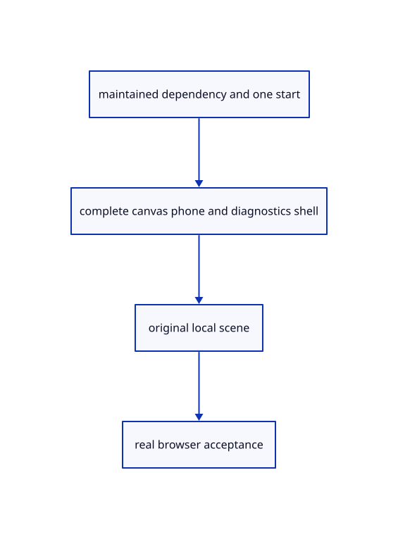

# Reference comparison · Compare with the maintained browser runtime

**Typing: 23–46 minutes.** [Estimate](typing-load.md).

Connect the current viewer, its complete browser shell and one original local scene together. The browser now runs the maintained camera, commands, input and rendering code; the earlier teaching implementation remains available in previous checkpoints.

## Type

Continue from [Draw original CAD wire curves](96zzzzzzzq-draw-original-cad-wire-curves.md). [Save or recover your work](recovery.md).

### 1. `Cargo.toml`

Use one maintained viewer dependency for native reference and browser startup.

<details>
<summary>Locate the existing block</summary>

```toml
[package]
name = "viewer_journey"
version = "0.1.0"
edition = "2024"

[lib]
crate-type = ["cdylib", "rlib"]

[workspace]

[dependencies]
wood = { path = "../../../../wood/rust" }
wasm-bindgen = "=0.2.128"
web-sys = { version = "=0.3.105", features = ["console", "Window", "Document", "Element", "HtmlCanvasElement", "EventTarget", "AddEventListenerOptions", "PageTransitionEvent", "ErrorEvent", "PromiseRejectionEvent", "Location", "History", "UrlSearchParams", "Navigator", "MediaQueryList", "Storage", "Performance", "PerformanceResourceTiming", "PerformanceEntry", "Event", "MouseEvent", "PointerEvent", "DomRect", "KeyboardEvent", "WheelEvent", "AddEventListenerOptions", "HtmlElement", "HtmlInputElement", "File", "FileList", "Blob", "ReadableWritablePair", "CustomEvent", "CustomEventInit", "FocusOptions", "Url", "HtmlAnchorElement", "AbortController", "AbortSignal", "RequestInit", "RequestMode", "RequestCache", "EventSource", "MessageEvent", "Response", "Headers", "ReadableStream", "ReadableStreamDefaultReader"] }
console_error_panic_hook = "=0.1.7"
prost = "=0.14.4"
sha2 = "=0.10.8"
uuid = { version = "=1.26.1", features = ["v4", "js"] }
js-sys = "=0.3.105"
wasm-bindgen-futures = "=0.4.78"
wgpu = "=29.0.4"
session_rust = { path = "../../../session_rust", default-features = false }
getrandom = { version = "=0.2.17", features = ["js"] }

egui = { version = "=0.34.3", default-features = false }
egui-wgpu = { version = "=0.34.3", default-features = false }

serde = { version = "1.0", features = ["derive"] }
serde_json = { version = "1.0", features = ["float_roundtrip"] }

glyphon = "=0.11.0"
anyhow = "=1.0.104"
ttf-parser = {version="=0.25.1",default-features=false}

serde_yaml_ng = "=0.10.0"
toml = { version = "=0.8.23", optional = true }

[features]
json-sessions = []
toml-manifests = ["dep:toml"]

[dev-dependencies]
pollster = "=0.4.0"
log = "=0.4.34"

[target.'cfg(not(target_arch = "wasm32"))'.dependencies]
current_viewer = { package = "session_viewer", path = "../.." }

[[example]]
name = "reference"
path = "src/reference_example.rs"

[[example]]
name = "inventory"
path = "src/inventory_example.rs"
```

</details>

Edit the existing block to match this code; keep unchanged lines:

```toml
[package]
name = "viewer_journey"
version = "0.1.0"
edition = "2024"

[lib]
crate-type = ["cdylib", "rlib"]

[workspace]

[dependencies]
current_viewer = { package = "session_viewer", path = "../.." }
wood = { path = "../../../../wood/rust" }
wasm-bindgen = "=0.2.128"
web-sys = { version = "=0.3.105", features = ["console", "Window", "Document", "Element", "HtmlCanvasElement", "EventTarget", "AddEventListenerOptions", "PageTransitionEvent", "ErrorEvent", "PromiseRejectionEvent", "Location", "History", "UrlSearchParams", "Navigator", "MediaQueryList", "Storage", "Performance", "PerformanceResourceTiming", "PerformanceEntry", "Event", "MouseEvent", "PointerEvent", "DomRect", "KeyboardEvent", "WheelEvent", "AddEventListenerOptions", "HtmlElement", "HtmlInputElement", "File", "FileList", "Blob", "ReadableWritablePair", "CustomEvent", "CustomEventInit", "FocusOptions", "Url", "HtmlAnchorElement", "AbortController", "AbortSignal", "RequestInit", "RequestMode", "RequestCache", "EventSource", "MessageEvent", "Response", "Headers", "ReadableStream", "ReadableStreamDefaultReader"] }
console_error_panic_hook = "=0.1.7"
prost = "=0.14.4"
sha2 = "=0.10.8"
uuid = { version = "=1.26.1", features = ["v4", "js"] }
js-sys = "=0.3.105"
wasm-bindgen-futures = "=0.4.78"
wgpu = "=29.0.4"
session_rust = { path = "../../../session_rust", default-features = false }
getrandom = { version = "=0.2.17", features = ["js"] }

egui = { version = "=0.34.3", default-features = false }
egui-wgpu = { version = "=0.34.3", default-features = false }

serde = { version = "1.0", features = ["derive"] }
serde_json = { version = "1.0", features = ["float_roundtrip"] }

glyphon = "=0.11.0"
anyhow = "=1.0.104"
ttf-parser = {version="=0.25.1",default-features=false}

serde_yaml_ng = "=0.10.0"
toml = { version = "=0.8.23", optional = true }

[features]
json-sessions = []
toml-manifests = ["dep:toml"]

[dev-dependencies]
pollster = "=0.4.0"
log = "=0.4.34"

[[example]]
name = "reference"
path = "src/reference_example.rs"

[[example]]
name = "inventory"
path = "src/inventory_example.rs"
```

<details>
<summary>Optional patch references</summary>

Use these original edit fragments when comparing a saved checkpoint. Apply the complete blocks above.

```text
--8<-- "journey/code/97-finish-with-the-maintained-browser-runtime-01.toml"
```

```text
--8<-- "journey/code/97-finish-with-the-maintained-browser-runtime-02.toml"
```

</details>

### 2. `src/lib.rs`

Give WebAssembly automatic startup to the maintained event loop.

Edit these blocks from bottom to top. Keep the surrounding lines unchanged.

<details>
<summary>Locate this block</summary>

```rust

#[cfg(test)]
mod inventory_tests;
#[cfg(test)]
mod ambient_shader_contract;
pub mod projection_lookup;
```

</details>

Replace it with:

```rust

#[cfg(test)]
mod inventory_tests;

#[cfg(target_arch="wasm32")]
#[wasm_bindgen]
pub fn start()->Result<(),wasm_bindgen::JsValue>{current_viewer::run_web()}
#[cfg(test)]
mod ambient_shader_contract;
pub mod projection_lookup;
```

<details>
<summary>Locate this block</summary>

```rust

use wasm_bindgen::prelude::*;

#[wasm_bindgen(start)]
pub fn start() {
    console_error_panic_hook::set_once();
```

</details>

Replace it with:

```rust

use wasm_bindgen::prelude::*;

#[cfg(not(target_arch="wasm32"))]
#[wasm_bindgen(start)]
pub fn start() {
    console_error_panic_hook::set_once();
```

<details>
<summary>Complete updated block reference</summary>

```rust
#[cfg(test)]
mod diagnostic_shape_tests;
pub mod load_measure;
#[cfg(test)]
mod load_measure_tests;
pub mod report_recency;
#[cfg(test)]
mod report_recency_tests;
pub mod report_store;
#[cfg(test)]
mod report_store_tests;
pub mod diagnostic;
pub mod adapter_info;
pub mod load_phase;
#[cfg(test)]
mod load_phase_tests;
#[cfg(test)]
mod adapter_info_tests;
pub mod suspension;
pub mod startup;
pub mod error_message;
#[cfg(test)]
mod error_message_tests;
#[cfg(test)]
mod startup_tests;
#[cfg(test)]
mod suspension_tests;
#[cfg(test)]
mod close_report_tests;
#[cfg(test)]
mod heartbeat_tests;
#[cfg(test)]
mod diagnostic_tests;
pub mod gpu_fault;
#[cfg(test)]
mod gpu_fault_tests;
pub mod background;
pub mod camera;
mod render_space;
#[cfg(test)] mod scene_origin_tests;
#[cfg(test)] mod camera_space_tests;
pub mod bounds;
pub mod memory;
pub mod stroke_gpu;
pub mod stroke;
pub mod chain;
pub mod marker;
pub mod controls;
#[cfg(test)]
mod control_parent_tests;
pub mod curve;
#[cfg(test)]
mod curve_input_tests;
#[cfg(test)]
mod curve_source_tests;
#[cfg(test)]
mod curve_sample_tests;
#[cfg(test)]
mod curve_layout_tests;
#[cfg(test)]
mod control_tests;
#[cfg(test)]
mod point_input_tests;
#[cfg(test)]
mod point_document_tests;
#[cfg(test)]
mod marker_tests;
#[cfg(test)]
mod path_input_tests;
#[cfg(test)]
mod path_placement_tests;
#[cfg(test)]
mod path_document_tests;
#[cfg(test)]
mod chain_link_tests;
#[cfg(test)]
mod chain_tests;
#[cfg(test)]
mod stroke_input_tests;
#[cfg(test)]
mod stroke_tests;
pub mod mesh;
pub mod normals;
pub mod normal_example;
pub mod grid;
#[cfg(test)]
mod grid_input_tests;
#[cfg(test)]
mod grid_source_tests;
#[cfg(test)]
mod normal_input_tests;

#[cfg(test)]
mod normal_view_tests;

#[cfg(test)]
mod normal_gpu_tests;
#[cfg(test)]
mod normal_matrix_tests;
#[cfg(test)]
mod normal_source_tests;
#[cfg(test)]
mod index_width_tests;
pub mod colour;
#[cfg(test)]
mod colour_input_tests;
#[cfg(test)]
mod colour_tests;
pub mod prepared;
pub mod row_metadata;
pub mod origin;
pub mod reload_url;
pub mod rehydrate;
pub mod reload_job;
pub mod edit_intent;
pub mod edit_replay;
pub mod reload_reply;
#[cfg(test)]
mod reload_reply_tests;
#[cfg(test)]
mod reload_complete_tests;
#[cfg(test)]
mod reload_precision_tests;
#[cfg(test)]
mod reload_failure_tests;
#[cfg(test)]
mod edit_owner_tests;
#[cfg(test)]
mod edit_scope_tests;
#[cfg(test)]
mod edit_move_tests;
#[cfg(test)]
mod edit_delete_tests;
mod edit_source;
#[cfg(test)]
mod origin_tests;
#[cfg(test)]
mod unload_tests;
#[cfg(test)]
mod rehydrate_tests;
pub mod placement;
#[cfg(test)]
mod line_scene_tests;
pub mod scene;
#[cfg(test)]
mod source_visibility_tests;
pub mod picking;
pub mod history;
pub mod recovery;
#[cfg(test)]
mod recovery_tests;
pub mod drawing_document;
pub mod editor;
pub mod offset;
pub mod viewport;
pub mod gesture;
pub mod shortcuts;
#[cfg(test)]
mod shortcuts_tests;

pub mod navigation;

#[cfg(test)]
mod document_phase_tests;
pub mod revision;
pub mod document;
pub mod read_gate;
pub mod specimen;
#[cfg(test)]
mod document_tests;
#[cfg(test)]
mod fit_tests;
#[cfg(test)]
mod move_tests;
#[cfg(test)]
mod prepared_tests;
#[cfg(test)]
mod source_tests;
#[cfg(test)]
mod file_identity_tests;
#[cfg(test)]
mod snapshot_tests;
#[cfg(test)]
mod placement_load_tests;
#[cfg(test)]
mod save_roundtrip_tests;
#[cfg(test)]
mod replace_tests;
#[cfg(test)]
mod imported_source_tests;
#[cfg(test)]
mod placement_tests;
#[cfg(test)]
mod selected_fit_tests;
#[cfg(test)]
mod projection_tests;
#[cfg(test)]
mod navigation_tests;
#[cfg(test)]
mod gesture_tests;
pub mod geometry_cache;
pub mod gpu_geometry;
pub mod packed_vertex;
pub mod arena_spans;
mod arena_rows;
pub mod mesh_arena;
pub mod object_record;
#[cfg(test)]
mod geometry_storage_tests;
#[cfg(test)]
mod object_record_tests;
#[cfg(test)]
mod mesh_arena_tests;
#[cfg(test)]
mod arena_rows_tests;
pub mod browser_defaults;
#[cfg(test)]
mod browser_defaults_tests;
#[cfg(test)]
mod display_rgba_tests;
#[cfg(test)]
mod packed_vertex_tests;
mod primitive_image;
mod frame_targets;
pub mod gpu_mesh;
pub mod sample_quality;
#[cfg(all(test,not(target_arch="wasm32")))]
#[path="sample_positions_tests.rs"]
mod sample_positions_tests;
pub mod renderer;
pub mod depth;
#[cfg(target_arch = "wasm32")]
mod browser_reload;
#[cfg(target_arch = "wasm32")]
mod browser_network;
#[cfg(target_arch = "wasm32")]
mod source_fetch;
#[cfg(target_arch = "wasm32")]
mod browser_recovery;
#[cfg(target_arch = "wasm32")]
mod browser;
#[cfg(target_arch = "wasm32")]
mod file_input;
#[cfg(target_arch = "wasm32")]
mod file_output;

use wasm_bindgen::prelude::*;

#[cfg(not(target_arch="wasm32"))]
#[wasm_bindgen(start)]
pub fn start() {
    console_error_panic_hook::set_once();
    #[cfg(target_arch = "wasm32")]
    wasm_bindgen_futures::spawn_local(async {
        if let Err(error) = browser::run().await {
            browser_report::fatal(&format!("Cannot draw: {error:?}"));
            browser::report(&format!("Cannot draw: {error:?}"));
        }
    });
}

#[cfg(any(test, target_arch = "wasm32"))]
mod command_dock;

#[cfg(test)]
#[path = "command_dock/tool_buttons_tests.rs"]
mod tool_buttons_tests;
#[cfg(any(test, target_arch = "wasm32"))]
mod command_vocabulary;
pub mod feature_owner;
#[cfg(test)]
mod feature_owner_tests;
#[cfg(test)]
mod projected_fit_tests;
#[cfg(test)]
mod instance_feature_tests;
#[cfg(test)]
mod copy_feature_tests;
#[cfg(test)]
mod feature_pick_tests;
#[cfg(test)]
mod feature_style_tests;

#[cfg(target_arch = "wasm32")]
mod panel;
#[cfg(target_arch = "wasm32")]
mod listeners;
#[cfg(target_arch = "wasm32")]
mod browser_runtime;
#[cfg(target_arch = "wasm32")]
mod browser_report;
#[cfg(target_arch = "wasm32")]
pub mod report_storage;
#[cfg(target_arch = "wasm32")]
mod timer;
#[cfg(target_arch = "wasm32")]
mod browser_rebase;
#[cfg(target_arch = "wasm32")]
mod report_lifecycle;
#[cfg(target_arch = "wasm32")]
mod browser_startup;
#[cfg(target_arch = "wasm32")]
mod browser_errors;
#[cfg(target_arch = "wasm32")]
mod browser_adapter;
#[cfg(target_arch = "wasm32")]
mod browser_upload;
#[cfg(target_arch = "wasm32")]
mod browser_phase;

pub mod pick_window;

#[cfg(test)]
mod pick_window_tests;

pub mod gpu_layout;

pub mod pick_pipeline;

mod pick_image;

pub mod pick_gpu;

mod pick_encode;

#[cfg(target_arch = "wasm32")]
pub mod browser_pick;

#[cfg(test)]
mod pick_input_tests;

pub mod pick_gate;
pub mod pick_view;
#[cfg(test)]
mod pick_view_tests;

pub mod mesh_parts;
pub mod mesh_pens;

#[cfg(test)]
mod mesh_parts_tests;

pub mod sub_id;
pub mod pick_sources;

pub mod selection;

#[cfg(test)]
mod pick_sources_tests;

pub mod face_pick;

pub mod highlight;

#[cfg(test)]
mod selection_tests;

pub mod object_selection;

#[cfg(test)]
mod object_selection_tests;

#[cfg(test)]
mod multi_selection_tests;

pub mod commands;

#[cfg(test)]
mod commands_tests;

pub mod tool_coords;
#[cfg(test)]
mod tool_coords_tests;

pub mod tool;

pub mod tool_preview;

#[cfg(test)]
mod tool_tests;

#[cfg(test)]
mod selection_cycle_tests;

pub mod snap;

pub mod snap_math;

pub mod snap_sources;

pub mod snap_bins;

pub mod snap_index;

#[cfg(test)]
mod snap_tests;

pub mod edit_preview;

#[cfg(test)]
mod edit_preview_tests;

pub mod gizmo;

#[cfg(test)]
mod gizmo_tests;

pub mod widget_mesh;

pub mod widget_layout;

pub mod widget_pipelines;

pub mod widget;

#[cfg(test)]
mod widget_tests;

pub mod part_preview;

pub mod gizmo_edit;

pub mod number_box;

#[cfg(test)]
mod gizmo_edit_tests;
#[cfg(test)]
mod number_box_tests;

pub mod hierarchy;

pub mod tree_panel;

pub mod tree_specimen;

#[cfg(test)]
mod hierarchy_tests;

pub mod view_flags;

pub mod layer_properties;

pub mod layer_edit;

pub mod layer_palette;

#[cfg(test)]
mod view_flags_tests;

#[cfg(test)]
mod layer_edit_tests;

#[cfg(test)]
mod layer_ui_tests;

pub mod rect_select;

#[cfg(test)]
mod rect_select_tests;

pub mod canvas_drag;

pub mod touch;

#[cfg(test)]
mod navigation_complete_tests;

#[cfg(test)]
mod shortcut_focus_tests;

pub mod surface;

#[cfg(test)]
mod surface_tests;

pub mod cad_edges;

pub mod cad_boundary;

#[cfg(test)]
mod cad_boundary_tests;

pub mod cad_samples;

#[cfg(test)]
mod cad_trim_tests;

pub mod cad_seams;

#[cfg(test)]
mod cad_seam_tests;

pub mod cad_orient;

pub mod cad_face;

pub mod cad_display;

#[cfg(test)]
mod cad_display_tests;

pub mod text;

pub mod text_atlas;

pub mod text_example;

#[cfg(test)]
mod text_atlas_tests;

pub mod scene_label;

pub mod scene_label_screen;

pub mod text_gpu_support;
#[cfg(test)]
mod growing_buffer_tests;

pub mod scene_text_gpu;

pub mod text_fonts;

#[cfg(test)]
mod scene_label_tests;

pub mod outline_math;

pub mod outline_gpu;

#[cfg(test)]
mod outline_math_tests;

pub mod cloud;

pub mod cloud_lod;

#[cfg(test)]
mod cloud_tests;

pub mod cloud_normals;

pub mod cloud_gpu;

pub mod cloud_pick;

#[cfg(test)]
mod cloud_pick_tests;

pub mod manifest;

pub mod live_revision;

pub mod source_validate;

pub mod archive;

pub mod geometry_snapshot;

pub mod scene_archive;

pub mod archive_identity;

pub mod archive_document;

pub mod archive_presentation;

pub mod document_source;

pub mod document_geometry;

pub mod scene_document;

pub mod archive_restore_texts;

pub mod archive_restore_flags;

pub mod publication;

pub mod scene_manifest;

pub mod publication_route;

pub mod publication_index;

#[cfg(target_arch = "wasm32")]
pub mod publication_fetch;

#[cfg(target_arch = "wasm32")]
pub mod browser_publication;

pub mod stream;

pub mod range_gate;

pub mod range_rules;

pub mod range_page;

#[cfg(target_arch = "wasm32")]
pub mod range_fetch;

pub mod range_source;

pub mod page_cache;

pub mod stream_generation;

pub mod stream_budget;

pub mod stream_properties;

pub mod range_cloud;

pub mod range_example;

#[cfg(test)]
mod stream_row_tests;

pub mod source_encoding;

#[cfg(target_arch = "wasm32")]
pub mod source_unpack;

#[cfg(target_arch = "wasm32")]
pub mod stream_load;

pub mod range_shape;

pub mod instance_plan;
mod instance_features;

pub mod instance_definition;

pub mod instance_snapshot;

pub mod instance_specimen;

#[cfg(test)]
mod instance_scene_tests;

pub mod instance_members;
mod instance_gpu;

pub mod cad_shape_key;

pub mod cad_shape_cache;

pub mod cad_shape_example;

pub mod nested_placement;

pub mod nested_example;

#[cfg(test)]
mod nested_placement_tests;

pub mod sheet_entity;

pub mod sheet_example;

#[cfg(target_arch="wasm32")]
pub mod sheet_entity_fetch;

pub mod sheet_page;

pub mod sheet_stream;

pub mod sheet_source;

pub mod sheet_range;

pub mod sheet_lookup;

pub mod sheet_pipeline;

pub mod sheet_gpu;

#[cfg(target_arch="wasm32")]
pub mod browser_sheet;

#[cfg(test)]
mod sheet_scene_tests;

pub mod cplane;

pub mod drawing_coords;

pub mod drawing_input;

#[cfg(test)]
mod drawing_tests;

pub mod planar;

#[cfg(test)]
mod planar_tests;

pub mod primitive_options;

pub mod primitive_shape;

pub mod primitive_box;

pub mod primitive_pyramid;

pub mod primitive_block_with_hole;

pub mod primitive_tetrahedron;

pub mod primitive_octahedron;

pub mod primitive_icosahedron;

pub mod primitive_dodecahedron;

pub mod primitive_draft;

pub mod primitive_geometry;

pub mod primitive_registry;

#[cfg(test)]
mod primitive_tests;

pub mod round_cylinder;

pub mod round_cone;

pub mod round_sphere;

pub mod round_torus;

pub mod round_capsule;

pub mod round_quad_sphere;

#[cfg(test)]
mod round_tests;

pub mod freeform_circle;

pub mod freeform_ellipse;

pub mod freeform_arc;

pub mod freeform_parabola;

pub mod freeform_curve;

#[cfg(test)]
mod freeform_tests;

pub mod transform_scale;

pub mod transform_rotate;

pub mod source_controls;
#[cfg(test)]
mod original_control_tests;

pub mod source_deform;

pub mod source_topology_colour;

pub mod transform_draft;

pub mod source_part;

pub mod transform_commands;

#[cfg(test)]
mod transform_tests;

pub mod gather_input;

pub mod surfacing;

pub mod extrude_geometry;

pub mod revolve_geometry;

pub mod gather_draft;

pub mod gather_registry;

#[cfg(test)]
mod gather_tests;

pub mod loft_geometry;

pub mod nurbs_loft_geometry;

pub mod sweep1_geometry;

pub mod sweep2_geometry;

#[cfg(test)]
mod loft_tests;

pub mod network_geometry;

pub mod patch_geometry;

#[cfg(test)]
mod network_tests;

pub mod project_geometry;

pub mod source_cut;

pub mod extend_reach;

pub mod interval_geometry;

pub mod source_edit;

pub mod project_draft;

pub mod extend_draft;

pub mod editing_commands;

#[cfg(test)]
mod editing_tests;

pub mod split_geometry;

pub mod split_draft;

#[cfg(test)]
mod split_tests;

#[cfg(test)]
mod split_face_tests;

pub mod measure_math;

pub mod measure_length;

pub mod measure_area;

pub mod measure_volume;

pub mod bounds_original;

pub mod measure_mark;

pub mod measure_gpu;

#[cfg(test)]
mod measure_tests;

pub mod trim_parts;

pub mod explode_geometry;

pub mod text_geometry;

pub mod curve_heads;

pub mod selection_region;

pub mod source_shape;

pub mod plane_original;

pub mod selection_query;

pub mod explode_edit;

pub mod text_draft;

pub mod guide_gpu;

pub mod trim_draft;

pub mod lasso;

pub mod graph_edit;

pub mod group_plan;

pub mod command_request;

#[cfg(test)]
mod command_inventory_tests;

#[cfg(test)]
mod command_owner_tests;

#[cfg(test)]
mod command_fetch_tests;

#[cfg(test)]
mod lasso_geometry_tests;

pub mod tile_math;

pub mod browser_tiles;

pub mod tile_report;

pub mod tile_pipelines;

pub mod tile_gpu;

pub mod finite_sources;

pub mod finite_ink;
pub mod ink_ranges;
#[cfg(test)]
mod view_command_tests;
#[cfg(test)]
mod cad_wire_tests;

#[cfg(test)]
mod tile_shader_tests;

#[cfg(test)]
mod tile_gpu_tests;

#[cfg(test)]
mod finite_visibility_tests;

pub mod clipping_geometry;

pub mod clipping_rows;

pub mod clipping_uniform;

pub mod clipping_input;

pub mod clipping_tool;

pub mod clipping_gpu;

#[cfg(test)]
mod clipping_source_tests;

#[cfg(test)]
mod clipping_gpu_tests;

#[cfg(test)]
mod clipping_uniform_tests;

pub mod solid_orientation;

pub mod solid_cache;

pub mod cap_bounds;

pub mod cap_source_bounds;

pub mod cap_image;

pub mod cap_geometry;
mod cap_pipeline;

pub mod cap_pick_pipeline;

pub mod cap_pick_gpu;

pub mod caps_gpu;

#[cfg(test)]
mod cap_gpu_tests;

pub mod pyramid_size;

pub mod pyramid_image;

pub mod pyramid_pipeline;

pub mod pyramid_gpu;

pub mod ambient_radius;

pub mod ambient_camera;

pub mod ambient_rows;

pub mod ambient_source_pipeline;

pub mod ambient_source_gpu;

pub mod ambient_image;

pub mod ambient_images;

pub mod ambient_pipeline;

pub mod ambient_groups;

pub mod ambient_pass;

pub mod ambient_gpu;

#[cfg(test)]
mod arctic_tests;
#[cfg(test)]
mod surface_controls_tests;

pub mod outline_caps;

pub mod outline_composite;

#[cfg(test)]
mod global_outline_command_tests;

pub mod element_values;

pub mod element_beam;

pub mod element_column;

pub mod element_plate;

pub mod element_support;

pub mod element_beam_variable;

pub mod element_block;

pub mod element_original;

pub mod element_input;

pub mod element_draft;

pub mod element_adopt;

#[cfg(test)]
mod element_tests;

#[cfg(test)]
mod opacity_command_tests;

pub mod comparison;

#[cfg(not(target_arch="wasm32"))]
pub mod reference_frame;

#[cfg(test)]
mod comparison_tests;

pub mod bench_config;

pub mod bench_samples;

pub mod bench_compare;

pub mod tree_witness;

#[cfg(test)]
mod bench_tests;

pub mod source_metadata;

pub mod definition_merge;

pub mod registry_audit;

pub mod source_audit;

#[cfg(test)]
mod metadata_tests;

pub mod feature_plan;

pub mod feature_display;

pub mod interaction_example;

#[cfg(test)]
mod interaction_bridge_tests;

#[cfg(test)]
mod inventory_tests;

#[cfg(target_arch="wasm32")]
#[wasm_bindgen]
pub fn start()->Result<(),wasm_bindgen::JsValue>{current_viewer::run_web()}
#[cfg(test)]
mod ambient_shader_contract;
pub mod projection_lookup;
mod finite_project_source;
#[cfg(test)]
mod finite_scan_contract;
#[cfg(test)]
mod finite_tiles_contract;
pub mod source_mesh_topology;

#[cfg(target_arch="wasm32")]
#[wasm_bindgen]
pub fn validate_source_json(text: &str) -> Result<(), JsValue> {
    source_validate::json(text).map_err(|error| JsValue::from_str(&error))
}

mod shader_check;
mod surface_view;
#[cfg(test)]
mod cloud_shader_contract;

mod draw_slots;
mod object_rows;
mod primitive_slot_table;
mod slot_space;
#[cfg(test)] mod draw_slots_tests;
#[cfg(test)] mod primitive_slot_table_tests;

#[cfg(test)] mod source_phase_tests;

#[cfg(test)]
mod current_command_tests;

#[cfg(test)]
mod full_source_action_tests;

#[cfg(test)]
mod camera_reverse_tests;

#[cfg(test)]
mod camera_reference_tests;
#[cfg(test)]
mod camera_defaults_tests;

#[cfg(test)]
mod grid_hardware_tests;

#[cfg(test)]
mod camera_analytic_ray_tests;

#[cfg(test)]
mod camera_depth_reach_tests;

#[cfg(test)]
mod camera_navigation_tests;

mod sample_pipelines;
mod surface_pipelines;

#[cfg(all(test,not(target_arch="wasm32")))]
mod sample_test_proof;
```

</details>

<details>
<summary>Optional patch references</summary>

Use these original edit fragments when comparing a saved checkpoint. Apply the complete blocks above.

```text
--8<-- "journey/code/97-finish-with-the-maintained-browser-runtime-03.rs"
```

```text
--8<-- "journey/code/97-finish-with-the-maintained-browser-runtime-04.rs"
```

</details>

### 3. `view_local.yaml`

Name the original local comparison scene for the maintained route.

Create the file and type:

```yaml
--8<-- "journey/code/97-finish-with-the-maintained-browser-runtime-05.yaml"
```

### 4. `index.html`

Connect maintained browser inputs, diagnostics, status and local assets.

<details>
<summary>Locate the existing block</summary>

```html
<head>
  <meta charset="utf-8">
  <meta name="viewport" content="width=device-width, initial-scale=1">
  <title>Session Viewer</title>
  <link data-trunk rel="rust">
  <link data-trunk rel="copy-dir" href="assets/text" data-target-path="text">
  <link data-trunk rel="copy-dir" href="assets/pb" data-target-path="assets/pb">
  <style>
    html, body { width: 100%; height: 100%; margin: 0; overflow: hidden; }
    canvas { display: block; width: 100%; height: 100%; outline: none; background: #fff; }
    #status:not([hidden]) { position: fixed; bottom: 32px; left: 8px; right: 8px; margin: 0; padding: 8px; background: white; font: 14px system-ui; }
  </style>
</head>
<body>
  <p id="status" role="status" hidden>Waiting for Rust…</p>
  <canvas id="canvas" tabindex="0" width="640" height="480" aria-label="Viewer drawing"></canvas>
  <input id="open" type="file" accept=".pb,.session" hidden>
</body>
</html>
```

</details>

Edit the existing block to match this code; keep unchanged lines:

```html
--8<-- "journey/code/97-finish-with-the-maintained-browser-runtime-06.html"
```

### 5. `src/browser_runtime.rs`

The maintained viewer owns the JavaScript `reload_scene` entry point. Keep the earlier teaching helper callable from Rust, but remove its `#[wasm_bindgen]` export attribute so packaging emits one JavaScript name. The function body stays unchanged. The maintained viewer also owns browser startup; the older teaching auto-start remains disabled.

Replace the complete earlier `reload_scene` function and its export attribute with:

```rust
--8<-- "journey/code/97-finish-with-the-maintained-browser-runtime-07.rs"
```

The original native check and WASM compilation passed, but the optimized package failed while generating JavaScript because both crates exported the same name. The corrected wrapper passes fresh WASM compilation, optimized packaging and its complete original maintained browser contract at DPR 1 and 2 on the recorded NVIDIA adapter. Both actual pedestal images were individually reviewed. This accepts checkpoint 97; broader feature and final release gates remain separate. [Source-bound recovery and browser proof](release/maintained97-export-recovery-review.json).


## Run and check

Run this from `session_viewer` to select the fixed dependency versions and install supplied binary assets. It updates Cargo.lock and preserves the previous lock. It does not write implementation code:

```sh
npm --prefix ../session_tests run course -- dependencies 97-finish-with-the-maintained-browser-runtime
```

In your project:

```sh
cd workspace/journey
REGEN_PROTO=0 cargo build --lib --locked --target wasm32-unknown-unknown -j1
REGEN_PROTO=0 CARGO_BUILD_JOBS=1 trunk serve --port 8780
```

Open `http://127.0.0.1:8780/`. Keep an existing Trunk server running; saving rebuilds it.

Serve the final maintained-runtime bundle on localhost with ?inspect=1&nogrid=1. It loads four original solids and one generated nameplate. Exercise commands, selection, history and release against the maintained inspection attributes; the supplied reference example separately renders a native frame.

### Recorded visual result

**Previous native render — current verification pending.**

The native teaching comparison retains its original blue pedestal and black boundaries. This illustration is not a browser screenshot or a pixel-equivalence claim.


*This recorded image predates a source or checker change. Rebuild this checkpoint before using it as current evidence; browser controls require separate acceptance.*

This reference image is shared with [19.3.3 · Fit original box corners to the free canvas](96u-fit-original-box-corners-to-the-free-canvas.md). It does not demonstrate a new feature by itself.

<details>
<summary>Code explanation and diagram</summary>


maintained dependency and one start → complete canvas phone and diagnostics shell → original local scene → real browser acceptance.



Can the event loop handoff be verified before its browser shell is ready?

Compile the complete handoff together. The maintained event loop owns automatic WebAssembly startup, while its canvas, phone input, status, error panel and assets are present in the same runnable endpoint. Compilation still does not establish browser acceptance.

Study estimate, including typing and experiments: 0.5–1 hours.

</details>

<details>
<summary>Optional experiment</summary>

Use the current-viewer exercise: check independent Element toggles, nested interaction rows and parent lamp state. Close finishes an active polyline; an empty-manifest replacement exercises release. Record command answers and inspect retained source counts.

</details>

<details>
<summary>Check and save your work</summary>

Restore experimental edits, then run from `session_viewer`:

```sh
npm --prefix ../session_tests run course -- check 97-finish-with-the-maintained-browser-runtime
npm --prefix ../session_tests run course -- save 97-finish-with-the-maintained-browser-runtime
```

Source comparison leaves your project untouched. [Save and recovery instructions](recovery.md).

</details>

<details>
<summary>Viewer coverage and verification</summary>

The browser destination now links this checkout’s maintained viewer directly. Its reverse-depth renderer, camera, input, panels, command actions and original geometry owners execute without the earlier teaching adapters. [Source inventory](inventory.md) records the declared current Rust closure; [final handoff](final-handoff.md) separates native/build evidence, the historical final Chrome contract at its recorded source, and remaining current browser/visual/hardware acceptance.

[October 9 behavior](current-viewer.md): independent layer lamps, panel selection Fit, Element Attributes Off and Element Interactions On. The dated comparison preserves the earlier baseline; browser and handwritten-runtime coverage remain separate. Read [remaining implementation differences](rendering-differences.md) before claiming cumulative handwritten parity.

Keep all 809 supplied native fixtures. The native reference example renders the maintained pipeline from original scene bytes. The historical final browser contract has Chrome evidence at both pixel densities for its original source; it does not accept the current export-corrected wrapper. The remaining handwritten bridges and broader visual/device acceptance must pass before retiring the earlier reference.

The historical maintained-runtime record, before the 2026-10-24 export correction, passed in visible Chrome 153.0.8010.36 at DPR 1 and 2: command ownership, shortcuts, Element and bounding-box history, panel width, orbit/zoom, Close rejection outside drawing, three-point Close with a 1,200 mm perimeter and identity-preserving Undo/Redo, empty-manifest release, and actual blue geometry with black boundaries. Broader visual parity and Lenovo performance remain separate.

[Full validation scope](release.md).

To reproduce the scripted acceptance of the reference checkpoint, run from `session_viewer` with the [course bundle server](release.md#reproduce) running on port 8781:

```sh
npm --prefix ../session_tests run course -- capture 97-finish-with-the-maintained-browser-runtime
```

This uses the verified reference bundle; it does not check or change your typed project.

</details>
