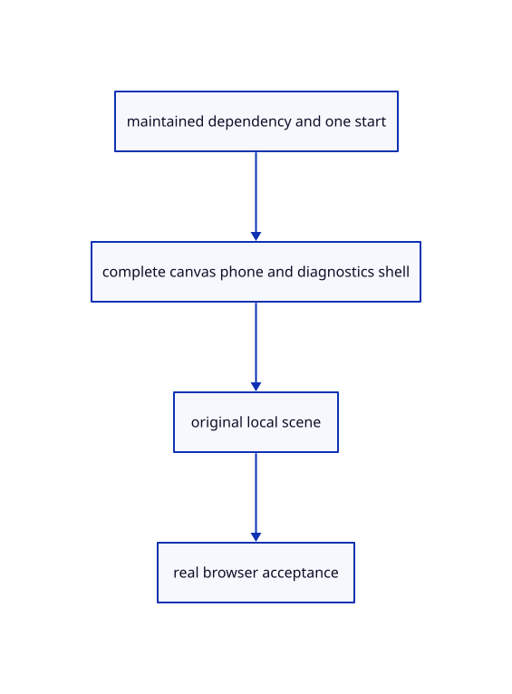

# Reference comparison · Compare with the maintained browser runtime

**Typing: 23–46 minutes.** [Estimate](typing-load.md).

Connect the current viewer, its complete browser shell and one original local scene together. The browser now runs the maintained camera, commands, input and rendering code; the earlier teaching implementation remains available in previous checkpoints.

Use the [maintained command grammar](current-command-grammar.md) for this comparison. Wood-specific Element construction tools from earlier chapters are historical teaching examples and are absent from the maintained viewer registry. Loaded kernel Elements and their `Element Attributes` and `Element Interactions` controls remain supported.

## Type

This appendix compares the learner program with the maintained runtime. It does not complete the remaining handwritten implementation.

### 1. `Cargo.toml`

Replace the `png` dependency line with these two entries, making the maintained viewer a normal dependency.

```toml
--8<-- "journey/code/97-finish-with-the-maintained-browser-runtime-cumulative-kernel-feature-0.toml"
```

Remove the native-only dev-dependency section containing the previous `current_viewer` entry. Keep all other dependencies.

### 2. `view_local.yaml`

Create the local launch configuration:

```yaml
--8<-- "journey/code/97-finish-with-the-maintained-browser-runtime-05.yaml"
```

### 3. `index.html`

Replace the complete existing head element, including its opening and closing tags, with this startup and asset configuration:

```html
--8<-- "journey/code/97-finish-with-the-maintained-browser-runtime-06.html"
```

### 4. `src/browser_runtime.rs`

Replace the exported `reload_scene` function with this maintained-runtime dispatch. Keep the surrounding exports.

```rust
--8<-- "journey/code/97-finish-with-the-maintained-browser-runtime-07.rs"
```

### 5. `src/lib.rs`

Remove the tutorial `entry` and `registration` module declarations together with their path and wasm-target attributes. Replace that six-line registration block with this nonautomatic export:

```rust
--8<-- "journey/code/97-maintained-reference-startup-registration.rs"
```

The dependency owns the page's automatic startup. This export keeps the maintained runtime linked without automatically invoking a second constructor. The tutorial entry and finished mathematics files remain available and unchanged; they are not registered by this reference appendix. The default production startup needs no feature change.

## Run and check

Run this from `session_viewer` to select the fixed dependency versions and install supplied binary assets. It updates Cargo.lock and preserves the previous lock. It does not write implementation code:

```sh
npm --prefix ../session_tests run course -- dependencies 97-finish-with-the-maintained-browser-runtime
```

In your project:

```sh
cd workspace/journey
REGEN_PROTO=0 cargo build --lib --locked --target wasm32-unknown-unknown -j1
REGEN_PROTO=0 CARGO_BUILD_JOBS=1 trunk serve --port 8780
```

Open `http://127.0.0.1:8780/`. Keep an existing Trunk server running; saving rebuilds it.

Serve the final maintained-runtime bundle on localhost with ?inspect=1&nogrid=1. It loads four original solids and one generated nameplate. Exercise commands, selection, history and release against the maintained inspection attributes; the supplied reference example separately renders a native frame.

### Recorded visual result

Run the maintained endpoint at `http://127.0.0.1:8780/?inspect=1&nogrid=1`; the diagram below shows its browser-runtime handoff.

<details>
<summary>Code explanation and diagram</summary>


maintained dependency and one start → complete canvas phone and diagnostics shell → original local scene → real browser acceptance.



Can the event loop handoff be verified before its browser shell is ready?

Compile the complete handoff together. The maintained event loop owns automatic WebAssembly startup, while its canvas, phone input, status, error panel and assets are present in the same runnable endpoint. Compilation still does not establish browser acceptance.

Study estimate, including typing and experiments: 0.5–1 hours.

</details>

<details>
<summary>Optional experiment</summary>

Use the current-viewer exercise: check independent Element toggles, nested interaction rows and parent lamp state. Close finishes an active polyline; an empty-manifest replacement exercises release. Record command answers and inspect retained source counts.

</details>

<details>
<summary>Check and save your work</summary>

Restore experimental edits, then run from `session_viewer`:

```sh
npm --prefix ../session_tests run course -- check 97-finish-with-the-maintained-browser-runtime
npm --prefix ../session_tests run course -- save 97-finish-with-the-maintained-browser-runtime
```

Source comparison leaves your project untouched. [Save and recovery instructions](recovery.md).

</details>

<details>
<summary>Viewer coverage and verification</summary>

The browser destination now links this checkout’s maintained viewer directly. Its reverse-depth renderer, camera, input, panels, command actions and original geometry owners execute without the earlier teaching adapters. [Source inventory](inventory.md) records the declared current Rust closure; [final handoff](final-handoff.md) separates native/build evidence, the historical final Chrome contract at its recorded source, and remaining current browser/visual/hardware acceptance.

[October 9 behavior](current-viewer.md): independent layer lamps, panel selection Fit, Element Attributes Off and Element Interactions On. The dated comparison preserves the earlier baseline; browser and handwritten-runtime coverage remain separate. Read [remaining implementation differences](rendering-differences.md) before claiming cumulative handwritten parity.

Keep all 809 supplied native fixtures. The native reference example renders the maintained pipeline from original scene bytes. The earlier browser contract and the later export-recovery record each bind their own source and inputs; neither automatically accepts subsequent changes. The remaining handwritten bridges and broader visual/device checks must pass before retiring the reference.

The historical maintained-runtime record, before the 2026-10-24 export correction, passed in visible Chrome 153.0.8010.36 at DPR 1 and 2: command ownership, shortcuts, Element and bounding-box history, panel width, orbit/zoom, Close rejection outside drawing, three-point Close with a 1,200 mm perimeter and identity-preserving Undo/Redo, empty-manifest release, and actual blue geometry with black boundaries. Broader visual parity and Lenovo performance remain separate.

[Full validation scope](release.md).

To reproduce the scripted acceptance of the reference checkpoint, run from `session_viewer` with the [historical course bundle server](../archived/journey-release-evidence.md#reproduce) running on port 8781:

```sh
npm --prefix ../session_tests run course -- capture 97-finish-with-the-maintained-browser-runtime
```

This uses the verified reference bundle; it does not check or change your typed project.

</details>
