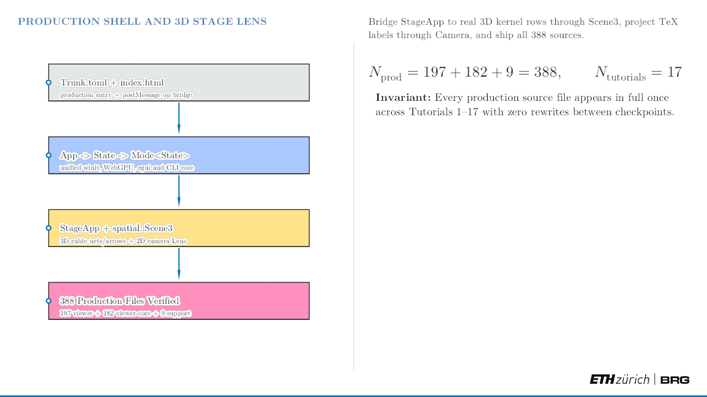

# Cumulative viewer course

Build the Session Viewer across **17 complete, code-first tutorials** (`408` whole-file `--8<--` source includes: `197` `session_viewer/src` files, `182` `viewer-core/src` files, `9` support files, `.cargo/config.toml`, `13` course checkpoint entries, and `6` `session_mcp` FastMCP files), backed by **9 acyclic cumulative Cargo assemblies** (`frame` through `application`).



## 17 Tutorials (Sequential Reading Order)

| # | Tutorial | Assembly | Full-file includes | Visible / verified result |
| --- | --- | --- | --- | --- |
| 1 | [Project architecture and browser initialization](tutorial-one-startup.md) | `frame` | `14` | `viewer-core` + `session_viewer` workspace and `#canvas` loop |
| 2 | [WebGPU and `wgpu` initialization](tutorial-two-wgpu.md) | `frame` | `9` | `256 MiB` device, first-error latch, reverse-Z/MSAA/ID targets |
| 3 | [Rendering engine and shared shaders](tutorial-three-rendering.md) | `rows` | `19` | `build.rs` `#include` assembly, `PRELUDE`, bind groups `0..=3` |
| 3.1 | [Compositing `egui` shapes and text](tutorial-three-painting.md) | `painting` | `2` | `egui` overlay tessellation and deferred texture-free pass |
| 3.2 | [Laying out and animating 2D mathematics](tutorial-three-mathematics.md) | `mathematics` | `23` | `1600×900` OpenType MATH, rounded 2D matrices, `24×0.30` arrows |
| 4 | [Geometry and scene data structures](tutorial-four-geometry.md) | `rows` / `geometry` | `75` | `20 B` vertices, arenas, ribbons, arrows, `112 B` `Instance` rows |
| 5 | [Camera and navigation](tutorial-five-camera.md) | `camera` / `application` | `10` | `f64` camera rebasing, reverse-Z orbit/pan/zoom, `State` hub |
| 6 | [Object creation and transformations](tutorial-six-modeling.md) | `application` | `79` | `86`-spec `REGISTRY`, `CPlane`, `OSnap`, `0`-step preview, `Undo` |
| 7 | [Picking and selection](tutorial-seven-picking.md) | `application` | `14` | Hover + click `Rg32Uint` ID window and unified `SelectionState` |
| 8 | [Gumball widget and interactive handles](tutorial-eight-gumball.md) | `geometry` / `application` | `8` | 13-handle `World`/`Object`/`CPlane` gizmo and single-commit drag |
| 9 | [Layers, hierarchy, panels and instancing](tutorial-nine-layers.md) | `geometry` / `application` | `25` | Virtualized `Layers`/`Properties`/`Graph` panels and `InstanceRef` |
| 10 | [Display modes: outlines, Arctic SSAO, attributes and scene text](tutorial-ten-display.md) | `geometry` / `application` | `30` | Coverage-mask silhouettes, GTAO `ssao.wgsl`, `glyphon` text lanes |
| 11 | [Point clouds, octree LOD and sheets](tutorial-eleven-clouds.md) | `geometry` / `application` | `17` | Frustum-culled octree (`lod_px = 2.0`), EDL splats, `250k` chunks |
| 12 | [Transparency, finite-triangle tile visibility and section caps](tutorial-twelve-visibility.md) | `geometry` / `application` | `14` | `atomicMax` tile depth, prefix-sum visibility, `Alpha`, section caps |
| 13 | [Command dock, completion, history and native CLI](tutorial-thirteen-commands.md) | `dock` / `application` | `17` | Decoupled `command_dock`, phone IME, and `session-viewer-cli` |
| 14 | [Shared `Op` API, browser `execute_op` and FastMCP server](tutorial-fourteen-fastmcp.md) | `dock` / `application` | `10` | `49` serde `Op`s (`4,076 ops/s`), WASM bridge, Python `session_mcp` |
| 15 | [File formats, bounded protobuf decode, `.session` archives and live reload](tutorial-fifteen-formats.md) | `decoding` / `application` | `23` | `<= 512 MiB` wire validation, canonical `.session`, ETag/SSE reload |
| 16 | [Performance tiers, GPU timing, diagnostics and headless self-tests](tutorial-sixteen-performance.md) | `rows` / `application` | `11` | `[p50, p95, p99]` `FrameStats`, `PassTimer`, and `selftest::oracle` |
| 17 | [Complete application reconstruction and real-scene stage](tutorial-seventeen-application.md) | `application` | `8` | `StageApp + spatial::Scene3` 3D stage lens and `388/388` parity |

## Materialize any cumulative assembly

From `session_tests`, materialize any of the 9 acyclic Cargo assemblies (`frame`, `painting`, `mathematics`, `dock`, `camera`, `rows`, `geometry`, `decoding`, `application`) into a fresh directory:

```sh
npm run course -- checkpoint frame ../session_viewer/target/learn-frame
npm run course -- active-audit
npm run course -- teaching
```

Build and serve using the shared cache and guards in [Maintaining](../maintaining.md). Checkpoint `application` emits the complete `388`-file production workspace (`production.html`).

## Acceptance

All `9` subjects in [active-course.json](active-course.json) are marked `"acceptance": "pending"` until reviewed in a hardware WebGPU browser and on physical mobile devices (the Linux build host's Chromium WebGPU adapter renders black). Native and compilation gates are verified at HEAD:

- `course -- active-audit`: `passed: true` (`0` failures, `0` missing, `0` extra, `0` rewritten files across all 9 assemblies).
- `course -- teaching`: `388 / 388` production and support files bound by SHA-256 to their owning `Tutorial 1`–`Tutorial 17` explanations (`0` missing, `0` errors).
- `cargo check --target wasm32-unknown-unknown -j8` (`0` warnings), `cargo xtest -j8` (`626` passed, `0` failed), `pytest ../session_mcp/tests/test_mcp_parity.py` (`3/3` passed), and `DOCS_STRICT_LINKS=1` Vite production build (`0` errors).

## Historical reconstruction

[Historical contents](contents.md), [checkpoint progress](roadmap.md) and the [former route](../archived/cumulative-route-20261115.md) preserve `course.json` (`npm run course -- historical-list`) and the archived `00`–`37` lessons under `docs/archived/`.
