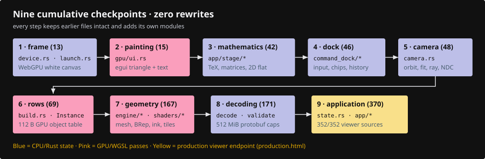

# Cumulative viewer course

Build the Session Viewer across nine cumulative Rust and `wgpu` checkpoints. Every checkpoint compiles and runs, keeps earlier implementations in place, and adds only its own modules and declared registrations.



## Subjects

| # | Tutorial | ID | Files | Visible output |
| --- | --- | --- | --- | --- |
| 1 | [Open a GPU frame](completion-frame.md) | `frame` | `13` | Cleared white WebGPU canvas |
| 2 | [Paint shapes and text](completion-painting.md) | `painting` | `15` | `egui` pink triangle and bottom-left label |
| 3 | [Lay out and animate mathematics](completion-mathematics.md) | `mathematics` | `41` | `1600×900` TeX equations, matrices and tweens |
| 4 | [Enter commands](completion-dock.md) | `dock` | `45` | Persistent command bar, history and option chips |
| 5 | [Project and fit a scene](completion-camera.md) | `camera` | `47` | Perspective orbit, ray unprojection and bounds fit |
| 6 | [Place and update object rows](completion-rows.md) | `rows` | `68` | `112 B` GPU `Instance` table and inspector |
| 7 | [Render kernel geometry](completion-geometry.md) + [Visibility](completion-visibility.md) | `geometry` | `166` | Shaded meshes, BRep ink, curves, matrices and SSAO |
| 8 | [Decode a document](completion-decoding.md) | `decoding` | `170` | Bounded `512 MiB` protobuf validation and decode |
| 9 | [Run the application](completion-application.md) (+ 9 chapters) | `application` | `369` | Full `351/351` production viewer (`production.html`) |

## Materialize any checkpoint

From `session_tests`, list or materialize any checkpoint into a new directory without overwriting existing files:

```sh
npm run course -- list
npm run course -- checkpoint frame ../session_viewer/target/learn-frame
```

Build and serve using the shared cache and guards in [Maintaining](../maintaining.md). Checkpoint `application` builds `production.html`.

## Acceptance

The route is **incomplete**. Eight of its nine executable subjects are accepted: frame, painting, mathematics, dock, camera, rows, geometry and decoding. Application remains pending. [Evidence](release.md) and each lesson record native, wasm and browser scope separately from physical-device verification.

`course -- teaching` verifies all `359` source-bound prose witnesses across all `351` Rust/WGSL files and `8` support files (`Cargo.toml`, `Cargo.lock`, `build.rs`, `Trunk.toml`, `index.html`, `assets/diagnostics.js`, `assets/text-quality.html`, `assets/view_local.yaml`), with `17` binary/font/licence exclusions in [completion-asset-exclusions.json](completion-asset-exclusions.json). Open items for whole-course completion are the [application GPU instancing comparison](release/completion-application-gpu-diagnostic-windows-20261116.json) (`31` pixels differing by `3` levels vs `<= 2`), physical-device runs, and `Save` JSON whitespace/key normalization; see [production reconciliation](release/completion-production-reconciliation-20261118.json) and [stage reconciliation](release/completion-stage-reconciliation-windows-20261118.json).

## Historical reconstruction

[Historical contents](contents.md), [checkpoint progress](roadmap.md) and the [former route](../archived/cumulative-route-20261115.md) preserve `course.json` (`npm run course -- historical-list`) and its `1,298` historical checkpoints unchanged.
