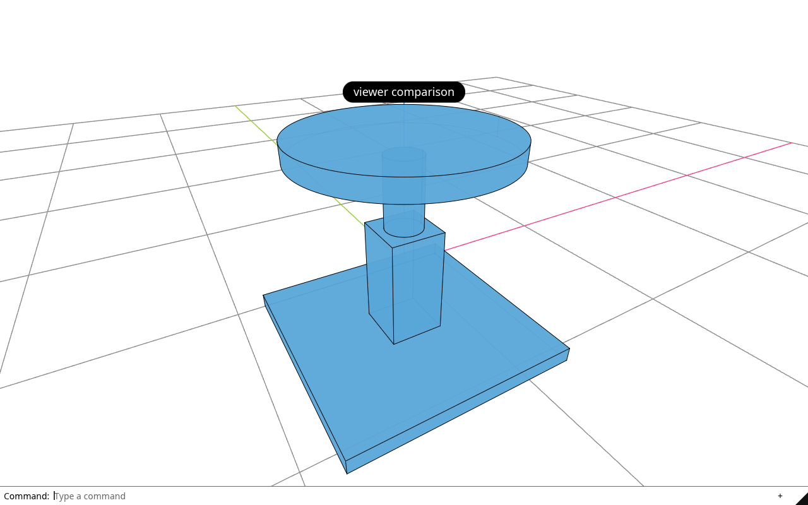
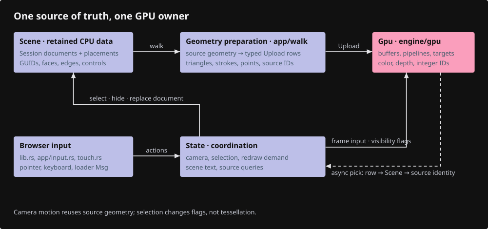

# Run the application

Wire all eight subsystems into the concrete `App` / `State` host (`src/app/runtime.rs`, `src/state.rs`) and build the standalone `production.html` viewer (`351/351` production Rust/WGSL files).





## Prerequisites and ownership

Requires [8. Decode a document](completion-decoding.md). Checkpoint `application` (`369` files: `351` files under `src/`, `8` build/browser support files, and `10` retained course example files) completes source parity with `session_viewer`:

| Core host file | Role |
| --- | --- |
| [src/app/runtime.rs](../../src/app/runtime.rs) | `App: ApplicationHandler<Msg>` lifecycle, panel-before-scene event routing, `Box<dyn Mode<State>>` dispatch and `100 ms`-throttled resize. |
| [src/state.rs](../../src/state.rs) | Single owner of `Arc<Window>`, `Gpu`, `Camera`, `Scene`, `Selection` and `Features` across async message boundaries. |
| [src/state/features.rs](../../src/state/features.rs) | Hook tables (`BEFORE_PICK`, `TAKE_PICK`, `AFTER_PICK`, group expansion) decoupling drags, drafts, splits and queries from the event loop. |
| [Trunk.toml](../../Trunk.toml), [index.html](../../index.html), [assets/view_local.yaml](../../assets/view_local.yaml) | Production release bundler (`production.html` in the checkpoint), early asset prefetcher, diagnostics hook and scene manifest. |

Nine focused chapters document every subsystem wired into `State`:

1. [9.1 Documents, hierarchy and history](completion-documents.md) — `Scene`, `(doc, GUID)` rows, `Footprint`, `256 MiB` undo tombs, layers and archives.
2. [9.2 Commands, tools and editing](completion-commands.md) — `Spec` / `Action` / `Draw` verb registry, `Move` preview and section planes.
3. [9.3 Route input and select geometry](completion-input.md) — pointer/gesture priority, multi-touch, IME keyboard agent and generation-stamped GPU picks.
4. [9.4 Construct and edit geometry](completion-modeling.md) — `CPlane`, screen-binned snaps, `Recipe` primitives, NURBS surfacing, split/trim/extend and measurements.
5. [9.5 Load without blocking the viewer](completion-loading.md) — `window.__viewerEarly`, generation-guarded `loader`, `RangeGate` and on-demand hydration.
6. [9.6 Keep scene labels readable](completion-text.md) — `glyphon` shaping reuse, world-plane/plate text, async full-font fallback and `text-quality.html`.
7. [9.7 Bound large scenes and live updates](completion-streaming.md) — HTTP `Range` clouds/sheets, out-of-core point/side-table picking and ETag/`EventSource` live sync.
8. [9.8 Mathematics in the real scene](stage-scene.md) — `Scene3` row sync, `2×4` camera label lens and `D_N x_N = p - D_F x_F` cable-net decks.
9. [9.9 Explain a failed frame](completion-debugging.md) — `diagnostics.js`, `inspect=1`, headless `selftest` ray/ID oracles and GPU parity diagnostics.

## Build

Build the Vue docs once, materialize `application`, and package `production.html` with Trunk:

```sh
DOCS_STRICT_LINKS=1 DOCS_BASE=/docs/ npm --prefix ../session_tests run build -- --outDir ../session_viewer/target/docs/vue --emptyOutDir
npm --prefix ../session_tests run course -- checkpoint application ../session_viewer/target/learn-application
trunk build production.html
```

### One owner for changing state

- `src/app/runtime.rs` implements `ApplicationHandler<Msg>`: panels consume events before scene shortcuts, `Box<dyn Mode<State>>` temporarily moves out during callbacks to avoid double mutable borrows, `FramePacing` prevents submission backlogs, and `State::resize` throttles target rebuilds to `100 ms`.
- `src/state.rs` holds `Arc<Window>`, `Gpu`, `Camera`, `Scene` and `Selection` in one struct mutated exclusively on the event loop thread via `EventLoopProxy<Msg>`, preserving user camera navigation if `State::append` finishes after the camera moved from its load-start pose.

```rust
--8<-- "session_viewer/src/app/mode.rs:application-mode"
```

### Register state and frame responsibilities

`src/state/features.rs` stores cross-frame interaction state (`Draft`, `ObjectDrag`, pending splits, cloud/sheet query generations, `Snap` and `Hierarchy`) and dispatches ordered `TAKE_PICK` hooks so active drags claim delayed GPU picks before ordinary selection runs.

### Package the browser entry and its dependencies

- `Trunk.toml` configures release builds, relative `public_url`, pre-build Vue docs generation, watch paths (`../session_rust`, `docs`), and `Cache-Control: no-store` on the dev index HTML.
- `index.html` (materialized as `production.html` alongside the course's `index.html`) mounts `#viewer`, starts `window.__viewerEarly` fetches ahead of `.wasm`, loads `diagnostics.js`, copies `stage/`, `decks/`, `text/` and `docs/`, and handles same-origin `postMessage` scene reloads.
- `assets/view_local.yaml` lists default local scene URLs, display names, `xform`/`at` instance placements and `point_size` overrides resolved relative to the active manifest route.

## Run and observe

Serve the built `dist/` directory with a scene manifest pointing to available `.pb` fixtures:

- Orbit with right-drag, pan with middle-drag, scroll to zoom, and run `Fit` or `View Orthographic` in the bottom command dock.
- Typing letters in the dock (`Fit`, `Layers All`) never triggers single-key scene shortcuts.

## Predict and try

Start loading a large local `.pb` scene, orbit the camera before the transfer finishes, and predict whether completion snaps the camera back: `Msg::Fit` compares current pose against the saved load-start pose and preserves your orbit until you explicitly run `Fit`.

## Question and answer

**Why post decoded `Session` results through `EventLoopProxy<Msg>` instead of holding `&mut State` inside the `async` fetch future?**
Holding `&mut State` across `.await` would block input and rendering for the entire network/decode duration; `Msg` serializes adoption atomically with pointer events and frame submission.

## Validation

- **Passing**: `351/351` exact production source parity (`0` missing, `0` extra, `0` rewrites), locked `wasm32` tutorial + production Trunk builds, `609` default native tests (`60` ignored), and `8` desktop/upright browser captures ([production reconciliation](release/completion-production-reconciliation-20261118.json)).
- **Pending (`acceptance: pending`)**: In the [37-test GPU run](release/completion-application-gpu-windows-20261116.json), `36` pass and `1` fails (`instanced_frames_match_the_baked_scene`: [diagnostic](release/completion-application-gpu-diagnostic-windows-20261116.json) reproduces `31` pixels differing by `3` channel levels vs `<= 2` in the turned scene). That assertion and physical-device verification remain open.
