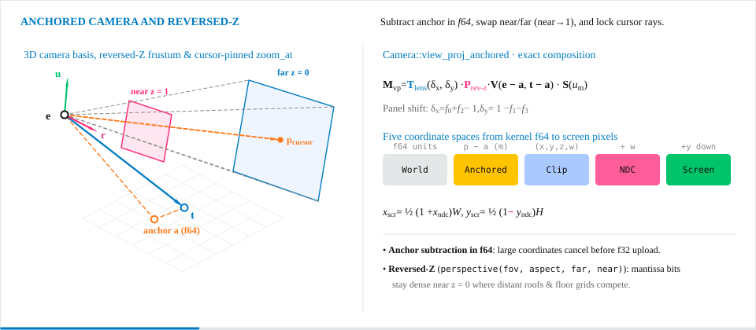

# Project and fit a scene

Orbit, pan, zoom toward the cursor, toggle perspective/orthographic projection, and fit `3D` bounds inside the unobstructed viewport using the production `src/camera.rs` math.




## Prerequisites and ownership

Requires [4. Enter commands](completion-dock.md). This fifth cumulative subject is reviewed against native tests, locked `wasm32` builds and desktop/upright WebGPU interactions. Checkpoint `camera` (`48` files) retains Tutorials 1–4 and adds `2` files:

| Added file | Role |
| --- | --- |
| [src/camera.rs](../../viewer-core/src/camera.rs) | Anchor-relative `f64` view/projection matrices, reversed-Z `[1..0]` depth, cursor-preserving `zoom_at`, world rays and panel-aware `fit_in`. |
| [examples/course/camera.rs](../../examples/course/camera.rs) | Projects `8` `session_rust::Point` cube corners and `12` edges onto the canvas with orbit/zoom/fit controls. |

## Build

Materialize checkpoint `camera` or add `src/camera.rs` and `examples/course/camera.rs` step by step:

```sh
npm --prefix ../session_tests run course -- checkpoint camera ../session_viewer/target/learn-camera
```

### Step 1. Store camera pose in `f64` meters (`src/camera.rs`)

Create `src/camera.rs` and declare `pub mod camera;` in `src/lib.rs`. Store `target`, `position`, `distance` and quaternion `orientation` in `f64` meters so large architectural coordinates never lose precision during orbit or pan:

```rust
--8<-- "session_viewer/viewer-core/src/camera.rs:camera-pose"
```

### Step 2. Compose anchor-relative view and reversed-Z projection

Subtract `anchor` from `eye` and `target` in `f64` before building `view`, swap `far` and `near` in `Xform::perspective(fov, aspect, far, near)` so `near` maps to `z = 1.0` and `far` maps to `z = 0.0` (reversed-Z), and pre-multiply the unobstructed panel `lens` translation:

```rust
--8<-- "session_viewer/viewer-core/src/camera.rs:camera-projection"
```

### Step 3. Lock the cursor ray in `zoom_at` and frame bounds in `fit_in`

`src/camera.rs` implements quaternion `orbit` (world-up yaw + right-axis pitch), distance-scaled `pan`, world `ray` unprojection, `fit_in` across all `8` `AABB` corners inside `frame`, and cursor-locked `zoom_at`, which shifts `target` by `(1 - k)` times the cursor's offset on the target plane so the point under the cursor never drifts:

```rust
--8<-- "session_viewer/viewer-core/src/camera.rs:204:230"
```

### Step 4. Project the `8`-corner wireframe cube (`examples/course/camera.rs`)

Write `examples/course/camera.rs` and register `("camera", camera::start)` in `examples/course/registration.rs`, flipping NDC `+Y` (up) into screen `+Y` (down) via `(1.0 - ndc[1]) * 0.5 * height`:

```rust
--8<-- "session_viewer/examples/course/camera.rs:course-camera"
```

## Run and observe

Serve the checkpoint and open `http://127.0.0.1:8780/?tutorial=camera`:

- Drag or press arrow keys to orbit; scroll the wheel to zoom around the cursor point.
- `P` switches perspective and orthographic projection; `F` fits the cube inside the viewport (including `390×844`); `Home` restores orthographic isometric fit.

## Predict and try

Orbit `20°` off-axis and press `P`: predict which cube edges converge toward a vanishing point in perspective versus staying parallel in orthographic projection, then verify both modes in the browser.

## Question and answer

**Why does screen mapping negate the normalized `y` coordinate (`(1.0 - ndc.y) * 0.5 * height`)?**
Clip/NDC `+Y` points up, whereas canvas/egui pixel `+Y` points down from the top-left corner; omitting the sign flip mirrors the `3D` scene vertically.

## Validation

Verified by `48`-file locked `wasm32` build ([stage reconciliation](release/completion-stage-reconciliation-windows-20261118c.json)), `33` passing baseline native tests (`1` GPU test ignored), `5`-subject retention tests, and desktop/upright orbit, zoom, projection and fit checks on Intel Gen-12LP ([camera receipt](release/completion-camera-windows-20261115.json)). Physical-phone touch testing remains separate.
